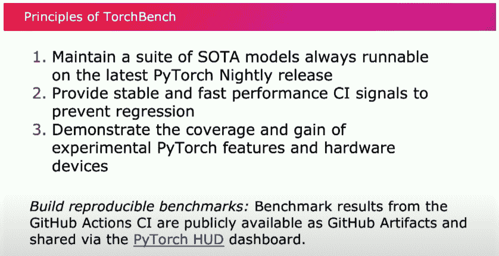
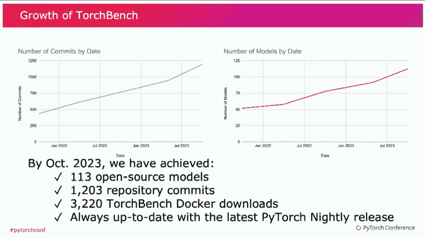
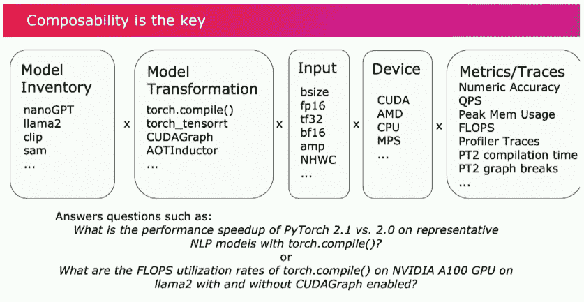
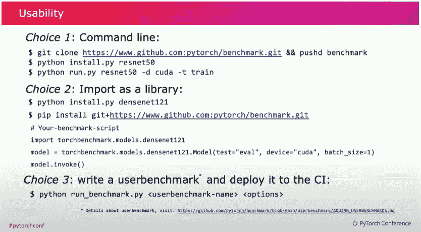
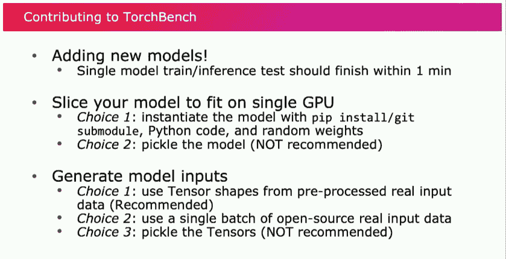
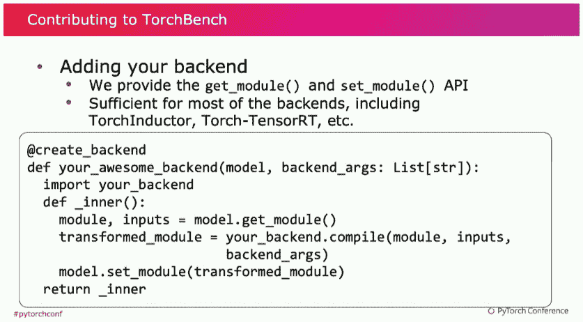
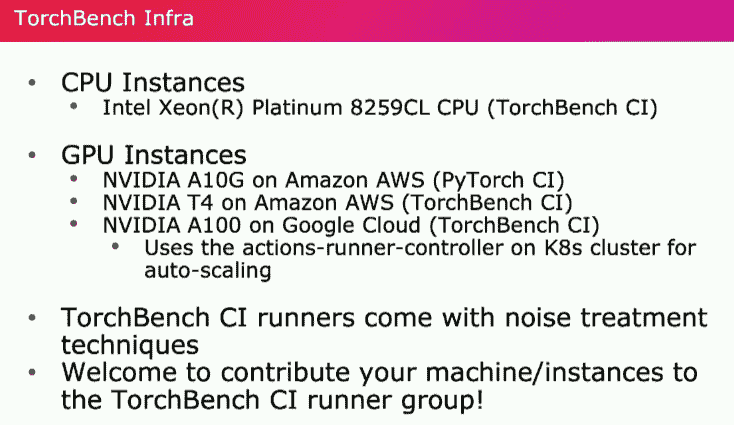
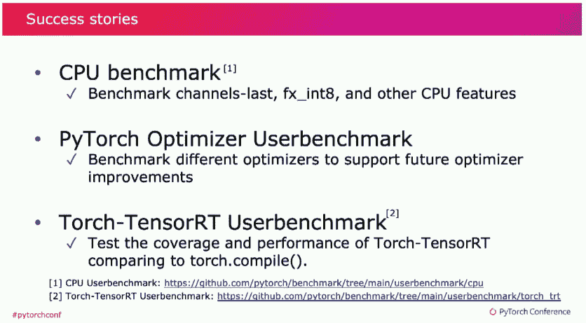
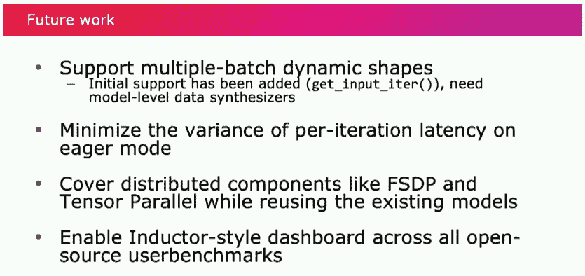
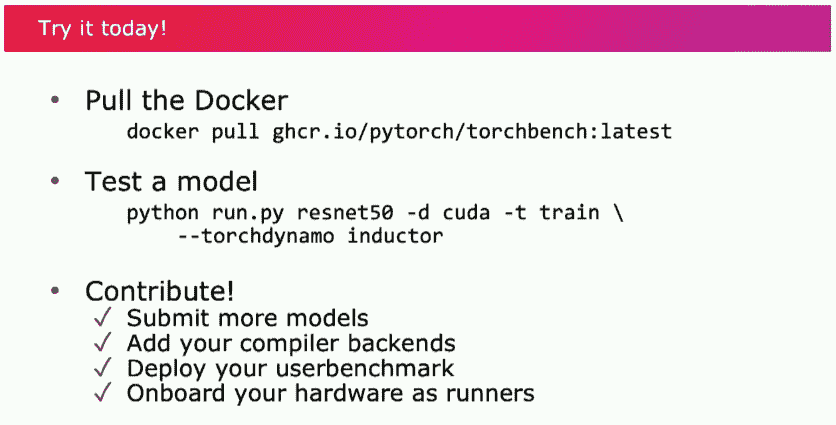

# CI for AI system

> 来源：[https://learning.feishu.cn/docx/HSPwdyZIDoZKIxxJ03tcrJH6nMg](https://learning.feishu.cn/docx/HSPwdyZIDoZKIxxJ03tcrJH6nMg)

https://hud.pytorch.org/benchmark/compilers

1.  TorchBench: Guarding the Performance

1.  very good CI infra

# TorchBench: Guarding the Performance

https://www.youtube.com/watch?v=CRqkcAQv0T4

TorchBench: Guarding the Performance of the PyTorch Ecosystem with Continuous Benchmarking - Xu Zhao, Meta

noise treatment:

1.  CPU runners: 隔离 cpu core，防止进程间相互影响。

1.  GPU runners: tune the freq, 保证结果的稳定性。

