# Nvidia TensorCore

> 来源：[https://learning.feishu.cn/docx/BVs4dwmbFoP2hKxrrmUci3kRnae](https://learning.feishu.cn/docx/BVs4dwmbFoP2hKxrrmUci3kRnae)

# Introduction

## TensorCore 历史概述

| 序号 | 时间 | 架构 | 异步数据搬运机制 | 编程模型 &amp; 计算指令 | 数据类型 | 里程碑意义 |
| --- | --- | --- | --- | --- | --- | --- |
| 1 | 2017 | Volta (V100) | 无异步机制 | Warp 级 wmma 指令 | FP16 | 开启混合精度计算，第 1 代 TensorCore |
| 2 | 2018 | Turing (T4) | 同 Volta 架构 | 同 Volta 架构 | + int8, int4, int1 | 低精度推理，推动 AI 推理普及 |
| 3 | 2020.05 | Ampere (A100) | 软件管理的异步拷贝 | Warp 级 mma.sync，可编程 Thread 级数据排布 | + fp32, bf16 | 大幅提升 FP32 训练性能，结构化稀疏 |
| 4 | 2022.03 | Hopper (H100) | 硬件 TMA | thread block 级 wgmma &amp; 硬件 TMA | + fp8 | 引入FP8和动态精度切换，为 LLM 训练优化 |
| 5 | 2024.03 | Blackwell (B200) | 专用的 Tensor Memory | 跨SM协作的 UTCMMA.2SM &amp; Tensor Memory | + fp4, fp6 | 专为万亿参数LLM推理和训练设计 |

## 演进的核心脉络

3 个关键优化点：

1.  内存能力。核心是异步数据搬运机制 & 内存层级设计。AsyncCopy -> 硬件 TMA -> Tensor Memory。

1.  数据格式。越来越丰富，特别是 FP8 / FP4 的引入。

1.  编程模型。提升并行层级：Warp (mma)  => Thread Block (wgmma)  => 跨 SM (UTCMMA.2SM)。

# 计算指令的演进

待补充：指令 shape & 单指令算力 flops。

AI Compiler，比如 Triton。不需要支持 wmma 指令。用 mma 足以取代 wmma 的功能。

## MMA & WMMA - A100

都是 warp level 的执行模型。

H100 之前，并存的 2 个主要指令。

MMA 指令特性:

+   线程级控制：支持手动控制线程级别的数据排布和寄存器分配。

+   灵活性高，性能好。支持自定义数据布局优化。

+   编程复杂度：高，需要显式管理寄存器分配和数据流水。

WMMA 指令特性

+   封装抽象：封装了完整的 Shared Memory → MMA → Shared Memory 流程。

+   易用性优先：降低编程门槛，适合快速原型开发。

+   灵活性限制：难以规避 SMEM bank conflict，性能优化空间有限，无法自定义数据排布。

尽管 mma 是通过一个 warp 去调度实现的，但还是粒度为线程级别时更容易编写。

以下场景 WMMA 无法实现，但 MMA 支持：

1.  数据排布优化：自定义Shared Memory → MMA的swizzle layout

1.  计算融合：将elementwise操作直接融合到MMA累加寄存器

1.  复杂数据重用：实现更高效的数据局部性优化

指令文档：https://docs.nvidia.com/cuda/cuda-c-programming-guide/index.html#warp-matrix-functions

wmma 内部分成了如下多条指令

```
void load_matrix_sync(fragment&lt;...&gt; &amp;a, const T* mptr, unsigned ldm);
void load_matrix_sync(fragment&lt;...&gt; &amp;a, const T* mptr, unsigned ldm, layout_t layout);
void store_matrix_sync(T* mptr, const fragment&lt;...&gt; &amp;a, unsigned ldm, layout_t layout);
void mma_sync(fragment&lt;...&gt; &amp;d, const fragment&lt;...&gt; &amp;a, const fragment&lt;...&gt; &amp;b, const fragment&lt;...&gt; &amp;c, bool satf=false);
```

*_sync 类的指令，等待所有 warp lanes 都 barrier.arrived。

load_matrix_sync 和 mma_sync，需要 warp 内所有 thread 都调用，否则结果未定义。

store_matrix_sync 不要求 warp 内所有 thread 都调用。（比如，warp reduce 之后，只需要 store 1 element）

## WGMMA - H100

H100 引入 wgmma，4 个连续的 warp 可以组成一个 warp group。

只有 TMA + wgmma 才能打满 TensorCore 理论算力。

内存层次优化

传统路径: SMEM → RF → TensorCore (存在 RF 瓶颈)

WGMMA路径: SMEM → TensorCore (直接访问 SMEM，消除 RF 瓶颈)

核心优势：

+   消除瓶颈：绕过寄存器文件，直接 SMEM → TensorCore

+   能效提升：减少数据移动，降低指令开销和功耗

+   编程简化：减少显式数据搬移指令

+   规模扩展：支持更大矩阵运算，warp group 协同计算

From https://llvm.org/devmtg/2025-04/slides/technical_talk/ozen_blackwell.pdf

Page 21

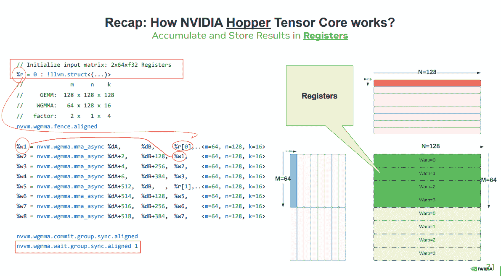

PTX 中有 4 条 WGMMA 相关的指令:

+   wgmma.mma_async。异步的计算指令，执行时间不确定（因为要读 shared memory）

+   wgmma.fence。确保 fence 前所有 MMA 完成后再发射后续 MMA。(比如多条 mma 在 K 方向累加)

+   wgmma.commit_group。将之前发射的异步 MMA 打包成一个 group 提交。便于跟踪一组相关计算任务。

+   wgmma.wait_group。等待指定数量 N 的未完成计算组。N=0 等待所有组完成。N 是常数。

完整执行流程

```
// 1. 数据准备
Load matrices A, B, D to registers or shared memory;

// 2. 内存同步（fence operations）
wgmma.fence;                    // 确保 warp group 内 register/shared-memory 数据可见
fence.proxy.async;              // 使通用代理操作对 async proxy 可见

// 3. 异步计算
wgmma.mma_async;                // 在 async proxy 中 Issue 矩阵乘加

// 4. 组提交
wgmma.commit_group;             // 打包提交所有未决的 MMA 操作。Create a wgmma-group and commit all the prior outstanding wgmma.mma_async operations into the group

// 5. 等待完成  
wgmma.wait_group;               // 等待指定组完成

// 6. 结果就绪
// 所有 wgmma.mma_async 操作已完成
```

关键约束条件

+   A 矩阵：Register 或 Shared Memory

+   B 矩阵：必须从 Shared Memory 直接读取

+   矩阵形状（fp16 示例）：

+   M = 64 (固定)

+   K = 16 (固定)

+   N = 8~256 (8的倍数，编译时常数，设置在指令 encoding 中。不能运行时修改)

SASS 层是 HGMMA 指令。

推测：一条 wgmma 执行时，在一个SM内部，矩阵A是被切分为4组，每一组是16*16，分别执行在对应4个tensor core上；而矩阵B是需要被4个tensor core共享的，所以它只能放在 shared memory 上。

如果采用 mma 指令，则需 4 条 MMA.m16n8k16 指令。所以，wgmma 可以减少指令数。

```
// 一条Tensor core PTX指令wgmma(64n8k16)
wgmma.mma_async.sync.aligned.m64n8k16.f16.f16.f16

// 对应三条SASS指令
WARPGROUP.ARRIVE
HGMMA.64x8x16.F16
WARPGROUP.DEPBAR.LE
```

## UTCMMA.2SM - B200

B200 引入。

Blackwell GEMM https://mp.weixin.qq.com/s/HgXWsNa5xkKQ_gmNgmRvbQ

# TensorCore 架构设计 - 原理科普

每 cycle 完成的计算：D = A * B + C

常见的，matmul 算子的输入 & 输出，都是 FP16 类型。

底层的 PTX 指令，一般是 fp16 输入 + fp32 输出，以避免累加时精度丢失。

## 向量乘 FMA：1 行 * 1 列

FMA 指令，实现 D = A * B + C

绿色是 register。

1.  横的是 16 bit-register，存 input or 中间数据

1.  竖的是 32 bit-register，存 累积结果 or 中间高精度数据

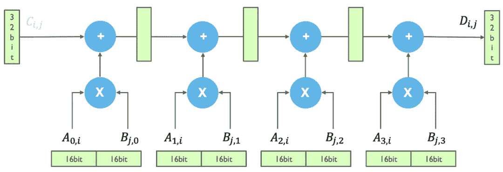

2 个核心加速点：

1.  所有的乘法，可以并行触发，并行计算。单周期完成。

1.  所有的加法，树形归约 Reduction Tree。N 个 加法，只需要   步完成。看硬件的频率设定，1 个 cycle 可能完成多步。

## 矩阵乘 MMA - M 行 * N 列

1.  1 个蓝色方块，就是上面的 一行 * 一列的 电路。每个蓝色方块对应一个输出位置。输出 shape 是 4*4 矩阵。

1.  A 和 B 矩阵的 register，也按二维矩阵设计。每个 cycle，广播 A 的一行，B 的一列到对应的蓝色方块上。

1.  所有 16 个蓝色方块，可在同一 cycle 启动计算，完成各自的 FMA 计算。

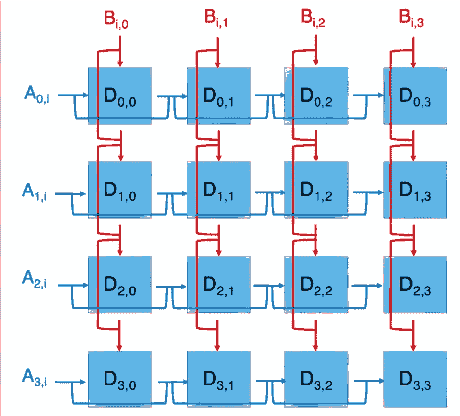

阵列的核心加速点：单周期完成数据分发。

硬连线的广播网络，无冲突的数据访问。A 行数据→水平广播，B 列数据→垂直广播。

```
         A 矩阵寄存器 (FP16)                  B 矩阵寄存器 (FP16)
              ↓  ↓  ↓  ↓                        → → → →
           +-----------------+              +-----------------+
Row 0 → | A00 → PE00/01/02/03 |        | B00 → PE00/10/20/30 | ← Col 0
Row 1 → | A10 → PE10/11/12/13 |        | B11 → PE01/11/21/31 | ← Col 1
Row 2 → | A20 → PE20/21/22/23 |        | B22 → PE02/12/22/32 | ← Col 2
Row 3 → | A30 → PE30/31/32/33 |        | B33 → PE03/13/23/33 | ← Col 3
           +-----------------+              +-----------------+
```

# Nvidia TensorCore 分析

## Volta - V100 架构

### 调度流程

Volta 架构，1 个 SM 有 4 个 sub-core。

每个 sub-core 有：

+   2 个 TensorCore

+   1 组 CudaCore。（图中的 FP 和 INT 单元）

+   1 个 warp scheduler，跑 1 个 warp。（图中 subcore 图的第 2 行）

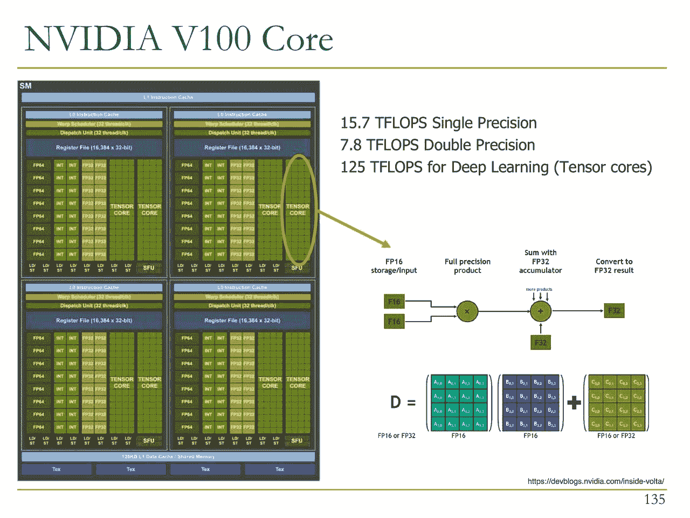

sm 内的执行流程：

1.  Warp Scheduler 向 Tensor Core 发送矩阵乘法 GEMM 运算指令

1.  **Tenso**r Core 接收来自寄存器文件的输入矩阵（A、B、C），

1.  执行多次 **4x4x4** 矩阵乘法操作，直至完成整个矩阵乘法

1.  将结果矩阵写回寄存器文件(Register File)

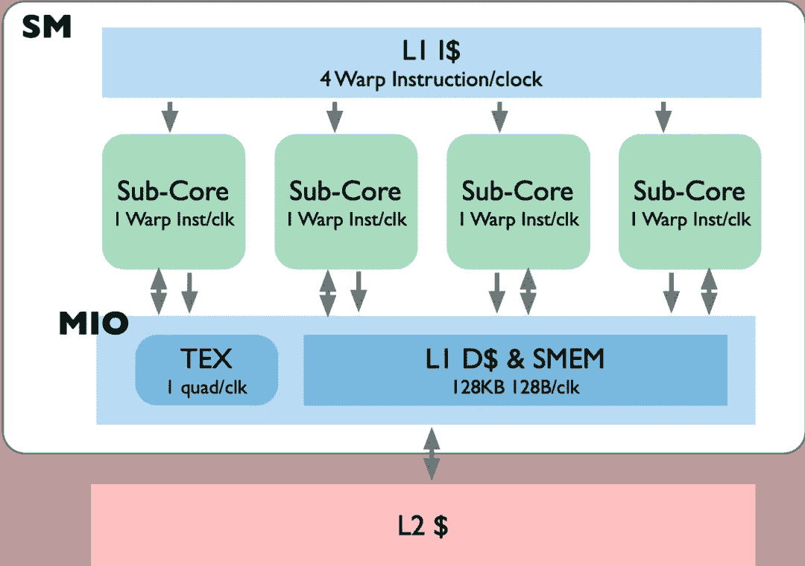

subcore 内部的架构，如下图

顶部依然是 L1 Cache，紧随其后的是 L0 Cache，也就是 Register File。

Register File 负责将数据传输到 Warp Scheduler，然后是 Warp Scheduler 做指令调度。

1.  CUDACore 的计算，Warp Scheduler 通过 Math Dispatch Unit 分发指令。

1.  TensorCore 的计算，Warp Scheduler 直接触发。

subcore 的 2 个 TensorCore 并行计算，结果写回 Register File。

Register File 通过 MIO 的 Data Pipeline 与 Shared Memory 通讯。

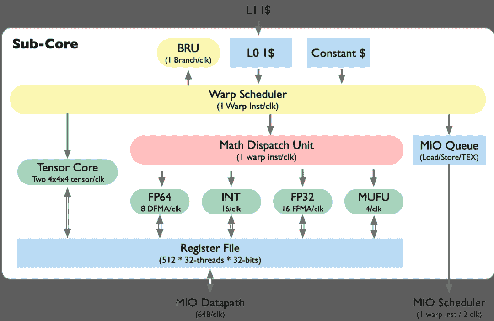

### Tensor Core 微架构

参考文章 https://arxiv.org/pdf/1811.08309

逆向工程了 V100 tensor core 的设计。

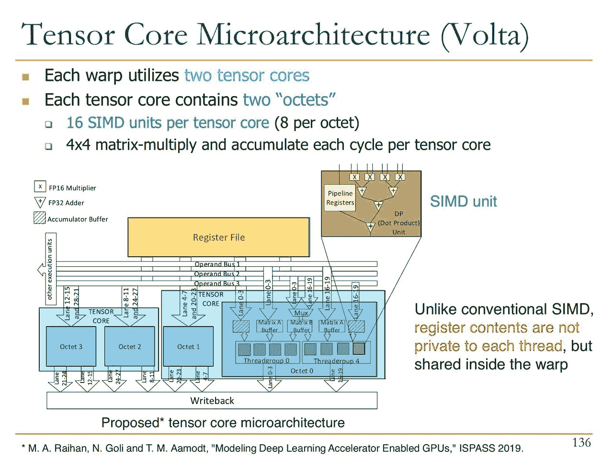

V100 有 4 个 SubCore。

每个 SubCore 有 2 个 TensorCore。

每个 Tensor Core 处理 8 个 thread，每个 thread 拥有自己的寄存器。

需要 2 个 cycle 才能用 2 个 tensor core 处理完 32 thread 的一组 mma？

每个 Tensor Core / thread 每次执行 4x4x4 的 FP16 矩阵乘。不支持其它 data type。

因此，在 8 个时钟周期内，可以执行 1024 次 MAC 操作。

每个 subcore，可以通过软件的方式将其扩展到 16x16x16 的规模。

通过局部数据的搬运来提升计算效率，但这并不意味着我们能够轻松地处理所有嵌入的向量或大矩阵。

要探索Tensor Core的微架构，本质上就是要回答两个问题：

（1）16*16 的矩阵乘法所需的数据 A,B,C 是如何分配给 1 个 warp 内的 32 个线程的？

（2）Tensor Core具体是按照什么顺序来分步执行完这个16*16的矩阵乘法的，耗费了多少个周期？

分别可以通过一段简单的CUDA程序与SASS反汇编来获得。参考文章 https://arxiv.org/pdf/1811.08309

（octet 是 8 位字节）

## Ampere - A100 架构

Tensor Core 进行了优化，1 个 Warp 提供了 32 个线程。

Volta 每个Tensor Core 只有 8 个线程。

这样的设计可以减少线程之间的数据搬运次数，从而进一步提高计算效率。

每个 Tensor Core 可以处理 32 条线程，

因此在 8 个时钟周期内，可以寄存 2048 次MAC操作，每个时钟周期处理其中一块的数据。

Tensor core 的指令是 wmma，32 线程间的数据是共享的，不同于 FFMA 指令。

```
// 一条 Tensor core PTX 指令 wmma(m16n16k16)
wmma.mma.sync.aligned.row.col.m16n16k16.f16.f16 \
    {%r53, %r52, %r51, %r50}, \
    {%r29, %r30, %r31, %r32, %r33, %r34, %r35, %r36}, \
    {%r37, %r38, %r39, %r40, %r41, %r42, %r43, %r44}, \
    {%r53, %r52, %r51, %r50};

// 对应两条 SASS 指令 HMMA (1 HMMA / TensorCore)
HMMA.16816.F16 R8, R4, R24, R8
HMMA.16816.F16 R2, R4, R26, R2
```

tensor core 单元一个 cycle 只能计算 m8n4k8(256Macs)，

1 条 HMMA.16816(2048Macs) 指令执行会理论上需要 8cycle,

故完成一个 m16n16k16 的矩阵运算需要 16cycle。

(如果是 2 个 TensorCore，应该就只需要 8 cycle）

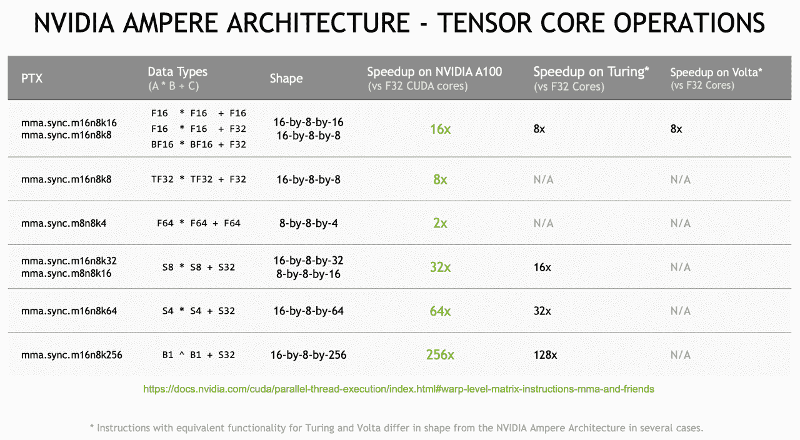

### LDGSTS - async_copy

A100 之前，使用 SMEM （shared memory）时，数据流是 Global memory -> Register -> Shared Memory，

必须要过一次 Register，效率很低。

A100 新增 LDGSTS（Load Global Storage Shared）指令，实现异步拷贝，GMEM -> SMEM，可不经过 register file。

Movement Efficiently，3 倍的速度提升。

A100相对于V100，数据相当于少走一次回头路

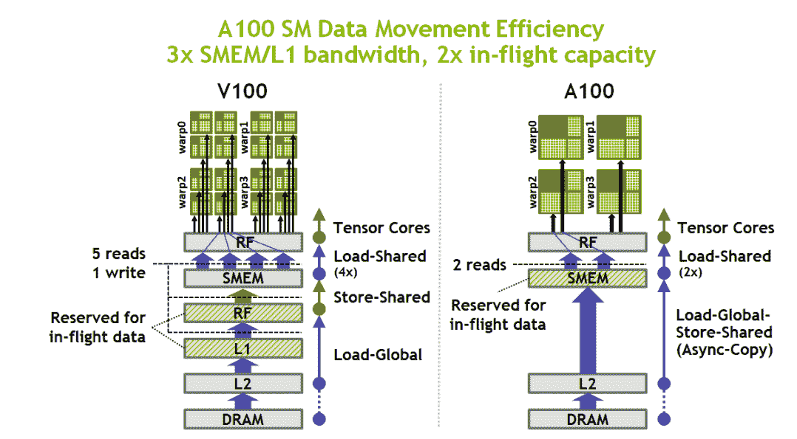

A100 之前，整个 GEMM 流程中，数据的移动轨迹：：

Global memory -> Register -> Shared Memory -> Register -> Compute -> Shared Memory -> Register -> Gloable memory

A/B/C/D 四个矩阵分布在一个 warp 的 32 个线程的 register 中。这可能会带来一些问题：

+   对于register占用量大

+   对于register读写端口压力大，为了性能，必须用好 register reuse cache

+   所有操作数都是寄存器，需要频繁的从 shared memory 和 global memory 读数据。为了缓解这个问题，A100 已经增加了async_copy(LDGSTS)功能，从 GM 直接拷贝数据到 shared memory

### 多级缓存和数据带宽

在GPU中，数据是多级存储的，主要是三级：

Global memory -- Shared Memory -- Register.

Ampere 架构中提供异步内存拷贝机制，通过新指令 LDGSTS（Load Global Storage Shared），实现全局内存直接加载到共享内存，避免了数据从全局内存到寄存器再到共享内存的繁琐操作，从而减少时延和功耗。

整个CUDA Kernel共享一个Global memory地址空间.

每个CTA有自己的Shared Memory, CTA 内的 warps 共享。

Math 模块包括 Tensor Core 和 CUDA Core

RF 是 register file

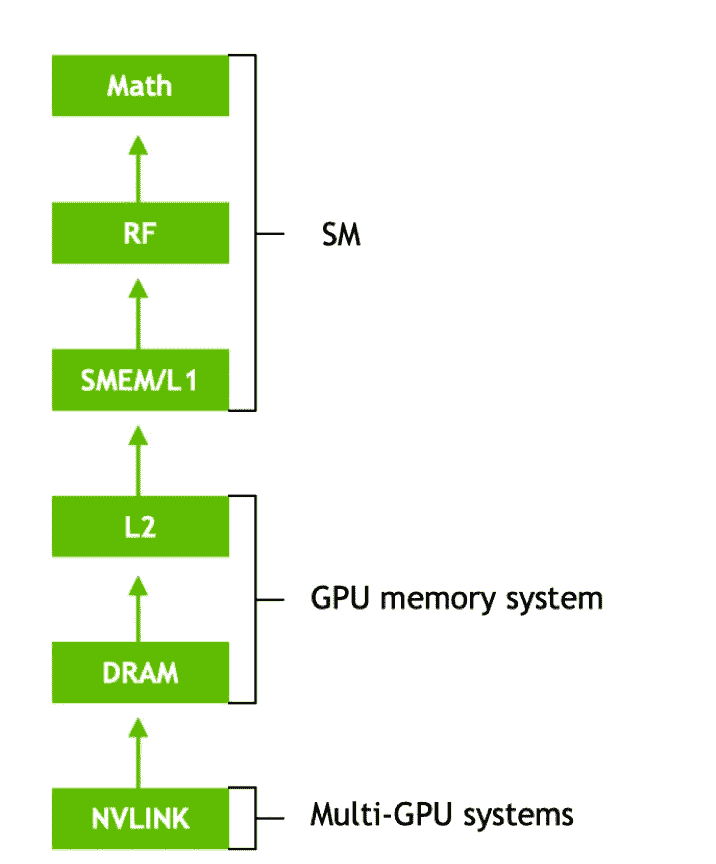

### A100 内存结构简化图

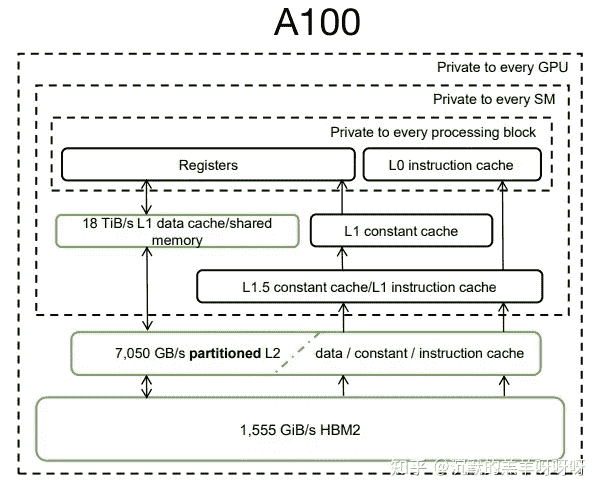

对于任意m*n*k的FP16矩阵运算：一个tensor core的访存计算比(Byte/s)可以简化表示为：512*(m+n)/n/m，因为A100有108SM、每个SM 有4个tensor core，峰值主频是1410Mhz，故一共需要：297*(m+n)/n/m TB/s。

从当前的每一级缓存带宽看上显然不能满足此计算带宽需求，所以首先需要利用SM内部shared memory缓存数据，保证SM内部的4个tensor core计算时可以共享数据；其次在L2 缓存上也能缓存数据，保证多个SM之间计算时可以共享数据，这样才能达到实际的访存计算比，使得算力能够充分发挥。

### TensorCore FFMA

FFMA（Fuse Fold Math and Add）

绿色的小块代表SubCore，也就是之前提到的SubCore。而图中连续的蓝色框代表寄存器Registers。

当寄存器仅使用CUDA Core时，所有数据都存储在寄存器中，每个寄存器针对一个CUDA Core进行数据传输。这样使用CUDA Core计算会非常慢。

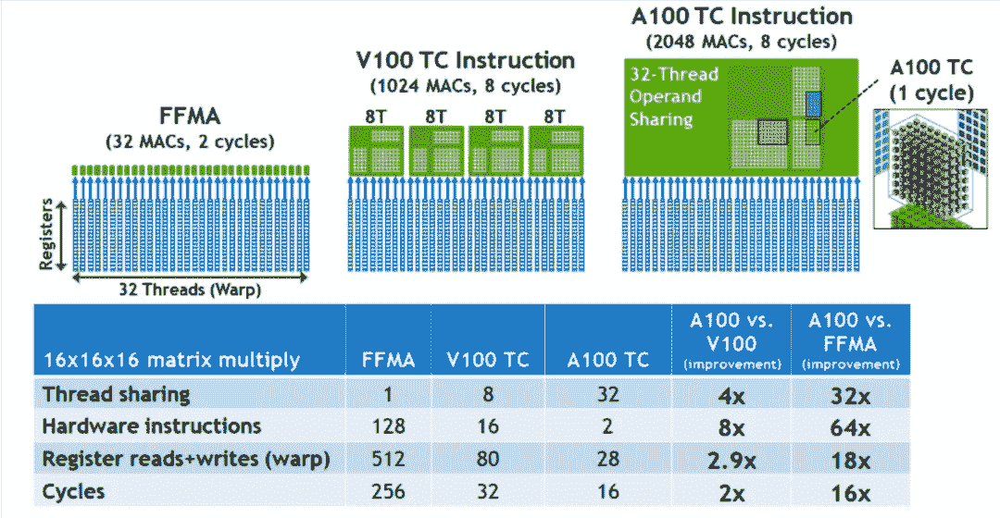

### register file 分配

一条PTX指令 MMA .m16n8k16计算时，对于FP16类型：

矩阵A：会按照下图拆分为：4个8x8的小块，每个线程需要4个32bit寄存器，分为A0、A1、A2、A3。

(MMA .m16n8k16 fragment layout for matrix A with .f16 / .bf16 type)

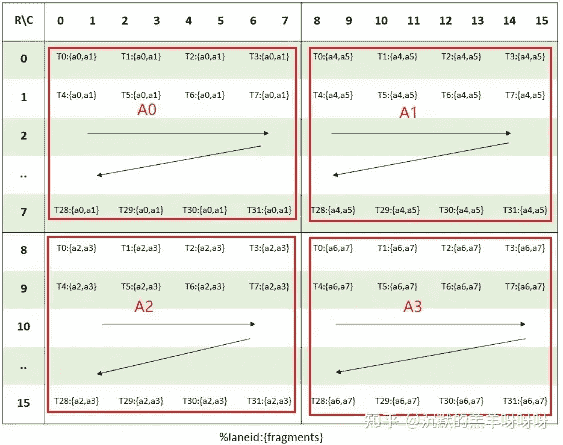

矩阵B：会按照下图拆分为：2个8x8的小块，每个线程需要2个32bit寄存器，分为B0、B1。

(MMA .m16n8k16 fragment layout for matrix B with .f16 / .bf16 type.)


对于矩阵C/D：会按照下图拆分为：2个8x8的小块，若累加为fp16, 每个线程需要2个32bit寄存器;若累加为fp32, 每个线程需要4个32bit寄存器，分为C0、C1/D0、D1。

(MMA .m16n8k16 fragment layout for accumulator matrix matrix C/D)

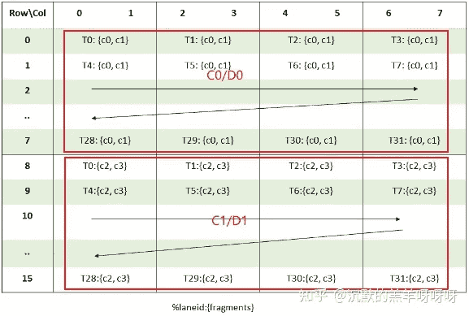

### 性能推演

推测部分：

对于MMA.m16n8k16指令，tensor core 执行时会分为4步操作，每一步：执行两次m8n4k8的矩阵运算操作，需要两个cycle。

第一步：A0 * B0 + 0 = C0;

第二步：A1 * B1 + C0 = D0;

第三步：A2 * B0 + 0 = C1;

第四步：A3 * B1 + C1 = D1;

一共需要8个cycle。

寄存器的访存次数：

第一步：2 read + 1 write

第二步：2 read + 1 read + 1 write

第三步：2 read + 1 write

第四步：2 read + 1 read + 1 write

一共是14次访问。

所以对于Ampere架构，一个m16n16k16运算操作，Tensor core计算时，需要 16cycle， 28次寄存器访问次数。

## Hopper - H100 架构

从这篇测试论文（https://arxiv.org/abs/2402.13499v1）看起来：

Hopper的 MMA.m16n8k16 是跑不满全部算力的，所以一个周期看起来只能执行16个DP16，只有WGMMA能把算力跑满

### TMA 异步加载机制

Tensor Core 中引入了 Tensor Memory Accelerator（简称TMA）。

前三代的 Tensor Core 均基于 Warp-Level 编程模式进行运作。

尽管 Nvidia A100 架构中引入了软件的 async_copy，但其核心运算逻辑仍基于 Warp-Level 编程模式进行。

这一模式要求先将数据从 HBM（全局内存）加载到寄存器中，随后通过Warp Schedule调用Tensor Core完成矩阵运算，最终再将运算结果回传至寄存器，以便进行后续的连续运算。

（cuda core 与 TensorCore 想彻底异步，首先，TensorCore 的驱动，要脱离 Warp Scheduler。这东西是绑在 cuda core 上的）

存在 2 个问题：

1.  数据的搬运与计算过程紧密耦合。

1.  可扩展性受到了严重限制。由于多级缓存Cache的存储空间限制，单个 warp 的矩阵计算规格有上限，这直接限制了矩阵计算的规模。

数据的搬运与计算过程紧密耦合，这导致线程在加载矩阵数据时不得不独立地获取矩阵地址，简而言之，Tensor Core 准备数据时，warp 内线程分别加载矩阵数据 Data Tile，每一个线程都会获取独立矩阵块地址；为了隐藏数据加载的延时（全局内存到共享内存，共享内存到寄存器的数据加载），会构建多层级软流水（software pipeline），消耗寄存器数量及存储带宽。这一过程不仅消耗了大量的继承器资源，还极大地占用了存储带宽，进而影响了整体运算效率。

对比 A100 与 H100 的 SM 架构图，下方加了 Tensor Memory Accelerator。

硬件化的数据异步加载机制使得全局内存的数据能够更为高效地异步加载到共享内存，进而供寄存器进行读写操作。

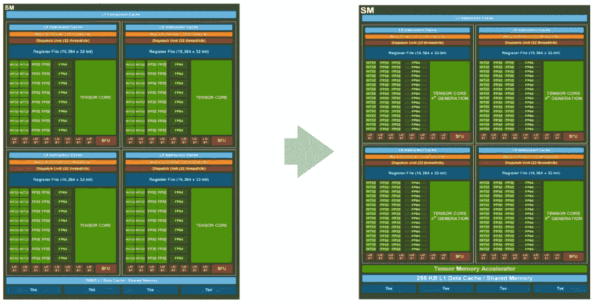

传统的 Warp-Level 编程模式要求所有线程都参与数据搬运和计算过程，这不仅消耗了大量的资源，还限制了计算规模的可扩展性。而单线程 schedule 模型则打破了这一束缚，它允许Tensor Core在不需要所有线程参与的情况下进行运算。这种设计大大减少了线程间的同步和协调开销，提高了计算效率。此外，使用TMA（Tensor Memory Access）之前，用户只需要一次性配置好首地址、偏移量等Tensor描述信息。这种一次性配置的方式简化了操作流程，减少了重复配置的开销，使得 Tensor Core 能够更加专注于计算任务本身。

在A100时代，虽然已经实现了软件层面的数据异步加载，但 TMA 的硬件化实现无疑将这一功能推向了新的高度。通过 TMA，数据搬运与计算之间的耦合度得以降低，从而提高了整体运算效率。

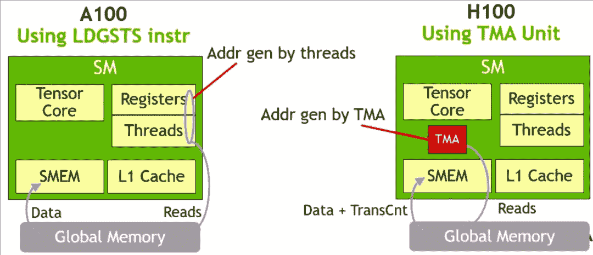

通过TMA将SM组织成一个更大的计算和存储单元，从而实现了数据从全局内存（global memory）到共享内存（shared memory）的异步加载，以及数据到寄存器的计算和矩阵乘法的流水线处理，最后通过硬件实现了矩阵乘法的流水线。硬件实现的矩阵乘法流水线确保了计算过程的连续性和高效性，使得GPU能够更快地处理大规模矩阵运算。

### register file 分配

一条PTX指令WGMMA .m64n8k16 计算时，对于FP16类型：

矩阵A：会按照下图拆分为：16个8x8的小块，分为A0、A1、....、A15。每个线程需要4个32bit寄存器，一共有128个线程。

(WGMMA .m64nNk16 register fragment layout for matrix A.)

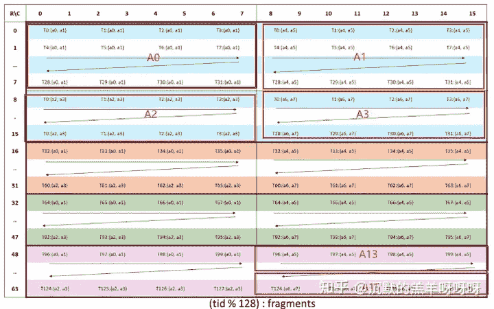

矩阵B会存储在 shared memory 上，类似下图。

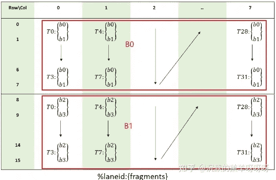

矩阵D：会按照下图拆分为：8个8x8的小块，分为A0、A1、....、A7。

(WGMMA .m64nNk16 register fragment layout for accumulator matrix D)

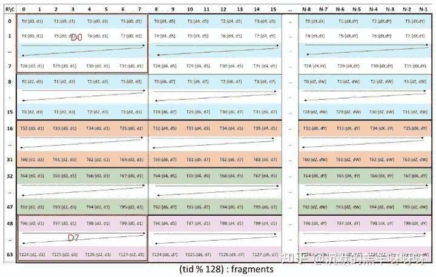

### 性能推演

推测部分：

在一个SM上执行时，对于wgmma.m64n8k16指令，会分布在4个tensor core 上执行，每一个tensor core 执行 m16n8k16。每一个tensor core上执行时，会分为2步操作，每一步：执行两次m8n4k16的矩阵运算操作，需要两个cycle。

tensor core0:

第一步：A0 * B0 + A1 * B1 = D0;

第二步：A2 * B0 + A3 * B1 = D1;

tensor core1:

第一步：A4 * B0 + A5 * B1 = D2;

第二步：A6 * B0 + A7 * B1 = D3;

tensor core2:

第一步：A8 * B0 + A9 * B1 = D4;

第二步：A10 * B0 + A11 * B1 = D5;

tensor core3:

第一步：A12 * B0 + A13 * B1 = D7;

第二步：A14 * B0 + A15 * B1 = D8;

一共需要4个cycle。

## Turing

SubCore 微架构

从图片上，基本看不到变化。

1.  拿掉了 FP64.

1.  TensorCore 增加了 int8，int4。

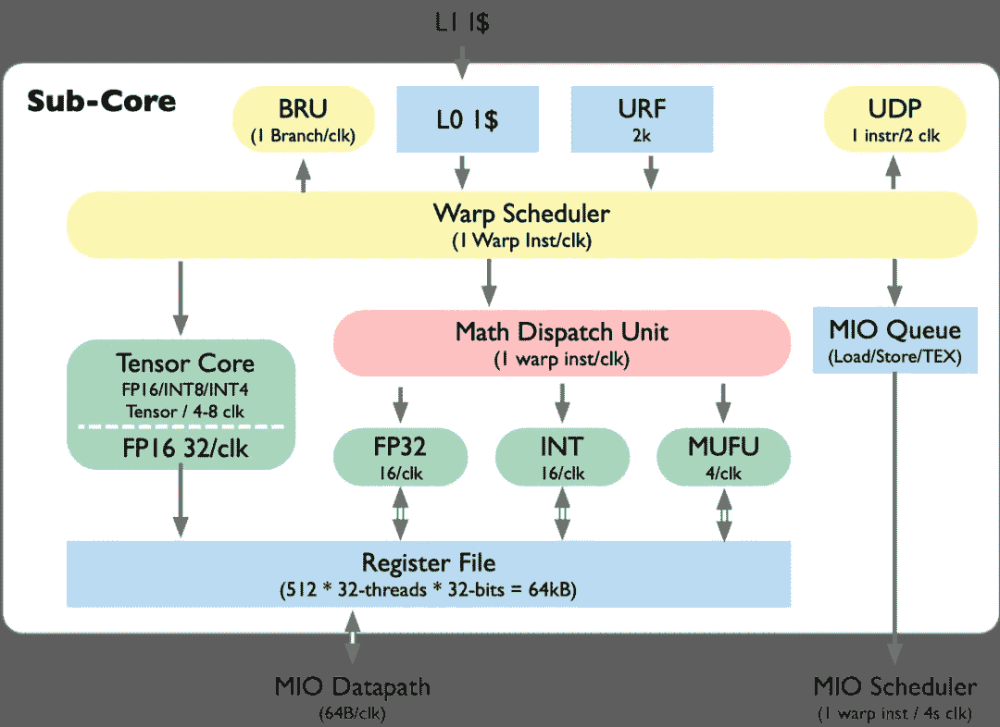

Turing架构还引入了FP16的FastPath，这一创新设计使得每个时钟周期可以执行高达32次的计算操作。与Volta架构中需要4到8个时钟周期才能完成单个多线程GEMM计算的情况相比，Turing架构的计算频率和吞吐量得到了显著提升。

值得一提的是，Turing架构还支持通过线程共享数据的本地内存（Local Memory）。换句话说，在Turing架构的Tensor Core层面，每个线程的私有寄存器被设计成了可共享的资源。通过一种透明的共享机制，Tensor Core能够充分利用这些寄存器资源，实现更高效的矩阵计算。这种设计使得Tensor Core在执行矩阵乘法等计算密集型任务时，能够充分利用线程间的协作，提高计算效率，还降低了系统的整体能耗。

# Matmul 计算模型 & 性能推演

## 极限性能推演 - TODO

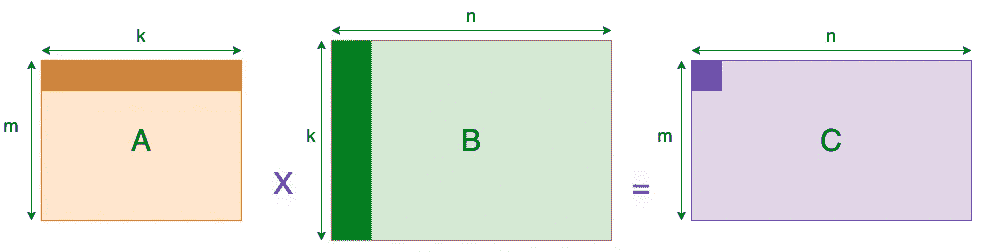

A 和 B，各要 load 一次。C 要 Store 一次。

通常，时间的理论极限是 max(Load_a + Load_b, Store_c)

关键概念：计算强度(Arithmetic Intensity) = Flops/Bytes。

决定性能受限于计算峰值还是带宽。

## CPU 矩阵乘

### 3 层循环的 Naive 算法

```
// 假设 A, B, C 都是行主序存储
// C = A * B
for (int i = 0; i &lt; M; ++i)
    for (int j = 0; j &lt; N; ++j)
        for (int k = 0; k &lt; K; ++k) {
            C[i][j] += A[i][k] * B[k][j];  // 3 load + 1 store per loop
        }
```

### 临时变量 - 减少访存次数

优化效果：内层循环访存从 4 次 (3load+1store) 降到 2 次 load。

关键：临时变量 (tmp) 保存在 register 中，消除 C 的重复 load/store。

```
// 假设 A, B, C 都是行主序存储
// C = A * B
for (int i = 0; i &lt; M; ++i)
    for (int j = 0; j &lt; N; ++j) {
        float tmp = 0;
        for (int k = 0; k &lt; K; ++k) {
            tmp += A[i][k] * B[k][j];  // 2 load + 0 store per loop
        }
        C[i][j] = tmp;  // 1 store
    }
```

### 循环分块 - 提升访存局部性

A 和 B 的 load，是无法优化掉的。通过局部性提升性能。

B的非连续访问是主要优化目标，循环分块是解决这问题的关键手段。

方法是循环分块（blocking/tiling）。

+   目标：让block数据能fit in cache

+   A的block按行访问，B的block按列访问 → 注意B的访存模式

+   Block大小选择：L1 Cache / 3 ≈ 合适block尺寸（如32x32）

```

const int BLOCK_SIZE = 32;
for (int i = 0; i &lt; M; i += BLOCK_SIZE)
    for (int j = 0; j &lt; N; j += BLOCK_SIZE)
        for (int k = 0; k &lt; K; k += BLOCK_SIZE)
            for (int ii = i; ii &lt; min(i+BLOCK_SIZE, M); ++ii)
                for (int jj = j; jj &lt; min(j+BLOCK_SIZE, N); ++jj) {
                    float tmp = 0;
                    for (int kk = k; kk &lt; min(k+BLOCK_SIZE, K); ++kk) {
                        tmp += A[ii][kk] * B[kk][jj];
                    }
                    C[ii][jj] += tmp;
                }
```

关键性能洞察

1.  B矩阵列主序访问是性能瓶颈

1.  理想情况：所有数据在cache → 性能接近CPU峰值

1.  现实约束：K很大时B无法全部cache，出现cache thrashing

下一步：分块产生的 broadcast 需求 & 指令数量问题。

## IterationK

数据的移动不是凭空发生的，具体来说也是需要分配到每个thread去完成的，这里需要考虑几个问题。

1.  为什么要进 shared memory？同一个 CTA 的若干个 warp 之间需要的数据是有重复的，避免重复读 global memory。

1.  数据读到 Shared Memory 该如何分工到各个 thread？如果还是按照thread的计算环节的分工来进行，那毫无疑问就会产生冗余，与我们的初衷不符，所以这个环节要重新进行分工，将整个CTA需要读的A的部分，分摊到各个thread，同样的方法处理B。所以对于每个thread而言，在读Global memory负责的A,B的部分和在乘加计算要负责的部分是不一样的。

1.  如果shared memory一次装不下CTA所需的全部A,B部分怎么办？分 tile 块处理，最简单的是 IterationK。

改进最基础的 IterationK：

如何通过异步流水的方式来加速这个过程？

如何分工来得到对性能最友好的访存pattern?

## SplitK & SlicedK

IterationK 算法中。

对于结果矩阵的一个元素C[i, j]，该元素的所有（K次）乘加计算都是在同一个CUDA thread上完成的。

这意味着，基于IterationK的算法，每个thread至少需要完成K次乘加运算，对于K比较大，M,N比较小的case来说，这个算法显然不是最优的，于是这时候我们需要打破这个假设，也就是把C[i, j]的运算分拆到不同的thread来进行。

第一个思路是把原本的一个warp，再K方向上拆成若干个warp，也就是说这若干个warp负责C中的同一部分。这么做可以解决问题，但需要额外增加一个环节——把这个几个warp得到的结果做累加。CUTLASS把这个环节放在了Kernel的Epilogue的部分。这就是SlicedK。

SplitK的思路与SlicedK类似，只不过方法是把原本的一个CTA，在K方向上拆成若干个CTA。那么这若干个CTA之间也需要做累加。CUTLASS选择额外launch一个新的CUDA Kernel来完成CTA的结果之间的Reduction。

如果不使用乘加指令，而是使用Tensor Core指令会有什么影响？

不会有什么很大的影响，无非是把计算的最低层级从thread上调到warp而已，对IterationK而言，每个warp依旧负责结果矩阵的某一小部分的所有K方向的累加，只不过计算的粒度变大了，累加的次数就变小了。而Tensor Core的使用也要求数据全部在寄存器中，属于对于数据移动部分的流程也没有影响。

## StreamK 算法

## Matmul 性能推演

> TODO：

1.  结合 Cute 和 Triton layout 讨论一下实现细节。

1.  [CUDA Swizzle & bank conflict](https://deep-learning.feishu.cn/wiki/SDsgwgjD9iX0gYkkDY9c4s6Anib?fromScene=spaceOverview)虑一下 bank conflict 和 swizzle

### warp level

CUDA Core 上，计算的粒度是 thread。

TensorCore 一般用 warp 或更高层的 warp group。因为，Cuda thread 粒度太细了。

1.  分 x 个 block (CTA)，每个 block 计算 m-n-k 的 tile，由 1 个 SM 完成。

1.  block 分到 warp。c 最好是 1 个 warp 完成，否则，需要 warp 间再 reduce 一次。

warp 内 thread 共享 shared  memory。A B 矩阵部分的加载到 shared memory 中，要考虑数据复用效率。

shared memory 中的 data layout，按照特定维度（K 维）进行排序。

这种排序方式有助于减少内存访问延迟，使得线程能够更高效地访问所需的数据。

### Warp-level 的矩阵乘 - wmma

warp 内，每个 thread(?) 每次计算的一个 A tile * B tile，叫 fragment。

假设，A tile 和 B tile 都在 SMEM (shared memory）中。

完整计算过程

1.  初始，分 tile 存在 GMEM。

1.  load。tile 加载到 SMEM。SMEM 是 block 内 thread 都可访问的 low latency memory pool。

1.  compute。数据加载到 TensorCore 的 register file 并执行计算。

1.  store。计算结果，写回 SMEM。SMEM 更适合用于中间结果的存储和线程间的数据交换。

1.  move。写回 GMEM。算好 memory layout 和 stride。多个 thread block 的结果，拼接成最终完整 GEMM 结果。

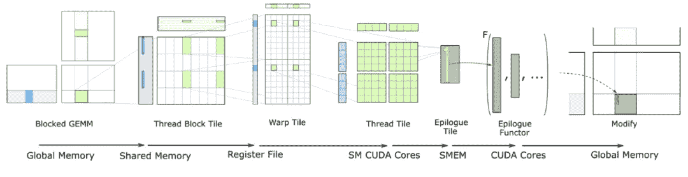

左 1，CTA 负责浅绿色的 C 结果，所以整个淡蓝色的部分，和整个淡黄色的部分，都是需要。

关键过程拆解

load A 和 B，并执行 mma compute。

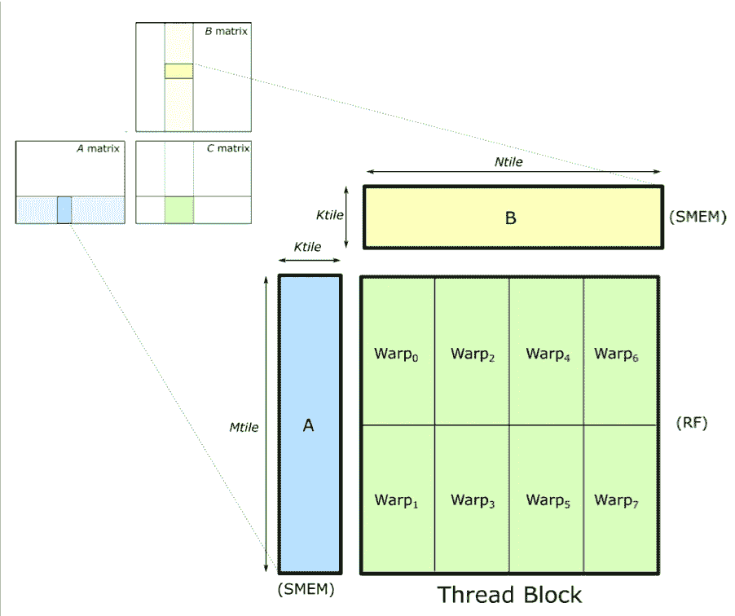

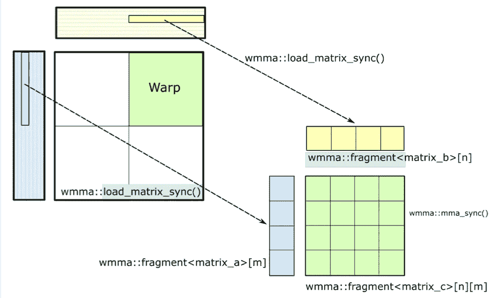

计算累积和，写回 SMEM，再 store 到 GMEM

H100 有了 TMA，store GMEM 时，可以不经过 register file 了。

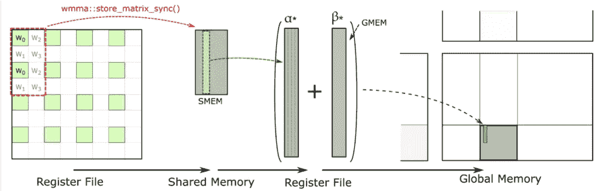

## arch 讨论

如何用 CUDA 写有 CuBLAS 90%性能的GEMM Kernel https://zhuanlan.zhihu.com/p/631227862

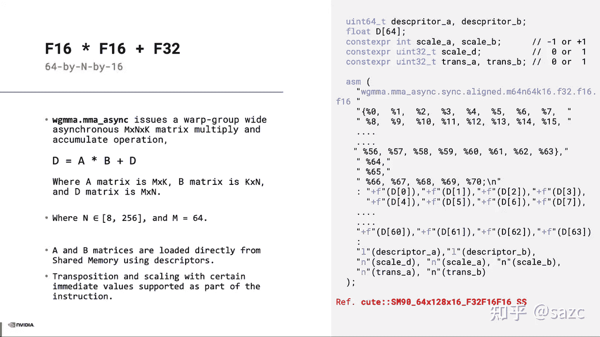

CUTLASS 的一个GEMM计算示意图，

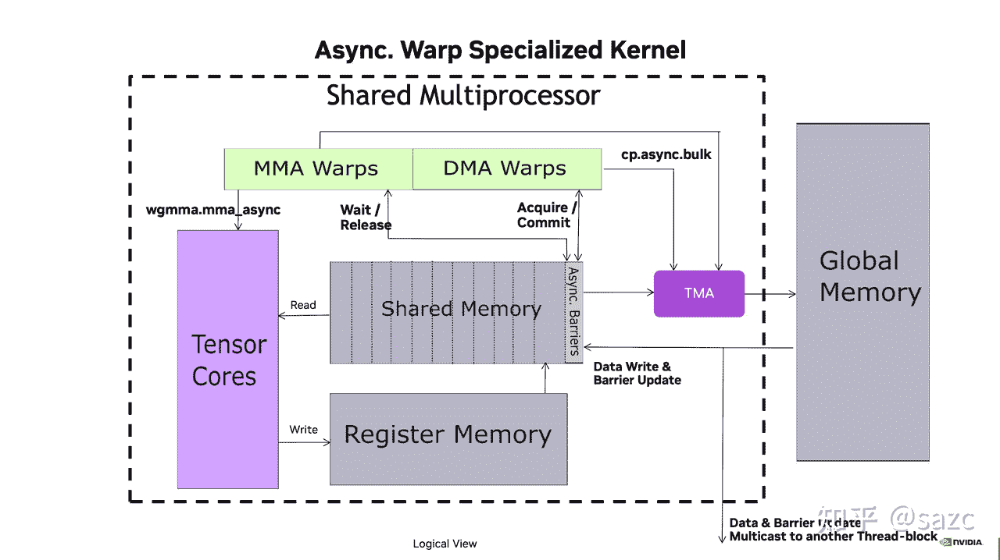

register files（RF）

Volta/Turing/Ampere 架构，register files（RF）是有两组sram Banks,每组Bank的位宽是64bit。

以一个FMMA指令为例，“FFMA R6, R97, R99, RX”，只要三个源寄存器不会同时访问同一个Bank就不会出现寄存器访问冲突。

对于Tensor core 计算是以一个Warp32线程为单位执行的，其源数据也是从register files（RF）获取，每个时钟周期32个线程并行访问32*32bit=128B 矩阵A数据。从寄存器文件的角度看，可以满足Tensor core计算的带宽需求。

对于Hopper架构而言，因为矩阵A需要256B的数据，按照一个warp还是32线程执行，每个线程就需要能够访问64bit的数据才能满足算力的需求。这里还需实际测试才能确认。

TensorCore shape 的特点是：优先做大 K，输出的 mxn 数据量不变。

然后做大 m，解决大 batch size 下的 throughput。

只要 m,k,n 乘积是 constant，flops 一样的。

做大 k，代价是 A 和 B 矩阵的 input bandwidth 都要加大。

做大 m 和 n 的话，只增大 1 边 input，然后 output 得增大。

input bandwidth 需求的增大，可以尝试加 cache 缓解。

加了 AccBuf，就相当于把 k 做大了。可以近似的认为，从 AccBuf 出来的 m,n 基本不变。

FP6精度在计算性能上并不比FP8有显著提升——因为它在NVIDIA的张量核心中本质上仍然是以类似FP8的方式进行操作——但由于数据大小缩小了25%，它在内存占用和带宽需求方面带来了显著的优势。

# other

## cutlass GEMM API

```
// threadblock (CTA) tile M = 128, N = 128, K = 32
// load tile A and Tile B to shared memory
using ShapeMMAThreadBlock = cutlass::gemm::GemmShape&lt;128, 128, 32&gt;;

// warp tile M = 64, N = 64, K = 32
using ShapeMMAWarp = cutlass::gemm::GemmShape&lt;64, 64, 32&gt;;

// MMA Op tile M = 8, N = 8, K = 4
// Single Tensor Core Instruction
using ShapeMMAOp = cutlass::gemm::GemmShape&lt;8, 8, 4&gt;;
```

用 tile size 来除以 warp size 就是每个 CTA 的 warp 数（每一维前者都必须是后者的整数倍）

M与N的含义是该warp负责的大小。warp size.k如果小于tile_size.k,那么这里就是使用了SlicedK的方法，反之则为单纯的IterationK。

如果用户要使用SplitK，那就得使用特别的针对SplitK的最上层的模板类，具体可以参考examples路径下的06_splitK_gemm。

## conv support

在Tensorflow中，有两种数据排列格式：NHWC与NCHW，而Tensor Core仅支持NHWC

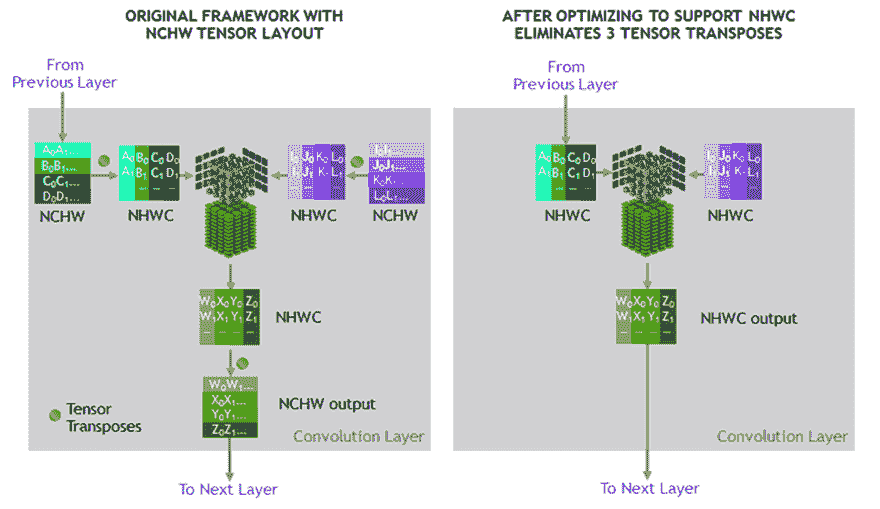

我们可以看到，Tensor core在处理NCHW数据时，会在输入输出阶段进行额外的格式转换，这是需要我们注意的

另外，想要使用Tensor core，在模型设计时有一些要点需要注意：

1.  对于卷积：

+   早于7.2的cuDNN版本，输入通道数与输出通道数必须是8的倍数才能触发Tensor core运转。

+   7.3及更高的cuDNN版本，解除通道数的倍数限制。对于NHWC格式，矩阵大小不是8的倍数时，cuDNN会进行自动填充。

+   在部分情况下cuDNN可以自动将NCHW格式进行转换，这里不再展开。

1.  对于矩阵乘法：

+   以A*B为例（A = M x K ; B = K x N），其中M，N，K必须是8的倍数。

+   K越大，单线程的计算密度越大，也可更充分发挥Tensor core性能。

|  | **Pascal-P4** | **Turing-T4** | **Volta-V100** |
| --- | --- | --- | --- |
| **L2 cache** | 2MiB | 4MiB | 6MiB |
| **L1 cache / SM** | 48KiB | 64KiB | 128KiB |
| Register File Size / SM | 256KiB | 256KiB | 256KiB |
| **SMs** | 20 | 40 | 80 |
| **SM contain** | 128 FP32 ALU | 64 FP32 ALU | 64 FP32 ALU |

尽管三款产品中，每个SM单元拥有的Register File总量保持一致——均为256KB。但P4中，每个SM单元中有128个FP32 CUDA核心；而V100与T4中为64个FP32 CUDA核心。尽管Volta架构与Turing架构支持FP32与INT32并行计算，应当按双倍单元数来算。但当我们已知主要的计算任务为FP32时，实际上每个CUDA核将拥有约两倍于P4的寄存器文件容量。这将是我们在编程中需要注意的地方。

# Reference

https://github.com/NVIDIA/cutlass/blob/main/media/docs/efficient_gemm.md

Efficient GEMM in CUDA

cutlass 官方 doc

加速矩阵计算：英伟达TensorCore架构演进与原理最全解析

https://mp.weixin.qq.com/s/dwT1Fl6F4V1MvWGgt1ac0Q

揭秘 Tensor Core 底层：如何让AI计算速度飞跃

https://mp.weixin.qq.com/s/UL7CLWp3cmdUgGILr4iVzA

NV_GPU tensor core 算力/带宽/编程模型分析

https://zhuanlan.zhihu.com/p/638129792

A100 TensorCore 优化

DEVELOPING CUDA KERNELS TO PUSH TENSOR CORES TO THE ABSOLUTE LIMIT ON NVIDIA A100

https://developer.download.nvidia.cn/video/gputechconf/gtc/2020/presentations/s21745-developing-cuda-kernels-to-push-tensor-cores-to-the-absolute-limit-on-nvidia-a100.pdf

解读 https://zhuanlan.zhihu.com/p/674693873

Blackwell GEMM https://mp.weixin.qq.com/s/HgXWsNa5xkKQ_gmNgmRvbQ

Hopper 引入的 Tensor Memory Accelerator（简称TMA）硬件机制。

下发配置信息驱动 TPE 计算的范式。是比 warp-Level 编程更好的执行模型。

# 术语解释

SMEM: shared memory

GMEM: global memory

TMEM: Tensor Memory (B200 引入)

fragment: 一个 warp 所有 thread 访问的数据。