# Nvidia PTX 指令理解

> 来源：[https://learning.feishu.cn/docx/Si4RdIgtkop3wTxDcLtcOfL0nlf](https://learning.feishu.cn/docx/Si4RdIgtkop3wTxDcLtcOfL0nlf)

https://docs.nvidia.com/cuda/parallel-thread-execution/

PTX 全称 parallel thread execution。

1. PTX 是一个通用的、虚拟的、低层次的指令集，不是特定 GPU 的硬件指令。
1. 核心模型是将 GPU 抽象为一个数据并行计算设备。理论上，任何支持此模型的硬件都可实现 PTX。
1. PTX 的“一次编写，多处运行”，依赖 GPU driver 在运行时的即时编译（JIT）功能。

## 主要 cuda & PTX version

| CUDA 版本 | 开始支持 | Compute Capability | PTX ISA version | NV driver | 点评 |

| --- | --- | --- | --- | --- | --- |

| CUDA 8 | P4 / P40 | sm_61 | PTX 5.0 | r361 | PTX 5.0 与 6.0 之间没有小版本 |

| CUDA 9 | V100 | sm_70 | PTX 6.0 | r384 | V100 是载入史册的版本 |

| CUDA 10 | T4 | sm_75 | PTX 6.3 | r400 | 一代推理神卡 |

| CUDA 11 | A100 | sm_80 | PTX 7.0 | r445 | 大模型的神卡 |

| CUDA 11.8 | RTX 4090 | sm_89 | PTX 7.8 | r520 | 支持不带加速 feature H100，sm_90 |

| CUDA 12 | H100 | sm_90a | PTX 8.0 | r525 | adds wgmma and setmaxnreg |

| CUDA 12.7 | B200 | sm_100 | PTX ISA 8.6 | r565 |  |

| CUDA 12.8 | 5090 | sm_120 | PTX ISA 8.7 | r570 |  |

## 语法体系

case sensitive. uses lowercase for keywords

each PTX module 都包含 `.version` 和 `.target` 字段。

指令中，可以写 optional guard predicate。`@p`, 取反是 `@!p`

interger constants 是 64-bits, 包括 signed `.s64` 和 unsigned `.u64`。

signed/unsigned 在处理 division 和 ordered comparison 时比较需要。

### statements

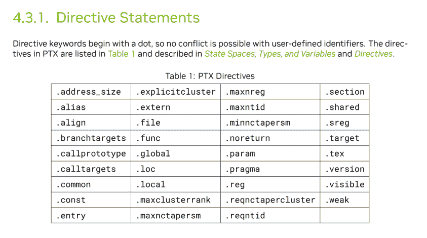

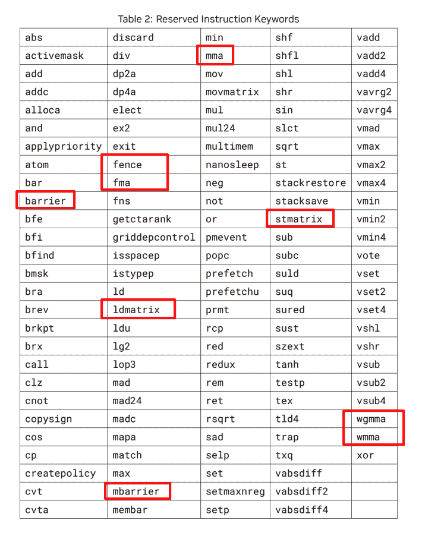

### constant

没有 `%clusterid`.

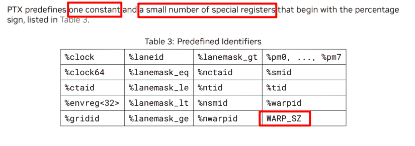

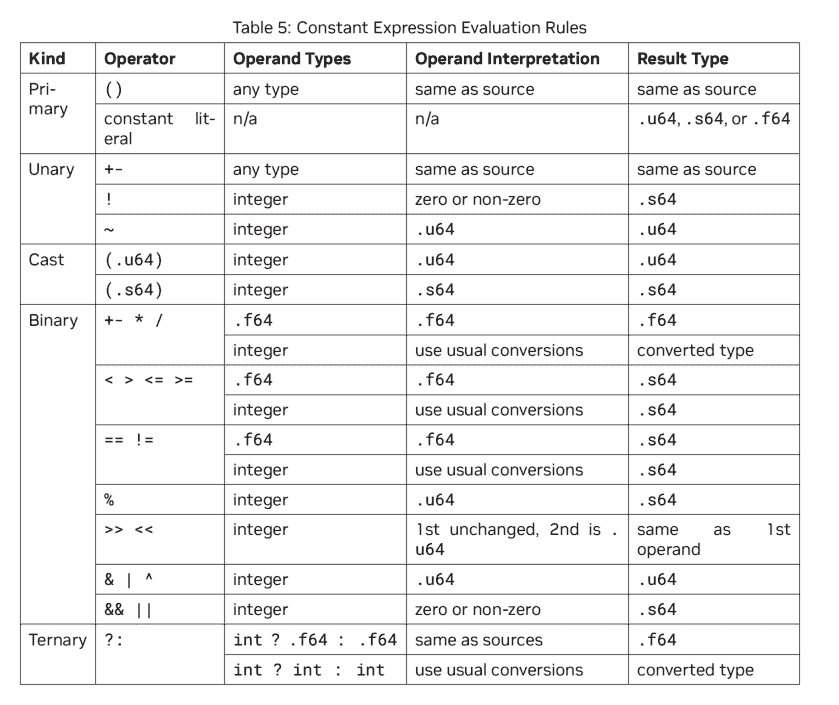

### state spaces - TODO

指令，比如

`ld.const`

`ld.global` / `st.global` / `atom.global`

`ld.local` / `st.local`

编译 ABI 时，`.local state space` 的变量，必须声明在 function scope，并 allocate on the stack。

不支持 stack 的实现上，local memory variable 分配在固定内存地址上，不支持递归的函数调用。

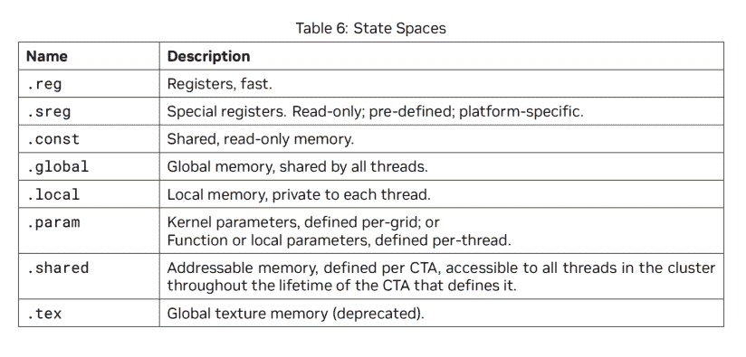

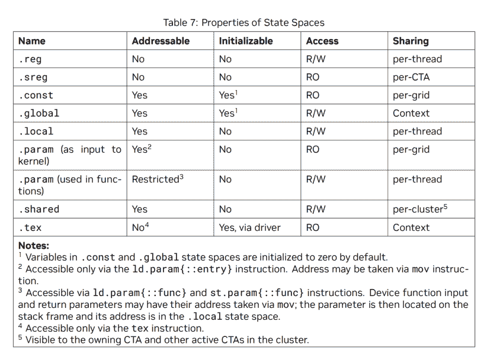

predicate registers 是 1bit，

scalar register 从 8 至 128bits

vector register 从 16 至 128bits

8bit register 用的最多的是 `ld/st/cvt` 指令，以及作为 elements of vector tuples

kernel 和 device function 的传参问题。

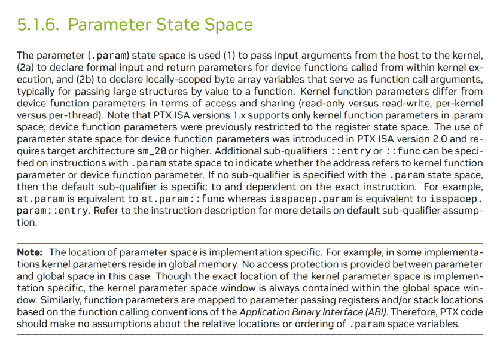

### Types - TODO

## 重要 feature 理解

### Tensors & Layout

理解重点：

1. Dimension

1. stride（value stride => Triton tensor 存 ptr 的场景）

1. tensor 的每个 dimension 可以有 padding

1. stride 可以用于描述每个 dimension 的 padding 大小。

1. Tensor instructions include:

1. Copying data between global and shared memories

1. Reducing the destination tensor data with the source

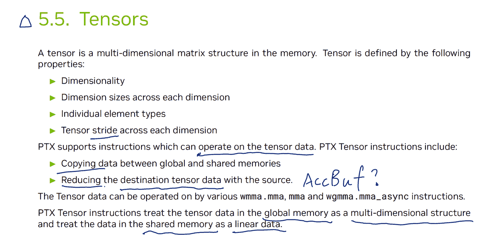

PTX Tensor instructions

treat the tensor data in the global memory as a multi-dimensional structure and

treat the data in the shared memory as a linear data

访问 Tensor 有 2 种模式：

1. tiled mode

1. im2col mode

shared memory 使用如上 2 种模式，都不太方便。

所以，用 linear layout，不支持 tensor 结构，更方便。

所以，Triton 里面大力支持 linear layout，应该也有这方面的考量。

#### tiled mode

一个 tile 块，叫 bounding box。

PTX tensor instruction 的指令，operand 是 bounding box 的 starting offset。

starting offset 和 bounding box 的其他 information，一起约定了 访问的具体 elements。

The traversal stride in dimension 0 can be used for the Interleave layout.

For non-interleaved layout, the traversal stride in dimension 0 must always be 1.

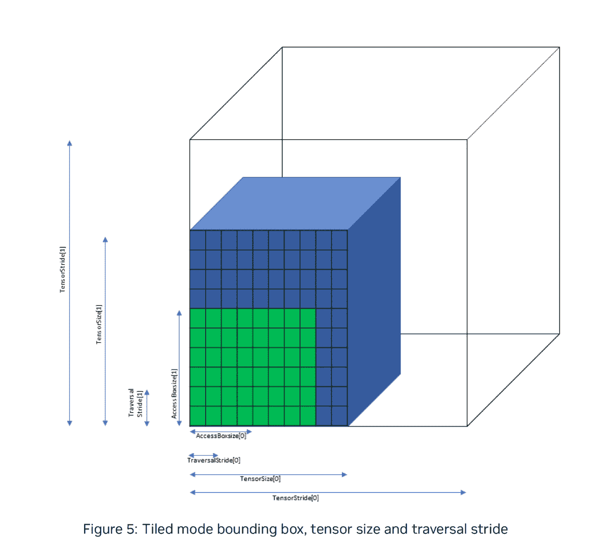

Out of Boundary Access

PTX Tensor operation can detect and handle the case when the Bounding Box crosses the tensor

boundary in any dimension. There are 2 modes:

▶ Zero fill mode:

Elements in the Bounding Box which fall outside of the tensor boundary are set to 0.

▶ OOB-NaN fill mode:

Elements in the Bounding Box which fall outside of the tensor boundary are set to a special NaN

called OOB-NaN.

#### im2col mode - TODO

#### Interleave layout

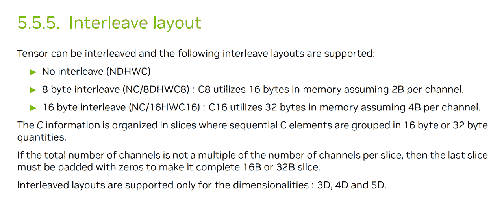

#### Tensor-map

The tensor-map is a 128-byte opaque object either in `.const` space or `.param (kernel function parameter)` space or `.global` space which describes the tensor properties and the access properties of the tensor data described in previous sections.

Tensor-Map can be created using CUDA APIs. Refer to CUDA programming guide for more details.

### ldmatrix

主要是和 `mma` 搭配使用，例如 `mma.m16n8k16`

根据 Graphene IR 的 paper，把 `ldmatrix` 换成 simpler data movement 指令，GEMM 性能下降 17%

https://dl.acm.org/doi/10.1145/3582016.3582018

Graphene: An IR for Optimized Tensor Computations on GPUs

Tensor 的核心是多维，区别于物理 memory 和 shared memory 是 1 维的 linear layout。

多维数据的表达和抽象，核心是解决 data-to-thread 的 mapping 问题。

The `ldmatrix` instruction prescribes a strict data-to-thread mapping

warp 被 tiled into 4 groups of 8 threads。

每个 8-thread group 搬运 1 个 unique 的 8*8 tile in SMEM。如图 a。

每个 thread 搬 8*8 tile 中的 1 row 8 个 element。所以，row 要求是连续的，row 与 row 之间，不需要连续。

搬运到 register 以后，如图 b。

每个 8*8 的 register tile 里面，每个 thread 持有 2 个相邻 element，4 个 tile 里共 8 个 element。

`f16` 数据，每个 thread 2 个 element，刚好占用 1 个 32bit register。

在 SMEM 和 register 里面，数据连续性是完全不一样的。

图片来自 Graphene IR 的 paper https://dl.acm.org/doi/10.1145/3582016.3582018

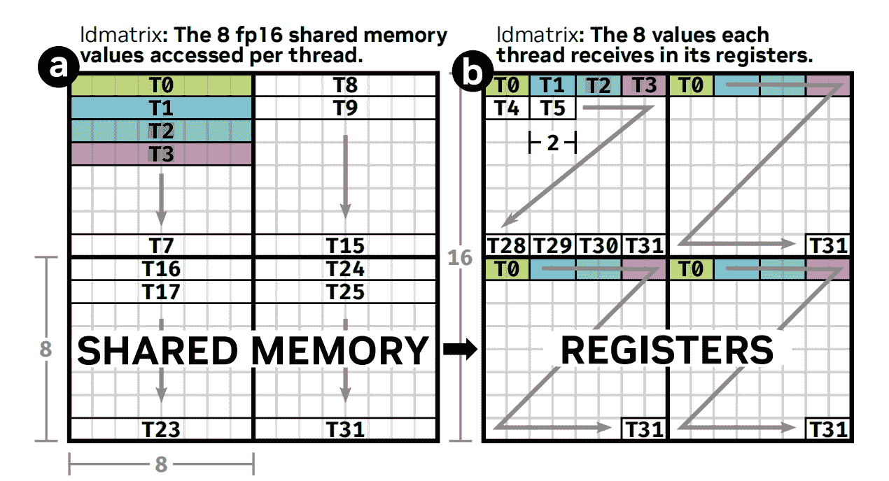

例子 1: `ldmatrix.sync.aligned.m8n8.x1.shared.b16 { %0 }, [ %1 ];`

只搬运 1 个 tile，不常见的用法。在 register 里面如果连续，在 SMEM 里就有 stride 了。

例子2: `ldmatrix.sync.aligned.m8n8.x4.shared.b16 { %0, %1, %2, %3 }, [ %4 ];`

1 个 warp 搬 4 个 tile。

这是当前 performance SOTA 版本的代码。

In CUDA C++, the conceptual reshaping of a warp into

2 × 2 8-thread groups must be expressed as a set of scalar thread

index manipulations (lines 1-3). Those are then used in a scalar

index for accessing a one-dimensional buffer in shared memory

(lines 7,8). Due to the way CUDA and PTX handle address spaces,

we must further cast the access of the shared memory buffer into a

valid shared memory pointer (lines 9-13), and then call `ldmatrix`

(lines 16-19).

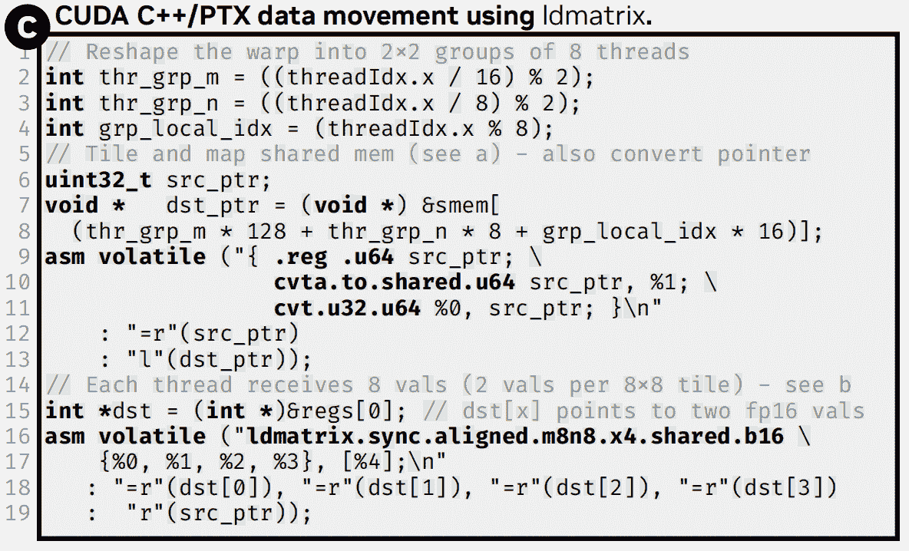

```
/**/ Reshape the warp into 2x2 groups of 8 threads
2 int thr_grp_m = ((threadIdx.x / 16) % 2);
3 int thr_grp_n = ((threadIdx.x / 8) % 2);
4 int grp_local_idx = (threadIdx.x % 8);
// Tile and map shared mem (see a) - also convert pointer
6 uint32_t src_ptr;
7 void * dst_ptr = (void *) &smem[
8 (thr_grp_m * 128 + thr_grp_n * 8 + grp_local_idx * 16)];
9 asm volatile ("{ .reg .u64 src_ptr; \
10 cvta.to.shared.u64 src_ptr, %1; \
11
cvt.u32.u64 %0, src_ptr; }\n"
12 : "=r"(src_ptr)
13
 : "l"(dst_ptr));
14
// Each thread receives 8 vals (2 vals per 8�8 tile) - see b
15 int *dst = (int *)®s[0]; �� dst[x] points to two fp16 vals
16 asm volatile ("ldmatrix.sync.aligned.m8n8.x4.shared.b16 \
17 {%0, %1, %2, %3}, [%4];\n"
18 : "=r"(dst[0]), "=r"(dst[1]), "=r"(dst[2]), "=r"(dst[3])
19 : "r"(src_ptr));
```

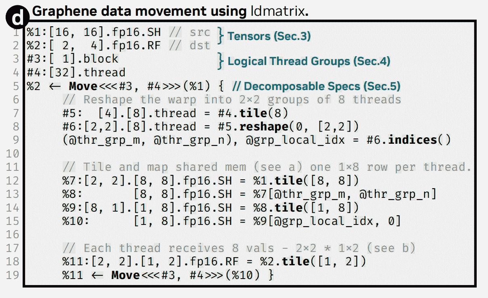

#### 指令语法

warp-level matrix load

Collectively load one or more matrices from shared memory for `mma` instruction

```
ldmatrix.sync.aligned.shape.num{.trans}{.ss}.type r, [p];

.shape = {.m8n8};
.num = {.x1, .x2, .x4};  // matrices number
.ss = {.shared{::cta}};
.type = {.b16};
```

The mandatory `.sync` qualifier indicates that `ldmatrix` causes the executing thread to wait until all threads in the warp execute the same `ldmatrix` instruction before resuming execution.

The mandatory `.aligned` qualifier indicates that all threads in the warp must execute the same `ldmatrix` instruction. 如果 发生 `branch divergence`，行为未定义。

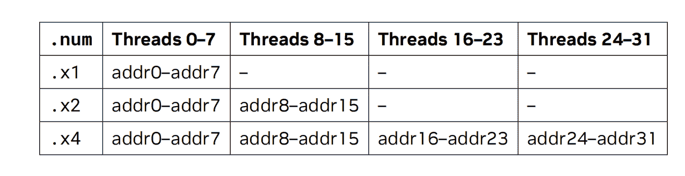

| 字段 | 解释 | 备注 |

| --- | --- | --- |

| `p` | source address，在 shared state space 中 |  |

| `r` | destination address，在 register state space 中 |  |

| `.type = {.b16};` | 1 个 element 占 2 byte |  |

| `.shape = {.m8n8}` | matrix shape 都是 8*8 的 | 每行的8个元素必须连续存放，不同行之间可以不连续。 |

| `.num = {.x1, .x2, .x4};` | 一次可加载 1，2 or 4 个 matrix | num 是 `x1` 时，加载了 8*8=64 个 element，warp 内每个 cuda thread 分 2 个 element。每个 element 是 16bit，刚好是 1 个 32bit register。 |

#### cuda example


```
#include <stdio.h>
#include <iostream>

__global__ void helloFromGPU (void)
{
  __shared__ uint32_t aTile[4*8*4];

  int tidx = threadIdx.x + blockDim.x * threadIdx.y;
  // 下面的代码是把smem中的4*8*4的矩阵，初始化数值！
  if (tidx == 0) {
    for (int i = 0; i < 4*8*4; ++i) {
        aTile[i] = i;
    }
  }
  __syncthreads();

  int aTile_index = tidx % 16 * 8 + tidx / 16 * 4;
  uint32_t a[4];
  uint32_t smem = __cvta_generic_to_shared(aTile+aTile_index);
  asm("ldmatrix.sync.aligned.m8n8.x4.shared.b16 { %0, %1, %2, %3 }, [ %4 ];\n"
  : "=r"(a[0]), "=r"(a[1]), "=r"(a[2]), "=r"(a[3]) 
  : "r"(smem)
  );

  if (tidx == 1) {
    printf("%d \n", (a[0])); printf("%d \n", (a[1]));
    printf("%d \n", (a[2])); printf("%d \n", (a[3]));
  }
}

int main(void) {
  uint3 grid = {1,1,1};
  uint3 block = {32,1,1};
  helloFromGPU <<<grid, block>>>();

  cudaDeviceReset();
  return 0;
}
```

+ 编译命令是 `nvcc A.cu -arch sm_80`。
+ 下面的代码就是让一个warp中的32个线程，从shared memory中加载4个8*8的矩阵，但是我这个里面写的是`uint32_t`元素类型，因此其实是4个8*4的矩阵！
+ 下面代码打印出线程1占据的四个32位寄存器的值！
+ 上面代码中`int aTile_index = tidx % 16 * 8 + tidx / 16 * 4;`这个代码是让
+ 每个线程分别指向每行的首地址！
+ 其中`tidx % 16`表示的是行id，
+ `tidx / 16 * 4`表示的是列id，
+ 从按照`b16`的角度来看，其实列id应该是`tidx / 16 * 8`，
+ 但是我代码里面写的是`uint32`类型，所以就是`tidx / 16 * 4`了！
+ 最后打印出来的四个数字如下图所示哦！

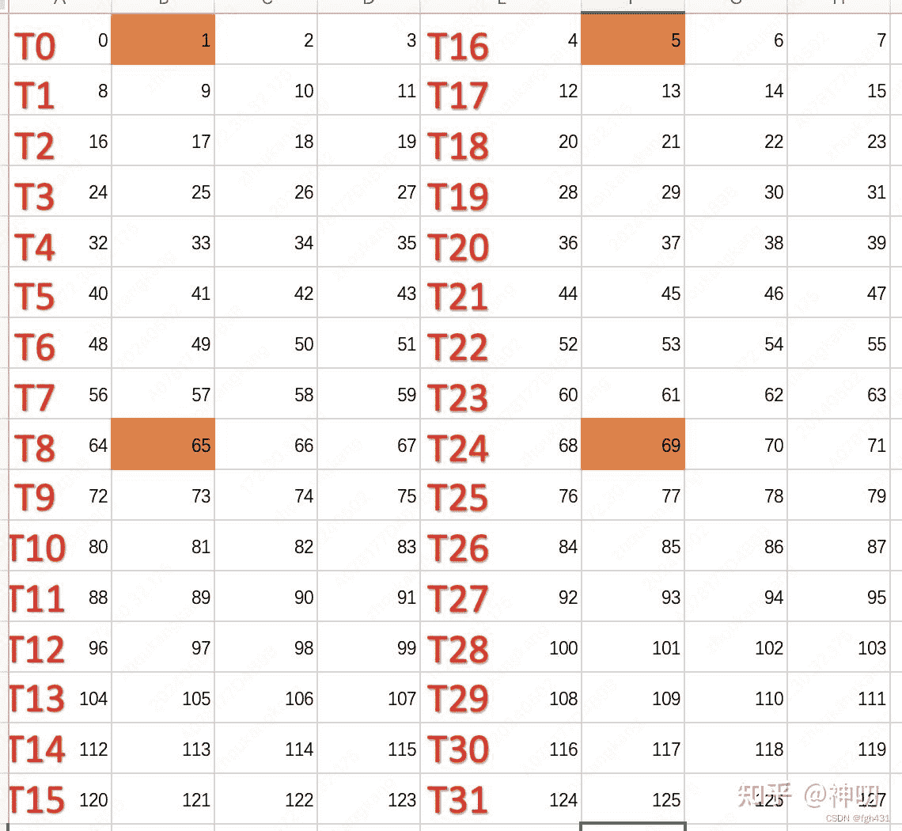

+ 上面的使用例子我的数据单元设置成`uint32_t`了，用户可能不太好直接理解，下面我补充一个例子，直接针对`fp16`元素进行`ldmatrix`指令的例子。
+ 下面例子的代码我起名字叫`B.cu`，编译命令是 `nvcc B.cu -arch sm_80`。

```
#include <stdio.h>
#include <iostream>
#include "cublas_v2.h"

__global__ void helloFromGPU (void) {
  __shared__ half aTile[4*8*8];

  int tidx = threadIdx.x + blockDim.x * threadIdx.y;
  // 下面的代码是把smem中的4*8*8的矩阵，初始化数值！
  if (tidx == 0) {
    for (int i = 0; i < 4*8*8; ++i) {
        aTile[i] = i;
    }
  }
  __syncthreads();

  int aTile_index = tidx % 16 * 16 + tidx / 16 * 8;
  uint32_t my_register[4];
  uint32_t smem = __cvta_generic_to_shared(aTile+aTile_index);
  asm("ldmatrix.sync.aligned.m8n8.x4.shared.b16 { %0, %1, %2, %3 }, [ %4 ];\n"
  : "=r"(my_register[0]), "=r"(my_register[1]), "=r"(my_register[2]), "=r"(my_register[3]) 
  : "r"(smem)
  );

  if (tidx == 1) {
    for (int i = 0; i < 4; i++) {
      half * tmp = (half*)(&(my_register[i]));
      printf("%f\n", (float)(tmp[0]));
      printf("%f\n", (float)(tmp[1]));
    }
  }
}

int main(void) {
  uint3 block = {32,1,1};
  uint3 grid = {1,1,1};
  helloFromGPU <<<grid, block>>>();

  cudaDeviceReset();
  return 0;
}
```

打印出来的就是下面的8个数字啦

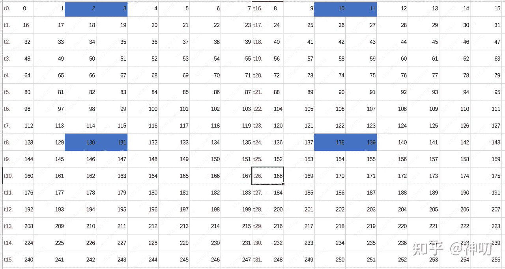

# H100 - TMA 引擎

TMA 引擎的 API，见章节：`Data Movement and Conversion Instructions: cp.async.bulk`

https://docs.nvidia.com/cuda/hopper-tuning-guide/index.html#tensor-memory-accelerator

# 附录

## Compute Capability Sheet

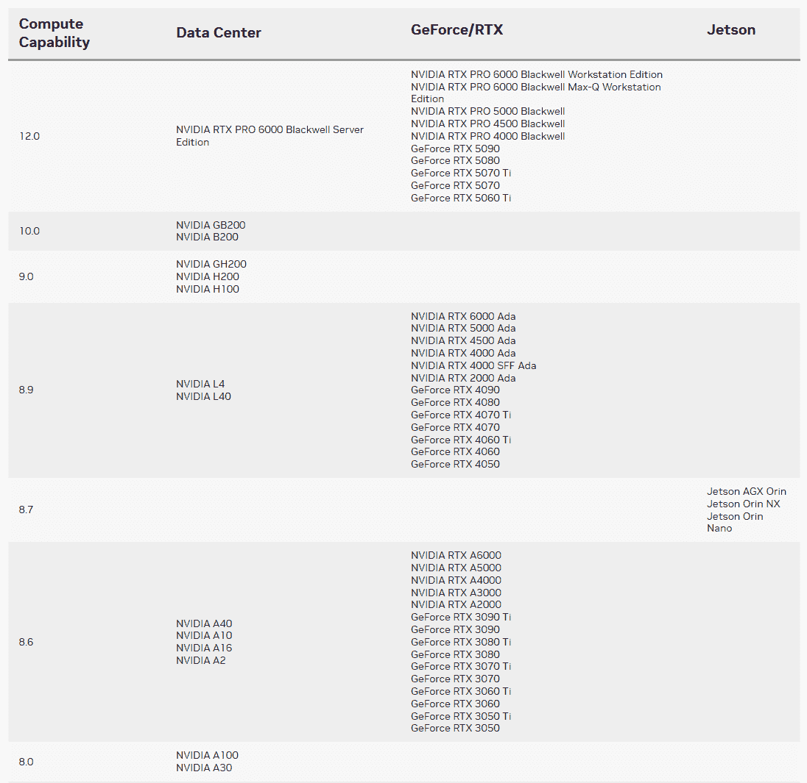

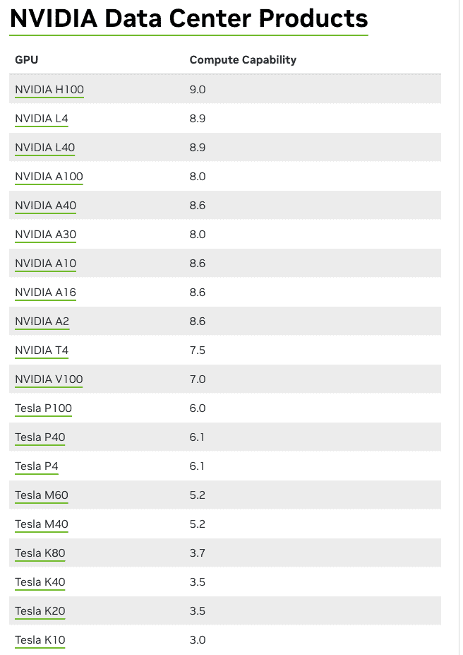

Compute Capability 查看方法: https://developer.nvidia.com/cuda-gpus

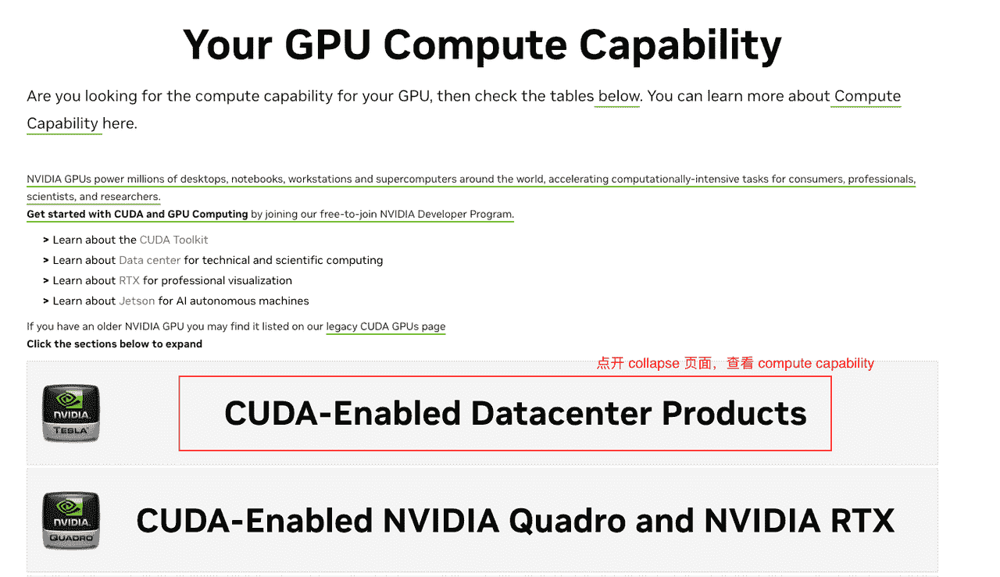

## PTX ISA version history

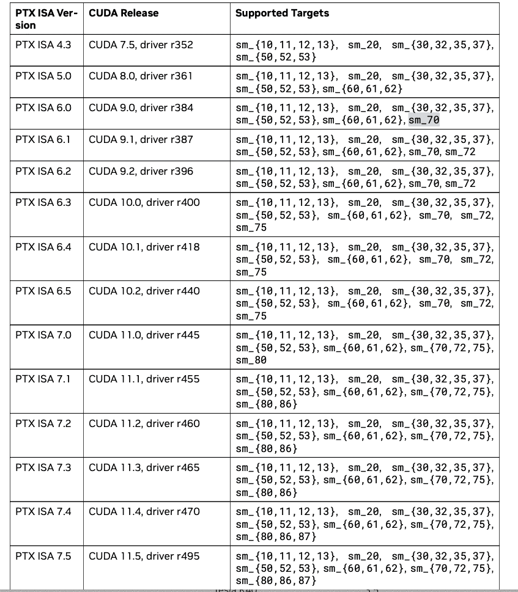

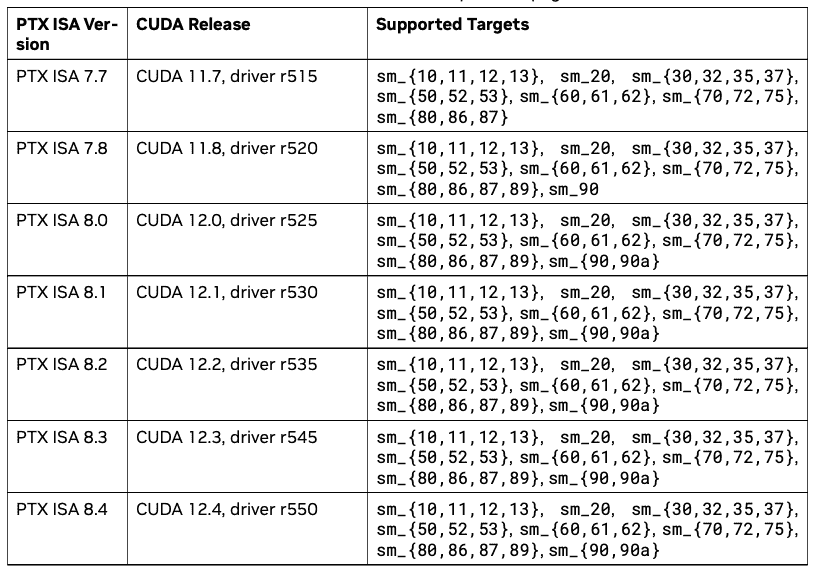

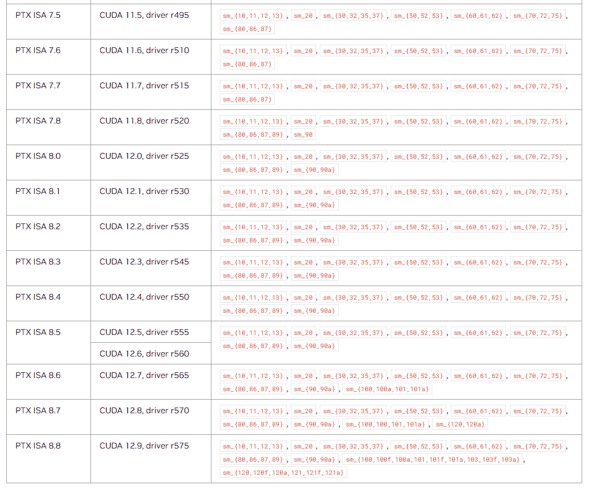

## 直接访问 SMEM 的指令

GPU 的运算单元可以直接操作共享内存的数据而不加载到寄存器中吗

`sm90` 增加的 `TMA`, `WGMMA` 指令可以, `TMA` 还带了 reduction 功能

https://docs.nvidia.com/cuda/parallel-thread-execution/index.html#register-fragments-and-shared-memory-matrix-layouts

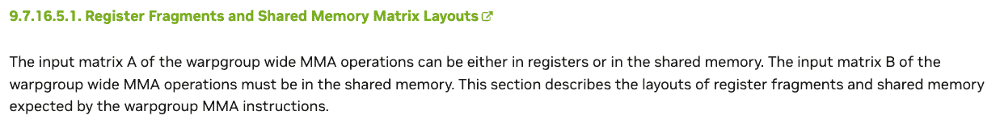

## cuda 硬件约束

https://docs.nvidia.com/cuda/cuda-c-programming-guide/index.html#features-and-technical-specifications

| 开始支持 | Compute Capability | PTX ISA version | max | max | max | max |  |

| --- | --- | --- | --- | --- | --- | --- | --- |

| A100 | `sm_80` | `PTX 7.0` | 2048 | 64 | 32 | 2048 / 32 = 64 |  |

| RTX 4090 | `sm_89` | `PTX 7.8` | 1536 | 48 | 24 | 1536 / 24 = 64 |  |

| H100 | `sm_90a` | `PTX 8.0` | 2048 | 64 | 32 | 64 |  |

| B200 | `sm_100` | `PTX ISA 8.6` | 2048 | 64 | 32 | 64 |  |

| 5090 | `sm_120` | `PTX ISA 8.7` | 1536 | 48 | 32 |  |  |

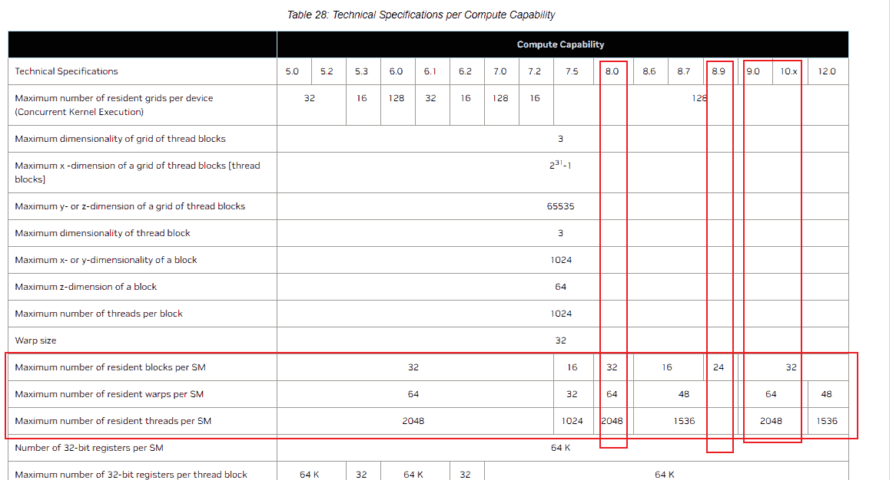

## deviceQuery

H100 PCIe

5120/8 * 1.593 * 2 /1000 = 2.039 TB/s

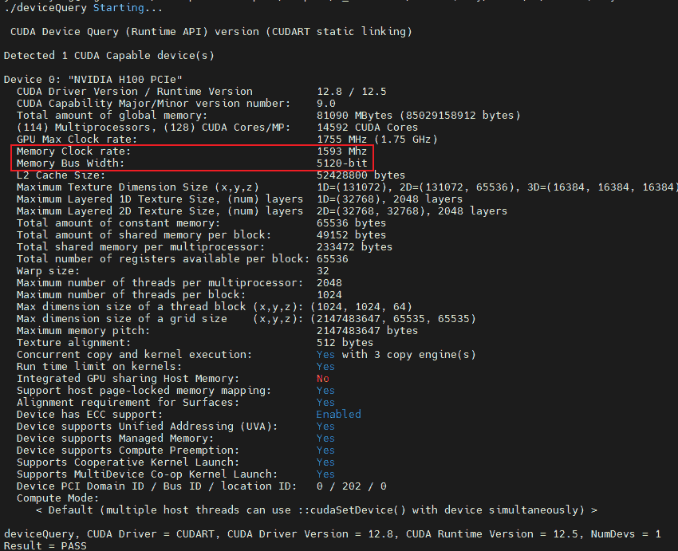

A100-SXM4-40GB

5120/8 * 1.215 * 2 /1000 = 1.55 GB/s

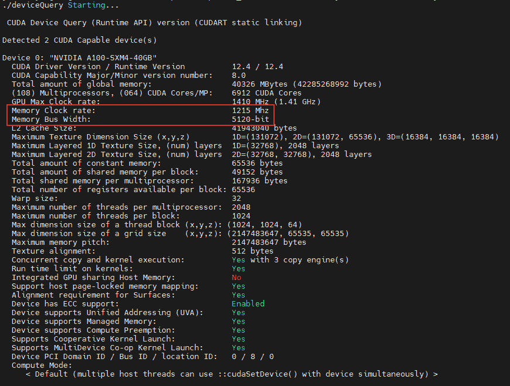

# PTX vs SASS

https://zhuanlan.zhihu.com/p/707409842

开心的小福 - 从PTX到SASS：编译器视角

2024.07

`PTX`指令明确地使用了寄存器，支持 Predicated Execution，也有五花八门的操作符(例如`ld`的各种cache控制)。

但到`SASS`仍旧路途遥远，一些是保证程序正确性的转换，更多的则是优化。

`PTX` 是为了兼容，到 `SASS` 不全是一对一映射。

## 功能性转换

### 数据依赖

CPU 和 GPU 中都有 记分牌 (score board)，区别在于，

CPU的记分牌是由硬件在指令发射时分配和自动跟踪的，

GPU不自动跟踪，需要编译器或手工设置。

有些论文就是通过手工修改指令流的二进制编码来改变记分牌（或其他控制功能），进而提高性能。

例如，对于一个 `RAW` (read after write) 依赖，

编译器必须设置 源指令 在完成后更新`记分牌A`的状态，

而目标指令必须等待`记分牌A`。

在执行时，若`记分牌A`的状态标识源指令未完成，则不发射目标指令。有点类似于OS课程中的信号量概念。

抛砖引玉，读者们可以思考如何解决跨基本块的依赖且性能损失最小。

这就是一个 `producer-consumer` 的 computing model。

### branch divergent & barrier

在Independent thread scheduling 时代(`V100` 引入，改变了 `warp-synchronicity` 的行为)，

如果不进行同步，在汇合处，走不同分支的线程将会继续不同步地执行下去，严重影响资源使用率和性能。

编译器会自动插入 `barrier` 同步指令，解决此问题。

在性能方面也有一些考量，比如没必要在每对`divergent branch`和`rejoin point`都插入同步，一指令数增加，二是可能对性能影响不大。

## 优化

大多数人心中的疑问是：`PTX`已经够底层了，到`SASS`还能有什么优化？

其实所有的平台相关优化都是在这一层做的，包括但不限于大家耳熟能详的后端三板斧：指令选择，指令调度和寄存器分配。

熟悉`LLVM/NVPTX`的朋友又会问，这些不都已经做过了吗？我简要说两点原因:

1.  最重要的指令调度和寄存器分配均未达到生产要求。小插曲：有一次我误改了指令调度的一个方法，导致某`kernel`性能下降了22%，我要表达的是这些家伙需要精雕细琢，因地制宜。

1.  `PTX` 毕竟是为了兼容而生，到 `SASS` 不全是一对一映射，可能会产生新的指令甚至新的基本块，因此在`PTX`层次可能无法看到最终的程序。

Lowering过程也会产生别的各类优化机会，最简单地如窥孔优化。但其实在GPU编译器里，就连窥孔优化也不全是简单地识别-转换即可，因为延长某寄存器的生命期可能会导致溢出，而回报可能只是少执行了一条延迟不高的指令。

由此可见，藏在 `PTX` 层底下的，实际上是一个庞大的分析和优化 pipeline。

理论上包含平台相关的优化足矣，就是那些类似于 `LLVM/CodeGen` 目录底下的。但点开Transforms底下的PASS也可以看到，大家或多或少都使用了Target hook来查阅信息并决策，因此这个pipeline是非常巨大的，甚至也囊括了CFG变换和循环优化。

（谈及循环优化，上周令我感到惊奇的事是，一个很长的程序在经过循环展开后，指令数反而大大减少，经仔细研读，发现是暴露的优化机会几乎全被充分利用了）

循环里有根据归纳变量的值走不同分支，那么展开后可以只保留走下去的分支的基本块。循环本身的判断，跳转指令也都可以省掉。

展开后，访存指令也可以向量化，运算指令可以做strength reduction。还有就是我们的循环优化比较早期，每次迭代都用不少公共运算，`reassociate`, `cse`后，让后续不公共的运算也简单了。

访存指令的 地质模式其实也能fold不少

由于GPU和CPU的结构差异，那些在CPU编译器中的同类PASS会有较大改动。譬如，为了追求并行度，可以忍受更多溢出，但为了折衷就得增加新的分析。

下文简要阐述两个GPU专有的优化，基本都和寄存器相关，毕竟寄存器的使用量直接影响了并行度和延迟，从而重塑了几乎所有的优化。另一个重要影响因素是针对纹理的优化，但本文是给写算子的CUDA用户扫盲，所以懒得写了。

### 使用 Uniform Register

对于WARP里所有线程的值都一样的变量，如线程块ID，可以放在`uniform register`中存储和运算，使用这类寄存器可以显著降低读操作数的延迟，以及更高效地利用功能部件。

第一步是通过数据流分析，从程序中找出所有线程都一致的值（也包括分支指令）。甚至某些不一致的值也能装到`uniform register`中运算。

鉴于`Uniform Register`的诸多好处，在不破坏各线程对值的“可见性”前提下，我们也会尽力分析一些复杂的控制流。

分析跑完后，将选择将哪些值放到`uniform register`里，毕竟寄存器总是有限的，而且频繁地在两类寄存器中移动数据可能得不偿失，大家可以理解为一种寄存器溢出。

决策过程的影响因素比较多，记不住，就先不说了。

### 溢出到 共享内存

动机是访存延迟，但过量使用共享内存会降低线程块间的并行度。针对该优化没什么可讲的，道理就是这么简单。诚然，`NVPTX`后端也可以完成类似优化，但如上文所述，此时的程序可能是不精确的。

与其他可以在`NVPTX`层实现，但未实现的优化一样，如果和`SASS`层各优化一次，那么使用非 `NVCC` 的用户可能要骂为什么编译这么慢了。

## 内联 PTX 有用吗？

既然到`SASS`过程里，`PTX`只是 `IR` 的角色，那内联“汇编”还有用吗？

老衲在23岁时候优化过一个CUDA程序，就是通过用加载指令+特定的cache操作提升了性能。

我不太清楚CUDA里有没有提供C++的接口，但这种情况下，编译器无法分析得出，可以考虑使用内联汇编。

## PTX 之前

有很多非常重要的优化（我最近就学习了一个），但我确实不熟，而且有些历史原因我不太熟悉，就不评论了。

其他 case

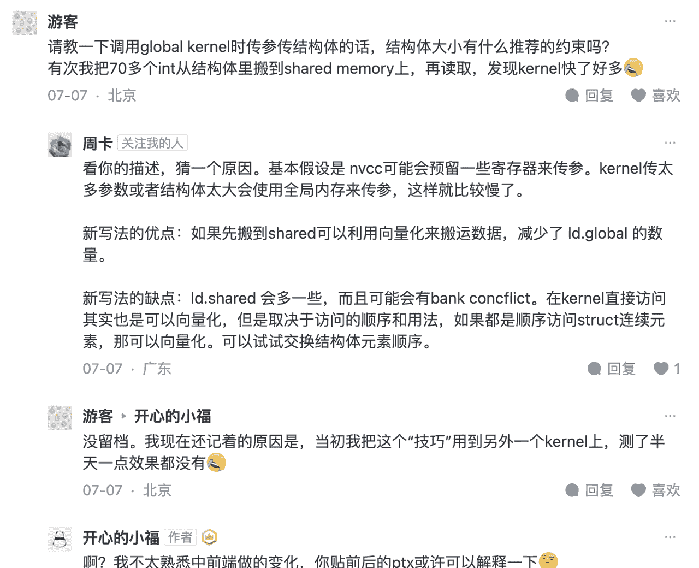
