# CUDA & GPGPU Programming

> 来源：[https://learning.feishu.cn/docx/T4zEd3DMJosjtgx149BcTpolnUx](https://learning.feishu.cn/docx/T4zEd3DMJosjtgx149BcTpolnUx)

| Links |
| --- |
| https://www.youtube.com/watch?v=bh9cbi_HN4A |
| CUDA C++ Programming Guide |
| https://www2.eecs.berkeley.edu/Pubs/TechRpts/2016/EECS-2016-143.pdf |
| https://nvidia.github.io/cccl/cub/ |
| [Nvidia PTX 指令理解](https://deep-learning.feishu.cn/wiki/RpYiwYWP3i9oC9kNSVmcYifBnhf?fromScene=spaceOverview) |

## Summary

需要掌握的要点：

1. GPU 架构入门，cuda framework & 基本术语。
1. grid/block/thread 的基本概念。
1. kernel function 声明 & kernel launch
1. sm / sp 的 hardware execution model
1. warp，warp scheduler & warp-synchronicity
1. 性能加速方法，总结为两个方向：
1. IO优化（提高cache命中、使用share memory、register等）
1. 并行规划（让计算与IO、IO与IO、计算与计算互相overlap）
1. memory copy
1. stream & async copy
1. cache 友好的程序

分 host & device 侧。

host:

+ allocate device memory
+ copy data
+ launch kernels

device 上:

+ hardware execution model: SIMT
+ software programming model: SPMD

device 上，kernel 间的同步是 bulk sync programming 模式。

Global (coarse-grain) sync between kernels.

bulk sync programming: kernel 的 thread 间做同步的唯一方法是 terminate the kernel。

thread 调度.

为了代码能在不同 GPU 上兼容运行，thread 的调度都交给硬件去做。不同 hardware 的 thread 数不同。

重点：

1. 并行性
1. Hide Latency

+ Latency Hiding 的过程其实就是提升 Occupancy 的过程
+ Latency 的时候我们可以将闲置的单元利用起来并且运行

并不是所有算子都要无脑用 TensorCore 计算。

如果算子是访存受限的，瓶颈在 HBM 访存带宽上，即使 CUDA Core 的计算能力也用不满，换成TensorCore也没有意义。

GPU 是 an array of SMs (Streaming Multiprocessors).

基本概念

+ host
+ device
+ kernel

## CUDA - Programming Model

### PTX Introduction

[Nvidia PTX 指令理解](https://deep-learning.feishu.cn/wiki/RpYiwYWP3i9oC9kNSVmcYifBnhf?fromScene=spaceOverview)

CUDA 和 PTX 是 data parallel。

需要 `tid` / `cluster_ctaid` / `clusterid` 把 input data 分片到每个 thread / block / cluster 上。

使用如上的 identifiers，programmer 只需写 scalar thread 的计算逻辑。

hardware 通过 warp 机制，以 zero scheduling overhead 把 scalar threads 组成 SIMT 并行。

warp size 是 runtime immediate constant: `WARP_SZ`。

只要是支持立即数 operand 的指令，都可以直接用 `WARP_SZ`。

grid 内的 block，执行在不同的 `SM` 上。

1 个 block 的 thread，在同一个 `SM` 上。

`SM` 上可以运行 a batch of block，block block 独占这个 `SM`。

### Thread Hierarchy

Pre-Hopper 是 one grid for each kernel。

grid - cluster (CGA) - block (CTA) - thread。

grid launch 时，可以声明 dependency。实现 CUDA Graph 的机制。

| NV 术语 | AMD 术语 | identifier | shape register | 共享机制 |
| --- | --- | --- | --- | --- |
| Thread | work-item | `tid` | `ntid` | scalar thread 独占 register 和 local memory |
| Block | work-group | `cluster_ctaid` (3d) | `cluster_nctaid` (3d) | block 内 thread 共享 |
| Block Cluster |  | `clusterid` | `nclusterid` | cluster 内 block 共享 |
| Grid | NDRange | `gridid` |  | grid 间，只能用 |

4 层模型（SM90 开始）: grid - cluster - CTA - thread

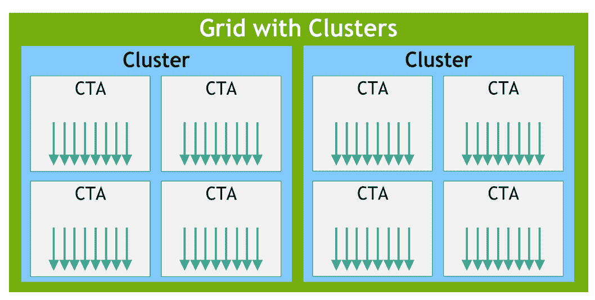

传统 3 层模型: Grid - CTA(block) - Thread

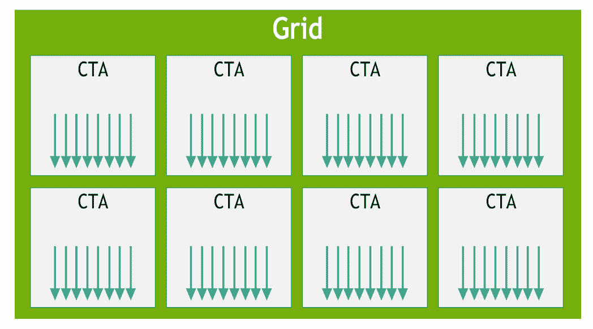

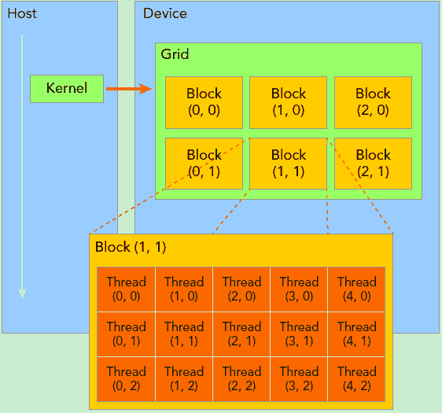

block 内的 thread，跑在一个 sm core 内。thread number 受限于 sm memory，当前，最大可以 1024 threads。

1 个 kernel，可以由几个 equally-shaped block 执行。

`SM` 执行一个 block 时，会先把 thread partition 成一组 warp，然后由 warp scheduler 调度执行。

grid 内的 block 数量，与被处理的数据量有关，dictated by the size of the data being processed。一般超过了系统 processor 的数量。

调用 kernel 时，只要指定 `thread-per-block` & `block-per-grid` 即可。

block 内的 threads，可以通过 shared memory 或 `__syncthreads()` intrinsic 来 cooperate。

`__syncthreads` 是一种 barrier。

https://docs.nvidia.com/cuda/cuda-c-programming-guide/index.html#shared-memory

thread-synchronization primitives

https://docs.nvidia.com/cuda/cuda-c-programming-guide/index.html#cooperative-groups

Unlike CPU cores, they are issued in order and there is no branch prediction or speculative execution.

### Memory Hierarchy

+ memory
+ global (HBM): visible to all threads
+ shared (SRAM): private to each block
+ local: private to each thread

warp 只是一个执行的概念，不影响 `SMEM`/`GMEM` 的数据共享层级分配。

`SMEM` 是 thread 之间共享的，warp 不影响层级。所以，`SMEM` 是 block 内 thread 间共享的。private to each block

| Memory Hierarchy | Notes | handled by |
| --- | --- | --- |
| Registers | 分给 individual threads (CUDA cores) | compilers |
| Read-only Memory | on-chip memory |  |
| L1 Cache/shared Memory | on-chip memory, |  |
| L2 Cache | can be accessed by all threads in all CUDA blocks |  |
| Global Memory | resides in a device’s DRAM |  |

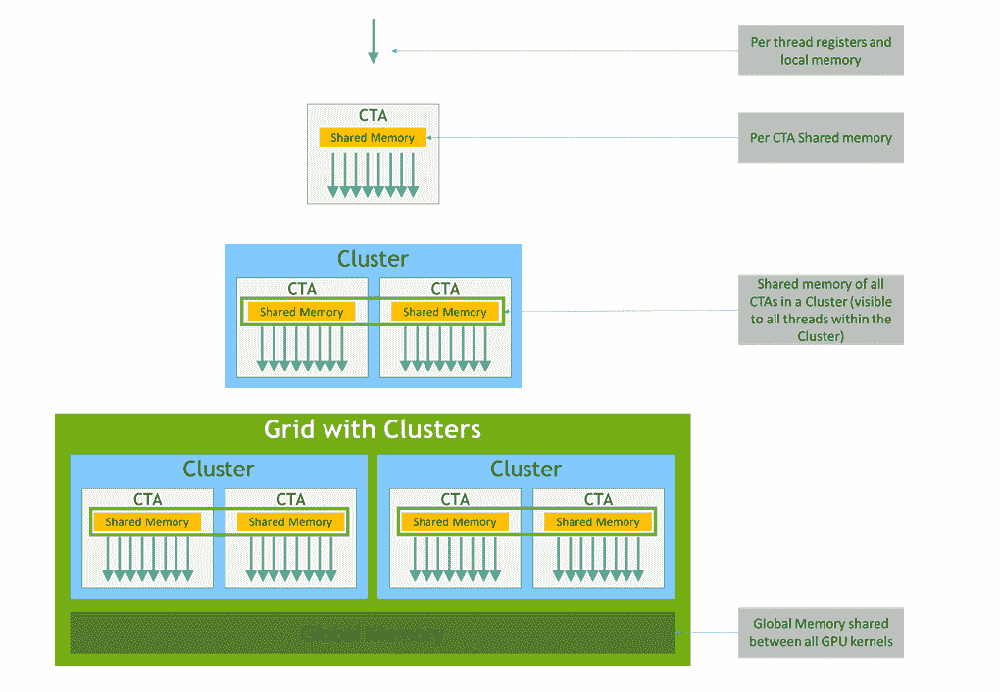

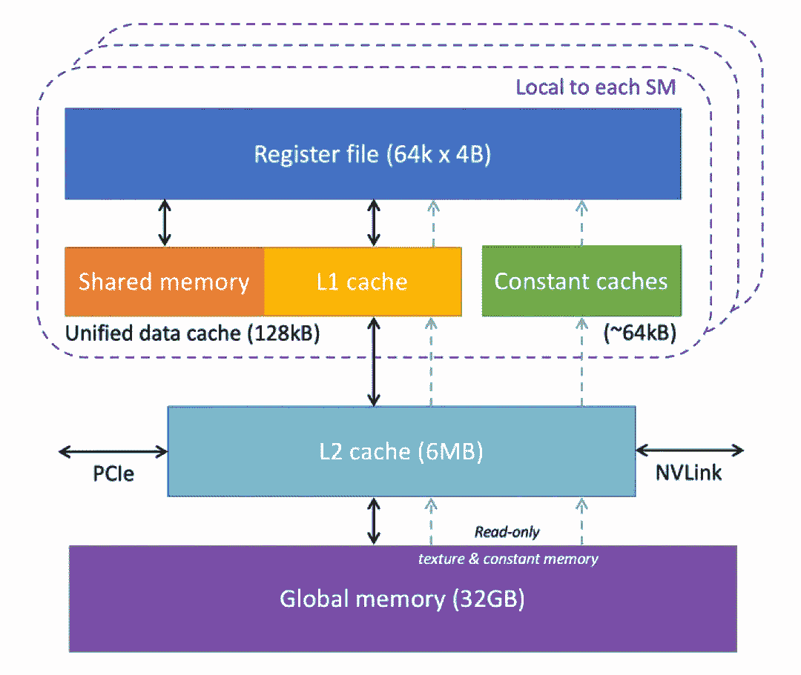

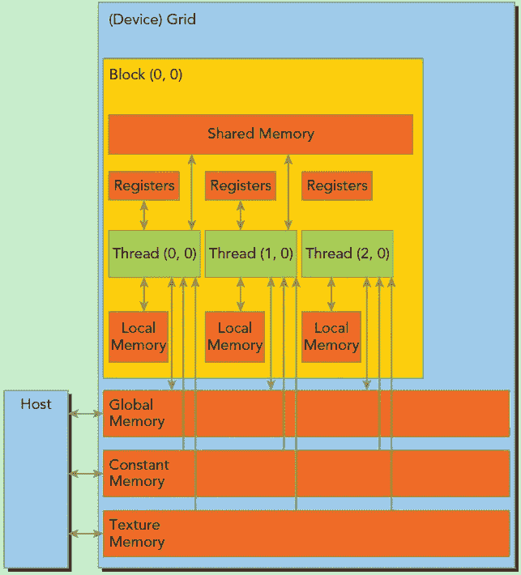

## Execution Model

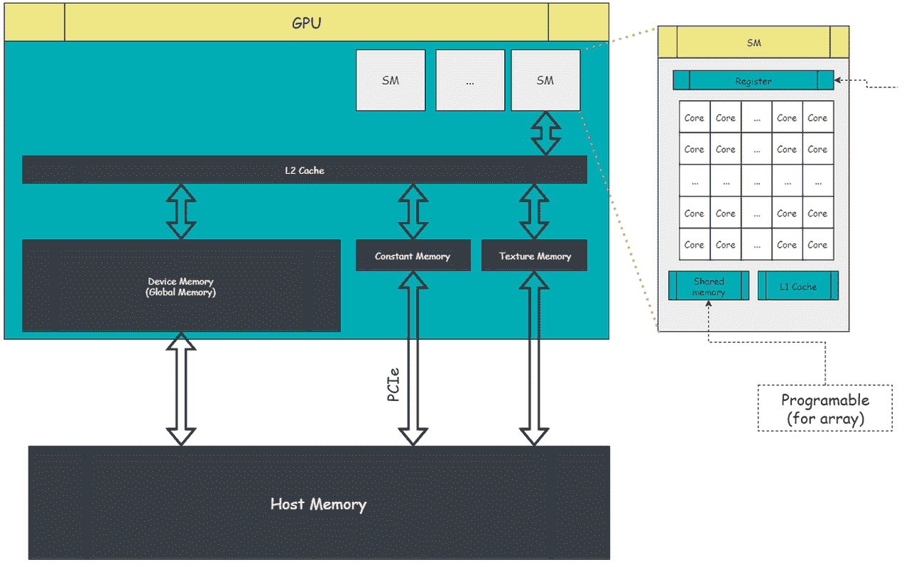

### hardware model

SIMT 执行模型，关键前提：

1. fast barrier synchronization
1. lightweight thread creation
1. zero schedule overhead

warp 内的 thread 是固定的，不会变的，只有所有 thread 都 ready，这个 warp 才会被 scheduler 选中并执行。

不是动态的选出 32 个 ready thread 并临时组成 warp 去立即执行。

对应的关键词是，block 分到 warps 的方式， always the same。warp 内的 thread 是 consecutive （连续）的。

PTX ISA v8.5 Page 17

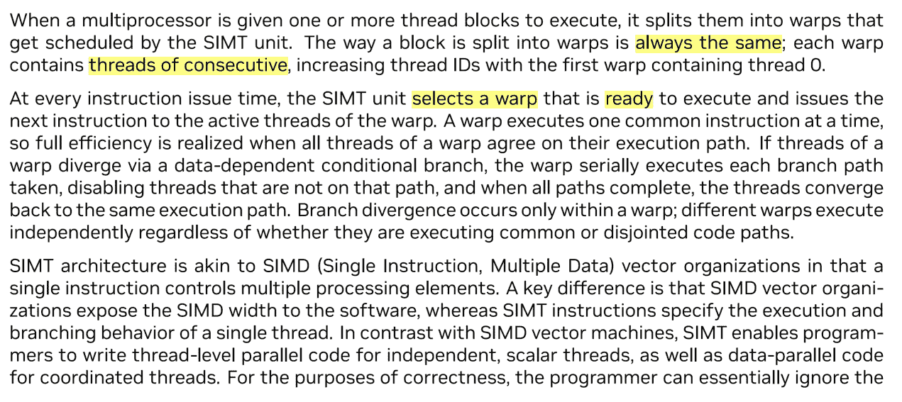

SIMT 的性能，就像 cache line。

只考虑功能正确时，可忽略 cache line size，但 peak performance 必须考虑。

SIMT 的 peak performance，也需要考虑 warp 内的 branch diverge，coalesce loads 的 data length。

hardware model

1. 绿色 processor 是 `SP` - scalar processor。
1. 黄色 multi-processor 是 `SM` - streaming multi-processor。

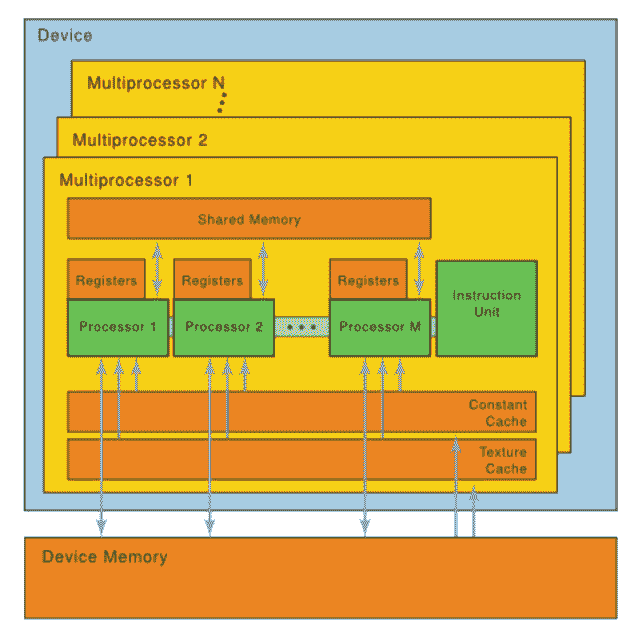

硬件: `SP`, `SM`, warp

| 名词 | Notes |
| --- | --- |
| `SP` (Scalar Processor) | GPU 最基本的处理单元 |
| `SM` (Streaming MultiProcessor) | 包含多个 `SP` (Scalar Processor) + 1 multithreaded instruction unit + shared memory, |
|  |  |
| `Thread` | 线程，单 lane |
| `Warp` | 硬件调度的最小单元，SIMT 单元，warp 内 thread 执行同一段指令 |
| `stream` | GPU 运行程序的一个组织单位，类似于 CPU 的进程。 |

### warp

warp 是 hardware 概念，最基本的执行单元。

包含 32 个并行 threads。

当 kernel 执行时，thread block 被分配到 `SM` 上。

一个 block 的 threads 只能在 1 个 `SM` 上。1 个 `SM` 上可以调度多个 block。

一个 SM 的 CUDA core 会分成几个 warp，由 warp scheduler 负责调度。

1 个 block 的 warp 数量： thread number / `warp-size`

```
cuda_kernel<<<grid_size, block_size, 0, stream>>>(...)
```

+ `grid_size`: block number of a kernel grid
+ `block_size`: thread number of a block. 最好是 32/64 的整数倍

thread，block，gird在不同维度的大小根据算力不同是有限制的

https://en.wikipedia.org/wiki/CUDA

https://docs.nvidia.com/cuda/cuda-c-programming-guide/index.html#features-and-technical-specifications

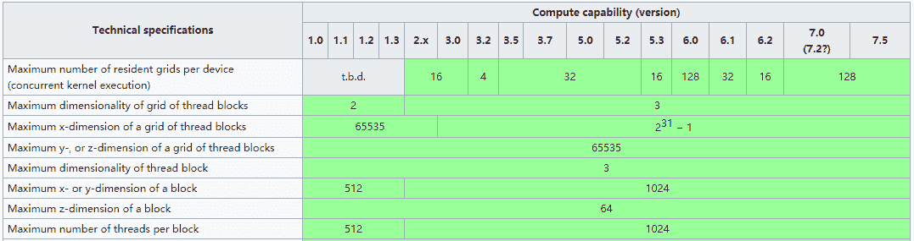

thread 调度

thread 并行是 hardware 接管的，不用 software 处理。

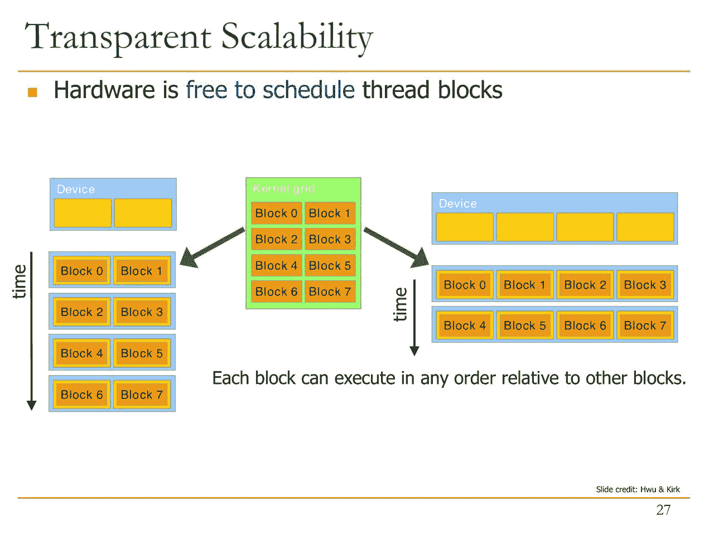

### Warp 内的 PC 问题

Volta 架构之前，warp 内 32 个 thread 共享一个 `PC` register，+ 一个 active mask。

V100 引入了 Independent Thread Scheduling，改变了 warp-synchronicity 的行为。

PTX ISA v8.5 Page 19

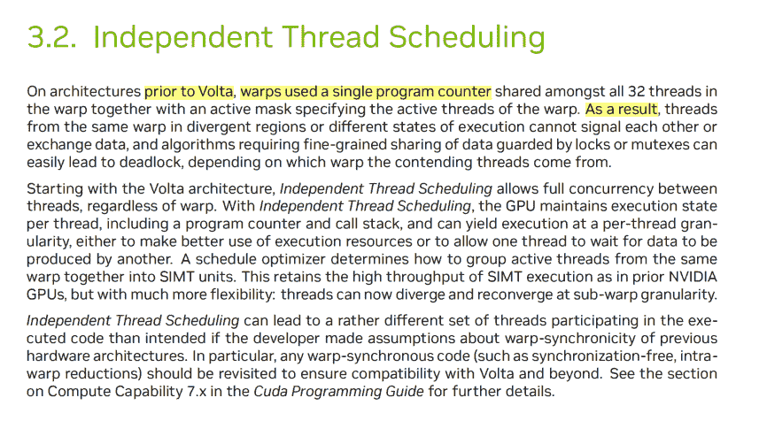

从Volta开始，线程调度发生了变化，在Pascal以及之前的GPU上，每个Warp里的32个线程共享一个Program Counter (简称`PC`) ，并且使用一个Active Mask表示任意时刻哪些线程是可运行的，一个经典的运行如下。

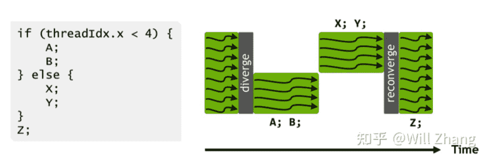

直到第一个分支完整结束，才会执行另一个分支。这意味着同一个warp内不同分支失去了并发性，不同分支的线程互相无法发送信号或者交换数据，但同时，不同warp之间的线程又保留了并发性，这当中的线程并发存在着不一致，事实上如果程序员不注意这点，很可能导致死锁。

在Volta中解决了这个问题，同warp内的线程有独立的`PC`和栈，如下。

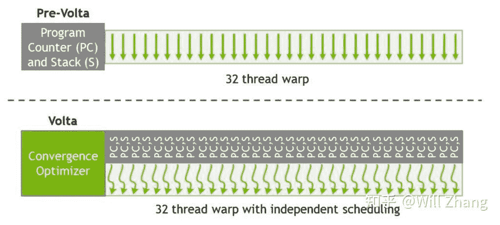

由于运行时仍然要符合SIMT，所以存在一个调度优化器负责将可运行的线程分组，使用SIMT模式执行。经典运行如下。

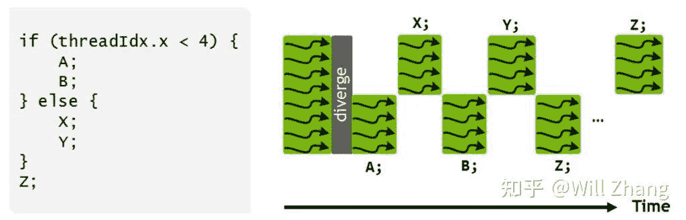

上图可以注意到，`Z`的执行并没有被合并，这是因为`Z`可能会产生一些被其他分支需要的数据，所以调度优化器只有在确定安全的情况下才会合并`Z`，所以上图`Z`未合并只是一种情况，一般来说，调度优化器足够聪明可以发现安全的合并。程序员也可以通过一个API来强制合并，如下。

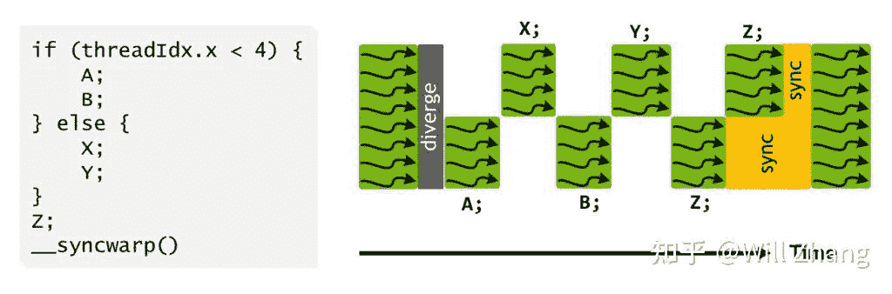

从Volta开始，提高了对多进程并发使用GPU的支持。在Pascal及之前，多个进程对单一GPU的使用是经典的时间片方式。从Volta开始，多个用不满GPU的进程可以在GPU上并行，如下图。

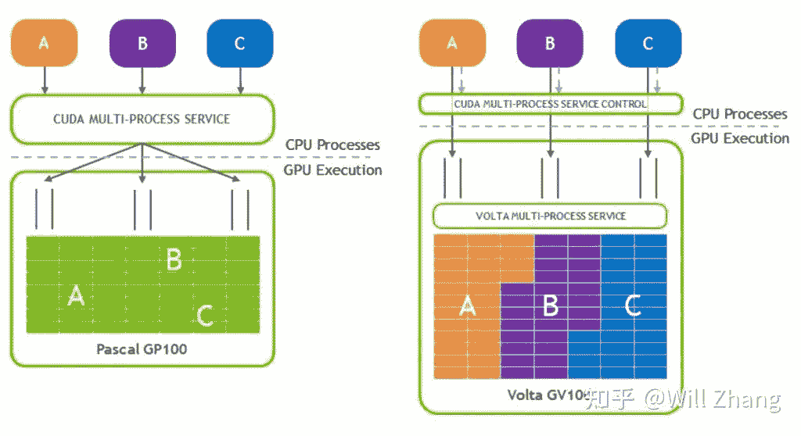

### `grid_size` & `block_size`

https://mp.weixin.qq.com/s/1_ao9xM6Qk3JaavptChXew

如何设置CUDA Kernel中的`grid_size`和`block_size`？

调度相关的资源一般会表现为两个具体的限制，Maximum number of resident blocks per `SM` 和 Maximum number of resident threads per `SM` ，也就是 `SM` 上最大同时执行的 block 数量和线程数量

`SM` 上并发执行的线程数和`SM` 上最大支持的线程数的比值，被称为 Occupancy，更高的 Occupancy 代表潜在更高的性能。


显然，一个 kernel 的 `block_size` 应大于 `SM` 上最大线程数和最大 block 数量的比值，否则就无法达到 100% 的 Occupancy，对应不同的架构，这个比值不相同，对于 V100 、 A100、 GTX 1080 Ti 是 2048 / 32 = 64，对于 RTX 3090 是 1536 / 16 = 96，所以为了适配主流架构，如果静态设置 `block_size` 不应小于 96。考虑到 block 调度的原子性，那么 `block_size` 应为 `SM` 最大线程数的约数，否则也无法达到 100% 的 Occupancy，主流架构的 GPU 的 `SM` 最大线程数的公约是 512，96 以上的约数还包括 128 和 256，也就是目前为止，`block_size` 的可选值仅剩下 128 / 256 / 512 三个值。

还是因为 block 调度到 `SM` 是原子性的，所以 `SM` 必须满足至少一个 block 运行所需的资源，资源包括 shared memory 和寄存器，shared memory 一般都是开发者显式控制的，而如果 block 中线程的数量 * 每个线程所需的寄存器数量大于 `SM` 支持的每 block 寄存器最大数量，kernel 就会启动失败。

目前主流架构上，`SM` 支持的每 block 寄存器最大数量为 32K 或 64K 个 32bit 寄存器，每个线程最大可使用 255 个 32bit 寄存器，编译器也不会为线程分配更多的寄存器，所以从寄存器的角度来说，每个 `SM` 至少可以支持 128 或者 256 个线程，`block_size` 为 128 可以杜绝因寄存器数量导致的启动失败，但是很少的 kernel 可以用到这么多的寄存器，同时 `SM` 上只同时执行 128 或者 256 个线程，也可能会有潜在的性能问题。但把 `block_size` 设置为 128，相对于 256 和 512 也没有什么损失，128 作为 `block_size` 的一个通用值是非常合适的。

确定了 `block_size` 之后便可以进一步确定 `grid_size`，也就是确定总的线程数量，对于一般的 elementwise kernel 来说，总的线程数量应不大于总的 element 数量，也就是一个线程至少处理一个 element，同时 `grid_size` 也有上限，为 Maximum x-dimension of a grid of thread blocks ，目前在主流架构上都是 2^31 - 1，对于很多情况都是足够大的值。

# Triton - Programming Model

moved to [Triton 设计思想 & Paper 理解 - WIP](https://deep-learning.feishu.cn/wiki/EXWGwc9xniMKSukrN8DcO4KWnJc?fromScene=spaceOverview)

## CUDA vs Triton 的 scope 对比

TODO 根据模型切分，整理出新 hardware 上的这个 scope 定义。

### 编译器优化的 scope

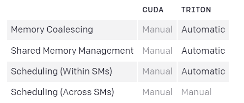

### 更具体的对比

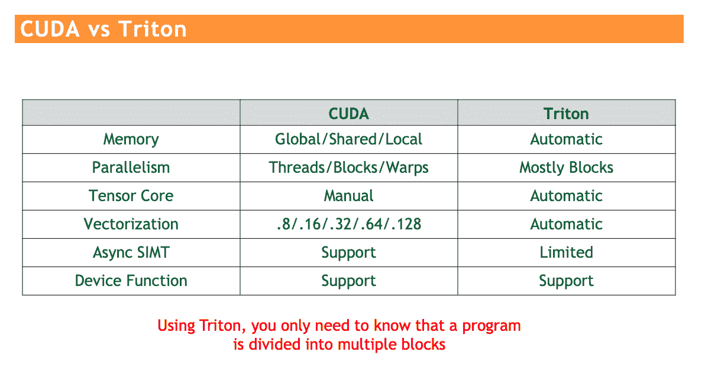

## Triton Programming Model

kernels are defined as decorated Python functions, launched concurrently with different `program_id`’s on a grid of so-called instances.

Triton exposes intra-instance parallelism via operations on blocks—small arrays whose dimensions are powers of two—rather than a Single Instruction, Multiple Thread (SIMT)(7) execution model. In doing so, Triton effectively abstracts away all the issues related to concurrency within CUDA thread blocks (e.g., memory coalescing, shared memory synchronization/conflicts, tensor core scheduling).

CUDA 的 kernel launch，传入 `grid_size` 和 `block_size`，在 kernel function 内，编写一个 thread 的逻辑。

Triton 的 kernel launch，只传入 `grid_size` 一个参数。在 kernel function 内，编写一个 block 的逻辑。block 内交给 compiler 去处理。

Triton 的编程模式，其实更贴合 GPGPU 的 execution model。在 hardware 单元上，GPU 也是按 warp 执行的，而不是 thread。在 SIMT 中的 Thread，也是 CUDA 创造出来，简化 parallel programming 难度的。

CUDA 的 SIMT 抽象，并没有屏蔽掉 memory coalescing, shared memory synchronization/conflicts 这些同样由 parallel programming 引入的疑难问题。

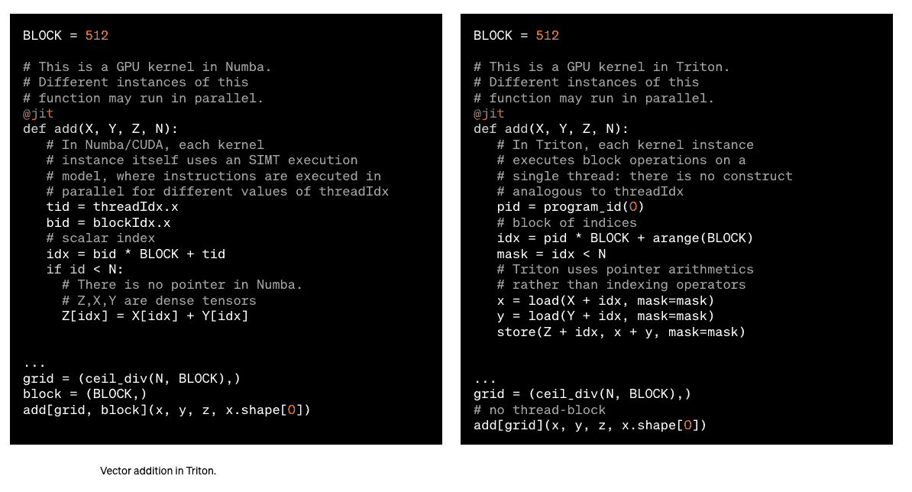

## Example Code

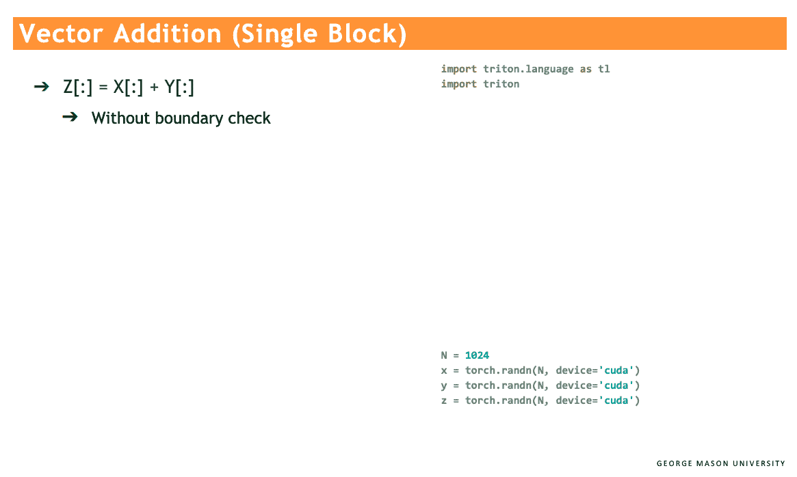

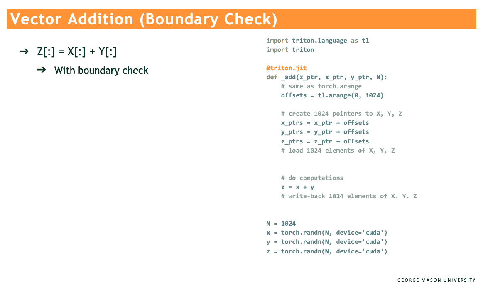

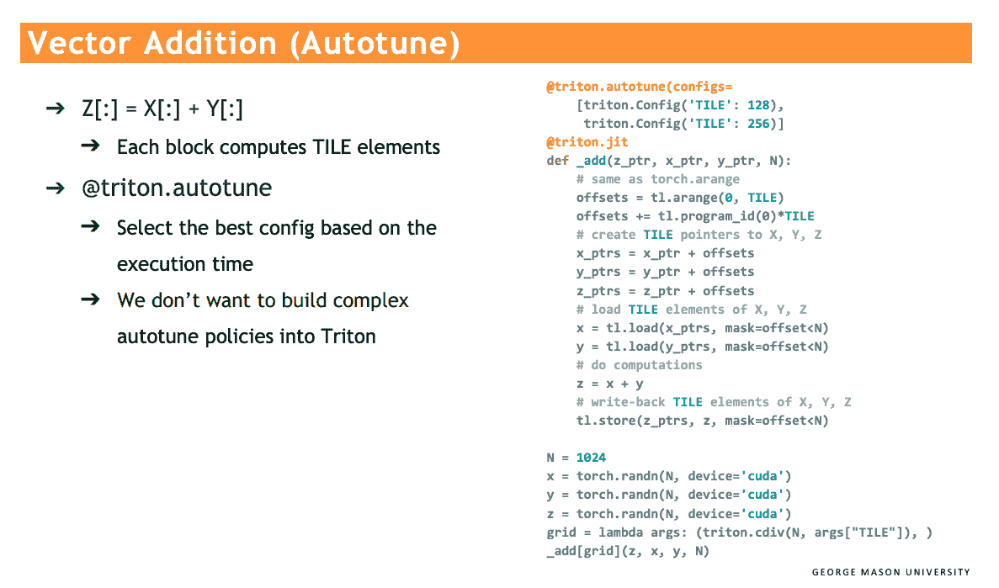

## Pass

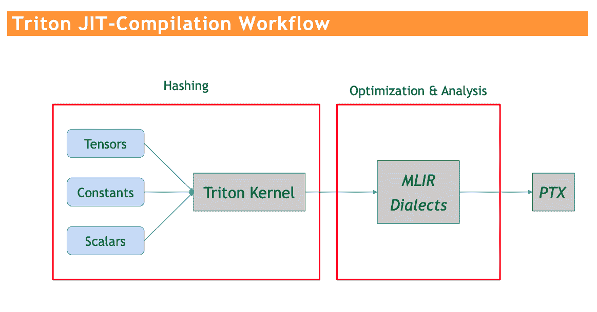

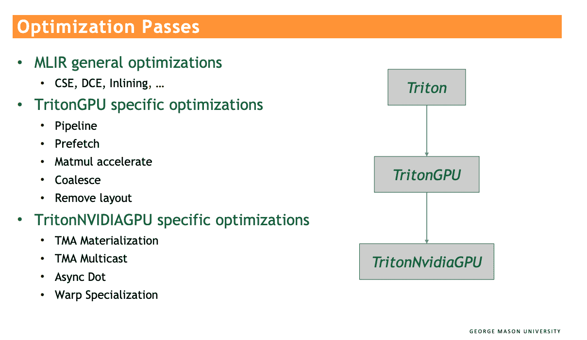

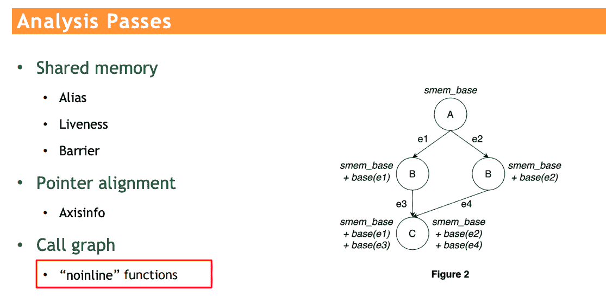

## Data Layout

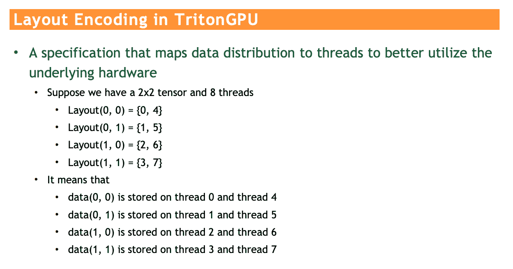

### Block Layout

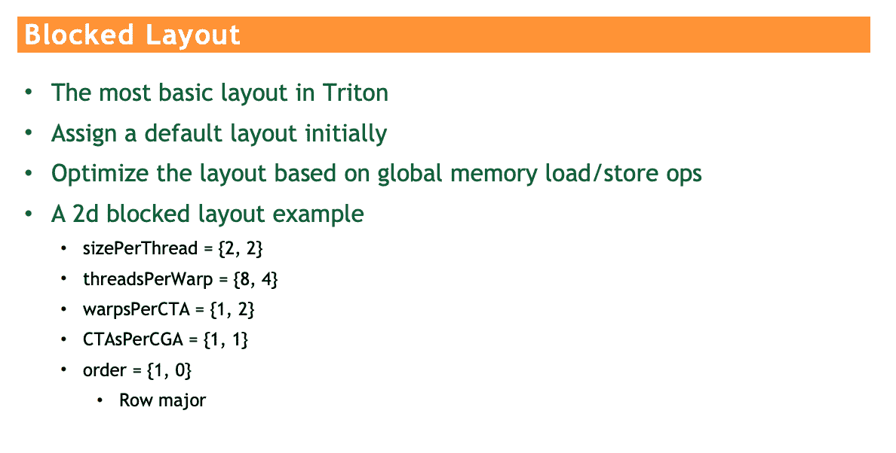

### Share Layout

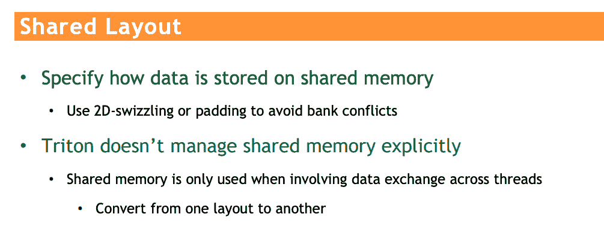

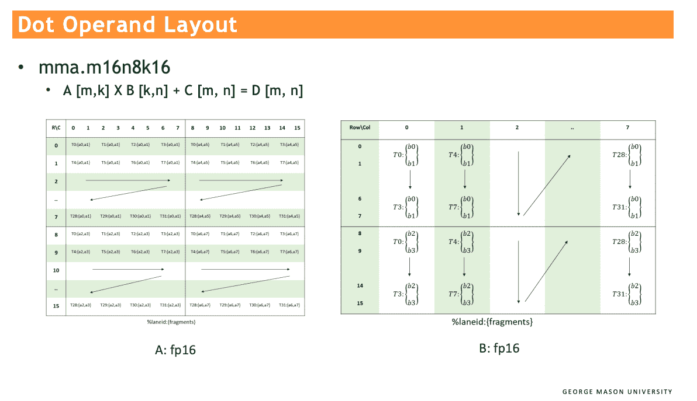

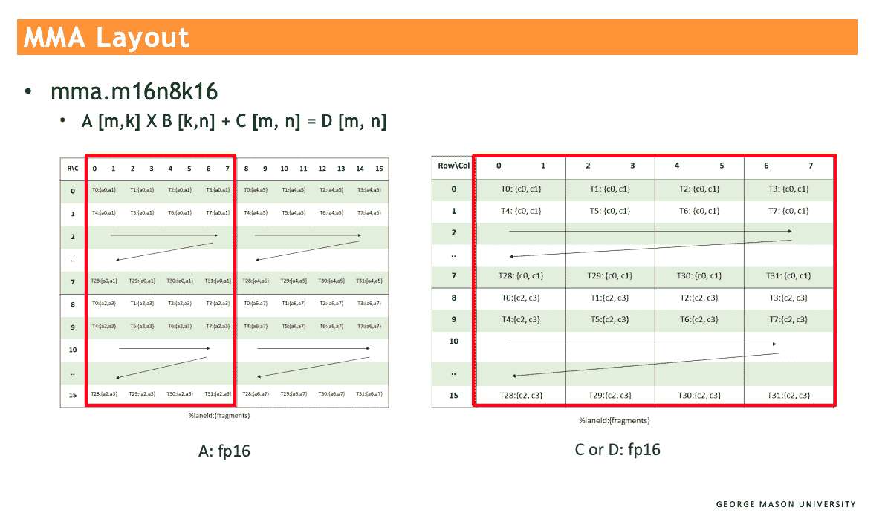

## Language

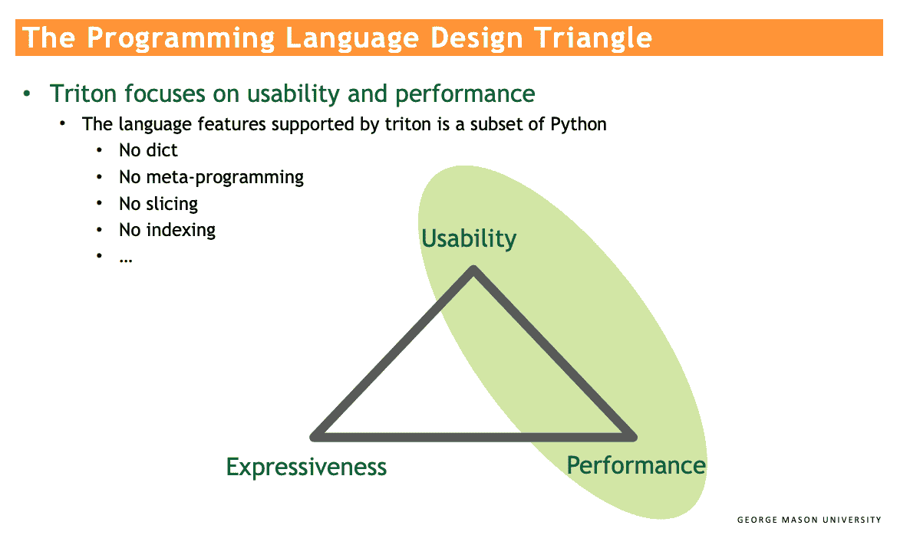

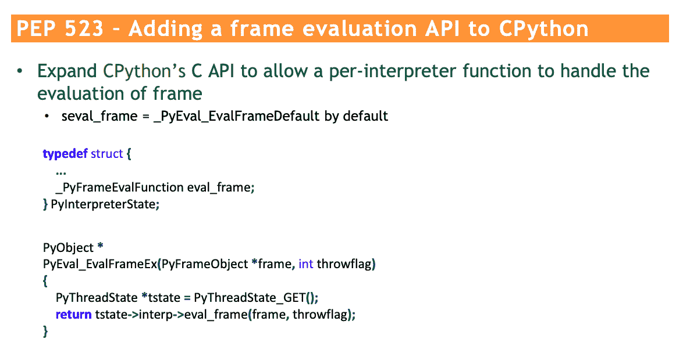

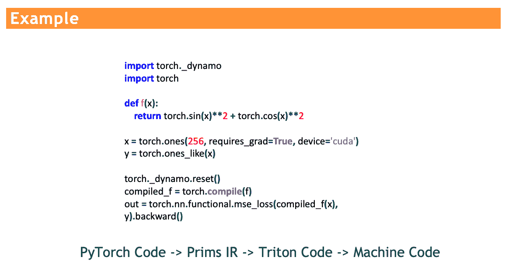

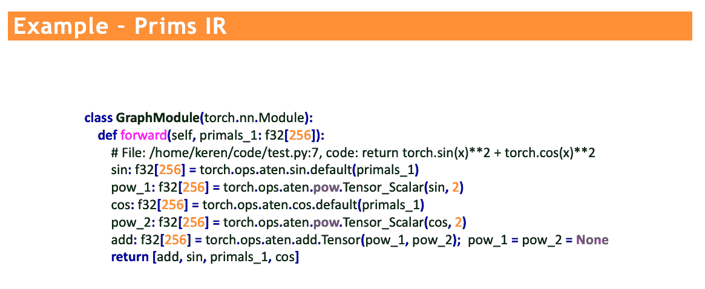

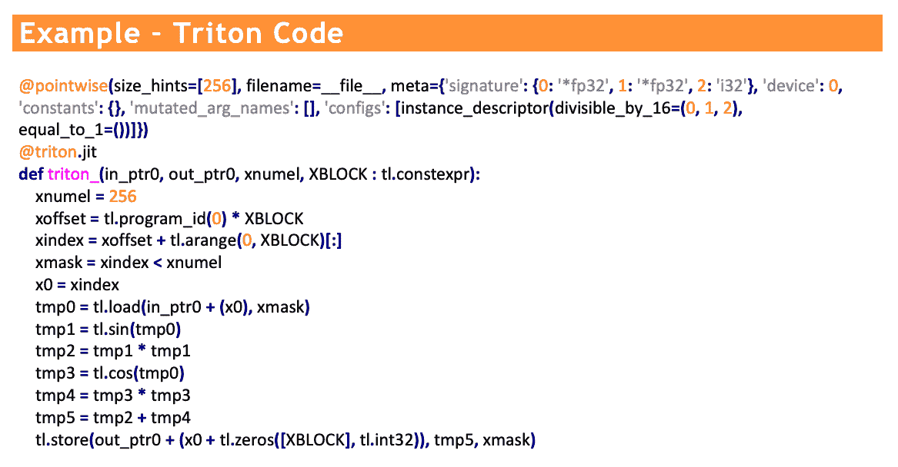

# CUDA program

## program structure

[Hands On Cuda](https://deep-learning.feishu.cn/wiki/O7CAw3cWcieIhEkYLKbcGHXnngD?fromScene=spaceOverview)

## CUDA Context

管理由 Driver 层分配的资源的生命周期。

多线程分配调用的 GPU 资源同属一个 `context` 下，通常与 CPU 的一个进程对应。

对于 `context` 的创建与管理，CUDA runtime 和 CUDA driver API 的方式稍有不同：

CUDA runtime 软件库通过延迟初始化（deferred initialization）来创建 `context`，也就是 lazy initialization。具体意思是在调用每一个 CUDART 库函数时，它会检查当前是否有 `context` 存在，假如需要 `context`，那么才自动创建。也就是说需要创建上面这些对象的时候就会创建 `context`。

runtime也可以通过调用 `cudaFree(0)` 来强制显式地初始化 `context`。-- why?

cuda runtime 将 `context` 和 device 的概念合并了，即在一个 gpu 上操作可看成在一个 `context` 下。

而在驱动这一层的Driver API里，创建的 `context` 是针对一个线程的，即一个device，对应多个 `context`，每个 `context` 对应多个线程，线程之间的 `context` 可以转移。

在driver API中，每一个cpu线程必须要创建 `context`，或者从其他cpu线程转移 `context`。如果没有创建 `context`，直接调用 driver api创建上面那些对象，就会报错。

cuda runtime API 都是以 4 个字母 cuda 开头，

所有的 Driver API 都是 2 个字母 cu 开头。

## CUDA Stream

CUDA随笔之Stream的使用

https://zhuanlan.zhihu.com/p/51402722

host 发到 device 上的 cuda 操作，都是异步的，按照 `stream` 中 host 代码调度顺序执行。

操作包括：`h2d`, launch kernel, device query 等。

CUDA runtime API默认的 `default stream` 是同步串行的，且一个进程内的所有线程都在 `default stream` 下，需要显式声明 `default` 之外的 `Stream` 才可以实现多流并发。

## Memory Layout

1D 指的是，grid/block/thread 都是 1D 的形式。还可以是 2D，与 Tensor 结构更容易匹配。

2D 的，更好用。

## intra-SM parallelism

Hardware Compute Partitioning on NVIDIA GPUs

http://rtsrv.cs.unc.edu/cgit/cgit.cgi/libsmctrl.git/about/

目前没法在CUDA里指定 `thread block` 调度到的 `SM`，但是可以利用 `thread block` 到 `SM` 的调度机制来将 `thread block` 送到某个 `SM` 中

https://mivenhan.github.io/publication/2021plasticine/2021plasticine.pdf

https://github.com/manospavlidakis/pascalComputePreemption/blob/main/priority-interrupt/priority-interrupt.cu

https://dl.acm.org/doi/10.1145/3453953.3453972

2021

Demystifying the Placement Policies of the NVIDIA GPU Thread Block Scheduler for Concurrent Kernels

In this work, we empirically derive the scheduler's behavior under concurrent workloads for NVIDIA's Pascal, Volta, and Turing microarchitectures. In contrast to past studies that suggest the scheduler uses a round-robin policy to assign thread blocks to streaming multiprocessors (SMs), we instead find that the scheduler chooses the next SM based on the SM's local resource availability. We show how this scheduling policy can lead to significant, and seemingly counter-intuitive, performance degradation; for example, a decrease of one thread per block resulted in a 3.58X increase in execution time for one kernel in our experiments. We hope that our work will be useful for improving the accuracy of GPU simulators and aid in the development of novel scheduling algorithms.

https://xplorestaging.ieee.org/document/9113104

2020

Dissecting the CUDA scheduling hierarchy: a Performance and Predictability Perspective

Over the last few years, the ever-increasing use of Graphic Processing Units (GPUs) in safety-related domains has opened up many research problems in the real-time community. The closed and proprietary nature of the scheduling mechanisms deployed in NVIDIA GPUs, for instance, represents a major obstacle in deriving a proper schedulability analysis for latency-sensitive applications. Existing literature addresses these issues by either (i) providing simplified models for heterogeneous CPUGPU systems and their associated scheduling policies, or (ii) providing insights about these arbitration mechanisms obtained through reverse engineering. In this paper, we take one step further by correcting and consolidating previously published assumptions about the hierarchical scheduling policies of NVIDIA GPUs and their proprietary CUDA application programming interface. We also discuss how such mechanisms evolved with recently released GPU micro-architectures, and how such changes influence the scheduling models to be exploited by real-time system engineers.

https://xplorestaging.ieee.org/document/10475953

2023

Randomized Testing Framework for Dissecting NVIDIA GPGPU Thread Block-To-SM Scheduling Mechanisms

# 常用 code

## peak_gflops

`calc_peak_gflops.cpp`


# 编译

```c
#include <stdio.h>
#include <stdlib.h>
#include <string.h>

#include <cuda_runtime.h>

#define CHECK_CUDA(x, str) \
  if((x) != cudaSuccess) \
  { \
    fprintf(stderr, str); \
    exit(EXIT_FAILURE); \
  }

int cc2cores(int major, int minor)
{
  typedef struct
  {
    int SM;
    int Cores;
  } sSMtoCores;

  sSMtoCores nGpuArchCoresPerSM[] =
  {
    {0x30, 192},
    {0x32, 192},
    {0x35, 192},
    {0x37, 192},
    {0x50, 128},
    {0x52, 128},
    {0x53, 128},
    {0x60,  64},
    {0x61, 128},
    {0x62, 128},
    {0x70,  64},
    {0x72,  64},
    {0x75,  64},
    {0x80,  64},
    {-1, -1}
  };

  int index = 0;

  while (nGpuArchCoresPerSM[index].SM != -1)
  {
    if (nGpuArchCoresPerSM[index].SM == ((major << 4) + minor))
    {
      return nGpuArchCoresPerSM[index].Cores;
    }

    index++;
  }

  printf(
      "MapSMtoCores for SM %d.%d is undefined."
      "  Default to use %d Cores/SM\n",
      major, minor, nGpuArchCoresPerSM[index - 1].Cores);
  return nGpuArchCoresPerSM[index - 1].Cores;
}

bool has_fp16(int major, int minor)
{
  int cc = major * 10 + minor;
  return ((cc == 60) || (cc == 62) || (cc == 70) || (cc == 75) || (cc == 80));
}
bool has_int8(int major, int minor)
{
  int cc = major * 10 + minor;
  return ((cc == 61) || (cc == 70) || (cc == 75) || (cc == 80));
}
bool has_tensor_core_v1(int major, int minor)
{
  int cc = major * 10 + minor;
  return ((cc == 70) || (cc == 72) );
}
bool has_tensor_core_v2(int major, int minor)
{
  int cc = major * 10 + minor;
  return (cc == 75);
}
bool has_tensor_core_v3(int major, int minor)
{
  int cc = major * 10 + minor;
  return (cc == 80);
}

int main(int argc, char **argv)
{
  cudaDeviceProp prop;
  int dc;
  CHECK_CUDA(cudaGetDeviceCount(&dc), "cudaGetDeviceCount error!");
  printf("GPU count = %d\n", dc);

  for(int i = 0; i < dc; i++)
  {
    printf("=================GPU #%d=================\n", i);
    CHECK_CUDA(cudaGetDeviceProperties(&prop, i), "cudaGetDeviceProperties error");
    printf("GPU Name = %s\n", prop.name);
    printf("Compute Capability = %d.%d\n", prop.major, prop.minor);
    printf("GPU SMs = %d\n", prop.multiProcessorCount);
    printf("GPU CUDA cores = %d\n", cc2cores(prop.major, prop.minor) * prop.multiProcessorCount);
    printf("GPU SM clock rate = %.3f GHz\n", prop.clockRate/1e6);
    printf("GPU Mem clock rate = %.3f GHz\n", prop.memoryClockRate/1e6);
    printf("FP32 Peak Performance = %.3f GFLOPS\n", cc2cores(prop.major, prop.minor) * prop.multiProcessorCount * (prop.clockRate / 1e6) * 2);
    if(has_fp16(prop.major, prop.minor))
    {
      printf("FP16 Peak Performance = %.3f GFLOPS\n", cc2cores(prop.major, prop.minor) * prop.multiProcessorCount * (prop.clockRate / 1e6) * 2 * 2);
    }
    if(has_int8(prop.major, prop.minor))
    {
      printf("INT8 Peak Performance = %.3f GFLOPS\n", cc2cores(prop.major, prop.minor) * prop.multiProcessorCount * (prop.clockRate / 1e6) * 2 * 4);
    }
    if(has_tensor_core_v1(prop.major, prop.minor))
    {
      printf("Tensor Core FP16 Peak Performance = %.3f GFLOPS\n", cc2cores(prop.major, prop.minor) * prop.multiProcessorCount * (prop.clockRate / 1e6) * 2 * 8);
    }
    if(has_tensor_core_v2(prop.major, prop.minor))
    {
      printf("Tensor Core FP16 Peak Performance = %.3f GFLOPS\n", cc2cores(prop.major, prop.minor) * prop.multiProcessorCount * (prop.clockRate / 1e6) * 2 * 8);
      printf("Tensor Core INT8 Peak Performance = %.3f GFLOPS\n", cc2cores(prop.major, prop.minor) * prop.multiProcessorCount * (prop.clockRate / 1e6) * 2 * 16);
    }
    if(has_tensor_core_v3(prop.major, prop.minor))
    {
      printf("Tensor Core TF32 Peak Performance = %.3f GFLOPS\n", cc2cores(prop.major, prop.minor) * prop.multiProcessorCount * (prop.clockRate / 1e6) * 2 * 8);
      printf("Tensor Core FP16 Peak Performance = %.3f GFLOPS\n", cc2cores(prop.major, prop.minor) * prop.multiProcessorCount * (prop.clockRate / 1e6) * 2 * 16);
      printf("Tensor Core INT8 Peak Performance = %.3f GFLOPS\n", cc2cores(prop.major, prop.minor) * prop.multiProcessorCount * (prop.clockRate / 1e6) * 2 * 32);
    }
  }
  return 0;
}
```

# 看 device 信息

`nvidia_samples/1_Utilities/deviceQuery/deviceQuery.cpp`

请不要把block size设置过大，否则kernel会启动失败。

max thread per block 有硬件限制。

```cpp
int dev = 0;
cudaDeviceProp devProp;
CHECK(cudaGetDeviceProperties(&devProp, dev));
std::cout << "使用GPU device " << dev << ": " << devProp.name << std::endl;
std::cout << "SM的数量：" << devProp.multiProcessorCount << std::endl;
std::cout << "每个线程块的共享内存大小：" << devProp.sharedMemPerBlock / 1024.0 << " KB" << std::endl;
std::cout << "每个线程块的最大线程数：" << devProp.maxThreadsPerBlock << std::endl;
std::cout << "每个EM的最大线程数：" << devProp.maxThreadsPerMultiProcessor << std::endl;
std::cout << "每个SM的最大线程束数：" << devProp.maxThreadsPerMultiProcessor / 32 << std::endl;
```

```
// GT 730 输出如下
使用GPU device 0: GeForce GT 730
SM的数量：2
每个线程块的共享内存大小：48 KB
每个线程块的最大线程数：1024
每个EM的最大线程数：2048
每个EM的最大线程束数：64
```

# Performance Considerations

GPGPU 的 bottlenecks:

1. CPU-GPU data transfers (PCIe, NVLINK)
2. DRAM Memory Bandwidth (GDDR5, GDDR6, HBM2)
3. data layout

## Memory Access

### Latency Hiding

active warp 数量多一点，hardware 调度更容易 hide long latency operation。

但，warp 最大数量有上限，就是 FGMT 中的 register 和 PC 套数上限。

### Occupancy

有的 program 需要 2 register per thread。有的可能是 4 register per thread。

所以，max warp number 也可能不一样。

### Memory Coalescing

nearby 的核心目的是，提高 cache line 的命中率。如果没命中同一个 cache line，是否 nearby 都一样。

### AoS v.s. SoA

所以，RISC-V CPU 和 GPGPU 可能很难共享同一套 data layout，进而导致没法兼容一套 pipeline / lowering 过程。

CPU 可以接受很大的 structure。每个 thread 有自己的 cache，把一个 structure 完整 load 进 thread cache，后面访问其他 element 更容易命中 cache line。

GPU 是多个 thread 执行相同的指令，访问不同的数据，所以，先 load 所有 A，再 load 所有 B，更容易在 thread 之间命中 cache line。

### Tiling

### Bank Conflict

[CUDA Swizzle & bank conflict](https://deep-learning.feishu.cn/wiki/SDsgwgjD9iX0gYkkDY9c4s6Anib?fromScene=spaceOverview)

### SIMD Utilization - Divergence

warp 发散。

尽管warp中的线程从同一程序地址，但可能具有不同的行为，比如分支结构，因为GPU规定warp中所有线程在同一周期执行相同的指令，warp发散会导致性能下降。

### Atomic Operations

### CPU-GPU Data Transfers

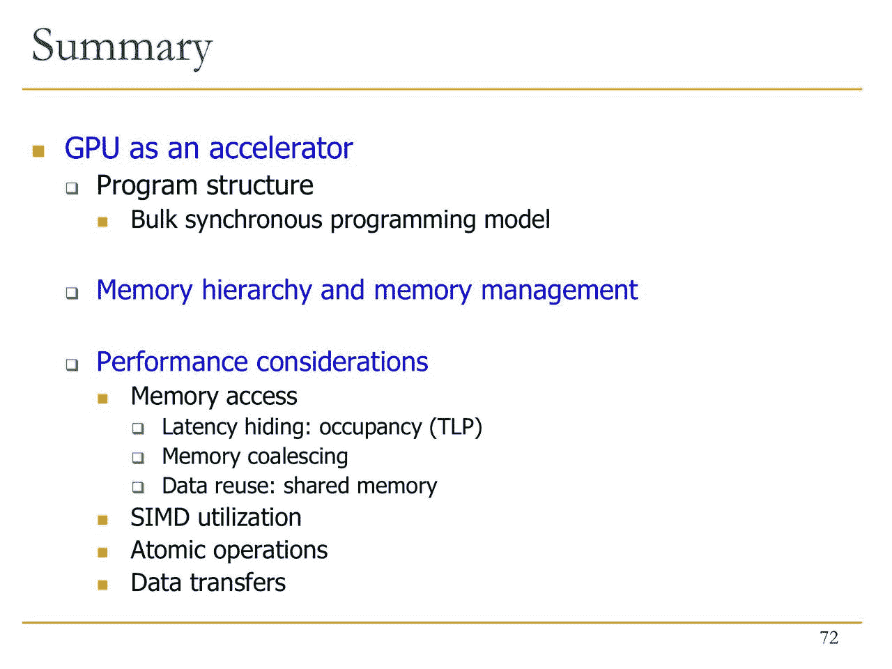

# 并行计算的重要性

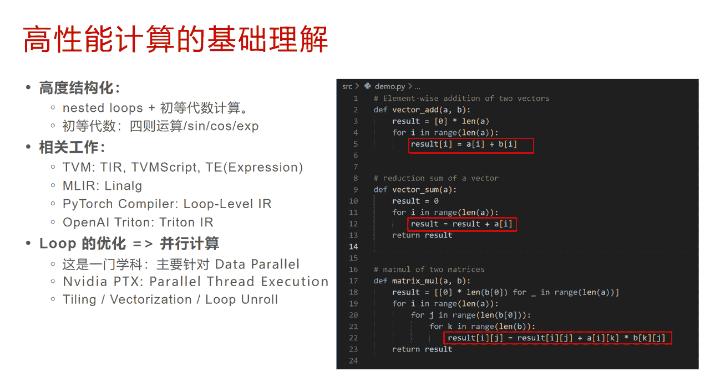

CPU 处理几十的并行度

GPGPU 处理几百 - 几千的并行度。

并行计算很重要，革命已经开启。要从硬件的变化看起。

| 时间 | 阶段 | Notes |

| --- | --- | --- |

| 1980 | Consumer PC 诞生 | CPU 1M Hz |

| 2005 | multi-core 出现 | 用了 25 年 |

| 2010 | 几乎都是 multi-core | 用了 5 年 |

GPU 的兴起

| 时间 | 阶段 | Notes |

| --- | --- | --- |

| late 1980s, early 1900s | 图形加速器需求诞生 |  |

| 1992 | OpenGL Library 发布 | for 3D graphics applications |

|  | GeForce 256 release |  |

| 2001 | GeForce 3 release |  |

| 2006.11 | CUDA and Geforce 8800 GTX | first DirectX 10 GPU |

| ~2007 | CUDA c & hardware driver | 可以操作早期 cuda 架构还不支持的新硬件 feature |

# Collaborative Computing

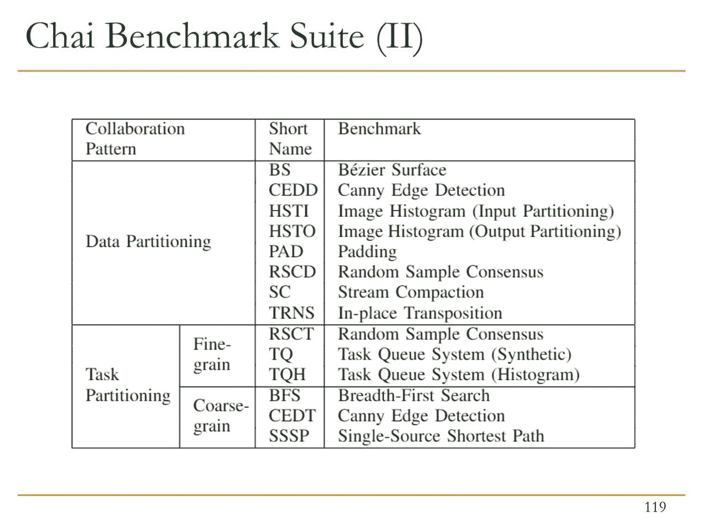

# References

1. https://docs.nvidia.com/cuda/cuda-c-programming-guide/index.html#thread-hierarchy
