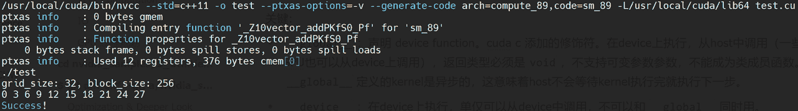
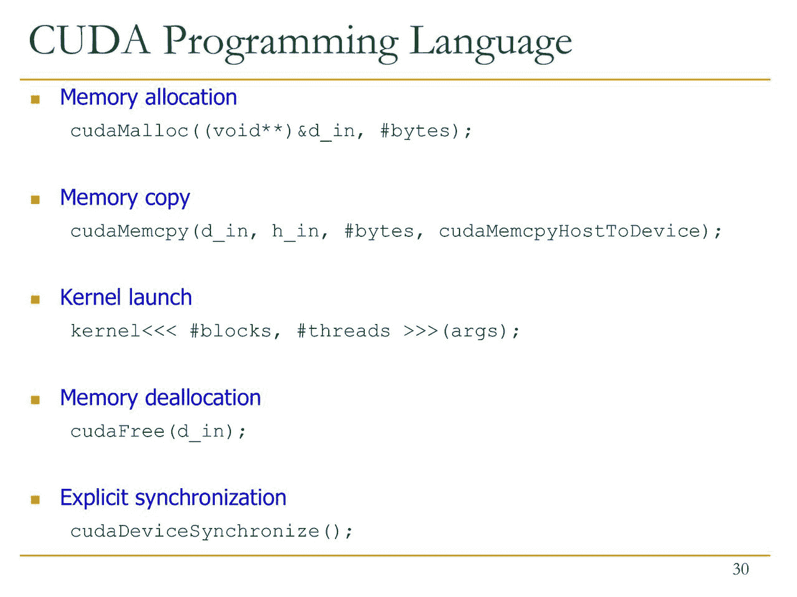
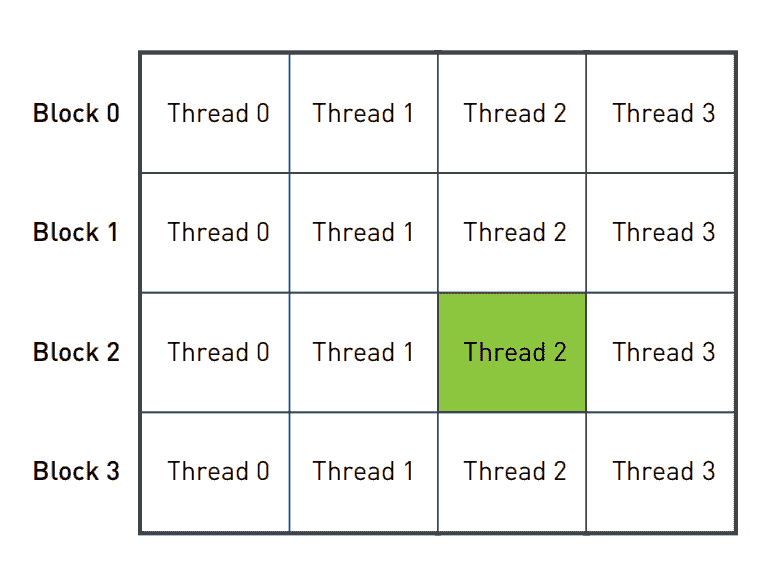
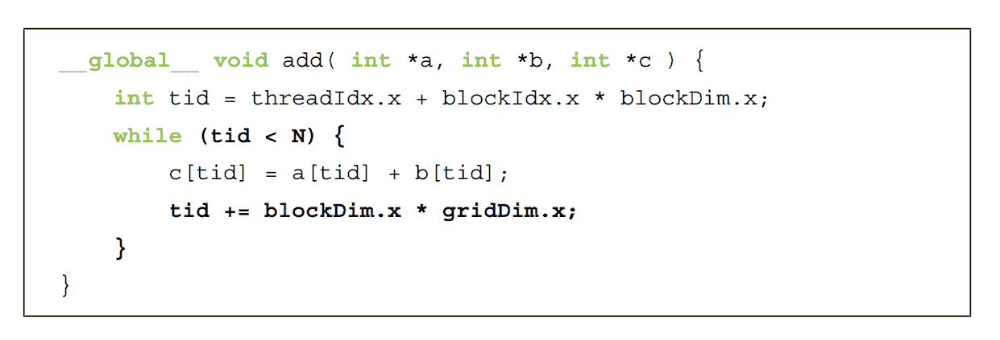
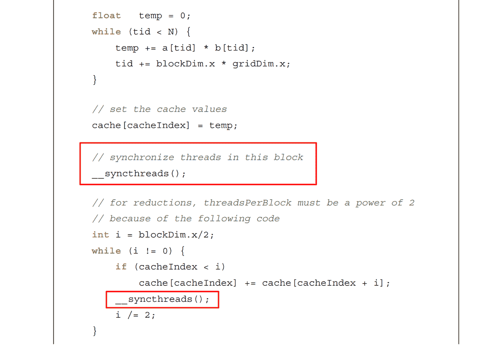
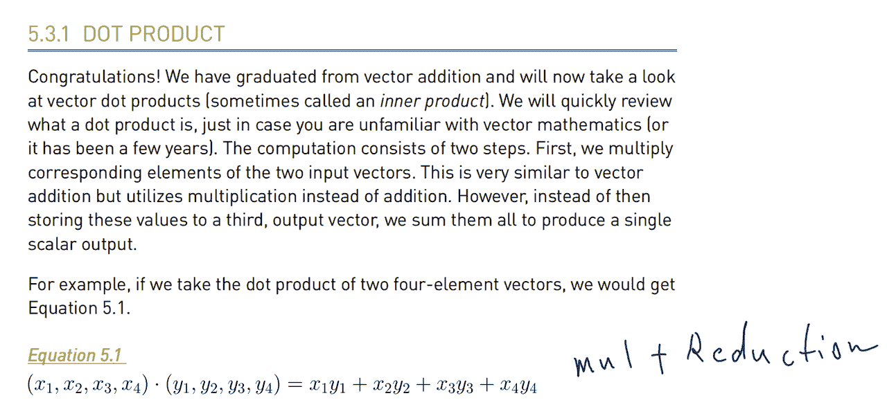
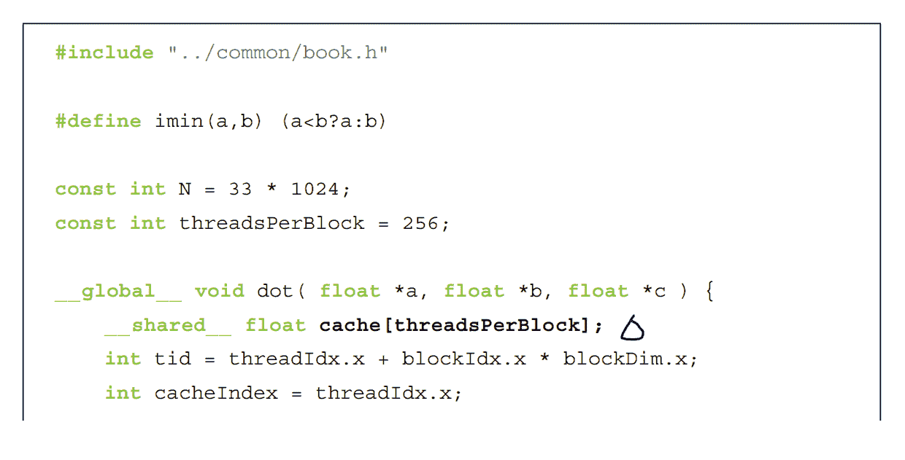
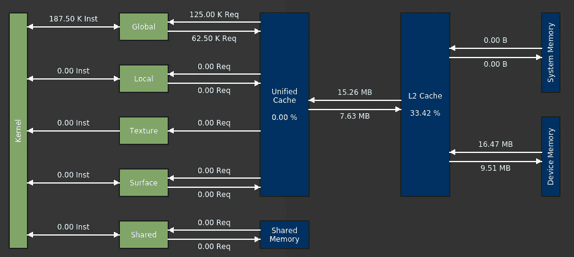
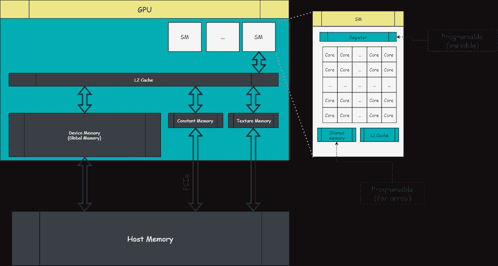

# Hands-On Cuda

> 来源：[https://learning.feishu.cn/docx/LTrIdEbNxodjAkxGYTEcBdTvnnd](https://learning.feishu.cn/docx/LTrIdEbNxodjAkxGYTEcBdTvnnd)

Code: `https://github.com/JackonYang/paper-reading/tree/master/02-tutorial-code/03-hands-on-cuda`

## 第一个 CUDA 程序 - `vector_add`

### 学习目标

实现向量相加（`a + b = c`），掌握三个核心要点:

1. 异构编程区分

   - `Host` 代码（CPU）：默认函数
   - `Device` 代码（GPU）：用 `__global__` 修饰 `Kernel`

1. `cuda` 5 步流程

   1. 分配 `host` / `Device` 内存（`malloc` / `cudaMalloc`）
   1. 数据传到 `device`（`cudaMemcpyHostToDevice`）
   1. Launch `Kernel`（`<<<grid_size, block_size>>>`）
   1. 结果传回 `Host`（`cudaMemcpyDeviceToHost`）
   1. 释放内存（`free` / `cudaFree`）

1. `SIMT` 并行执行模型。

1. Launch `Kernel` 时，配置参数。

   - `grid_size = numOfBlocks`
   - `block_size = numOfThreads`

1. `Kernel` 内计算全局索引，`int tid = blockIdx.x * blockDim.x + threadIdx.x`。

简单来说：搞懂 `cuda` 的流程 & `SIMT` 并行模型。

### Kernel 代码

```cpp
#define N 8192

__global__ void vector_add(const float *a, const float *b, float *c)
{
    // global thread index
    int tid = blockIdx.x * blockDim.x + threadIdx.x;
    if (tid < N)  // check the bound
    {
        c[tid] = a[tid] + b[tid];
    }
}
```

### Host 代码

```cpp
int main(int argc, char* argv[])
{
    float *a, *b, *c;  // host copies of a, b, c
    float *dev_a, *dev_b, *dev_c;  // device copies of a, b, c

    // Allocate memory on the host and initialize
    a = (float*)malloc(N * sizeof(float));
    b = (float*)malloc(N * sizeof(float));
    c = (float*)malloc(N * sizeof(float));

    for (int i = 0; i < N; i++)
    {
        a[i] = static_cast<float>(i);
        b[i] = static_cast<float>(i * 2);
    }

    // Allocate memory on the device
    cudaMalloc((void**)&dev_a, N * sizeof(float));
    cudaMalloc((void**)&dev_b, N * sizeof(float));
    cudaMalloc((void**)&dev_c, N * sizeof(float));

    // Copy input data from host to device
    cudaMemcpy(dev_a, a, N * sizeof(float), cudaMemcpyHostToDevice);
    cudaMemcpy(dev_b, b, N * sizeof(float), cudaMemcpyHostToDevice);

    // Launch kernel
    int block_size = 256;
    int grid_size = (N + block_size - 1) / block_size;
    std::cout << "grid_size: " << grid_size << ", block_size: " << block_size << std::endl;

    vector_add<<<grid_size, block_size>>>(dev_a, dev_b, dev_c);

    // Copy the result from device to the host
    cudaMemcpy(c, dev_c, N * sizeof(float), cudaMemcpyDeviceToHost);

    // clean up (free device memory)
    cudaFree(dev_a);
    cudaFree(dev_b);
    cudaFree(dev_c);
    free(a);
    free(b);
    free(c);

    return 0;
}
```

### `nvcc` 编译 & 运行

`nvcc` 参数解释：

- `-ptxas-options=-v`: 编译时打印 `ptxas` 阶段的寄存器和 `shared_memory` 使用量
- `-arch=compute_89`: compiler 可以用 `sm_89` 及以上的新 feature
- `-generate-code arch=compute_89,code=sm_89`: 编译 `sm_89` 架构的机器指令，即，4090 卡。如果不加，只会编译到 `ptx`，首次运行时，生成对应 `arch` 的机器码。表现为 warmup 速度慢。

运行结果



```bash
/usr/local/cuda/bin/nvcc --std=c++11 -o test --ptxas-options=-v --generate-code arch=compute_89,code=sm_89 -L/usr/local/cuda/lib64 test.cu
ptxas info    : 0 bytes gmem
ptxas info    : Compiling entry function '_Z10vector_addPKfS0_Pf' for 'sm_89'
ptxas info    : Function properties for _Z10vector_addPKfS0_Pf
    0 bytes stack frame, 0 bytes spill stores, 0 bytes spill loads
ptxas info    : Used 12 registers, 376 bytes cmem[0]
./test
grid_size: 32, block_size: 256
0 3 6 9 12 15 18 21 24 27
Success!
```

## perf

H100

```text
N: 1024M, grid_size: 33554432, block_size: 32
Success! time cost: 21.949 ms, HBM Bandwidth: 391.36 GB/s

N: 1024M, grid_size: 16777216, block_size: 64
Success! time cost: 11.039 ms, HBM Bandwidth: 778.16 GB/s

N: 1024M, grid_size: 8388608, block_size: 128
Success! time cost: 7.378 ms, HBM Bandwidth: 1164.28 GB/s

N: 1024M, grid_size: 4194304, block_size: 256
Success! time cost: 7.427 ms, HBM Bandwidth: 1156.59 GB/s

N: 1024M, grid_size: 2097152, block_size: 512
Success! time cost: 7.571 ms, HBM Bandwidth: 1134.58 GB/s

N: 1024M, grid_size: 1048576, block_size: 1024
Success! time cost: 7.821 ms, HBM Bandwidth: 1098.38 GB/s
```

较大的 `block_size` 可能导致每个 block 占用更多寄存器/`SMEM`/`thread`，

从而减少 `SM` 可同时驻留的线程块数量。

最佳的数量，一般是 `128`/`256`。

- 若 `GPU` 的每个 `SM` 最多支持 `1536` 个线程，当 `block_size=1024` 时，每个 `SM` 最多只能驻留 1 个线程块（`1024` 线程），浪费剩余线程容量。
- 若 `block_size=256`，则每个 `SM` 可驻留 6 个线程块（`256×6=1536` 线程），充分利用硬件资源。

在向量加法中，全局内存访问模式是关键性能因素：

- 合并访问（`Coalesced Access`）：当线程块内线程访问连续的全局内存地址时，`GPU` 可合并内存事务，提升吞吐量。
- `block_size` 与内存事务的关系：

无论 `block_size` 大小，只要线程访问模式是连续的，合并效率相同。因此，内存带宽利用率与 `block_size` 无直接关系，但较大的 `block_size` 可能因占用率降低导致整体吞吐量下降。

## extra Notes

`kernel` 代码里面，注意及时 `cudaFree`，以及 `stream` & `sync` 写对。



## 访存合并

```text
N: 1024M, grid_size: 4194304, block_size: 256, elementsPerThread: 1
Success! time cost: 7.389 ms, HBM Bandwidth: 1162.46 GB/s

N: 1024M, grid_size: 2097152, block_size: 256, elementsPerThread: 2
Success! time cost: 6.886 ms, HBM Bandwidth: 1247.39 GB/s

N: 1024M, grid_size: 1048576, block_size: 256, elementsPerThread: 4
Success! time cost: 7.664 ms, HBM Bandwidth: 1120.78 GB/s

N: 1024M, grid_size: 524288, block_size: 256, elementsPerThread: 8
Success! time cost: 12.695 ms, HBM Bandwidth: 676.63 GB/s
```

手动的循环展开，也没用。

使用 `float4` 指令

```text
N: 1024M, grid_size: 1048576, block_size: 256, elementsPerThread: 4
Success! time cost: 6.849 ms, HBM Bandwidth: 1254.25 GB/s
```

code

```cpp
if (tid < N/4) {
    float4 a4 = reinterpret_cast<const float4*>(a)[tid];
    float4 b4 = reinterpret_cast<const float4*>(b)[tid];
    float4 c4;
    c4.x = a4.x + b4.x;
    c4.y = a4.y + b4.y;
    c4.z = a4.z + b4.z;
    c4.w = a4.w + b4.w;
    reinterpret_cast<float4*>(c)[tid] = c4;
}
```

## `vector_add` 进阶

### Memory Copy

`CUDA` runtime offers its own mechanism for allocating host memory: `cudaHostAlloc()`

`pinned memory` (`page-locked host memory`)

The operating system guarantees us that it will never page this memory out to disk,

which ensures its residency in physical memory.

=> safe for the OS to allow an application access to the physical address of the memory, since the buffer will not be evicted or relocated.

=> Knowing the physical address of a buffer, the `GPU` can then use direct memory access (`DMA`) to copy data to or from the host.

The possibility of the CPU moving pageable

data means that using pinned memory for a DMA copy is essential. In fact, even

when you attempt to perform a memory copy with pageable memory, the CUDA

driver still uses DMA to transfer the buffer to the GPU.

Therefore, your copy happens twice, first from a pageable system buffer to a page-locked "staging" buffer and then from the page-locked system buffer to the GPU.

perform memory copies from pageable memory,

the copy speed will be bounded by the lower of the PCIE transfer

speed and the system front-side bus speeds。

一般是 2 倍的 `bandwidth` 收益。

收益：

1. offload 了 `CPU`，纯 `DMA` 直接搬。
1. 省了一次 `host memory` 内 `mem copy` 的时间。

代价，常驻 `host memory`，更容易发生 `OOM`。

服务器也不应该启用这个 `swap` 分区。

体会 `pinned memory` 和 `pagable memory` 在 `PCIE` 带宽上的差异

内存拷贝一般使用什么函数：

1. 同步拷贝使用 `cudaMemcpy`
1. 异步拷贝使用 [`cudaMemcpyAsync`](https://docs.nvidia.com/cuda/cuda-runtime-api/group__CUDART__MEMORY.html#group__CUDART__MEMORY_1g85073372f776b4c4d5f89f7124b7bf79)
1. 详细介绍见: [`https://docs.nvidia.com/cuda/cuda-runtime-api/group__CUDART__MEMORY.html`](https://docs.nvidia.com/cuda/cuda-runtime-api/group__CUDART__MEMORY.html)

什么是 `pinned memory` (页锁定内存)

1. 介绍：[`https://blog.csdn.net/weixin_40446557/article/details/87895954`](https://blog.csdn.net/weixin_40446557/article/details/87895954)
1. 注意：

   1. 无论是 `pageable memory` 还是 `pinned memory`，都是 `CPU` 内存
   1. `pinned memory` 和 `pageable memory` 在 `CPU↔GPU` 通信带宽上是有明显差异的，且 `PCIE` 带宽越高，差异越明显
   1. 背后原因是在使用 `pageable memory` 时，需要有一次 `pageable memory` 到 `pinned memory` 的内存拷贝
   1. 如果希望做到计算通信重叠，则必须使用 `pinned memory`

mem copy

[`https://docs.nvidia.com/cuda/cuda-runtime-api/group__CUDART__MEMORY.html`](https://docs.nvidia.com/cuda/cuda-runtime-api/group__CUDART__MEMORY.html)

[`https://confluence.yitu-inc.com/pages/viewpage.action?pageId=496770668`](https://confluence.yitu-inc.com/pages/viewpage.action?pageId=496770668)

### 改进 `device` `kernel` 的并行度

`grid_size * block_size = number of total threads`


如果`grid_size`和`block_size`都用`1d`的表示，类似一个如下的`2d Tensor`。

另外一种`2d`的画法，如下的画法，可以方便的改成`3d`情况，每一个小格子是一个`multi-dim`的`tensor`。



### 计算`block_size` & `grid_size`的典型方法

```
int block_size = 256;
int grid_size = (N + block_size - 1) / block_size;
```

其中，`grid_size`本质是`ceil(N/block_size)`，上面是不用`ceil`函数的常见`trick`。

`block_size * grid_size`有上限`limit` => 单个`grid`的`thread`数限制。

当`kernel`的`element`数量超过`grid limit`时，一种思路是：

每个`thread`做多个`element`。代码复杂度增加，但效率是很高的。

支持任意`element per thread`的一种思路，用`while loop` + `tid`递增。

在`deep learning`任务中，如果`N`是编译时已知的，可以循环展开。也避免`while loop`引入分支分化的可能性。



如果`kernel`能支持任意数量的`element per thread`，

那么，选一个超过`SM`数量的`grid_size`似乎也没有意义了。

可以直接写`constant`，比如`128`，或者常见`GPU arch SM`数量的最小公倍数。

## Shared memory & Sync (Reduction?)

`splitting blocks into threads`，

可以认为是一种`working around`，适配`hardware`有最大`block number`（`grid_size`）的限制。

`__shared__`修饰符，声明分配在`SMEM`里面的`variable`。

每个`block`在`launch block`的时候，都会有一份`copy`。数据是`private to each block`的。

在`block`内做`data dependency` & `sync`，缩小了`barrier`的代价。

`fast barrier synchronization`也是`SIMT`模型的3大前提之一。

`SIMT`执行模型，关键前提：

1. `fast barrier synchronization`

1. `lightweight thread creation`

1. `zero schedule overhead`

# Reduction

先`element wise`的每个`thread`处理`n`个`element`。

然后把所有`thread`的结果，`reduce`到`1`个`element`。

做`reduction`的时候，如果`input`规模比较小，

为了用满`SM`算力而设置很大的`block number`，不一定是性能最优的。增加了`sync`的代价。

`naive`的实现中，有`2`个`sync`代码。第二行`sync`在`loop`里。

实际的`sync`代价是



`reduction`之前，注意做好`thread`间的`sync`。确保别的`thread`写完再去`read`他的结果。

```
// synchronize threads in this block 
 __syncthreads();
```

This call guarantees that every `thread` in the `block` has completed instructions prior to the `__syncthreads()` before the `hardware` will execute the next instruction on any `thread`.

例子



`code`



## SMEM

## sync & barrier

# GPU 编程的挑战

`single thread`很简单的事情，但`cuda`里面就很复杂了

1. `atomic`。`i++`指令，用`AtomicAdd`

1. `stream`

1. 带`control flow`支持的汇编

# matmul

## Code

例子代码写的不太典型，缺少`tuning`空间。换成`GEMM`的例子。

```
#include <stdio.h>
#include <cuda_runtime.h>
#include <iostream>


static void CheckCudaErrorAux (const char *, unsigned, const char *, cudaError_t);
#define CUDA_CHECK_RETURN(value) CheckCudaErrorAux(__FILE__,__LINE__, #value, value)


/**
 * Check the return value of the CUDA runtime API call and exit
 * the application if the call has failed.
 */
static void CheckCudaErrorAux (const char *file, unsigned line, const char *statement, cudaError_t err){
        if (err == cudaSuccess)
                return;
        std::cerr << statement<< " returned " << cudaGetErrorString(err) << "("<<err<< ") at "<<file<<":"<<line << std::endl;
        exit (1);
}


void generate_matrix(float *data, int size, float init_val){
  for (int i = 0; i < size; i++) {
    data[i] = init_val;
  }
}


__global__ void maxtrix_mul(float* a, float* b, float *c, int dim){
  int id = threadIdx.x;
  int x = id % dim; //每一个线程负载c[y][x]的结果计算
  int y = id / dim;

  #define idx(y,x) y*dim + x
  #pragma unroll //不用管
  for(int i = 0; i < dim; i++) {
    c[idx(y,x)] += a[idx(y,i)]*b[idx(i,x)];//计算c[y][x]
  }
}

int main(int argc, const char *argv[]){
  const int dim = 10;
  int size = dim*dim;
  float* a_host = new(float[size]);
  float* b_host = new(float[size]);
  float* c_host = new(float[size]);

  generate_matrix(a_host, size, 1);
  generate_matrix(b_host, size, 2);


  float *a_device, *b_device, *c_device;
  CUDA_CHECK_RETURN(cudaMalloc((void **) &a_device, size*sizeof(float))); //在GPU上为矩阵分配内存
  CUDA_CHECK_RETURN(cudaMalloc((void **) &b_device, size*sizeof(float)));
  CUDA_CHECK_RETURN(cudaMalloc((void **) &c_device, size*sizeof(float)));

  CUDA_CHECK_RETURN(cudaMemcpy(a_device, a_host, size*sizeof(float), cudaMemcpyHostToDevice)); //把a,b矩阵copy到GPU上
  CUDA_CHECK_RETURN(cudaMemcpy(b_device, b_host, size*sizeof(float), cudaMemcpyHostToDevice));

  maxtrix_mul<<<1,size>>>(a_device, b_device, c_device, dim); //让GPU计算，<<<>>>内指定启动size个线程，这种函数称之为kernel函数。

  CUDA_CHECK_RETURN(cudaDeviceSynchronize()); //暂时不用管
  CUDA_CHECK_RETURN(cudaMemcpy(c_host, c_device, size*sizeof(float), cudaMemcpyDeviceToHost)); //把计算结果c矩阵取回主机内存

  printf("maxtrix multiply finished! c[0][0] = %f", c_host[0]);

  delete(a_host);
  delete(b_host);
  delete(c_host);
  cudaFree(a_device);
  cudaFree(b_device);
  cudaFree(c_device);
  return 0;
}
```

### run

```
nvcc matrix_mul.cu -o run
./run
```

因此保证`GPU`程序就是保证别让`GPU`的`Core`和`CPU`闲着，高效方式主要有两条：

+ 保证并发度，即尽量多用`Core`

+ 用上的`Core`尽量别等待，比如说等`IO`

### 计算`Computation`

如何填满一个`Warp`（32 `thread`）也有一定的讲究（一家人就要整整齐齐的）。因此，这个层面的性能分析往往是：

1. 我用的`Core`够不够。

1. `Warp`的利用率高不高。

### `IO`

其实上图中已经出现了`Register`、`Shared Memory`（`CUDA`可控）、`Cache`这样的组件。那么我们简单介绍一下`IO`构架。

+ 首先`System memory`会通过`PCIe3`连接`GPU`，把数据传入`Device Memory`，这里的带宽上限大概是`12GB/s`。

+ 然后每个`Core`会发起对`Device Memory`读取操作，检查是否命中`Cache`，若没有命中，则由`SM`整体对`Memory Controller`发起读取操作，因此这里最好多个`Core`每次读一段连续的地址，有助于提高`Cache line`的命中从而减少读写`Device Memory`的次数

+ 对于热数据，用户合一自定义使用`Shared memory`进行加速减少`IO`瓶颈。

也就是说，在优化`performance`时，我们需要尽量减少`GPU Core`由于`IO`操作引起的空转。



### `GPU`的基本内存构架



1. 通常我们使用`global memory`，使用`cudaMemcpy`将数据从`host memory`拷贝到`GPU`上。

1. `GPU`有两级`cache`，其中`L1 cache`每个`SM`都有一个，但是比较小。看`GPU`架构图

1. 我们通常将频繁访问的数组放入`shared memory`中，它具有接近`register`的速度。（硬件上，每个`SM`有一个`shared memory`。）

1. 软件上，所有一个`block`内的`thread`共享一个`shared memory`的数据。

## GPU 线程规划

```
...

global
 void maxtrix_mul(float* a, float* b, float *c, int dim){
  int id = threadIdx.x;
  int x = id % dim; //每一个线程负载c[y][x]的结果计算
  int y = id / dim;
 
....
  maxtrix_mul<<<1,size>>>(a_device, b_device, c_device, dim); //让GPU计算，<<<>>>内指定启动size个线程，这种函数称之为kernel函数。
...
```

我们在`kernel`函数的`<<<gird, block>>>`指定`GPU`启动线程的数量和其在`GPU`上的大致分布。

其中`block`和硬件层面的`SM`对应。（请牢记这句话）。

实际上，为了更好的和程序结合，`CUDA`的线程可以成三维排列。虽然没有很大的用处，但是可以减少用户把`thread`的`uid`自己重新在空间中排列的工作。

我们这里简单以一个二维线程分布举例。假设我们在一个`kernel`启动的时候采用了这样的代码：

```
two_d_kernel<<<dim3(2,2),dim3(3,3)>>>(a_device, b_device, c_device, dim);
```

static.com/55a7b597-8de5-485b-8507-09fecca70da5/Untitled.png

```
#include <stdio.h>

global
 void two_d_kernel(){
  printf("gridDim.x:%d, gridDim.y:%d, blockDim.x:%d, blockDim.y:%d ***** blockIdx.x:%d, blockIdx.y:%d, threadIdx.x:%d, threadIdx.y:%d\n",gridDim.x,gridDim.y,blockDim.x,blockDim.y,blockIdx.x,blockIdx.y,threadIdx.x,threadIdx.y);
}
int main(){
  two_d_kernel<<<dim3(2,2),dim3(3,3)>>>();
  cudaDeviceSynchronize();
  return 0;
}
```

# Optimization & Deeper Look

`goal`: 加速矩阵乘

`CUDA`程序加速可以总结为两个方向：

1. `IO`优化（提高`cache`命中、使用`share memory`、`register`等）

1. 并行规划（让计算与`IO`、`IO`与`IO`、计算与计算互相`overlap`）

本节需要一点背景知识：

1. `cache`的基本原理。

1. 阻塞和非阻塞，异步和同步的概念。

1. 多线程的基本原理。

### `IO`优化

程序优化的`2`个常见优化点：

1. `cache`友好的访问模式。

1. 使用`shared memory`暂存频繁读写的数据。

### `cache`友好的访问模式

`GPU`的`cache`与传统的`cache`相同，也存在`cache line`的概念。

`cache line`解释：Why software developers should care about CPU caches https://medium.com/software-design/why-software-developers-should-care-about-cpu-caches-8da04355bb8a

Each processor core sports two levels of cache:

+ `2 to 64 KB Level 1 (L1) cache` very high speed cache

+ `~256 KB Level 2 (L2) cache` medium speed cache

All cores also share a `Level 3 (L3) cache`. The `L3 cache` tends to be around `8 MB`

+ `L1 cache` access latency: `4` cycles

+ `L2 cache` access latency: `11` cycles

+ `L3 cache` access latency: `39` cycles

+ `Main memory` access latency: `107` cycles


# 矩阵乘法缓存优化与共享内存加速

`an O(N) algorithm may perform better than an O(1) algorithm if the latter causes more cache misses.`

A cache line is the unit of data transfer between the cache and main memory. Typically the cache line is 64 bytes.

### Row-wise Access

简单的说，如果`cache line = 8`，当计算单元访问一个内存地址如`0x0000`时，cache会把`0x0000`到`0x0007`的数据全部装进缓存中，因此，我们要做的就是保证程序在`0x0000`到`0x0007`被挤出cache之前，多用它。

```
cd matrix_mul
nvcc matrix_mul_worse_cache.cu -o run_worse
nvcc matrix_mul_better_cache.cu -o run_better
./run_worse
./run_better
// run_worse要比run_better慢8倍。
```

我们对比两者，发现只有第32~34行代码不同：

```
>>>>>>> better_cache
 int idx = (blockIdx.x + blockIdx.y * gridDim.x) * blockDim.x * blockDim.y + (threadIdx.x + threadIdx.y * blockDim.x);
    int y = idx / dim_c.x;
    int x = idx % dim_c.x;


>>>>>>> worse_cache
int idx = (blockIdx.x + blockIdx.y * gridDim.x) * blockDim.x * blockDim.y + (threadIdx.x + threadIdx.y * blockDim.x);
    int y = idx % dim_c.y;
    int x = idx / dim_c.y;
```

运行结果显示，`worse_cache` 要比 `better_cache` 慢8倍。

```
>>>>>>> better_cache
int idx = (blockIdx.x + blockIdx.y * gridDim.x) * blockDim.x * blockDim.y + (threadIdx.x + threadIdx.y * blockDim.x);
int y = idx / dim_c.x;
int x = idx % dim_c.x;


>>>>>>> worse_cache
int idx = (blockIdx.x + blockIdx.y * gridDim.x) * blockDim.x * blockDim.y + (threadIdx.x + threadIdx.y * blockDim.x);
int y = idx % dim_c.y;
int x = idx / dim_c.y;
```

这个矩阵乘的程序，我启动的线程数，和结果矩阵`C`的大小一致，也就是说，每一个线程负责计算一个`C`中的元素`C[y][x] = ∑(k=0 to n) A[y][k] * B[k][x]`。

实际上，这两行代码决定了`thread`在矩阵`C`上的排列方式，决定了他们所负责的`C[y][x]`，从而决定了他们需要的`A[y][k]`、`B[k][x]`。

以`worse_cache`为例，我们假设`A(1000,1000) * B(1000,1000) = C(1000,1000)`，那么`thread0-4`是怎样访问内存的呢？如下图所示：


假设所有线程步伐一致，我们看到第`k`轮，线程`p`需要`A[p][k]`，`0 ≤ p < 8`和`B[k][0]`。

若`cache line`为`8`，而矩阵又是按行存的，列元素并不连续，那么第`0`轮，cache为线程`0-4`读入了`A[0][0-7]`、`A[1][0-7]`、`A[2][0-7]`、`A[3][0-7]`。

但是线程`0-4`只使用了`A[0][0]`、`A[1][0]`、`A[2][0]`、`A[3][0]`。

等到下一轮开始，线程`0-4`准备使用`A[0][1]`、`A[1][1]`、`A[2][1]`、`A[3][1]`。

但是真的非常抱歉，因为线程真的非常多，大家都在抢cache，`A[0][0-7]`、`A[1][0-7]`、`A[2][0-7]`、`A[3][0-7]`可能已经被挤出cache了。

就算没有被挤出cache，还是有大量的线程抢不到cache，因为你现在的`cache capacity`相当于原来的`1/8`，你`load`了`64`个元素，但你只用了`8`个。

### better_cache 实现

```
#include <stdio.h>
#include <cuda_runtime.h>
#include <iostream>
#include <time.h>

static void CheckCudaErrorAux(const char *, unsigned, const char *, cudaError_t);

#define CUDA_CHECK_RETURN(value) CheckCudaErrorAux(__FILE__, __LINE__, #value, value)

/**
Check the return value of the CUDA runtime API call and exit
the application if the call has failed.
*/

static void CheckCudaErrorAux(const char *file, unsigned line, const char *statement, cudaError_t err) {
    if (err == cudaSuccess)
        return;

    std::cerr << statement << " returned " << cudaGetErrorString(err) << "(" << err << ") at " << file << ":" << line << std::endl;
    exit(1);
}

void generate_matrix(float *data, int size, float init_val) {
    for (int i = 0; i < size; i++) {
        data[i] = init_val;
    }
}

__global__ void maxtrix_mul(float* a, float* b, float *c, dim3 dim_a, dim3 dim_b, dim3 dim_c) {
    int idx = (blockIdx.x + blockIdx.y * gridDim.x) * blockDim.x * blockDim.y + (threadIdx.x + threadIdx.y * blockDim.x);
    int y = idx / dim_c.x;
    int x = idx % dim_c.x;

    #define idx(y,x,width) y*width + x

    // printf("%d of %d, and %d of %d ### blockIdx.x: %d, blockIdx.y: %d, blockDim.x: %d, blockDim.x: %d, gridDim.x: %d, gridDim.y: %d\\n", x, dim_c.x, y, dim_c.y, blockIdx.x, blockIdx.y, blockDim.x, blockDim.y, gridDim.x, gridDim.y);

    if (x < dim_c.x && y < dim_c.y) {
        #pragma unroll
        for (int i = 0; i < dim_a.x; i++) {
            c[idx(y, x, dim_c.x)] += a[idx(y, i, dim_a.x)] * b[idx(i, x, dim_b.x)];
        }
    }
}

int main(int argc, const char *argv[]) {
    dim3 dim_a(8192, 128);
    dim3 dim_b(128, 8192);
    dim3 dim_c(dim_b.x, dim_a.y);

    float *a_host = new float[dim_a.x * dim_a.y];
    float *b_host = new float[dim_b.x * dim_b.y];
    float *c_host = new float[dim_c.x * dim_c.y];

    generate_matrix(a_host, dim_a.x * dim_a.y, 1);
    generate_matrix(b_host, dim_b.x * dim_b.y, 2);

    float *a_device, *b_device, *c_device;

    CUDA_CHECK_RETURN(cudaMalloc((void **)&a_device, dim_a.x * dim_a.y * sizeof(float)));
    CUDA_CHECK_RETURN(cudaMalloc((void **)&b_device, dim_b.x * dim_b.y * sizeof(float)));
    CUDA_CHECK_RETURN(cudaMalloc((void **)&c_device, dim_c.x * dim_c.y * sizeof(float)));

    CUDA_CHECK_RETURN(cudaMemcpy(a_device, a_host, dim_a.x * dim_a.y * sizeof(float), cudaMemcpyHostToDevice));
    CUDA_CHECK_RETURN(cudaMemcpy(b_device, b_host, dim_b.x * dim_b.y * sizeof(float), cudaMemcpyHostToDevice));

    uint warp_size = 32;
    dim3 block(warp_size, warp_size);
    dim3 grid(dim_c.x / warp_size + (dim_c.x % warp_size != 0), dim_c.y / warp_size + (dim_c.y % warp_size != 0));

    maxtrix_mul<<<grid, block>>>(a_device, b_device, c_device, dim_a, dim_b, dim_c);

    CUDA_CHECK_RETURN(cudaDeviceSynchronize());
    CUDA_CHECK_RETURN(cudaMemcpy(c_host, c_device, dim_c.x * dim_c.y * sizeof(float), cudaMemcpyDeviceToHost));

    printf("maxtrix multiply finished!\n");

    for (int i = 0; i < dim_c.y; i++) {
        printf("%f,", c_host[i]);
    }

    printf("\n");

    for (int i = 0; i < dim_c.y; i++) {
        printf("c[%d][0] = %f\n", i, c_host[dim_c.x * i + 0]);
    }

    clock_t start, end;
    start = clock();

    int repeat = 1000;
    for (int i = 0; i < repeat; i++) {
        maxtrix_mul<<<grid, block>>>(a_device, b_device, c_device, dim_a, dim_b, dim_c);
    }

    CUDA_CHECK_RETURN(cudaDeviceSynchronize());

    end = clock();

    printf("kernel repeat %d times: %lf\n", repeat, (double)((double)(end - start) / (double)CLOCKS_PER_SEC));

    delete(a_host);
    delete(b_host);
    delete(c_host);

    cudaFree(a_device);
    cudaFree(b_device);
    cudaFree(c_device);

    return 0;
}
```


## 使用shared memory加速程序

shared memory是速度接近cache的高速存储介质，但他的好处是编程可见。每个kernel中有数个block，同一个block的线程会被分配到同一个物理SM(streaming multiprocessor)上去，也就是说，同一个block中的所有线程，共享shared memory。

那么我们仔细分析矩阵乘这个算法就会发现：

`A[i][j]`这个值，他在计算`C[i][k]`，`0 < k < n`的时候都要用到，每一次都去global memory中去读，显然很不划算。

同样，`B[i][j]`这个值，他在计算`C[k][j]`，`0 < k < n`的时候都要用到，去global memory读`n`次，同样不划算。

那么，我们想办法把`A[i][j]`和`B[i][j]`存入shared memory中，来提高程序速度。

但是呢，每个`block`单独使用一块很小的shared memory，我们又不能一次全放进去，所以只能切分矩阵做一些很`trick`的事情。

```
nvcc matrix_mul_sharemem.cu -o run_sm
nvcc matrix_mul_idx.cu -o run
./run
./run_sm
```

使用shared memory确实比直接计算快数倍（具体依矩阵规模而定）。

```
#include <stdio.h>
#include <cuda_runtime.h>
#include <iostream>
#include <time.h>

static void CheckCudaErrorAux(const char *, unsigned, const char *, cudaError_t);

#define CUDA_CHECK_RETURN(value) CheckCudaErrorAux(__FILE__, __LINE__, #value, value)

/**
Check the return value of the CUDA runtime API call and exit
the application if the call has failed.
*/

static void CheckCudaErrorAux(const char *file, unsigned line, const char *statement, cudaError_t err) {
    if (err == cudaSuccess)
        return;

    std::cerr << statement << " returned " << cudaGetErrorString(err) << "(" << err << ") at " << file << ":" << line << std::endl;
    exit(1);
}

void generate_matrix(float *data, int size, float init_val) {
}
```


# CUDA 矩阵乘优化与 Stream 异步

## CUDA 矩阵乘核心代码

```cpp
for (int i = 0; i < size; i++) {
    data[i] = init_val;
}

#define WARP_SIZE 32

__global__
void maxtrix_mul(float* a, float* b, float* c, dim3 dim_a, dim3 dim_b, dim3 dim_c) {
    int x_start = blockIdx.x * blockDim.x + threadIdx.x;
    int y_start = blockIdx.y * blockDim.y + threadIdx.y;
    int x_in_sub = threadIdx.x;
    int y_in_sub = threadIdx.y;

    #define idx(y, x, width) (y) * (width) + (x)

    for (int x = x_start; x < dim_c.x; x += gridDim.x * blockDim.x) {
        for (int y = y_start; y < dim_c.y; y += gridDim.y * blockDim.y) {
            float temp = 0;
            for (int s = 0; s < dim_a.x; s += WARP_SIZE) {
                __shared__ float a_shared[WARP_SIZE][WARP_SIZE];
                __shared__ float b_shared[WARP_SIZE][WARP_SIZE];

                int x_now = x_in_sub + s;
                int y_now = y_in_sub + s;

                a_shared[y_in_sub][x_in_sub] = a[idx(y, x_now, dim_a.x)];
                b_shared[y_in_sub][x_in_sub] = b[idx(y_now, x, dim_b.x)];

                __syncthreads();

                #pragma unroll
                for (int i = 0; i < WARP_SIZE && (s + i) < dim_a.x; i++) {
                    temp += a_shared[y_in_sub][i] * b_shared[i][x_in_sub];
                }

                __syncthreads();
            }
            c[idx(y, x, dim_c.x)] = temp;
        }
    }
}

int main(int argc, const char *argv[]) {
    dim3 dim_a(2560, 256);
    dim3 dim_b(256, 2560);
    dim3 dim_c(dim_b.x, dim_a.y);

    float* a_host = new float[dim_a.x * dim_a.y];
    float* b_host = new float[dim_b.x * dim_b.y];
    float* c_host = new float[dim_c.x * dim_c.y];

    generate_matrix(a_host, dim_a.x * dim_a.y, 1);
    generate_matrix(b_host, dim_b.x * dim_b.y, 2);

    float *a_device, *b_device, *c_device;

    CUDA_CHECK_RETURN(cudaMalloc((void **)&a_device, dim_a.x * dim_a.y * sizeof(float)));
    CUDA_CHECK_RETURN(cudaMalloc((void **)&b_device, dim_b.x * dim_b.y * sizeof(float)));
    CUDA_CHECK_RETURN(cudaMalloc((void **)&c_device, dim_c.x * dim_c.y * sizeof(float)));

    CUDA_CHECK_RETURN(cudaMemcpy(a_device, a_host, dim_a.x * dim_a.y * sizeof(float), cudaMemcpyHostToDevice));
    CUDA_CHECK_RETURN(cudaMemcpy(b_device, b_host, dim_b.x * dim_b.y * sizeof(float), cudaMemcpyHostToDevice));

    dim3 block(WARP_SIZE, WARP_SIZE);
    dim3 grid(dim_c.x / WARP_SIZE + (dim_c.x % WARP_SIZE != 0), dim_c.y / WARP_SIZE + (dim_c.y % WARP_SIZE != 0));

    // dim3 grid(1, 1);
    maxtrix_mul<<<grid, block>>>(a_device, b_device, c_device, dim_a, dim_b, dim_c);

    CUDA_CHECK_RETURN(cudaDeviceSynchronize());
    CUDA_CHECK_RETURN(cudaMemcpy(c_host, c_device, dim_c.x * dim_c.y * sizeof(float), cudaMemcpyDeviceToHost));

    printf("maxtrix multiply finished!\n");

    for (int i = 0; i < dim_c.y; i++) {
        printf("%f,", c_host[i]);
    }

    printf("\n");

    for (int i = 0; i < dim_c.y; i++) {
        printf("c[%d][0] = %f\n", i, c_host[dim_c.x * i + 0]);
    }

    clock_t start, end;
    start = clock();

    int repeat = 1000;
    for (int i = 0; i < repeat; i++) {
        maxtrix_mul<<<grid, block>>>(a_device, b_device, c_device, dim_a, dim_b, dim_c);
    }

    CUDA_CHECK_RETURN(cudaDeviceSynchronize());

    end = clock();
    printf("kernel repeat %d times: %lf\n", repeat, (double)((double)(end - start) / (double)CLOCKS_PER_SEC));

    delete(a_host);
    delete(b_host);
    delete(c_host);

    cudaFree(a_device);
    cudaFree(b_device);
    cudaFree(c_device);

    return 0;
}
```

## 共享内存矩阵乘原理解析

我们看这个 `matrix_mul_sharemem.cu` 代码的第 30 行到第 67 行。有点让人费解。这里我简单介绍一下思路。

简化如下

```cpp
__global__
void maxtrix_mul(float* a, float* b, float* c, dim3 dim_a, dim3 dim_b, dim3 dim_c) {
    int x = blockIdx.x * blockDim.x + threadIdx.x;
    int y = blockIdx.y * blockDim.y + threadIdx.y;
    int x_in_sub = threadIdx.x;
    int y_in_sub = threadIdx.y;
    #define idx(y, x, width) (y) * (width) + (x)
    float temp = 0;
    for (int s = 0; s < dim_a.x; s += WARP_SIZE) {
        __shared__ float a_shared[WARP_SIZE][WARP_SIZE];
        __shared__ float b_shared[WARP_SIZE][WARP_SIZE];
        int x_now = x_in_sub + s;
        int y_now = y_in_sub + s;
        a_shared[y_in_sub][x_in_sub] = a[idx(y, x_now, dim_a.x)];
        b_shared[y_in_sub][x_in_sub] = b[idx(y_now, x, dim_b.x)];
        __syncthreads();

        #pragma unroll
        for (int i = 0; i < WARP_SIZE && (s + i) < dim_a.x; i++) {
            temp += a_shared[y_in_sub][i] * b_shared[i][x_in_sub];
        }
        __syncthreads();
    }
    c[idx(y, x, dim_c.x)] = temp;
}
```

每个线程负责计算一个 `C[y][x] = ∑ A[y][k] * B[k][x]`，不过这次简单一些，我们假设 `grid` 的形状和矩阵 `C` 一模一样，那么 `thread<y,x>` 就负责 `C[y][x]`。

不过 `thread<y,x>` 这次多了一个任务，就是和同 `block` 的小伙伴一起把 `A`、`B` 矩阵的一部分搬进 `shared memory`。

但是 `shared memory` 太小又搬不完，那怎么办？只能一点点搬，一点点乘了。

具体的，我们假设 `Block` 是 `2*2` 的，那么线程 `0-3` 的工作流程如下图所示：


每一轮，线程 `0-4` 都先齐心协力把黄色阴影部分的 `A`、`B` 子矩阵分别读入 `shared memory`，再各取所需计算自己的乘加。

这样 `A[i][j]` 和 `B[i][j]` 这些值就会被复用 `WARP_SIZE` 遍，而不用每次都去 `global memory` 里面重新读，从而大大减少了 IO 开销。

注意 `__syncthreads()`：

这是一个 `barrier`，含义是一个 `block` 中的所有 `thread` 都必须走到这里，大家才可以开始下一段计算，具体如下图所示。


因此，它是使用 `shared memory` 非常常用的一个函数。

## 并发与异步 CUDA Stream

设想这样一个场景，我们有 10 个 `visitor` 矩阵，都要和 `waiter` 矩阵相乘，然后拿到结果。

按照我们上面的实现方式，我们把 `visitor` 遍历三遍，统一传入，统一计算，统一传出。这样。我们就得到了 10 倍的耗时。

请执行：

`nvcc matrix_mul_multi_kernel_slow.cu -o run_slow`

`./run_slow`

结果表明这个程序要 300 多秒。

实际上，最耗时的操作是计算部分。

CUDA 提供 `stream` 的概念，使得 GPU 上可以同时运行多个 `kernel`。

为了了解 `stream`，我们先来介绍一下 `kernel`、`memcpy` 的执行方式。

现在我们认为我们的程序有两部分。一个是在 CPU 上主进程，一个是在 GPU 上的进程（我们称之为 `default stream`）。那么各个操作如何在 CPU 和 GPU 的协同下完成呢？

请看以下示意图：


可以看到，就 CPU 端来说，`memcpy` 是阻塞完成的，而 `kernel` 是非阻塞的，调用即刻返回，需要显式调用 `synchronize` 等待其返回。这样的一个好处是 CPU 可以利用这点时间干点别的事。

请注意 `memcpy` 是阻塞的还意味着，他必须等 `stream` 上的其他工作做完，然后在开始自己，然后结束自己，然后把控制权交回 CPU。

假如我们直接在 `default` 多次调用 `kernel`，虽然我们看到 CPU 端 `Kernel` 是非阻塞的（见上图），但是因为只有一个 `stream`，就会出现下图这种情况：


目标：


做法

`nvcc matrix_mul_multi_kernel.cu -o run_overlaped`

`./run_overlaped`

可以看到只需要 30 多秒，说明 `kernel` 耗时非常长，同时我们使用 `stream` 把 `kernel` overlap 成功了。

请认真阅读 `matrix_mul_multi_kernel.cu` 代码，学习 `cuda stream` 的用法。

## Async 操作与 Event

到这里我们有一个疑问？为什么 `kernel` 都可以互相 overlap，但是 `memcpy` 不行呢？

没错 GPU 编程的一大优化思想就是把能 overlap 的东西尽量 overlap 掉。

本小节我们就介绍怎么让使用非阻塞的 `MemcpyAsync`。

在此之前，我们需要关注一个问题，

GPU 端启动了很多 `stream`，那么这些 `stream` 之间是怎么知道彼此运行到哪了，万一有程序这种需求呢，就和 CPU 的 `thread` 需要通讯一样，就和 `block` 里的 `thread` 需要 `__syncthreads()` 一样。

这种需求，我们通过 `event` 来解决。

`event` 就和赛车的照相点一样。它把自己加入某个 `stream` 的赛道，然后你就可以通过它观测和控制某个 `stream` 的状态了。

具体的，他有以下几个 API：


# CUDA 事件与流同步

```
cudaEvent_t event;//声明一个event
cudaEventCreate(cudaEvent_t* event);//命令GPU创建一个event
cudaEventRecord(cudaEvent_t event,cudaStream_t running_stream); //把这个stream 安排给某个stream,你可以把stream，看成一个先进先出的队列，event被塞进了这个队列，也就说等它前面已经声明的任务执行完了之后，event才会发生。
cudaEventSynchronize(cudaEvent_t event); //命令CPU主线程等待这个event发生，在event发生之前，CPU会阻塞在这行代码处。
cudaStreamWaitEvent(cudaStream_t waiting_stream,cudaEvent_t event, 0);//命令一个stream等待一个event发生，这个event可能被植入别的stream了，那么通过这种方式，两个stream就实现了交互和同步等操作
cudaEventDestroy(cudaStream_t event);//用完别忘说分手。

cudaDeviceSynchronize();现在我们理解这个cudaDeviceSynchronize()就是等所有stream中已经安排的任务跑完。
```

```
for(int i = 0; i < visitor_size; i++){
    if(i!=0){
        cudaStreamWaitEvent(stream[i],kernel_cal[i-1],0);
    }
    maxtrix_mul<<<grid,block,0,stream[i]>>>(i);
 
    cudaEventRecord(kernel_cal[i],stream[i]);
}
```

为什么`kernel`都可以互相overlap，但是`memcpy`不行呢？

没错GPU编程的一大优化思想就是把能overlap的东西尽量overlap掉。

本小节我们就介绍怎么让使用非阻塞的`MemcpyAsync`。

GPU端启动了很多`stream`，那么这些`stream`之间是怎么知道彼此运行到哪了，万一有程序这种需求呢，就和CPU的`thread`需要通讯一样，就和`block`里的`thread`需要`__syncthreads()`一样。

这种需求，我们通过`event`来解决。

`event`就和赛车的照相点一样。它把自己加入某个`stream`的赛道，然后你就可以通过它观测和控制某个`stream`的状态了。

具体的，他有以下几个API：

```
cudaEvent_t event;//声明一个event
cudaEventCreate(cudaEvent_t* event);//命令GPU创建一个event
cudaEventRecord(cudaEvent_t event,cudaStream_t running_stream); //把这个event 安排给某个stream,你可以把stream，看成一个先进先出的队列，event被塞进了这个队列，也就说等它前面已经声明的任务执行完了之后，event才会发生。
cudaEventSynchronize(cudaEvent_t event); //命令CPU主线程等待这个event发生，在event发生之前，CPU会阻塞在这行代码处。
cudaStreamWaitEvent(cudaStream_t waiting_stream,cudaEvent_t event, 0);//命令一个stream等待一个event发生，这个event可能被植入别的stream了，那么通过这种方式，两个stream就实现了交互和同步等操作
cudaEventDestroy(cudaStream_t event);//用完别忘说分手。

cudaDeviceSynchronize();现在我们理解这个cudaDeviceSynchronize()就是等所有stream中已经安排的任务跑完。
```

这样讲起来比较抽象，那么我们通过一个具体的例子来理解。

`vi event_test1.cu`

我们看到这样的代码：

```
for(int i = 0; i < visitor_size; i++){
    if(i!=0){
        cudaStreamWaitEvent(stream[i],kernel_cal[i-1],0);
    }
    maxtrix_mul<<<grid,block,0,stream[i]>>>(i);
    cudaEventRecord(kernel_cal[i],stream[i]);
}
```

static.com/2aad1f56-325d-40e4-bd41-afb634269f76/Untitled.png

实际上`stream`的名称已经指出了它的设计理念：就是一个先进先出的任务队列，所以`event`就是在队列里埋下的标记点。

基于这种思路，我们重新回到`matrix_mul_multi_kernel_slow.cu`，换种思路，想一想我们不并行`kernel`，而是把每次的数据传输和上一次的`kernel`计算重叠起来，形成一个流水，像这样：

static.com/5bb9eb37-de78-4612-94d0-420a49007a72/Untitled.png

同一个方向的`memcpy`不能互相overlap?因为PCIe虽然是双工的，但是GPU只有一个HtoD的copy引擎加一个DtoH的copy引擎啊。

我们按照这个思路实现了`matrix_mul_io_after_overlap.cu`

接下来我们通过实验看看速度提升：

```
nvcc matrix_mul_io_after_overlap.cu -o run_af
nvcc matrix_mul_io_before_overlap.cu -o run_bf
./run_af
./run_bf
```

实际上因为矩阵乘的`kernel`计算太慢了，显示不出来io被流水的效果，我们代码里使用了一点小trick。让`kernel`不真正计算而是使用这个函数休息一会(1秒左右)：

```
__device__
void sleep_awhile(){
    for(int i = 0; i < 1*1500; i ++ )
    {
        long long int start_clock = clock64();
        long long int clock_offset = 0;
        while (clock_offset < 1000000)
        {
            clock_offset = clock64() - start_clock;
        }
    }
}
```

请你对照代码理解`memcpyAsync`的工作方式，并为`matrix_mul_io_after_overlap`画出类似上图的时序示意图

你知道吗？在CUDA7之前，`default stream`上所有的操作，默认都是同步阻塞的，所以当你写了异步代码，但是它不work的时候，你可以看看这两个网页：

[如何重叠数据传输](https://devblogs.nvidia.com/how-overlap-data-transfers-cuda-cc/)

[GPU Pro Tip: CUDA 7 Streams Simplify Concurrency](https://devblogs.nvidia.com/gpu-pro-tip-cuda-7-streams-simplify-concurrency/)

### GPU 开发

```
__device__
void sleep_awhile(){
  ...
}
 

__global__
void kernel(){
    sleep_awhile();
}
```

这里涉及几个指示符：

1.  `__global__` 表示该函数是CPU调用GPU的接口`kernel`函数。

1.  `__device__` 表示该函数是GPU端代码，只能在`kernel`内执行。

1.  `__host__` 表示该该函数是CPU端代码，可省略。

但是有一种特殊情况：

```
__device__ __host__
void double_side_func(){
  ...
}

__global__
void kernel(){
    double_side_func();
}

int main(){
    kernel<<<1,1>>>();
    double_side_func();
}
```

带有`__device__` `__host__`标记的函数既可以在GPU上使用，又可以在CPU上使用。

## 自主练习题

编译执行`matrix_mul/test_device.cu`观察输出并学习代码。

请尝试解释`ds`对象是如何被传输到GPU上的，他的函数表又是怎样的。如果想不出来，请请教你的mentor。

# Profiling & Optimizing

搭建一个CUDA profiling知识树，以一个样例程序作为引导，使像我一样的初学者掌握CUDA profiling的以下7点内容：

1.  GPU程序性能分析的主要关注点是什么。

1.  GPU程序的性能分析流程是怎样的。

1.  GPU程序的并发是怎样的，在profiling的时候应该注意什么。

1.  `nvprof`(nvidia profiler)是什么，怎么用。

1.  `nvvp`（nvidia visual profiler）是什么，怎么用。

1.  `nsight compute`是什么，怎么用。

1.  要查拓展资料怎么查。

要做到这些，我们可能需要一些背景知识，包括：

+   `cuda`编程的基本概念（我默认读者有一定的基础）

+   NVIDIA GPU的构架（下文会给出简单的讲解）

## 配置要求

[Untitled](https://www.notion.so/2a33146075c04180a688cf68a56da7b1?pvs=21)

## 示例

```
which nvcc
/usr/local/cuda/bin/nvcc
cp /usr/local/cuda/samples ./
cd simples/0_Simple/vectorAdd
make
```

得到一个简单的向量加程序。

```
nvprof ./vectorAdd (./不要掉了)
```

static.com/f270c04f-3f01-487b-bde0-6154786658cb/Untitled.png

可以看到，`nvprof`执行成功后返回了2个信息：

1.  `Kernel`和`CUDA memcopy`的耗时。

1.  `CUDA API`的调用耗时。

1.  对于一个程序，因为`CUDA`中并发过程较多。所以总耗时并不能简单计算（因此提升性能也不是简单的优化耗时最多的地方）

好，我们现在跑通了第一个测试，终于进入正轨。接下来安心看一下框架吧。

### nvprof 框架

在了解GPU的构架之后，理解`nvprof`的框架有助于我们理解`nvprof`的工作原理。

实际上，GPU的性能报告之所以能被生成，有两个重要支持：

1.  GPU有自己的运行状态`metrics`。`nvprof`可以将其为对应的`kernel`提取出来。

1.  同时代码中也有各种自定义或者预设的`events`。代码运行时，`nvprof`会记录这些`events`发生的时刻和次数等信息，有助于我们理解具体代码段的执行情况。

1.  `nvprof`正是在执行的过程中生成`timeline`数据，不断地把`metrics`和`events`整理进去从而生成一个有很多信息的`timeline`，从而帮助我们理解程序运行过程的工具。

#### metrics

```
nvprof --query-metrics
// or
/usr/local/cuda/NsightCompute-2019.3/nv-nsight-cu-cli --query-metrics
```

可以看到会有各种`l2_utilization`、`shared_utilization`等统计信息。

static.com/f147484d-f0f6-43a9-8d02-2c51481336b7/Untitled.png

如果报错如下，用 `nsight`

static.com/6d8c7198-cb28-4cd5-8d25-f1f0561fca0a/Untitled.png

#### events

因为7.5以上的构架不支持`event`

static.com/90a70dd0-81db-4fc3-8f47-e7b9bb4ccb22/Untitled.png

### nvidia-smi

`nvidia-smi dmon -i 0`

`enc`(视频编码模块使用率)

`dec`（视频解码模块使用率）

`mclk`（内存频率，一般GPU有两个内存频率，分别对应idle和使用中）

`pclk`(processor clock, 忙时频率取决于超频设置)

从第6行开始，由于有程序加入，GPU的频率突然提升，耗电和温度都在上升。

static.com/f3c96afa-7995-4f42-ab53-595e26120bf4/Untitled.png

有时GPU常常会因为设置不当、功率限制、过热保护等原因，无法充分发挥性能，这时候需要调研和确认，执行命令：

```
watch -n 1 -d nvidia-smi -q -d performance -i 0
```

static.com/28f5c608-25dd-4971-bf2b-617cbc0e7eb8/Untitled.png

使用`tmux` 再开一个`pane`

```
cd samples/1_Utilities/bandwidthTest
make
./bandwidthTest
```

static.com/56a1e507-296c-41dc-8b79-901b6363373b/Untitled.png

发现`Performance`跳到了`P0`(`P12`最低，`P0`最高，如果没有到`P0`，你的`GPU`卡可能需要正确配置来提高性能)，`Idle`变成了`Not Active`。

如果任何`Slowdown`选项出现`active`，证明`GPU`因为温度（HW）或者功率原因出现了性能下降。请你虐待它。

### 超频

（有的`GPU`支持自动超频，因此你可以跳过这一步，如果上面两步显示出来跑程序的`clock`不是最高的，再做）

首先执行

```
nvidia-smi -q -d support_clocks -i 0 #0是你要超频的`GPU`编号，不是我随便填的
```

static.com/7c3a5e39-4d99-42e7-8698-6a0a94946945/Untitled.png

本例中发现`T4`卡的最大内存频率为5001，最大处理器频率为1590。

因此执行以下命令进行超频：

```
sudo nvidia-smi -pm #保证任何设置长期有效
sudo nvidia-smi -acp 0 #`GPU`不限制应用性能
sudo nvidia-smi -ac memClock,processorClock #指定`GPU`频率
sudo nvidia-smi --auto-boost-default=0
```

检验超频是否成功：

```
sudo nvidia-smi -q -d clock -i 0
```

static.com/0a432a0c-2a11-4f9e-9fcc-1ff0405de0dd/Untitled.png

## nvprof


我们采用`matrixMultiply`这个程序作为分析的例子

## 得到 GPU summary

```
cd samples/0_Simple/matrixMulCUBLAS; make && ./matrixMulCUBLAS --sizemult=10
nvprof ./matrixMulCUBLAS --sizemult=10 (--summary) ##summary是默认模式
```

本例中，就是用`CUBLAS`这个线性代数库做了一次矩阵乘，然后和`CPU`上的结果对比了一下。那么我们猜想`CUBLAS`很高效，同时`GPU`并行度又很高，所以这个程序的主要瓶颈可能还是在内存上。


是不是我们猜错了？这里有一个叫`maxwell_sgemm_128x64_raggedMn_nn_splitK`的kernel，占用了74%的时间，他是`CUBLAS`自己实现的一个分块矩阵乘的kernel，我们看到这个`A(1280960)`和`B(960640)`的矩阵，被分接成若干个小向量的乘加。这个kernel被调用了31次才算完整个矩阵。

那么现在的问题是：

1. 74%代表他占了运行时间的74%？

1. 74%是不是代表瓶颈就在这里呢？

实际上不是的，因为真正的`CUDA`程序有很多步是可以异步或者说并发的

请务必请移步[Chapter 3.5]Concurrency&profiling in CUDA 弄懂74%的含义

## 得到 CPU 结果

好的我们现在知道这个74%是每次执行耗时的简单相加，并不代表占总耗时的74%。因此对我们实际没有什么意义。

那么暂时先放下这一线索，回头来了解`CPU`上的矩阵乘情况：

```
nvprof --cpu-profiling on ./matrixMulCUBLAS --sizemult=10
```


看起来最耗时的是一个不知道干什么的`start_thread`的函数，还跑了18.14s, 咦不读我们程序一瞬间就跑完了呀，这是什么啊。

```
date +"%T.%3N" && nvprof --cpu-profiling on ./matrixMulCUBLAS --sizemult=10 && date +"%T.%3N";
```

开始


结束


一共在执行了8s，抛去`nvprof`的数据整理时间，总共可能也就6秒左右，因此去掉第一项这个奇怪的`__clone→start_thread`系统调用会比较合理。

结果也就是`matrixMulCPU`占了5.2秒，哇那还是`GPU`快一点，原来瓶颈在`matrixMulCPU`啊。

那到这一步我们发现两个问题;

1. 这个每分析一步就要跑一遍程序。好慢好麻烦（接下来我们学习储存结果以便备用）。

1. 这个各种耗时出来又不能直接加，感觉乱七八糟的（所以我推荐你用图形界面，这里主要学习原理和如何展开思路）。

1. 这个`CPU`怎么感觉各种不准啊（还行吧，毕竟人家是`GPU` profiling工具，如果你的程序有很多`CPU`部分，建议用`gprof`或者`valgrind`再测一遍`CPU`）。

## 储存结果以便备用

```
nvprof -o myTimeline --cpu-profiling on ./matrixMulCUBLAS --sizemult=10
```

得到一个全量的`timeline`文件，里面每一秒记录了各种事件的状态。以供以后分析。

## 主优化路径分析

```
nvprof -i myTimeline --dependency-analysis #如果想把CPU的信息也打印出来带上--cpu-profiling on就好，前提是myTimeline里面有CPU的信息
```


`dependency-analysis`在调用`DAG`(`Directed acyclic graph`)中较为智能地找到一条尽量无等待路径（可以理解为最长路径），优化路径上的函数可以直接为程序提速。

我们可以看到：

+   主要耗时是`Others`(其实就是`matrixMulCPU`) `Others` 为什么是 `matrixMulCPU`？

+   然后就是内存分配

+   最后才是我们的主要`CPU`矩阵乘函数`maxwell_sgemm_128x64_raggedMn_nn_splitK`。

最后我们调皮一点，去`matrixMulCUBLAS.cpp`的293行，让它把这个矩阵乘循环23333遍：


```
make && nvprof --dependency-analysis ./matrixMulCUBLAS --sizemult=10
```


结果`GPU`果然变成了性能瓶颈，但是主要耗时竟然是`cudaMemsetAsync`和`cudaLaunch`

这给我们优化时2个建议：

1.  不要太过频繁的启动`kernel`，不然`cudaLaunch`会占很多时间的（实际上笔者在`../matrixMul`中也进行了类似的测试，结论一致）。

1.  结合我们之前的分析，这个`dependency`结果其实最好作为一个参考，不要轻信谣言。

## 多线程和多`stream`

在分析74%的时候我们在这个页面顺便分析了，所以请移步[Chapter 3.5]Concurrency&profiling in CUDA再梳理一下思路。

### 小结

通过上面的各种操作，我们对整个程序执行的情况有了宏观了解。

`nvprof`还支持指定`metrics`或者`events`进行测试，这些`metrics`和`events`主要是用来被分析具体某个`kernel`在被执行时的性能问题。

这里我们声明两个点：

1.  一个程序可能需要运行多遍，才能从骨架到细节地收集到所以`profiling`信息。

1.  这些`metrics`和`events`在没有细致全面的上下文时是完全看不懂的。

所以其实我个人推荐，不要用`nvprof`分析`metrics`，除非你非常非常非常清楚你要干啥。要分析这些`metrics`，请移步下文的`nsight-compute`教程。

这一节主要是一些简单的`nvprof`命令，这些通过这些命令，对`nvprof`的原理有切身的理解和体会。所以总的来说：

1.  `nvprof`坑比较多。直观百分比并不对应瓶颈。

1.  但它不卡啊！

1.  通过一定的分析还是可以对程序有一个大概理解的。

```
nvprof --metrics all ./matrixMulCUBLAS --sizemult=10 #这里写all,你也可以挑任意几个
nvprof --events all ./matrixMulCUBLAS --sizemult=10 #这里写all,你也可以挑任意几个
```


## `nvvp` : `nsight`

`nvvp`是`nvidia profiler`的图形界面版本，这个工具的好处是非常直观，坑少，坏处是非常弱鸡，容易卡死。

`nvvp`远程启动不了，我们这里主要介绍使用`nsight`里的`nvvp`功能。

本节将明确讲述以下内容：

1.  如何远程打开`nvvp`（非必须）

1.  如何在`nvvp`里面添加`executable`并执行（非必须）

1.  如何在`nvvp`里面导入用`nvprof`生成好的`timeline`（如果你比较倒霉，测试环境和图形界面不在一个机器上，或者`executable`太大太慢，这是你最后的保底）

1.  分析

### 远程打开（非必须）

通常，我们本地没有`GPU`，`cuda`程序是在远程环境运行的，那我们需要连接远程图形界面。这里给出简单教程。

首先它是基于`java`的一个图形界面程序，因此为了保证他不卡，我们在启动时吧`java`的内存调大：

```
ssh -Y remote-host #请确认remote-host的server支持-Y选项
which nvcc #如果你的命令行提示找不到`nsight`, 你可以用这个命令找到`cuda`目录，然后去`cuda`目录里找`nsight`
/usr/local/cuda/bin/nsight -vmargs -Xmx10G -Xms4G --XX:PermSize=1G -XX:MaxPermSize=3G
```

如果你执着于长期配置，请参考https://docs.nvidia.com/cuda/profiler-users-guide/index.html#large-data

### timeline分析

我们以`samples/0_Simple/matrixMul`为例，把第265行的`nIter=300`改成`nIter=3000`。

`timeline`如图：


实际上你拿这个也只能对`timeline`有一个大致的理解，没有别的可以玩的。然后缩放划一划，关注以下几点：

1.  多线程的话看看哪里能再`overleap`一下

1.  检查下各个部分耗时合理不合理，对照代码想想能不能再优化下。

1.  温度和功率是否造成了`clock`过低。

`nvvp`有个好处，就是当你`import` `executable`的时候，你只需要几个`click`就可以重新运行来分析更多的东西，而不用重新跑一遍。


所以关于`nvvp`的定位，我们再总结强调一遍：

1.  `nsight`是一个`GPU`程序性能分析工具，所以对`Kernel`性能分析支持非常强。`CPU`和程序整体只能有一个大概的`timeline`和框架。

1.  为什么我们没介绍`kernel`的性能分析，因为我们下一节要用最新的工具`ns-compute`.

1.  `nsight`还是对程序的`timeline`给一个直观的展示，只不过相比`nvprof`坑比较少。但是如果你不详细理解程序本身，还是比较困难。

[`nsight-systems`](https://developer.nvidia.com/nsight-systems%E8%BF%99%E9%87%8C%E6%9C%89%E4%B8%80%E4%B8%AA%E5%AE%98%E6%96%B9%E8%A7%86%E9%A2%91%E6%95%99%E7%A8%8B%EF%BC%8C%E6%9C%89%E5%85%B4%E8%B6%A3%E6%88%96%E8%80%85%E8%A7%89%E5%BE%97%E6%88%91%E8%AE%B2%E7%9A%84%E4%B8%8D%E5%A4%9F%E6%B7%B1%E5%85%A5%EF%BC%8C%E5%8F%AF%E4%BB%A5%E7%9C%8B%E4%B8%80%E4%B8%8B%E3%80%82。)这里有一个官方视频教程，有兴趣或者觉得我讲的不够深入，可以看一下。

## `NsightCompute`: 2019新型`kernel`性能分析工具

你可能会有很大的疑问：“哇这个人之前废话那么多`metrics`多牛逼什么的，最后就整出来个`timeline`？`GPU`程序到底性能瓶颈在哪怎么感觉还是一个黑箱呢？”

那是因为：

1.  菜鸡调程序都是简单看看：

1.  `IO`操作和`kernel`能`overleap`就行。

1.  想要的并行基本符合预期就行。

1.  给你那么多`metrics`，你能看懂么？

好了不闹了，我们简单介绍一下这个逼格比较高的工具吧(请注意这个工具只适合`debug`和分析一个`kernel`，不能代替`nvvp`)。


```
sudo ./nv-nsight-cu
```


我们这里还是拿`samples/0_Sample/matrixMul`里的例子来演示。


分析结果可以让我们从以下方面了解`kernel`的性能情况：

1.  `cache`的命中率

1.  访存耗时

1.  `share memory`的利用率

1.  `warp`调度时是否被填满

1.  每种指令耗时百分比(你甚至可以对着代码看每一行的耗时统计(其实`nvvp`也可以))

我们简单给一个分析结果的图，就不具体展开了。有兴趣的同学自行研究吧。


# [Chapter 3.0.5]Concurrency&profiling in CUDA

本页面作为`nvprof`教程的一个子页面，意在阐述`nvprof`中每个指标的含义与并发之间的关系。主要分析了：

1.  `CUDA`默认情况下的并发是怎样的，`nvprof`的结果是否和直接执行一致。

1.  `CUDA`使用`stream`时并发是怎样的，`nvprof`中又如何体现。

1.  `CUDA`使用`pthread`时的并发是怎样的，`nvprof`中又如何体现。

## 起因和疑问

`nvidia`官方关于并发的说明文档里说：


哈？意思`nvrpof`测试的`timeline`还和真实执行的不一样？要真不一样，很可能性能分析了半天，结果发现是错了。因此我们需要弄清楚`CUDA`编程时的并发、异步和阻塞几个关键词。

## GPU可并行的点

我们知道`GPU`的计算主要通过编写`kernel`函数完成，而`IO`则主要通过调用`API`（如`cudaMemcpy`，`cudaMemcpyAsync`, `cudaMemset`等）完成。

实际上根据母教程中的`GPU`构架，我们知道`GPU`的并发主要可以做到3点：

1.  计算和计算并发。

1.  内存操作和计算并发。

1.  内存操作和内存操作并发。

这样的话，整个程序运行的过程实际上是像这样的一个`DAG`(`Directed acyclic graph`)。


那么`DAG`中的最长路径决定了程序耗时。那就不是简单的单线程耗时了（百分比也就不那么靠谱了），但是`nvprof`的`summary`中每个耗时统计又和`DAG`怎么对应呢？我们慢慢来看。

首先关于2和3都比较简单：

1. 首先`DtoD`的内存拷贝只有一个引擎，所有虽然可以写成异步非阻塞的，但实际执行时还是被序列化了。

1. `DtoH`和`HtoD`各自有一个引擎，然后同样所有虽然可以写成异步非阻塞的，但实际执行时还是被序列化了。

因此主要问题是：

`kernel`的并行到底是咋回事？

我们通过简单的代码测试来分析。

## nvprof的测试结果

我们继续母页面的例子。

```
nvprof ./matrixMulCUBLAS --sizemult=10 (--summary)
```


这里显示了`maxwell_sgemm_128x64_reggedMn_nn_splitK`的`kernel`耗时74%，所以这个74%是指占主程序的运行时长呢？还是多并行执行的`kernel`的简单的汇总？要弄懂这个，我们需要一些时间。

## 默认并发行为

[这个页面](https://stackoverflow.com/questions/8473617/are-cuda-kernel-calls-synchronous-or-asynchronous/44187877#44187877)告诉我们两件事：

1. `kernel`被调用后是立即返回的（也就是说CPU会立即执行下一行代码）。

1. 但是在一个`stream`里的`kernel`会被塞进一个`FIFO`的队列里阻塞执行。

啥意思呢？

我们写一个非常简单的`kernel`:

```
global
 void sleepingKernel(int sec){
      long long int start_clock = clock64();
      long long int clock_offset = 0;
      while (clock_offset < sec*1500000000)
      {
        //printf("%lf\n", (double)(clock_offset));
        clock_offset = clock64() - start_clock;
      }
}
```

这个`kernel`啥都不干，就睡觉。

然后我们调用这个`kernel`10次

```
clock_t s1,s2,s3;
s1 = clock();
for (int j = 0; j < 10; j++) {
  sleepingKernel<<<1,1>>>(30);
  printf("sleep %d called: %lf\n", j, (double)((double)(clock()-s1)/(double)CLOCKS_PER_SEC));
  s1 = clock();
}
cudaDeviceSynchronize();
printf("sleep finished: %lf\n",(double)((double)(clock()-s1)/(double)CLOCKS_PER_SEC));
```

执行结果：


确实验证了1， 也就是说`kernel`被调用后是立即返回的（CPU会立即执行下一行代码）。但是这些`kernel`是串行还是并行执行的呢？

我们把这个10次改成100次再执行：


时间变成了100s, 也就是说，这些`kernel`虽然只占用1个`GPU`的线程，但是仍然是串行执行的。

如果在这个`case`里，那么`nvprof`的这个74%是合理的，就是占总时间的74%。

但是当我们使用多线程或者`stream`进行并行呢？

## 使用stream让kernel并行

我们结合[nvidia的官方教程](https://devblogs.nvidia.com/gpu-pro-tip-cuda-7-streams-simplify-concurrency/)来解释这件事。

阅读https://devblogs.nvidia.com/gpu-pro-tip-cuda-7-streams-simplify-concurrency/的A Multi-Stream Example小节，回到我们的教程，我们的得到如下结论：

1. 使用多`stream`执行`kernel`，多个`kernel`确实并行了。但要编译时带上参数 `--default-stream per-thread`

1. `nvvp`的测试结果确实体现了这一点。

我们剩下的唯一疑问是，`nvprof`的测试结果是怎样的。

简单执行代码得到如下结果：


左边的这个没并行的和右边的这个并行的`nvprof`结果，竟然基本是一样的。都说`kernel`执行了16次占了255ms。所以到底怎么回事呢？

这里我们把执行结果保存下来，用`nvvp`打开看（教程后面会讲）


确实是并行执行的。

这说明一个问题：`nvprof`虽然执行过程是对的，但是统计结果却“是错的”，也就是说74%指`DAG`中所有（`kernel` + `DtoHmemcpy` + `HtoDmemcpy`）节点加起来的时间比，而不是占整个`process`的百分比。不一定是瓶颈，也不一定有意义。

甚至连我们后面要讲的`dependency-analysis`都是不准确的。

这个命令行工具，还真是不靠谱呢。

## 使用pthread让kernel并行

其实这和`stream`类似，唯一好处是CPU端的代码可以用`pthread`得到并行，而不是使用`stream`只能异步。

阅读https://devblogs.nvidia.com/gpu-pro-tip-cuda-7-streams-simplify-concurrency/的A Multi-threading Example小节，回到我们的教程，我们的得到如下结论：

1. 使用多`pthread`执行`kernel`，多个`kernel`确实并行了。但要编译时带上参数 `--default-stream per-thread`

1. `nvvp`的测试结果确实体现了这一点。

仍然，我们需要对`nvprof`的测试结果进行考证：


可以看到，这个多线程，如果不加`--default-stream per-thread`，虽然CPU端有多个线程，但`kernel`挤进default stream的时候还是被序列化了。如果加上`--default-stream per-thread`，就会被并行处理。

但是`nvprof`的测试结果还是一如既往地不靠谱。

# Exercises & Knowledge

+ 1[初级习题](https://confluence.yitu-inc.com/pages/viewpage.action?pageId=366230142#id-%5BChapter5%5D:Exercises&Knowledge-%E5%88%9D%E7%BA%A7%E4%B9%A0%E9%A2%98)

+ 1.1[nvvp验证矩阵乘](https://confluence.yitu-inc.com/pages/viewpage.action?pageId=366230142#id-%5BChapter5%5D:Exercises&Knowledge-nvvp%E9%AA%8C%E8%AF%81%E7%9F%A9%E9%98%B5%E4%B9%98)

+ 1.2[Pinned Memory](https://confluence.yitu-inc.com/pages/viewpage.action?pageId=366230142#id-%5BChapter5%5D:Exercises&Knowledge-PinnedMemory)

+ 1.3`Gird Size and Concurrency`

+ 2[进阶习题](https://confluence.yitu-inc.com/pages/viewpage.action?pageId=366230142#id-%5BChapter5%5D:Exercises&Knowledge-%E8%BF%9B%E9%98%B6%E4%B9%A0%E9%A2%98)

+ 2.1[IO速度测量](https://confluence.yitu-inc.com/pages/viewpage.action?pageId=366230142#id-%5BChapter5%5D:Exercises&Knowledge-IO%E9%80%9F%E5%BA%A6%E6%B5%8B%E9%87%8F)

+ 2.2[Pthread与矩阵乘](https://confluence.yitu-inc.com/pages/viewpage.action?pageId=366230142#id-%5BChapter5%5D:Exercises&Knowledge-Pthread%E4%B8%8E%E7%9F%A9%E9%98%B5%E4%B9%98)

## nvvp验证矩阵乘

+ 习题

+ 在`[Chapter 2.5] Optimization&Deeper Look`(https://confluence.yitu-inc.com/pages/viewpage.action?pageId=366230052)中我们对矩阵乘进行了各种改进，但当时你还没有学习`nvprof`和`nvvp`的相关知识。现在请你用`nvvp`分别测试：

1. `matrix_mul_idx`

1. 对比`matrix_mul_worse_cache.cu`、`matrix_mul_better_cache.cu`

1. `matrix_mul_multi_kernel.cu`

1. 对比`matrix_mul_io_before_overleap.cu`、`matrix_mul_io_after_overleap.cu`

1. 对比`event_test.cu`、`event_test1.cu`、`event_test2.cu`、`event_test3.cu`

+ 并给出图形界面截图。

+ 小提示

+ 这里有个坑：

+ 不用`cudaHostMalloc`的话，`memcopyAsync`就不起作用。

## Pinned Memory

+ `PCIe3.0`的带宽上限是12GB/s左右。但你会发现你的程序`cudaMemcpy`永远在4GB/s挣扎。这是为什么呢？

+ 因为你新建数组的时候没有使用`cudaHostMalloc`。

+ 想知道更多详情？自己动手丰衣足食吧：

+ [https://devblogs.nvidia.com/how-optimize-data-transfers-cuda-cc/](https://devblogs.nvidia.com/how-optimize-data-transfers-cuda-cc/)

+ 习题

+ 使用`nvvp`测试`Pinned memory`和`Unpinned memory`的速度，给出结果。

## Gird Size and Concurrency

+ 习题

+ 找到教程代码`matrix_mul/matrix_mul_multi_kernel.cu`，把`grid size`调大， `nvprof`一下观察各个`kerenl`的`overleap`情况，给出结果，结合`GPU`的计算构架解释为什么。

## IO速度测量

**习题**

请设计简单的程序，测量出`global memory`的copy带宽和访问带宽，测量出`constant memory`、`shared memory`的访问带宽，并与`global memory`作比较。

## Pthread与矩阵乘

**习题**

请根据https://devblogs.nvidia.com/gpu-pro-tip-cuda-7-streams-simplify-concurrency/的例子，把`http://gitlab.yitu-inc.com/yxhou/cuda_tutorial/blob/master/matrix_mul/matrix_mul_pthread.cu`中的多矩阵乘改成`pthread`并行版本。并给出`nvvp`结果。简单分析为什么。

# 附录

## 环境 Setup

一般`GPU`机器上都装了`cuda`相关，只要配好自己的环境变量即可。

post-installation steps

https://docs.nvidia.com/cuda/cuda-installation-guide-linux/index.html#post-installation-actions

检查自己环境变量的方法

```
# 检查机器上已安装的 cuda 版本，这台机器有 12.1, 12.2
ls -d /usr/local/cuda*
# /usr/local/cuda  /usr/local/cuda-12.1  /usr/local/cuda-12.2

# nvcc, nvprof, ptxas 命令加入 $PATH
export PATH=/usr/local/cuda/bin${PATH:+:${PATH}}
# 以 nvcc 为例，验证方法
nvcc --version

# 设置 LD_LIBRARY_PATH
export LD_LIBRARY_PATH=/usr/local/cuda/lib64${LD_LIBRARY_PATH:+:${LD_LIBRARY_PATH}}

# 检查 nvidia-smi 可用
nvidia-smi
```

其他

```
# check driver version
cat /proc/driver/nvidia/version
```

如果没有 cuda，安装脚本 `install-cuda.sh`

```
distro="ubuntu2204"
arch="x86_64"

sudo apt install nvidia-driver-535
# reboot is required

download_dir="~/packages"

mkdir -p $download_dir
pushd $download_dir >> /dev/null

wget https://developer.download.nvidia.com/compute/cuda/repos/$distro/$arch/cuda-keyring_1.1-1_all.deb
sudo dpkg -i cuda-keyring_1.1-1_all.deb

popd >> /dev/null

sudo apt-get update

sudo apt-get install -y cuda-toolkit nvidia-gds
sudo apt-get install -y nvidia-cuda-toolkit

# 2nd reboot required
```

`Nsight`


# Nsight Systems samples CPU activity and gets backtraces using the Linux kernel’s `perf` subsystem

To collect thread scheduling data and instruction pointer (IP) samples, the `perf` paranoid level on the target system must be ≤2

`https://developer.nvidia.com/blog/nvidia-nsight-systems-containers-cloud/`

## Reference

CUDA C++ Programming Guide

`https://docs.nvidia.com/cuda/cuda-c-programming-guide/`

即使更新的官方手册

CUDA by Example: An Introduction to General-Purpose GPU Programming

`https://developer.nvidia.com/cuda-example`

一共 300 页。

2010 年的 cuda 书了，GPU 和 CUDA 的重点，改变了很多。看完连 `Matmul` 和 `TensorCore` 不会写。

又写的很啰嗦，阅读价值不高了。

### 学习曲线

1. `sdk` 调用能手
1. `tools` — debug and profile
1. optimization: speed and space
1. best practices and frameworks
1. experts

### examples 例子设定

1. first device kernel
1. execute in parallel (vector)
1. Thread cooperation

#### 3 key abstractions:

1. a hierarchy of thread groups
1. shared memory
1. barrier synchronization

这 3 个抽象，指导 programmer 把 problem 拆解成独立的 sub problems。

每个 sub problem 都可以由 a block of threads 并行计算。

### 进阶的材料

`https://github.com/gpu-mode/lectures`

Udacity CS344: Intro to Parallel Programming

`reduction`

`https://developer.nvidia.com/gpugems/gpugems3/part-vi-gpu-computing/chapter-39-parallel-prefix-sum-scan-cuda`

`https://developer.download.nvidia.com/assets/cuda/files/reduction.pdf`

`transpose`

`https://developer.download.nvidia.cn/assets/cuda/files/MatrixTranspose.pdf`
