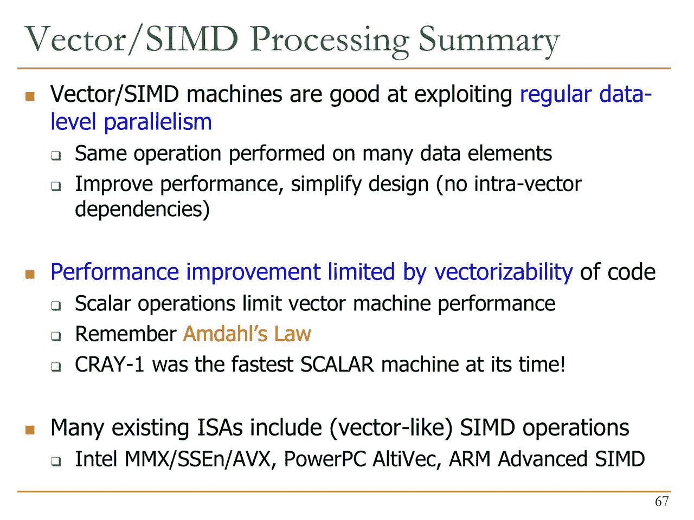

# Vector Processor

> 来源：[https://learning.feishu.cn/docx/VufndtY1zoKeRGxtR0FceJf8n6f](https://learning.feishu.cn/docx/VufndtY1zoKeRGxtR0FceJf8n6f)

https://www.youtube.com/watch?v=P0SEyu0bYO8

Lecture 25: SIMD Processors and GPUs

Lecturer: Professor Onur Mutlu

# Summary

exploiting (Regular) Data Parallelism

1.  区分 programming model (software) 和 execution model (hardware)

1.  理解 Arrary Processor 和 Vector Processor 的理论模型。这是一个 time-space 二维并行的哲学问题。

加速策略：

1.  operate the vector and SIMD processor in the regular manner。有固定的 stride。

1.  memory banking & interleave，优化 memory access。

1.  VLEN 解决 incomplete 的 vector 问题。

1.  irregular access 的内存访问方法 - 用 gather scatter。不连续，且没有固定的 stride。

+   array processor 是相同的 PE，同时算一条指令的部分 data。

+   Vector processor 是不同的 unit。unit 之间是 pipeline 并行。

现代处理器，一般都是 2 者的混合。

简单理解，内层是 array 做数据并行，外层是 vector 做 pipeline 并行。

如果把 unit 看作 space，就是变成了一个 time-space 的二维问题。

array 是 time 上 op 相同。每个 PE 独立完成 OP 的所有计算，不同 PE 处理不同的 op/data。

vector 是 space 上 op 相同，pipeline 的每个 stage，处理 op 的一部分。

这很哲学。

关键的寄存器：

1.  vector register。

1.  vector length register。VLEN

1.  vector stride register。VSTR

1.  VMASK。支持 control flow

how to achieve latency requirements with a memory that takes more than 1 cycle to access?

bank and interleave

操作数的 stride 不同，可能导致 bank conflict。

# Vector Processors

## Array v.s. Vector Processors

+   array processor 是相同的 PE，同时算一条指令的部分 data。

+   Vector processor 是不同的 unit。unit 之间是 pipeline 并行。

physically，vector processor 的 unit 可能就是 ALU 和 load/store units，可能排在一起。

概念上，只要 unit 是 pipeline 的，就能在不同的 cycle 处理不同的 data。

现代处理器，一般都是 2 者的混合。

简单理解，内层是 array 做数据并行，外层是 vector 做 pipeline 并行。

purist，纯粹主义者

## Vector 结构 - 3 register

需要 3 个寄存器：

1.  vector register。

1.  vector length register。VLEN

1.  vector stride register。VSTR

对 vector stride register 的解释。

vector instructions 的核心优势：

vector 内没有 data dependency，control flow & 可计算的 address(preaching 策略) 。

pipelining & parallelization work really well.

## 优缺点分析

优势

缺点

## 并行加速比

用 Amdahl's Law 分析 vector processor

## vmask register & control flow

比前面讲的 3 个 register，增加了 vmask register。一般用来实现 control flow。

注：VSTR 是 vector stride register。

## Memory Banking and interleave

how to achieve latency requirements with a memory that takes more than 1 cycle to access?

bank and interleave

# Code Example

## Scalar baseline - 1504 cycles

没有 pipeline，一个 loop 是 50 cycle。

有 pipeline，把第 2 个 loop 遮掩了 10 个 cycle，降到 40.

## Vectorization - 285 cycles

VLD 每次 load vector 的 1 个 element，所以，latency 要加 VLEN。

与 scalar 版本相比，instructions 数量从 304 降到 7 条。

VLEN = 50，所以，加速接近 50 倍。

latency 分析，时序图如 slide 的最下方。其中，所有的 49 都是 VLEN - 1。

一共 285 cycle，前面 scalar 版本是 2004（no banking） 和 1504（interleave banking）。

加速主要来自于，vectorization 把更多的 load 排在了一起，11 个 cycle 的 overlapping 更好了。

scalar 时的 interleave 版本，每 2 个只能遮掩 1 个 11 cycle。这里 50 个全能遮掩。

## chaining 的优化 - 182 cycle

加入 chaining 的优化

从 285 降到 182，少了 ~100 cycle.

VADD 和 VSHFR 可以 pipeline 起来了，不用等 50 个 element 的 vld 全结束才开始。

2 个 VLD 和 VST 不能相互遮掩，因为，假设了只有一个 port（Unit）。load/store 并发度只能是 1。

## Add Memory Ports - 79 cycle

用 3 port，2 个 load + 1 个 store。就能完美 pipeline 了。

只需 79 cycle。又少了 103 cycle。来自于，2 个 11 + 49 cycle 被 overlap 了很多。

# Tough Issues

## vector stripmining

strip mining：露天采矿。

这名字起的，确实很难联系起来。

## scatter/gather - irregular memory access

下图，红色框出的 LVI 就是 gather 操作。

本质就是先用 LV 指令 load indices，然后根据 indices 去 LVI 加载离散的 value。

所以，gather / scatter 对稀疏矩阵很有用。

指令的 latency 取决于硬件实现。所以，稀疏矩阵的高效支持，需要 hardware 定制。

scatter 的例子，就是 sparse vector 的存储方法。

学生提了几个问题：

1.  gather / scatter 对 latency 的影响？特别是，index 和 value 在一个 bank 导致 bank conflict 的场景。

1.  数据在 memory 是均匀分布的吗？或者说，这种分布会导致 memory access pattern 的差异。为了使数据分布尽可能 balance，memory controller 的设计是否明显不一样了？或者说，更复杂。

回答 & 个人理解：

1.  真实的程序，什么都有可能发生。设计，主要是为了让主流场景运行的更高效，总体的运行更快。

1.  如果你能 predict memory access pattern in advance，那么，you, as a programmer, 就要通过reshape 等提前解决。而不是交给 hardware 的 memory controller 解决。

1.  hardware support 也有一些。可以看 gpu 和 dram 的设计。dram 也是 bank memory，更复杂，现在，会有 hash function 去计算真实物理地址。

感想：这些学生有点厉害，提问都挺犀利的。确实跟上了老师的上课思路。

## Control Flow - VMASK

用 mask 控制的是 store 指令在每一个 element 上是否生效。

## Bank Conflict

A 和 B 的 stride 不同，可能导致 bank conflict。

# Vector Instruction

实际的系统，都是 array 和 vector processor 的混合。

开发者定义的 vector length 是 32，hardware 有 8 个 lanes。

所以，需要 4 cycles 来启动 vector load 指令。

compiler 的自动向量化识别。

