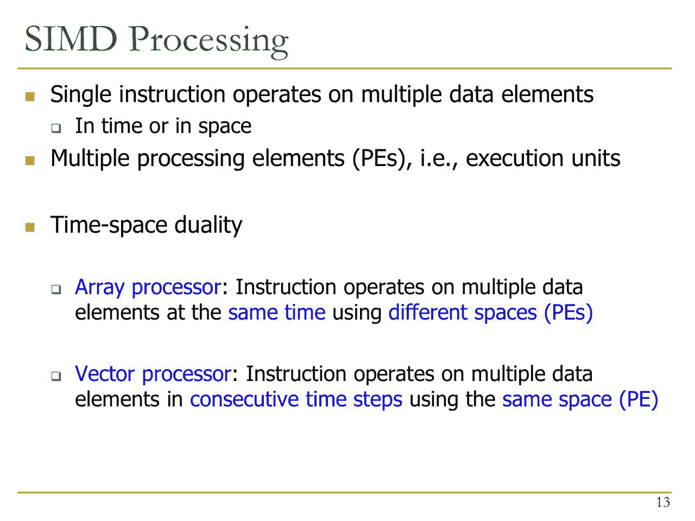
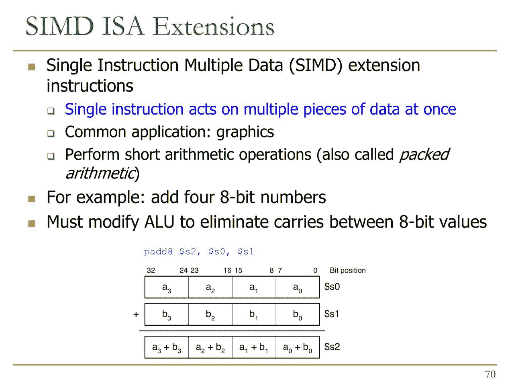
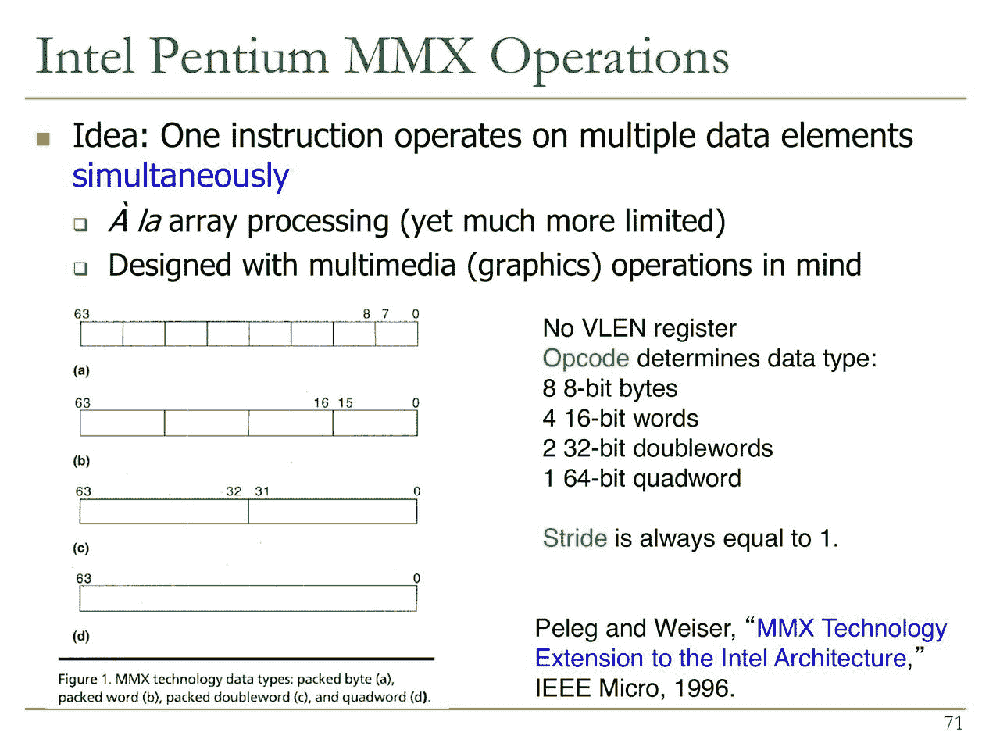
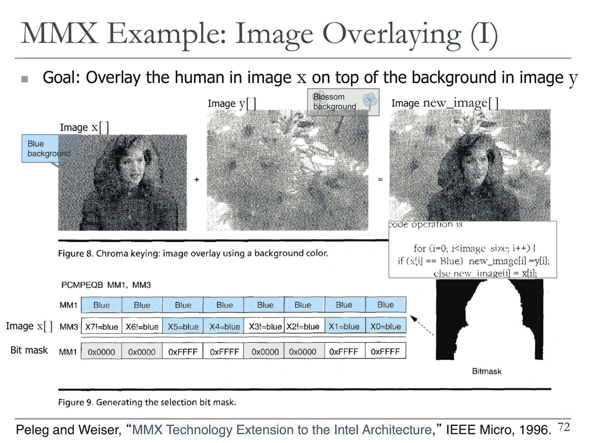
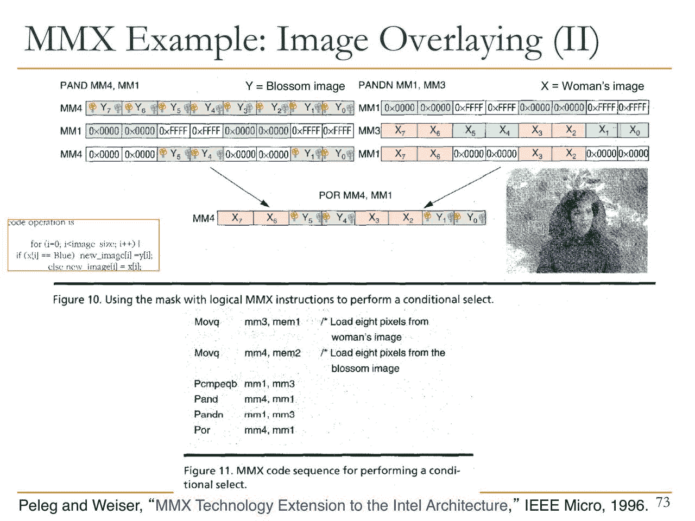
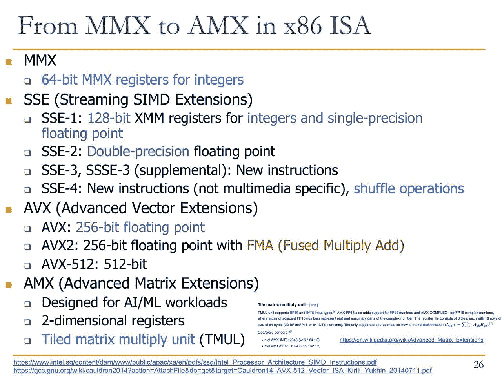
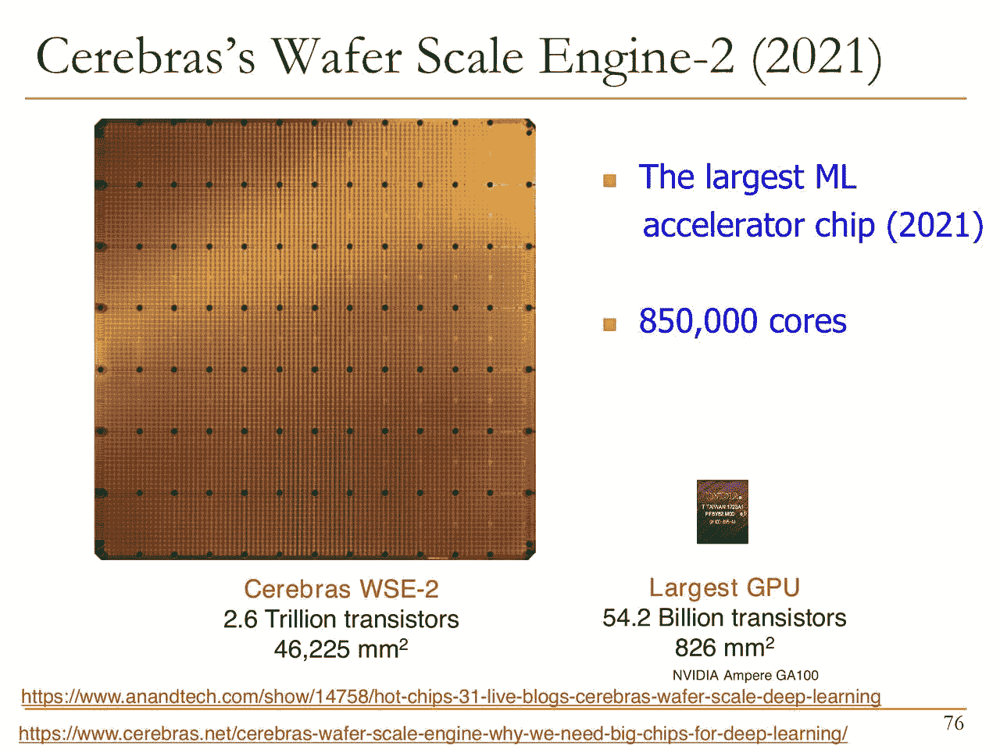
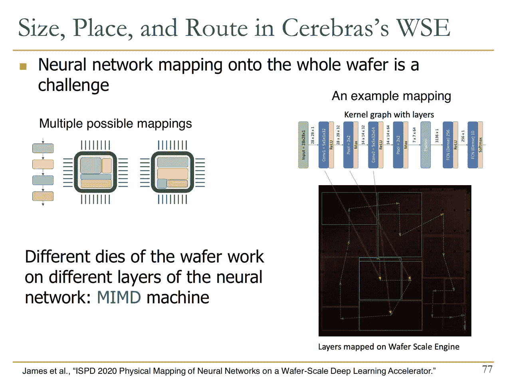
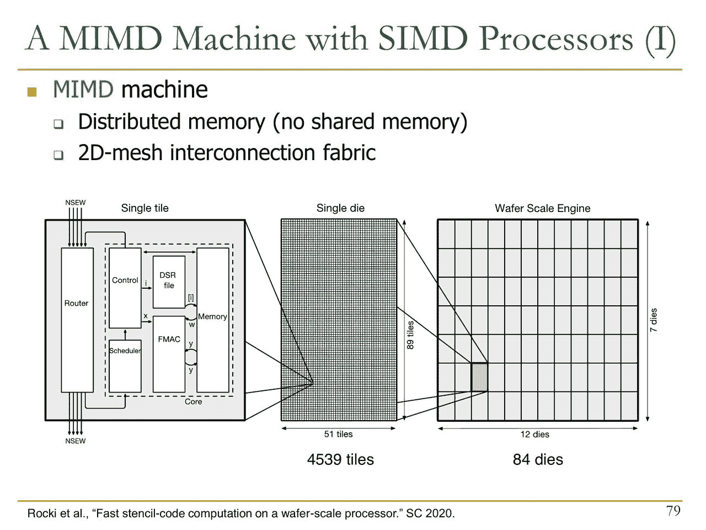
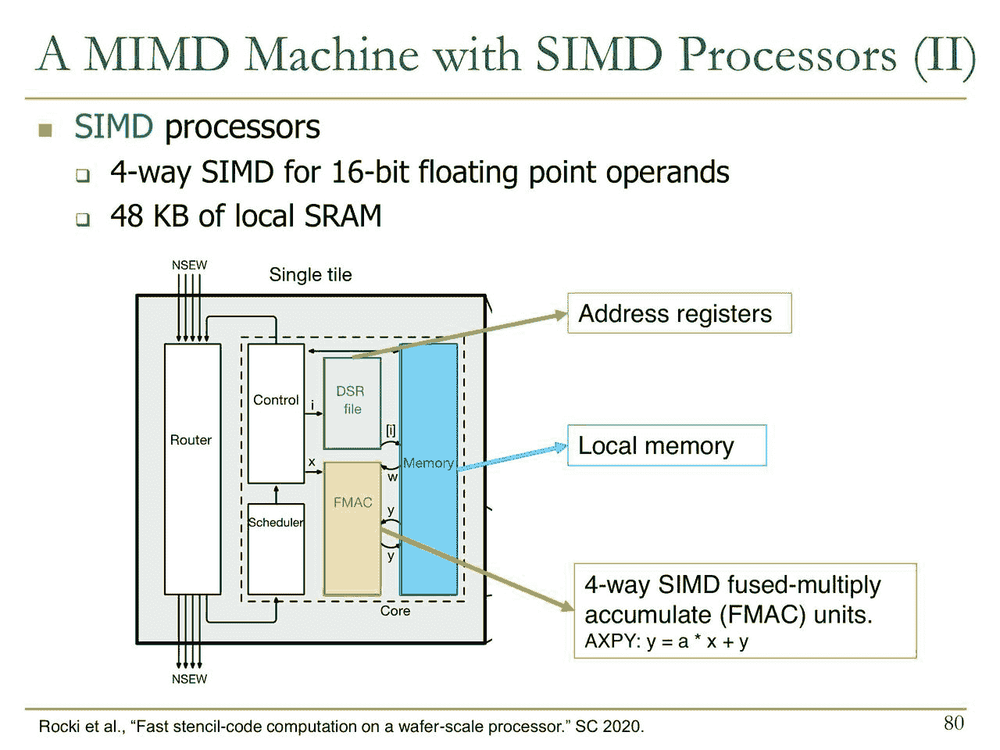

# SIMD Processing

> 来源：[https://learning.feishu.cn/docx/CnUSdCCk1oqFTGxa3Zhcz2GnnKr](https://learning.feishu.cn/docx/CnUSdCCk1oqFTGxa3Zhcz2GnnKr)

| Links |
| --- |
| https://www.youtube.com/watch?v=XaW_O9nKPe0 |
| https://www.youtube.com/watch?v=P0SEyu0bYO8 |
| https://www.youtube.com/watch?v=P0SEyu0bYO8 |

如果有机会在工作中研究 SIMD 和 GPGPU 的统一架构，很不错。

## SIMD 的 3 个流派

SISD, SIMD, MISD, MIMD

SIMD 的 3 个主要流派：

1.  Vector Processor ( pipeline processor ), 每个 unit 在时间维度上，做相同 instruction 的不同 data。

1.  SIMD extension: MMX, AVX, SSE 等。

1.  GPGPU (SIMT): 每个 thread，每个 cycle 做相同 instruction。

说明：

1.  Array Processor 和 Vector Processor，比较抽象，但有助于 uArch 的融会贯通。

1.  GPGPU 在 warp level 是 FGMT (Fine-Gained Multithreading)。FGMT 很重要。

1.  理解 GPGPU 时，注意区分 programming 和 hardware model。

1.  此处都是 Regular  (Data) Parallelism。非规则的，用 gather / scatter 预处理下。

## Vector Processor - TODO

[Vector Processor](https://dwpl6xgouw.feishu.cn/wiki/IFStwfZYrig8XfkjCPqcg8tAnHg?fromScene=spaceOverview)

# SIMD Processing

背景介绍: [Flynn's Taxonomy 费林分类法](https://dwpl6xgouw.feishu.cn/wiki/CQA8w0fL9ip30Kk6HawcdnipnVd?fromScene=spaceOverview)

与 MIMD ( multi-core )  比，SIMD 的 instruction 依旧是 sequential 的，更符合开发者的直觉，易于 debug。

提到向量 SIMD 处理器时，需要注意其流行普及的两类关键技术：

1.  操作数重组（component swizzling）：能够将源运算对象的单个操作数重定向到单个处理单元，类似地，将单个输出操作数重定向到目标操作数

1.  操作数屏蔽（component masking）：能够丢弃单个输出操作数（或类似地禁用单个处理单元）

## Data Parallelism

SIMD 是 same operator on different(multiple) data。不需要通过 multi-thread 就可以。

Dataflow 是 **different** operations in parallel。

thread parallelism 是 different thread in parallel。

multiple data elements, 可以是 in time or in space。

对应的，是 array processor 或 vector processor。

需要 vector registers 存数据。

SIMD v.s. VLIW

+   SIMD 是 same operation。

+   VLIW 是 multiple operation pack 在一起。

## SIMD ISA Extensions

### Intel Pentium MMX Operations

### SIMD in ML accelerator

### MIMD Machine with SIMD Processors

bottom-up: Tile -> Die -> Wafer

每一个 Tile 是就一个 SIMD processor。

4-wary 的 SIMD processor。

