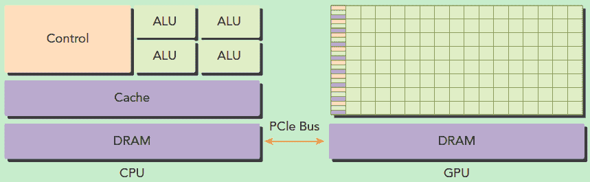
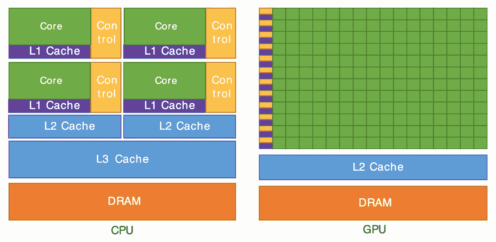
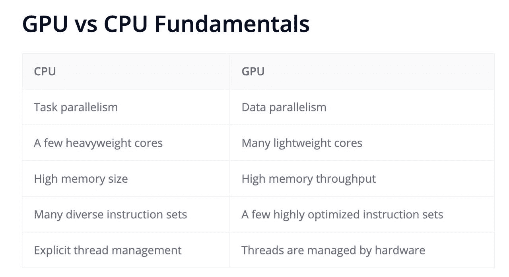
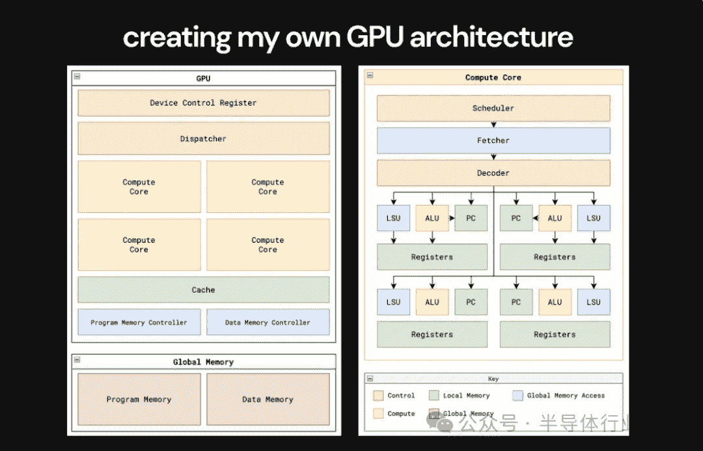
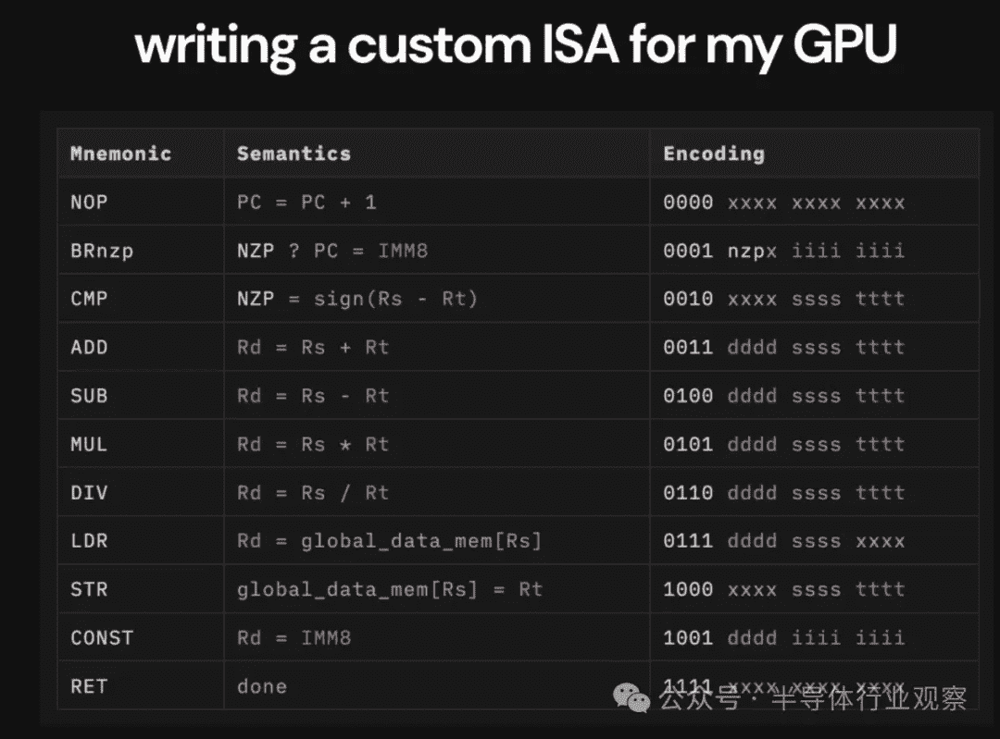
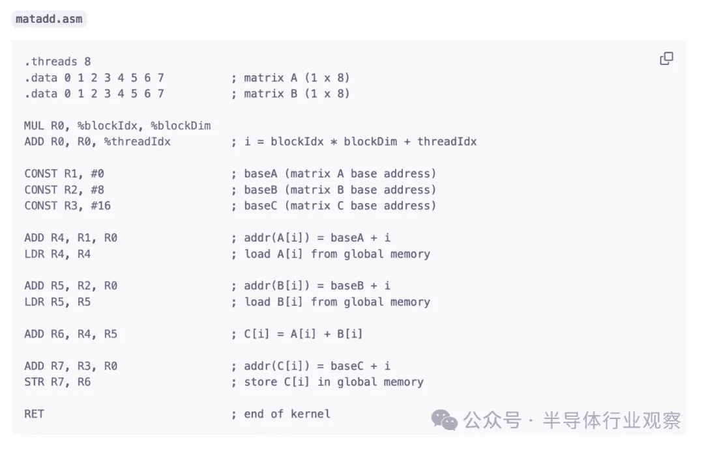
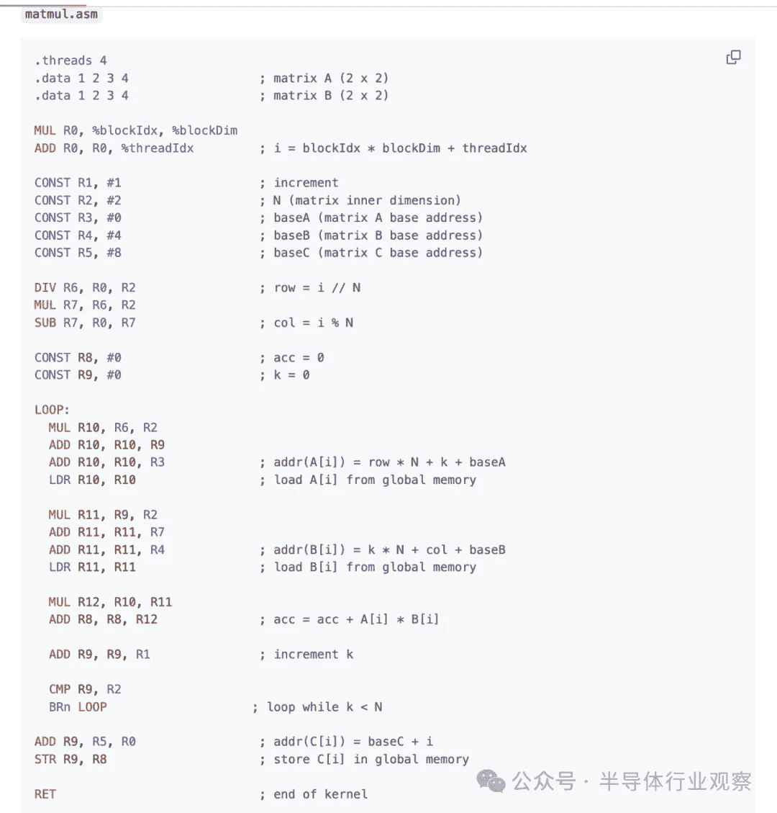
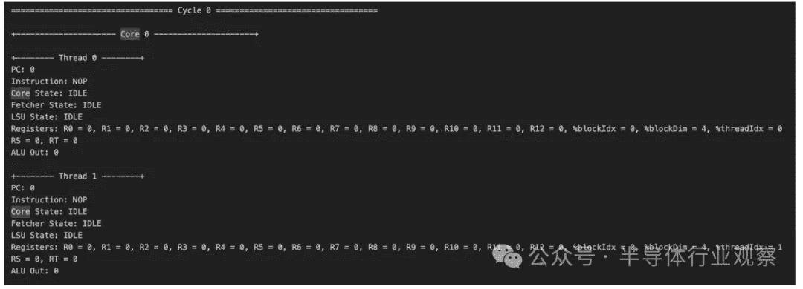
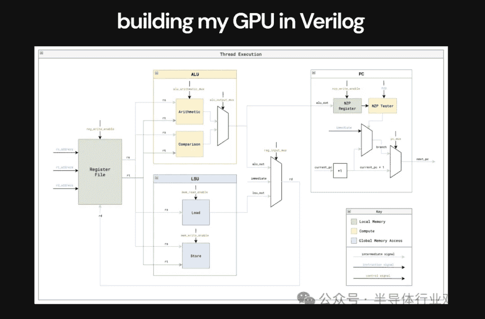

# 设计一个 GPGPU

> 来源：[https://learning.feishu.cn/docx/XmVpdNywMoQ8FIx2nuIcOkp4nCb](https://learning.feishu.cn/docx/XmVpdNywMoQ8FIx2nuIcOkp4nCb)

从零开始设计一个GPU：附详细流程

https://mp.weixin.qq.com/s/YdRdWcXDC5HTIG0OTOpHzQ

https://github.com/adam-maj/tiny-gpu

https://twitter.com/MajmudarAdam/status/1783304260303855774

芯片小白零基础入门芯片设计，两周设计出CPU

https://mp.weixin.qq.com/s?__biz=Mzg2NDgzNTQ4MA==&mid=2247734481&idx=1&sn=a4659d4ae27c8d4ff53ffcdbfc53e5ed&scene=21#wechat_redirect

# Summary

1.  create GPU architecture

1.  create custom assembly

1.  write kernels for GPU

1.  build GPU in Verilog

## Design steps

| Step | Notes |  |
| --- | --- | --- |
| Single-ALU GPU | 1.  ALU: GPU 的核心是 fp 和 int 计算，在 ALU 里做。 |  |
| multi-ALU GPU | 改进 1: 增加计算单元的数量，并就近放一个 cache。 |  |
| multi-blocks GPU | 改进 2: more blocks of units，每个 block 内有自己的 control unit。 |  |

## CPU v.s. GPU

+   CPU: A few out-of-order Cores

+   GPU: Many in-order FGMT Cores

GPU 每行有多个 Core，但只有一个 Control。=> 多个 Core 同一时刻只能执行同样的指令。

# GPU 核心要素

GPU 的核心要素：

+   全局内存 - 存储数据和访问它的程序的外部内存是 GPU 编程的巨大瓶颈和限制

+   计算核心 - 在不同线程中并行执行内核代码的主要计算单元

+   分层缓存 - 缓存可最大限度地减少全局内存访问

+   内存控制器 - 处理对全局内存的限制请求

+   调度程序——GPU的主要控制单元，将线程分配给可用资源执行

每个计算核心中，主要单元：

+   寄存器 - 为每个线程存储数据的专用空间。

+   本地/共享内存 - 线程之间共享内存以相互传递数据

+   加载-存储单元 (LSU) - 用于从全局内存存储/加载数据

+   计算单元 - ALU、SFU、专用图形硬件等，用于对寄存器值执行计算

+   调度程序 - 管理每个核心中的资源，并计划何时执行来自不同线程的指令 - GPU 的大部分复杂性都在这里。

+   Fetcher - 从程序存储器中检索指令

+   解码器——将指令解码为控制信号

# 简化的 arch

# ISA and assembly code

受 LC4 ISA 的启发制作了自己的小型 11 指令 ISA。

编写一些简单的矩阵数学内核作为概念证明。

我得到了以下指示：

+   NOP - 经典的空行（Classic empty row instruction ）指令只是为了增加（increment） PC

+   BRnzp - 使用 NZP 寄存器的分支指令来启用条件语句和循环

+   CMP - 设置 NZP 寄存器以供 BRnzp 指令稍后使用的比较指令

+   ADD、SUB、DIV、MUL - 基本算术指令可实现简单的张量计算。

+   STR/LDR - 在全局数据存储器中存储/加载数据以访问初始数据并存储结果。

+   CONST - 将常量值加载到寄存器中以方便使用

+   RET - 表示线程已完成执行。

ISA 的完整表格，包括每条指令的确切结构。

# write Kernel Using ISA

编写矩阵数学内核

我创建了 2 个矩阵数学内核来运行在我的 GPU 上。

每个内核都指定要操作的矩阵、要启动的线程数以及要在每个线程中执行的代码。

我的矩阵加法内核使用 8 个线程添加了两个 1x8 矩阵，并演示了 SIMD 模式的使用、一些基本的算术指令和加载/存储功能。

我的矩阵乘法内核使用 4 个线程将两个 2x2 矩阵相乘，并额外演示了分支和循环。

演示矩阵数学功能至关重要，因为图形和机器学习中的现代 GPU 用例的基础在很大程度上围绕着矩阵计算（授予更复杂的内核）。

该矩阵加法内核通过在单独的线程中执行 8 个元素明智的加法来添加两个 1 x 8 矩阵。

该演示使用%blockIdx、%blockDim和%threadIdx寄存器来展示该 GPU 上的 SIMD 编程。它还使用需要异步内存管理的LDR和指令。

矩阵乘法内核将两个 2x2 矩阵相乘。它对相关行和列的点积执行元素级计算，并使用CMP和BRnzp指令来演示线程内的分支（值得注意的是，所有分支都会收敛，因此该内核适用于当前的tiny-gpu 实现）。

tiny-gpu 设置为模拟上述两个内核的执行。在模拟之前，您需要安装iverilog和cocotb。

安装先决条件后，您可以使用make test_matadd和运行内核模拟make test_matmul。

执行模拟将输出一个日志文件，test/logs其中包含初始数据内存状态、内核的完整执行跟踪以及最终数据内存状态。

如果查看每个日志文件开头记录的初始数据内存状态，您应该看到计算的两个起始矩阵，并且在文件末尾的最终数据内存中，您还应该看到结果矩阵。

下面是执行跟踪的示例，显示每个周期每个内核中每个线程的执行情况，包括当前指令、PC、寄存器值、状态等。

# Verilog 构建 GPU

我重写了几次代码。

**重写 1：**

我最初将全局存储器实现为 SRAM（同步）。

但有读者谁给我反馈说，这违背了构建 GPU 的整个目的——GPU 最大的设计挑战是管理访问带宽有限的异步内存 （DRAM） 的延迟。因此，我最终使用外部异步内存来重建我的设计，并最终意识到我还需要添加内存控制器。

**重写 2：**

我最初使用 warp-scheduler 实现了我的 GPU（大错误，对于我的项目目标来说太复杂了，没有必要）。

然后，有读者反馈帮助我意识到这是一个不必要的复杂性。

具有讽刺意味的是，当我第一次收到反馈时，我没有足够的上下文来完全理解它。因此，我花时间尝试构建一个扭曲调度器，然后才意识到为什么这是一个坏主意lmao。

**重写 3：**

第一次没有在每个计算核心中正确实现调度，不得不返回并分阶段设计我的计算核心执行，以获得正确的控制流。

但是，尽管困难重重，但这是我的许多学习真正沉入深层直觉的一步。通过直面问题，我对 GPU 所面临的挑战有了更本能的感觉。

+   当我遇到内存问题时，我真的感受到了为什么管理瓶颈内存的访问是 GPU 的最大限制之一。

+   当我的设计无法工作时，我从第一性原理中发现了对内存控制器的需求，因为多个 LSU 试图同时访问内存，并意识到我需要一个请求队列系统。

+   当我在调度程序/调度程序中实施简单的方法时，我看到了更高级的调度和资源管理策略（如流水线）如何优化性能。

下面是我在 Verilog 中内置到 GPU 中的单个线程的执行流程 - 它在执行时与 CPU 非常相似。

# 芯片布局

在完成Verilog设计后，最后一步是将我的设计通过EDA流程，以创建最终的芯片布局。

# 高级 GPU 功能

为了简单起见，现代 GPU 中实现了许多附加功能，这些功能大大提高了 tiny-gpu 省略的性能和功能。我们将在本节中讨论一些最关键的功能。

**（1）多层缓存和共享内存**

在现代 GPU 中，使用多个不同级别的缓存来最大限度地减少需要从全局内存访问的数据量。tiny-gpu 在请求内存的各个计算单元和存储最近缓存数据的内存控制器之间仅实现一层缓存层。

实施多层缓存可以将频繁访问的数据缓存到其使用位置的更本地位置（某些缓存位于各个计算核心内），从而最大限度地缩短该数据的加载时间。

使用不同的缓存算法来最大化缓存命中——这是一个可以改进以优化内存访问的关键维度。

此外，GPU 经常使用同一块内的线程共享内存来访问可用于与其他线程共享结果的单个内存空间。

**（2）内存合并**

GPU 使用的另一个关键内存优化是内存合并。并行运行的多个线程通常需要访问内存中的顺序地址（例如，一组线程访问矩阵中的相邻元素） - 但每个内存请求都是单独放入的。

内存合并用于分析排队的内存请求，并将相邻请求合并到单个事务中，最大限度地减少寻址所花费的时间，并将所有请求放在一起。

**（3）流水线**

在tiny-gpu的控制流程中，核心等待一组线程上执行一条指令，然后开始执行下一条指令。

现代 GPU 使用流水线技术一次性流式执行多个顺序指令，同时确保相互依赖的指令仍能按顺序执行。

这有助于最大限度地提高核心内的资源利用率，因为资源在等待时不会闲置（例如：在异步内存请求期间）。

**（4）扭曲调度**

用于最大化课程资源利用率的另一个策略是扭曲调度。这种方法涉及将块分解成可以一起执行的单独批次的 thead。

通过在一个 warp 等待时执行来自一个 warp 的指令，可以在单个内核上同时执行多个 warp。这与流水线类似，但处理来自不同线程的指令。

**（5）分支分歧**

tiny-gpu 假设单个批次中的所有线程在执行每条指令后都位于同一台 PC 上，这意味着线程可以在其整个生命周期内并行执行。

实际上，各个线程可能彼此分歧，并根据其数据分支到不同的线路。对于不同的 PC，这些线程需要分成单独的执行线，这需要管理发散的线程并注意线程何时再次聚合。

**（6）同步与障碍**

现代 GPU 的另一个核心功能是能够设置障碍，以便块中的线程组可以同步并等待，直到同一块中的所有其他线程都到达某个点，然后再继续执行。

这对于线程需要彼此交换共享数据的情况非常有用，这样它们就可以确保数据已被完全处理。

# other

这是我在 GPU 上运行矩阵加法内核的视频（视频参考原文链接），浏览 GPU 运行的执行跟踪，然后检查 GPU 存储最终结果的数据存储器中的最终状态。

您可以在执行跟踪中查看每个周期中每个线程/内核的单个指令、PC、ALU 处理、寄存器值等。

最重要的是，您可以在开始时看到结果矩阵的空地址，然后在最后看到正确的值被加载到数据存储器中的结果矩阵中！

我想在未来进行更新以改进设计，也欢迎其他人做出贡献：

+   添加一个简单的指令缓存

+   构建适配器以通过 Tiny Tapeout 7 使用 GPU

+   添加基本分支分歧

+   添加基本内存合并

+   添加基本流水线

+   优化控制流程和寄存器的使用以缩短周期时间

+   编写基本图形内核或添加简单的图形硬件来演示图形功能