# AMD GPGPU uArch

> 来源：`https://learning.feishu.cn/docx/Hns5dadqGofdRnxCAiDcdirqn8c`

看 2 个架构：

1. 最经典的 GCN 第 1 代。2012 年。对标的应该是 2010 年的 Nvidia Fermi。
1. 最新的。当前是 MI300X 的 CNDA3

# Summary

1. 从GCN1-CDNA3，CU 整体结构基本没变，包含1个SALU，四个SIMD，1个LDS，1个L1 RW Vector DCache，自CDNA1 时代增加了四个Matrix Unit，和四个SIMD单元应该是匹配的；

1. L1 Vector DCache 16KiB 64B lines, 4 sets x 64-way 64B/CLK由一个CU独享，从GCN1保持到CDNA2，在2023年的CDNA3改成了32KiB 128B lines，带宽增大一倍至128B/CLK；

1. L1 Scalar DCache 16 KiB 4 way，4个CU共享， 16B/CLK，整体应该是一直保持不变（但至少在CDNA2时期，翻倍至32B/CLK），也许和ICache一样，在CDNA3改为两个CU共享了。

1. L1 ICache 32KiB 32B/CLK由四个CU共享，从GCN1保持到CDNA2（至少在CDNA2时期，翻倍至64B/CLK），在2023年的CDNA3改成了64KiB 8-way set-associative，2个CU共享；

1. LDS 64KiB 32 bank 512 entries 4B 128B/CLK，一直保持没变，但是根据一些指令做优化，比如原子指令啥的；

1. GDS 64KiB，只在GCN里面有，在CDNA1基本就去掉了，变为4KiB，主要服务于同步啥的；

## uArch

重点关心 2 代: GCN，CDNA

| uArch | Notes |

| --- | --- |

| TeraScale | 1. 3rd. 2008 - 2011 |

| GCN | 1. 第 4 代。2012 - 2017。全称 Graphics Core Next。面向图形 + GPGPU。 |

|  |  |

| RDNA (Navi) | 1. 第 5 代，2018-2019 |

| CDNA | 1. 第 6 代。2020-2023 |

完整 5 代图 by AMD

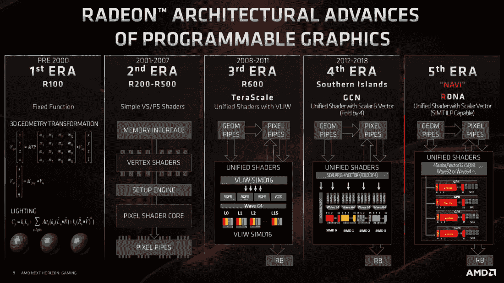

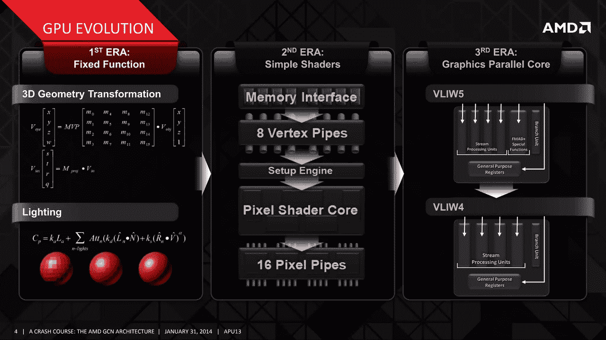

## 软件

`ROCm`软件自 2016 年推出以来一直是开源的，但是固件的开源也很重要，AMD GPU 上的`MES`固件AMD 单独开发的，不是开源的。

整个 AMD 硬件堆栈缺乏近乎普遍的 `ROCm` 支持。

Lisa 还对 AMD 的软件堆栈发表了评论：

“最近的大问题是软件。我们在软件方面取得了巨大进步。`ROCm` 6 软件堆栈是一个重大进步。在软件方面还有很多工作要做……我们希望抓住巨大的机遇。”

-- 无他，AMD 刚刚发布 `rocm 6`

## 开源

`https://github.com/VerticalResearchGroup/miaow/wiki`

GCN1 的 RTL 开源实现。

`https://www.gem5.org/events/isca-2018`

AMD `gem5` APU Simulator: Modeling GPUs Using the Machine ISA

[Held in c](http://iscaconf.org/isca2018/)onjunction with ISCA 2018. June 2nd, 2018.

GCN 的 CL 级别的模拟器实现

## 商业 - AMD 战略

GCN 的时代，AMD 没火起来。几个原因：

1. 只有好的 GCN 硬件设计，没有配套的 `cuda` + `tensorrt` 软件栈。`CUDA` 比 `OpenCL` 成熟的更早。

1. 消费领域，游戏仍然是最重要的。GCN compute 设计，也发挥不出价值。

苏姿丰 (Lisa Su) 10 年扭转 AMD 局面的 3 大战略

1. 数据中心 GPU，`Instinct` 系列：`MI300`。

1. 客户端系列。`Radeon` 独立显卡 (`GPU`) 及其 `APU`。

1. `XDNA` AI 引擎。技术来自 `Xilinx`。将作为微软 `AIPC` 计划的 `NPU` 呈现，以与英特尔和高通的产品竞争。这些 AI 引擎专为低功耗推理而设计。

2022 年，AMD内部估计全球数据中心AI加速器市场在2023年的规模可达约300亿美元，今后每年的复合增长率都能超过50％，到2027年将形成超过1500亿美元的价值，不可限量。

2023 年来看，这个数据太保守了，AMD已经将2023年、2027年的数据中心AI加速器市场规模预期分别调高到400亿美元、4500亿美元，年复合增长率超过70％。

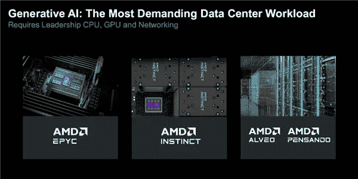

AMD 拥有最全解决方案。

CPU 有 `EPYC` 处理器，GPU 有 `Instinct` 加速器，网络方面有 `Alveo`、`Pensando`等技术，

软件有 `ROCm` 开发平台。

# GCN 架构

## Summary

`https://chipsandcheese.com/2023/12/04/gcn-amds-gpu-architecture-modernization/`

Graphics Core Next (GCN) throws out the Terascale playbook,

focus on predictable performance for general purpose compute.

从 Terascale 架构到标准 GPU 的 2 个要点：

1. 调度全给了 hardware 去做。Explicit scheduling information is gone, shifting those responsibilities to hardware.

1. Execution within a thread is strictly scalar. 不再支持 issue multiple operations per cycle from a single thread.

GCN 基本是现在 GPGPU 的架构了。特别是：

+ scheduling

+ execution unit layout

+ cache

compute density and high memory bandwidth 是 2 大优势 feature。

但 command issue 的效率不行。

大 workload 可以，比如高分辨率的场景。小的 workload，就打不过 NV 卡了

游戏领域，越来越多 compute workload，现代游戏卡也借鉴了 GCN 的设计。

比如，

RDNA keeps the scalar datapath and uses a similar instruction set.

Nvidia added a scalar path (called the uniform datapath) to their Turing architecture and kept it in subsequent designs.

## Arch

调度模块是 command processor + ultra-threaded dispatch processor

command processor 的 2 个功能：

1. communicates with the host

1. schedule on chip workloads

ultra-threaded dispatch processor，接收 `CP` 的 command 并分发给 `CU`。

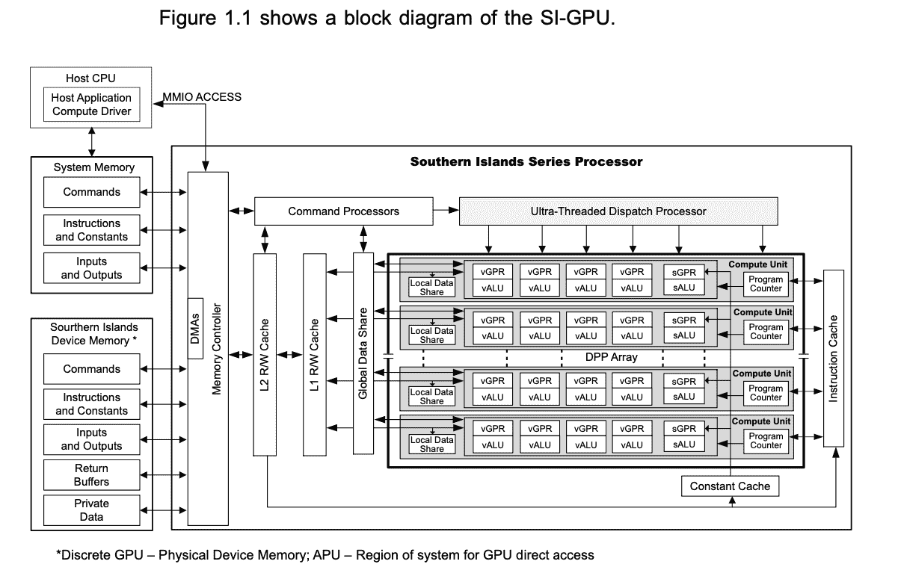

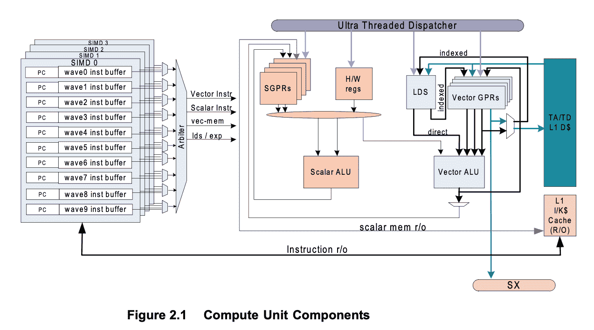

basic building block is the Compute Unit (`CU`)

Tahiti’s shader array consists of 32 `CU`s

Each `CU` has a private 16 KB vector cache and 64 KB local data share, but shares an instruction cache and scalar cache with up to four neighboring `CU`s.

L2 cache 是 chip 内共享的。

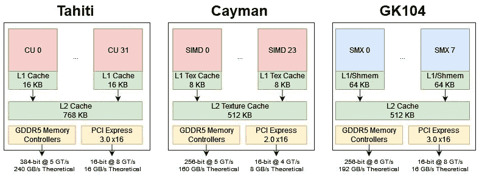

图形和 HPC 的 command processor & execution pattern 还是不一样的。

The array of compute units can be fed by the Graphics Command Processor or Asynchronous Compute Engines (`ACEs`) depending on whether work is being submitted on the graphics or compute queue.

`GCN1` 竟然有 1 个 command processor + 2 个 `ACE`。

For compute workloads, each `ACE` can launch one wavefront per cycle.

letting it launch two wavefronts per cycle across the GPU.

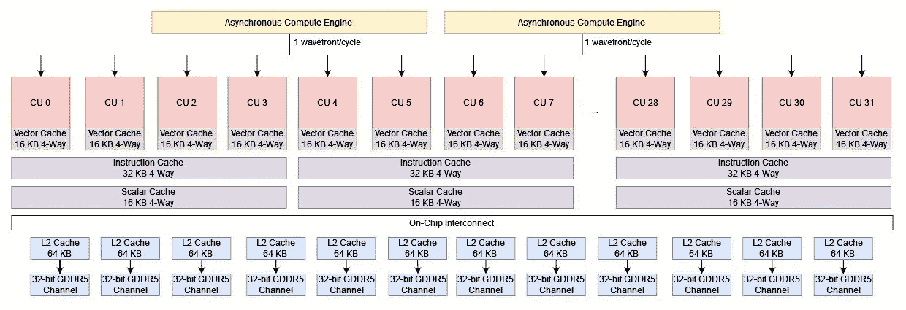

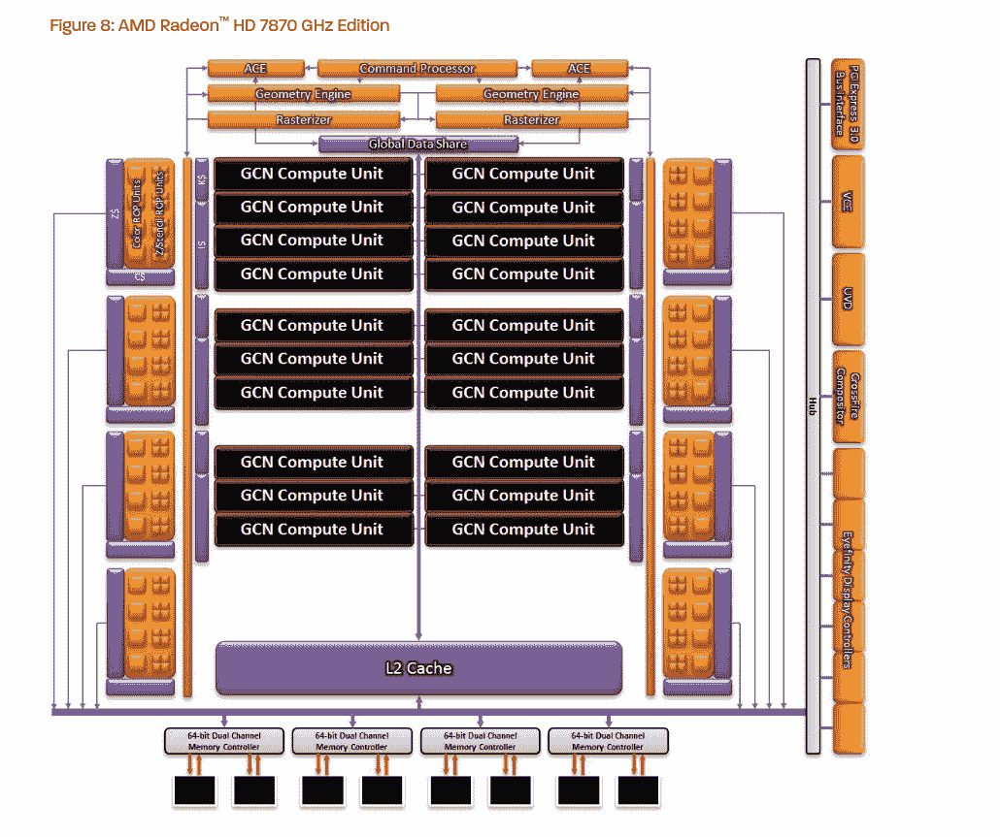

Compute workloads write their results to VRAM, where they can be consumed by future kernels or get copied back to the host.

## Compute Unit

GCN’s Compute Unit is roughly analogous to Terascale’s SIMD

相似

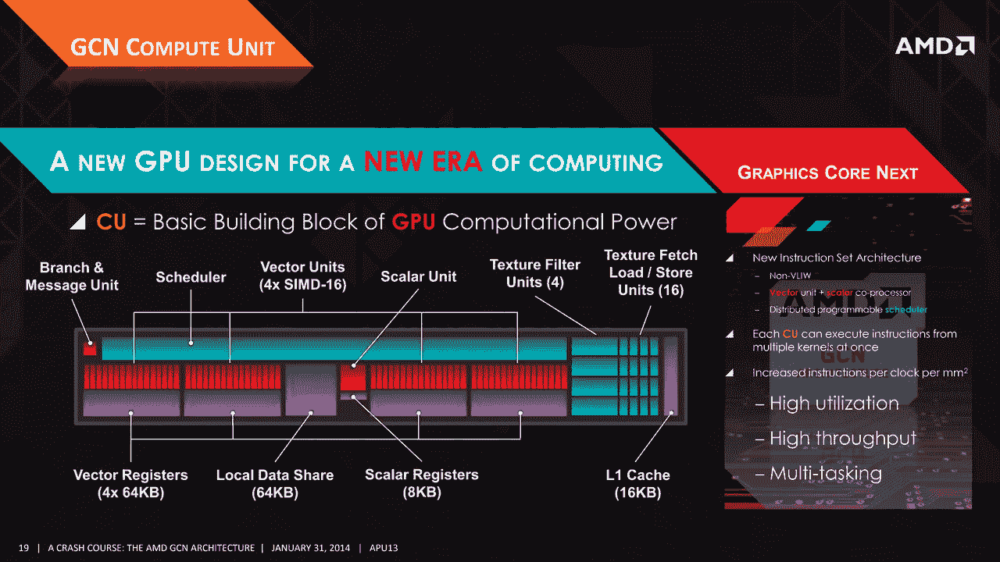

### Compute Unit Frontend

Instead of one big SIMD capable of quad-issuing instructions, a compute unit consists of four smaller SIMDs. Each SIMD gets its own 64 KB vector register file and 10 entry scheduler partition. Execution within a thread is now completely scalar, which means the `CU` can’t issue multiple instructions per cycle from the same thread. However, a `CU` can issue up to five instructions per cycle if multiple threads in a SIMD’s scheduler partition are ready, and each thread’s ready instruction goes to a separate functional unit.

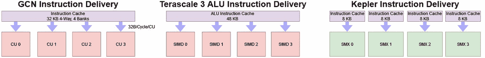

Terascale 3 shared a 48 KB ALU instruction cache across up to four SIMDs, so there’s some similarity to GCN. AMD was able to cut instruction cache size to 32 KB because GCN’s variable length instructions require less storage on average. Terascale 3 used fixed length 64-bit instructions. A bundle of instructions could range from 64 to 384 bits depending on how many instructions and immediate values the compiler packs in. GCN’s instructions are 32 or 64 bits long, with an optional 32-bit immediate coming after.

Instruction bandwidth demands visualized

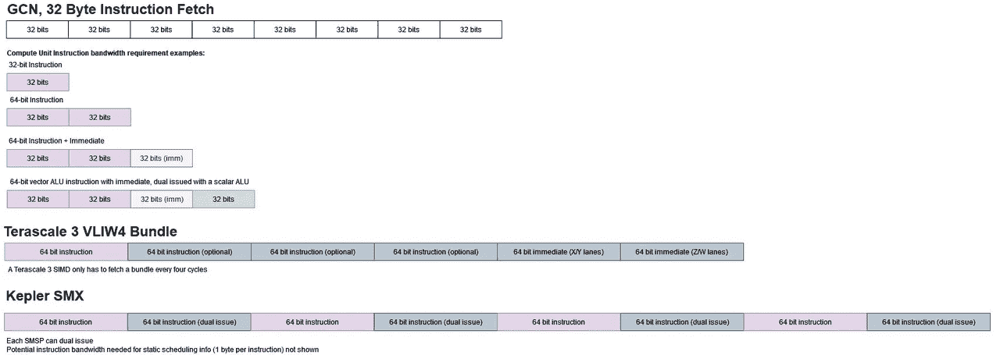

Nvidia’s Kepler uses a 8 KB instruction cache private to each SMX. A private cache is better suited to handling Kepler’s high instruction bandwidth demands. A SMX needs to sustain at least 6 instructions per cycle to feed its 192 FP32 units, because each instruction on Nvidia operates on a 32-long vector of 32-bit elements. With fixed length 64-bit instructions, Kepler’s instruction cache would have to deliver 48 or 54 bytes of instructions per cycle depending on whether you count the byte of static scheduling info per instruction. GCN Compute Units only need to execute one instruction per cycle to saturate its vector execution units, both because it fewer of them and because each GCN instruction operates on a 64-long vector.

### Scheduling and Instruction Issue

Once instructions have been fetched, they’re held in a set of instruction buffers.

Each of the `CU`’s four SIMDs has a 10 entry buffer, letting it track instructions from up to 10 separate threads. The entire `CU` can thus track 40 threads (or wavefronts). With 64-wide wavefronts, a `CU` can have 2560 32-bit operations in flight.

Every cycle, the `CU` selects a SIMD and scans its 10 threads to see if any are ready for execution. GCN can achieve limited multi-issue capability by selecting multiple threads and co-issuing instructions of different categories. For example, a scalar ALU instruction from one thread can co-issue alongside a vector ALU instruction from another. In theory, a compute unit can issue 5 instructions per cycle. But such high issue rates should be rare because workloads are unlikely to have an even mix of instructions from different categories. High occupancy is essential to making most of this multi-issue strategy. If a SIMD has more threads to choose from, it has a better chance of finding multiple threads with the right mix of instructions to enable multi-issue.

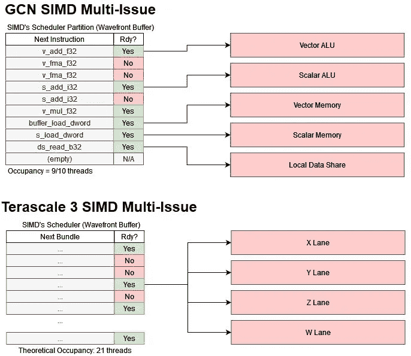

GCN’s strategy contrasts with Terascale’s, which emphasizes multi-issue from a single thread with a huge burden on the compiler.

The compiler had to find instructions that were both independent and didn’t oversubscribe register file ports when packed into a bundle. GCN’s move to using thread level parallelism means the compiler can be mostly oblivious to those hardware details. Nvidia’s Kepler takes a middle ground. Register bank conflicts are handled by a hardware operand collector. The compiler was responsible for marking pairs of instructions for dual issue in the instruction stream, but dual issue was really a cherry on top. Kepler could maintain much better throughput than Terascale without having to multi-issue.

Although GCN loses the ability to multi-issue from a single thread, it can issue from a thread more often than Terascale can. A Terascale SIMD was 16-wide and could issue a bundle every four cycles, but couldn’t execute two bundles from the same thread back-to-back. Therefore, Terascale needed at least two threads in a SIMD to achieve full throughput. GCN removes this restriction, so a thread on SIMD can execute an instruction once every four cycles. Terascale could achieve higher per-thread throughput, but only if the compiler does a good job packing instructions into bundles.

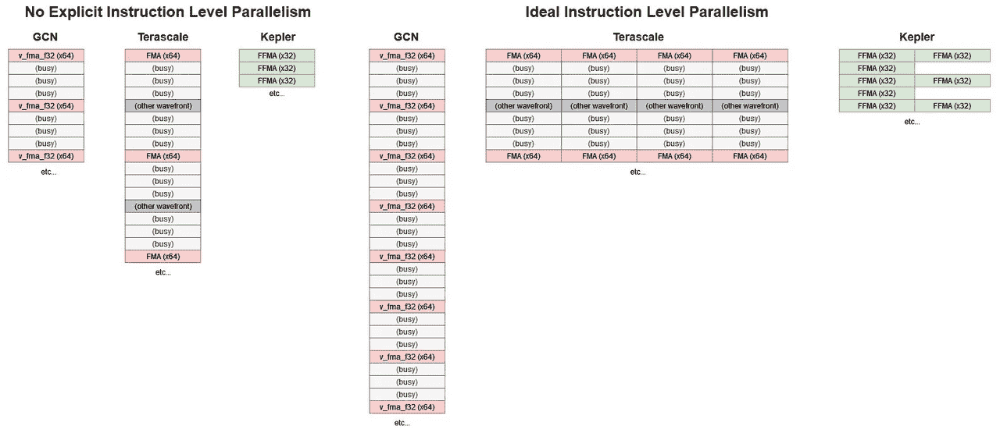

Rough idea of how fast one thread can issue in the absence of register bank conflicts and delays due to dependencies. Each box is one cycle.

Kepler meanwhile can blaze through a single thread. It uses 32-wide waves and 32-wide execution units, so a thread can issue an instruction every cycle. Dual issue is a cherry on top. Thus Kepler can maintain decent throughput in the face of low occupancy and limited thread-level parallelism.

### Register Files

A selected instruction reads its inputs from the register files.

In GCN, a Terascale SIMD’s giant 256 KB register file is split into four 64 KB register files, one for each GCN SIMD.

GCN’s register files are almost certainly banked structures, but should suffer less from register bank conflicts than Terascale. Assuming its still a quad banked register file, GCN would have four inputs available to feed an instruction that potentially needs up to three inputs (for a fused multiply-add). Bandwidth demands on the vector register file can be lower if an instruction takes an input from the scalar registers or an immediate value in the instruction stream. On top of that, GCN likely has an operand collector that can smooth out demands for register file bandwidth in case of occasional bank conflicts.

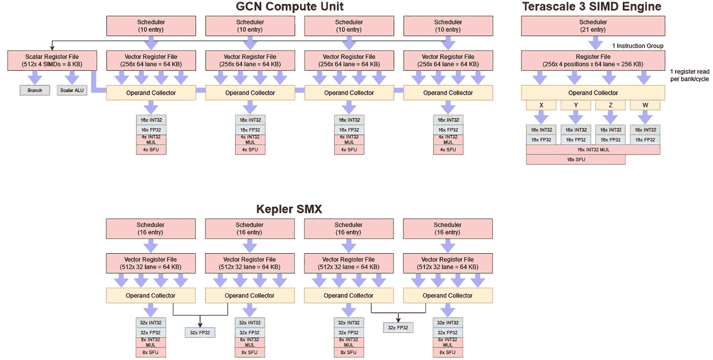

Terascale required intricate scheduling and register assignment to get good utilization. Each VLIW lane could only write back to its corresponding register file bank, and any register bank conflicts on the read side could reduce VLIW packing. Kepler requires even more effort to fully optimize because there isn’t enough register file bandwidth to feed FMA operations across all of a SMX’s FP32 units.

Besides the vector register file, a GCN CU has a 8 KB scalar register file. Programs can reduce vector register usage and achieve higher occupancy if they can store some variables in scalar registers.

### Execution Units

Each SIMD in GCN has a 16-wide execution unit.

Common FP32 operations and integer adds execute at full rate, while 32-bit integer multiplies and special functions execute at quarter rate.

需要 4 个 active threads 填满 4 个 SIMD。但不需要把 4 instructions 打成 1 个 packet。

本质是 4 个 EU 共享 1 套 issue 和 schedule hardware。

control flow and addresss generation 从 vector processor 移到了 scalar ALU 中。

与 Kepler’s SMX，GCN 的 CU 小，算力低。解决方案是，放了 4 倍数量的 CU。

AMD 也开始减少 fp64 的投资了，都意识到了，AI workload 用不上。

### Compute Unit Data Caching

分为 vector cache 和 scalar cache。

CU’s primary data cache: 16 KB 4-way set associative vector cache

LRU replacement policy, 64B lines

can feed the compute unit with 64 bytes per cycle

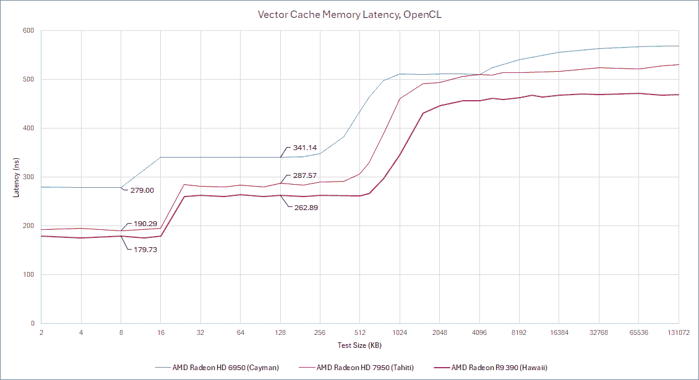

GCN’s vector cache supports writes too. The L1 cache is a write-through, write-allocate design. It’s not as good as write-back caches in most CPUs, but the L1 can still help coalesce writes before they’re passed to L2.

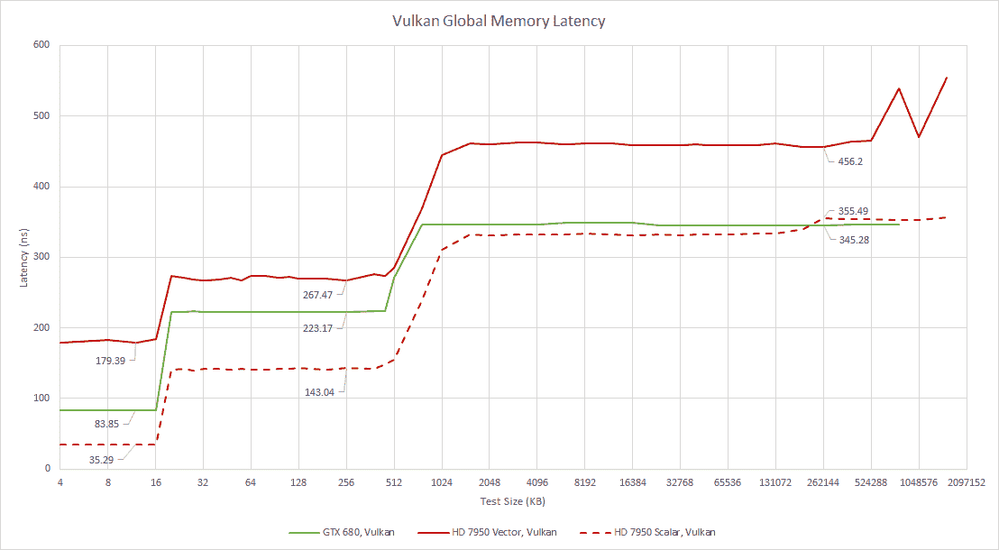

GCN 的 vector access latency 比不过 Kepler 架构。

AMD hopes to mitigate this by optimizing some memory accesses to use the scalar path.

最多 4 个相邻的 CU，share 1 个 16 KB 4-way scalar cache

16 bytes per cycle to each CU,

optimized for low latency, under 50 ns

faster than any of Kepler’s caches except for its tiny 2 KB constant cache.

每次谈到 AMD 比 NV 更好的时候，都要加个 except。被拿捏的死死的。

constant cache 不知道现在效果如何，直觉上，可能非常精髓。

"unlike Fermi, Nvidia’s compiler no longer tries to use the constant cache for memory accesses that are constant across a wave. You have to explicitly mark memory with `__constant` qualifier to use the constant cache hierarchy." -- 看起来，constant cache 可能效果不大。

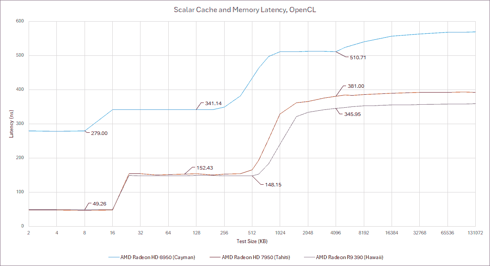

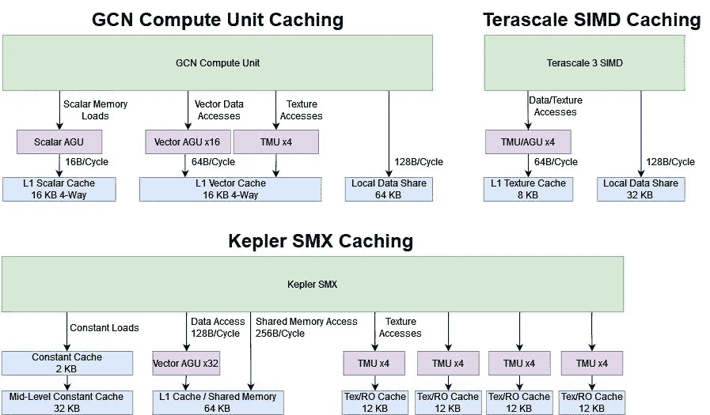

GK104 Kepler depicted. GK210 has 128 KB of L1 cache/shared memory

Nvidia’s Kepler architecture dips into both the old and new worlds with a caching strategy similar to Fermi’s.

Read-only texture cache are still around.

Kepler 有独立的 L1 data cache, 与 scratchpad memory 使用相同 SRAM。逻辑上划分开的。

A SMX has 146 KB of caches and scratchpad memory.

|  | AMD Graphics Core Next | AMD Terascale 3 | Nvidia Kepler |

| --- | --- | --- | --- |

| Global Memory | 16 KB L1 Vector Cache or | 8 KB L1 Texture Cache | 16/32/48 KB L1 Data Cache |

| Constant Memory | 16 KB Scalar Cache | 8 KB L1 Texture Cache | 4 KB Constant Cache  32 KB Mid-Level Constant Cache |

| Texture | L1 Vector Cache | 8 KB L1 Texture Cache | 12 KB Texture/Read Only Cache Per SM Sub Partition |

| Local Memory | 64 KB Local Data Share | 32 KB Local Data Share | 16/32/48 KB Shared Memory on GK104 (Shared with L1 Data Cache) |

For comparison, a GCN Compute Unit has 80 KB of private data caches and scratchpad memory. That figure goes up to 84 KB if you divide the 16 KB L1 scalar cache across 4 CUs.

### Local Memory (Shared Memory)

每个 CU 有 64KB 软件可管理的 memory scratchpad(暂存器) 叫 Local Data Share (LDS)

OpenCL 术语是 Local Memory。

Nvidia 叫 Shared Memory

GCN1 的 spec

32 banks, 32-bit / cycle / bank.

bandwidth: 128 bytes per cycle.

根据型号不同，NV Kepler 从 SRAM 中分配出 scratchpad 和 L1 cache。

NV spec

32 banks, 64-bit / cycle / bank.

bandwidth: 256 bytes per cycle.

更适合处理 64-bit data types

Where AMD does have an advantage is in synchronizing threads through the LDS. Integer atomic units built into the LDS help speed these operations up.

Nvidia’s Fermi and Kepler architectures don’t have an equivalent. Their Shared Memory is fast, but performance with atomics has a lot of room for improvement.

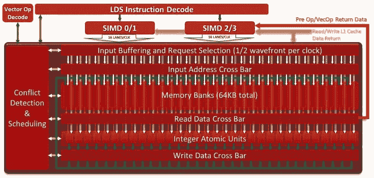

# RDNA(Navi)

RDNA3的性能和价格表现都没有令人瞩目的亮点，更不幸的是，据传下一代RDNA4也一直存在问题，导致AMD的高端Navi 41和Navi 42的设计被取消，仅保留了中低端的Navi 43和Navi 44。

## RDNA(Navi) 的 CU 改进

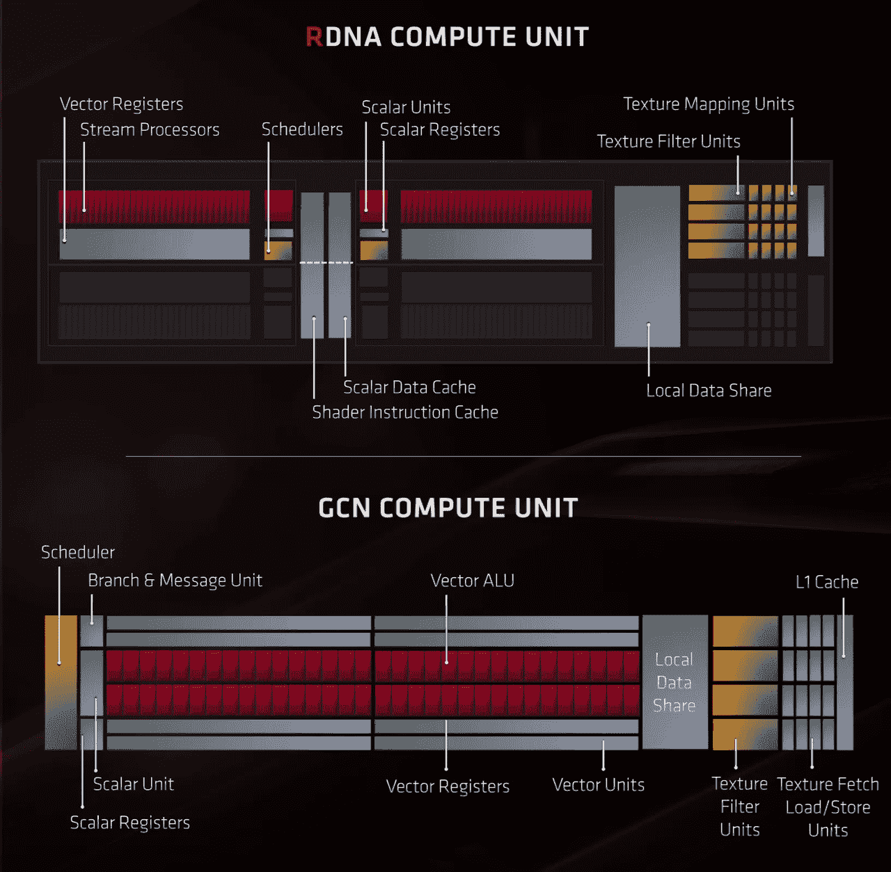

RDNA 图里，scheduler 两边应该是 2 个 EU。

EU 内有 stream  processor 和 vector register

RDNA 和 GCN 比起来，主要是模块的 arrangement 变了。

schedule 变化较大。

+   RDNA，共 32 个 stream processor，有独占的 scheduler (instruction unit).

+   GCN，共 16 个 Steam processor。4 个共享 1 个 scheduler。

因为独占 scheduler。RDNA 架构，32 个 thread 每个 clock 都能独立 issue。

为了兼容 Radeon 的用户代码，支持以 2 倍频率运行 16 thread，或 0.5 倍频率跑 64 thread。

EU 的比较

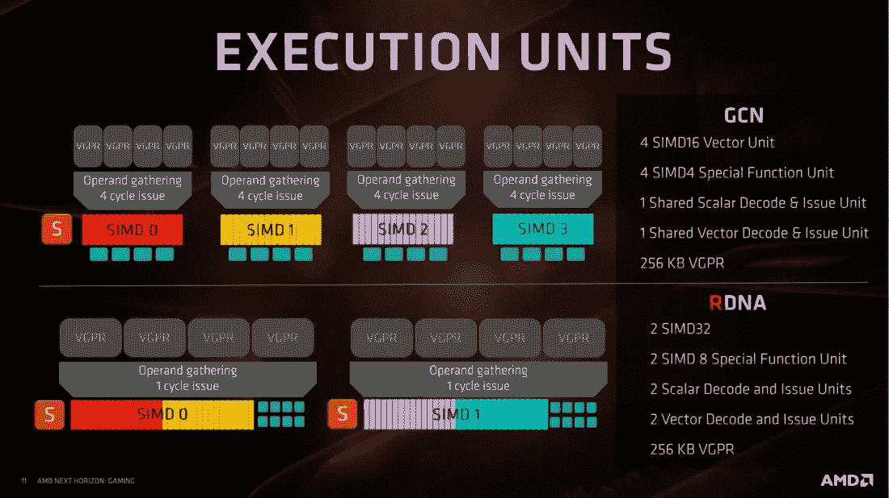

SFU 的数量，减半。但，能处理的 dataset size 翻倍了。（怎么做到的？）

# CDNA

## CDNA3 arch

CDNA3 的 arch 图，跟 GCN 完全一样。

比较奇怪的是，TensorCore 都没体现出来，只有 vALU 和 sALU。

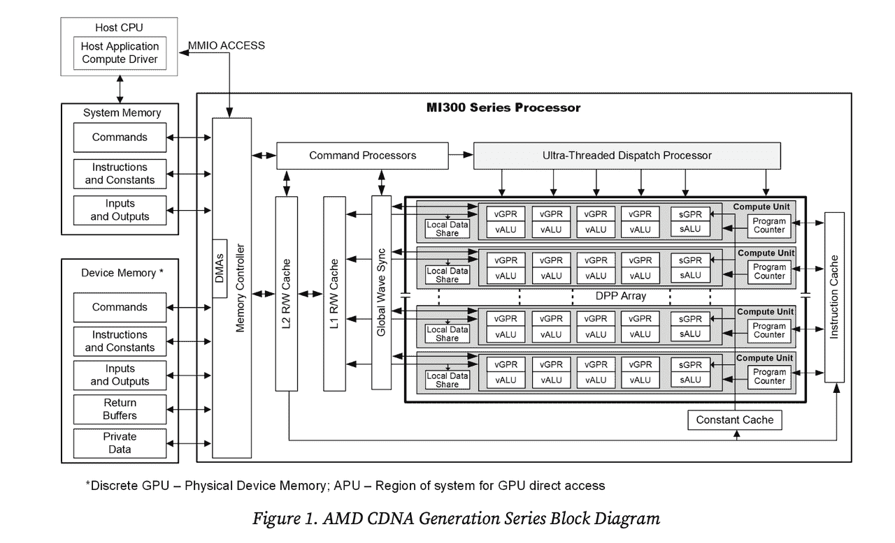

command processor 的 2 个功能：

1.  communicates with the host. reads commands that the host has written to memory-mapped CDNA registers in the system-memory address space

1.  sends hardware-generated interrupts to the host when the command is completed

1.  schedule on chip workloads

The CDNA memory controller has direct access to all CDNA device memory and the host-specified areas of system memory.

To satisfy read and write requests, the memory controller performs the functions of a direct-memory access (DMA) controller, including computing memory-address offsets based on the format of the requested data in memory.

In the CDNA environment, a complete application includes two parts:

+ a program running on the host processor,
+ programs, called kernels, running on the CDNA processor.

## Arch History

CDNA相对GCN变化较小，主要是删除了对图形的支持指令，专注于通用计算，增加了Matrix Cores的支持，并在2023-CDNA3引入了Infinity Cache。

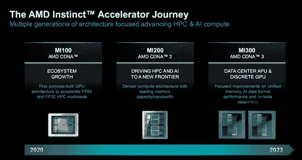

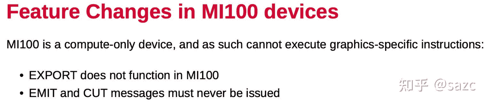

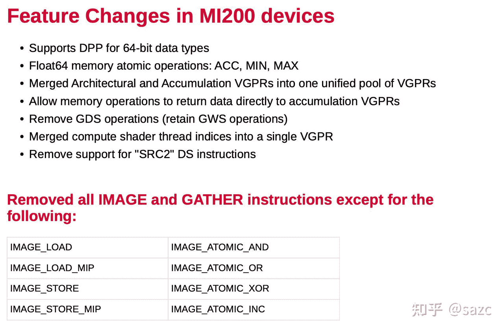

## Instinct MI300X GPU

AMD MI300 深度揭秘：全面超越NVIDIA

https://mp.weixin.qq.com/s/NprEgCn_nmvm5Im0jUBktQ

2023.06 发布。只公布了一部分技术细节。

2023.12.07，AMD Advancing AI大会，正式公布了Instinct MI300 系列加速器的详细规格与性能，以及众多的应用部署案例。

MI300对标英伟达H100。

包含1530亿个晶体管，AI任务推理性能比H100快1.6倍，内存容量足足192GB，是H100的两倍以上（2.4x）。

MI300X 1920亿晶体管怪兽 完胜NVIDIA H100.

传统的GPU加速器方案，纯粹的GPU设计

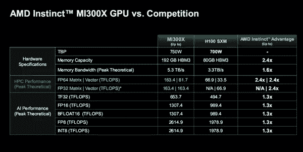

底层是4个6nm I/O芯片，上面融合了8个HBM3内存（12Hi堆栈）和8个5nm CDNA 3 GPU小芯片（3D堆栈）

其中3D堆叠GPU和I/O芯片通过“3.5D”封装技术进行连接。

最终成品功耗750W，包含304个计算单元、5.3TB/s带宽，以及高达192GB的HBM3内存（相比之下，H100仅80GB）。

通过 Infinity Fabri 进行互联，各GPU之间的吞吐量为896 GB/s。

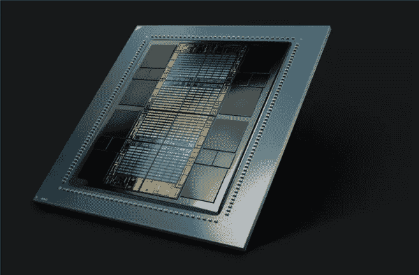

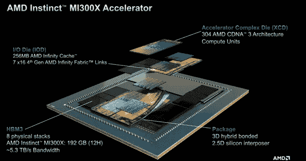

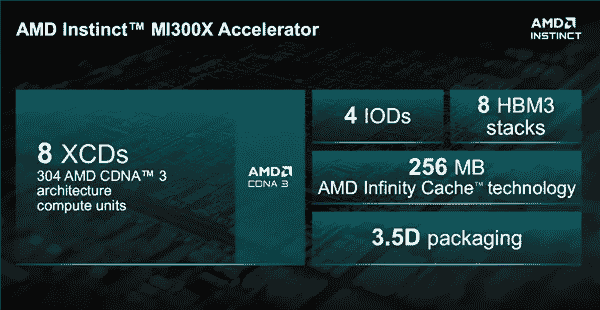

分为数据中心APU、专用GPU两条路线，重点提升了统一内存、AI性能、节点网络等方面的表现，再加上先进封装、更高能效，以满足生成式AI的强劲需求。

## Command Processor

https://old.gem5.org/wiki/images/1/19/AMD_gem5_APU_simulator_isca_2018_gem5_wiki.pdf

AMD_gem5_APU_simulator: isca_2018_gem5_wiki

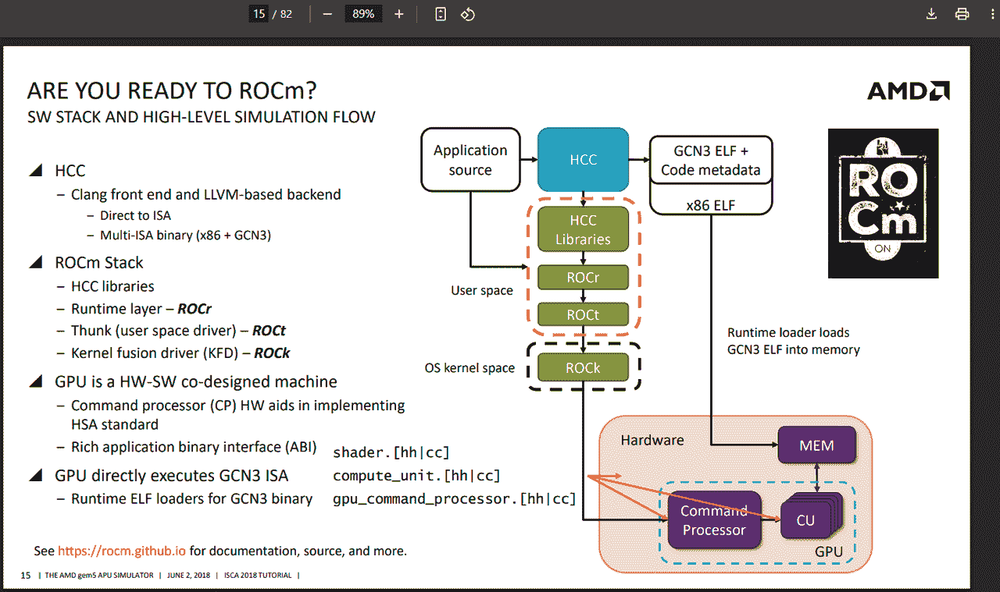

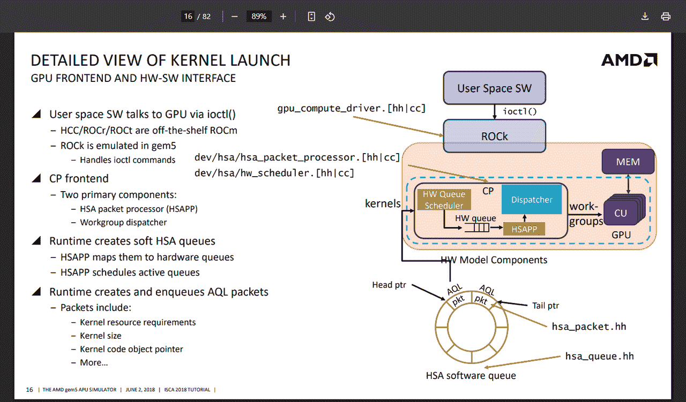

At intialization, the SI-GPU command processor is configured to read commands from the host in memory-mapped buffers. These command buffers contain primarily operational pipeline state data by reference or value, explicit dispatch/draw/DMA commands, and memory/cache synchronization operations with optional controls to schedule host interrupts. The command processor interprets the commands sequentially and schedules the work conveyed by compute dispatches, graphic rendering (draw) commands, or DMA operations after initializing the state registers and satisfying scheduled synchronizations.

When an application passes compute workloads to the SI-GPU, it first must compile the kernel and load it into memory. It also must bind buffers for the source and result data. Finally, it creates a command buffer instructing the command processor how to execute its workload on the SI-GPU. An application typically does not do this directly, but rather through a set of APIs.

The minimum set of commands to execute a kernel on the SI-GPU are:

+ Load the kernel onto the SI-GPU by providing a pointer to the kernel’s binary image in memory and inform the SI-GPU of the resource requirements for this kernel.
+ Provide pointers to the data domain on which the kernel is to operate.
+ Provide pointers to constant data and resources in memory.
+ Provide pointers to the output buffer(s).
+ Invalidate the caches, and execute the kernel.

## Intel

Intel的Xe HPC GPU，Ponte Vecchio （PVC），是真正实现计算核心胶水化的GPU。PVC通过大量的3D和2.5D互联技术将计算核心胶水在一起。因此，在过去的一段时间里，我一直将Intel的Ponte Vecchio称为GPU胶水的天花板。

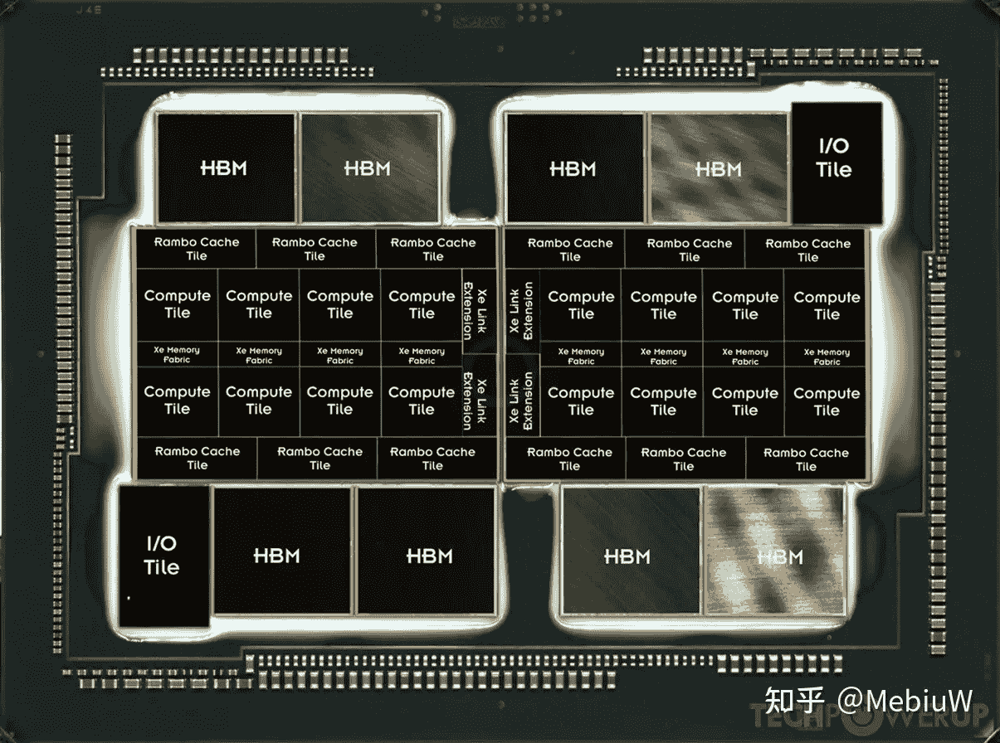

RDNA4的胶水设计也实现了类似于Intel Ponte Vecchio的计算核心胶水化。具体来说，在RDNA4里有三部分胶水，第一部分是计算核心的胶水部分，叫做Shader Engine Die (SED)。第二部分是RDNA4的灵魂所在的Base Active Interposer Die (AID) Die。AID最高可以通过3D封装技术承载3颗SED核心，并且AID和AID之间可以通过2.5D封装技术实现横向的拓展。因此，在示意图中，这个RDNA4总共实现了3AID*3SED的设计，也就是最高可将9颗SED核心有机地胶水在一起。最后一个核心是一个MID，主要是一些多媒体单源和PCIe控制器，避免了SED重复加载这些单元的设计。

AMD的RDNA4胶水设计比我之前称之为天花板的Intel Ponte Vecchio还要强。这个胶水设计非常完美，充分地利用了高级2.5D和3D封装的潜能，算是Chiplets设计的又一个天花板。

AMD只需要设计一个AID、一个SED和一个MID，就能胶水组合出非常多的高性能GPU。这个设计非常美滋滋。

为什么RDNA4“问题不断”的话题。就像Intel的Ponte Vecchio一样，RDNA4的激进封装设计必然存在许多麻烦事。

+ 首先，如此多的Die封装结合在一起对于良品率的要求非常高，每一个封装都必须非常精准，否则一切前功尽弃。
+ 其次，与Intel的Ponte Vecchio不同，AMD的RDNA4底层的AID本身就有显存控制器和Infinity Cache两个发热源。再加上上面3D封装覆盖的计算核心SED，整体的散热要求非常高。这也是为什么我说RDNA4是又一个天花板，而不是新的天花板。在高性能领域，过于先进的3D封装技术并不一定是更好的技术。因为这种过于理想的3D设计非常不利于散热。
+ 最后，虽然RDNA4一定采用了各种高级的胶水封装技术，但是SED和SED之间的互联一定比单一芯片要差。因此，必须对芯片架构和软件设计进行大刀阔斧的修改才能避免被互联卡住。否则，即使封装技术已经完美就绪，最终性能可能也难以发挥。
