# GPGPU - Memory Model Design

> 来源：[https://learning.feishu.cn/docx/HMGzd6tUaoR2VExY4zKcpqg5nBg](https://learning.feishu.cn/docx/HMGzd6tUaoR2VExY4zKcpqg5nBg)

https://zhuanlan.zhihu.com/p/696367351

GPU内存模型优化方向

https://course.ece.cmu.edu/~ece847c/S15/lib/exe/fetch.php?media=part2_2_sorin12.pdf

A Primer on Memory Consistency and Cache Coherence

https://pages.cs.wisc.edu/~markhill/papers/isca90_drf0.pdf

Weak Ordering - A New Definition

# GPU Memory

challenge:

1.  chip multiprocessors，比如，GPGPU，有 shared memory on chip。

## host-device memory Model

首先，分为 Host Memory 和 Device Memory。

GPU 的 driver 是跑在 host memory 上的。

## Device Memory Hierarchy

global memory，习惯上认为是 off-chip memory。当前都是 HBM 方案。

最早是 NV 加 bandwidth 魔改过的 GDDR 方案。

L1/L2缓存（Cache），SRAM + 逻辑电路。区别就是 SM 内 vs 所有 SM 共享。

生命周期，由系统控制。

local memory 是 thread 独享的。应对 Register File 不够用的问题。

shared memory，SRAM，是 block 内可访问。与L1的位置、速度极其类似。

生命周期受用户控制，更利于block之内线程之间数据交互。算是一种 buffer 机制。

早期有 const memory，是专门存储器。

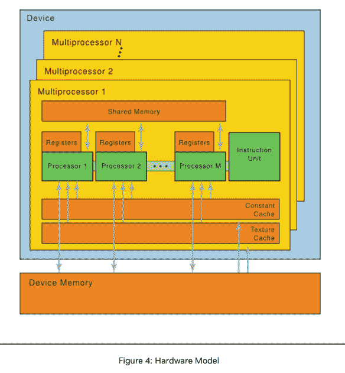

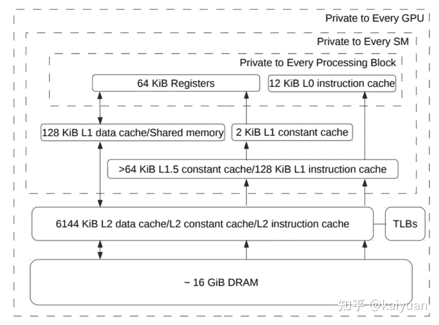

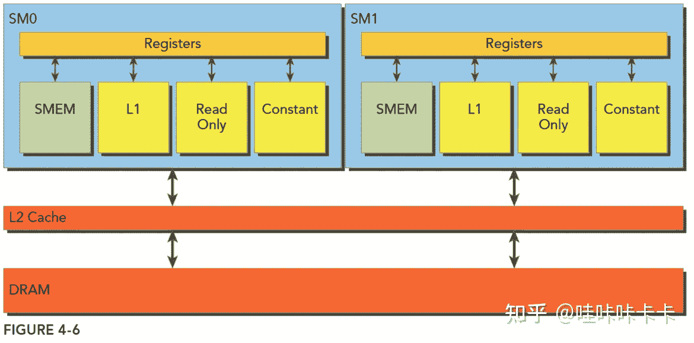

寄存器（register）是线程能独立访问的资源，它所在的位置与局部内存不一样，是在片上（on chip）的存储，用来存储一些线程的暂存数据。寄存器的速度是访问中最快的，但是它的容量较小。以目前最新的Ampere架构的GA102为例，每个SM上的寄存器总量256KB，使用时被均分为了4块，且该寄存器块的64KB空间需要被warp中线程平均分配，所以在线程多的情况下，每个线程拿到的寄存器空间相当小。

寄存器的分配对SM的占用率（occupancy）存在影响，

可以通过 https://xmartlabs.github.io/cuda-calculator/ 计算比较，

举例：如图当registers从32 增加到 128时，occupancy从100%降低到了33.33%：

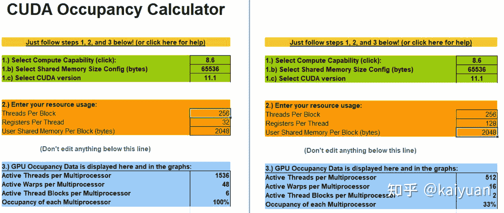

常量内存(constant memory)

常量内存(constant memory) 是指存储在片下存储的设备内存上，但是通过特殊的常量内存缓存（constant cache）进行缓存读取，常量内存为只读内存。为什么需要设立单独的常量内存？直接用global memory或者shared memory不行吗？

主要是解决一个warp内多线程的访问相同数据的速度太慢的问题，如下图所示：

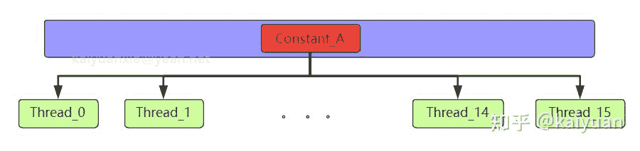

所有运算的thread都需要访问一个constant_A的常量，在存储介质上面constant_A的数据只保存了一份，而内存的物理读取方式决定了这么多thread不能在同一时刻读取到该变量，所以会出现先后访问的问题，这样使得并行计算的thread出现了运算时差。常量内存正是解决这样的问题而设置的，它有对应的cache位置产生多个副本，让thread访问时不存在冲突，从而提高并行度。

```
__constant__ int c1 = 10;  // 声明__constant__ 即可。
__global__ void kernel1(int *d_dst) {
   int tId = threadIdx.x + blockIdx.x * blockDim.x;
   d_dst[tId] += c1;
}
```

需要说明的是，在硬件上面，constant单元也分了多级（L1/L1.5/L2），而且存在线程访问延时，比如上述例子中的广播操作，当线程数量增加时延时也会随之增加。

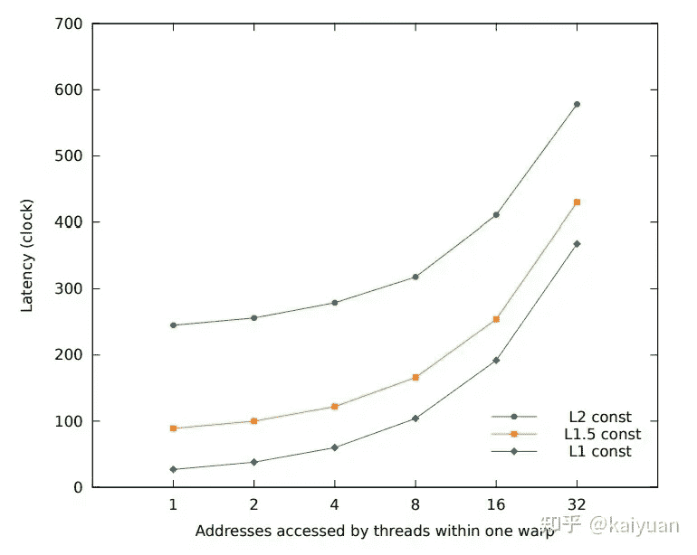

## CUDA Memory API

| API | Type | Notes |
| --- | --- | --- |
| +   cudaMalloc | device memory |  |
| +   cudaHostAlloc | Pined Memory on host |  |
| +   cudaMallocManaged | Unified Memory | Reference: [h](https://devblogs.nvidia.com/unified-memory-cuda-beginners/)ttps://devblogs.nvidia.com/unified-memory-cuda-beginners/ |

CUDA Memory API 的 Async / Sync

[h](https://docs.nvidia.com/cuda/cuda-driver-api/api-sync-behavior.html)ttps://docs.nvidia.com/cuda/cuda-driver-api/api-sync-behavior.html

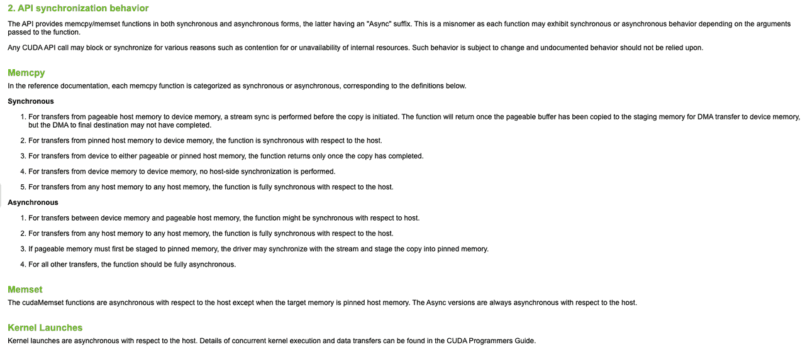

## Chip 内 memcpy_async

H100，TMA tensor core。

核心是 A100 引入的 tensor description 的概念。

然后是 H100 的优化手段。

tensor core 的位置，与 RF 的远近。

tensor core 的算力吞吐量，对搬运速度的需求变化。

tensor 粒度的变化，与 warp/work-group 之间的关系。与指令的碎片化程度有关，下发的 overhead 很大。

Ampere 架构之后才支持，通过 cooperative_groups::memcpy_async 操作完成

数据从 L2 到 SRAM 时，可以 bypass L1 和 RF。加速 2x 以上。

由此大胆猜测，真 sync 的 memcpy，可能都要经过 RF。否则，如何做到 sync？

（通过 async + synchronize 实现的 sync，不算）

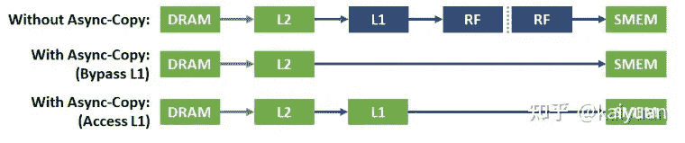

```
/// This example streams elementsPerThreadBlock worth of data from global memory
/// into a limited sized shared memory (elementsInShared) block to operate on.
#include &lt;cooperative_groups.h&gt;
#include &lt;cooperative_groups/memcpy_async.h&gt;

namespace cg = cooperative_groups;

__global__ void kernel(int* global_data) {
    cg::thread_block tb = cg::this_thread_block();
    const size_t elementsPerThreadBlock = 16 * 1024;
    const size_t elementsInShared = 128;
    __shared__ int local_smem[elementsInShared];

    size_t copy_count;
    size_t index = 0;
    while (index &lt; elementsPerThreadBlock) {
        cg::memcpy_async(tb, local_smem, elementsInShared, global_data + index, elementsPerThreadBlock - index);
        copy_count = min(elementsInShared, elementsPerThreadBlock - index);
        cg::wait(tb);
        // Work with local_smem
        index += copy_count;
    }
}
```

# Memory Model

分为

+   hardware 负责的 硬件内存模型。

+   compiler 负责的 软件内存模型。

+   更上层的

## Hardware Memory Model

内存一致模型

+   Sequential Consistency (SC): 讨论一致模型是什么，如何实现之类的

+   Total Store Ordering（TSO）

+   更弱的模型

### SC - Sequential Consistency 模型

Sequential Consistency 模型：

1.  program order: 对某个processor而言，execution maintains program order

1.  CPU 的 out-of-order execution 依旧能保证 memory order。

1.  比如，遵循各种 data dependency，多个 load/store 的先后顺序保证问题。

1.  global total order: 对于所有processor而言，所有的内存操作有一个单一的全局的order

1.  由内存和 cache 负责保证

cache coherence protocol 的作用在于，让cache invisible，让你在上层无法判断cache是否存在。

Consistency的作用嘛，大概在于让你能够对内存顺序进行reason，让你知道什么reorder可以什么不可以。根据Hennessy和Patterson的定义，coherence是：

+   对某个processor而言，在一次写之后相邻的一次读会读到写的内存。

+   对于不同的两个processor而言，A的读会读到B最近的一次写的结果，如果这个读在写之后的一定时间发生。读最终是能读到，但具体隔多久能读到，是consistency问题。

+   对于同一个 memory location，对该地点所有的write是serialized的，也就是有一个单一的全局顺序。

对于SC而言，SC的两点coherence都没有满足，譬如coherence没有指明两次相邻读之间的顺序，coherence只对某个地点具有单一store order等（而SC是total order for all memory ops）。但是不论consistency有多松，coherence（以上条件）都是能够保证的。

### TSO - Total Store Ordering

放松了一些约束。

### Memory Barrier (Fences)

就实现而言，memory fence 相当于清空 store buffer。

C++的内存ordering是既约束compiler的reordering，也约束硬件在运行时的reordering，所以对于某些硬件可能需要插入fence来enforce某种ordering。

c++ memory model

https://en.cppreference.com/w/cpp/atomic/memory_order

On **s**tr[ongly-orde](https://www.zhihu.com/search?q=non-atomic&search_source=Entity&hybrid_search_source=Entity&hybrid_search_extra=%7B%22sourceType%22%3A%22answer%22%2C%22sourceId%22%3A510745335%7D)red systems — x86, SPARC TSO, IBM mainframe, etc. — release-acquire ordering is automatic for the majority of operations. No additional CPU instructions are issued for this synchronization mode; only certain compiler optimizations are affected (e.g., the compiler is prohibited from moving non-atomic stores past the atomic store-release or performing non-atomic loads earlier than the atomic load-acquire). On weakly-ordered systems (ARM, Itanium, PowerPC), special CPU load or memory fence instructions are used.

## Weak Ordering

# 优化概念

## Pined Memory - on host

分配在 host 上的 memory，区分 pined memory 和 pageable memory。

过度使用 Pined Memory，会消耗系统的可用内存，有概率拖慢整个系统的运行速度。

Dec 04, 2012 [h](https://devblogs.nvidia.com/how-optimize-data-transfers-cuda-cc/)ttps://devblogs.nvidia.com/how-optimize-data-transfers-cuda-cc/

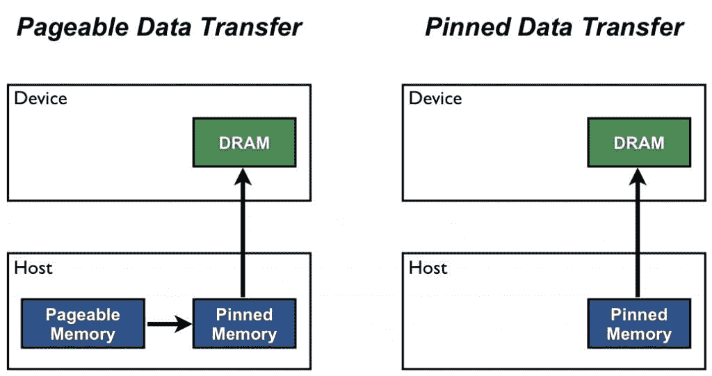

## h2d - Zero copy

host to device 时，直接搬到 GPU cache，不经过 global memory & shared memory？

具体的做法是，直接申请pinned memory，然后将指针传递给运算的kernel。

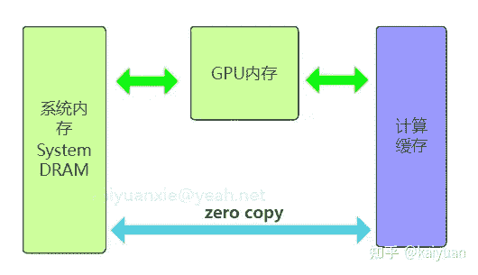

code

https://github.com/CalvinXKY/BasicCUDA/blob/master/memory_opt/zeroCopy.cu

```
float *a_h, *a_map; // 定义两个指针：a_h 内存原指针，a_map映射指针 
...cudaGetDeviceProperties(&amp;prop, 0);       // 获取GPU的特性，看是否支持地址映射 
if (!prop.canMapHostMemory) 
    exit(0);cudaSetDeviceFlags(cudaDeviceMapHost);    // 设置设备属性，打开地址映射
cudaHostAlloc(&amp;a_h, nBytes, cudaHostAllocMapped);  // 开辟pinned memory
cudaHostGetDevicePointer(&amp;a_map, a_h, 0);    // 地址映射 a_h -&gt;  a_map.
kernel&lt;&lt;&lt;gridSize, blockSize&gt;&gt;&gt;(a_map); 
```

## UMA

2014 年 Kepler 架构，CUDA 6，提出了 UMA (Unified Memory) 的概念。

只需要调用 cudaMallocManaged 这个 API，不用管内存是在哪里分的，也不用去做拷贝，UMA 都会帮你打理好。

和传**统的 cudaMalloc**/cudaMallocHost 不同，通过 cudaMallocManaged 申请的内存（称为 managed memory）不是立即满足的，而是等真的用到时才分配物理内存，即 demand paging（此处可类比 Linux 中 kmalloc 和 malloc/vmalloc 的区别）。

伴随 CUDA 6 的是 Kepler **架构，基于这种架构的** **GP**U 不能处理 page fault，对于 demand paging 的支持有限。而到了 CUDA 8 时代，硬件已升级为能够支持 page fault 的 Pascal 架构，UMA 才步入成熟。

不能处理 page fault 主要是 GPU thread 不能暂停，因为访问 absent page 时，GPU 需要 pause 正在执行的 thread ，把页面弄回 device memory。

而如果 GPU 支持 page fault，就没有这样的限制，暂时不用的 GPU 页面甚至可以 evict 到 host memory，下次用到时再换回。

**对于 page fau**lt 存在的开销，也可通过 Prefetching 的方式减小（思路类似于 Linux 中对 Page Cache 的 Readahead）。

一个 CUDA 程序，有一部分是由 CPU 完成的（比如初始化和返回结果，下图蓝色部分所示），有一部分是由 GPU 完成的（比如计算和渲染，下图绿色部分所示），里面的变量 x, y 通过 CPU/GPU 各自的虚拟地址（VA）访问，如果这两个 VA 能保持一致，将带来编程的方便。"single-pointer-to-data"，也是 UMA 的一个重要组成部分。

这就要求 GPU 的虚拟地址空间和 CPU 匹配，x86-64 的 CPU 一般是 48 位吧，Pascal 架构的 GPU 是 49 位，完全没问题。

VA 相同，但 PA 可能不同。CPU 的用户态程序虽然和 GPU 使用相同的 address space，但有各自独立的 per-process 页表。

## Weakly-Ordered Memory Model

TODO

## distributed shared memory

MMU 很重

sm - work group - cluster 8M

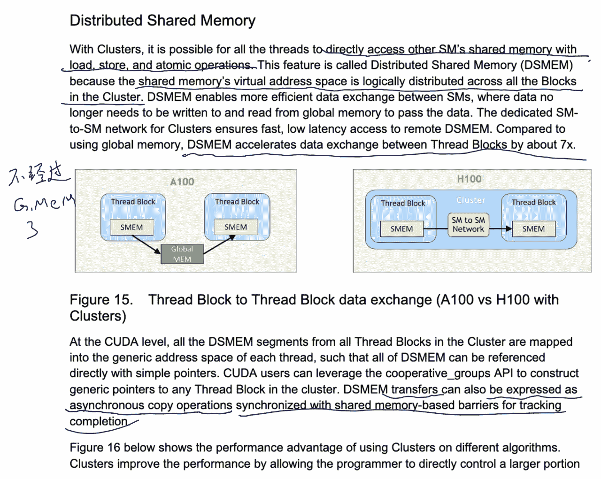

# Compiler 优化需求

为什么重视内存访问

+   必须清楚desirable (getter)和undesirable (scatter)的内存访问方式。 ->gather 和scatter

+   getter:memory到thread有多个输入，只有一个输出（图像模糊算法）

+   scatter:thread到memory有一个输入，多个输出（每个thread将结果scatter到各个memory，将附近值+1）

内存模型对GPU编程中优化方向

+   global memory

+   带宽、内存合并和内存对齐

+   shared memory

+   bank conflict、数据分布、conner-turning、async

+   const cache

+   broadcast、serialization

+   L2 cache

+   persisting

+   local memory

+   数据重用、数据对齐、同步原语

+   register

+   数据重用、循环展开

与锁有关的优化方向

+   global memory -> shared memory

+   global memory -> texture memory

+   global memory -> warp/block

解决数据竞争与数据一致性的锁与内存屏障

+   数据竞争 -> 锁

+   数据一致性 -> memory barrier / fence

# CPU & Linux Memory

https://mp.weixin.qq.com/s/vc9xEkG5FFKkqTJfCb7kzA

Linux 里面用户态和内核态共享数据的两种方式：read/write 和 mmap。可能很多人都觉得 mmap 不用拷贝，性能应该更好，但：随着硬件的发展，内存拷贝消耗的时间已大大降低，有些情况下，mmap 的性能反倒比不过 read/write。

Understanding the Linux® Virtual Memory Manager

https://pdos.csail.mit.edu/~sbw/links/gorman_book.pdf