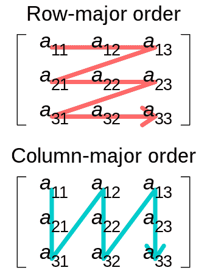

# PyTorch and Triton Memory Model

> 来源：[https://learning.feishu.cn/docx/M6fnd35VroKB6YxrbWZc5xClnFg](https://learning.feishu.cn/docx/M6fnd35VroKB6YxrbWZc5xClnFg)

无论tensor是多少维度，在内存中都只有一维，所以需要根据一定的布局方式，将高维tensor排布到内存中

# RowMajor and ColumnMajor

https://en.wikipedia.org/wiki/Row-_and_column-major_order

