# gem5 simulator

> 来源：[https://learning.feishu.cn/docx/O8WqdR9nLoidVUxaoMRcwQEwn7c](https://learning.feishu.cn/docx/O8WqdR9nLoidVUxaoMRcwQEwn7c)

repo: https://github.com/gem5/gem5

https://cn.news.synopsys.com/2024-03-25-PR-1-AI-Omniverse-EDA

# Summary

merger of the best aspects of the M5 [4] and GEMS [9] simulators

Discrete-event simulation platform with numerous models

模块化的离散事件驱动全系统模拟器。

Cycle-level modeling (not “cycle accurate”)。比 RTL (cycle-accurate) 速度快。

Python做配置，C++做底层实现。

适合在芯片规格定义阶段快速评估芯片的性能。

对 CPU 建模比较完善，GPU 要看 AMD simulator。

Gem5 的核心是：

1.  SimObjects，大多数 object 的基类。

1.  event queue。event 进 queue，出 queue。

传给 gem5 binary 的入参，是一个 python scripts，定义了 arch system 的 components 及其详细配置。

gem5 通过 event 机制进行 simulation & 信息采集。

Most of the components in the simulated system are SimObjects: CPUs, caches, memory controllers, buses, etc. gem5 exports all of these objects from their C++ implementation to python. Thus, from the python configuration script you can create any SimObject, set its parameters, and specify the interactions between SimObjects.

# Learning gem5 Tutorial

## Course Info

我只看了 part1 & part2，暂时感觉，够用了。

Learning gem5 Tutorial as ASPLOS 2018

http://learning.gem5.org/tutorial/index.html

最新官方 tutorial 文档：https://www.gem5.org/documentation/learning_gem5/introduction/

老文档的 b 站视频

1.  part 1 https://www.bilibili.com/video/BV167411q7c6

1.  part 2a https://www.bilibili.com/video/BV1r7411q7Vw/

1.  part 2b https://www.bilibili.com/video/BV1v7411q7S8/

1.  part 3 https://www.bilibili.com/video/BV1q7411q74x/

1.  part 4 https://www.bilibili.com/video/BV1B7411q7sH

## Getting started

### Build gem5

最新的 build 方法：

https://www.gem5.org/documentation/learning_gem5/part1/building/

编译命令

```
python3 `which scons` build/X86/gem5.opt -j9
```

### Hello world - 使用 SimObject

http://learning.gem5.org/book/part2/helloobject.html

code: gem5/configs/learning_gem5/part1/simple-riscv.py

定义了如下的最简 system，包含 cpu，memory & 连接二者的 bus 总线。

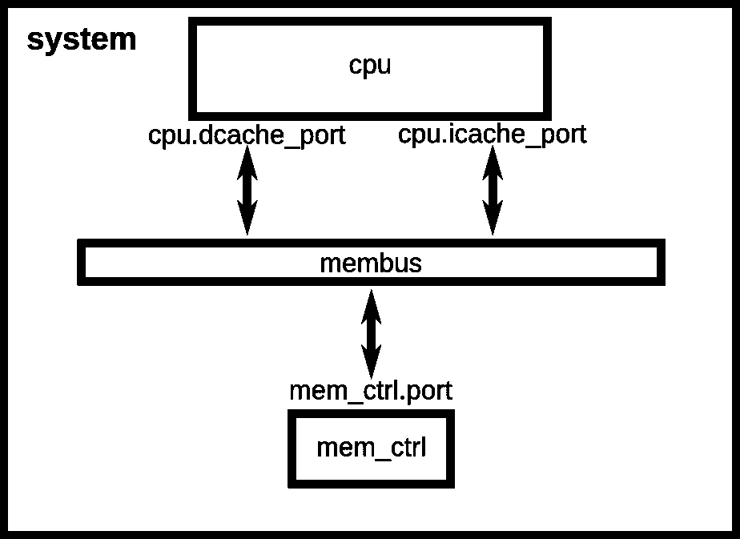

定义的代码如下，

```
import m5
from m5.objects import *

system = System()

system.clk_domain = SrcClockDomain()
system.clk_domain.clock = &quot;1GHz&quot;
system.clk_domain.voltage_domain = VoltageDomain()

system.mem_mode = &quot;timing&quot;
system.mem_ranges = [AddrRange(&quot;512MB&quot;)]
system.cpu = RiscvTimingSimpleCPU()

system.membus = SystemXBar()

system.cpu.icache_port = system.membus.cpu_side_ports
system.cpu.dcache_port = system.membus.cpu_side_ports

system.cpu.createInterruptController()

system.mem_ctrl = MemCtrl()
system.mem_ctrl.dram = DDR3_1600_8x8()
system.mem_ctrl.dram.range = system.mem_ranges[0]
system.mem_ctrl.port = system.membus.mem_side_ports

system.system_port = system.membus.cpu_side_ports
```

binary 的运行机制，推荐使用 syscall emulation mode (SE mode)。

we will just point the CPU at the compiled executable。

也可以选 full system mode 运行。需要 gem5 模拟整个 hardware system，就像运行虚拟机一样。

code 如下

```
thispath = os.path.dirname(os.path.realpath(__file__))
binary = os.path.join(
    thispath,
    &quot;../../../&quot;,
    &quot;tests/test-progs/hello/bin/riscv/linux/hello&quot;,
)

system.workload = SEWorkload.init_compatible(binary)

process = Process()
process.cmd = [binary]
system.cpu.workload = process
system.cpu.createThreads()

root = Root(full_system=False, system=system)
m5.instantiate()

print(f&quot;Beginning simulation!&quot;)
exit_event = m5.simulate()
print(f&quot;Exiting @ tick {m5.curTick()} because {exit_event.getCause()}&quot;)
```

触发运行

```
build/X86/gem5.opt configs/tutorial/part1/simple.py
```

输出信息 https://www.gem5.org/documentation/learning_gem5/part1/gem5_stats/

3 files generated in a directory called m5out:

1.  config.ini: Contains a list of every SimObject created for the simulation and the values for its parameters.

1.  config.json: The same as config.ini, but in json format.

1.  stats.txt: A text representation of all of the gem5 statistics registered for the simulation.

### 加 cache - 自定义 SimObject

新增 L1DCache，L1ICache，L2Cache 的 SimObject: gem5/configs/learning_gem5/part1/caches.py

system 配置中，增加 cache 模块：gem5/configs/learning_gem5/part1/two_level.py

simulator 构建的新 system 如下

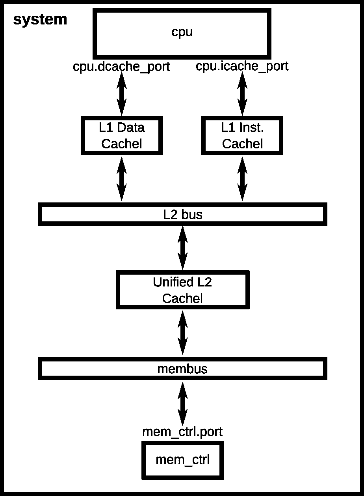

gem5 中，现在有 2 套 cache system：Classic caches and Ruby

gem5 currently has two completely distinct subsystems to model the on-chip caches in a system, the “Classic caches” and “Ruby”. The historical reason for this is that gem5 is a combination of m5 from Michigan and GEMS from Wisconsin. GEMS used Ruby as its cache model, whereas the classic caches came from the m5 codebase (hence “classic”). The difference between these two models is that Ruby is designed to model cache coherence in detail. Part of Ruby is SLICC, a language for defining cache coherence protocols. On the other hand, the classic caches implement a simplified and inflexible MOESI coherence protocol.

To choose which model to use, you should ask yourself what you are trying to model. If you are modeling changes to the cache coherence protocol or the coherence protocol could have a first-order impact on your results, use Ruby. Otherwise, if the coherence protocol isn’t important to you, use the classic caches.

A long-term goal of gem5 is to unify these two cache models into a single holistic model.

## Modifying / Extending

### 创建新 SimObject

SimObjects are wrapped C++ objects that are accessible from the Python configuration scripts.

SimObjects can have many parameters, which are set via the Python configuration files.

1.  Create a Python class for your new SimObject

1.  Implement your SimObject in C++。.hh 头文件 & .cc 文件

1.  Register the SimObject and C++ file。在目录下增加 SConscript，增加 .py 和 .cc 的编译配置。

1.  (Re)-build gem5

1.  在 python config 里面使用，就像使用已有 SimObject 一样。

## Debug & event

https://www.gem5.org/documentation/learning_gem5/part2/debugging/

## Advanced Learning gem5 topics

+   Building a CPU model in gem5

+   ISAs and CPU model ISA relation

+   Overview of different CPU models

+   Building a simple CPU model

+   Coherence protocols with Ruby

+   Intro to Ruby

+   Simple MSI protocol

+   Configuring Ruby

+   Debugging Ruby protocols

+   Quick overview of other gem5 topics

+   Overview of full system simulation

+   Briefly gem5's other features

+   gem5 limitations

## gem5 Best Practices

+   Developing and contributing to gem5

+   This will cover an qu[ick](https://git-scm.com/) introduction to git, best practices for contributing, how to test gem5, and how to use gem5's code review site.

+   Ryota Shioya: **Visualizing the ou**t-of-order CPU model

+   Konata is a new CPU pipeline viewer and has many useful features not in the previ[ous text-based viewer. T](https://github.com/shioyadan/Konata/releases)his talk will explain how to use the new viewer and best practices in gem5. https://github.com/shioyadan/Konata/releases

+   Link to presentation

+   Éder F. Zulian: Using gem5 for Memory Research

+   This talk provides an overview of our experiences with the gem5 simulator at the Microelectronic System Design Research Group of the TU Kaiserslautern. It begins with our motivation and use cases for applying gem5. Then we jump ahead to a brief description of innovations introduced by our research group and partners. The span of topics covers the DRAM power model used by gem5 (DRAMPower), which is being currently extended and maintained by our group. Furthermore, we show how a simple HMC memory model can be built from native objects provided by gem5, the configuration parameters are generated by our DRAMSpec tool. Moreover, we present how gem5 can be coupled to SystemC/TLM2.0 based modules, an interesting approach for industry to reuse in-house and third-party SystemC modules together with gem5. Finally, we close the session showing a bunch of useful scripts, called gem5 Tips and Tricks, for setting up and breaking the ice with gem5.

+   Link to presentation

https://github.com/gem5/gem5-resources/tree/stable/src/gpu/square

https://www.gem5.org/documentation/general_docs/gpu_models/vega

https://www.gem5.org/assets/files/workshop-isca-2023/slides/improving-gem5s-gpufs-support.pdf

# NPU 仿真 - Gemmini

paper: https://arxiv.org/abs/1911.09925

Gemmini: Enabling Systematic Deep-Learning Architecture Evaluation via Full-Stack Integration

2019.11.22

https://github.com/ucb-bar/gemmini

Berkeley's Spatial Array Generator。一个开源 NPU

软件硬件都是开源的，有一个主控的RISCV核，加速器部分是一块脉动阵列，整体结构比较简单，但是结构完整清晰，很适合用来做项目。

## NPU vs CPU

npu和cpu在架构上最大的区别到底在哪里？

1.  访存行为，eyeriss算是npu的一个典型结构，有global buffer，有RF，每个层级都有他的复用；跟cache有相似之处，但是由于AI计算的pattern是可以提前预测和安排的，所以不需要复杂的cache controller的逻辑，一般来说，用DMA来做system memory到global buffer的搬运，用显式的指令让寄存器直接访问片上memory；

1.  计算行为，跟cpu的avx，vector之类的向量指令集比起来，npu并行度很高；npu可以理解成一种专用的矩阵运算单元，每一拍都要进行数百到数千个MAC操作；

1.  控制行为，NPU的控制是粗粒度的，因为NPU的计算具有很强的规律，而且具有很强的局部数据复用性，因此一条粗粒度的指令就可以完成任务，比如说一片连续内存的搬运，或者说矩阵乘的计算，可以用硬件硬化的逻辑来实现，而不需要操作数明确的细粒度指令；

由于有这些区别，使用gem5里面的原生cpu，光靠修改配置是很难实现精确的npu建模的；想做好npu的建模，同样需要对以上的三个区别做好建模，包括：

1.  NPU的memory hierarchy，除了cpu里面经典的L1, L2 cache以外，应该对global memory/scratchpad这种NPU特有的片上专用存储空间做建模；

1.  计算上的行为差异，cpu架构里面一百多个的寄存器资源是不够的，通用寄存器的资源更是受限，因此需要为NPU添加充足的寄存器资源，并行计算产生的中间数据会放在NPU大量的最小粒度的寄存器上；

1.  控制上的区别，需要添加NPU访存和计算相关的定制ISA，这里面会涉及到一些粗粒度的指令，执行周期可能长达数百个，NPU会作为cpu的一个专用执行单元，或者说一套协处理器，NPU相关的指令嵌套在cpu原有的ISA里面，而这部分指令的行为需要在gem5中进行建模；

## Memory and Register

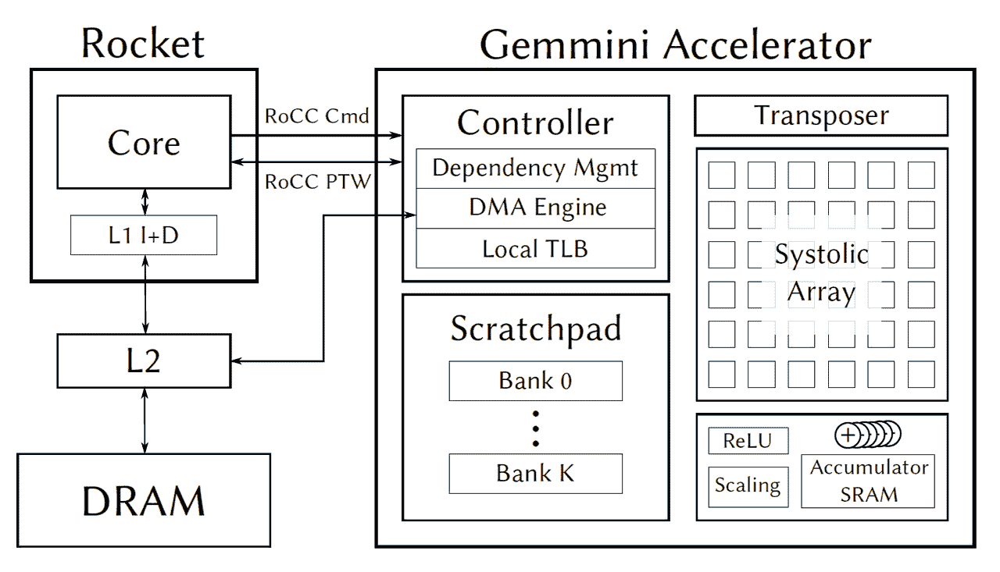

accelerator部分，数据可以存放在三个地方：Scratchpad，Systolic Array，或者Accumulator SRAM，mvin，mvout指令可以读写Scratchpad或者Accumulator的数据，而脉动阵列则是从scratchpad里面取数，选择将结果存放在本地（OS模式）或者存放到Accumulator（WS模式）；

而要在gem5里面建模这几片存储空间，最直接的方法就是新增一个NPU寄存器类，按照寄存器的访问index来判断当前想要访问的是哪一个存储部件里面的数据，给每一个存储部件都分配一段地址；这样子每一条指令需要什么数据，就可以直接用访问寄存器的API: xc -> getRegOperand，xc -> setRegOperand来读写，比较方便；至于如何新增寄存器类，可以参考gem5开发版里面支持 custom Register in arm  的做法；

Add custom Register In ARM (arm SME指令扩展新增 matrix reg)

https://www.mail-archive.com/gem5-users@gem5.org/msg20989.html

## ISA support

添加新指令的部分，这又包括两个部分，一是添加新指令的解码逻辑，让模拟器能够正确识别binary，二是添加新指令的执行逻辑，使得仿真器能够正确执行指令所对应的功能，这一部分的基础内容gem5的一个bootcamp里面是有提到的，https://gem5bootcamp.github.io/gem5-bootcamp-env/modules/developing%20gem5%20models/instructions/

gemmini的指令集，其实数量非常少。概括来讲，有三类指令：

1.  配置指令，有三条，config_load/config_store/config_ex，是用来提前配置访存和计算行为逻辑的一些必要参数；

1.  计算指令，也有三条：preload/compute_preload/compute_accumulate，是用来做脉动阵列的累加的；

1.  访存指令，有两条，就是mvin/mvout

这些指令都可以看作一种协处理器指令，并且他们的Opcode会避免与已有的RV ISA冲突，CPU解码到这些指令时，就知道要让加速器去完成指令执行的部分；而这样子的描述只是一个纯功能性的描述，好像协处理器指令跟CPU指令是等价的，事实上，他们遵循着完全不一样的流水级，而且NPU指令的粒度比较粗，一条指令实际上可能会产生数百次的访存/写回，而且大部分的操作数是隐式计算的，这跟CPU指令有着较大的区别。以mvin指令为例，可以看到除了源地址（DRAM），目标地址（Spad）以外，还有需要搬运多少行/列的数据，而这实际上在硬件上是通过DMA Controller完成的：

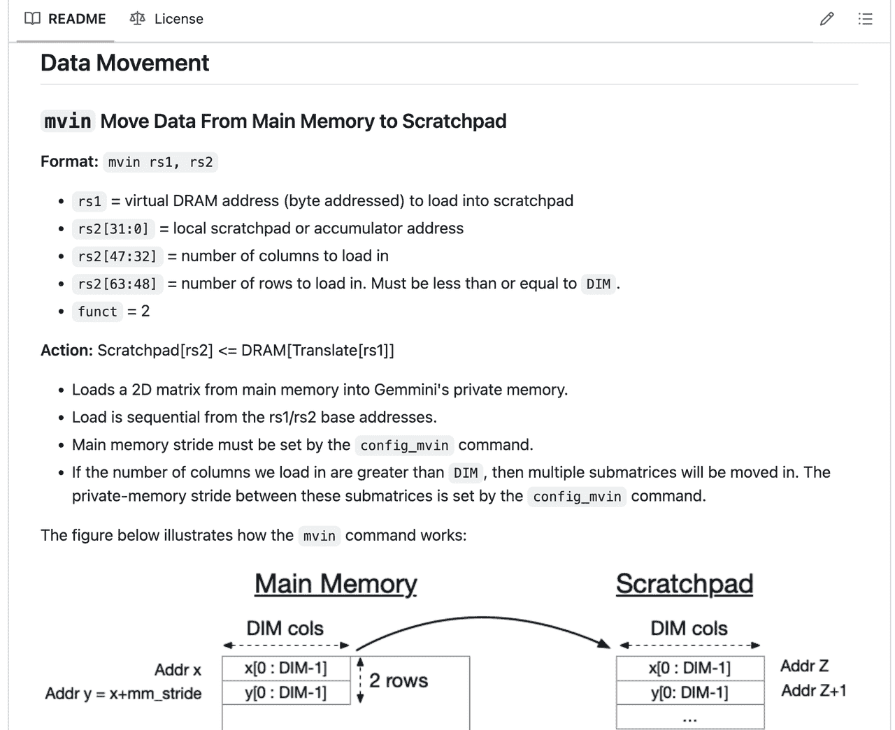

本文主要讨论怎么在gem5从功能上模拟这样子的行为，如mvin指令这种类似于DMA的行为，我们可以在该指令的execute模板中（详见gem5 bootcamp），写上一个for循环来模拟这个过程，其伪代码为：

```
Mvin::execute{
    for (int i = 0; i &lt; rows * cols; i++)
    {
        readMemAtomic(DramAddr, val); //Mem[Addr] -&gt; val
        DramAddr += stride;
        xc-&gt;setRegOperand(this, SpadAddr + i, Rd); //val -&gt; Reg[SpadAddr + i]
    }
}
```

mvout的过程也是类似的：

```
Mvout::execute{
    for (int i = 0; i &lt; rows * cols; i++)
    {
        val = xc-&gt;getRegOperand(this, SpadAddr + i); //Reg[SpadAddr + i] -&gt; val
        writeMemAtomic(DramAddr, val); //val -&gt; Mem[Addr]
        DramAddr += stride;
    }
}
```

compute_acc或者compute_preload，都是在计算一个tile的矩阵乘C = A * B + D，他们的实现可以这样子写：

```
Mvin::execute{
    // C[i][j] += A[i][k] * B[k][j]
    for (int i = 0; i &lt; DIM; i++)
    {
        for (int j = 0; j &lt; DIM; j++){
            uint64_t C_elem = getSystolicElem(i, j);
            for (int k = 0; k &lt; DIM; k++){
                uint64_t A_elem = getScratchpadElem(A_scratchpad_addr, i, k);
                uint64_t B_elem = getScratchpadElem(B_scratchpad_addr, k, j);
                C_elem += A_elem * B_elem;
            }                                
            setSystolicElem(C_elem, i, j);
            if(writeAcc){
                setAccumulatorElem(C_scratchpad_addr, final_val, i, j);
            }
        }
    }        
}
```

上面提到的这些execute函数，都会生成到/build/RISCV/arch/riscv/generated/exec-ns.cc.inc里面，而他们的定义则是在/src/arch/riscv/isa/formats/***.isa，isa后缀是gem5里面一种独有的domain specific language，会通过一个parser转换成最终执行的C++代码；

# GPU 仿真 - AMD

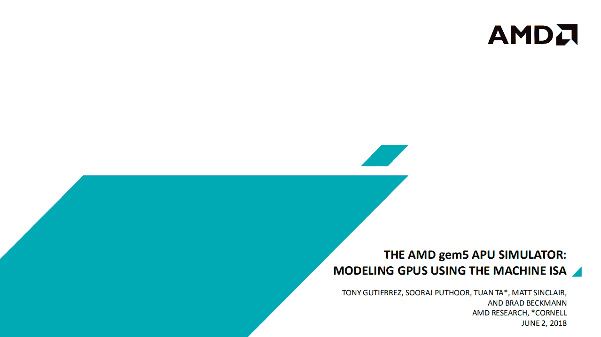

[2018-AMD_gem5_APU_simulator_isca_2018_gem5_wiki.pdf](https://internal-api-drive-stream.feishu.cn/space/api/box/stream/download/all/YsgybI09SoGgoZxA7Sjcle27nPf)

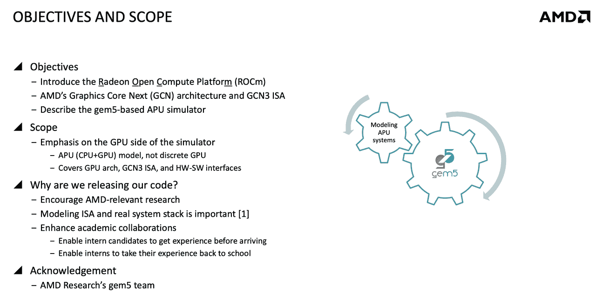

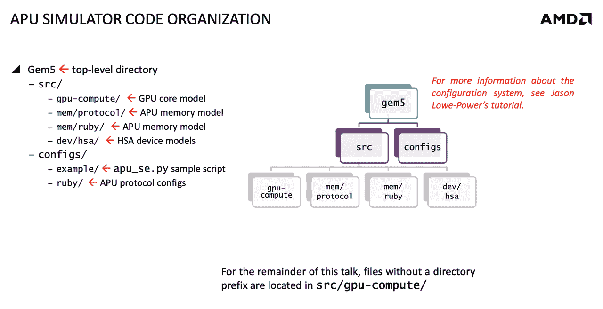

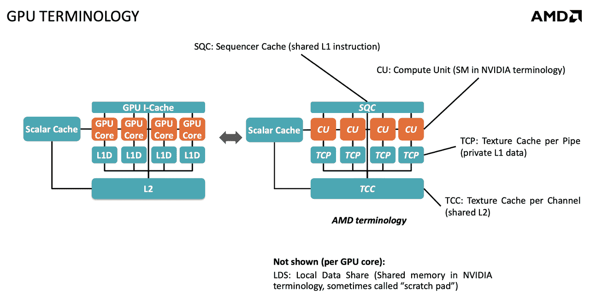

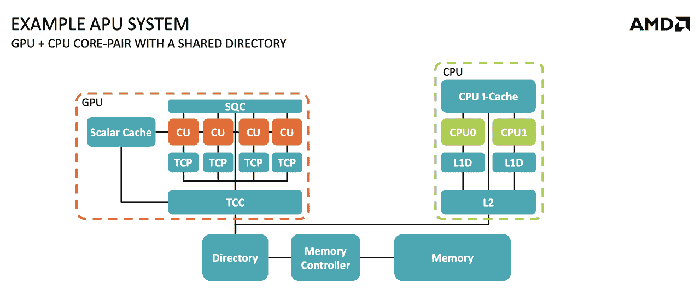

# Improving gem5’s GPUFS Support

https://www.gem5.org/assets/files/workshop-isca-2023/slides/improving-gem5s-gpufs-support.pdf

from AMD Research

2023

## takeaways

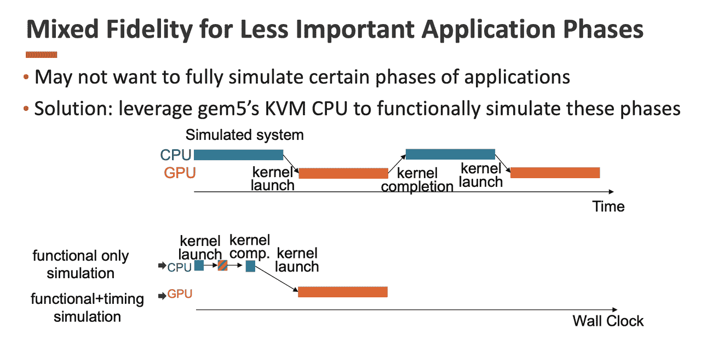

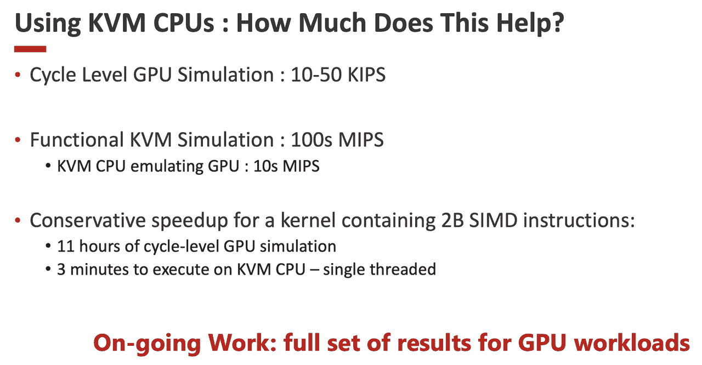

## details

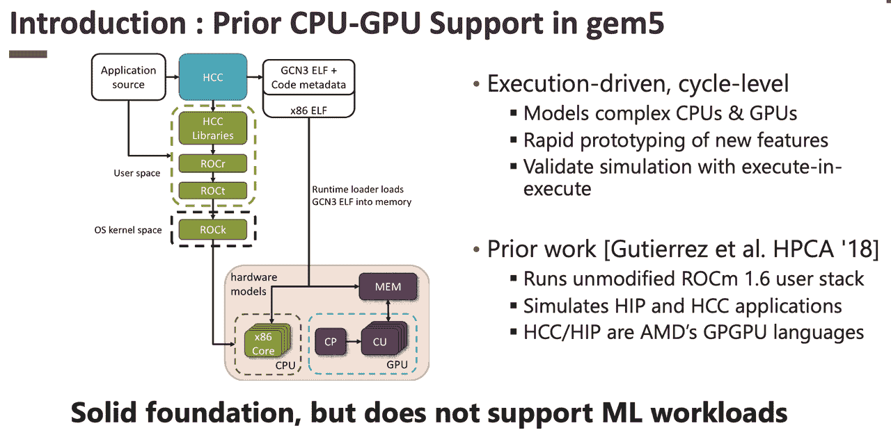

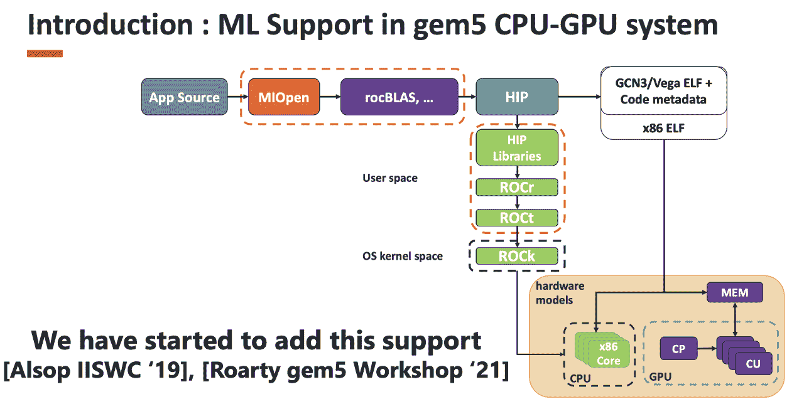


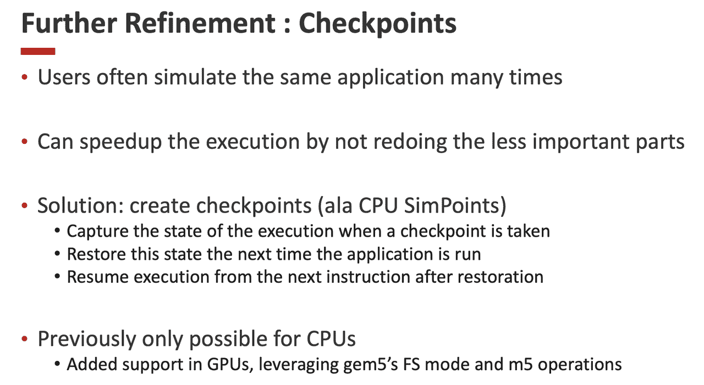

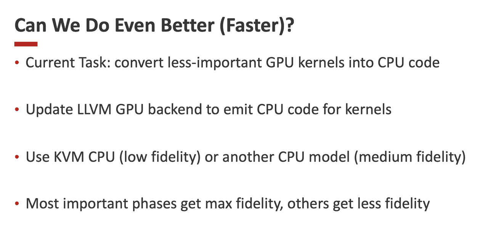

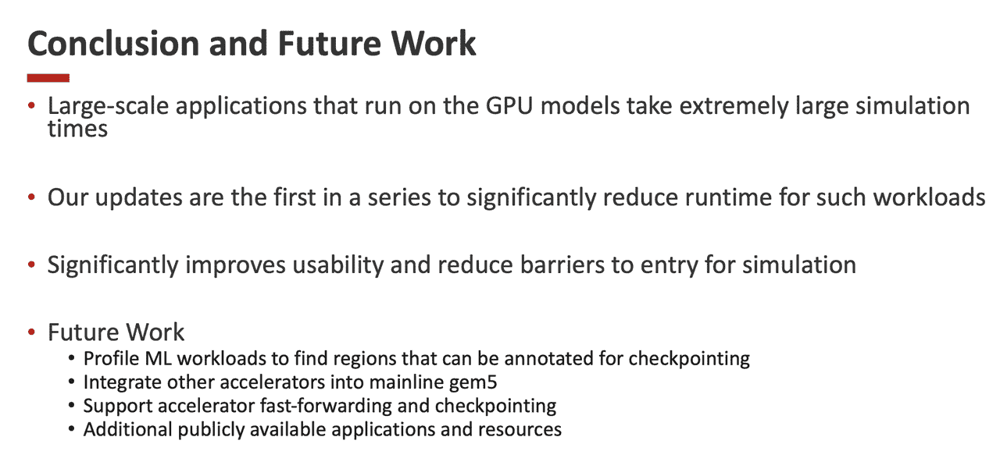