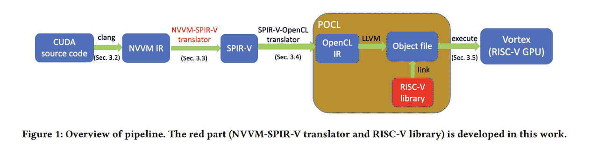
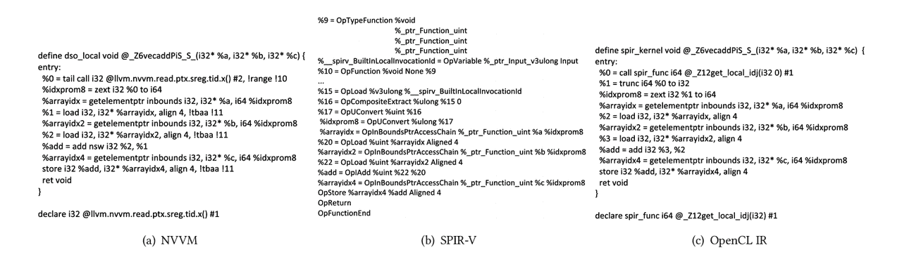
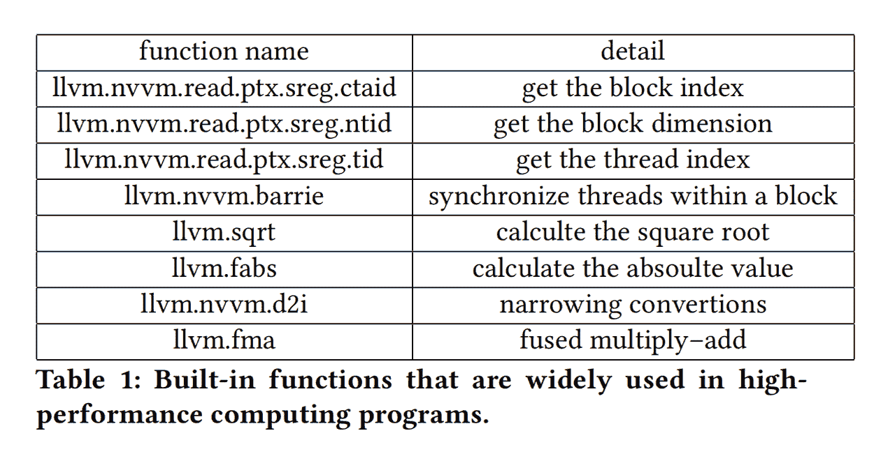

# CUDA on SIMD(RVV) GPU

> 来源：[https://learning.feishu.cn/docx/TnUsdI7chodnxZx1bUdcrfF9nBg](https://learning.feishu.cn/docx/TnUsdI7chodnxZx1bUdcrfF9nBg)

Supporting CUDA for an extended RISC-V GPU architecture

https://arxiv.org/abs/2109.00673

2021.09

propose and build a pipeline

input: CUDA source codes

output: executes them on an extended RISC-V GPU architecture

succeed in executing multiple CUDA source codes with multiple features, including multi-thread,multi-block, atomic, and synchronization

核心是：

build a translator support translating from NVVM to SPIR-V https://github.com/gthparch/NVPTX-SPIRV-Translator

extend existing POCL to support RISC-V back-end.

POCL: Portable Computing Language

2015, pocl: A performance-portable OpenCL implementation

3 种 IR 表示 vector 的例子

NVVM IR

2012, Compiling CUDA and other languages for GPUs

represent GPU compute kernels.

call nvcc to compile CUDA into NVVM IR, and the GPU driver will further

translate the NVVM IR into a binary code that can be run on NV GPU

a subset of LLVM IR along with a defined set of the build-in functions used to represent GPU programming

concepts.

SPIR-V

SPIR (Standard Portable Intermediate Representation)

expressing parallel computation and GPU-based graphics

used as an isolation layer that departs the front-ends programming language (e.g. MLIR, OpenCL, OpenGL) and low-level compute architecture.

hardware-friendly

OpenCL IR

a framework for writing programs that execute across heterogeneous platforms

It supports several back-end devices: CPUs, GPUs, FPGAs, and so on

This language provides a rich set of built-in functions for scalar and vector operations

When we refer to LLVM-IR, we generally refer to LLVM bc format of LLVM-IR

