# 总线 & PCIe 总线

> 来源：[https://learning.feishu.cn/docx/J0e1dpuUko2QtjxbF73cXh3Xn5c](https://learning.feishu.cn/docx/J0e1dpuUko2QtjxbF73cXh3Xn5c)

## Summary

`总线带宽 (bit/s) = 频率 * 位宽`

PCIe 是高速串行总线，差分信号。

采用端到端的连接方式，一条链路只能接 2 个设备。

一条 PCIe 链路，可以包含多个 lane。1, 2, 4, 8, 12, 16, 32。

一般来说，当系统上电后，host会自动查询PCIE设备枚举以获取总线拓扑结构。除一些特殊系统外，普通的系统只会在开机阶段进行设备的扫描，启动成功后，即枚举过程结束后，即使插入一个PCIE设备，系统也不会再去识别它。

PCIe在现代x86体系中除了传统的连接外部设备（真的有硬连线）的作用，更多的是充当IP粘合剂的作用，并不存在符合PCIe总线标准的硬连线。

Chip 内的 IP 之间，需要相互暴露接口。本质就是一组寄存器，准确的说是 CSR（Control and Status Register）。接下来唯一的问题是这些CSR如何暴露给带内内核了。在 **ARM传统体系中**，这些CSR往往作为MMIO映射到地址空间中，某个IP CSR MMIO起始地址在SOC设计地址规划阶段就需要定下来，定好后一般后期不能改变。在 **x86体系中**，传统上，南桥的设备映射到PCIe地址空间中，而北桥和CPU内部的设备映射到MMIO中。但后期随着北桥的功能被移入CPU，和CPU中加入越来越多的IP，传统做法让MMIO地址冲突越来越严重。更重要的是，MMIO的映射关系不是PnP的，也就是不可以枚举的，而是在ACPI中列举的，这在系统整合和SKU越来越多的时候，造成很大麻烦。为什么不和南桥设备一样，统一映射到PCIe地址空间呢？

Intel的架构师也有一样的想法，如果我们仔细跟踪Intel CPU中设备CSR的映射关系，就会发现有越来越多的设备IP从MMIO空间移入了PCIe空间（配置寄存器空间或者BAR上），有了自己的Device和Func号。在BIOS启动阶段设备甚至比在操作系统阶段可以看到的设备多得多，很多不需要终端用户关心的设备在启动最后阶段被隐藏了。那么这种迁移是如何做到的呢？是不是通过在芯片内部连接了无数PCIe总线呢？

并不是。这要归功于IOSF（Intel On-Chip System Fabric）总线，它提供Die内backbone Fabric（可以跨DMI），将各个IP整合在一起。IOSF总线包括两种接口（Interface）：Primary Interface和Sideband Interface。主接口提供PCIe抽象，方便各个IP CSR映射到PCIe空间中；而简化的旁路接口是传统的index/value接口，提供轻量级的访问，方便一些简单的IP的CSR映射到带外IO空间中，缺点是速度慢。

借助于IOSF总线，大量的集成IP通过Primary Interface将自己的CSR暴露给带内CPU，从而在独立和互操作上取得平衡。它们在软件逻辑上，看起来和PCIe没有什么不同，其实原理大不相同。 **正因为如此，我们今天，才能在x86 PC和服务器中，看到如此多的PCIe设备，它们不仅仅是传统的外部PCIe设备，还有很多是抽象的内部IP。**

PCI-to-PCI桥规范是理解PCI体系结构的基础

### 常见总线

抛开PCIe不谈，如果我们设计一种板间通信的总线协议，我们关注的点至少有：

+   总线带宽

+   成本开销

+   信号完整性

+   可扩展性

从系统模块的角度，总线系统主要由 2 大部分组成：

1.  CPU 总线，又称为 FSB（Front Side Bus，前端总线）。

1.  PCI/PCIe 总线。

从功能实现上，可以分为 3 种总线类型：

1.  **数据总线**：用于在 CPU 与 Main Memory 或 I/O 设备之间传输数据。

1.  **地址总线**：用于在 CPU 与 Main Memory 或 I/O 设备之间传输地址信息。

1.  **控制总线**：用于在 CPU 与 Main Memory 或 I/O 设备之间传输控制信号。

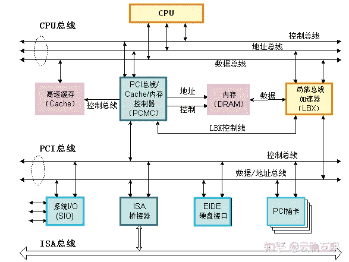

| Bus | Year |  |  |

| --- | --- | --- | --- |

| ISA | 1981 | 8位的ISA提供了4.77MB/s的带宽（或传输率） | 第一代 IBM PC XT机型上（1981） |

| EISA | 1988 |  | IBM 的 MCA总线，迫使其他几家PC兼容机厂商联合起来捣鼓出来EISA。因为两者都期待兼容ISA，导致速度没有多大提升。 |

| MCA |  |  | IBM PS/2 产品线 |

|  |  |  |  |

| VLB | 1992 | 绑定自己的频率到了当时486 CPU内部总线频率：33MHz。而到了奔腾时代，内部总线提高到了66MHz，给VLB带来了严重的兼容问题，造成致命一击。 | 真正的高速总线 |

|  |  |  |  |

| I2C or I^2 C |  |  |  |

| SPI |  |  | peripheral 外围的 |

| USB |  |  |  |

| SATA |  |  |  |

| PCI | 1992 | 133MB/s的带宽(33MHz时钟，每时钟传送32bit) |  |

| AGP | 1996 |  |  |

| PCI-X | 1999 |  | PCI-X和AGP走了两条略有不同的路径，PCI-x不断提高时钟频率，而AGP通过在一个时钟周期内传输多次数据来提速。 |

| PCIe / PCI Express | 2004 |  |  |

### Bus History

1990-1991 年 80386 的 motherboard。分 8bit 和 16 bit 2 代 ISA slot。

几乎用于一切外设接到 motherboard 上，缺点是速度慢，不满足最新 graphics card 等设备的需求。

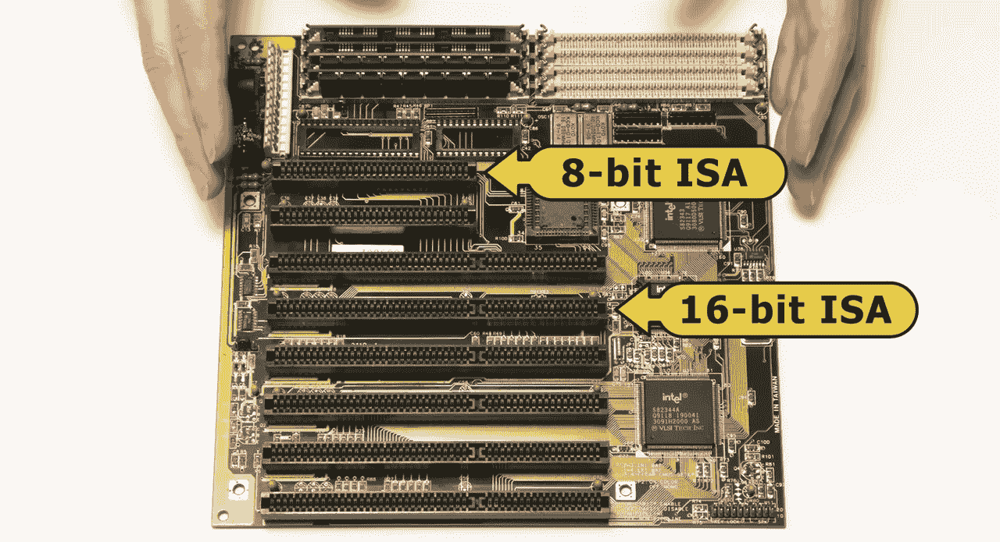

1997 年的 motherboard，

1.  4 个 PCI slot。白色。

1.  2 个 ISA slot。白色下面 2 个长条。

1.  1 个 AGP slot。白色的上面。缺点是，版本多，相互不兼容。插口的物理外形都不一样。

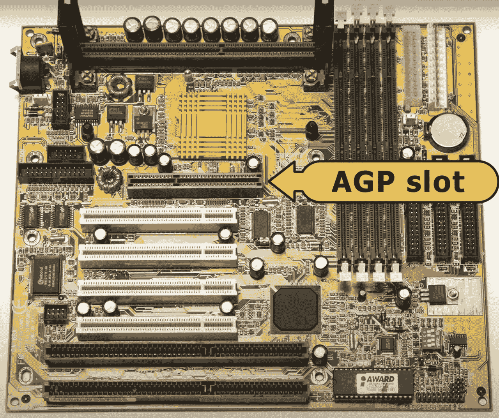

另一个 motherboard，5 个 PCI slot + 1 AGP Pro slot。

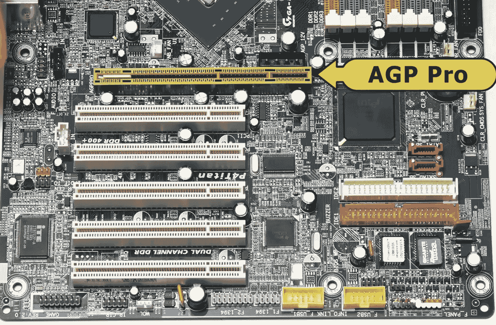

2004 年，诞生 PCIe。

下面的 motherboard，有 3 个 PCIe x1， 1 个 PCIe x16

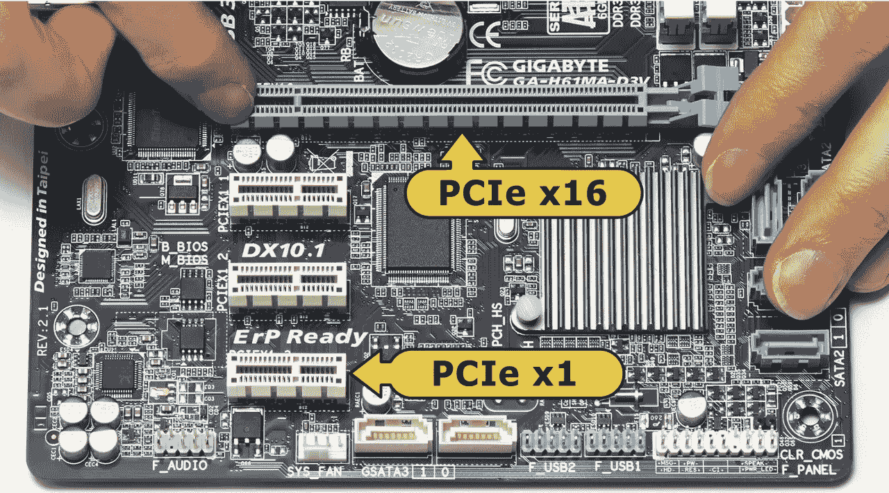

slot 数量

1.  3 个 PCI slot

1.  4 个 PCIe slot。2 个 x1，1 个 x4，1 个 x16。

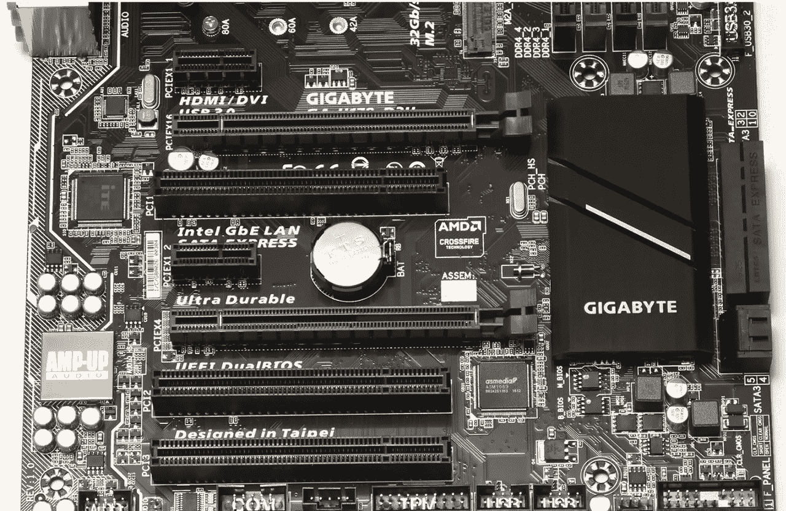

如果放大了仔细看，PCIe x4 的 slot，只有前 1/4 有 electrical pins。

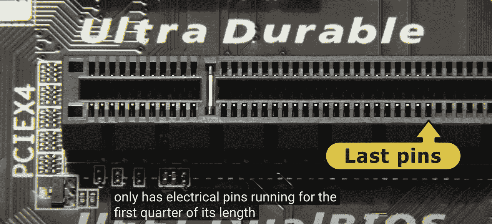

第一代总线

第二代 IO 总线包括 PCI、AGP 和 PCI-X

第三代高性能IO总线PCIExpress(下称PCIe)

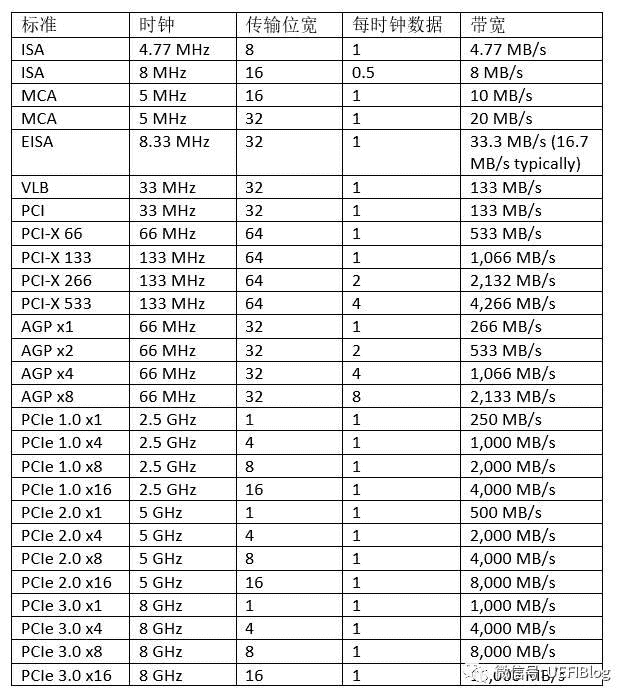

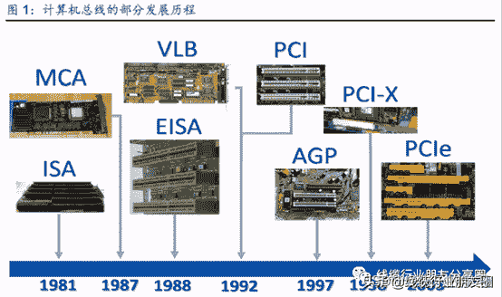

PCI 总线与处理器总线（FSB）以及存储总线（DDR）三者是相互分离的。

PCI总线作为处理器系统的局部总线（Local Bus），是处理器系统的一个组成部分。

FSB（Front Side Bus）两个PCI总线域的PCI设备不能直接进行数据交换，需通过FSB（Front Side Bus）总线进行数据交换（需要CPU参与）

PCI与I2C或SPI的区别是什么？

前者是由物理层，链路层和事务层三层组成。后两者则只有物理层和链路层，所以在先了解I2C SPI协议的前提下，没能意识到这种区别就会发现很难理解。

PCI是与x86强捆绑的，所以他的IO事务类型和内存事务类型的区分对于ARM背景的人就显得很奇怪。IO事务类型是完全为了x86的`in` `out`两个指令服务的，而ARM没有这两个指令。

PCI总线相比于EISA和MCA总线相比有很多突出的优点：

1.  PCI总线空间与处理器空间隔离，即PCI设备具有独立的地址空间，如上图所示该空间通过HOST主桥隔离，而且HOST主桥包含有缓存，使得处理器和PCI总线工作在各自时钟频率中，互不干扰；

——任何访问PCI设备的操作必须经过HOST主桥， PCI设备可以通过HOST主桥与处理器共享主存储器资源；

——HOST主桥的一个重要作用就是将处理器访问的存储器地址转换为PCI总线地址；而PCI设备的地址属于PCI总线域的，与存储器地址空间不同。

1.  PCI总线具有很好的可扩展性，HOST主桥管理的第一条PCI总线，可以通过PCI桥扩展出一系列PCI总线，并以HOST主桥为根节点，形成一颗PCI总线树；

——PCI总线树上最多能挂256个PCI设备，这其中包括了PCI桥；而PCI桥是PCI总线能够扩展的主要原因，每一个PCI桥下相当于一个PCI总线的子树，可以通过PCI桥继续扩展；

——PCI桥可以管理这颗PCI总线子树，其配置空间中含有管理PCI总线子树的配置寄存器。

1.  PCI设备地址可以根据需要由软件动态分配，解决了设备间的地址冲突问题，实现了PCI板卡即插即用的功能；

——PCI设备的地址在BAR空间中，系统软件可以动态配置这个基地址（也可以配置固定地址），保证了每个PCI设备使用的物理地址不相同；PCI桥的配置空间含有其下挂PCI子树所能使用的地址范围。

1.  总线带宽高，32位/33MHz的PCI总线可提供132MB/s的峰值带宽，相比于EISA和MCA要大的多；

1.  共享总线机制，PCI设备通过仲裁后获得总线使用权，然后才能进行数据传输，PCI总线上的数据传输不需要处理器干预；

——PCI总线仲裁器不在PCI总线规范定义中，并不一定是HOST主桥和PCI桥的一部分（一般来说是由它们来实现）。

1.  [中断机制](https://www.zhihu.com/search?q=%E4%B8%AD%E6%96%AD%E6%9C%BA%E5%88%B6&search_source=Entity&hybrid_search_source=Entity&hybrid_search_extra=%7B%22sourceType%22%3A%22answer%22%2C%22sourceId%22%3A3121947087%7D)，PCI总线上的设备可以通过4个中断信号INTA~D#向处理器提交中断请求；PCI总线上的设备可以共享中断请求信号，不同的PCI设备可以“线与”后连接到中断请求管脚上。

### 历代 PCIe 性能

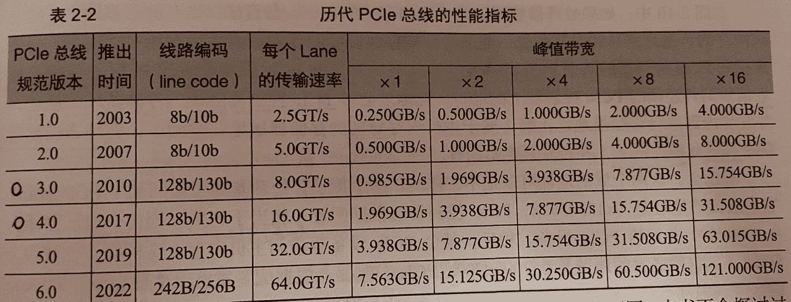

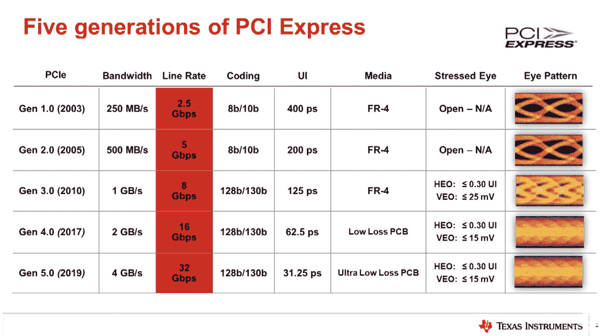

## 总线简介

### PCIe 历史

Intel在1992年提出PCI（Peripheral Component Interconnect）总线协议，并召集其它的小伙伴组成了名为 PCI-SIG (PCI Special Interest Group)（PCI 特殊兴趣组J）的企业联盟。从那以后这个组织就负责PCI和其继承者们（PCI-X和PCIe的标准制定和推广。

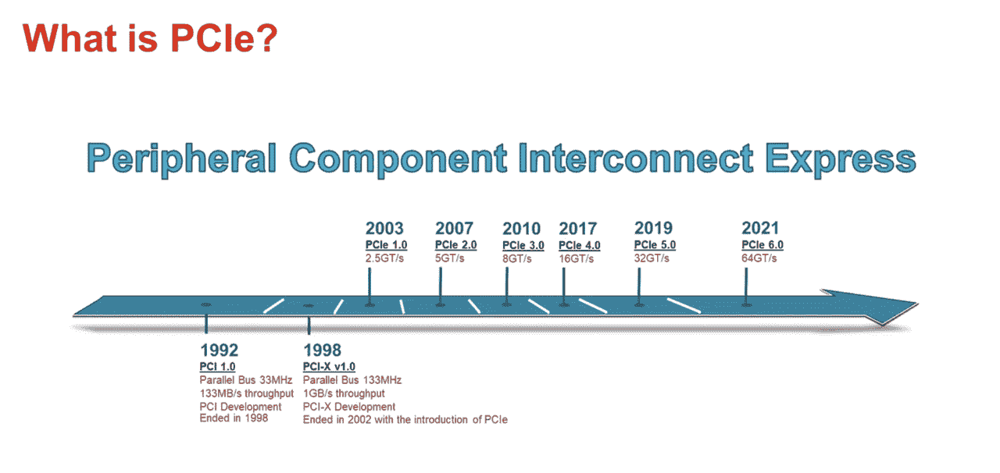

1.  在 VESA 和 PCI 的竞争中，PCI 胜出。

1.  PCI 是 单端并行 信号传输数据。易受外部系统干扰，总线频率很难进一步提高。

1.  高速差分信号，可以用更高的时钟频率，更少的信号线。

1.  2021 年，Intel 的 IAL（Intel Architecture Lab）发布取代 PCI 的第 3 代 IO 技术，称为 3GIO，后改名 PCI Express。

1.  当前最新的是 PCIe 6.0。常用的是 PCIe 3.0 和 PCIe 4.0。

1.  从 driver 的角度，PCIe 全面兼容 PCI。

Intel 的 IAL（Intel Architecture Lab）提出了：USB，AGP（Accelerated Graphics Port，替代了VESA总线），PCIe总线规范；甚至连X86的南北桥结构也是由它提出的。

PCI 淘汰了EISA（Extended Industry Standard Architecture）、VESA（Video Electronics Standards Association）等32位的总线

PCIe VS PCI 的 2 个核心改变：

1.  由并行总线转变为串行总线，

1.  点到点的互连。

PCIe 6.0标准变化很大，它将总线上的可用带宽提升了一倍，也就是64GT/s，这意味着PCIe 6.0 x16的带宽可以达到128GB/s，PCIe的信号也由原来的二进制NRZ信号变成了四态的PAM4信号，并结合固定数据包FLIT接口实现传输，以避免速率翻倍之后不提升频率的情况。

顺带一提，在NVIDIA Ampere架构GeForce RTX 3080和3090高性能GPU的推广后，GDDR6X中所使用的PAM4信号在消费领域也已经获得了不少的认知。

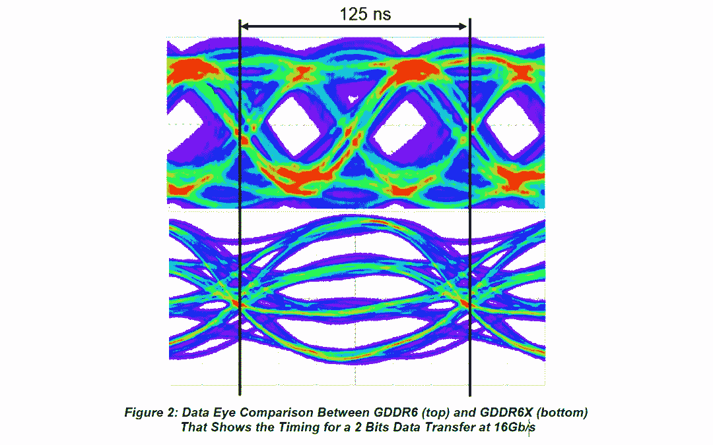

### M.2 协议

PCIe有两种存在形式M.2接口通道形式和PCIe标准插槽。

M.2接口通道也是一种PCIe接口，主要插支持M.2的固态硬盘。

为什么有的PCIe插口和M.2的插口不能共存？

两种插口使用的是同一PCIe带宽通道。当使用其中一个的时候，由于被占用，另一个就失效了。

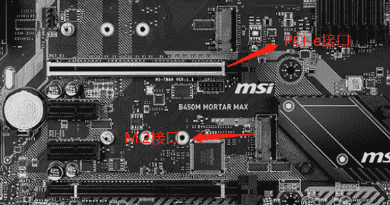

## PCIe 体系

### 通俗介绍

1.  CPU 芯片内，集成了 Root Complex。

1.  下图有 3 个端口，可以连 3 个设备。

1.  通过 PCIe 专用 switch，可以连更多 PCIe 设备。

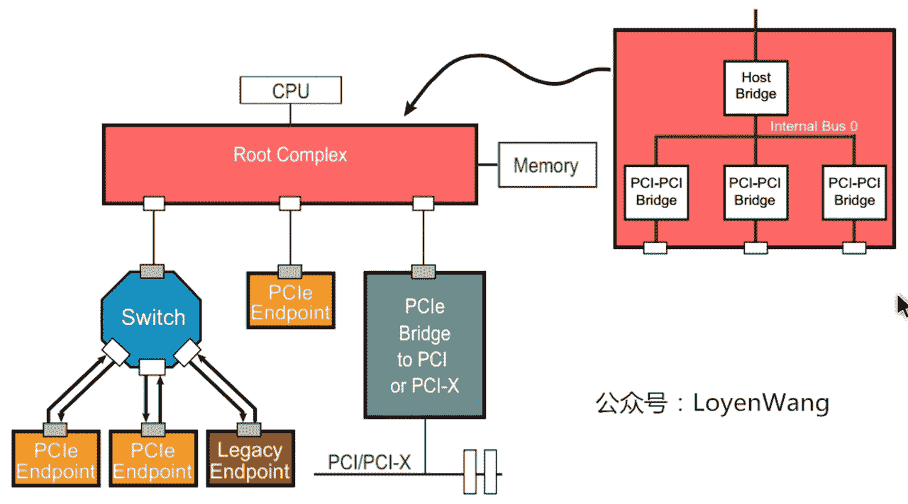

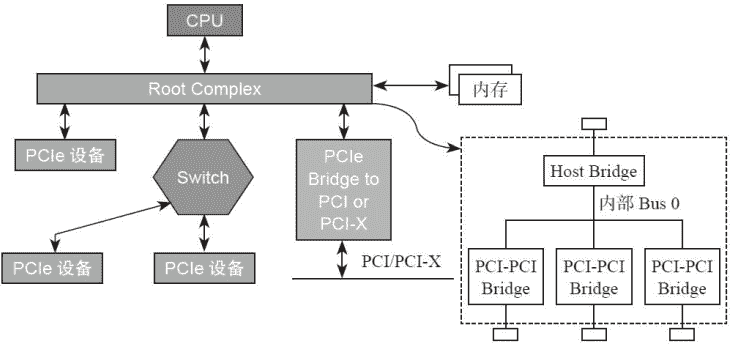

1.  2 个域 (domain)，2 种地址。PCIe 控制器翻译地址。

1.  实际上，为了简化代码，OS 统一编址，可以不用翻译地址。

1.  这 2 个地址，统称为物理地址。

### 精确术语

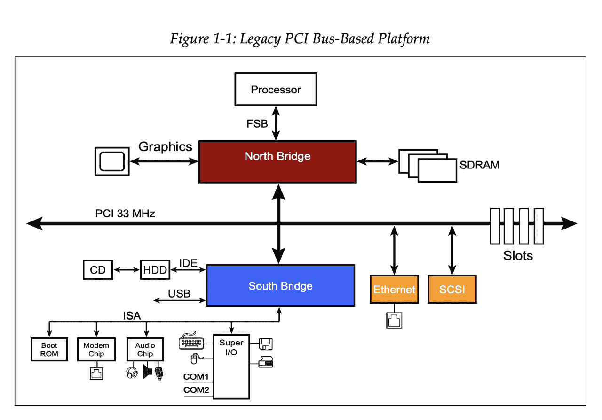

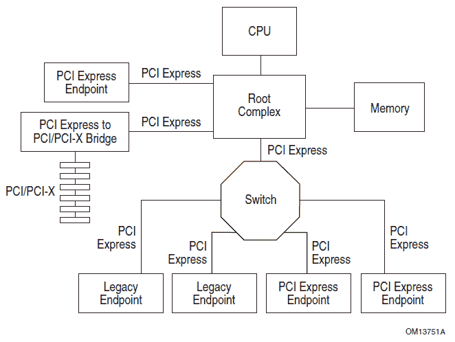

PCI 总线相关的模块包括了：HOST主桥，PCI总线，PCI桥以及PCI设备。

1.  我们已经知道了，HOST主桥的功能是隔离处理器系统的存储器域和PCI总线域，并管理PCI总线域，完成处理器与PCI设备之间的数据交换；而处理器与PCI设备之间的数据交换主要由：1，处理器访问PCI设备的地址空间；2，PCI设备使用DMA机制访问主存储器；这两部分组成；

——HOST主桥下的PCI设备的配置空间都由HOST主桥通过配置读写（Config Read/Write）访问。

1.  PCI总线，有PCI总线和PCI总线树两个概念；一颗PCI总线树中可能有多条PCI总线，而具有血缘关系的PCI总线组成一颗PCI总线树，一般直接与HOST主桥连接的PCI总线被命名为总线0；

——PCI总线由HOST主桥或PCI桥来管理，用来连接各类PCI设备；如果有多个HOST主桥那么就有多个PCI总线树。

1.  PCI设备，PCI总线中有三类设备：PCI主设备，PCI从设备和桥设备；

1，PCI从设备只能被动接收来自HOST主桥或其它PCI设备的读写请求；

2，PCI主设备可以通过总线仲裁获得PCI使用权，主动向其它PCI设备/主存储器发起读写请求；

3，桥设备的主要作用是管理下游PCI总线，并转发上下游总线之间的事务；

——PCI桥的两端分别接了两条PCI总线：上游总线和下游总线；其中距离HOST主桥较近的总线称为上游总线（Primary Bus），相反较远的那条称为下游总线（Secondary Bus）；但是不可否认的是它们都属于同一个总线域。

——存在两种PCI桥：透明桥和非透明桥。

——PCI桥的存在是PCI总线具有强大扩展性的重要原因，使大规模系统互连成为可能。

4，HOST主桥是一个特殊的PCI设备，可以获取PCI总线的控制权和访问PCI设备，也可以被PCI设备所访问，但是HOST主桥并非PCI设备，在PCI规范中没有对HOST主桥进行定义；

1.  HOST处理器，PCI总线规范规定在同一时刻，在一颗PCI总线树上有且只有一个HOST处理器；该HOST处理器可以通过HOST主桥发起PCI总线的配置请求总线事务，并对PCI总线上的设备和桥片进行配置。

——对于多CPU的处理器，这些CPU都可以通过HOST主桥访问其下的PCI总线树，作为HOST处理器；但上面已经说了：PCI总线树的实际管理者是HOST主桥，而非HOST处理器。

1.  处理器与PCI设备之间的数据通信，需要先经过HOST主桥进行地址转换（翻译）；

1.  处理器系统可能含有多个HOST主桥，那么不同HOST主桥下的PCI设备通信需要经过两个HOST主桥；

1.  HOST主桥与主存储器控制器在同一级总线上，因此PCI设备可以直接通过HOST主桥访问主存储器（DMA：Direct Memory Access）；


1. PCI设备的DMA操作需要与处理器的Cache进行一致性操作：进行地址监听，并根据监听结果改变Cache的状态。

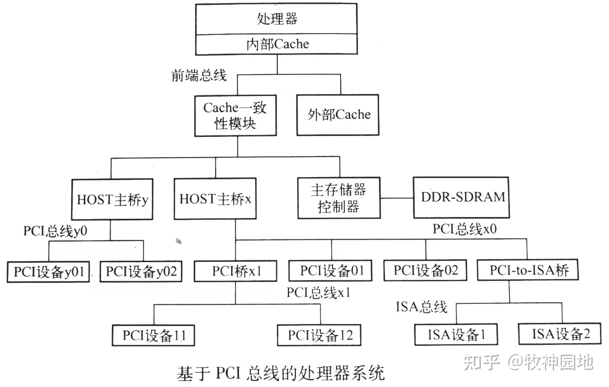

## Switch

switch的功能通常是以软件形式提供的，它包括两个或更多的逻辑PCI到PCI的连接桥（PCI-PCI Bridge），以保持与现有PCI兼容，具体功能类似现在的网络交换机。

对于switch多个下游端口上的 Endpoint(例如图中的`EP1`和`EP2`) 同时向RC发送数据，switch中会有相应的仲裁机制(后面会说到)，确定数据的优先级，将优先级高的数据传送到上游端口中去。

switch 内部有一条总线和多个PCI-PCI Bridge。

各个 Bridge 都要实现 “配置头1寄存器”，即Bridge里面有很多寄存器，对这些寄存器进行配置，就可以让switch实现相应的功能

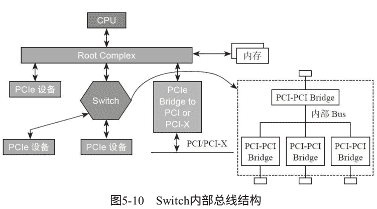

## PCIe 事务

由请求者发起，完成者接收数据并完成相应的事情。

+ 请求者是能够在PCIe中发起事务的设备。根聚合体RC和Endpoint是请求者类型。

+ 完成者是请求者寻址或者说作为目标的设备。请求者读取完成者的数据或者是请求者将数据写入完成者，根聚合体RC和Endpoint也是完成者类型。

理论上任何两个Endpoint都可以直接通信，但实际上很少这样做，因为两个不同设备的数据格式不⼀样，除⾮这两个设备是同⼀个⼚商的。通常都是Endpoint与RC通信，或者Endpoint通过RC与另外⼀个Endpoint通信。

事务层数据包(Transaction Layer packet, TLP)的数据包发送和接收

PCIe 的事务分为4大类：

1. 存储器事务

1. IO事务

1. 配置事务

1. 消息事务

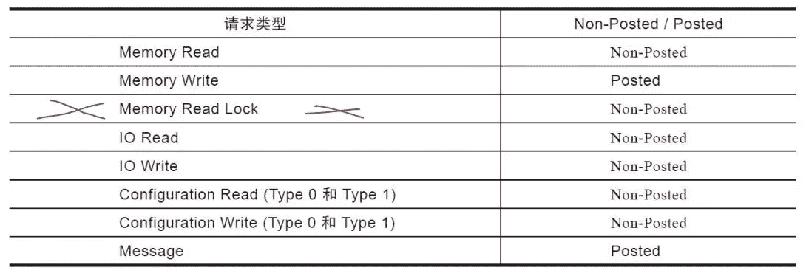

其中Memory Read Lock是历史遗留物，为的是兼容老设备，我们可以忽略。

事务又可以分为报告事务(Posted)和非报告事务(Non-Posted)。

+ 非报告事务，请求者发送一个TLP请求数据包给完成者，稍后，完成者返回一个TLP完成数据包给请求者。

+ 请求者发送一个TLP请求数据包给完成者，完成者不返回一个TLP完成数据包给请求者

## TLP & DLLP Packets

根据起源和终止，数据包可以分为3类：

事务层数据包(Transaction Layer Package TLP): 起源于发送设备的事务层，终止于接收设备的事务层。

数据链路层数据包(Data Link Layer Package DLLP): 起源于发送设备的数据链路层，终止于接收设备的数据链路层。

物理层数据包(Physical Layer Package PLP): 起源于发送设备的物理层，终止于接收设备的物理层。

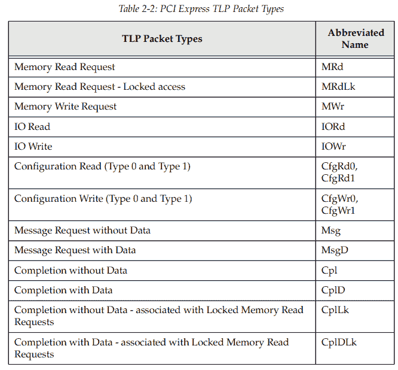

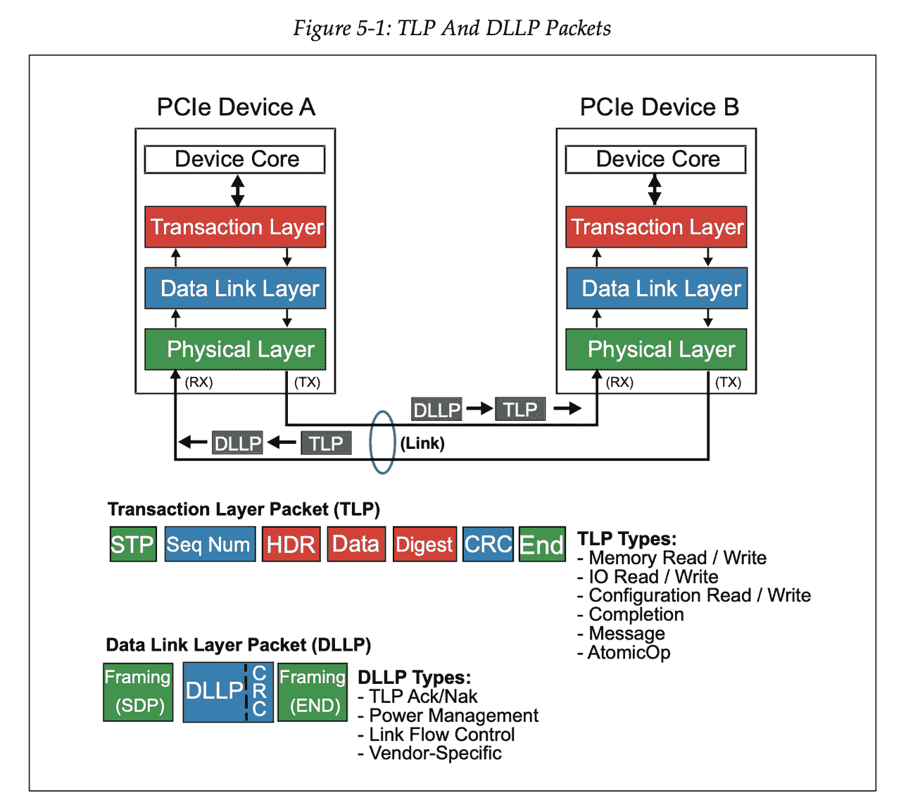

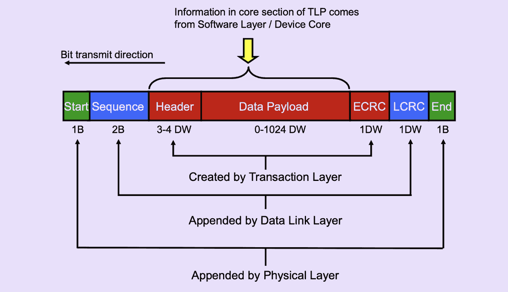

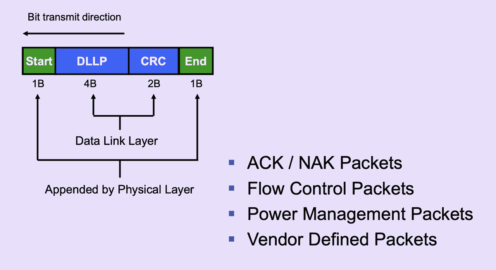

## Data Link Layers

1. Transaction层，负责TLP包（Transaction Layer Packet）的封装与解封装，此外还负责QoS，流控、排序等功能；

1. Data Link层，负责DLLP包（Data Link Layer Packet）的封装与解封装，此外还负责链接错误检测和校正，使用Ack/Nak协议来确保传输可靠；

1. Physical层，负责Ordered-Set包的封装与解封装，物理层处理TLPs、 DLLPs、 Ordered-Set三种类型的包传输；

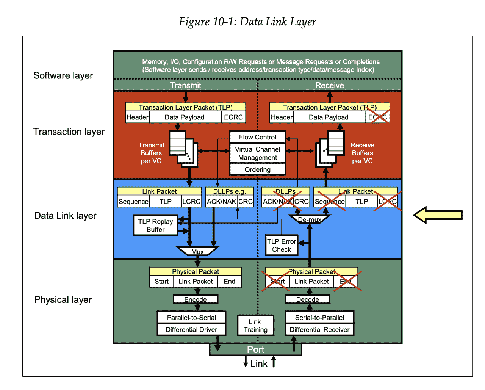

## PCI 总线

PCI总线也是一个同步总线，每个设备都有一个CLK信号，发送设备和接收设备使用CLK信号进行数据同步传输；PCI总线使用33MHz和66MHz时钟频率，而PCI-X总线可以使用133MHz、266MHz或533MHz的时钟频率。PCI总线信号如下表所示。

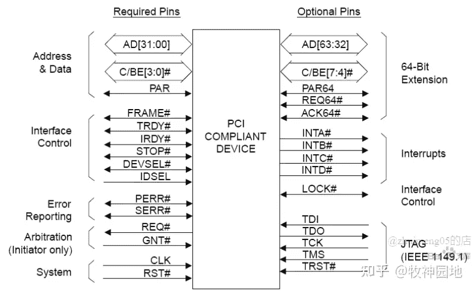

## PCIe Device

PCIE体系架构一般包含根组件RC（rootcomplex），交换器switch，终端设备EP（endpoint）等类型的PCIE设备组成。

PCIe上连接的设备可以分为两种类型：

+ `Type 0`：它表示一个PCIe上最终端的设备，比如我们常见的显卡，声卡，网卡等等。

+ `Type 1`：它表示一个PCIe Switch或者Root Port。和终端设备不同，它的主要作用是用来连接其他的PCIe设备，其中PCIe的Switch和网络中的交换机类似。

## Ordering

PCI总线上只支持Strong Ordering传送规则，而PCIe总线新增了Relaxed Ordering(RO) 和ID-based Ordering(IDO)传递方式。

常用的PCIe事务排序方法有强排序(Strong Ordering)、弱排序(Weak Ordering)及宽松排序(Relaxed Ordering) 三种。此外还有基于ID的事务排序（ID Based Ordering, IDO）规则。

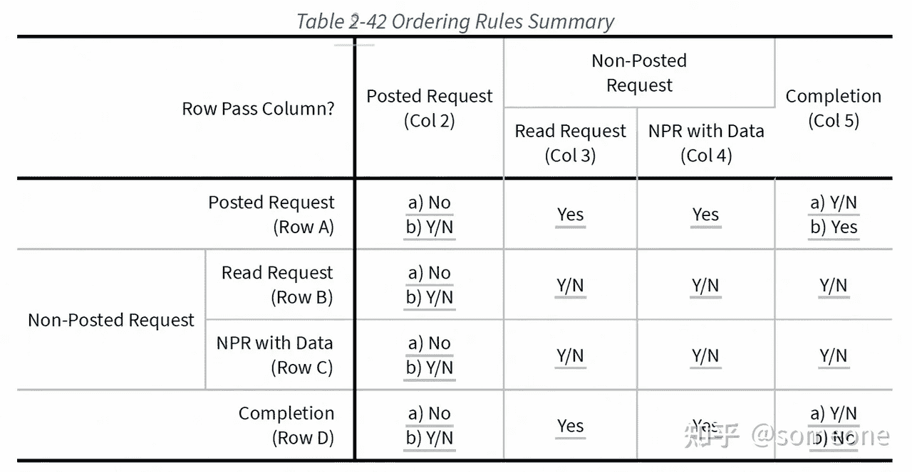

## PCIe 的 BDF

PCIe上所有的设备，无论是`Type 0`还是`Type 1`，在系统启动的时候，都会被分配一个唯一的地址，它有三个部分组成：

+ Bus Number：8 bits，也就是最多256条总线

+ Device Number：5 bits，也就是最多32个设备

+ Function Number：3 bits，也就是最多8个功能

类似于网络中的IP地址，一般写作`BB:DD.F`的格式。

由于默认BDF的方式最多只支持8个Function，可能不够用，所以PCIe还支持另一种解析方式，叫做ARI（Alternative Routing-ID Interpretation），它将Device Number和Function Number合并为一个8bit的字段，只用于表示Function，所以最多可以支持256个Function，但是它是可选的，需要通过设备配置启用

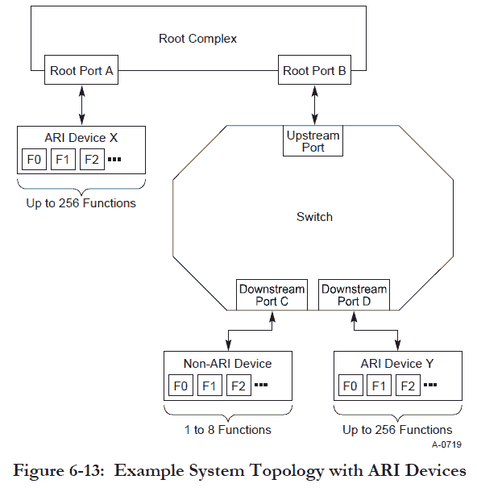

PCIe 协议支持 256 个 Bus，每条 Bus 最多支持 32 个 Device，每个 Device 最多支持 8 个 Function，所以由 BDF（Bus，Device，Function）构成了每个 PCIe 设备节点的身份证号。

PCIE设备在系统总线上都有自己的标识符，这个标识符就是BDF（Bus，Device，Function）

在BDF中，Bus Number占用8位，Device Number占用5位，Function Number占用3位。显然，PCIe总线最多支持256个子总线，每个子总线最多支持32个设备，每个设备最多支持8个功能，如下图所示：

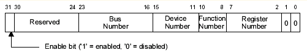

需要注意的是，每`Bus0`总是分配给RC，且每个设备必须要有功能0（`Fun0`），其他的7个功能（`Fun1~Fun7`）都是可选的。

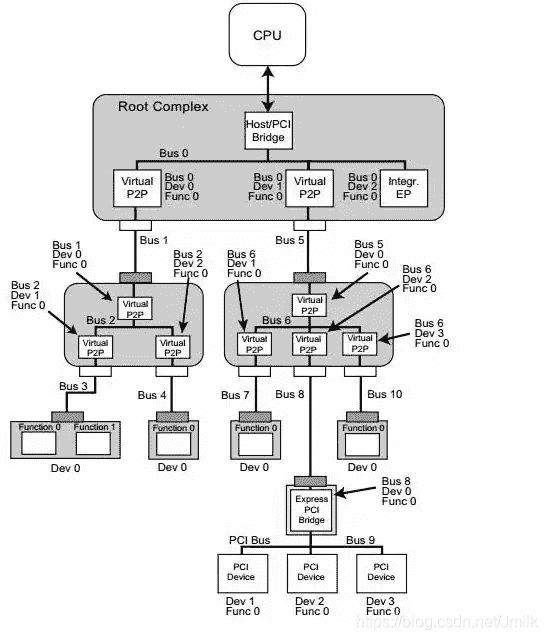

## base address register (BAR)

`https://zhuanlan.zhihu.com/p/680452316`

base address register (BAR)

下图标红的两部分是bar寄存器，那么为什么需要有这个东西呢？

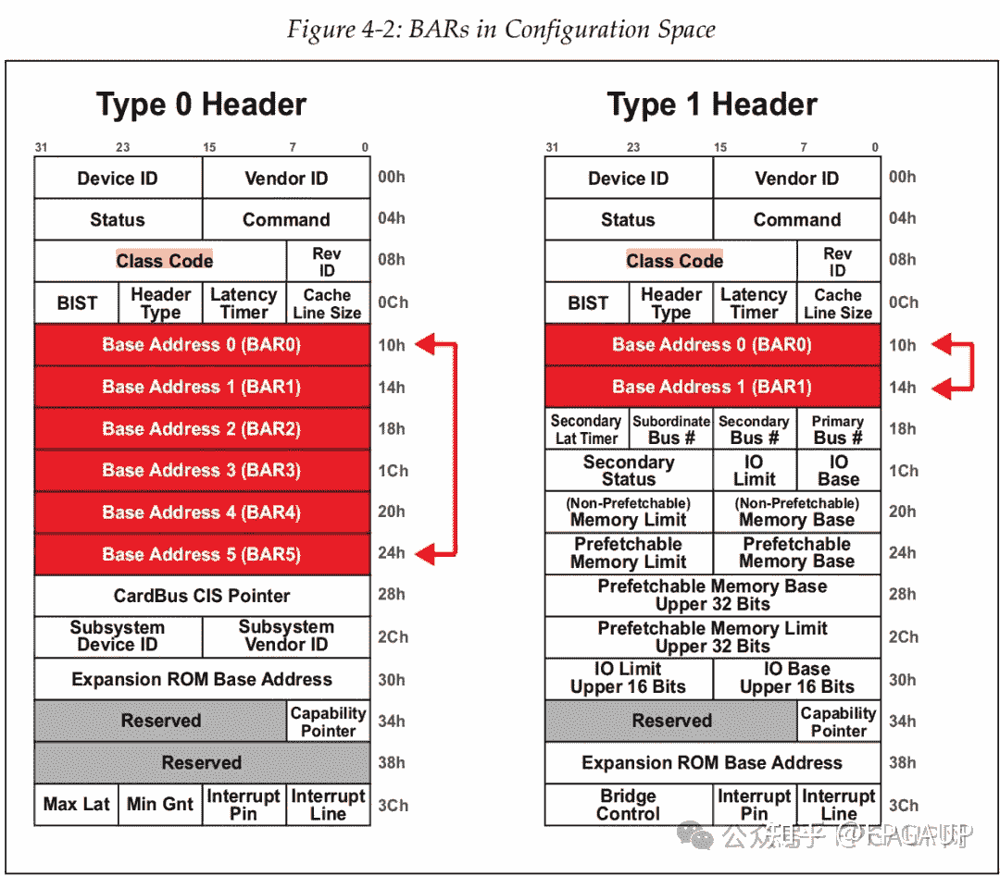

一方面这还是和CPU、操作系统的机制有关，它们不允许PCI设备自己在内存中划拉片地方供自己使用，而是必须由系统统一分配。

另一方面PCI设备需要一定内存空间来存储自身需要的些数据，例如功能相关的配置数据，而且不同设备不同功能的情况下需要的空间大小还不一致，所以就有了bar寄存器了，用于对不同设备进行量身定制内存空间。

PCI设备有6个bar寄存器，可以启用全部或其中几个，一旦启用，这个bar寄存器就与内存建立了关系，主机就可以根据BARs中所写入的地址范围进行访问。任何时候，当设备发现一个请求事务的地址是映射到自己的一个BAR时，它就会接收这个请求事务，因为它自己就是这个请求的目标设备。

## Address Space

PCIe架构定义了4种地址空间：配置空间、Memory空间、IO空间和message空间。

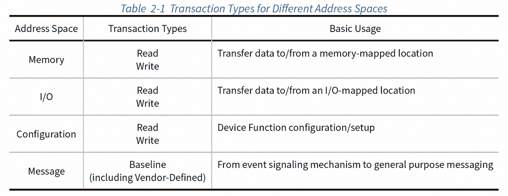

## 配置空间

每个PCIe Function都有4KB的配置空间(Configuration Space)。前256 Bytes 是和PCI 兼容的配置空间，剩余的是PCIe扩展配置空间(Extended Configuration Space)。

PCIe配置空间如下图所示，地址范围为`0x000～0xfff`。

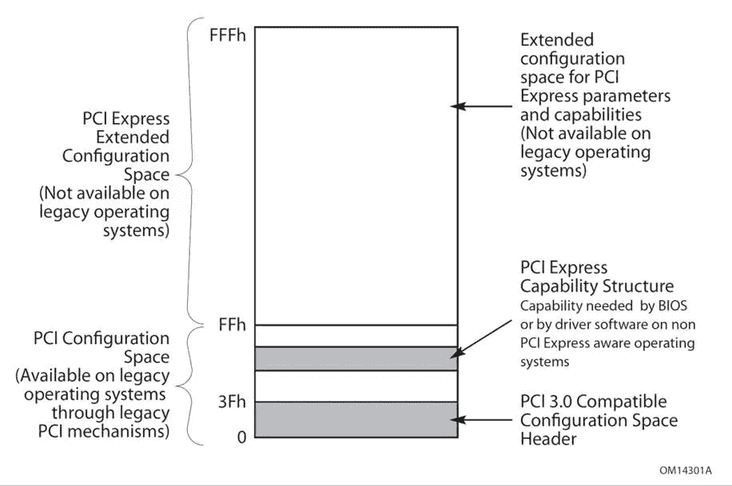

HOST主桥的基本功能是分离存储器域和PCI总线域，实现PCI总线域到存储器域，存储器域到PCI总线域之间的数据传递，并管理PCI设备的配置空间。如下图所示，划分了存储器域和PCI总线域；存储器域中划分为CPU域和DRAM域，而PCI域由HOST主桥所决定。

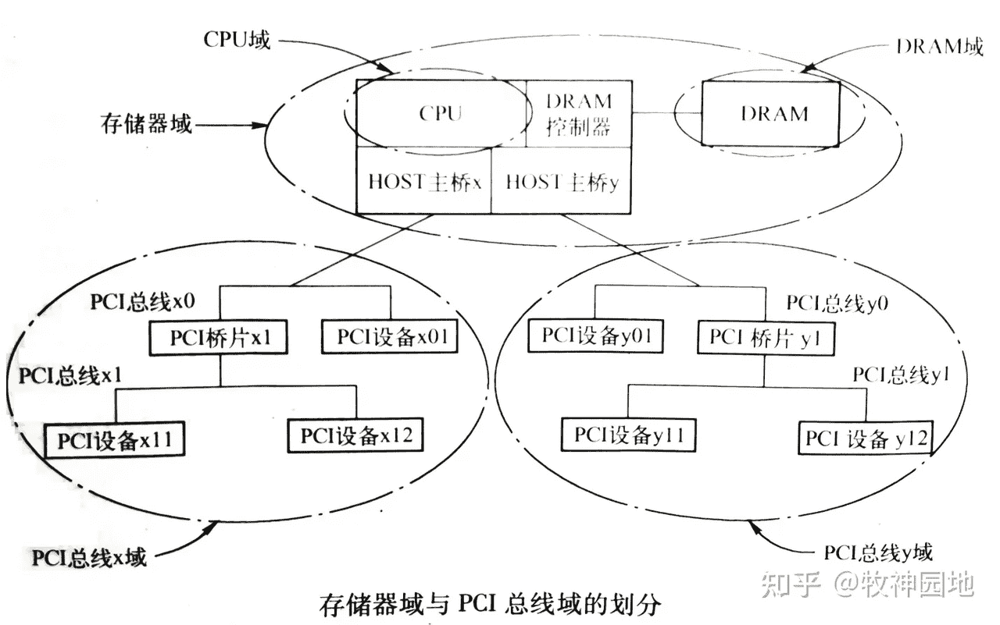

1. [`PCI`总线域](https://www.zhihu.com/search?q=%E7%9B%B4%E6%8E%A5%E8%AE%BF%E9%97%AE&search_source=Entity&hybrid_search_source=Entity&hybrid_search_extra=%7B%22sourceType%22%3A%22answer%22%2C%22sourceId%22%3A3121947087%7D)：[是外部设备与](https://www.zhihu.com/search?q=x86%E5%A4%84%E7%90%86%E5%99%A8&search_source=Entity&hybrid_search_source=Entity&hybrid_search_extra=%7B%22sourceType%22%3A%22answer%22%2C%22sourceId%22%3A3121947087%7D)的重要组成部分，由PCI设备所能直接访问的地址空间组成；在一个处理器系统中，可能存在多个HOST主桥，因此存在多个PCI总线域（如上图PCI总线x域和y域），两个PCI总线域的PCI设备不能直接进行数据交换，需通过FSB（Front Side Bus）总线进行数据交换（需要CPU参与）；

——在x86处理器系统中，所有外设都使用PCI总线管理，所以PCI总线域与外设空间等效。

——举个栗子：一个HOST主桥对应一个PCI总线域，两个HOST主桥对应两个PCI总线域，不同的HOST主桥对应的PCI总线域是不同的。

——如果HOST主桥支持Peer-to-Peer传输机制（PCI V3.0版本规范支持，不需要CPU参与），那么两个HOST主桥之间可以直接通信。

1. CPU域地址空间：指的是CPU所能直接访问的地址空间集合；CPU域的边界是CPU所能控制的数据完整性边界，仅在CPU内核（Cache）中有效；CPU如果要访问主存储器/PCI设备：

1. 首先将读写命令放入读写指令缓存中，然后将命令发送到DRAM控制器/HOST主桥；

2. DRAM控制器/HOST主桥将CPU地址转换为DRAM或PCI总线地址，分别进入DRAM域或PCI总线域；

3. 访问到DRAM域/PCI总线域的相应地址空间。

1. DRAM域地址空间：DRAM控制器所能访问的地址空间集合，在多数处理器系统中，DRAM域空间是CPU域空间的一部分；

——但有DRAM域空间不属于CPU域空间的情况，例如显卡控制器可能会借用一部分CPU的存储空间，这些被借用的空间不能被CPU所访问。

1. 存储器域：是CPU域和DRAM域的统称；存储器域内包括了CPU内部的通用寄存器，存储器映像寻址的寄存器、主存储器空间和外部设备空间；

——存储器域的外部设备空间，在PCI总线域中还有一个地址映射，当处理器访问PCI设备时首先访问的是该设备在存储器域上的PCI设备空间，然后HOST主桥将该存储器域的PCI总线地址转换为PCI总线域的物理地址。

1. 处理器域地址空间：指处理器系统能够访问的地址空间集合，由存储器域和外部设备域组成；存储器域与PCI总线域两者相互独立，并通过HOST主桥进行数据交换；HOST主桥是连接存储器域和PCI总线域的桥梁，是PCI总线域的实际管理者。HOST主桥进行不同地址域之间的数据交换时，需要遵循如下规则：

——对于x86来说，外部设备域即为PCI总线域；对于其它处理器来说，很多外设直接挂在FSB总线上而不是挂在PCI总线下。

——非常重要的一点：在处理器系统中，HOST主桥管理着PCI总线域，而不是HOST处理器；如果一个处理器系统中有多个CPU，那么每个CPU都可以成为HOST主桥所管理PCI总树的HOST处理器。

1. 处理器访问PCI总线域地址空间时：首先需要访问存储器域的地址空间，再通过HOST主桥将存储器地址转换成PCI总线地址，之后才能进入PCI总线域进行数据交换；

2. PCI设备访问存储器时：首先需要访问PCI总线域的地址空间，再通过HOST主桥将PCI总线地址转换为存储器地址，才能进行数据交换；

——此时处理器需要通过HOST主桥将PCI总线地址反向映射为存储器地址，否则不能访问存储器域地址。

4. 如果HOST主桥不支持Peer-to-Peer传输方式，那么不同PCI总线域的PCI设备之间不能直接进行数据交换，而需要通过FSB总线实现。

PCI体系结构支持3种地址空间，如图下图所示：Memory（内存）、I/O、Configuration Address Space（配置地址空间）。x86处理器可以直接访问Memory和I/O空间：如上所述PCI设备映射到处理器内存地址空间，可以支持32位（4GB）或64位寻址；在I/O地址空间，PCI设备可以支持32位寻址，但是因为x86 CPU仅使用16位的I/O地址空间，所以I/O空间限制在了64KB。

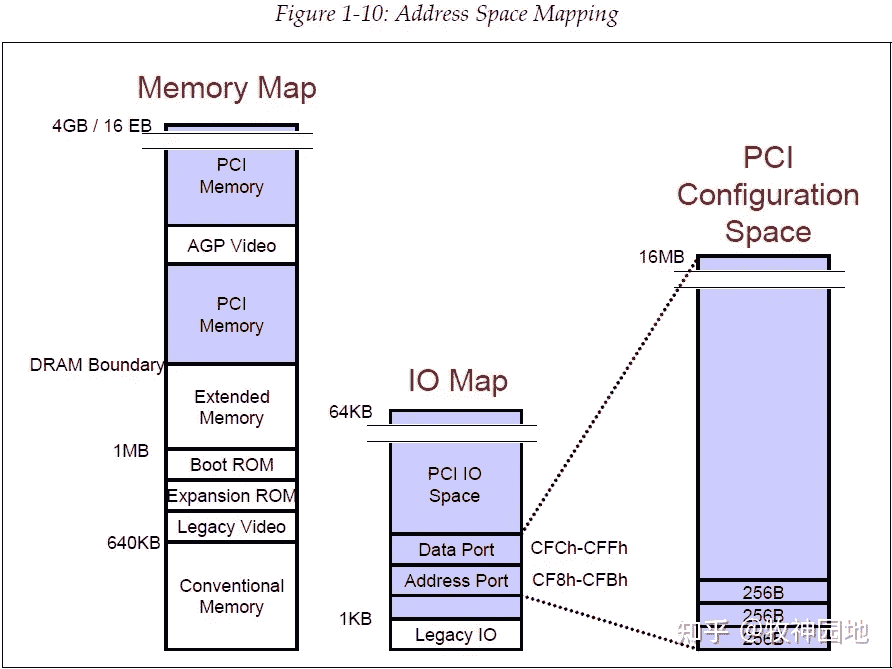

PCI还引进了第三种地址空间，称为配置空间（Configuration Address Space），CPU只能对它进行间接访问而非直接访问（软件不能通过命令直接访问到配置空间寄存器）。PCI设备中的每个Function（功能）都包含专为配置空间所准备的内部寄存器，这些寄存器对于软件来说是可见的，并且软件可以通过一个标准化的方式来控制它们的地址与资源，这为PC提供了一个真正的即插即用（plug and play）的环境。每个PCI Function最多可以有256 Bytes的配置地址空间，PCI总线系统的配置空间总大小为16MB。

——PCI最多可支持单个设备含有8个Function、每路总线含有32个设备、单个系统包含256路总线，那么可以得到一个系统的配置空间总量为：`256B/Function *8Function/device * 32devices/bus *256buses/system =16MB`。

因为x86 CPU无法直接访问配置空间，所以它必须通过IO寄存器进行索引（然而在PCI Express中引入了一种新方法来访问配置空间，这种新方法是通过将配置空间映射入内存地址空间来完成的）。在传统模型中，如上图所示，使用了一种被称为配置地址端口（`Configuration Address Port`）的IO端口，它位于地址`CF8h-CFBh`；还使用了一种被称为配置数据端口（`Configuration Data Port`）的IO端口，它位于地址`CFCh-CFFh`。

## I/O 空间

PCIe支持I/O空间，以便与需要使用I/O空间的传统设备兼容。PCIe spec的未来修订版可能不赞成使用I/O空间。

## Memory 空间

访问memory的地址空间，即mmio空间，32位平台为4G。 此memory空间和main memory（内存或者主存）是两个概念。

下图展示了一种通用的memory和IO的映射。内存映射的大小是这个系统可使用地址范围（通常由CPU的可寻址范围决定）的一个函数。PCIe可以支持的memory地址最多为64bit。图中仅展示了EP所声明使用的MMIO和IO，但是这种能力并不是EP所独有的。它对于Switch和RC来说也是一种很普通的能力，Switch和RC内部也存在着可以通过MMIO和IO地址来进行访问的设备特定寄存器。

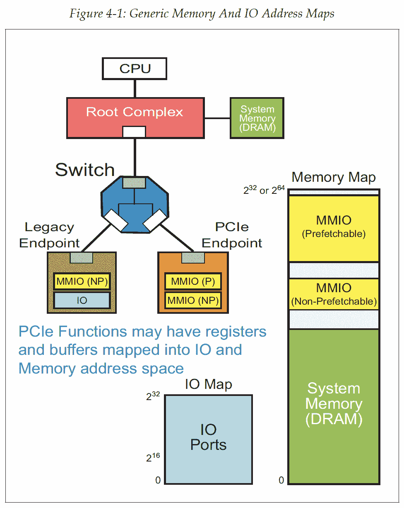

图 4‑1展示了被PCIe设备声明的两种不同类型的MMIO：可预取MMIO（Prefetchable MMIO，P-MMIO）和不可预取MMIO（Non-Prefetchable MMIO，NP-MMIO）。可预取空间有两个意义十分明确的属性：

+ 读操作不存在副作用。（Reads do not have side effects）

+ 允许写合并（Write merging is allowed）

X86采用独立编址的方式，将memory操作与外设IO操作分开了，才有了memory空间和IO空间的区分。ARM采用统一编码的方式。

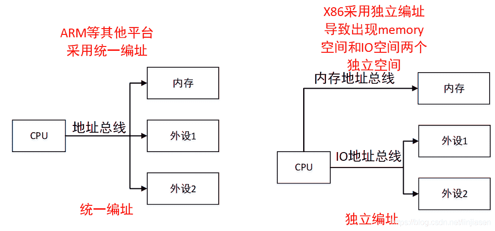

## message空间


`message`空间用来report带内的`message`和`event`。例如`error message`、电源管理消息等

# PCIe Transaction Model

## PIO

`Programmed I/O`，可编程输入输出

数据传送由CPU执行I/O端口指令来按照字节或更大的数据单位来处理，占用大量的CPU资源，数据传输速度也大大低于DMA模式。

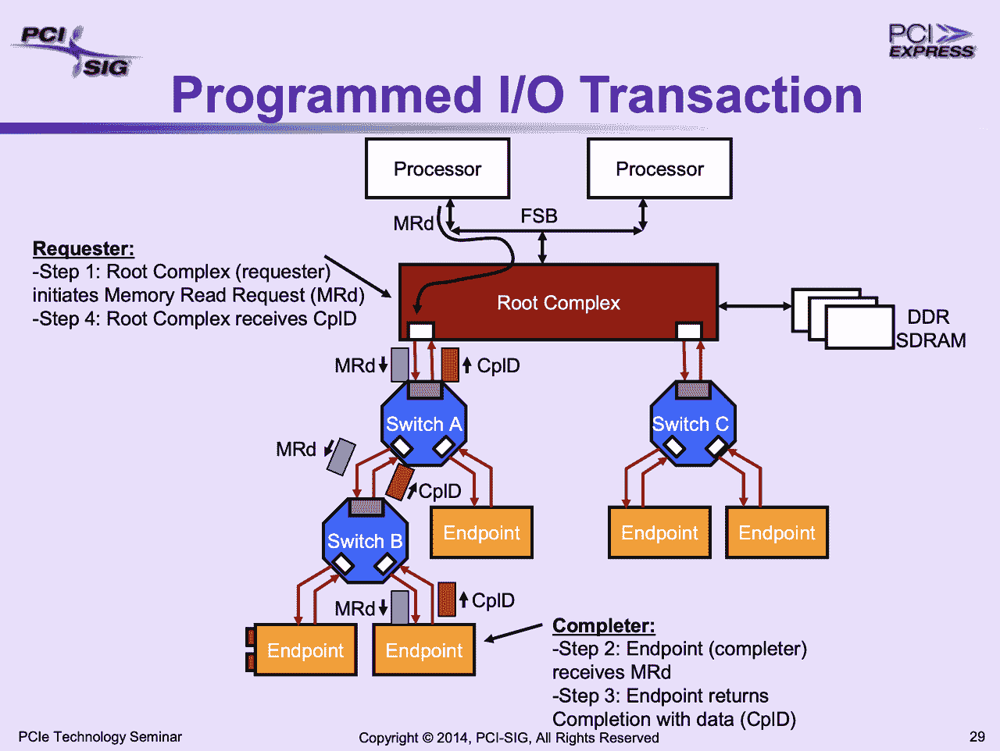

## DMA

`Direct Memory Access`，直接内存访问。

数据传送由 DMA 控制器完成，占用极少的 CPU 资源。

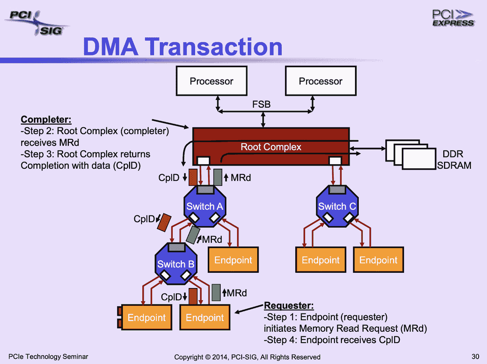

## P2P

`Peer-to-Peer`。

一个`endpoint`发送`packet`给另一个`endpoint`。

`P2P`路由在`Switch`中是必需的，但对于`RC`来说是可选的。

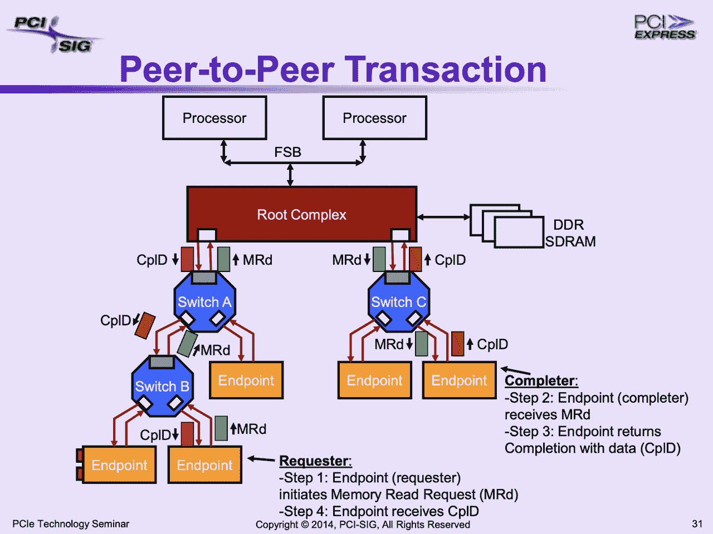

# PCIe 基本概念

重要`feature`

1. `Point-to-Point bus`

2. `Bi-directional bus`

3. `Scalability of data rates`

4. `Backwards compatibility`

5. `Wide adoption across many markets`

## P2P 双工

PCIe的总线并不是我们传统意义上共享线路的总线（`Bus`），而是一个点对点的网络

1. `Point-to-Point bus`

2. `Bi-directional bus`

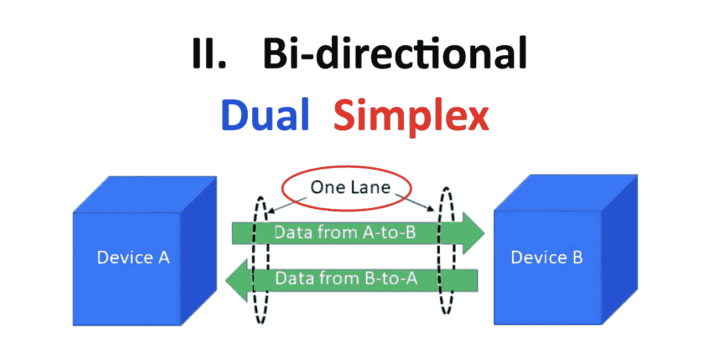

## Data Link & Lane

一组`lane`是一个`date link`。

`Lane`数量可变 -> `Scalable`

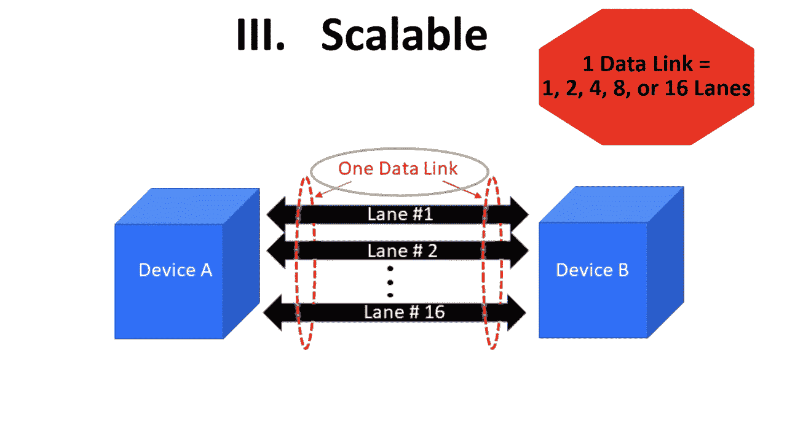

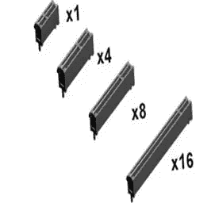

## Root Complex

广义来说，`Root Complex`可以认为是 CPU 和 PCIe 拓扑之间的接口。或者说，PCIe 树的根节点。

所有的数据，都要经过`Root Complex`。

`Root Complex`集成在 CPU 内，或作为 CPU 外的一个单独 component。

从广义上讲，`RC`可以理解为CPU前端总线和PCIe总线之间的桥，主要负责将CPU的访问事务转换为PCIe总线上的访问事务。PCIe总线是以报文的形式交换信息或者传输数据的，因此，`RC`负责根据CPU的访问事务产生对应的报文，并转发给下游PCIe设备，同时也要解析下游PCIe设备上报的报文，并根据报文内容，将信息或者数据通知CPU。

在早期的CPU上，`Root Complex`其实是放在了北桥（MCU）上 [5]，后来随着技术的发展，现在已经都集成进了CPU内部了 [8]。（注意下图的`System Agent`的部分，他就是`PCIe Root Complex`所在的位置。）

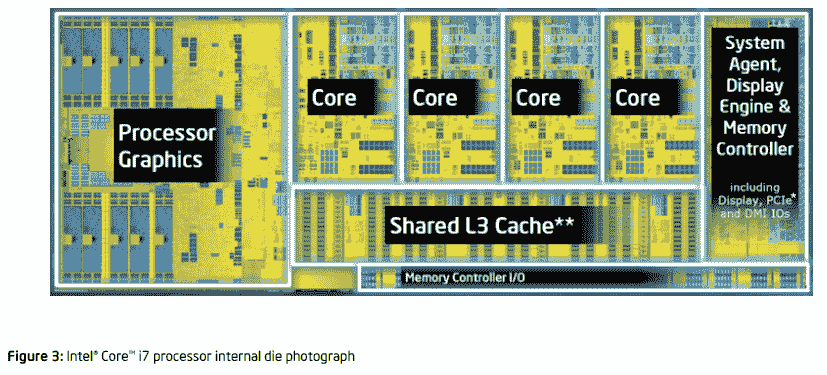

虽然是根节点，但是系统里面可以存在不只一个`Root Complex`。随着PCIe Lane的增加，PCIe控制器和`Root Complex`的数量也随之增加。比如，我的台式机的CPU是i9-10980xe，上面就有4个`Root Complex`，而我的笔记本是i7-9750H，上面就只有一个`Root Complex`。我们在Windows上可以通过设备管理器来查看：

| `i9-11900K` | `i7-9750H` |

| --- | --- |

| 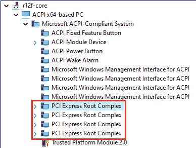 | 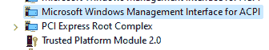 |

用的CPU是EPYC 7742，可以很明显的看到`PEG P0-3`，对应着4个PCIe Controller和`Root Complex`

https://www.supermicro.org.cn/en/products/motherboard/H12DSi-Nt6

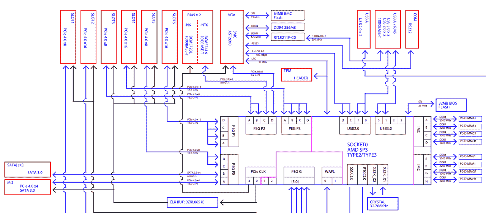

一个`RC`可以包括多个`RP`（`Root Port`），例如一个16条`lane`的PCIe `RC`可以包括4个`RP`（4个x4的），或者8个`RP`（8个x2的）等等。

与PCI总线的中`Host bridge`有些类似，是CPU和PCIe总线直接的接口。

从软件的角度来看，`RC` 像是一组虚拟的 `PCI-PCI` 桥。

1. 完成存储器域到 PCIe 总线域的地址转换，

2. 随着虚拟化技术的引入，`RC`的功能也越来越复杂。

3. `RC`把来自 CPU 的`request`转化成PCIe的4种不同的`requests`(`configuration`， `Memory`， `I/O`， `Message`)并发送给接在它下面的设备。

4. `Root Complex` 可以访问内存

`RC`支持的主要功能有：

1. 配置空间管理：`RC`管理 PCIe 总线上所有设备的配置空间。每个 PCIe 设备都有一些配置寄存器，这些寄存器存储设备的特定信息，如设备ID、厂商ID。

2. 地址映射：`RC`负责分配 PCIe 总线上各个设备的地址。这包括内存映射和I/O映射，以确保不同设备之间的数据传输能够正确进行。

3. 中断管理：PCIe设备可能会生成中断信号，`RC`负责管理这些中断，确保它们正确地传递到相应的处理器核心。

4. 通信与数据传输：`RC`与其他 PCIe 设备之间通过 PCIe 链路进行通信。PCIe 链路分为一到多个通道，每个通道包含一个上行和一个下行通道，用于双向数据传输。

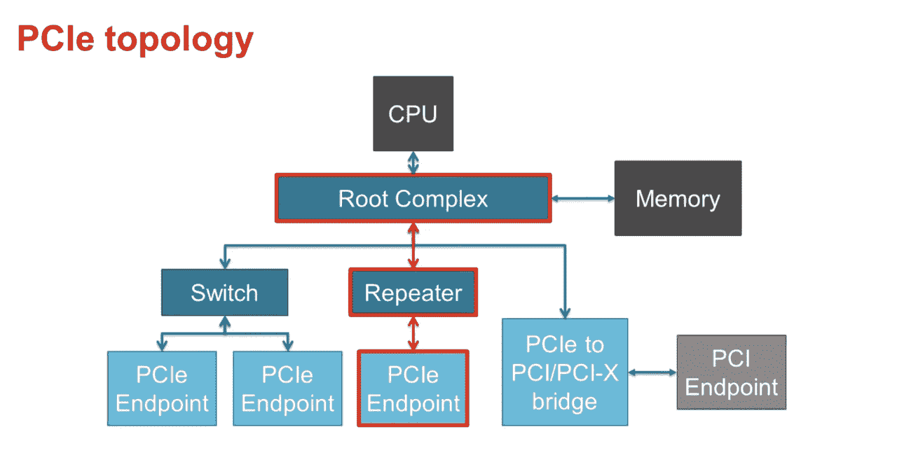

### downstream/upstream port

与`RC`直接或者间接相连的端口称之为上游端口。

在PCIe总线中，`RC`的位置一般在上方，这也是上游端口的由来。

除上游端口之外的其它端口就是下游端口。

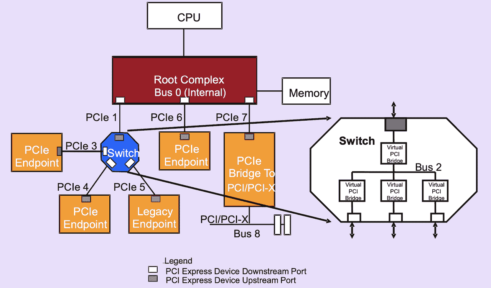

### Reference Clock

嵌入式时钟的技术（`Embedded Clock`），即发送端不再向接收端发送时钟，但是接收端可以通过`8b/10b`，`128b/130b`的编码从数据`Lane`中恢复出时钟。


### Wide adoption

PCIe可拓展性强，可以支持的设备有：显卡、固态硬盘（PCIe接口形式）、无线网卡、有线网卡、声卡、视频采集卡、PCIe转接M.2接口、PCIe转接USB接口、PCIe转接Tpye-C接口等


# PCIe layout guidelines

https://www.youtube.com/watch?v=kTtE3vQsbsw

`PCIe layout guidelines`

# Control & Data Flow


# 协议参数

https://zhuanlan.zhihu.com/p/676301958

## Max payload size

有些`TLP`含有`Data Payload`，如存储器写请求、存储器读完成`TLP`等。`TLP`包含的`Data Payload` 大小与`Max_Payload_Size` 、`Max_Read_Request_Size`和 `RCB` 参数相关。下面将分别介绍这些参数的使用。

PCIe spec规定TLP里的数据有效负载的最大值为4KB，但是PCIe设备并不一定能发送这么大的数据报文。PCIe设备含有`Max_Payload_Size`和`Max_Payload_Size Supported`参数，这两个参数分别在`Device Control`寄存器和`Device Capability`寄存器中定义。


`Max_Payload_Size Supported`参数：存放PCIe设备TLP有效负载的最大值，该参数由PCIe设备的硬件逻辑确定，系统软件不能改写该参数。

而`Max_Payload_Size`参数存放PCIe设备实际使用的TLP有效负载的最大值。该参数由PCIe链路两端的设备协商决定，是PCIe设备进行数据传送时实际使用的参数。

PCIe设备发送数据报文时，使用`Max_Payload_Size`参数决定TLP的最大有效负载。当PCIe设备所传送的数据大小超过`Max_Payload_Size`参数时，这段数据将被分割为多个TLP进行发送。当PCIe设备接收TLP时，该TLP的最大有效负载也不能超过`Max_Payload_Size`参数，如果接收的TLP，其`Length`字段超过`Max_Payload_Size`参数，该PCIe设备将认为该TLP非法。

`RC`或者`EP`在发送存储器读完成TLP时，该TLP的最大`Payload`也不能超过`Max_Payload_Size`参数，如果超过，PCIe设备需要发送多个读完成报文。值得注意的是，这些读完成报文需要满足`RCB`参数的要求，有关`RCB`参数的详细说明见下文。

在实际应用中，尽管有些PCIe设备的`Max_Payload_Size Supported`参数可以为256B、512B、1024B或者更高，但是如果PCIe链路的对端设备可以支持的`Max_Payload_Size`为128B时，系统软件将使用对端设备的`Max_Payload_Size Supported`参数，初始化该设备的`Max_Payload_Size`参数，即选用PCIe链路两端最小的`Max_Payload_Size Supported`参数初始化`Max_Payload_Size`参数。

在多数x86处理器系统的MCH或者ICH中，`Max_Payload_Size Supported`参数为128B。这也意味着在x86处理器中，与MCH或者ICH直接相连的PCIe设备进行DMA读写时，数据的有效负载不能超过128B。而在PowerPC处理器系统中，该参数大多为256B。

目前在大多数`EP`中，`Max_Payload_Size Supported`参数不大于512B，因为在大多数处理器系统的`RC`中，`Max_Payload_Size Supported`也不大于512B。即便`EP`支持较大的`Max_Payload_Size Supported`参数，并不会提高数据传送效率。

`Max_Payload_Size`参数的大小与PCIe链路的传送效率成正比，该参数越大，PCIe链路带宽的利用率越高，该参数越小，PCIe链路带宽的利用率越低。

PCIe总线规范规定，对于实时性要求较高的PCIe设备，`Max_Payload_Size`参数不应设置过大，因此这个参数有时会低于PCIe链路允许使用的最大值。

## `Max_Read_Request_Size`参数

`Max_Read_Request_Size`参数由PCIe设备决定，该参数规定了PCIe设备一次能从目标设备读取多少数据。

`Max_Read_Request_Size`参数在`Device Control`寄存器中定义。该参数与存储器读请求TLP的`Length`字段相关，`Length`字段不能大于`Max_Read_Request_Size`参数。在存储器读请求TLP中，`Length`字段表示需要从目标设备读取多少数据。

值得注意的是，`Max_Read_Request_Size`与`Max_Payload_Size`参数间没有直接联系，`Max_Payload_Size`参数仅与存储器写请求和存储器读完成报文相关。

PCIe总线规定存储器读请求，其读取的数据长度不能超过`Max_Read_Request_Size`参数，即存储器读TLP中的`Length`字段不能大于这个参数。如果一次存储器读操作需要读取的数据范围大于`Max_Read_Request_Size`参数时，该PCIe设备需要向目标设备发送多个存储器读请求TLP。

PCIe总线规定`Max_Read_Request_Size`参数的最大值为4KB，但是系统软件需要根据硬件特性决定该参数的值。因为PCIe总线规定`EP`在进行存储器读请求时，需要具有足够大的缓冲接收来自目标设备的数据。

如果一个`EP`的`Max_Read_Request_Size`参数被设置为4KB，而且这个`EP`每发出一个4KB大小存储器读请求时，`EP`都需要准备一个4KB大小的缓冲。这对于绝大多数`EP`，这都是一个相当苛刻的条件。为此在实际设计中，一个`EP`会对`Max_Read_Request_Size`参数的大小进行限制。

## `RCB`参数

`RCB`位在`Link Control`寄存器中定义。`RCB`位决定了`RCB`参数的值，`RCB`的大小为64B或者128B，如果PCIe设备没有设置`RCB`的大小，则`RC`的`RCB`参数缺省值为64B，而其他PCIe设备的`RCB`参数的缺省值为128B。PCIe总线规定`RC`的`RCB`参数的值为64B或者128B，其他PCIe设备的`RCB`参数为128B。


在PCIe总线中，一个存储器读请求TLP可能收到目标设备发出的多个完成报文后，才能完成一次存储器读操作。因为在PCIe总线中，一个存储器读请求最多可以请求4KB大小的数据报文，而目标设备可能会使用多个存储器读完成TLP才能将数据传递完毕。

当一个`EP`向`RC`或者其他`EP`读取数据时，这个`EP`首先向`RC`或者其他`EP`发送存储器读请求TLP；之后由`RC`或者其他`EP`发送存储器读完成TLP，将数据传递给这个`EP`。

如果存储器读完成报文所传递数据的地址范围没有跨越`RCB`参数的边界，那么数据发送端只能使用一个存储器完成报文将数据传递给请求方，否则可以使用一个或多个存储器读完成TLP。

假定一个`EP`向地址范围为`0xFFFF_0000~0xFFFF_0010`这段区域进行DMA读操作，`RC`收到这个存储器读请求TLP后，将组织存储器读完成TLP，由于这段区域并没有跨越`RCB`边界，因此`RC`只能使用一个存储器读完成TLP完成数据传递。

如果存储器读完成报文所传递数据的地址范围跨越了`RCB`边界，那么数据发送端可以使用一个或者多个完成报文进行数据传递。数据发送端使用多个存储器读完成报文完成数据传递时，需要遵循以下原则。

+ 第一个完成报文所传送的数据，其起始地址与要求的起始地址相同。其结束地址或者为要求的结束地址(使用一个完成报文传递所有数据)，或者为`RCB`参数的整数倍(使用多个完成报文传递数据)。

+ 最后一个完成报文的起始地址或者为要求的起始地址(使用一个完成报文传递所有数据)，或者为`RCB`参数的整数倍(使用多个完成报文传递数据)。其结束地址必须为要求的结束地址。

+ 中间的完成报文的起始地址和结束地址必须为`RCB`参数的整数倍。

当`RC`或者`EP`需要使用多个存储器读完成报文将`0xFFFE_FFF0~0xFFFF_00C7`之间的数据发送给数据请求方时，可以将这些完成报文按照表5‑9方式组织。

表5‑9 存储器读完成报文的拆分方法

上表提供的方式仅供参考，目标设备还可以使用其他拆分方法发送存储器读完成TLP。PCIe总线使用多个完成报文实现一次数据读请求的主要原因是考虑`Cache`行长度和流量控制。在多数x86处理器系统中，存储器读完成报文的数据长度为一个`Cache`行，即一次传送64B。除此之外，较短的数据完成报文占用流量控制的资源较少，而且可以有效避免数据拥塞。

# ROCKm over PCIe

https://rocm.docs.amd.com/en/latest/conceptual/More-about-how-ROCm-uses-PCIe-Atomics.html

uses `PCIe 3.0` features for atomic read-modify-write transactions which extends inter-processor synchronization mechanisms to IO to support the defined set of `HSA` capabilities needed for queuing and signaling memory operations.

The new PCIe atomic operations operate as completers for `CAS` (`Compare and Swap`), `FetchADD`, `SWAP` atomics. The atomic operations are initiated by the I/O device which support `32-bit`, `64-bit` and `128-bit` operand which target address have to be naturally aligned to operation sizes.

Here is how our base address register (`BAR`) works on `GFX 8` GPUs with `40 bit` Physical Address Limit


```
11:00.0 Display controller: Advanced Micro Devices, Inc. [AMD/ATI] Fiji [Radeon R9 FURY / NANO Series] (rev c1)
Subsystem: Advanced Micro Devices, Inc. [AMD/ATI] Device 0b35
Flags: bus master, fast devsel, latency 0, IRQ 119
Memory at bf40000000 (64-bit, prefetchable) [size=256M]
Memory at bf50000000 (64-bit, prefetchable) [size=2M]
I/O ports at 3000 [size=256]
Memory at c7400000 (32-bit, non-prefetchable) [size=256K]
Expansion ROM at c7440000 [disabled] [size=128K]
```

## Legend

1 : GPU Frame Buffer BAR – In this example it happens to be 256M, but typically this will be size of the GPU memory (typically 4GB+). This BAR has to be placed < 2^40 to allow peer-to-peer access from other GFX8 AMD GPUs. For GFX9 (Vega GPU) the BAR has to be placed < 2^44 to allow peer-to-peer access from other GFX9 AMD GPUs.

2 : Doorbell BAR – The size of the BAR is typically will be < 10MB (currently fixed at 2MB) for this generation GPUs. This BAR has to be placed < 2^40 to allow peer-to-peer access from other current generation AMD GPUs.

3 : IO BAR – This is for legacy VGA and boot device support, but since this the GPUs in this project are not VGA devices (headless), this is not a concern even if the SBIOS does not setup.

4 : MMIO BAR – This is required for the AMD Driver SW to access the configuration registers. Since the reminder of the BAR available is only 1 DWORD (32bit), this is placed < 4GB. This is fixed at 256KB.

5 : Expansion ROM – This is required for the AMD Driver SW to access the GPU video-bios. This is currently fixed at 128KB.

# Hands On PCIe

通过`lspci`命令来查看所有的Root Complex：

```
$ lspci -t -v
-+-[0000:c0]-+-00.0  Advanced Micro Devices, Inc. [AMD] Starship/Matisse Root Complex
 +-[0000:80]-+-00.0  Advanced Micro Devices, Inc. [AMD] Starship/Matisse Root Complex
 +-[0000:40]-+-00.0  Advanced Micro Devices, Inc. [AMD] Starship/Matisse Root Complex
 \-[0000:00]-+-00.0  Advanced Micro Devices, Inc. [AMD] Starship/Matisse Root Complex
```

在Linux上，我们可以通过`lspci`命令来查看每个设备的BDF，比如，下面这个FCH SMBus Controller就是`00:14.0`

```
$ lspci -t -v
 # [Domain:Bus]
 \-[0000:00]-+-00.0  Advanced Micro Devices, Inc. [AMD] Starship/Matisse Root Complex
         # Device.Function
             +-14.0  Advanced Micro Devices, Inc. [AMD] FCH SMBus Controller
```

在我们知道了任何一个设备的BDF之后，我们就可以通过它查看到这个设备的详细信息了，如下

```
$ lspci -s 00:14.0 -vv 
00:14.0 SMBus: Advanced Micro Devices, Inc. [AMD] FCH SMBus Controller (rev 61)
        Subsystem: Super Micro Computer Inc H12SSL-i
        Control: I/O+ Mem+ BusMaster- SpecCycle- MemWINV- VGASnoop- ParErr- Stepping- SERR- FastB2B- DisINTx+
        Status: Cap- 66MHz+ UDF- FastB2B- ParErr- DEVSEL=medium &gt;TAbort- &lt;TAbort- &lt;MAbort- &gt;SERR- &lt;PERR- INTx-
        IOMMU group: 39
        Kernel driver in use: piix4_smbus
        Kernel modules: i2c_piix4, sp5100_tco

```

## 查看 PCIe 设备的详细信息

下图中展示了指定 PCIe 设备的详细信息。其中可以看见该设备的 Memory BAR 空间，一段的大小是 1MB，另一段的大小是 256KB。系统可以通过 Memory 空间访问设备。


## 消费级 PC

motherboard 上的 PCIe slot 分 2 种：

1. 直连 CPU。一般插 GPU。有 x16 or x20 lanes。
1. 通过 chipset 连 CPU。
1. 常用于 firmware，audio，SATA，ethernet，usb devices 等。
1. 对 bandwidth 需求低，且不会长时间占用。
1. 下图，chipset 和 CPU 之间是 PCIe x4。


CPU 一般需要支持至少 x20。

+ x16 直连。
+ x4 来自 chipset。

如果 motherboard 有 2 个 x16 的 PCIe 直连 CPU。

也不一定能保证 2 个 graphics card 都能 同时 full speed 工作。

需要 CPU 支持 更多的 lanes。


## QA

Q:我主板上没有x1的插槽，我x1的串口卡能不能插在x4的插槽里。

A: 可以，完全没有问题。除了有点浪费外，串口卡也将已x1的方式工作。

Q:我主板上只有一个x16的插槽，被我的显卡占据了。我还有个x16的RAID卡可以插在x8的插槽内吗？

A: 你也许会惊讶，但我的答案同样是：可以！你的RAID卡将以x8的方式工作。实际上来说，你可以将任何PCIe卡插入任何PCIe插槽中! PCIe在链接training的时候会动态调整出双方都可以接受的宽度。最后还有个小问题，你根本插不进去！呵呵，有些主板厂商会把PCIe插槽尾部开口，方便这种行为，不过很多情况下没有。这时怎么办？你懂的。。。。

Q: 我的显卡是PCIe 3.0的，主板是PCIe2.0的，能工作吗？

A: 可以，会以2.0工作。反之，亦然。

PCIe x1 的 USB adopter 插到 PCIe x16 的 slot 上，可以用。速度是 x1 lane。


如果 slot 有 physical end，没法插。这是物理限制，不是协议限制。


physical 上 open end 的 slot，可以插更多 lane 的 card。


Q: 我把x16的显卡插在主板上最长的x16插槽中，可是benchmark下来却说跑在x8下，怎么回事?！

A: 主板插槽x16不见得就连在支持x16的root port上，最好详细看看主板说明书，有些主板实际上是x8。有个主板原理图就更方便了。

Q: 我新买的SSD是Mini PCIe的，Mini PCIe是什么鬼？

A: Mini PCIe接口常见于笔记本中，为54pin的插槽。多用于连接wifi网卡和SSD，注意不要和mSATA弄混了，两者完全可以互插，但大多数情况下不能混用（除了少数主板做了特殊处理），主板设计中的防呆设计到哪里去了！请仔细阅读主板说明书。另外也要小心不要和m.2(NGFF)搞混了，好在卡槽大小不一样。

# How to learn

Mindshare PCI Express Technology 3.0

PCIe spec: PCI Express. Base Specification Revision 6.0

`PCI_Express_Basics_Background`

2 本中文书


# PCIe V.S. DMA

`https://www.kernel.org/doc/Documentation/DMA-API-HOWTO.txt`

观点 1: dma一般来说是一种硬件能力，如果硬件可以直接访问系统内存，那就可以说明，这个是一个dma硬件，网卡，显卡等Pcie设备都可以看作是dma硬件。不应该把某个具体硬件叫做dma，尽管那个硬件只有最简单的dma 能力。

观点 2: 倾向于把dma看作是一种功能，这个功能可以以某种硬件设备为载体实现，gpu或者nic这种具备系统内存访问的设备，当然可以称作dma设备，但是dma并不代表他们硬件功能的全部，而且他们的dma能力和host cpu的片内dma相比完全不是一回事了。此外，dma的这个m，memory并不是狭义的ddr memory，stm32这种嵌入式领域的mcu也有内置dma的功能，所以dma归根结底是一种功能体现而已。

pcie功能是dma隧道功能的体现，没有dma功能pcie功能也无法实施。

PCIe实质上就是一种高速IO，而DMA（direct memory access）的主要作用是做大规模的数据搬运。

P[CIe有](https://www.zhihu.com/search?q=%E6%8E%A5%E5%8F%A3%E5%8D%8F%E8%AE%AE&search_source=Entity&hybrid_search_source=Entity&hybrid_search_extra=%7B%22sourceType%22%3A%22answer%22%2C%22sourceId%22%3A2677423427%7D)规定的协议，数据包格式，时钟配[比，电压](https://www.zhihu.com/search?q=%E7%A7%81%E6%9C%89%E6%80%BB%E7%BA%BF&search_source=Entity&hybrid_search_source=Entity&hybrid_search_extra=%7B%22sourceType%22%3A%22answer%22%2C%22sourceId%22%3A2677423427%7D)规范，不同的PCIe设备之间理论上是可以互相通信的，DMA并没有绝对规范的接口协议，大部分公司的DMA一般都对接私有总线，所以DMA一般都集成在片内。

综上所述，PCIe的input/output ，基本都对接IO，而DMA的input/output，对应的是诸如noc之类的片内总线。

DMA API 涉及到的地址有好几种，了解差异很重要。

内核通常使用虚拟地址。 `kmalloc()`、`vmalloc()` 和类似接口返回的任何地址都是虚拟地址，可以存储在`void *`中。

[虚拟内存系统](https://www.zhihu.com/search?q=%E8%99%9A%E6%8B%9F%E5%86%85%E5%AD%98%E7%B3%BB%E7%BB%9F&search_source=Entity&hybrid_search_source=Entity&hybrid_search_extra=%7B%22sourceType%22%3A%22answer%22%2C%22sourceId%22%3A3378732759%7D)（TLB、页表等）将虚拟内存转换为CPU物理地址，存储为`phys_addr_t`或`resource_size_t`。内核管理设备资源，如寄存器 时将其视为物理地址, 存储在`/proc/iomem` 中。驱动程序不能直接使用该物理地址, 它必须使用 `ioremap()` 来映射它们的物理地址空间并生成虚拟地址。

[I/O ](https://www.zhihu.com/search?q=MMIO&search_source=Entity&hybrid_search_source=Entity&hybrid_search_extra=%7B%22sourceType%22%3A%22answer%22%2C%22sourceId%22%3A3378732759%7D)设[备使用第三种](https://www.zhihu.com/search?q=IOMMU%20&search_source=Entity&hybrid_search_source=Entity&hybrid_search_extra=%7B%22sourceType%22%3A%22answer%22%2C%22sourceId%22%3A3378732759%7D)地址：“总线地址”。如果一个设备注册了MMIO地址，或者执行DMA读/写系统内存, 设备使用的就是总线地址。在一些特殊的系统中，总线地址与 CPU 物理地址才是相同的，但一般都是不同的。IOMMU 和 host bridges可以在物理地址和总线地址之间生成任意映射。

从设备的角度来看，DMA 使用总线地址空间，但它可能仅限于该空[间的子集。 例如](https://www.zhihu.com/search?q=PCI%20BAR%20&search_source=Entity&hybrid_search_source=Entity&hybrid_search_extra=%7B%22sourceType%22%3A%22answer%22%2C%22sourceId%22%3A3378732759%7D)，即使系统支持主内存和 PCI BAR 的 64 位地址，设备也可能使用 IOMMU，因此设备只需要使用 32 位 DMA 地址。

只是从数据传输的结果来看，二者没有任何区别，DMA能做的，PCIe都能做。但是，如果从效率上来看，DMA的效率无疑远远高于PCIe。


# PCIe 与片内 DMA 数据传输机制对比

## PCIe 作为 Master 发起内存访问

首先，以访问[dev](https://www.zhihu.com/search?q=ddr&search_source=Entity&hybrid_search_source=Entity&hybrid_search_extra=%7B%22sourceType%22%3A%22answer%22%2C%22sourceId%22%3A2677423427%7D)i[ce m](https://www.zhihu.com/search?q=pcie&search_source=Entity&hybrid_search_source=Entity&hybrid_search_extra=%7B%22sourceType%22%3A%22answer%22%2C%22sourceId%22%3A2677423427%7D)emory为例，pcie作为master发起了，将memory A中的数据copy到memory B中的访问，需要copy的data大约是1GB，需要将A中的数据读出，再写到B中。假设pcie一次读访问的return data最多是4KB（具体多少我不记得了......），读请求从IO进入，经noc，到cache，如果cache miss，则再进入memory controller（总共读的数据量太大，所以一定会去memory，别想逃），经ddr，到达dram，数据读出，再一路返回，如此过程重复250000次......然后再以类似的过程发起写请求，不过pcie的write tlp是posted的，所以，不需要等response，理论上会快不少。但是，在此过程中，你的pcie总线可是被memory访问的工作全程占用的！host可是需要用它进行系统管理的，这种“搬砖”的活岂能让你这么玩？

## 片内 DMA 的数据搬运优势

接下来我们看用片内[dma](https://www.zhihu.com/search?q=dma&search_source=Entity&hybrid_search_source=Entity&hybrid_search_extra=%7B%22sourceType%22%3A%22answer%22%2C%22sourceId%22%3A2677423427%7D)，访问由dma发起，直接经内部总线，到cache，到memory controller（如[果cache mis](https://www.zhihu.com/search?q=read%20return&search_source=Entity&hybrid_search_source=Entity&hybrid_search_extra=%7B%22sourceType%22%3A%22answer%22%2C%22sourceId%22%3A2677423427%7D)s的话）[，到ddr 和 dram](https://www.zhihu.com/search?q=path%20delay&search_source=Entity&hybrid_search_source=Entity&hybrid_search_extra=%7B%22sourceType%22%3A%22answer%22%2C%22sourceId%22%3A2677423427%7D)，然后！不需要等到所有的read return全回来，只要有数据返回，dma会直接将它写到目标地址中去（路径同上），全程的bubble很小，带宽利用率极高。而且，一般片内会有多个dma！可以同时做这种数据搬运的工作！同时，dma的访问是直接在片内发起的，省去了从IO到noc这一段的path delay，这一读一写，效应更明显了（当然在outstanding的读和写中，这一段path delay的影响可能不会很大）。别以为pcie的速度有多快（gen5能到32GT/s），IO的速度即使再快，和片内这种大规模并行总线相比仍然只是弟弟，关键是此时pcie可以更多的聚焦于系统管理的任务（而不是琐碎的存储操作），整个系统运行的效率，大大提升。

## PCIe 控制器内部 DMA（iDMA）

最后，很多pcie controller本身也包含了dma功能（host和device做memory交互时很常见），比单纯地使用pcie发读TLP + 写TLP的方式确实要高效多了。但是和片内DMA比，只能说...仍然还是个弟弟。术业有专攻，pcie很强大，主要强在通用性，兼容性，以及背靠x86庞大的生态系统，但在很多特殊场景中，不见得有多么高效。

DMA 其实就是 `AXI master`，用于帮助 CPU 干活的。

PCIe 控制器有内部 DMA，也就 `iDMA`。

### 为什么需要 iDMA

因为 `crossbar` 上挂载的 `DMAchannel` 数目有限，SOC规模又大，不可能将所有数据传输都交给外部的DMA，并且如果PCIE自带DMA，能更好的利用CPU与外部DMA的零碎时间，提高整个总线的利用效率。

PCIE怎么知道需要怎么搬哪里数据？搬到哪里呢？

类似与普通DMA，需要cpu配置，`source`地址，`target`地址，当然，这个`source`地址或者`target`都有可能处于PCIE域，这就需要借助架构图中的`translater`完成pcie域到cpu域的地址转化。也就是 `inbound` 和 `outboud` 都要转化，不然就会出现对端设备或者我们不认识这个地址，从而导致数据丢失。

### PCIE 使用 iDMA 时

PCIE使用iDMA时，如果将EP侧CPU域数据发送到RC侧CPU域，首先需要在master产生一个假的`MEM`读请求，将数据读到DMA buffer，然后`BYPASS` `axi slave`发起一个`MEM`写，将数据发送到对端。

如果将RC侧数据读取到EP侧，流程类似，首先`BYPASS` `axi slave`发起`mem`读请求，将读取到的CPLs转化成RC侧的`MEM`写。通过`axi master`写出去就行了。

特别的是，iDMA通常支持链表型DMA，可以对多端不连续的地址空间进行读写，但是需要一段`axi master`可以访问的内存，存储DMA配置，然后通过`axi master`督导pcie配置空间。

这时PCIE就像有了自我意识一般，自己去完成数据传输，虽然这个意识也是CPU给它的。

### PCIE 不使用 iDMA 时

此时通过`axi slave`发起读写事务，当然这个读写事务可以是cpu控制，也可以是外部DMA控制，区别于地址空间分配时，那个`master`可以访问PCIE `axi slave`口。

当然最终肯定取决于软件的规划。

此时PCIE完全就是普通的高速外设，起到EP和RC的cpu沟通的桥梁，没有半点自我意识。

# References

https://www.youtube.com/watch?v=L9qXjmJdQXY

What is PCIe

Texas Instruments

https://www.youtube.com/watch?v=PrXwe21biJo

Explaining PCIe Slots

https://www.youtube.com/watch?v=VWNAqEYOy7g&list=PL9B4edd-p2ajuP4dBHcnhtHKoZKkoR1R4

PCIe QuickLearn

6 videos

An Introduction to PCI Express

https://www.mindshare.com/files/resources/MindShare_Intro_to_PCIe.pdf

PCI Express® Basics & Background

https://pcisig.com/sites/default/files/files/PCI_Express_Basics_Background.pdf

https://zhuanlan.zhihu.com/p/26172972

深入PCI与PCIe之一：硬件篇

https://zhuanlan.zhihu.com/p/26244141

深入PCI与PCIe之二：软件篇

https://r12f.com/posts/pcie-1-basics/

PCIe（一） —— 基础概念与设备树
