# CXL - Compute Express Link

> 来源：[https://learning.feishu.cn/docx/XrYUdo6DSoOIs8xsyBOcTW6Gnuf](https://learning.feishu.cn/docx/XrYUdo6DSoOIs8xsyBOcTW6Gnuf)

# 背景

## Goal

现代主存和设备内存（数量庞大的基于PCIe运算加速器等）是割裂的，相互交互延迟非常大。

CXL provides a low-latency, high-bandwidth path for an accelerator to access the system and for the system to access the memory attached to the CXL device.

特点是能在PCIe标准基础上建立丰富的I/O功能集，改善设备之间的缓存一致性，更好的将服务器中的设备与CPU链接在一起，无论是DRAM这样的易失性存储，还是SSD这样的非易失性存储。

让Gen-Z、CCIX、OpenCAPI都退出了竞争，傲腾时代结束了。

在产品方面，第一批原生支持CXL的x86 CPU几乎没有出货，大部分产品布局需要围绕英特尔即将发布的Sapphire Ridge至强处理器进行。

相对于CXL 1.X和CXL 2.0建立在PCIe 5.0之上，CXL 3.0与PCIe 6.0规范进行合并，这也使得CXL 3.0成为标准建立以来第一次物理层更新。

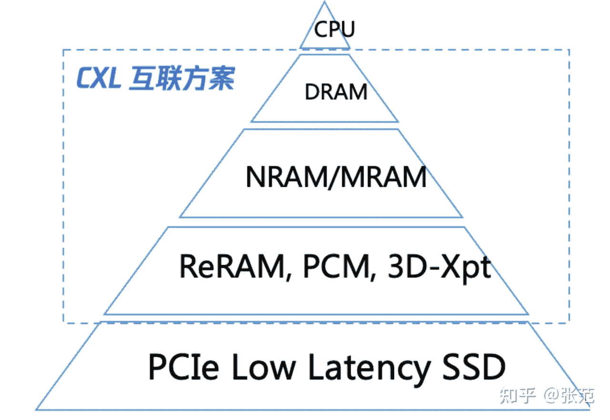

运行在PCIe gen5 (5.0)的物理层上，并寄希望在Gen 6上能够得到更广泛的应用。

CXL协议包括三个子协议：

+   CXL.io (Required) 是 IO 类型，和传统 PCIe 类似。向前兼容 PCIe

+   CXL.cache (Optional) 允许设备访问主存和 cache

+   CXL.memory (Optional) 允许 CPU 访问设备的内存.

PCIe 可以通过 DMA 访问 host memory，只需要知道物理地址。

PCIe 没有指定支持一致性的机制，并且不能高效地管理隔离的内存池，因为每个 PCIe 层级都要共享一个 64 位地址空间。此外，PCIe 链路的延迟可能过高，无法高效管理系统中多个设备的共享内存。

1.  有安全性问题。

曾经有黑客通过定制的PCIe卡，通过DMA扫描内存，可以偷走所有内存数据，从而让内存变成完全不设防的城市，这给BIOS工程师造成了一定的麻烦，不得不到处封堵漏洞。

1.  延迟高。

DMA 对内存的访问还是要通过内存控制器，延迟问题相当高。

## Nvlink

Nvlink解决GPU到GPU，CPU到GPU的内存一致性和统一问题。

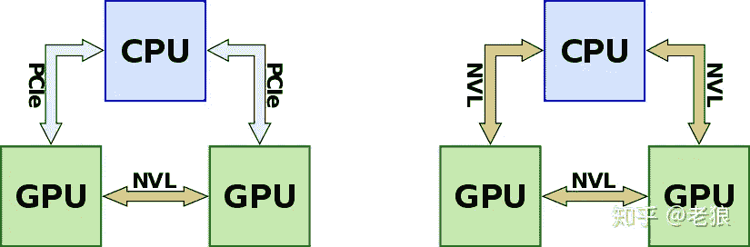

Nvlink可以替代SLI来连接GPU和GPU；如果CPU也支持Nvlink，则整个CPU和GPU的cache一致性和内存统一编址也可以做到。不过悲剧的是AMD和Intel并不打算在CPU里面支持nvlink，没有CPU的支持，Nvlink功能就被大大矮化，只能看作SLI的升级版。不过IBM却为此两肋插刀，尽管有自己的OpenCAPI，还在power CPU里面集成了NvLink

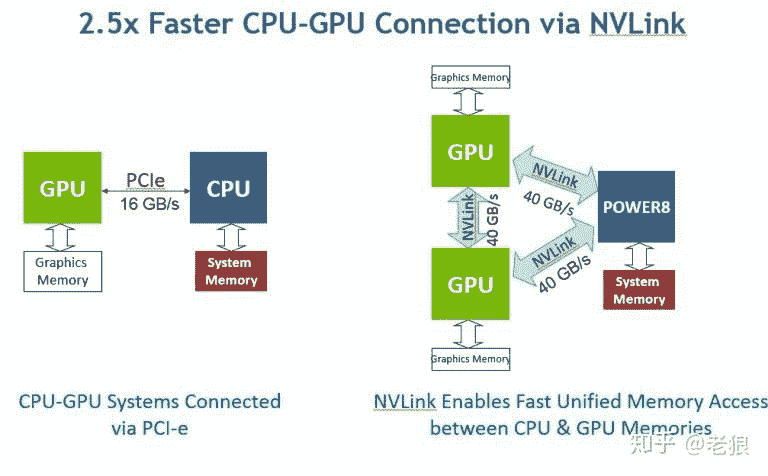

# CXL 历史

DMA对内存的访问还是要通过内存控制器，延迟问题相当高，基于此，Intel推出了I/OAT技术，DMA可以直接访问CPU LLC cache，大大提高了性能，I/OAT在网卡等高速设备上得到了广泛应用。

I/OAT 解决了部分问题，但，地址不能统一编址，缓存一致性也不能保证。

其他方案：

1.  以 IBM 牵头的 OpenCAPI，

1.  ARM 为代表支持的 CCIX，

1.  AMD，arm，戴尔和 HPE、内存制造商美光和 FPGA 专家赛灵思等支持的 GenZ

1.  Nvidia 的 Nvlink

所有关键一致性工作的成员——英特尔的Compute Express Link（CXL）、IBM的Concordent Accelerator Interface（CAPI）和OpenCAPI superset，Xilinx的Accelerators缓存一致性互连（CCIX）和AMD的Infinity Fabric、Nvidia的NVLink互连和Hewlett-Packard Enterprise的Gen-Z互连，以及戴尔早期大力支持的，所有这些都支持Intel的CXL协议互连，它本身就是PCI Express 5.0的超集，用于连接处理器和加速器并共享它们的内存。我们同时在这里做了一个非常深入的研究，这又是一个巧合。称之为调和收敛。

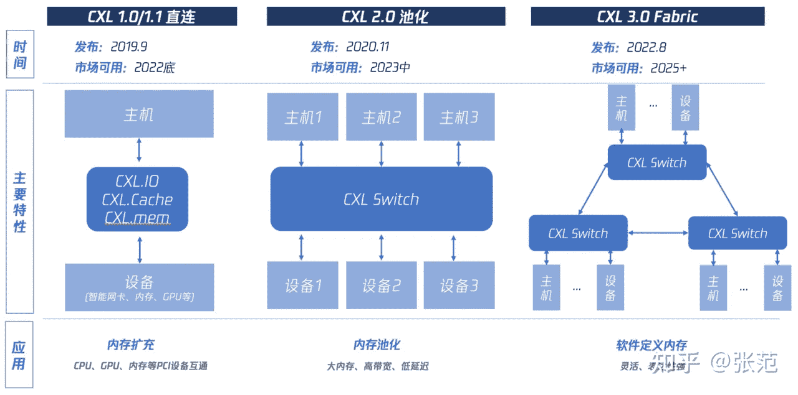

[CXL1](https://www.zhihu.com/search?q=%E7%9B%B4%E6%8E%A5%E8%AE%BF%E9%97%AE&search_source=Entity&hybrid_search_source=Entity&hybrid_search_extra=%7B%22sourceType%22%3A%22answer%22%2C%22sourceId%22%3A2806715874%7D)[.0/1.1 可归纳为“直](https://link.zhihu.com/?target=http%3A//CXL.io)连”，也就是让主机CPU可以直接访问PCIe设备的内存，具体分为三个子协议：http://CXL.io用于设备注册发现、CXL.cache用于设备访问CPU内存、CXL.mem 用于CPU访问设备内存。这可达到主机内存扩充的目的。

CXL2.0 可归纳为“池化”，就是让多个主机CPU和多个设备可通过一个CXL Switch硬件连接在一起，可以相互访问，在较小延迟影响的前提下提供高容量大带宽。这可达到内存池化的目的。

CXL3.0 可归纳为Fabric，可以让多个Switch形成级联结构，支持更复杂的结构。这可以达到“软件定义内存”的目的，此处借用了“软件定义网络”的概念，具体能干啥我暂时也想不出来~

当然，目前只是协议发布，真正到市场使用大概还需要一段的时间，预计CXL 1.0/1.1需要到2022年，CXL 2.0要到2023年中，至于CXL 3.0可能要等2025年之后了。

CXL 3.0响应了设备供应商的需求，将比CXL 1.X版本提升了带宽，并将一些原本复杂的标准设计简单化，确保易用性。这是2020年CXL 2.0标准引入内存池和CXL开关功能之后较大的改动，CXL 3.0将侧重于物理和逻辑层面的升级，在物理层面，CXL将每通道吞吐量提升了一倍，达到64GT/s。在逻辑层面，CXL 3.0扩招了标准逻辑能力，允许更复杂的连接拓扑，以及一组CXL设备内可以灵活实现内存共享和内存访问。

CXL 3.0则正是基于PCIe 6.0标准进行的。它属于PCIe 6.0全带宽改进版，在提升总带宽的同时，也加入了向前纠错FEC等内容，根据CXL联盟的说法，CXL 3.0能够在不增加延迟的情况下完成所有工作，这是PCIe 6.0所面临的挑战之一，因为一旦进行纠错，就一定会增加进程的延迟，为此PCI-SIG特意增加了FEC方式来解决问题。从整体上来看，CXL 3.0与CXL 2.0延迟保持相同。

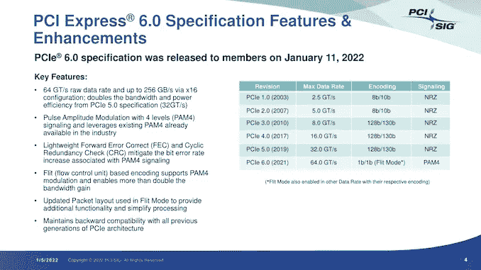

除了获得PCIe 6.0的基础更新，CXL联盟还调整了固定数据包FLIT的大小，原本的CXL 1.X和CXL 2.0使用了68 bytes数据包，在CXL 3.0直接升级到了256 bytes，给CXL 3.0引入的复杂拓扑提供了基础，另外CXL 3.0还引入了一种低延迟FLIT模式，通过将CRC分解成128 bytes的FLIT颗粒进行和传输，以减轻物理层中存储和转发的开销。

除了进一步提升整体I/O带宽，CXL 3.0还需要考虑到不同设备之间的高级互联协议。比如CXL 3.0中更新了具有缓存的一致性协议，当主机缓存数据无效的时候，设备还能正常运行。这意味着CXL 3.0取代了早起版本基于偏差一致性的方式。为了设计简单化，保持一致性不是通过共享内存空间实现，而是通过主机或者设备控制访问实现的。

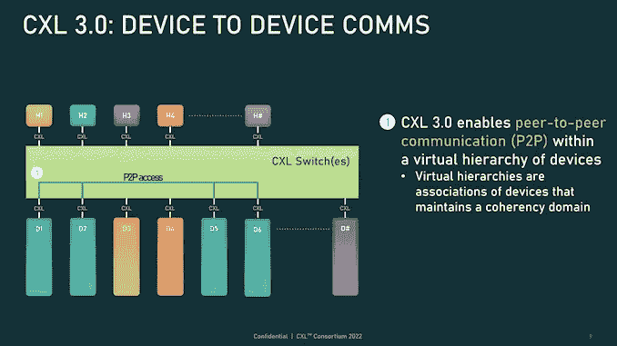

CXL 2.0提供了内存池设计，多个主机可以对设备内存进行访问，但是每个主机都需要分配自己专属内存段。在CXL 3.0中国，内存共享变得更开放，多个主机可以拥有一个共享内存段的一致性副本，如果设备级别发生变化，可以使用反向失效来保持所有主机同步。

但这样的设计并不能完全取代CXL 2.0上的内存池设计，因为某些方案中，内存池设计往往更为奏效，因此CXL 3.0会同时支持这两种模式，进行混合匹配。

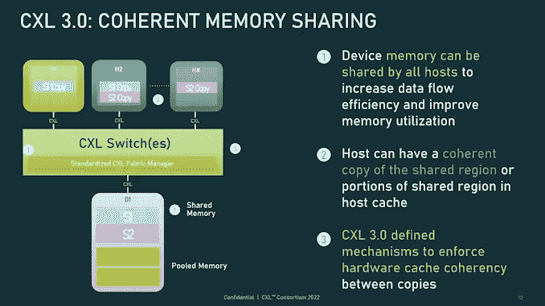

另外CXL 3.0消除了单个CXL端口下游的Type-1、Type-2设备数量限制，CXL 2.0只允许这些设备中出现一个根端口，而CXL 3.0没有类似的限制。这意味着现在CXL根端口无论是Type-1、Type-2还是Type-3都可以进行完全混合匹配设置，具体取决于系统构建者的目的。这意味着CXL 3.0能够将多个加速器连接到单个交换机，以提升密度，使得点对点传输功能更加有用。

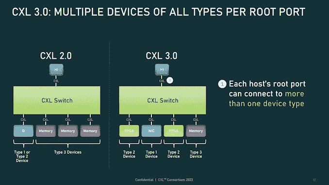

CXL 3.0另一个特性是支持多级切换，允许单个交换机驻留在主机和设备之间，并允许多级交换机实现多层级交换，对网络拓扑种类和复杂性有更好的支持。即便只有两层交换机，CXL 3.0也能够实现非树状拓扑，比如环形、网状或者其他结构，对节点中的主机或设备没有任何限制。

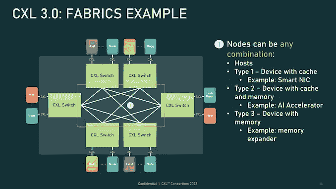

新的内存和拓扑结构功能都可以在CXL联盟推行的全局结构连接内存（Global Fabric Attached Memory，GFAM）一起使用，GFAM通过进一步分解给主机的内存，将CXL内存扩展版Type-3理念提升到了一个新水平，因此GFAM设备在功能就是自己的共享内存池，主机和设备可以根据需求进行访问，其中GFAM可以同时拥有易失性存储和非易失性存储，也就是DRAM和SSD都装在一个模块内，最终实现类似傲腾的功能。

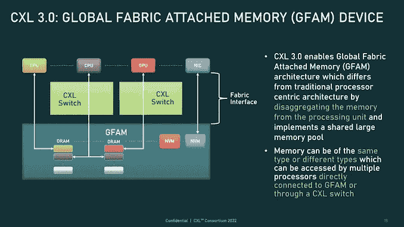

GFAM将使得CXL能够有效支持大型多节点设置，在范例列举中，CXL列举了在时下流行的MapReduce模型中如何提供了必要的性能和效率，尽管这套算法模糊了CXL本地互联和InfiniBand网络互联之间位置的界限。

鉴于CXL标准诞生并不久，CXL 1.X和CXL 2.0设备才刚开始交付，CXL 3.0距离实际的应用部署还有几年的时间，因此现在也没有实际的指导案例。但我们已经可以从中一窥整个业界正在向更为便宜、有效的方向前进，而非傲腾这种造价高昂的独占硬件解决问题。在IT硬件一轮又一轮的升级经验中，已经变成了永恒的道理。

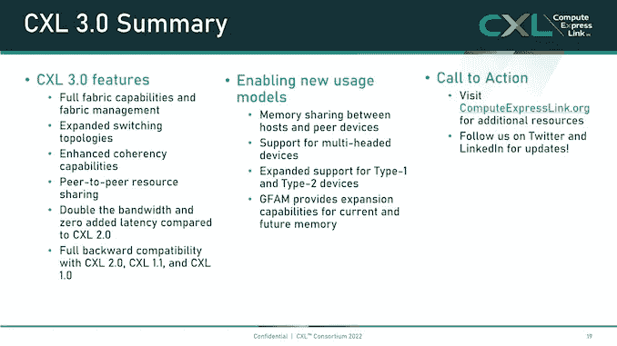

# CXL 协议

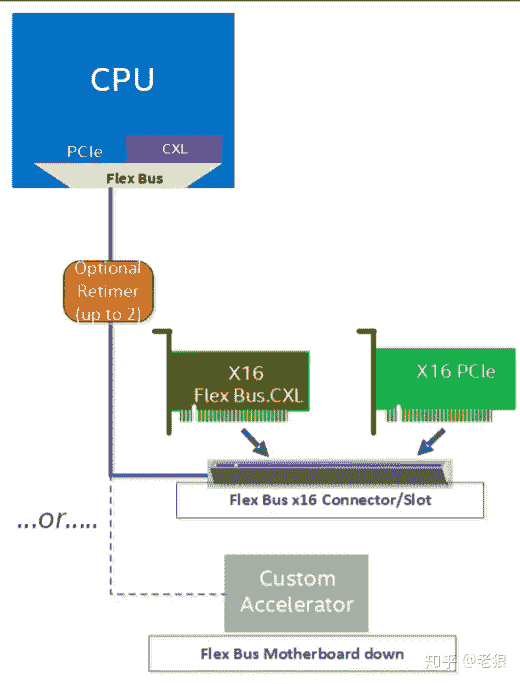

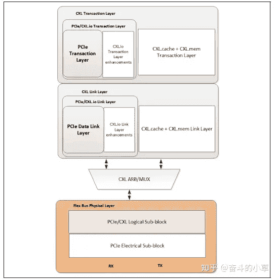

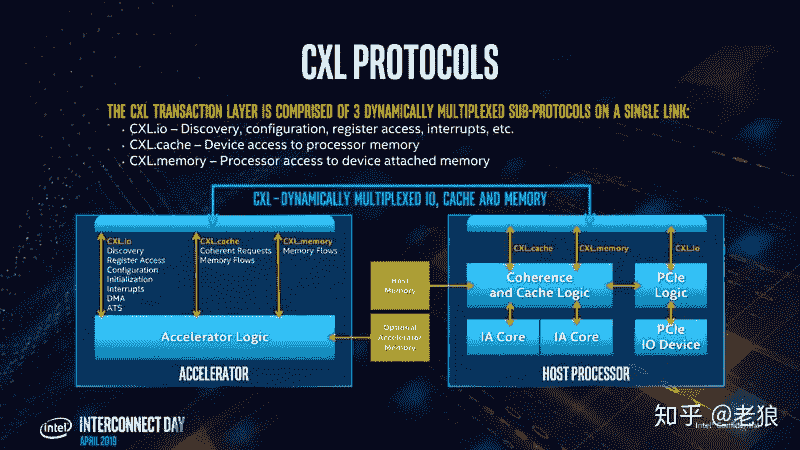

CXL相比[上文](https://zhuanlan.zhihu.com/p/63494668)介绍的基于CA和HA的引擎简单了很多

和UPI的cache一致性对称性设计不同，CXL是非对称的。UPI的对称性设计是指各个node都有HA和CA；而CXL则只有CPU有HA和CA，设备没有CA，只有HA。这简化了设备的设计，并允许没有cache的设备加入cache一致性的大家庭。

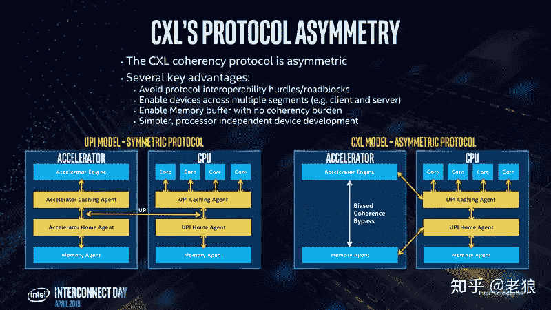

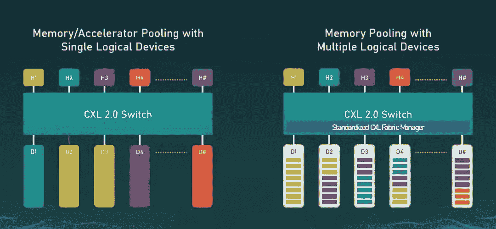

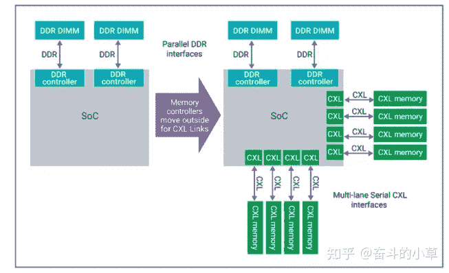

# 一些讨论

预计总体CXL市场收入将在2028年增长至150亿美元以上，DRAM将构成CXL市场收入的大部分，到2028年将达到120亿美元以上。然而，这取决于有效的路线图执行。

英特尔正式确认了充满黑科技意味的傲腾业务和3D Xpoint走向终结，取而代之的是向CXL架构发展。

# References

1.  Nvlink官网 [https://www.nvidia.com/en-us](https://www.nvidia.com/en-us/data-center/nvlink/)/data-center/nvlink/

1.  IBM Blog [ht](https://www.ibm.com/blogs/systems/ibm-power8-cpu-and-nvidia-pascal-gpu-speed-ahead-with-nvlink/)tps://www.ibm.com/blogs/systems/ibm-power8-cpu-and-nvidia-pascal-gpu-speed-ahead-with-nvlink/

1.  CXL About Page [https://www.computeexpre](https://www.computeexpresslink.org/about-cxl)sslink.org/about-cxl

1.  CXL资料 [ht](https://www.techpowerup.com/254462/intel-reveals-the-what-and-why-of-cxl-interconnect-its-answer-to-nvlink)tps://www.techpowerup.com/254462/intel-reveals-the-what-and-why-of-cxl-interconnect-its-answer-to-nvlink

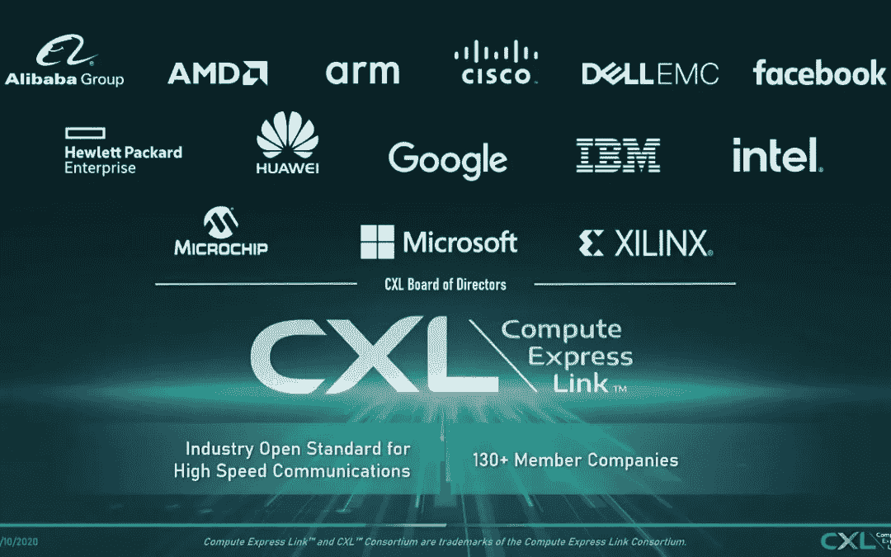

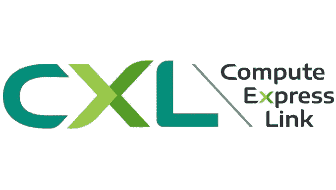