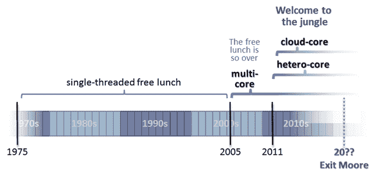
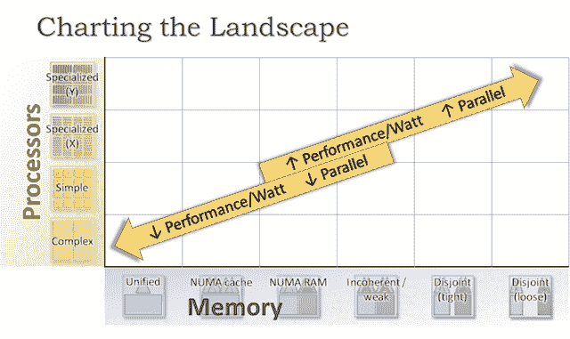
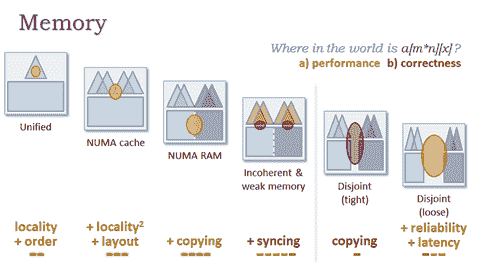
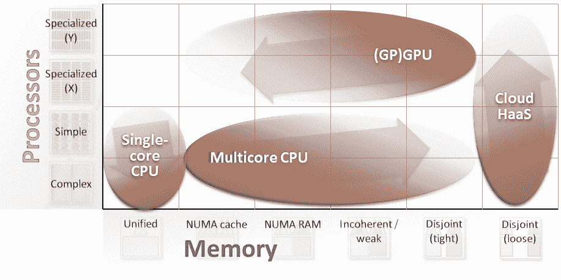
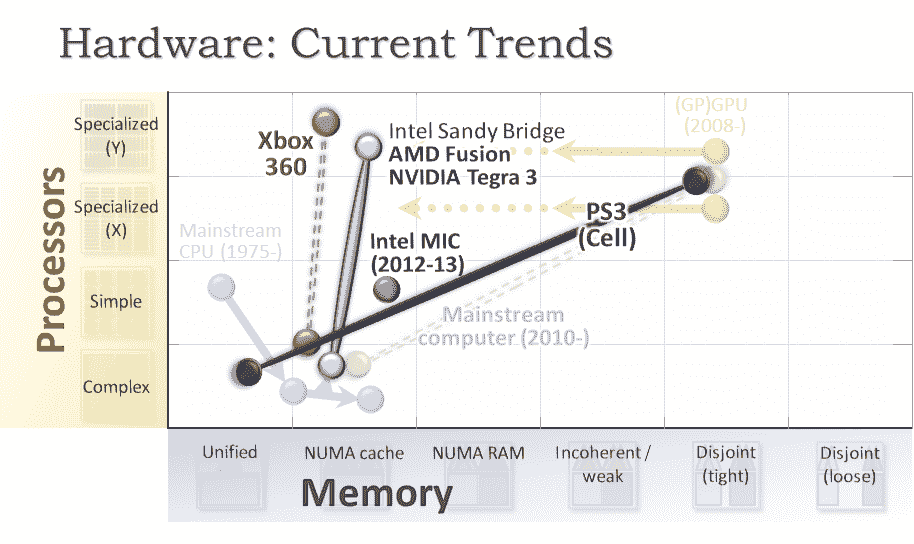

# Welcome to the Jungle - 硬件趋势

> 来源：[https://learning.feishu.cn/docx/SDNwdqHtIoqHMjx9Yjrcwt51nWw](https://learning.feishu.cn/docx/SDNwdqHtIoqHMjx9Yjrcwt51nWw)

[https://herbsutter.com/we](https://herbsutter.com/welcome-to-the-jungle/)lcome-to-the-jungle/

# 硬件发展趋势

硬件发展的 3 个阶段：

1.  单核性能提升。-- free launch。晶体管做小就行，单线程代码无需大幅优化即可获得性能提升。

1.  多核（同构）性能提升

1.  异构多核。比如 CPU-GPU，大核心 + 小核心。

“处理器 + 内存” 架构的二维趋势图

纵轴（Processors）：处理器类型。复杂核 - 简单核 - 专用核。

横轴（Memory）：**内存架构**，代表内存从 “统一共享” 向 “分布式 / 分离” 演变。

**趋势：专用处理器 + 分离内存**。并行度提升，编程复杂度提升。

**内存架构 - 6 种**

从左到右是

**Unified（统一内存）**

**→ NUMA_cache**

**→ NUMA_RAM**

→ Incoherent/weak

→ Disjoint (tight)

→ Disjoint (loose)，

之所以会出现不同的内存结构，主要在于：多processor 情况下可能会出现内存总线的竞争。考虑到local特性。

变成复杂度提升，带来 2 种问题：performance issues (yellow) or correctness issues (red)

In the blown-up figure, triangles represent cache and lower boxes represent RAM. A processor core (ALU) sits at the top of each cache “peak.”

The horizontal axis shows six common memory architectures. From left to right, they form a continuum of increasing performance and scalability, but (except for one important discontinuity) also increasing work for programs and programmers to deal with performance issues (yellow) or correctness issues (red). In the blown-up figure, triangles represent cache and lower boxes represent RAM. A processor core (ALU) sits at the top of each cache “peak.”

**Unified memory is tied to the** unicore motherlode and the memory hierarchy is wonderfully simple – a single mountain with a core sitting on top. This describes essentially all mainstream computers from the dawn of computing until the mid-2000s. This delivers a simple programming model: Every pointer (or object reference) can address every byte, and every byte is equally “far away” from the core. Even here, programmers need to be conscious of at least two basic cache effects: locality, or how well “hot” data fits into cache; and access order, because modern memory architectures love sequential access patterns. (For more on this, see my Machine Architecture talk.)

**NUMA cache** retains a single chunk of RAM, but adds multiple caches. Now instead of a single mountain, we have a mountain range with multiple peaks, each with a core on top. This describes today’s mainstream multi-core devices. Here we still enjoy a single address space and pretty good performance as long as different cores access different memory, but programmers now have to deal with two main additional performance effects: locality matters in new ways because some peaks are closer to each other than others (e.g., two cores that share an L2 cache vs. two cores that share only L3 or RAM), and layout matters because we have to keep data physically close together if it’s used together (e.g., on the same cache line) and apart if it’s not (e.g., to avoid the ping-pong game of false sharing).

**NUMA RAM** further fragments memory into multiple physical chunks of RAM, but still exposes a single logical address space. Now the performance valleys between the cores get deeper, because accessing RAM in a chunk not local to this core incurs a trip across the bus. Examples include bladed servers, symmetric multi-processor (SMP) desktop computers with multiple sockets, and newer GPU architectures that provide a unified address space view of the CPU’s and GPU’s memory but leave some memory physically closer to the CPU and other memory closer to the GPU. Now we add another item to the menu of what a performance-conscious programmer needs to think about: copying. Just because we can form a pointer to anything doesn’t mean we always should, if it means reaching across an expensive chasm on every access.

Incoherent and weak memory makes memory be by default unsynchronized, in the hope that allowing each core to have its own divergent view of the state of memory can make them run faster,

at least until memory must inevitably be synchronized again. As of this writing, the only remaining mainstream CPUs with weak memory models are current PowerPC and ARM processors (popular despite their memory models rather than because of them; more on this below). This model still has the simplicity of a single address space, but now the programmer further has to take on the burden of synchronizing memory himself.

Clarification: By “weak (hardware) memory model” CPUs I mean specifically ones that do not natively support efficient sequentially consistent atomics, because on the software side programming languages have converged on the strong “sequential consistency for data-race-free programs” (SC-DRF, roughly aka DRF0 or RCsc) as the default (C11, C++11) or only (Java 5+) supported software memory model for software. Hardware that supports weaker memory models than that are permanently disadvantaged and will either become stronger (as ARMv8 is now doing by adding SC acquire/release instructions) or atrophy. The two main hardware architectures with what I called “weak” memory models were ARMv7 and POWER. ARMv8 is upgrading to SC acquire/release, as predicted, and it remains to be seen whether POWER will upgrade or atrophy. I’ve seen some call x86 “weak”, but x86 has always been the poster child for a strong hardware memory model in all of our software memory model discussions for Java, C, and C++ during the 2000s. Therefore it’s clear that “weak” and “strong” are not useful terms because they mean different things for software and hardware memory models, and I’ve updated the text to clarify this.

Disjoint (tightly coupled) memory bites the bullet and lets different cores see different memory, typically over a shared bus, while still running as a tightly-coupled unit that has low latency and whose reliability is still evaluated as a single unit. Now the model turns into a tightly-clustered group of mountainous islands, each with core-tipped mountains of cache overlooking square miles of memory, and connected by bridges with a fleet of trucks expediting goods from point to point – bulk transfer operations, message queues, and similar. In the mainstream, we see this model used by 2009-2011 vintage GPUs whose on-board memory is not shared with the CPU or with each other. True, programmers no longer enjoy having a single address space and the ability to share pointers, but in exchange we have removed the entire set of programmer burdens accumulated so far and replaced them with a single new responsibility: copying data between islands of memory.

**Disjoint (loosely c**oupled) is the cloud where cores spread out-of-box into different rooms and buildings and datacenters. This moves the islands farther apart, and replaces the bus “bridges” with network “speedboats” and “tankers.” In the mainstream, we see this model in HaaS cloud computing offerings; this is the commoditization of the compute cluster. Programmers now have to arrange to deal with two additional concerns, which often can be abstracted away by libraries and runtimes: reliability as nodes can come and go, and latency as the islands are farther apart.

不同类型的processor 的结构

发展趋势

