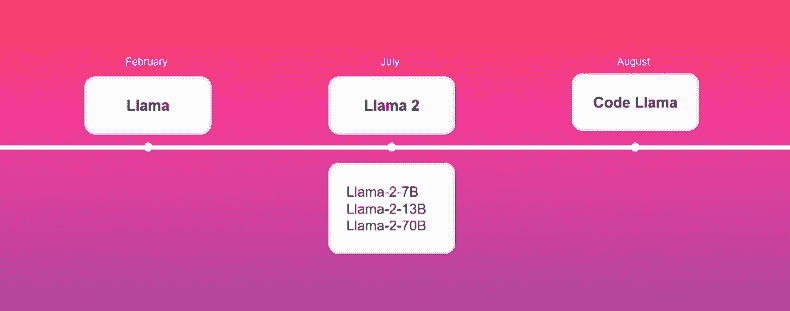
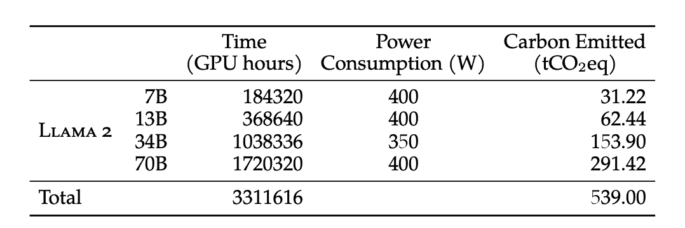
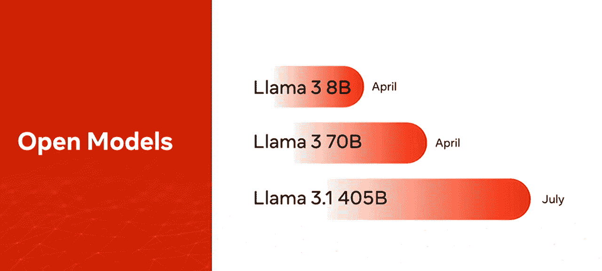
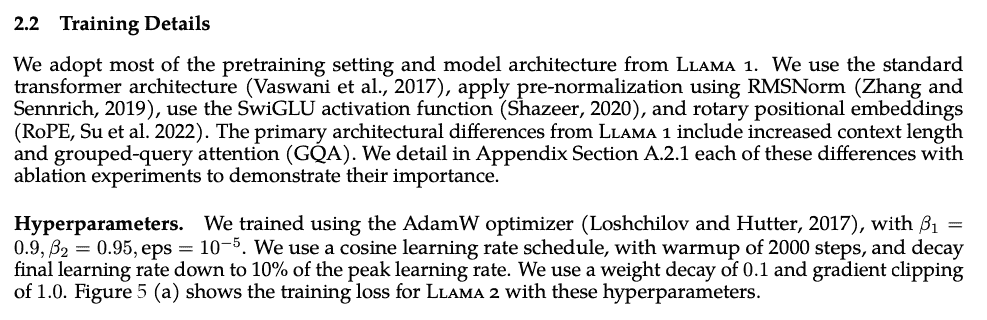
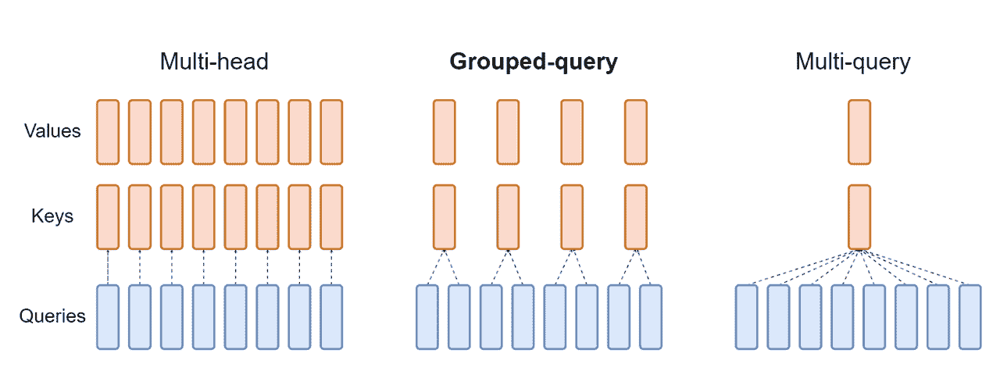
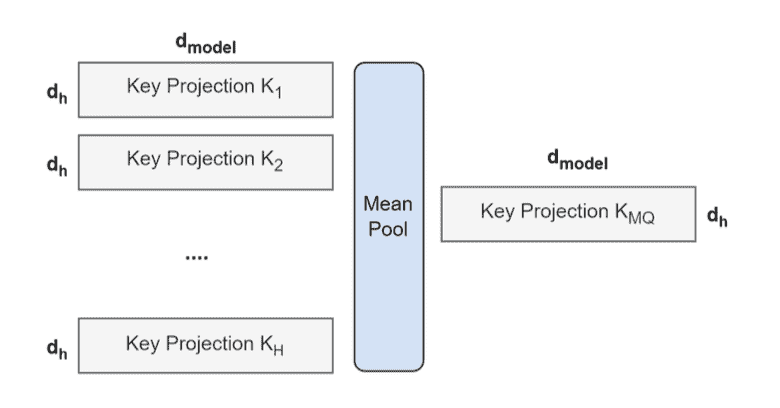
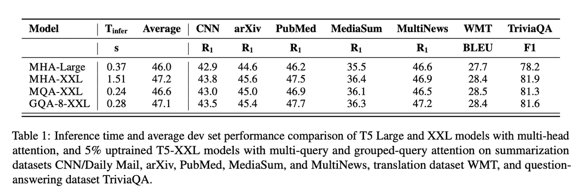
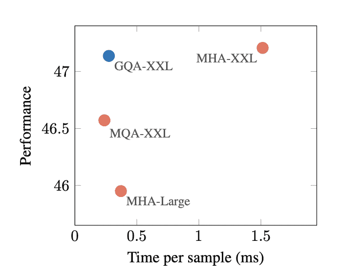
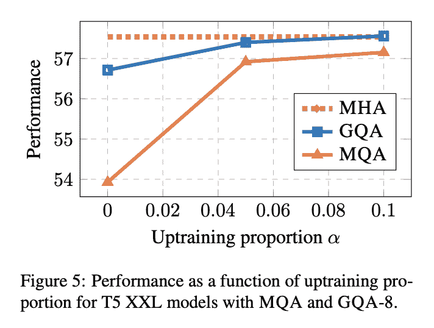
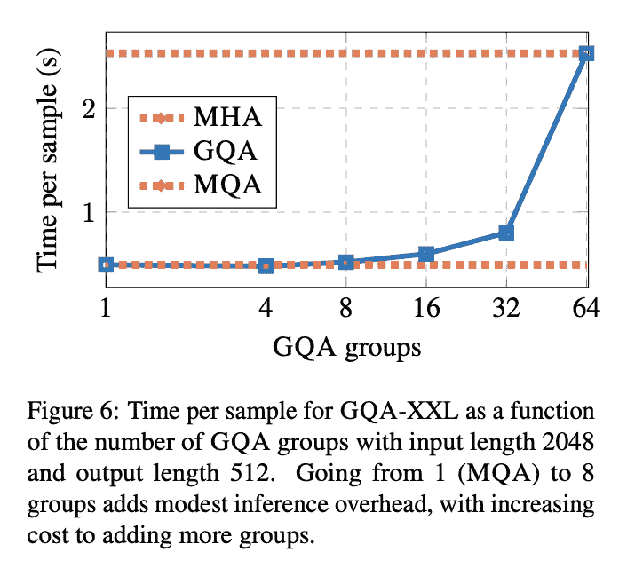

# LLaMa2 Arch & GQA Attention

> 来源：[https://learning.feishu.cn/docx/PQV2dBarGotiLOx7KYzcsq6ynkg](https://learning.feishu.cn/docx/PQV2dBarGotiLOx7KYzcsq6ynkg)

# Paper List

| Paper | year | author | Notes |
| --- | --- | --- | --- |
| LLaMA: Open and Efficient Foundation Language Models | 2023.02 | Hugo Touvron | code: https://github.com/dl-model-zoo/llama |
| Llama 2: Open Foundation and Fine-Tuned Chat Models | 2023.07 | Hugo Touvron | 没啥用，不如读 GQA |
|  |  |  |  |
| Fast Transformer Decoding: One Write-Head is All You Need | 2019.11 | Noam Shazeer | MQA |
| GQA: Training Generalized Multi-Query Transformer Models from Multi-Head Checkpoints | 2023.05 | Joshua Ainslie | GQA |

# Summary Notes

MHA, MQA, GQA 极大的影响 kvcache 的计算。

理论层面，应该就能找到 GQA 的最佳 group 数量区间。

又，考虑到 model TP，小于 TP 数的 group 没意义。

如果常见的是 GQA-8，那么，超过 8 的 TP 收益将更小，per die 的 kvcache 大小，丝毫不降。

可以做的实验 sequence：

1.  llama2-7b, or llama-7b

1.  baseline of MHA

1.  avg pool -> MQA

1.  pre-train -> MQA acc up

1.  GQA testing

# Model Arch

## Model Size

34B 只在 paper 中讨论，没有 release。

## Arch Comparision

llama2 沿用了 llama 的大多数 arch：

1.  pre-normalization using RMSNorm (Zhang and Sennrich, 2019)

1.  SwiGLU activation function (Shazeer, 2020)

1.  rotary positional embeddings (RoPE, Su et al. 2022)

arch diff

1.  increased context length. 2k->4k

1.  grouped-query attention (GQA)

## GQA - Grouped Query

从 MHA -> MQA -> GQA，核心就是 kvcache reduction。

MHA 会导致 quality degradation，解决思路就是，折中一下，从 global share 1 个 => N 个 group，每个 group share 1 个。

MHA -> MQA 的方法：所有的 kv weight 取平均值。

效果总结：用 MHA-large 的 latency 跑出了 MHA-XXL 的精度。

8 之后的时间增加，来自于单卡 kvcache size （搬运需求）增加。

## Calcs of KVCache

MHA, MQA, GQA 3 种 attention 机制，极大的影响 kvcache 计算。

llama2 默认是 GQA。

MHA 的模型，如 gpt 系列，可以用较低的 fine tune 成本转换成 GQA。

KVCache Size of LLama2-70b, TP=8，

+   计算公式：bs * seq * 128(head_dim) * 2(fp16) * 2(k & v) * head_cnt

+   Cheatsheet: 32MB / head

| attention | Per Decoder | Model Total |
| --- | --- | --- |
| MHA | 64 * 32M = 2G | 2G * 80 decoders = 160G |
| MQA | 32M | 32M * 80 decoders = 2.5G |
| GQA | 8 group * 32M = 0.25G | 0.25G * 80 decoders = 20G |

主要计算参数的设定如下：

+   80 decoders in total.

+   64 heads per decoder

+   avg_seq length = 1024 (max = 2048), bs=64

+   Datatype: fp16 （int8 时，kvcache size 减半）

+   Decoder weight size: ~1GB (comparision baseline)