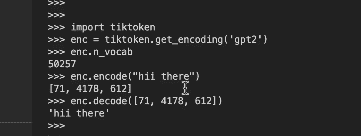
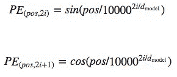
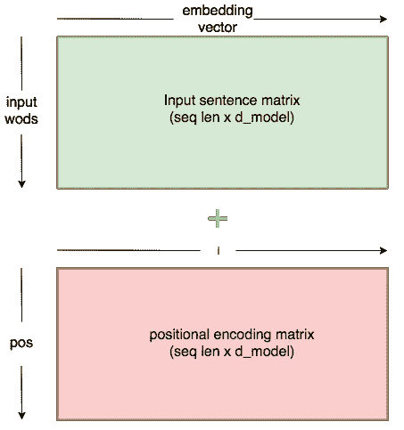

# GPT and Attention Mechanisms

> 来源：[https://learning.feishu.cn/docx/MdT9dOFBXoNg02xpQ4EcVf3wnGX](https://learning.feishu.cn/docx/MdT9dOFBXoNg02xpQ4EcVf3wnGX)

https://www.youtube.com/watch?v=kCc8FmEb1nY

Let's build GPT: from scratch, in code, spelled out

Andrej Karpathy

Jan 18, 2023



从头搭建 1 个 transformer，需要 5 个步骤

+   词向量层

+   位置编码

+   创建 Masks

+   多头注意层（The Multi-Head Attention layer）

+   Feed Forward层

模型理解一个句子有两个要素：

1.  单词的含义 - 词向量层

1.  单词在句中所处的位置 - 位置编码

```
# word embedding
class Embedder(nn.Module):
    def __init__(self, vocab_size, d_model):
        super().__init__()
        self.embed = nn.Embedding(vocab_size, d_model)

    def forward(self, x):
        return self.embed(x)

# positional embedding
class PositionalEncoder(nn.Module):
    def __init__(self, d_model, max_seq_len = 80):
        super().__init__()
        self.d_model = d_model
        
        # create constant &#x27;pe&#x27; matrix with values dependant on pos and i
        pe = torch.zeros(max_seq_len, d_model)
        for pos in range(max_seq_len):
            for i in range(0, d_model, 2):
                pe[pos, i] = math.sin(pos / (10000 ** ((2 * i)/d_model)))
                pe[pos, i + 1] = math.cos(pos / (10000 ** ((2 * (i + 1))/d_model)))
                
        pe = pe.unsqueeze(0)
        self.register_buffer(&#x27;pe&#x27;, pe)

    def forward(self, x):
        # make embeddings relatively larger
        x = x * math.sqrt(self.d_model)
        # add constant to embedding
        seq_len = x.size(1)
        x = x + Variable(self.pe[:,:seq_len], requires_grad=False).cuda()
        return x
```

positional embedding 的公式



Pos代表了句子的顺序，i代表了嵌入向量所处的维度位置。



# Writing notes

1.  Introduction to Attention Mechanisms

+   Motivation and importance of attention

+   Attention as a weighted sum

1.  GPT Model Architecture

+   Transformer-based architecture

+   Encoder-decoder structure

+   Positional encoding

1.  Attention Mechanisms in GPT

+   Self-attention

+   Cross-attention

+   Scaled dot-product attention

1.  Mathematical Formulation of Attention

+   Query, key, and value matrices

+   Softmax and normalization (Softmax-weighted sum of values)

+   Multi-head attention

1.  Conclusion

+   Summarize the key architectural and mathematical concepts

+   Emphasize the importance of attention in GPT's performance

# backlogs

| prompts |
| --- |
| I&#x27;m writing a summary article about the key aspects of GPT and attention mechanisms, focusing on the model architecture and mathematical aspects, ignoring their background, importance, integration, and applications. please give me 3 different outline scripts to choose. |
| I&#x27;m writing a summary article about the key aspects of GPT and attention mechanisms, focusing on the model architecture and mathematical aspects. please generate 3 versions of Mathematical Formulation of Attention&quot; for me to choose from. |

1.  GPT-specific Attention Innovations

+   Causal masking

+   Sparse attention

+   Efficient memory management

1.  Benefits of Attention in GPT

+   Improved context modeling

+   Enhanced long-range dependencies

+   Increased interpretability

1.  Limitations and Considerations

+   Computational complexity of attention

+   Potential biases in attention-based models

+   Ongoing research and developments