# Tokenization

> 来源：[https://learning.feishu.cn/docx/UUTBd6MNJosVcIxL69jcBZz2n2d](https://learning.feishu.cn/docx/UUTBd6MNJosVcIxL69jcBZz2n2d)

https://www.youtube.com/watch?v=zduSFxRajkE

Let's build the GPT Tokenizer

Andrej Karpathy

Feb 21, 2024

jupyter

https://colab.research.google.com/drive/1y0KnCFZvGVf_odSfcNAws6kcDD7HsI0L?usp=sharing#scrollTo=wf4702UaOhvt

# Introduction

Tokenizer

1.  translates between strings and tokens (text chunks).

1.  separate stage of the LLM pipeline: they have their own

1.  training sets,

1.  training algorithms (Byte Pair Encoding)

训练后，搞一个 embedding table，实现 2 个 function：

1.  encode() from strings to tokens,

1.  decode() back from tokens to strings.

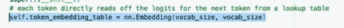

最简单的方案：

1.  character level + one-hot encoding

1.  word level，不同词性，都是不同的 token，过于稀疏。且，遇到新词就搞不定了。

1.  chunk level。介于 char 和 word level 之间。遇到新 chunk 的概率，明显低于新 word。

Tokenization 可以解决 LLM model 的很多问题

Tokenization is at the heart of much weirdness of LLMs. Do not brush it off.

+   **Why can't LL**M spell words? Tokenization.

+   Why can't LLM do super simple string pr**ocessing tas**ks like reversing a string? Tokenization.

+   W**hy is LLM wo**rse at non-English languages (e.g. Japanese)? Tokenization.

+   Why is LLM bad at** simple arit**hmetic? Tokenization.

+   W**hy did GPT-2** have more than necessary trouble coding in Python? Tokenization.

+   W**hy did my LL**M abruptly halt when it sees the string "<|endoftext|>"? Tokenization.

+   W**hat is this **weird warning I get about a "trailing whitespace"? Tokenization.

+   W**hy the LLM b**reak if I ask it about "SolidGoldMagikarp"? Tokenization.

+   W**hy should I **prefer to use YAML over JSON with LLMs? Tokenization.

+   W**hy is LLM no**t actually end-to-end language modeling? Tokenization.

+   What is the real** root of suf**fering? Tokenization.

In this lecture we build from scratch the Tokenizer used in the GPT series from OpenAI. In the process, we will see that a lot of weird behaviors and problems of LLMs actually trace back to tokenization. We'll go through a number of these issues, discuss why tokenization is at fault, and why someone out there ideally finds a way to delete this stage entirely.

# tokenizer 的比较

数字的 tokenization 就有些问题了。三位数，拆成了 2 个 两位数。

代码的 leading 空格，也都拆成了不同的 token。

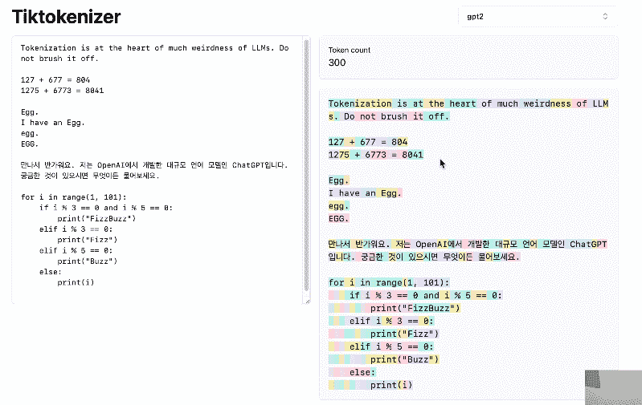

GPT4 的 tokenizer 明显改善了。

token count 从 300 降到了 185.

token 的 vocabulary size 从 50k 增到了 100k

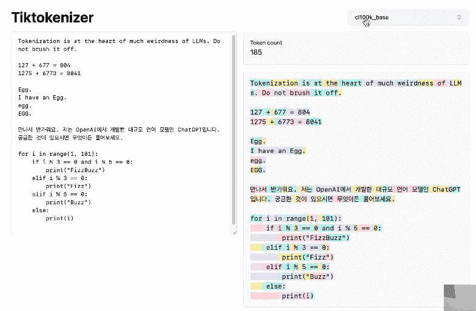

# Implementation

## 选择字符编码格式

目的：支持多种 language。

结论：

1.  unicode 字符集，不太好，一共有 150k 个 chars，并且，标准一直在改变。python ord 函数，拿到的就是 unicode。

1.  因此，需要一种字符编码。一共 3 个选项：

1.  utf8 效果最好。

1.  utf16 和 utf32。会插入很多不需要的 0.

utf8 输出 1-4 byte 的 encoding。

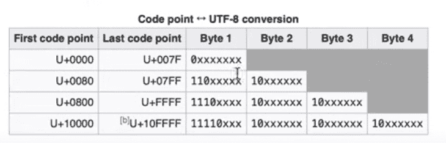

python 中，用 ''.encode('xxx') 得到 utf8, utf16, utf32  的 bytes。

换了 utf16 以后，可以看到 list 中多了很多 0 elements。如截图的最后部分。utf32 则更多。

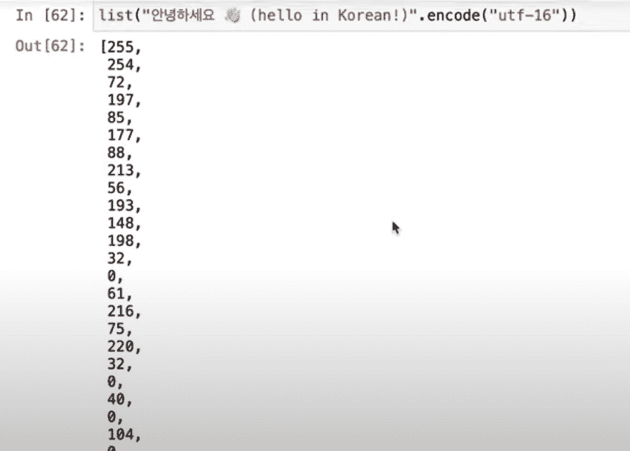

## 引入 byte pair encoding

utf8 虽然是最佳的字符编码格式，但，有个严重问题：

1.  naive 的使用 utf8，则，vocabulary size 只有 256. 很小。

1.  text 会被展开成一个非常长的 bytes sequence。比如，有的 character 可能占 4 bytes。

transformer 不擅长处理 long sequence length。

我们想要个大的 vocabulary size，short sequence length。

所以，引入 byte pair encoding 算法。

当然，如果能修改 transformer 架构，使得，可以直接把 raw bytes sequence 作为 input，可能更好（趋势），

但，目前好像做不到。

下面这篇 paper 做了尝试，但效果不确定是否有被更多的 research group 验证通过。

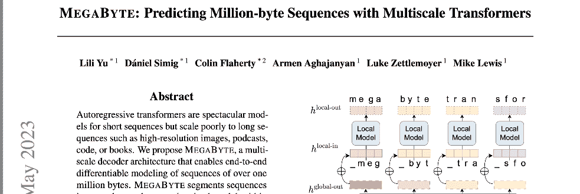

## byte pair encoding 算法

本质是一个 sequence 的压缩算法。compress。

原理很简单：

找到 frequency 最高的 pair，定义新 token，并加入 vocabulary & replace it in sequence。

从而实现了，用 vocabulary size 换 sequence length。

不断重复这个过程，直到终止条件。比如，

1.  no pair occurs more than once。

1.  max vocabulary size

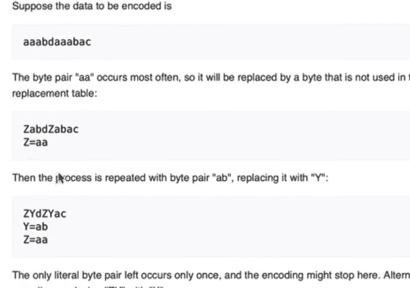

新老 sequence 的 ratio，就是 compression ratio。

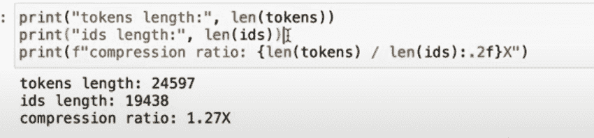

# 主流 model 的 tokenizer

## GPT2

禁用一些无效的 mergers，方法是 正则表达式，先 split 一下，然后在 splits 内找 merger。

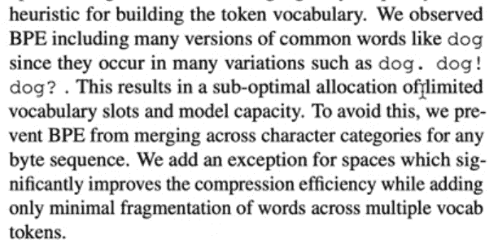

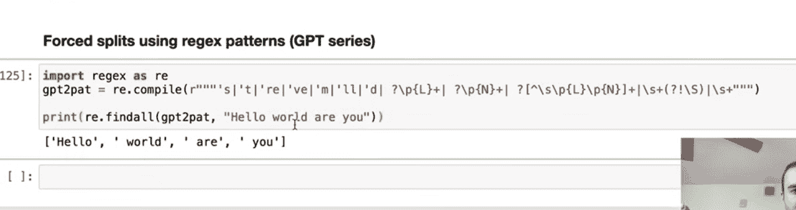

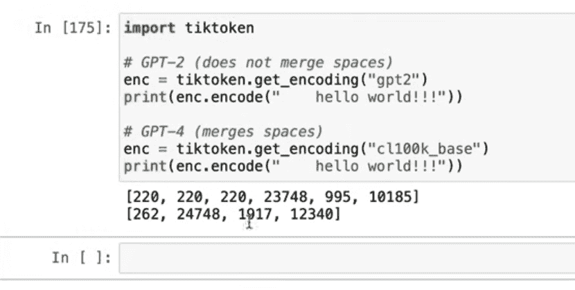

## special tokens

这个并不在 typical byte-pair-encoding 算法里。

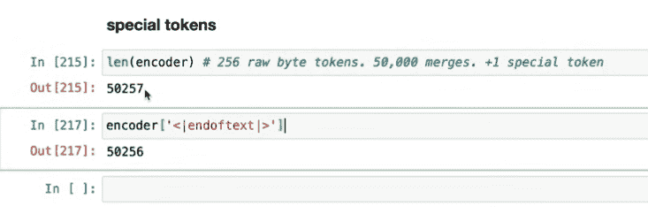

在 tokenizer 里面，也能看到 <|endoftext|> 会被识别为 1 个 special token 的 ID。

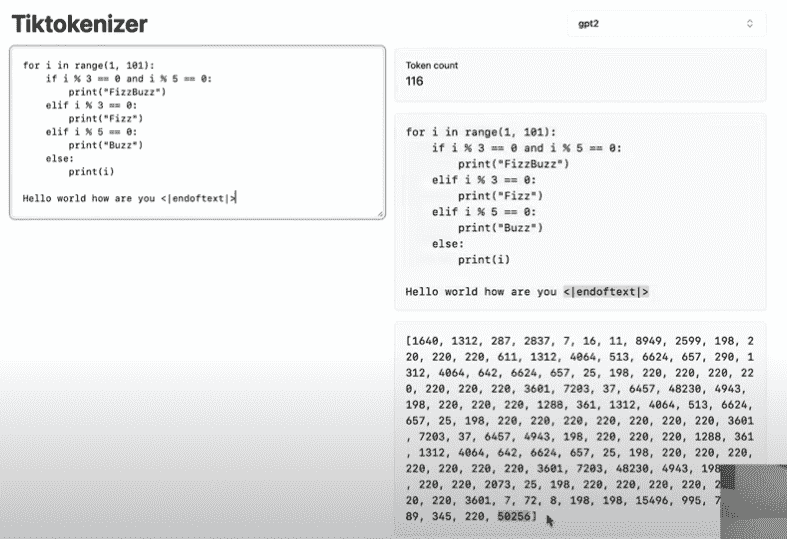

在 finetune 后的 chat 类模型里，用的都不是 base encoder，而是 finetune 后的 encoder。

finetune 后的 encoder 里面，<|xxx|> 修饰的 special token 是很多的。

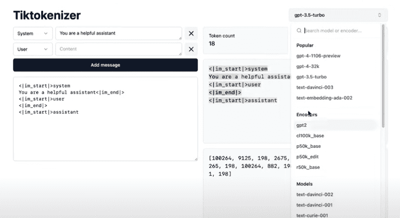

GPT4 的 special token 里面，增加了 FIM prefix/middle/suffix，以及 ENDOFPROMPT

FIM 3 个 special token 的解释，见下面 paper。

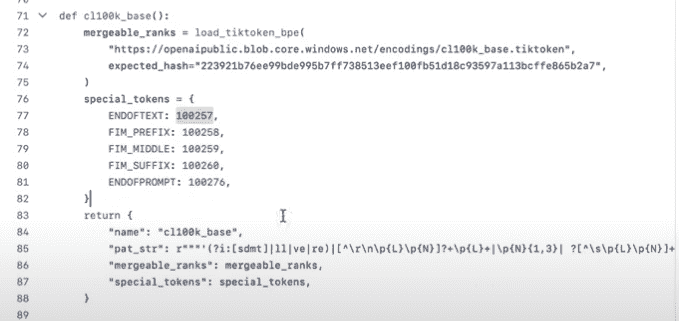

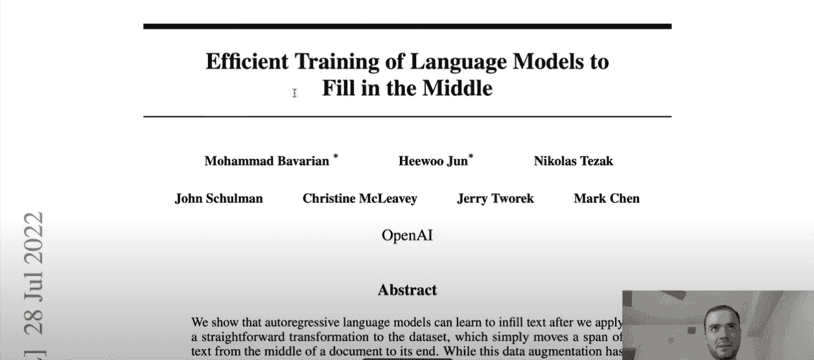

## Extending Tiktoken

tokenizer 是可以轻松 extending 的 。

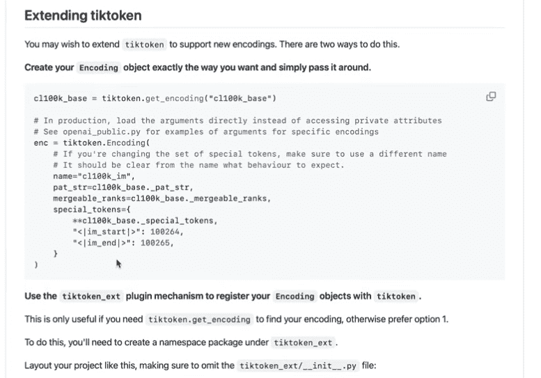

在 tokenizer 中添加了新的 special token 以后，模型也要适配。

1.  embedding matrix 要增加一行，适配 vocabulary size 的增加。

这一行，可以先用 small random numbers 初始化。

1.  transformer 的 final layer，进 classifier 的 projection 也要增加一行。

然后，应该就是 finetune 一下模型。

这是从 base model 到 chat model 做 finetune 时的常见做法。

# MinBPE

左边是 gpt4 的 tokenizer。右边是 minbpe 的 tokenizer。

minbpe 的 tokenizer 是用 Taylor Swift 的 wikipedia page 训练的。（the longest wikipedia page)

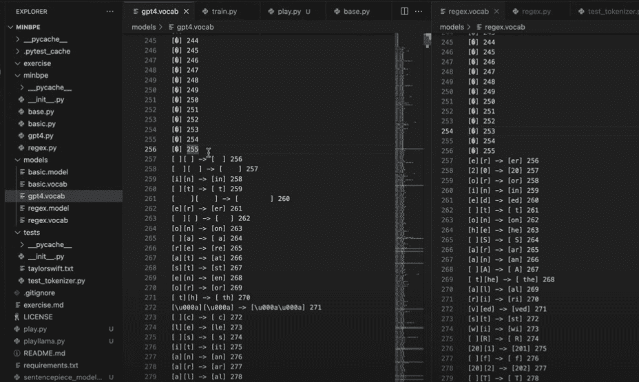

对比下来，很多 merger 都是相同的，只是顺序不同。大概率是 training set 不同导致的。

GPT4 中，space 的 merger 非常多且排名靠前，猜测是 training set 中有很多 python code。

# sentencepiece

支持多种 tokenizer 的 train 和 inference。

包括，BPE 算法。

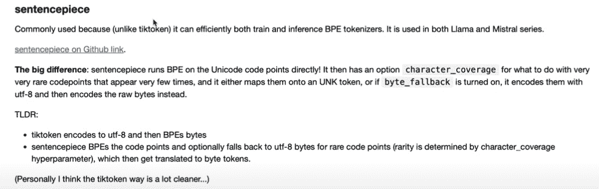

输出的顺序：

byte tokens

mergers

individual character tokens

注意一个选择 add_dummy_prefix

在 text 的开头，添加空格。使得 text 首单词和中间的单词，token 一致，减少 llm 的学习难度。

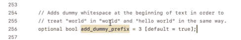

# vocab_size

+   Q: what should be vocab size?

+   Q: how can I increase vocab size?

+   [A: let](https://github.com/karpathy/ng-video-lecture/blob/master/gpt.py)'s see. Reminder: gpt.py from before.

vocab size 的选择，是个经验主义的玄学数字。参考当前主流模型的数字，效率更高一些。

通常说来，尽可能大一点会更好。但是，会有一些副作用

1.  training data 中 rare token 出现的频率低，可能根本得不到训练。

1.  把很长的 text 压缩到 1 个 token，推理时，model 可能无法准确理解这个 token。（怀疑跟上面是同样的底层逻辑，训练数据不足，token 理解不足）。

# 其他 topic

## 压缩 prompt

用类似的方法，可以压缩 prompt，见 paper。

类似 lora 的方法，prompt 压缩出一些新 token。frozen model weight，然后 finetune 对新 token 的理解。

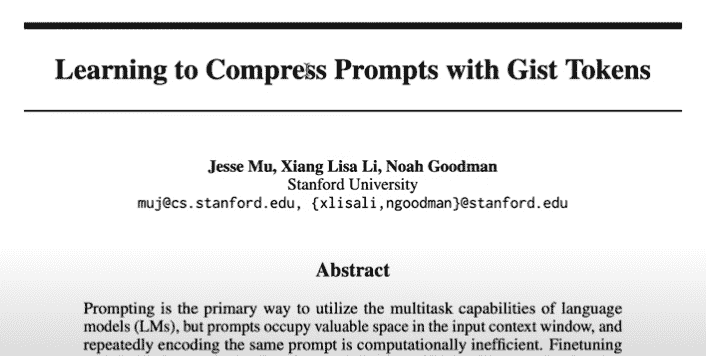

## VQGAN - taming transformer for high res image

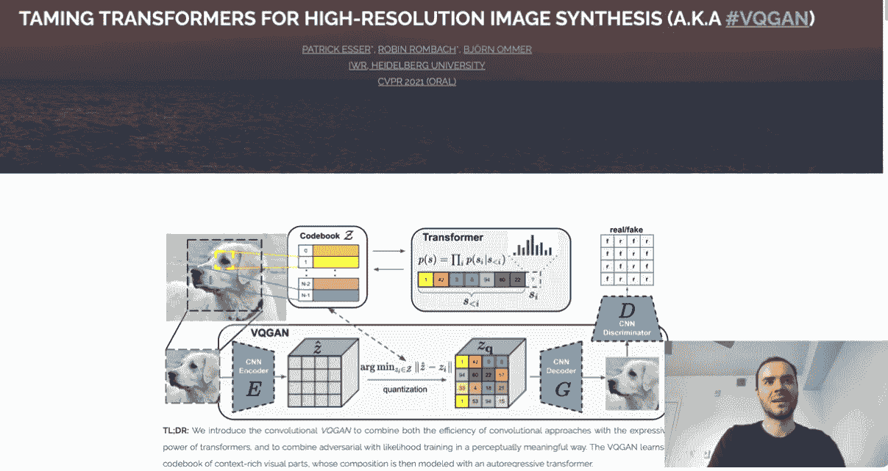

sora

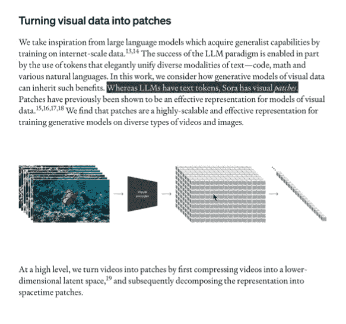

# quirks of LLM tokenization

多语言的情况下，tokenizer 的表现明显很差。

常用词都拆成了很多小 token。

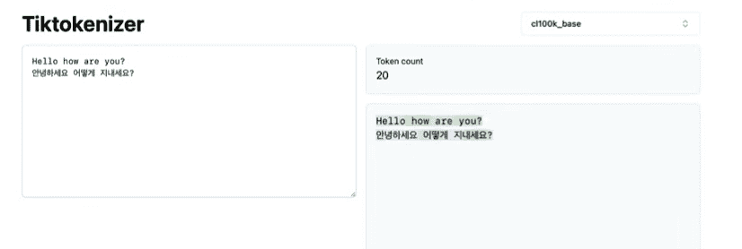

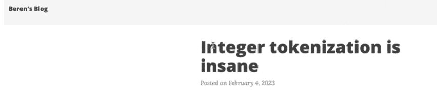

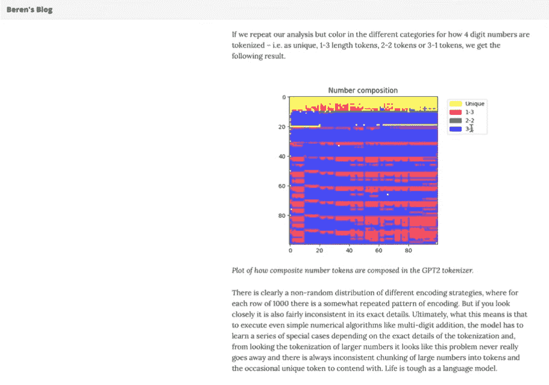

tailing space 本身，被解析为一个新的 token，导致后面的 completion 难度增加。

空格的 token 是 220，如果补齐的是 " Oh"，则一起是 token 8840

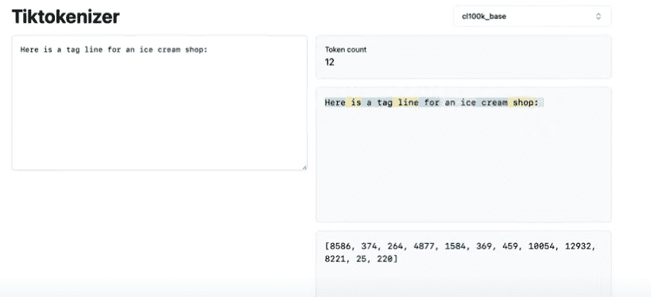

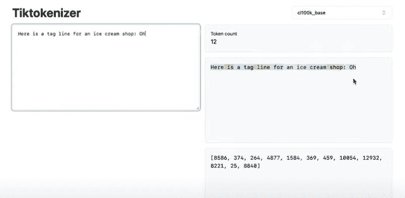

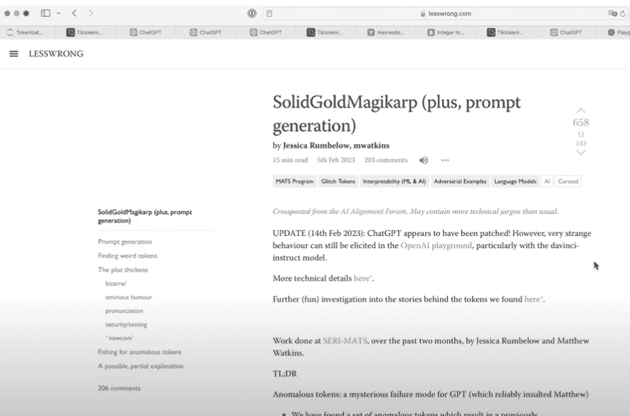

# Final recommendations

+   Don't brush off tokenization. A lot of footguns and sharp edges here. Security issues. Safety issues.

+   Eternal glory to anyone who can delete tokenization as a required step in LLMs.

+   In your own application:

+   Maybe you can just re-use the GPT-4 tokens and tiktoken?

+   If you're training a vocab, ok to use BPE with sentencepiece. Careful with the million settings.

+   Switch to minbpe once it is as efficient as sentencepiece :)