# Transformer, Bert & GPT 三部曲

> 来源：[https://learning.feishu.cn/docx/CZ0sd3lczo1LplxfmLXc7gPCnNd](https://learning.feishu.cn/docx/CZ0sd3lczo1LplxfmLXc7gPCnNd)

# Paper Info

2 篇 Google，3 篇 OpenAI

| Title | year | Author | Notes |
| --- | --- | --- | --- |
| Attention Is All You Need | 2017 | Vaswani | Transformer 结构的开山之作。8 卡训练 12 小时。 |
| BERT: Pre-training of Deep Bidirectional Transformers for Language Understanding | 2018 | Devlin | encoder + decoder 的 language Model |
|  |  |  |  |
| Improving Language Understanding by Generative Pre-Training | 2018.06 | Alec Radford | 只用 Decoder 的 language model。更适合 generation model |
| Language Models are Unsupervised Multitask Learners | 2019.02 | Alec Radford | Zero-shot，在子任务上不提供任何特殊的标记样本。 |
| Language Models are Few-Shot Learners | 2020.05 | Tom B. Brown | 解决 GPT-2 的有效性问题。从 zero shot 回退成 few shot。 |

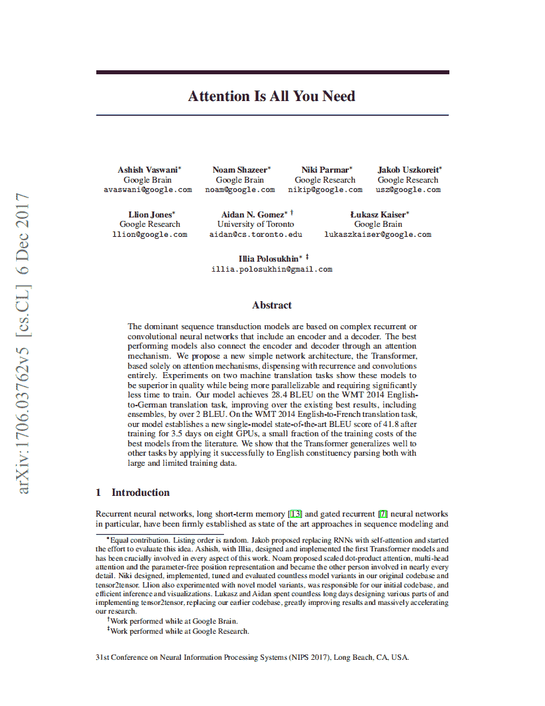

[2017-transformer.pdf](https://internal-api-drive-stream.feishu.cn/space/api/box/stream/download/all/EZ0nb4o5pogOhixnS8YcJT59n2e)

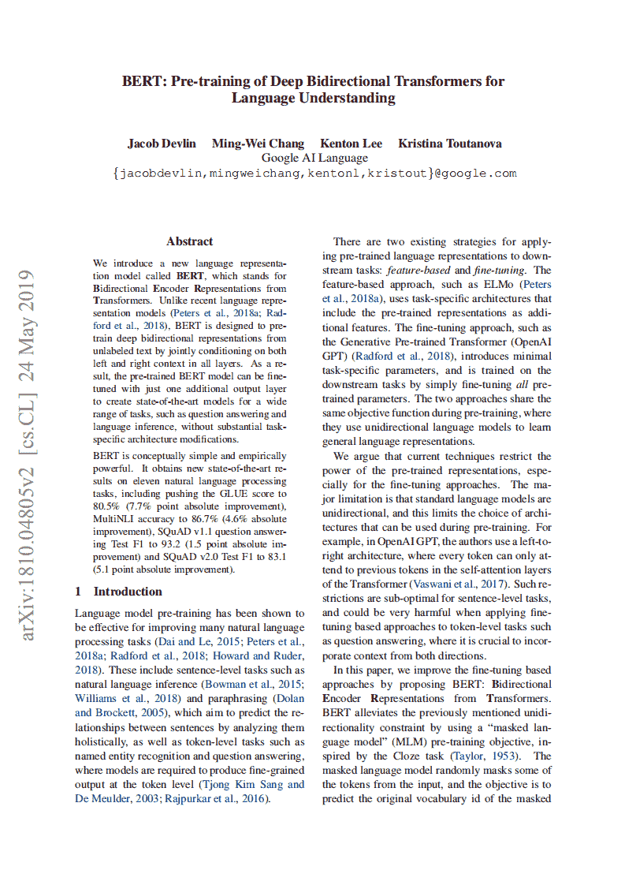

[2018-bert.pdf](https://internal-api-drive-stream.feishu.cn/space/api/box/stream/download/all/PJTkbUiu5o85fXxH3Dxco9r4nZf)

# Summary

what are the inputs and outputs of GPT

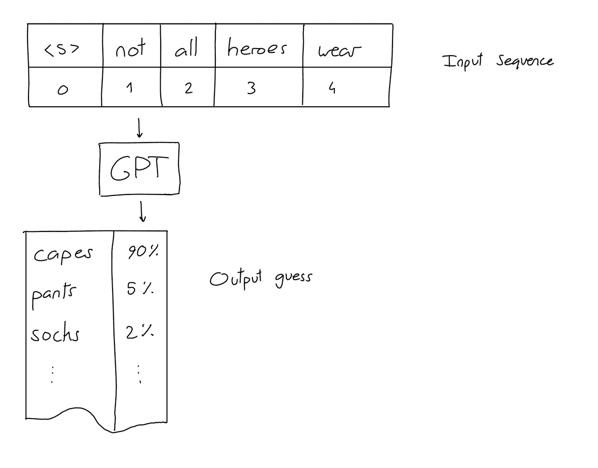

从数据数据量上，GPT使用了约5GB数据，而GPT2数据集名为WebText，GPT-2收集了更加广泛、数量更多的语料组成数据集。该数据集包含800万个网页（Reddit上高赞的文章，约有800万篇），大小为40G.,并且质量更高；用32块TPU v3（8 个核）训了一周，花了4.3万美金.

GPT有1.17亿的参数量，而GPT2将Transformer堆叠的层数增加到48层，隐层的维度为1600，，参数量达到了15亿(最大的GPT-2模型)；而Bert参数量也只有3亿

GPT-2将词汇表数量增加到50257个；最大的上下文大小 (context size) 从GPT的512提升到了1024 tokens；batchsize增加到512。

GPT3-175B，45 TB的训练数据以及高达 1200 万美元的训练费用

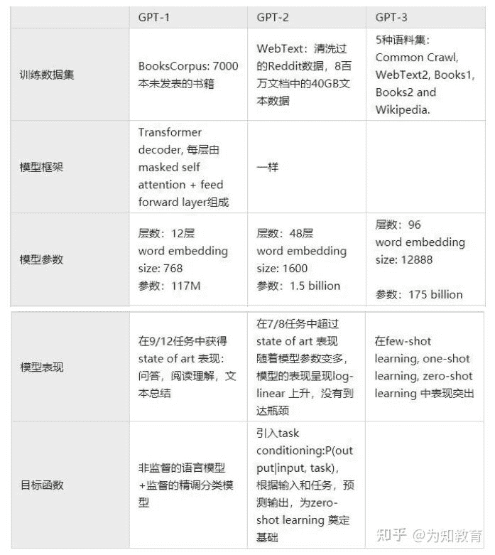

# 论文通读

# Paper Reading - Transformer

1.  用 seq2seq 建模 NLP 问题。

1.  自回归：输出作为自己的输入，反复重复。

1.  Encode 时，模型可以看到所有的 input。这在推理时，是很难（无法）做到的。

1.  Decoder 的第 1 个 self-attention 有 mask，使得，decode 时，train 和 inference 时看到的一样。

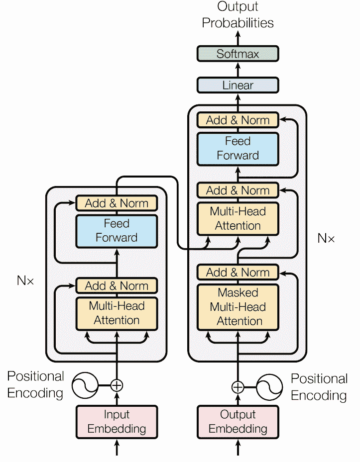

## LayerNorm 的解释

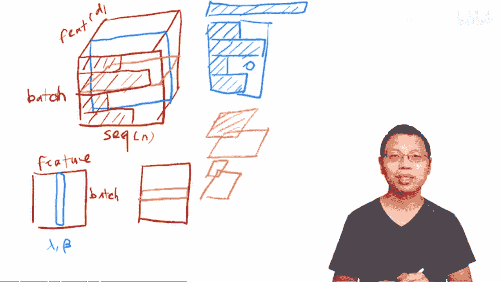

## Attention 机制

以 query, key 的相似度作为 weight，计算对应 value 的加权平均，作为 feature。

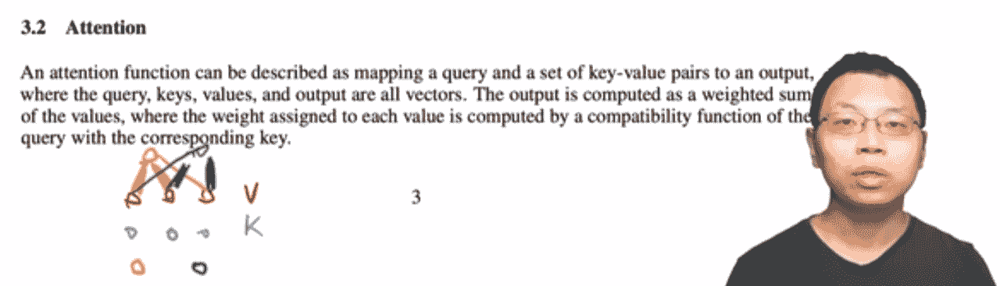

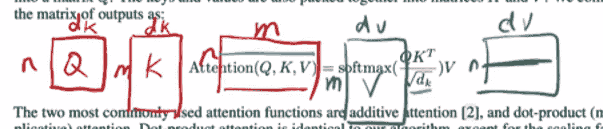

用 softmax 得到 N 个非负且 sum = 1 的 weight score，然后作用到 value，得到最终输入。

有 2 种注意力机制

1.  Additive attention

1.  dot-product。此处用的 dot-product，并 scale 了一下，使得梯度更大，更利于反向传播。如果不 scale，相似度相差很大时，softmax 之后的 score 也分布在 0 和 1 附近，使得梯度小，很难训练。

每个 h 头的 attention，可以并行分布式去做的（见右侧图），相互之间没有数据依赖，最后 concat 一次即可。

Mask 只在训练时有用，推理时不用 mask。主要用来 mask 当前 t 时刻之后的 query，或者计算最终的 value 时，不要算这部分。实现时，进 softmax 前换成很大的负数，做完 softmax 就都是 0.

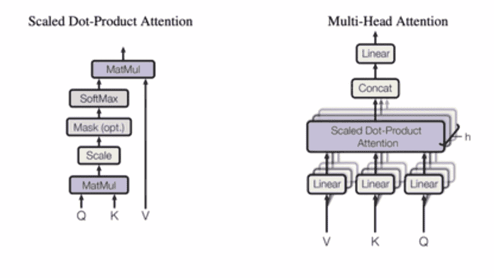

## 为什么用 multi-head

相比于训练一个很大的 attention，不如把 query，key，value 都投影到 h 次到一个小空间里。每次投影用的 projection 参数是 可学习的参数。即，学了 h 种不同的 feature。

模型从输入到输出可以整理为下表：

| **Layers** | **描述** | **输入** | **输出** | **子模块** |  |
| --- | --- | --- | --- | --- | --- |
|  |  |  |  | **名称** | **备注** |
| 输入层 | 将句子表示成一组向量分别用于表示原句和右移一个时间步的翻译输出 | 句子 x原句 或 翻译输出 | embedding 向量表示共 len(x) 个向量每个向量长度为 d_model | Embedding | 不太清楚 |
|  |  |  |  | Positional Encoding | # |
| Encoder | 一共 N 个 identical 层 stack 起来每个 identical 层由两个 sublayer 组成一个 self-attention block一个 前馈网络两个 sublayer 都使用残差连接和 Layer Normalization即 x_out = LayerNorm(x_in+Sublayer(x_in)) | 原句的 embedding 向量表示 | high level 的原句向量表示 | Encoder Attention Block | Q，K，V 都来自原句任意位置可以 attend 任意位置 |
|  |  |  |  | 前馈网络 | 两层全连接ReLU 激活 |
| Decoder | 一共 N 个 identical 层 stack 起来与 Encoder 类似，但是每层由三个 sublayer 组成 一个 masked self-attention block一个 encoder decoder attention block一个 前馈网络同样使用残差连接和 Layer Normalization | 翻译输出的 embedding 向量表示Encoder 的 high level 向量表示 | 翻译输出的向量表示 | Decoder Attention Block | Q，K，V 都来自翻译输出只可以 attend 当前时间步左边通过 mask 实现 |
|  |  |  |  | EncDec Attention Block | Q 来自当前时间步翻译输出K，V 来自原句 |
|  |  |  |  | 前馈网络 | 两层全连接ReLU 激活 |
| 输出层 | 将 decoder 最后一层的输出转为词表的 softmax 概率，通过 beam search 输出最终翻译结果 | 翻译输出的向量表示 | 翻译结果 y | Linear Transform+ Softmax | # |
|  |  |  |  | Beam Search | # |

Beam Search 超参

beam size：4

length penalty alpha：0.6

output length：input length + 50，terminate when possible

embedding 细节不清楚

[https://arxiv.or](https://arxiv.org/pdf/1608.05859.pdf)g/pdf/1608.05859.pdf 这里可能有信息

## Embedding & positional encoding

1.  **输入编码 (****Input**** Encoding)**

从嵌入矩阵中查找单词对应的嵌入向量，该矩阵也是模型训练结果的一部分。

这就是从 text 到 embedding 的过程。

注意，vocabulary size 和 embedding dim size 没有直接关系。

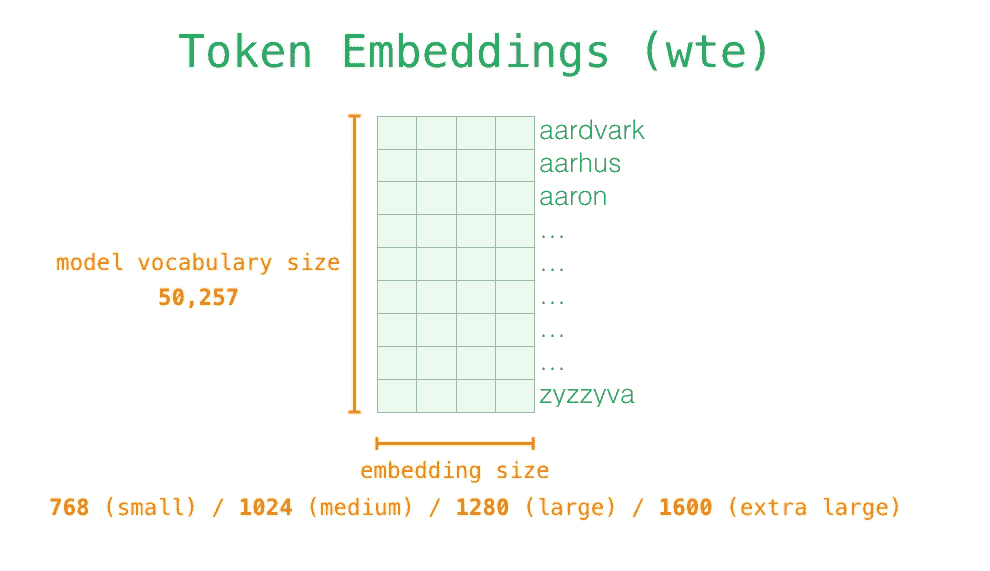

最终的 decoder 输入，是 embd + positional encoding

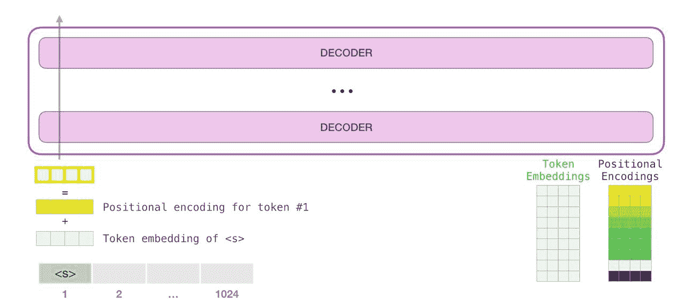

理解 qkv

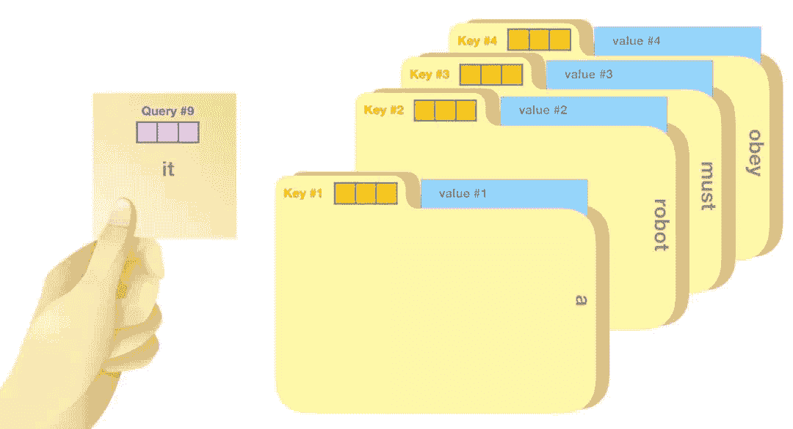

## 实验结果

+   与 SOTA 比较

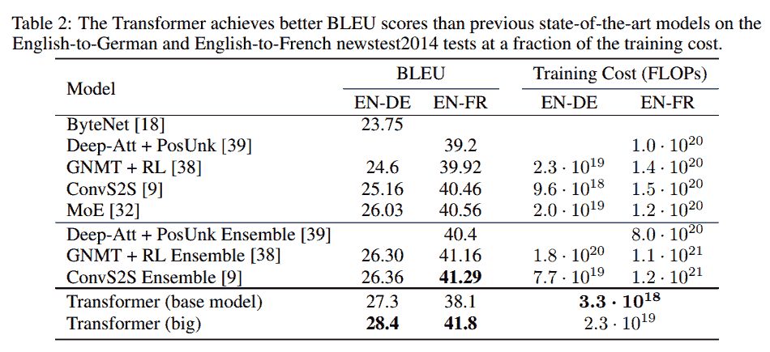

+   big model 性能超过之前所有公开性能（单模型和 ensemble 模型）

+   作者还比较了训练所用的 FLOPs（没有验算，可信度较高），远小于其他方法

+   Ablation

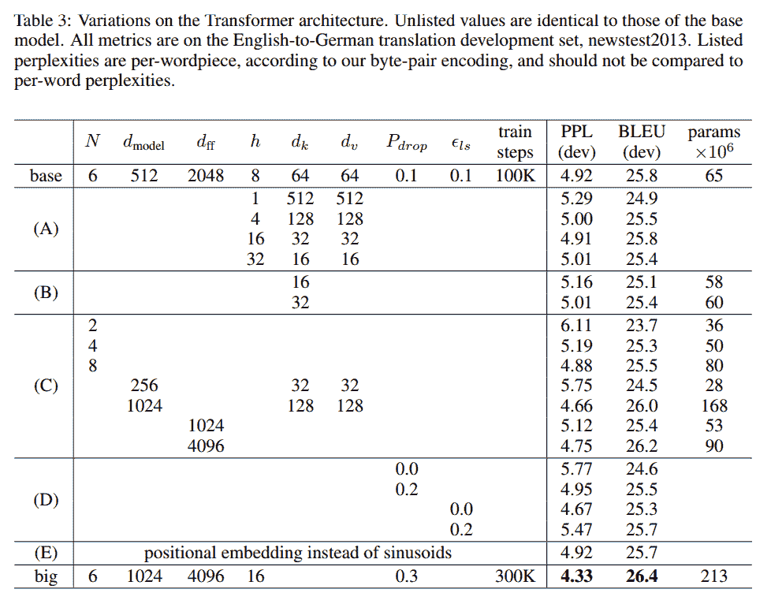

A 比较不同多抽头和单抽头 attention 性能，multi-head 增益很大（约 1 个点）

B 减少 key 的维数会损失性能，推出复杂的 匹配函数（attention 系数，这里就是 dot）更有利

C 增加模型大小，增大模型更有利

D 正则化参数调整，base 方案最优；dropout 增益很大（1 个点），label smooth 约（0.5 个点）

E 两种位置编码方案的比较，两者几乎一致

最后给出了充分 push 性能的 big 模型

# GPT-1

Demonstrate

+   generative pre-training of LM on unlabeled text

+   discriminative fine-tuning on each specific task

generative + discriminative  这就是 GAN 的经典结构。

在 12 个 NLP task 上，有 9 个 SOTA。

使用 unlabeled text 的 2 个挑战：

1.  pre-train 模型的优化目标函数，不清晰。当时有 3 种流派：LM，machine translation，discourse coherence。

1.  Effective way to transfer 到 downstream task 上。

## 本文的思路

1.  Pre-train 用 LM。

1.  Transfer 用 prompt 统一 downstream 的 data layout，也基本不用修改 pre-train model 的 arch。

Fine-tune 时, LM 也一起 update weight。

Prompt 结构如下

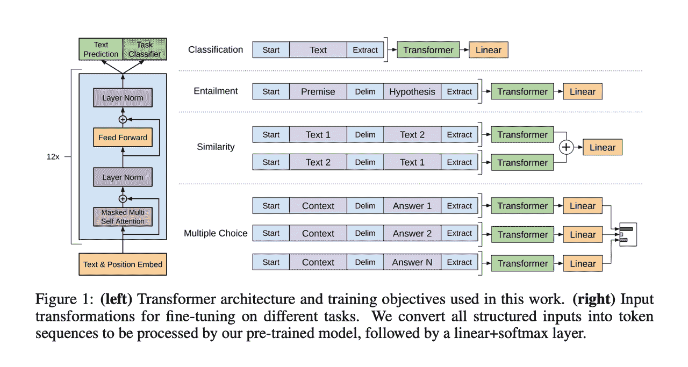

QA, textual entailment 等问题，也能用上面的格式。把 structured input 转成 ordered input。pre-train model 就能处理了。

# GPT-2

## 背景

1.  Bert 做了个比 GPT-1 大 3 倍的模型，效果好很多。

1.  GPT-2 比 Bert 大了 10 倍，但效果没有明显更好，发 paper 的卖点选了 zero-shot。

回看发展历史，zero-shot 确实是一个很重要的中间节点。

意味着，

1.  可以继续更多的无监督数据，训练更大的模型。

1.  一个 LM，无需任何的 finetune 和 modification，就可以直接去解决 a wide range of tasks（zero-shot，chatGPT）

模型结构，有微小的改动：

1.  把 layer norm 放在了 self-attention 的开头

1.  在 self-attention 的后面，也放了一个 layer norm

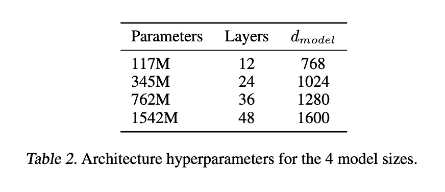

## 点评

文章的 第 2 节 Approach，文字有些晦涩，但却是非常酷的思考方式。

讨论了，为什么 zero-shot 是一个关键的方向 & milestone。非常有启发。

李沐没读出来这部分，不知道是不是因为太 common sense 而不被他们重视。

# GPT-3

175B，非稀疏模型。

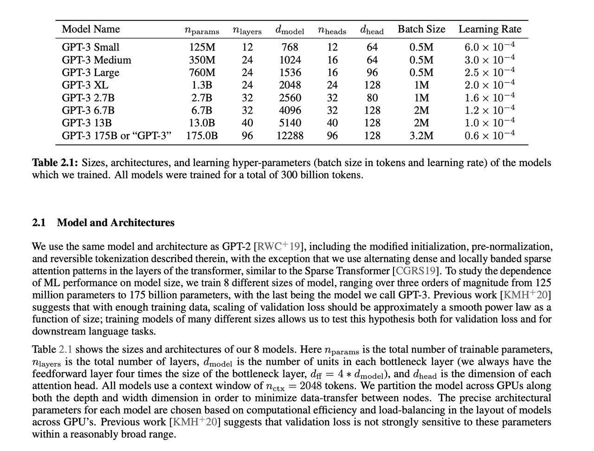

# Reference

https://dugas.ch/artificial_curiosity/GPT_architecture.html