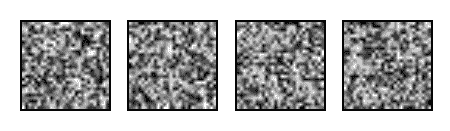
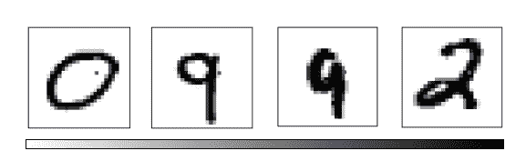
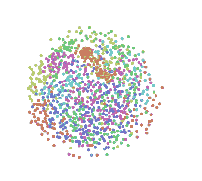
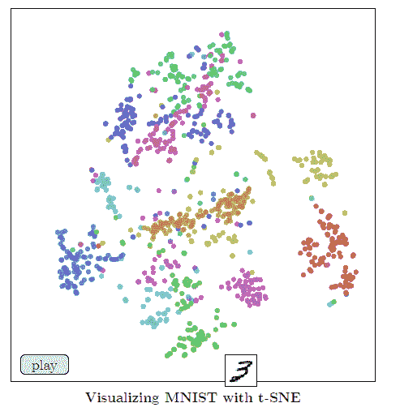
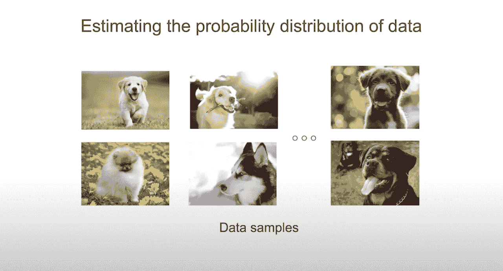
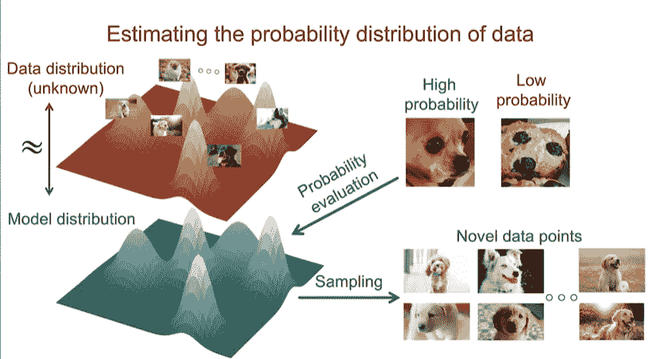
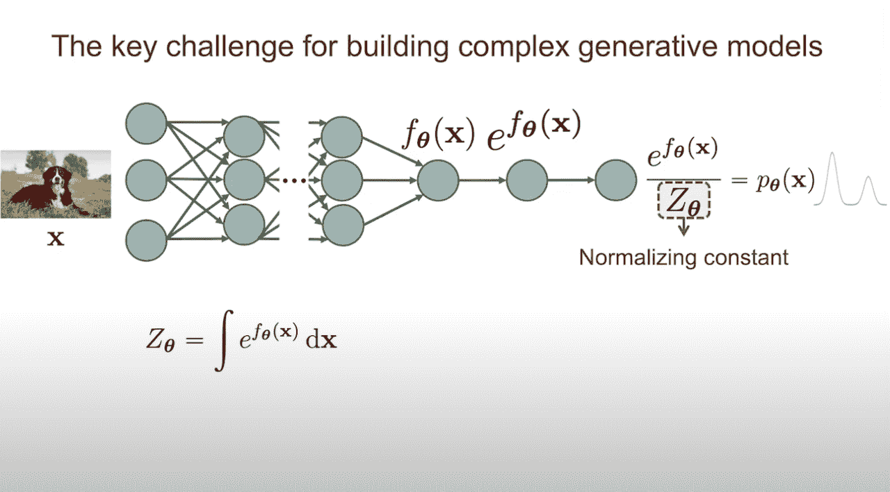
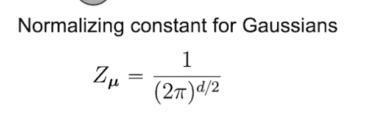

# Diffusion Model 画图的数学原理

> 来源：[https://learning.feishu.cn/docx/MgyRdrxmno1dDrxCXTic84aMnXF](https://learning.feishu.cn/docx/MgyRdrxmno1dDrxCXTic84aMnXF)

# 为什么是 distribution

回答 2 个问题：

1.  为什么 Train dataset 整体构成了一个 data distribution？

1.  为什么每一张图是 data distribution 中一个 I.I.D. sample。（独立同分布的样本）？

通过经典的 Visualizing-MNIST 文章，可以理解背后的数学原理。这是 2014 年的工作。

图片来自：http://colah.github.io/posts/2014-10-Visualizing-MNIST/

按照讲解需要，重新组织了对图片的解释。

## MNIST 可视化简介

以 MNIST dataset 为例，图片是 28*28 = 784 的，即 784-dimensional space。

784 维的每一维，都是 pixel value，取值 0-255 之间。

如果，随机采样 784 个 pixel value，图片是这样的：

如果，我们以上帝视角去有规律的采样，可能选出这样的 4 张图：

（image generation，就是期望以这样的上帝视角去采样）

如果我们把 784 维的空间投影到 2 维空间并可视化，可能是这样的：

注：每一个颜色，表示一个数字对应的 image。

如果我们用 deep learning 学到了一个更高级的投影规则，可视化可能就是如下的：

很明显，模型学到了一些规律，不是靠碰运气解决问题的。

## 用 distribution 建模 Image Generation

一句话总结：Image 中的 pixel value，可以看作是一组遵循特定概率分布的随机变量。

详细解释：

1.  一张 minist image 就是 28*28 维随机变量里的一个采样点。

1.  Image generation 的训练目标，就是根据 training set 里的 10k 张数字 9 对应的图片，在 28*28 维空间里精准画出一段区域。很明显，这段区域里，可以包含远超 10k 个采样点，也就是可以泛化到生成更多没见过的 9.

1.  Image generation 的推理，生成一张图，本质就是从画出的区域里，采样一个点。

1.  可控性，就是用户控制采样哪一个点的能力。可以是只控制类别，比如 9。也可以更精细的，草书 9。

# Diffusion Model 建模原理

内容来自 NeurIPS 2022 Workshop-Diffusion and Score-Based Generative Models

https://www.youtube.com/watch?v=wMmqCMwuM2Q

读的过程比较烧脑，读懂后心旷神怡。

1.  用 distribution 的观点看 image generation。

1.  Train dataset 整体构成了一个 data distribution。

1.  每一张图是 data distribution 中一个 I.I.D. sample。（独立同分布的样本）。

1.  distribution 是未知的，目标是找到 distribution。

1.  训练模型就是找 data distribution

1.  模型是什么？ a family of distributions（如果把 distribution 看作函数，那么 model 就是函数的函数）。

1.  训练模型，就是找 a single distribution，使得生成图片和训练集的 distance 尽可能小。

1.  使用 DL network 建模的思路

1.  难点：普通分类模型的输出是一维（or 标量），不能表示一个分布。

1.  把 DL 的输出变成 distribution 的方法：取 exp 并除以 normalizing constant。

一张图片/一次 inference，就是一个采样，最终的输出就是一个概率 P，也是一个 scalar number。

在 theta 参数(model) 下的所有采样，就是一个 distribution 下的所有 点的概率 P。

对 normalizing constant 的数学科普：

1.  需要除 Z, 因为 distribution 需要面积积分 = 1，即，sum(p) = 1。

1.  根据数学定义，此处，Z 就是分子在它的定义域上做积分

1.  如果能假定为 Gaussian distribution，那 normalizing constant 就很简单了。实际上，没这么简单。

1.  难点是 normalizing constant 怎么算

1.  算这个积分是 p-complete 问题，as hard as NP-complete。需要近似求解。

1.  热力学和统计力学，几百年来就是在研究类似问题的数学解。

# 为什么 Diffusion 比 GAN 的多样性好

Diffusion 为什么多样性很好？

上面已经解释，复述一下。

1.  训练时，根据 training set 里的 10k 张数字 9 对应的图片，在 28*28 维空间里精准画出一段区域。

1.  很明显，这段区域里，可以包含远超 10k 个采样点，也就是可以泛化到生成更多没见过的 9.

GAN 为什么做不到多样性？

1.  GAN 没有建模 distribution。GAN generator 学习的目标是能骗过 discriminator，这个目标，不需要多样性。

1.  另外，应该换个问题，GANs 的研究者如何能画个饼，让大家相信 GANs 的多样性好。至今无人能画出来。

# 能不能大力能出奇迹，为什么？

数学理论上，可以。

以 mnist 数据集为例，建立数学模型：

1.  采样空间是 28*28 维，每一维取值 256 (0-255) 种可能性。

1.  采样空间里，一共有 256^(28*28) 个采样点

那么，最小使用多大的力量可以出奇迹呢？

|  | 思路 | 解释 |
| --- | --- | --- |
| Step 1 | 完美复刻 | 如果我们训练一个 256^(28*28) 个参数的模型，每个参数对应一个采样点。 |
| Step 2 | 只复刻信息点 | 这个采样空间里，只有非常非常稀疏的采样点对应于真实数据。 |
| Step 3 | 压缩 pixel value | pixel value 的冗余度很高，可以用 encoder 压缩信息且基本无损。 |
| Step 4 | tradeoff: 牺牲多样性 | 样本分为很多类别，一般只关心部分类别。只学习这部分类别的采样点，所需的参数量进一步下降。 |

Google 的 transformer 和 bert，openAI 的 GPT2，GPT3 都是大力出奇迹，而且，基本都是同一时期的工作，这不是巧合，是大家的认知发展到了这个阶段，而且，chatGPT 的成功证明了，这认知没错，当时押宝这个的，就是远见。

# 总结

1.  一张 Image 是特定 distribution 中一个 I.I.D. sample（独立同分布的样本）。

1.  模型是一组 distributions。训练生成模型，就是找特定的 single distribution。

1.  大力出奇迹。