# [2023.04] AIGC - Paper Reading

> 来源：[https://learning.feishu.cn/docx/XbRnd4XIUogU9jxJMzbckg25ns3](https://learning.feishu.cn/docx/XbRnd4XIUogU9jxJMzbckg25ns3)

GAN 与 diffusion model 的 paper reading

1.  重点：介绍文章解决的问题，历史位置，核心思路，以及与其他文章的影响关系。

1.  补充一些理解文章所需的背景知识。

# Summary

## Summary of Summary

重点方向 (截至 2023.04 月):

1.  Diffusion model 的推理加速。降低门槛，提高部署的性价比。

1.  LoRA, ControlNet。 即，参数高效微调 PEFT。在更多的细分领域谋求落地。

1.  Bigger model，接入更好的 text 模型。

个人看法：

1.  当前，diffusion model 是主流。数学理论、模型效果、提升空间，都明显优于 GAN。

1.  GAN 的鼎盛时期在 2018-2019 年期间，StyleGAN-3 是代表作。短时间内，想要翻身压住 diffusion model，有点难。

1.  GAN 训练不稳定的问题，在大模型时代，更要命。这么多年了，也没点实质性进展。

关键的评估指标：

1.  真实度。比如，画手、画脸的细节能力。

1.  多样性。输出的图片类型更丰富。

1.  可控性。精准控制生成自己想要的图像。一般体现在，图像的语义编辑能力，Text input，ControlNet，LoRA

1.  算力消耗。推理速度。

Diffusion 领域的特点：

1.  Paper 非常难读。数学基础太完善 => 关于数学演进的 paper 很多，很容易掉进坑里，一周爬不出来。

1.  要抓住主线：模型架构和产品 feature 相关的演进。如下：

1.  多模态。有没有多模态，怎么打通的 text-image。

1.  高清大图的真实度

1.  可控生成的支持水平。典型任务：

1.  画给定的类别，比如猫、狗。

1.  画指定细节，比如，头发的颜色、手。

## text-to-image 的 Paper 概述

如何看待这些产品，横向比较的核心因素是什么？

几点理解：

1.  都是缝合怪，没太多创新。一堆模型的组合，端到端的看，基本看不出啥。应该逐个模型去比较。

1.  闭源模型的 Paper，我们应该关注什么？-- 研判技术趋势。对开源模型的启发，既可能来自技术差异，更有可能来自技术共性。

共性：

1.  Text feature -> image feature。一般是选了某个多模态的预训练模型，与 diffusion model 关系不大。典型的是 CLIP。

1.  Image 生成。

1.  都是 diffusion model。特别是 OpenAI 的 Dall-E，一年内，从 VQ-VAE 换成了 diffusion model。

1.  Backbone 都是 UNet，但 building block 部分的换成了 transformer block。

1.  高精大图离不开超分辨率。更具体的说：1024 * 1024 分辨率，基本都不是直接画的。

总结：

1.  DALL-E 2 和 Imagen 哪一个更好，好在哪里？很难给结论。相对靠谱的方法是，找 N 个人盲测，统计大家认为哪个更好。openAI 等都是用了这个方法。

1.  一般认为，后出现的 ImageGen 更好。这个结论的本质是，text 理解能力更好。即，T5-XXL 比 CLIP 厉害。与 diffusion 的关系不大。

1.  刷新对 AI 的认知：AI 到底更擅长什么？曾经，大家普遍认为是重复劳动。现在发现，艺术创作好像更厉害。

1.  朱神：only scale matters。其他的东西，比如模型的种类和训练的技巧，都只是锦上添花罢了。

1.  朱神：diffusion model 就像 17-18 年的 GAN，应该至少还有 2-3 年的时间去充分发挥他的潜力。

| 产品 | 公司 | 要点 |
| --- | --- | --- |
| Stable diffusion | 开源， | 在 latent space 上做 diffusion |
| DALL-E 1 | DALL-E 2 | VQ-VAE 架构 |
| DALL-E 2 | OpenAI | 3 个模型合体: CLIP + GLIDE |
| Imagen | google | 模型比 Dall-E 2 更简单一些。效果却差不多，甚至更好。 |
| Parti | google | 2022年6月 |

模型的参数量 from https://arxiv.org/abs/2303.05511

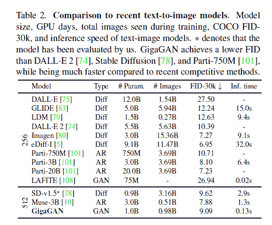

## Top Team

国际上的 top 团队：

1.  大厂

1.  OpenAI + 微软的钱

1.  Google Brain, Deepmind

1.  新星小厂

1.  Stability AI。开源 Stable Diffusion 背后的公司

1.  midjourney https://www.midjourney.com/

1.  学校

1.  斯坦福

1.  伯克利

Facebook 的 FAIR 感觉没啥存在感，

微软的 MSRA 等，基本围绕 OpenAI 的工作展开。比如，GPT 3 的 finetune (LoRA)。

国内看好哪一家？

没看到多少代表性工作，不足以给出判断。

## Random Notes

NeurIPS 2022 Workshop-Diffusion and Score-Based Generative Models

https://www.youtube.com/watch?v=wMmqCMwuM2Q

把 diffusion model 数学原理讲的最清楚的男人

GAN 的优质课程 https://www.coursera.org/specializations/generative-adversarial-networks-gans

OpenAI 最新 paper 里还写了啥，paper list: https://openai.com/research?contentTypes=milestone

Google 的 Brain 和 Deepmind 在做啥？

图片生成，是少有的还没有被 Transformer 无脑刷榜的领域，而且，奠基之作尚未看到。

知乎: DSA已死 https://zhuanlan.zhihu.com/p/619717622

图片生成，可以解决 pixel prediction 的问题。比如，语义分割，画地图等。

应用领域可以非常广，有想象空间。

Diffusion 涉及的数学概念：

1.  KL 散度

1.  在计算分布的相似度时，一个常见的指标是KL散度（KL-Divergence）

1.  Score Function

1.  随机微分方程 SDE 和 常微分方程 ODE

1.  Score Matching 方法

# Paper List - GAN

## 奠基之作 (GAN)

| 时间 | 模型名称 | 简介 | 算法原理 | 点评 |
| --- | --- | --- | --- | --- |
| 2014/06 | GAN | 奠基(1/3)，生成模型的开创工作 | 1.  生成器 vs 辨别器 的对抗学习。 | 1.  开山之作。idea demo，证明了 生成器 + 辨别器 架构可行性。 |
| 2014/11 | c-GAN | 奠基(2/3)，可以控制模型输出 | 1.  把 Label 加入训练数据的 input 和 gt 中。计算 label 不一致的 loss。 | 1.  解决落地的关键问题，思路简单粗暴，且有效。只是空间占用大。 |
| 2015/11 | DCGAN | 奠基(3/3)，使用 CNN 的 GAN | 1.  GAN 的 backbone 从 matmal 换成 CNN。 | 1.  VGG 是 2014 年的工作，CV classification 证明了 CNN 的有效性，迁移到 GAN 领域也是很自然的工作。 |
| 2017/01 | WGAN | 优化 Loss，训练更加容易 | 1.  把 loss 从 Jenson-Shannon divergence 换成 Wasserstain Distance。 | 1.  解决训练不稳定的问题，玩 loss 函数的一个数学工作。 |

1.  图片清晰度很差，很模糊 -- DCGAN 换 conv 后解决。

1.  生成的图片不可控，random。-- c-GAN 解决。

1.  其他 GAN 的经典问题：训练不稳定，mode collapse (模式坍缩) 很严重。

1.  Label 只是简单的分类信息，做不到比较精细的控制。

1.  增减 label 时，需要重新训练模型

## Image To Image

[Why Image-to-image Important](https://dwpl6xgouw.feishu.cn/wiki/J5PjwSP2MiqgKKknNLkcbP71nve)

| 时间 | 模型名称 | 简介 | 算法原理 | 点评 |
| --- | --- | --- | --- | --- |
| 2016/11 | pix2pix | 图像翻译的奠基 (使用 GAN 模型) | 1.  训练数据是一组标注好的 input - output image。如下图。 | 1.  落地难度大，需要大量的标注数据。 |
| 2017/03 | CycleGAN | 无监督的图像翻译奠基 | 1.  用 2 个 GAN 模型，分别做 A-&gt;B 和 B-&gt;A。 | 1.  生成的图片质量不如 Pix2Pix，作者认为是无监督训练导致的。 |

1.  生成器: U-Net

1.  辨别器: PatchGAN 分类器

1.  训练不稳定。

1.  容易出现 mode collapse

1.  生成器: ResNet

1.  辨别器: PatchGAN

## SOTA of GAN Era

[[模型][GANs] 2018-StyleGAN v1 / v2 / v3](https://dwpl6xgouw.feishu.cn/wiki/Q89TwSYfdiSRzrk1YHccyG62nbO)

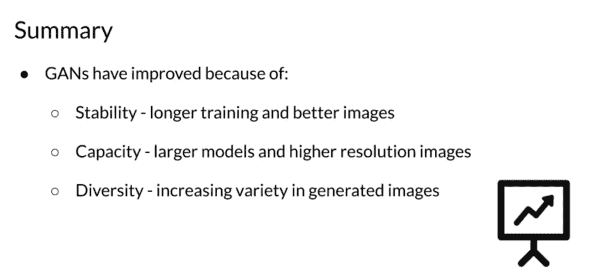

| 时间 | 模型名称 | 简介 | 算法原理 | 点评 |
| --- | --- | --- | --- | --- |
| 2018/12 | StyleGAN1 | 落地的转折点。图片质量非常好，而且能精准控制生成的细节（style mixing）。 | 1.  Style 可以理解为图片的任何改动。不只是传统的风格迁移。 | 1.  名字主要来自，可以做 Style Mixing。如下图。 |
| 2019/12 | StyleGAN2 | 影响较大的 SOTA 工作。StyleGAN1 的各种 trivial 改进 | 1.  StyleGAN1 的各种 trivial 改进 | 1.  模型很实用。基本是 GAN 黄金时代 (2018-2019 年) 的收官之作。 |
| 2021/06 | StyleGAN3 | 为视频和动画的生成铺平了道路 | 1.  用信号理论解决图片生成的 Aliasing (信号失真) 问题。比如，人脸转头或平移时，预期生成的人脸相貌不变。 | 1.  通用性不够好。整体比较 hack，引入了不少对训练数据的假设。 |
| 2019/03 | GauGAN | NV 研究院的涂鸦变风景画 | 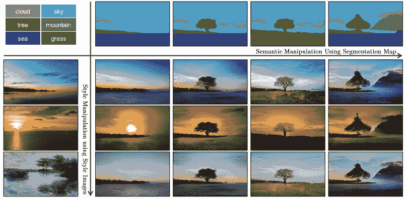 | 早期的一些落地尝试类工作 |
|  |  |  |  |  |
| 2023 | GigaGAN | 把 GAN 参数量拉到 1B 级别 |  | CVPR 2023 |

1.  Progressive growing，

1.  Noise mapping network,

1.  Adaptive instance normalization (AdaIN)

1.  训练困难，

1.  图片多样性不足，

1.  模型做不到太大。

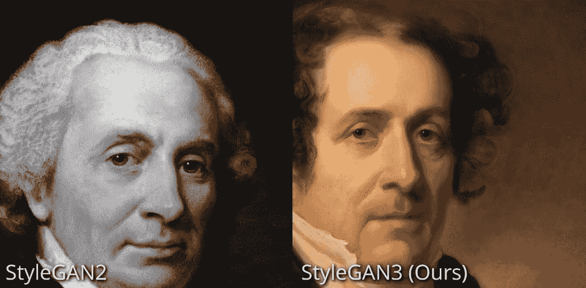

[a08d698c-2bef-11ec-9f66-86f5ac85407d.mp4](https://internal-api-drive-stream.feishu.cn/space/api/box/stream/download/all/RQIEbSFshoFU9axjpKfcJzmBnRc)

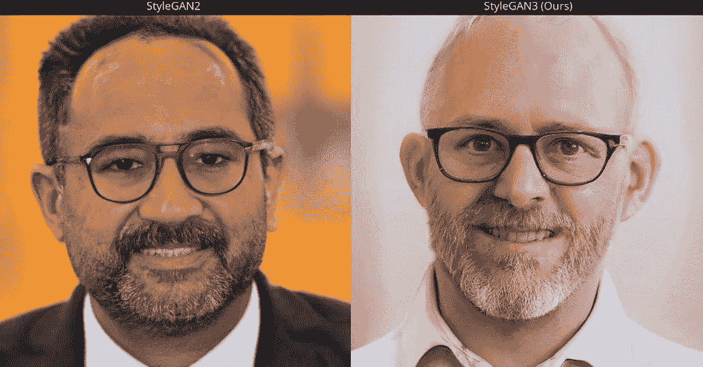

[a0d15b38-2bef-11ec-a3fa-4e8f0925b269.mp4](https://internal-api-drive-stream.feishu.cn/space/api/box/stream/download/all/PDBSbWTRIoMzvOx2tgscStkonjc)

# Paper List - Diffusion Model

## Diffusion 奠基

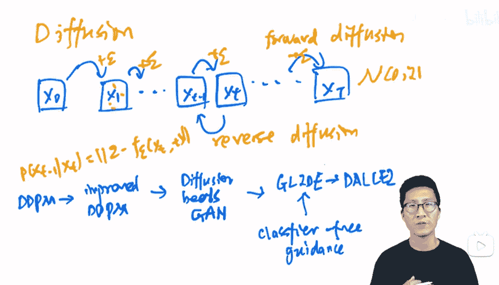

| 时间 | 模型名称 | 简介 | 算法原理 | 点评 |
| --- | --- | --- | --- | --- |
| 2020/06 | DDPM | diffusion 奠基。 | 1.  扩散(diffusion): 不断的加噪音，目标是把原图变模糊，直到全部是噪音。 | 1.  低分辨率的小图,质量确实不错。但，高分辨率上的效果还是不行的。Diffusion Beat GANs 解决了高清大图问题。 |
| 2020/10 | DDIM | 加速 ddpm 采样速度 | 1.  模型结构，与 DDPM 一样。 | 1.  与 GAN 相比，采样速度还是比较慢，仍需要多个 step。 |
| 2021/05 | Diffusion Beat GANs | 在高精大图上效果超过 GAN. | 1.  参考 GAN 的经验，改进 diffusion 模型。 | 1.  仍有很多方面不如 GAN。比如，采样速度慢。 |
| 2021/12 | GLIDE | guide-classifier-free 的文生图 | 1.  文本生成图像（64*64）模型。 | TODO |

1.  进行大量的消融实验，找到更好的模型结构。

1.  GANs tradeoff diversity for fidelity。使用 Classifier-Guidance 进一步提升效果，以牺牲多样性为代价。

## Text-to-Image 当红炸子鸡

| 时间 | 模型名称 | 简介 | 算法原理 | 点评 |
| --- | --- | --- | --- | --- |
| 2021/02 | CLIP | 首次 text 关联 image | 1.  把 text 和 cv 的 2 个 transformer 模型粘合起来，用超大数据集训练，出奇迹。 | TODO |
|  |  |  |  |  |
| 2021/12 | Latent diffusion | 开源 Stable Diffusion 的原型。加速了落地。 | 1.  原理：在 latent space 上进行 diffusion，用 cross-attention实现多模态训练 | 1.  在 AWS 上使用 256 个 NVIDIA A100 GPU 训练，共花费 15 万个 GPU 小时（6,250 GPU days），成本为 60 万美元 |
| 2021/02 | DALL-E 1 | OpenAI 的第一代画图产品 | 1.  模型是 VQ-VAE 架构。已被抛弃。 | 1.  架构和产品都已成为历史。 |
| 2022/04 | DALL-E 2 | OpenAI 的第二代画图产品，当前在用 | 1.  创新不多。就是 CLIP + GLIDE 的缝合，然后烧算力。 | 文章讨论的模型缺陷，有参考意义 |
| 2022/05 | Imagen | text-to-image，google发布的 | 1.  缝合 2 个模型：T5-XXL + improved DDPM | 1.  训练数据来自网络抓取，导致模型存在社会偏见 |

1.  text Transformer: 6300 万参数

1.  vision transformer: 3 亿参数

1.  把 text 和 image 分别 encode 然后 concat 成 a single stream of data

1.  按 seq2seq 建模，用 Transformer 自回归。

1.  CLIP: 多模态模型。文本特征 -> 图像特征，

1.  GLIDE: diffusion model。图像特征 -> 图片。

## PEFT - 参数高效微调

| 时间 | 模型名称 | 简介 | 算法原理 | 点评 |
| --- | --- | --- | --- | --- |
| 2023.01 | LoRA | 模型降维 | 1.  背景：模型是过参数化的，它们有更小的内在维度。 | 1.  个人理解，类似于 classifier-guidance 的原理，用这个人脸的参数，覆盖所有人脸。 |
| 2023/02 | Control-Net | 通过额外的输入来控制预训练的大模型 | 1.  通过额外的输入来控制预训练的大模型。 | 1.  弊端：每个大模型的 controlnet 代码都不一样，需要分别开发并训练。 |
|  |  |  |  |  |
|  | prefix-tuning |  | 弊端：比较难训练，效果不如直接finetune |  |
|  | Adapter |  | 弊端：增加了模型层数，引入了额外的推理延迟，尤其是在线上推理 batch size 为 1 的时候 |  |
| 2023/02 | T2I-Adapt | 腾讯发布的工具，用于更精细的控制diffusion model的图片生成 | 1.  方法：造了一种结构简单一点的插件模型来精细控制图片生成 | 1.  弊端：在用多个condition mode引导控制图像生成时需要人工调整 |

## Others

| **时间** | **模型名称** | **简介** | 算法原理 | 点评 |
| --- | --- | --- | --- | --- |
| 2022/08 | Prompt-to-Prompt | 用纯文本的 prompt 就能精准编辑图像的细节 | 1.  使用 Cross Attention Control | 1.  来自 Google Research |
| 2022/12 | DIT | 用改进版本的transformer替换掉Unet | 1.  用 Transformer(6.75亿参数) 替换U-Net | 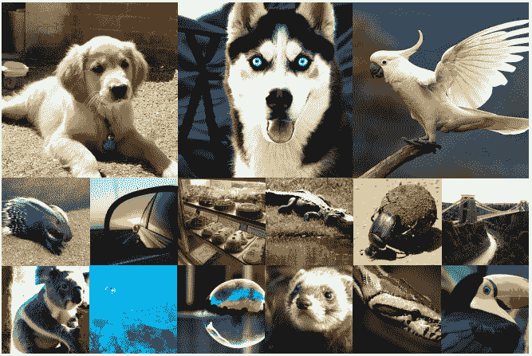 |
| 2023 | Consistency Models | 加速 diffusion model 推理 |  | https://arxiv.org/abs/2303.01469 |

# GAN 与 Diffusion 简介

## GAN

模型结构

1.  整体是一个 discriminator 和 Generator 博弈的 2-player game。

1.  discriminator 是一个分类模型，Model the conditional probability P( y | x )

1.  Generator 是一个生成模型，Model the features x conditioned on class y: P( x | y )

4.5 年，从模糊的黑白照片，到高清人脸大图。

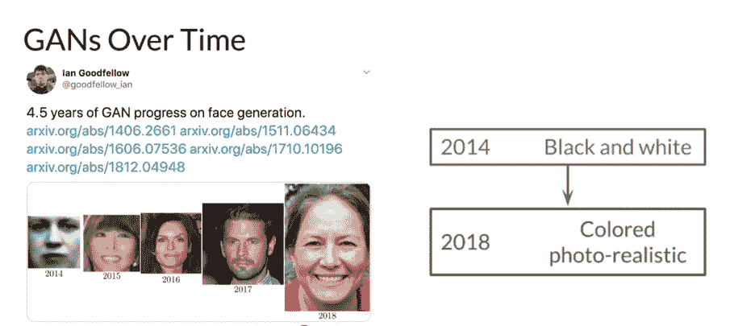

## Diffusion

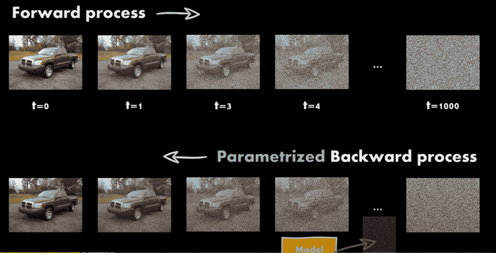

训练的思路（实际细节复杂很多）

1.  输入：真实图片

1.  训练原理：

1.  扩散（diffusion）：不断的加噪音，目标是把原图变模糊，直到全部是噪音。

1.  生成（reverse process）：不断的去噪音，目标是恢复原始模型。

1.  扩散和生成，都是 Markov chain（马尔可夫链）。即，分多个 step 逐步进行的。比如，1000 个 step。

1.  Loss：生成图片与原始输入图片之间的差异。

推理的思路：

1.  输入：随机噪音（高斯随机）+ 一点条件信息。

1.  过程：只跑训练中的生成（reverse process）过程即可。

详细的过程（体现了 Markov chain），如下

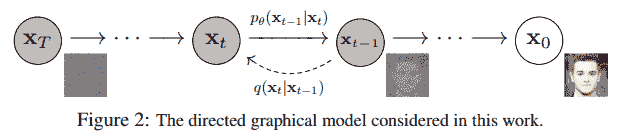

重要细节：

1.  特别的，扩散的最后一个 step，输出的图片全部是噪音。所以，生成的第一个 step，输入图片也是完全噪音的。

1.  扩散和生成时，图片的 dimension 都是一直不变的，即 latent space 不降维。而 VAE、GAN 等的 latent space，一般会降维。

## GAN vs diffusion

个人看法

|  | 优点 | 弊端(未解决的重要问题) |
| --- | --- | --- |
| GAN | 1.  推理快，真实度好。 | 1.  训练难，不稳定。个人认为，在大模型时代，这个问题将会更突出。 |
| Diffusion Model | 1.  画图的多样性好。 | 1.  推理慢。 |

1.  多样性，主要来自于初始的随机噪音。创造性很差。

1.  生成过程是隐式的（模型学到的）。不知道他学了什么，遵循了什么分布。

1.  mode collapse (模式坍缩) 很严重。

1.  数学上，模型的表达能力就有限，没有建模 distribution。

# GAN 与 Diffusion 之外

## AE & DAE

AE(auto-encoder) -> DAE(Denoising autoencoder) 模型

DAE：给输入的 x 进行一定程度的打乱(Denoising)，得到 corrupted input，然后去重建原始的 x。

解决过拟合等问题。

效果非常好 -> 间接证明: 图像特征的冗余太多了。

弊端：生成的 bottleneck，是一个固定的特征，不是分布，没法做采样。

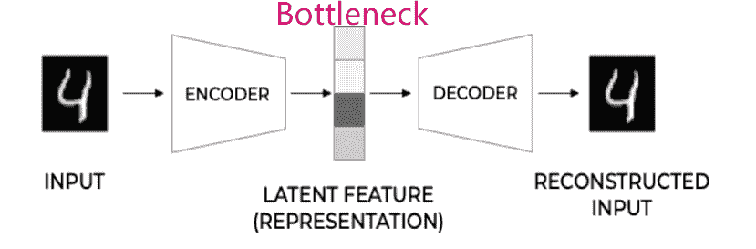

## VAE

把 AE 学到的 latent space，换成学习一个 distribution，而不再是学习固定特征。

学习 distribution 之后，大家就认为 VAE 优美了很多。出了很多后续工作，比如，VQ-VAE（DALL-E 1 的基础）

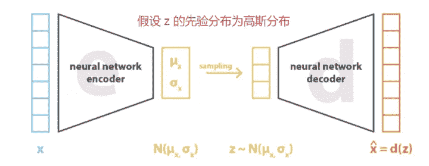

## VQ-VAE

VAE 学的是连续的分布，太难了。如果换成离散的中间表征，会容易很多。

Vector **Quantized **Variational Autoencoder，简称 VQ-VAE。名字的核心是 Quantized（量子化）

方法是，把连续分布，换成一组离散的 vector。这一组 vector，起个名字叫 cookbook (食谱）。

做菜的时候，从食谱里选，不要自由发挥。

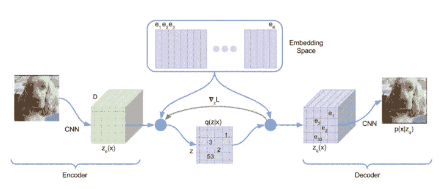

# 一些实践

## Stable Diffusion 初探

|  |  |
| --- | --- |
| Prompt（提示语） | A tiger discovering the lost city of Atlantis |
| OpenAI 的 demo 效果 | 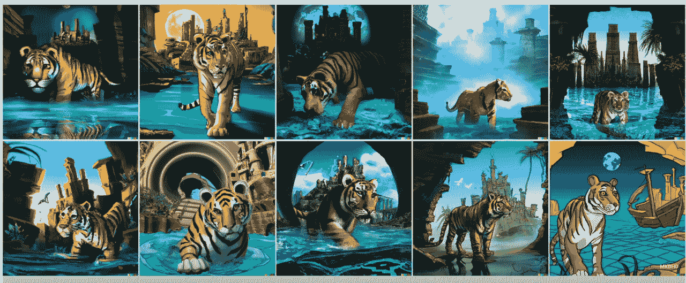 |
| 我画的 | 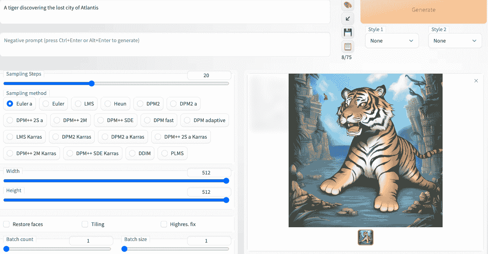 |

## LoRA 画妹子

1.  需要用到 C 站，披着 model hub 外衣的 p 站。https://civitai.com/

1.  prompt 非常难写，主要靠抄 prompt。

|  | C 站例子 | 我画的 |
| --- | --- | --- |
| Prompt | 模型：https://civitai.com/models/25494/beautiful-realistic-asians | 用 2 个 LoRA 模型画民国风的周淑怡 (mikuya) |
| 图片效果 | 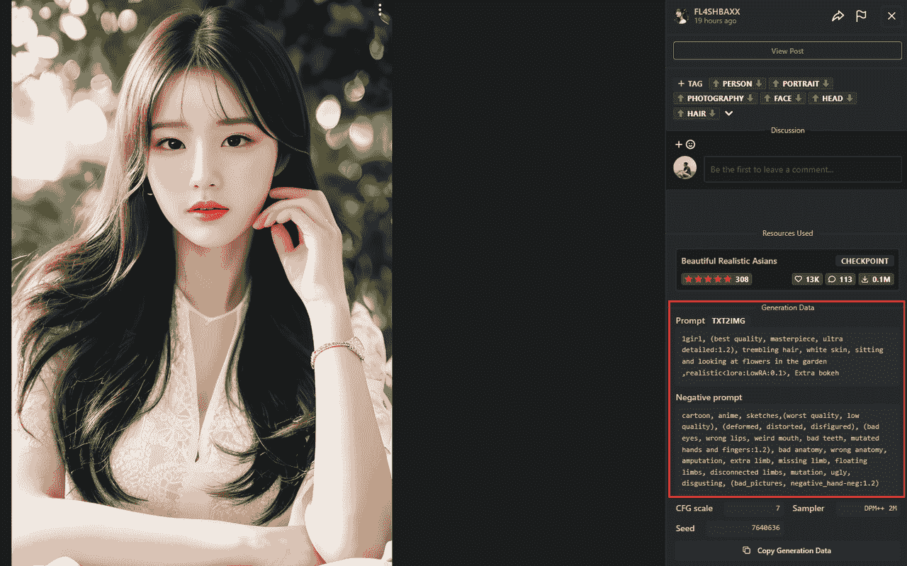 |  |

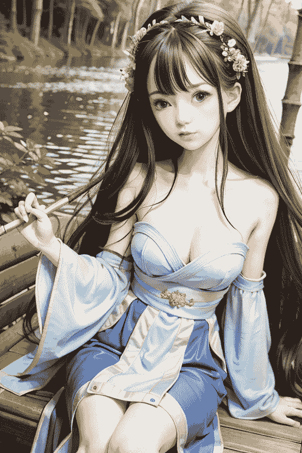

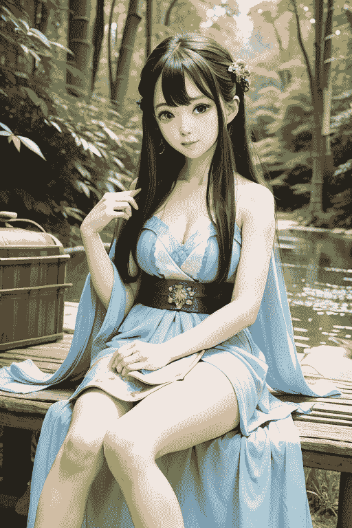