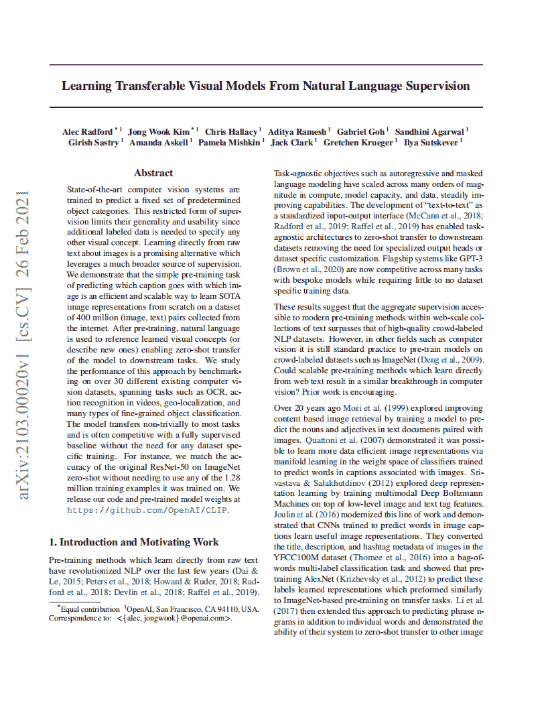
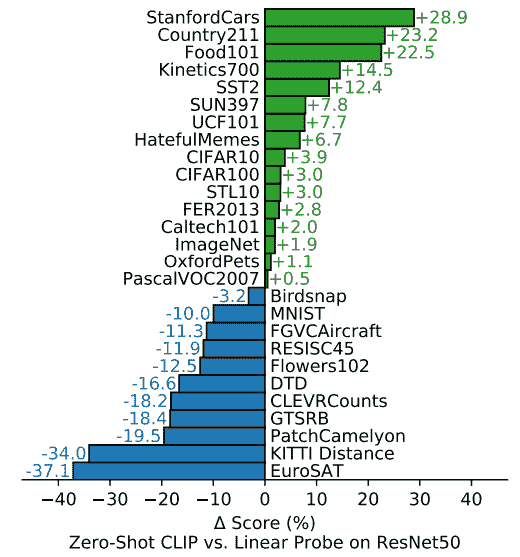
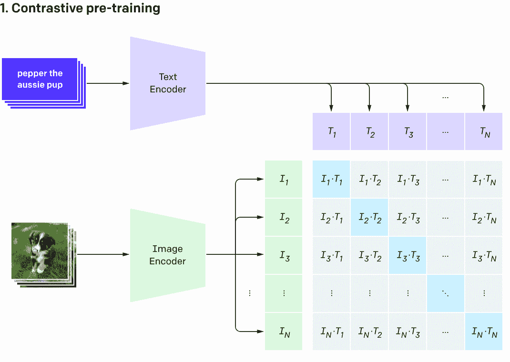
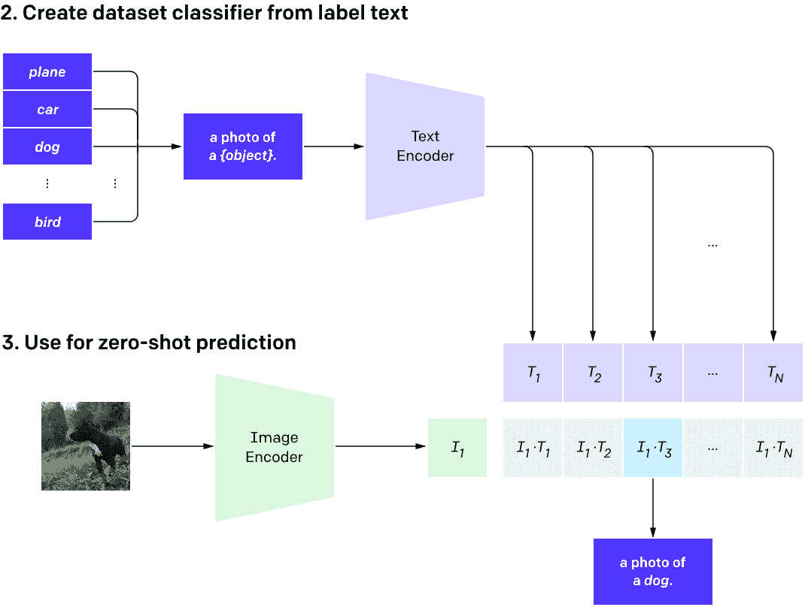
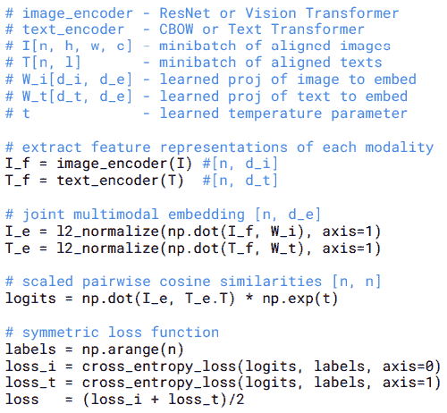

# [模型][diffusion] CLIP

> 来源：[https://learning.feishu.cn/docx/W4p3dgKtkoGad2xk1SGc1vebn7e](https://learning.feishu.cn/docx/W4p3dgKtkoGad2xk1SGc1vebn7e)

# Paper 信息

Learning Transferable Visual Models From Natural Language Supervision

https://arxiv.org/abs/2103.00020

[2021-CLIP.pdf](https://internal-api-drive-stream.feishu.cn/space/api/box/stream/download/all/MxuJbMs1joK5IlxVn6Wci1uXnpQ)

Code: https://github.com/OpenAI/CLIP

Clip: Connecting text and images https://openai.com/index/clip/

https://huggingface.co/blog/annotated-diffusion

https://www.zhihu.com/question/438649654/answer/2381466612

https://zhuanlan.zhihu.com/p/486857682

# Summary

首次 text 关联 image

the text paired with images found across the internet

CLIP models will need to learn to recognize a wide variety of visual concepts in images and associate them with their names.

1.  把 text 和 cv 的 2 个 transformer 模型粘合起来，用超大数据集训练，出奇迹。

1.  数据集规模：4亿文字图片对

1.  2 个 transformer 模型都很大：

1.  text Transformer: 6300 万参数

1.  vision transformer: 3 亿参数

1.  使用对比学习

CLIP 之前，也有工作试图打通文本与图像的隔阂。但是，要么是模型不够大，要么是数据集不够好，效果都不够惊艳（钱不够多）。

zero-shot 的视觉分类模型。

CV 不同于 NLP，一直做不到无监督，或者 zero-shot / few-shot 且泛化性很好的预训练模型？

A critical insight was to leverage natural language as a flexible prediction space to enable generalization and transfer.

从文本中得到监督信号，引导视觉分类的任务。

CLIP: Contrastive Language-Image Pretraining

把自然语言级别的抽象概念带到计算机视觉里

CLIP 的最大贡献在于打破了固定种类标签的桎梏，让下游任务的推理变得更灵活。并且在 zero-shot 的情况下，它的效果很不错。

在这篇工作发表之后，涌现出了一大批在其他领域的应用，包括物体检测、物体分割、图像生成、视频动作检索等。在创新度、有效性、影响力方面都非常出色。

虽然 OpenAI 并没有开源预训练的代码，但他们开源了预训练好的模型和 API，可以直接拿来做下游任务的推理，大家可以去玩一玩。

**它涨了多少性能**，用的方法多么朴素粗暴，这些完全不重要。

我现在感觉 CLIP 是一个远超 best paper 的工作，以前看不出来说明我们水平不行。

CLIP 为 CV 研究者打开了一片非常非常广阔的天地，原因在于 CLIP 真的把自然语言级别的抽象概念带到计算机视觉里了。当然肯定有其它类似工作，但 CLIP 跨过了奇点。

# Paper Reading

## 作者信息

[简读]关注一作和通讯作者，以及其他与本paper所做方向强相关的作者。

+   作者做过哪些工作，与当前工作有何关联？

+   作者（所在组）的风格如何？（solid、追求深刻、有远见等）

## 问题定义

问题定义：

研究意义：

## 相关工作

CLIP 之前，也有工作试图打通文本与图像的隔阂。

但是，要么是模型不够大，要么是数据集不够好，总之效果都不够惊艳。

## 动机及思路

输入是文字与图片的配对，每一张图片都配有一小句解释性的文字。

进行对比学习（contrastive learning）。

CLIP pre-trains an image encoder and a text encoder to predict which images were paired with which texts in our dataset. We then use this behavior to turn CLIP into a zero-shot classifier. We convert all of a dataset’s classes into captions such as “a photo of a dog” and predict the class of the caption CLIP estimates best pairs with a given image.

假设我们有一批N图像及其各自的描述配对，例如<image1,text1>…<imageN,textN>。对比预训练旨在联合训练生成图像嵌入[I1,…,In]和文本嵌入[T1,…,Tn]的图像和文本编码器，方式是正确的嵌入对<I1,T1>,<I2,T2>(其中i=j)的余弦相似度被最大化。以对比方式，不相似对<I1,T2>,<I1,T3><其中i≠j>的余弦相似度被最小化。

文本编码器是一个标准的transformer模型。图像编码器可以是resnet或vision transformer。对于批中的每个图像，图像编码器计算一个图像向量，第一个图像对应于I1向量，第二个图像对应于I2…，每个向量的大小为d，其中d是潜在维度的大小，因此这一步输出是Nxd的矩阵。文本编码器也类似得到一个Nxd的矩阵。然后将这些矩阵相乘并计算每个图像和文本描述之间的成对余弦相似度，这会产生一个NxN矩阵。目标是最大化沿对角线的余弦相似度，最小化其它的余弦相似度。

用对比学习的原因：如果给定一张图片，去预测对应的文本，是要逐字逐句去预测这个文本，这就很难，因为对于一张图片来说它可以有很多种描述，描述差异会很大，训练起来就会很慢，而CLIP模型和数据集本就很大了，所以模型不能用预测型的任务，生成式变判别式(填空题变选择题)。在只将预测型目标函数换出对比型目标函数训练效率就能提高4倍。

需要一些正样本和负样本。

1.  正样本: 配对的句子和文本就是一对正样本

1.  负样本: 不配对的就是一对负样本。

1.  预训目标: 最大化正样本对的余弦相似度，并最小化负样本的余弦相似度。

OpenAI 收集了四亿个样本对

zero-shot 的推理过程。

给定一张图片，如何利用预训练好的网络去做分类呢？

做一道“多项选择”题。

1.  给网络一堆分类标签，比如 cat, dog, bird，

1.  利用文本编码器得到向量表示。

1.  分别计算这些标签与图片的余弦相似度；

1.  相似度最高的标签即是预测的分类结果。

## 具体的解决方案

## model structure

text：transformer

image：vision transformer large

伪代码如下：可以看出除了transformer和vision transformer，就只有标准化、点乘、交叉熵损失。

## 实验结果

## 延伸讨论

# Exercises

https://github.com/yunhao-tech/Course_project/blob/master/Advanced%20Machine%20learning/Final%20project_CLIP.ipynb

一门课程的大作业要求利用 CLIP 做 zero-shot prediction、微调 CLIP 网络，并在原来网络架构的基础上添加线性分类层。做完之后，加深了我对 CLIP 的理解。

**Q6.** CLIP claims to perform 0 shot classification by comparing the likelihood of several embedding of tuple (image, description). Adapt the Zero-shot example of the repository to perform 0-shot predictions on the Hymenoptera dataset. Do the same on Cifar-100.

**Q7.** Adapt the finetuning code of Q5 such that the network model from CLIP can now be used as the backbone for a fine tuning on Cifar-100 and

**Q8.** Perform a training trying to tune the learning rate with a SGD optimizer and freezing/unfreezing the CLIP network. Also try different learning rate for SGD on the frozen paramters and the added layers. Can you find some recommendations?

**Q9.** On the Cifar-100 dataset create embedding of images and corresponding texts using 0-shot prediction (which is precisely the setting given in the example). Plot a few of the images and their corresponding texts using 2d PCA made on their common embedding space with a color depending if the point is from an image or from a text. Do you have any comment? Are the text and image spaces organized similarly?

**Q10.** Does the training of Q7 improves the situation detected at Q9?

**Q11.** Try to improve the performances of[ Cifar-100 following rec](http://karpathy.github.io/2019/04/25/recipe/)ommendations of http://karpathy.github.io/2019/04/25/recipe/ and/or adding a multi-head attention layer instead of a single fully connected layer on the top of CLIP.