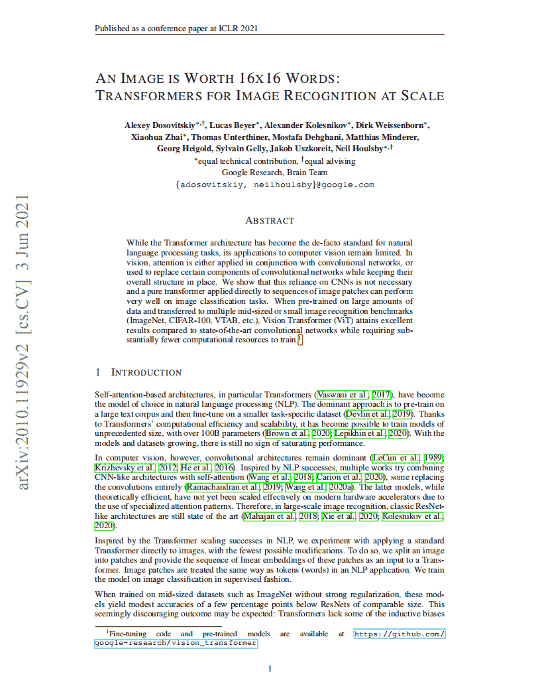
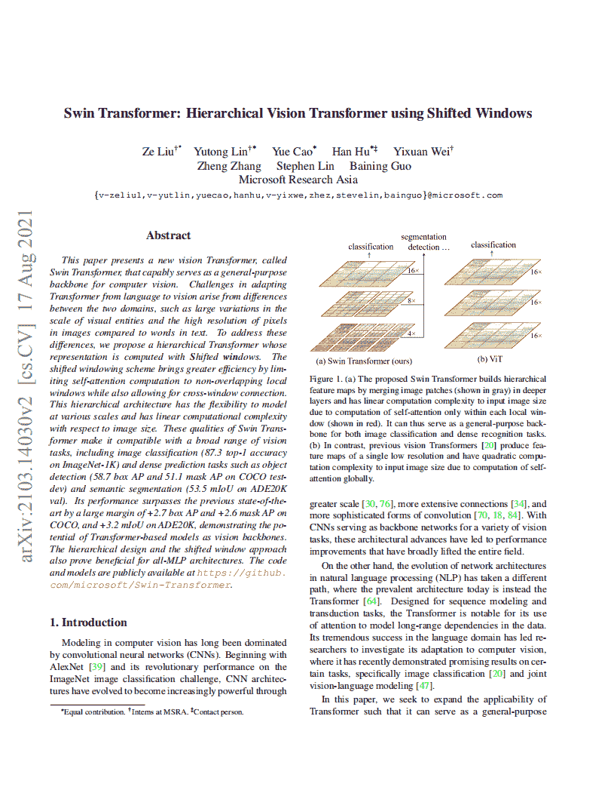
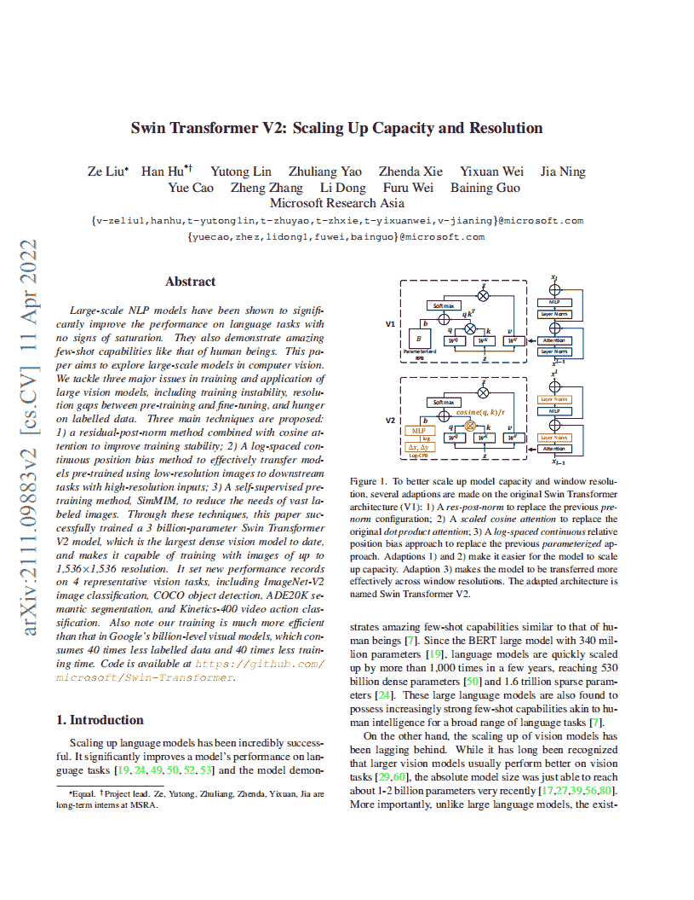
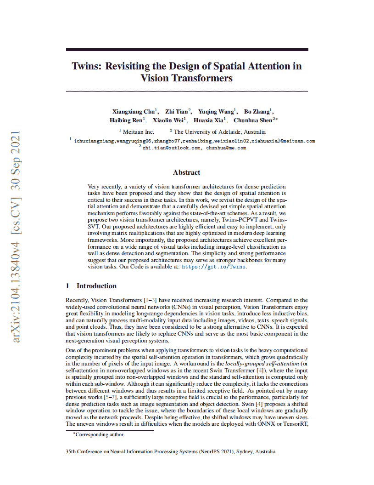
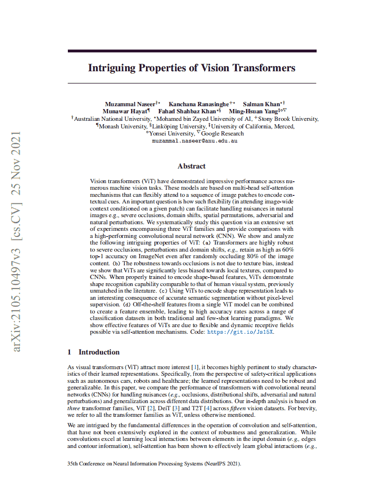
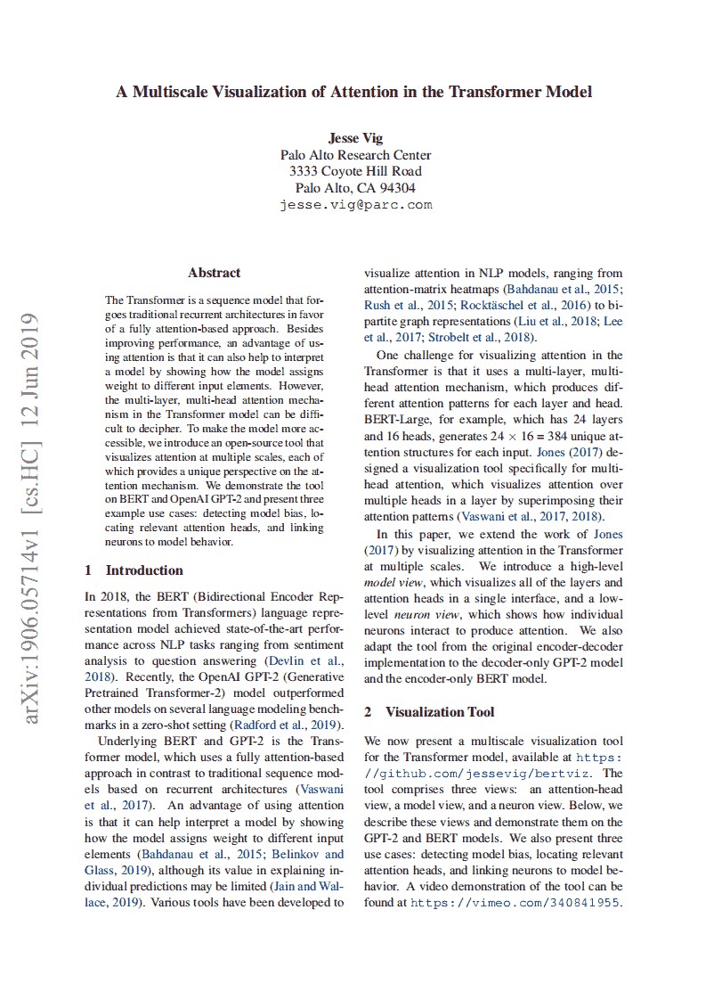
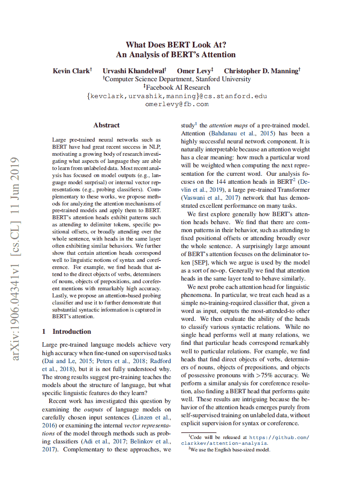

# Vision Transformer

> 来源：[https://learning.feishu.cn/docx/YjsXd9dDNolnYMxQecIcWFB4nqn](https://learning.feishu.cn/docx/YjsXd9dDNolnYMxQecIcWFB4nqn)

# 总结

开山之作共 4 篇工作，其中 3 篇来自 google，一篇微软。

【李沐论文精读】全覆盖。b 站有视频，link 见具体 paper 处。

开山之作：

1.  2017 - Google - transformer - Attention Is All You Need

1.  2018 - Google - BERT

1.  2020 - Google - ViT

1.  2021 - 微软 MSRA - Swin Transformer

沐神的论文精读很棒，特别是，

paper 受限于当时认知的局限性，有一些理解错误、认知偏差。

沐神站在 2022 年的上帝视角，能点透这些问题。

# 开山之作

| Title | year | Author | 阅读价值 | Notes |
| --- | --- | --- | --- | --- |
| An Image is Worth 16x16 Words: Transformers for Image Recognition at Scale | 2020 | Dosovitskiy | 高 | 【李沐精读】By 朱毅 https://www.bilibili.com/video/BV15P4y137jb/ |
| Swin Transformer: Hierarchical Vision Transformer using Shifted Windows | 2021 | 微软 MSRA | 高 | 【李沐精读】By 朱毅 https://www.bilibili.com/video/BV13L4y1475U |

[2020-vit.pdf](https://internal-api-drive-stream.feishu.cn/space/api/box/stream/download/all/P8tIbZmQAoeRBKxyelJcI3Ftn2g)

[2021-swin-transformer.pdf](https://internal-api-drive-stream.feishu.cn/space/api/box/stream/download/all/LmeibGdRno5KZKxvoqEceWiunVe)

# More Papers

一系列最近的工作使 ViT 适应新的任务并解决其缺点。

+   用海量数据训练 ViT 可以得到最好的性能，因此 Meta 和索邦大学的研究人员专注于提高 ViT 在包含数百万条数据的数据集上的性能（https://www.deeplearning.ai/the-batch/a-formula-for-training-vision-transformers/）。他们利用 Transformer 特有的已建立的程序（如数据增强和模型正则化）的适配来提高模型性能。

+   Inha 大学的研究人员修改了两个关键部件，使得 ViT与卷积神经网络更相似（https://www.deeplearning.ai/the-batch/less-data-for-vision-transformers/）。首先，他们将图像分割成重叠更多的图块（patch）。其次，他们修改了自注意力机制，使其关注与图块相邻的图块，而不是图块本身，并使其能够学习是否更均匀或更有选择性地权衡相邻的图块。这些修改极大地提高了精度。

+   印度理工学院孟买校区的研究人员为 ViT 配备了卷积层（https://www.deeplearning.ai/the-batch/upgrade-for-vision-transformers/）。由于重量共享机制，卷积带来了像素的局部处理和更小的内存占用等好处。在精度和速度方面，他们的卷积 ViT 优于普通的 ViT 和运行时优化的 Transformer（如 Performer，Nyströformer 和线性 Transformer）。其他团队采取了类似的方法。

| Title | year | Author | 阅读价值 | Notes |
| --- | --- | --- | --- | --- |
| Vision Transformer |  |  |  |  |
| Swin Transformer V2: Scaling Up Capacity and Resolution | 2021 | Ze Liu |  | 重要的改进模型。 |
| Twins: Revisiting the Design of Spatial Attention in Vision Transformers | 2021 | 美团 |  | Code: https://github.com/Meituan-AutoML/Twins |
| Intriguing Properties of Vision Transformers | 2021 | Muzammal Naseer |  | NeurIPS&#x27;21 |
| **原理 &amp; tricks** |  |  |  |  |
| A Multiscale Visualization of Attention in the Transformer Model | 2019 | Jesse Vig |  | open-source tool |
| What Does BERT Look At? An Analysis of BERT’s Attention | 2019 | Kevin Clark |  | 第一个问题的前半部分和第三个问题 |
|  |  |  |  |  |
| Google’s Neural Machine Translation System: Bridging the Gap between Human and Machine Translation | 2016 | Yonghui Wu | 低 | 研究 translation 问题，提出了一个系统 &amp; 多个问题的解决方案。 |
| Using the Output Embedding to Improve Language Models | 2016 |  | 低？ | 理解 embedding 具体怎么做的 |

[2021-swin-transformer-v2.pdf](https://internal-api-drive-stream.feishu.cn/space/api/box/stream/download/all/GDzMbfzBFoRUlUxymwRcaIlknQd)

[2021-Twins.pdf](https://internal-api-drive-stream.feishu.cn/space/api/box/stream/download/all/OMhSbYLkso0T5exvi5KcwXG3ni8)

[2021-vit-intriguing-properties.pdf](https://internal-api-drive-stream.feishu.cn/space/api/box/stream/download/all/QV5ebsj7FoWY7Xx7wEUcsF9anjd)

[2019-attention-visualization.pdf](https://internal-api-drive-stream.feishu.cn/space/api/box/stream/download/all/SfTkbccRSoRHTIxNtj4cRj4GnAe)

[2019-what-bert-look-at.pdf](https://internal-api-drive-stream.feishu.cn/space/api/box/stream/download/all/PJprbWIyNoSrNGxreEdcTbbXnGe)