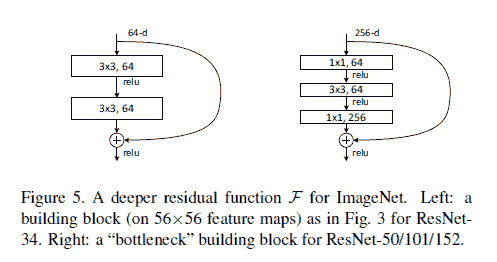
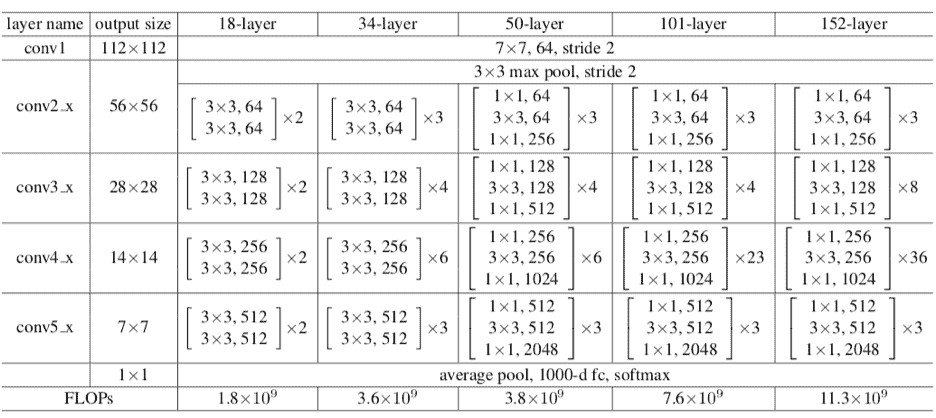
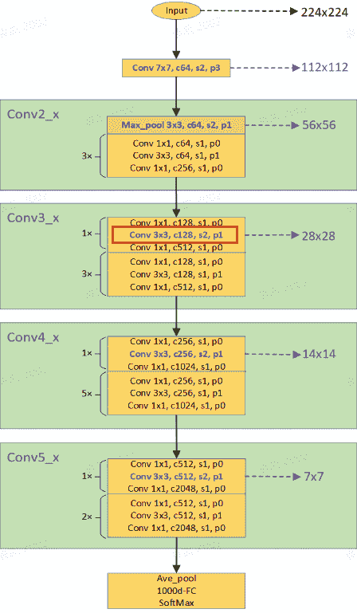
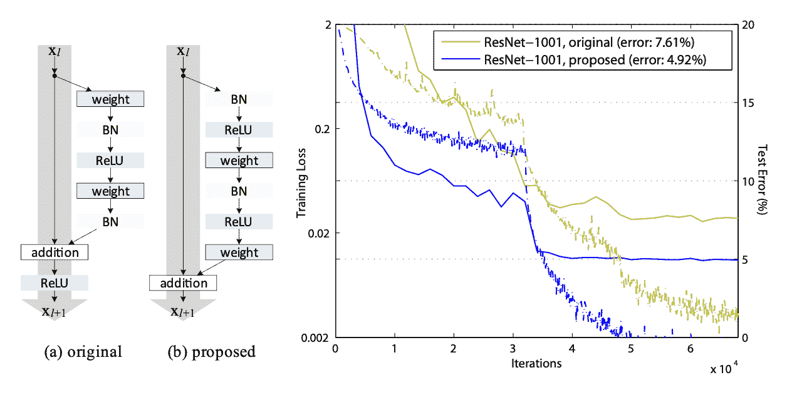
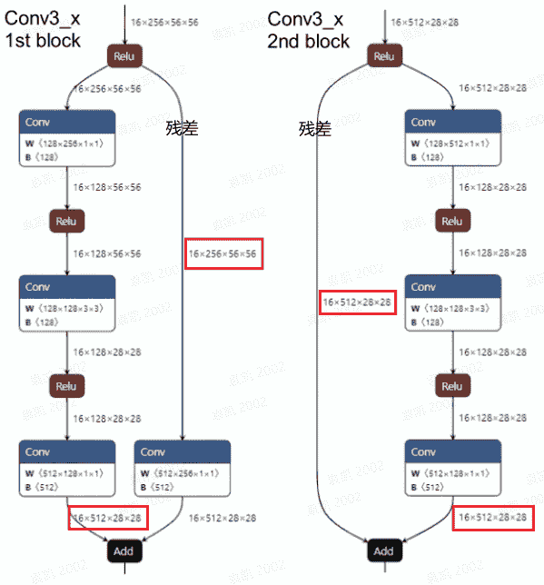
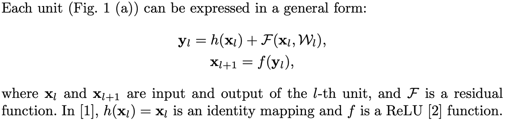
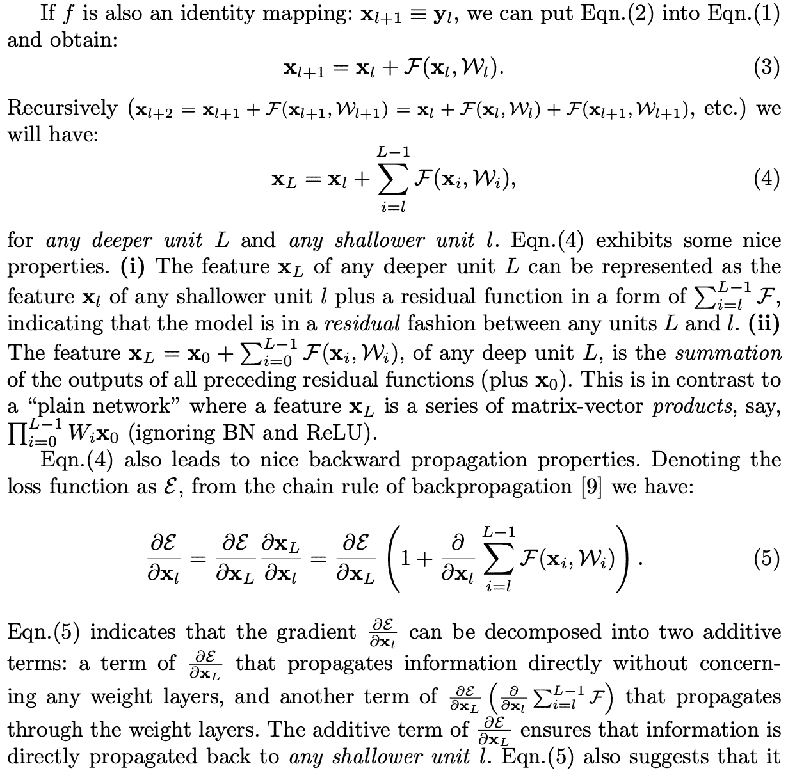
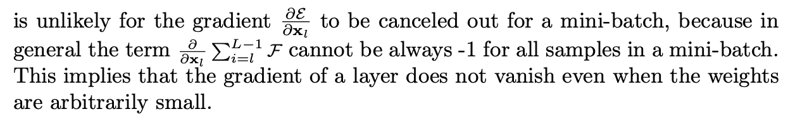
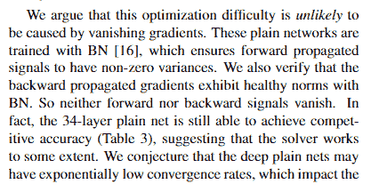

# 2015-ResNet & V2

> 来源：[https://learning.feishu.cn/docx/NejHdJUyhokkcjxPhh6cSitqnTh](https://learning.feishu.cn/docx/NejHdJUyhokkcjxPhh6cSitqnTh)

# Paper Info

| Paper | 说明 |  |
| --- | --- | --- |
| Deep Residual Learning for Image Recognition |  |  |
| Identity Mappings in Deep Residual Networks | v1 的改进版，业界使用更多 |  |

李沐的 paper reading，非常好。

复盘了很多当年大家理解不到位的细节。（比如，shortcut connection 提高训练效果主要还是 BP 时梯度保留的更好了）

https://www.bilibili.com/video/BV1Fb4y1h73E

# Model Structure

## 2015-ResNet

提出了新的模型结构，精度、性能和模型大小全方位吊打上一代的 VGG 架构。

至今依旧是 CNN 模型的主流 backbone。

ResNet 的 building block 是 residual block。有 2 种，如下图:

1.  左边是 non-bottleneck 版本。适用于 ResNet 34-。

1.  右边是 bottleneck 版本，适用于 ResNet 50+。

其中，bottleneck 版本是改进版，提升 training 效率。

Paper 给出了 5 个经典的 ResNet 模型，结构如下：

1.  数 layer 的方法。以 ResNet50 为例，

1.  只数 conv 和 FC 层。不计入 pool 层、ReLU 和 shortcut 链接。

1.  1 conv + (3+4+6+3)*3 conv + 1 FC = 50

1.  每个格子里，一个条 shortcut 链接。

1.  18-layer 和 34-layer 是 2 个 conv 一个 shortcut。

1.  50-layer 以上是 3 个 conv 一个 shortcut。3 个 conv 是 conv1-conv3-conv1，不是 3 个 conv3.

ResNet-50 V1.5 的结构细节如下。

（此图的价值是标注了 kernel size，channel 和 stride 位置。）

## 2016-ResNet-v2

把 ResNet V1 理解透了以后再读这篇，酣畅淋漓。一套数学推导就通关了。

改进 Residual Unit。

动机是，既然 v1 证明了 shortcut 很好用，那就更激进一些。把 addition 后的 ReLU 也拿掉，效果：

1.  从模型的 input 到 output 之间，有了一条贯通的 shortcut。

1.  任意的 input 和 residual unit 之间，都有贯通的 shortcut。

注意，没有拿掉 activation，只是，Unit 内从 post-activation 变成 pre-activation。

模型的深度，从 v1 的 ResNet152 提升到 ResNet200，在 imagenet 上还能看到精度提升。

## Residual Block 实现细节

Onnx 里面看到的真实模型结构如下图，

1.  右图，一条直线贯穿下来，就是标准的最简单的残差结构。

1.  直线是 x，俗称 shortcut。

1.  右边那个复杂的，是 残差 F(x) - x,

1.  下面进入 add 算子，加起来刚好是目标函数 F(x)

1.  左图，输入和输出的 dimension 不匹配，x 和残差没法直接 add，用 conv1*1 对齐维度，实际意义类似于 reshape。维度的修改内容如下：

1.  Channel 升起来。

1.  stride 2 把 Feature map size 降下去。

1.  标准 ResNet 共 5 layer。其中 4 layer（conv2_x - conv5_x）是重复的 residual block 组成。

1.  每个 layer 的第一个 shortcut connection 要升维，所以，需要左图的结构。layer 的后续 shortcut，输入和输出的维度都一样，用右图的结构。

1.  图片的降采样(downsampling)，每个 layer 做一次，通过算子的 stride=2 达成。

1.  降采样，就是长宽各降 1/2，即 feature map size / 4.

1.  原则上是每个 layer 的第一个 conv3*3 做。

1.  conv2_x 开头是 maxpool，此处做了降采样，conv3*3 不再重复做。

## Op List and Memory Size

ResNet50 算子详细信息 (FP16)（算子融合后）

|  | operator | Input size | Output size | MACs | max_memory | 备注 |
| --- | --- | --- | --- | --- | --- | --- |
| Conv1 | conv7-64, stride 2 | 1x224x224x3=294KB | 1*112*112*64=1568KiB | 7*7*64*112*112=37.5 M | **1862.0kb** | 没有 residual block |
|  |  |  |  |  |  |  |
| Conv2_x |  |  |  | (1.72 + 1.91 + 1.53) * 3 |  |  |
| maxpool | maxpool3*3, | 1*112*112*64=1568KiB | 1*56*56*64=392KiB | 9*56*56*64= 1.72 M | **1960.0kb** | 降采样，output size / 4 |
| shortcuts | conv1-256 | 1*56*56*64=392KiB | 1*56*56*256=1568.0KiB | 256*56*56=784 K | **1960.0kb** | 在 maxpool 之后，不用降采样 |
| 残差-部分 | conv1-64 | 1*56*56*64=392KiB | 1*56*56*64=392KiB | (1+9)*64*56*56=1.91 M | &lt;=1960.0kb | 不用降采样 |
| add 融合 | conv1-256 | 1*56*56*64=392KiB | 1*56*56*256=1568.0KiB | 256*56*56=784 K | 1568+392=1960 | 是否还有进一步融合的优化空间？ |
|  |  |  |  |  |  |  |
| Conv3_x |  |  |  | (392 * 3 + 882) * 4 |  |  |
| shortcuts | conv1-512, stride 2 | 1*56*56*256=1568.0KiB | 1*28*28*512=784.0kb | 28*28*512 = 392 K | **2352 kb** | 实际执行时，可以直接从残差的输入内存读数据，计算后直接覆盖到残差输出的内存上，就是最终的输出。不会额外占用 memory. (?) |
| 残差-部分 | conv1-128 | 1*56*56*256=1568.0KiB | 1*56*56*128=784.0kb | 56*56*128 = 392 K | **2352 kb** | 没有降低 Feature map，所以，size 很大。 |
| add 融合 | conv1-512 | 1*28*28*128=196.0KiB | 1*28*28*512=784.0kb | 28*28*512 = 392 K | 784.0+196=980.0 |  |
| BN-ReLU |  |  |  |  |  |  |
| Conv4_x |  |  |  | (196 * 3 + 441) * 6 |  |  |
| shortcuts | conv1-1024, stride 2 | 1*28*28*512=784.0kb | 1*14*14*1024=392kb | 14*14*1024 = 196 K | **1176 kb** |  |
| 残差-部分 | conv1-256 | 1*28*28*512=784.0kb | 1*28*28*256=392.0KiB | 28*28*256 = 196 K | **1176 kb** |  |
| add 融合 | conv1-1024 | 1*14*14*256=98.0kb | 1*14*14*1024=392kb | 14*14*1024 = 196 K | 490 kb |  |
| BN-ReLU |  |  |  |  |  |  |
| conv5_x |  |  |  | (98 * 3 + 220) * 3 |  |  |
| shortcuts | conv1-2048, stride 2 | 1*14*14*1024=392kb | 1*7*7*2048=196.0kb | 7*7*2048= 98 K | **588.0 kb** |  |
| 残差 | conv1-512 | 1*14*14*1024=392kb | 1*14*14*512=196.0kb | 14*14*512 = 98 K | **588.0 kb** |  |
| Add | conv1-2048 | 1*7*7*512=49kb | 1*7*7*2048=196.0kb | 7*7*2048= 98 K | 245 kb |  |
| BN-ReLU |  |  |  |  |  |  |
|  |  |  |  |  |  |  |
| avg pool |  |  |  |  |  |  |

# Paper Reading - ResNet

## 作者信息

+   一作 Kaiming He. 2011年，博士。香港中文大学，多媒体实验室。导师汤晓鸥。先后在 MSRA，Facebook AI 研究院。

+   通讯作者 Jian Sun。孙剑，当时在 MSRA，后来是旷视研究院院长。

Paper 是 MSRA 的工作，AI 的黄埔军校。

## 已有工作的局限性

要点：

1.  当模型 depth 进一步提升时，会出现精度 downgrade 问题。

1.  Highway network 方向的发展情况。

## 作者的方法

受 highway network 的思路启发，拿来解决精度 downgrade 问题

具体实现是 residual block, 详见 Model Structure 章节

## 作者思路的缺陷

李沐的点评，值得一读。https://www.bilibili.com/video/BV1Fb4y1h73E

总体来说：

1.  作者实验做的好，但对 residual block 为什么有效，理解的是错的。

1.  residual block 的作用，主要是 BP 的时候，梯度消失更慢了。提升了学习的效率。

1.  一年后（2016），作者提出了改进版的 ResNet V2

# Paper Reading - ResNet-V2

## 作者信息

Kaiming He, Xiangyu Zhang, Shaoqing Ren, and Jian Sun

机构是 MSRA。

跟 ResNet V1 的作者、排名完全一样。

## 问题定义

研究的问题：在 image classification 任务上, 改进 residual block 的 propagation formulation 提升模型效果。

评测指标：accuracy 的提升比例，训练时间，模型的泛化性。

研究意义: 更深入的理解 ResNet 中的 shortcut connection （identity mapping），探索出模型进一步优化的方向。

## 已有工作的局限性

shortcut 有用，但 resnet v1 只在 residual block 内用了。

能否更大胆一些，把整个 network 用 shortcut 直连起来？效果会如何？

-- 实验结论：更棒了。这就是 resnet v2。

## 作者的方法

1.  实验研究哪一种 shortcut 更有效果。

1.  Identity Mappings 最好用。

1.  skip connections of scaling, gating, and 1×1 convolutions all lead to higher training loss and error

1.  能否更彻底的 shortcut 把模型的 input / output 也直连。推导过程如下：

Residual Unit 的一般形式：

如果 f 也换成 identity mapping，x 和 x_{l+1} 就有一条贯通的 shortcut 了。residual function 部分也依旧可以学习非线性的关系。

## 实验结果

+   [精读]对于每个实验：

+   该实验想讨论什么问题？

+   该实验的设计是否合理？能否很好地回答此问题？

+   实验预期是什么？结论是什么？

+   [精读]有哪些需要注意的实现细节？（数据处理、参数等）

没有细读的需求，暂不整理。

简单总结，牛逼就行了。

# 延伸讨论

## ResNet 是多个网络的 ensemble

Paper: Residual Networks Behave Like Ensembles of Relatively Shallow Networks

由此引入了多样性的概念，它用来描述隐式集成的网络的数量；在预测时，残差网络的行为类似于集成学习；对训练时的梯度流向进行了分析，发现隐式集成大多由一些相对浅层的网络组成，因此，残差网络并不能解决梯度消失问题。

为了进一步证明残差网络的这种集成特性，并确定删除掉一部分跨层结构对网络精度的影响，作者进行了删除层的实验，在这里有两组实验，第一组是删除单个层，第二组是同时删除多个层。为了进行比较，作者使用了残差网络和VGG网络。实验结果证明，除了个别的层之外，删掉单个层对残差网络的精度影响非常小。相比之下，删掉VGG网络的单个层会导致精度的急剧下降。这个结果验证了残差网络是多个网络的集成这一结论。

第三组实验是对网络的结构进行变动，集调整层的顺序。在实验中，作者打乱某些层的顺序，这样会影响一部分路径。具体做法是，随机的交换多对层的位置，这些层接受的输入和产生的输出数据尺寸相同。同样的，随着调整的层的数量增加，错误率也平滑的上升，这和第二组实验的结果一致。

## Reddit 上对原理的讨论

https://www.reddit.com/r/MachineLearning/comments/px3hzd/d_has_the_resnet_hypothesis_been_debunked/

翻译: https://mp.weixin.qq.com/s/_ucJ18Vddnw8RI2CAS0fzQ

在ResNet论文观察到的退化问题（degradation problem），即34层的网络在整个训练过程中比18层的网络具有更高的训练误差，但18层网络的解空间显然是34层网络的子空间。

Kaiming 当时的看法

「我们认为这种优化困难不太可能是由梯度消失引起的，因为这些普通神经网络使用 BN 进行训练，确保前向传播的信号具有非零方差可以缓解这个问题。我们还验证了反向传播的梯度，结果可以看到表现出 BN 的结果也很正常。因此，前向或后向的信号都不会消失。事实上，34 层的普通网络仍然能够达到有竞争力的精度，这表明这个解决方法在一定程度上是有效的。我们推测普通神经网络的收敛速度可能呈指数级低，这会影响训练误差的减少。未来将研究这种优化困难的原因。」