# CS143 编译原理笔记 2 - Parsing

> 来源：`https://learning.feishu.cn/docx/DOEIdgKn1oy0csxiOjmcMmnnnmf`

# 总结

本文是 Stanford CS143 Compilers 课程 Week 3 & 4 的笔记，讲 Parsing 阶段。

第一次看的话，难度有点大。整个课程里，唯一全程 4 倍以上时长看完的。

另外，主打一个枯燥，特别是从 shift-reduce 开始，感觉连老师讲话都变的机械了。

| weeks | topic | 视频时长 | 用时/二刷 |
| --- | --- | --- | --- |
| week 3 | parsing | 1.5h | ~10h/4h |
| Week 4 | parsing | 2.5h | ~10h |

有的 compiler 把 lexer 和 parser 一起做了，不区分。

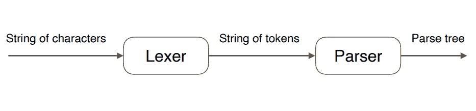

提纲：1 个 context free grammar，4 种实现。

| 分类 | 实现算法 | 说明 |
| --- | --- | --- |
| top-down | Recursive Descent Parsing | 递归下降分析 |
|  | Predictive Parsing | 用了 `LL(1)` Parsing Table。 |
| bottom-up | shift-reduce parsing | 核心是用 `LR(0)` items 找 viable prefix。 |
|  | `SLR` parsing | 带 lookahead 的 bottom-up 方法。 |

要点：

1.  context-free grammar 很重要。关键概念要熟悉：`terminal`, `non-terminal` & `productions`。

1.  Recursive descent parsing，很基础，需要能自己实现，理解 Left recursion 问题，及其消除办法。

1.  Predictive Parsing。要熟悉 `LL(K)` grammar 和 parsing table。了解 left factor, `First Set`, `Follow Set`.

1.  Shift-reduce parsing。核心是，如何用 `LR(0)` items 建立 NFA 状态机，从而识别 viable prefix。

1.  `SLR` parsing。基于 viable prefix 和 valid items 的 bottom-up 方法，跳过了没看。

其他一些 highlights：

1.  Parse tree 包含信息过多，下游更喜欢精简后的 `AST`。

1.  Gammar 的二义性不全是设计 bug，有些是易用性的 tradeoff。比如，运算符优先级。

1.  Panic-mode 就是 skip 一些 input 继续 parse 剩下的。可以一次 compile 检查更多的 error。rust 用的多。

1.  Top-down 是 `LL`，通过预测驱动，而 bottom-up 是 `LR`，通过预测解决冲突。

# Context Free grammars - `CFG`s

## 需求背景

需求：不是所有的 `token` sequence 都是 `program`。parser 需要能识别有效的 `program`。

设计，需要 2 个东西：（感觉就是 lexical analysis 里的语言 spec + 语言实现。）

1.  `language`。描述 valid strings of token 是什么。即，context free grammar。

1.  `method`。区分 strings of tokens 是否 valid。

`Language` 里，一般包含 recursive structure。正则描述不了。

Context Free grammar 天然的适合描述这个 structure。

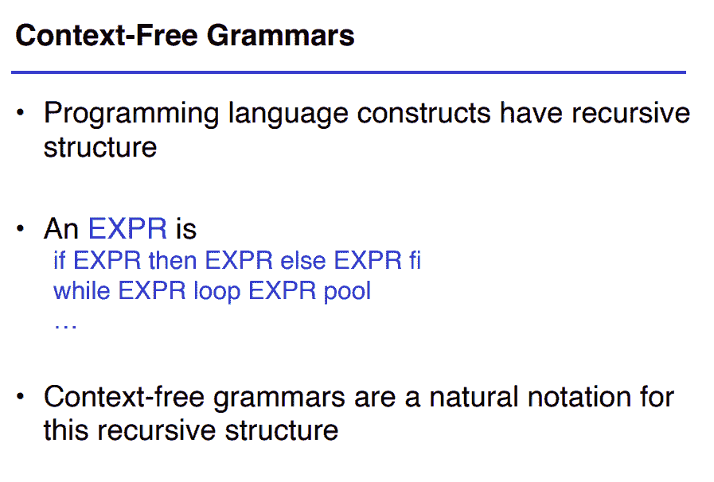

原始视频里，这里的解释感觉有点模糊。容易误解为：与 `if...else` / `loop` 等 control flow 有关。

实际上，是 recursive（递归）的意思。

一个 `expr` 的某个部分，可能还是 `expr`，几轮推导下来，可能出现：

1.  推导的次数是动态的。正则表达不了这种动态可变的状态数。

1.  递归成死循环了，正则表达不了无限的状态。

在 lexer parser 里，正则够用，因为，只需要识别出 `token` 即可。

此处，需要识别一个 `token` sequence 是否 valid。需求变了。

## `CFG` 语法

`CFG` 的组成包括 4 个东西：

1.  A set of terminals (`T`): 不可再分的符号。在 `production` 中，terminal 是右侧的最小单位。

1.  A set of non-terminals (`N`): 可以由其他符号组合而成。

1.  A start symbol (`S`): 一般是 1 个 non-terminal。

1.  A set of productions (`X-> Y_1 ... Y_N`): 翻译为“产生式”。

几点补充说明：

1.  此处的 terminals，就是 lexer 输出的那些 `token`s。

1.  从 start symbol 开始，用 productions 推导出整个 language。

1.  start symbol 只有 1 个，其他 3 个都是 a set of。

1.  Productions 可以看作是 rules，不断的用右侧表达式替换左侧。

一个最简的例子，由 2 个 productions 和 2 个 terminals 构成的语言。

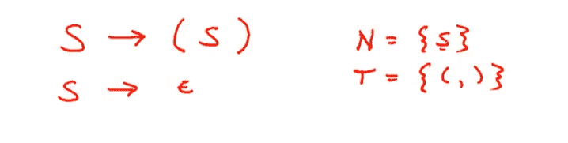

Productions 的严谨的定义：

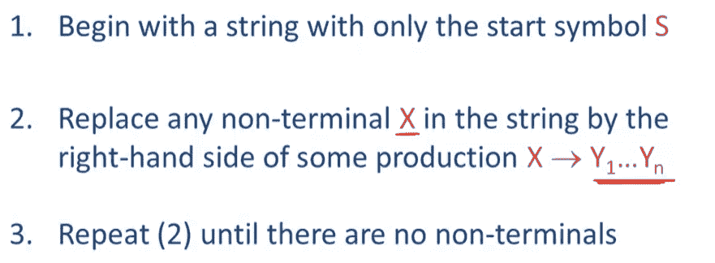

用 context free grammar 的形式，定义 language。

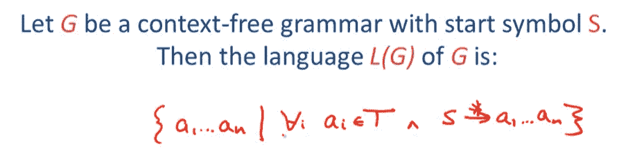

通俗的理解：

此处的 Language 仍然是一个 set，元素 token sequence。

对 token sequence 的 2 个要求：

1.  从 start symbol `S` 开始，反复使用 productions 可以推导出来。

1.  所有的 terminals 都来自于定义的 terminals 集合。

2 个 grammar 的例子，注意，

1.  分别描述 3 个 productions，4 个 productions。

1.  `Id` 是 identifier 的缩写，表示变量名。

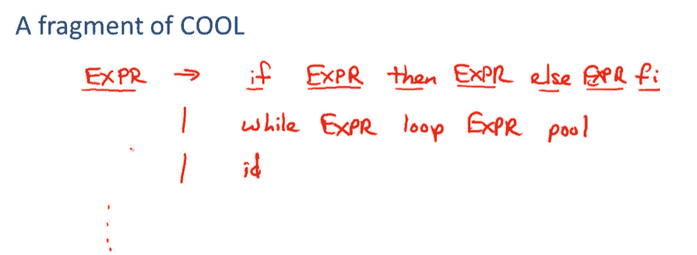

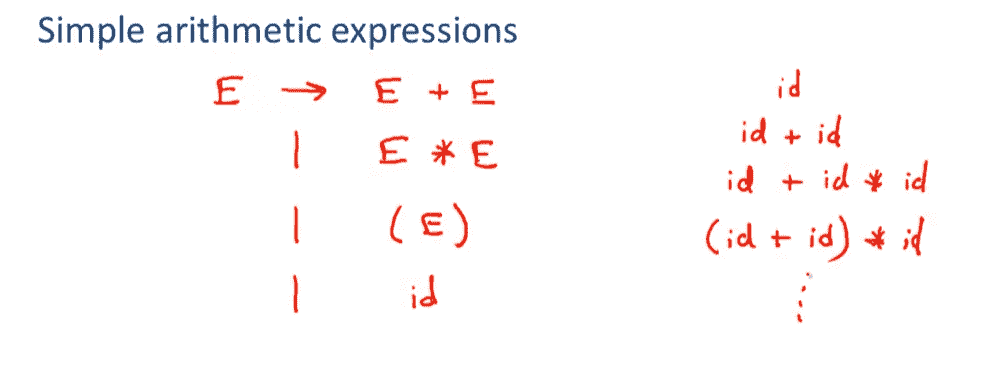

CFG 小结：

Parsing 要解决 2 个问题，当前进展 0.5。

1.  判定 language 是否 valid。但，error 处理还不够方便。

1.  缺一个 `cfg` 的 implementation。

## Derivations (派生) 和 Parse tree

Derivations 就是一系列 productions。核心目的：用 grammar 和 input 构建一个 parse tree。

1.  Derivations 可以用 tree 表示。

1.  Derivations 定义了 parse tree。

一个例子。

grammar & 输入如下

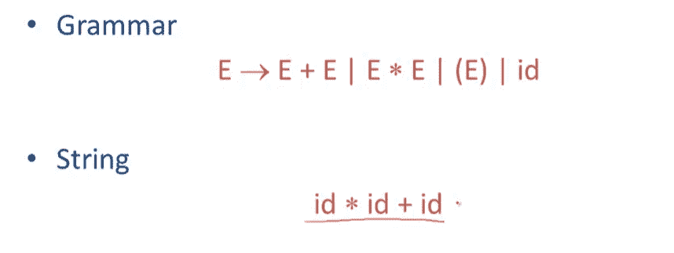

对应的 parse tree 如下

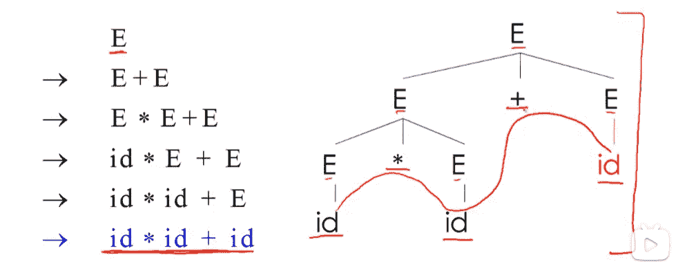

Parse tree 的性质

1.  Terminals 是叶节点。

1.  Non-terminals 是中间节点。

1.  中序遍历（in-order traversal）叶节点，得到 original input。

1.  展示了 operations 之间的关联关系。

derivation 可以有很多种推导顺序，但，得到的 parse tree 都是一样的。

常用的是：left-most 和 right-most。

当然，也可以 random 选先展开 tree 的哪一个 node。只要 parse tree 一样，结果不变。

## Ambiguity - 有二义性的语法

（二义性也能建模，真牛逼）

要点：

1.  二义性的 2 个例子：四则运算，`if` `else` 的匹配。

1.  处理二义性，可以选择消除，或者共存。消除用 rewrite grammar。共存用运算符优先级和亲和性。

1.  二义性不全是设计 bug，有些是易用性的 tradeoff。比如，运算符优先级。

核心：二义性，即，某个 `string` 存在多个 parse tree。

例子 1: 四则运算

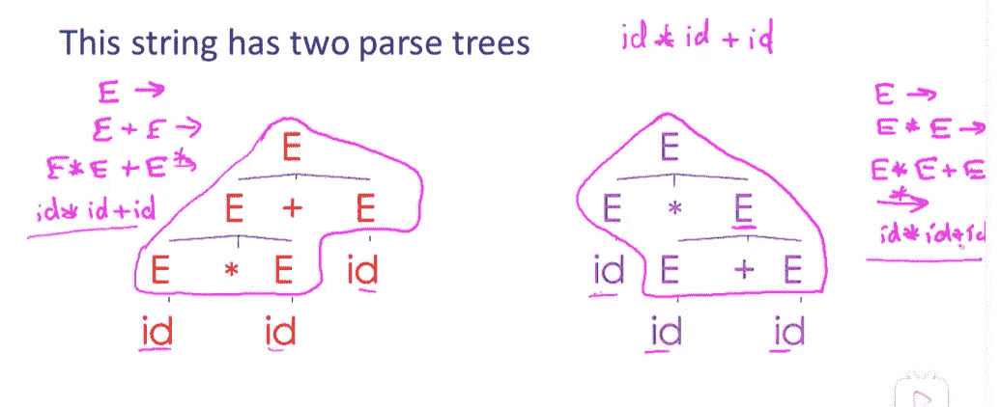

消除办法：修改 grammar，把 `*` 和 `+` 分别处理。

作为对比，原始的 grammar：

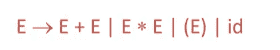

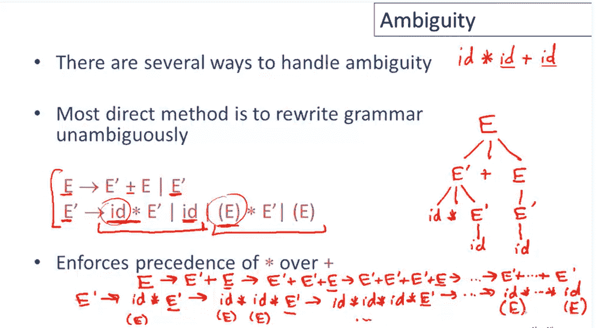

例子 2: `if` 语句的常见二义性消除，`else` 属于哪个 `if`。

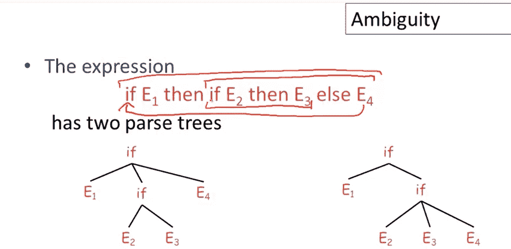

消除办法：大多数语言会约定 `else` 属于最近的 unmatched `then`，即，第二个 `then`（右边的 parse tree）。

Parsing 的实现方法：定义 `MIF` 和 `UIF` 2 个 production。

用 `UIF` 约束了，`else` 优先匹配了最近的 `if`。

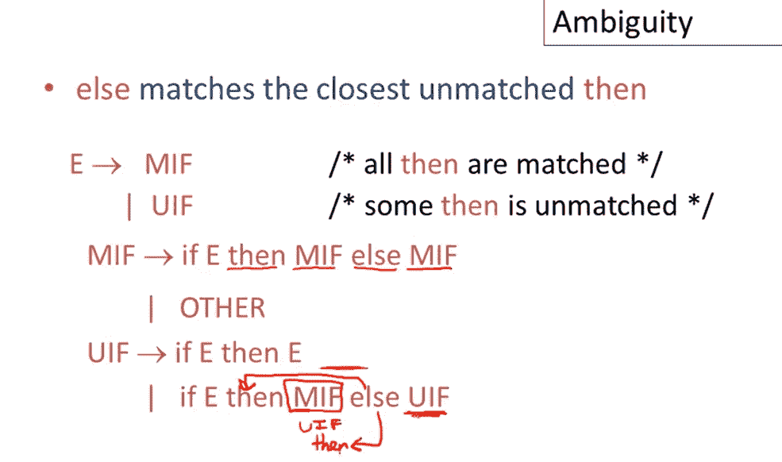

对应的，parse 结果如下

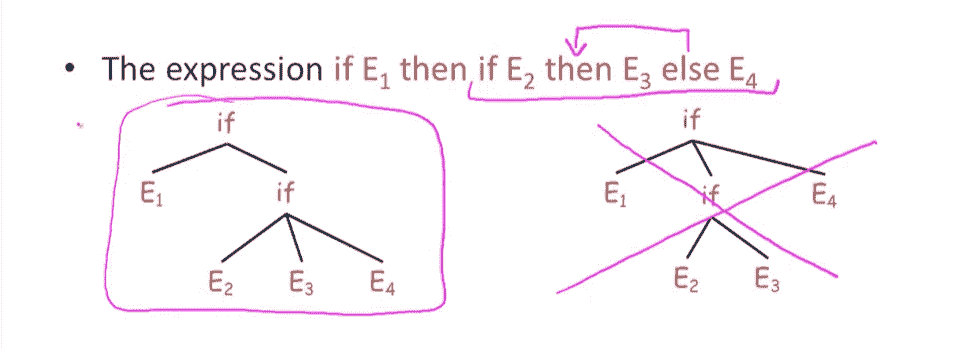

工程上，二义性不全是设计 bug，有些是易用性的 tradeoff。

比如，运算符的默认优先级，就是一种二义性的语法。如果放弃易用性，全都加上 `()`，就可以消除。

与二义性共存的常用方法，

1.  用 precedence declaration 定义优先级

1.  相同优先级的，用 associativity declaration 定义关联性。一般是左关联，表现为从右向左计算。

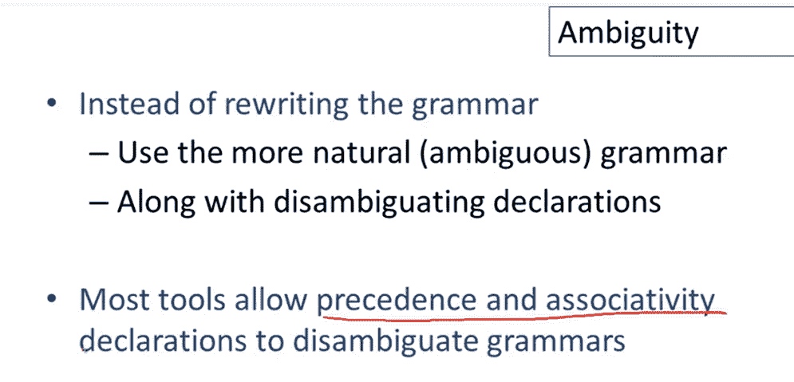

下图亲和性的定义，用的 `bison` 的语法。

需要谨慎的使用 `declaration`s，他们可能导致 `Rising Behavior`，影响语法解析的结果。

每次修改 `declaration` 之后，都要测试 grammar 的正确性。

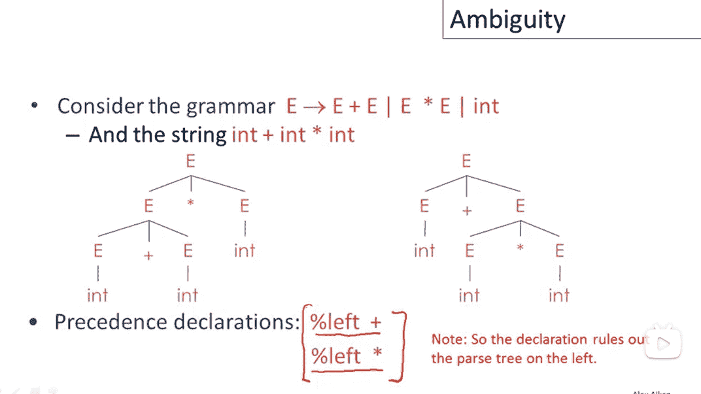

# Error Handling

Error handling 是 compiler 的 2 个 purpose 之一。

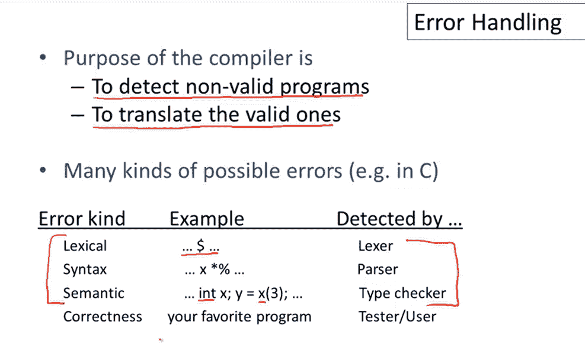

3 种 error handling 方法：

1.  Panic mode。skip 一些 input 然后尝试继续 parse 剩下的，一次 compile 检查更多的 error。

1.  error productions。兼容了常见 mistake 用法，但，增加了语法的复杂度。

1.  Automatic local or global correction。理论研究用的多，工程上，现在很少用了。

## Panic mode

Rust 就大量使用 Panic mode。

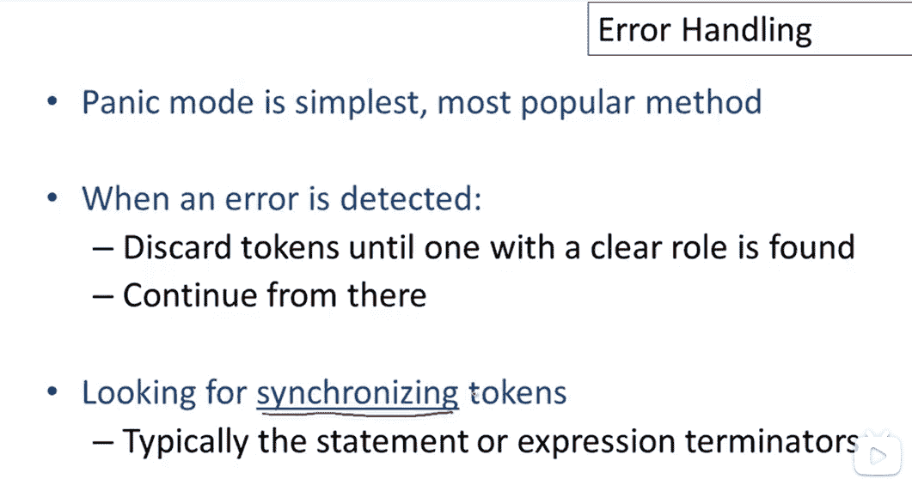

panic-mode，skip 一些 input 继续 parse 剩下的。可以一次 compiler 检查更多的 error。

下面的例子，用 `bison` 定义了 2 种 skip 策略。

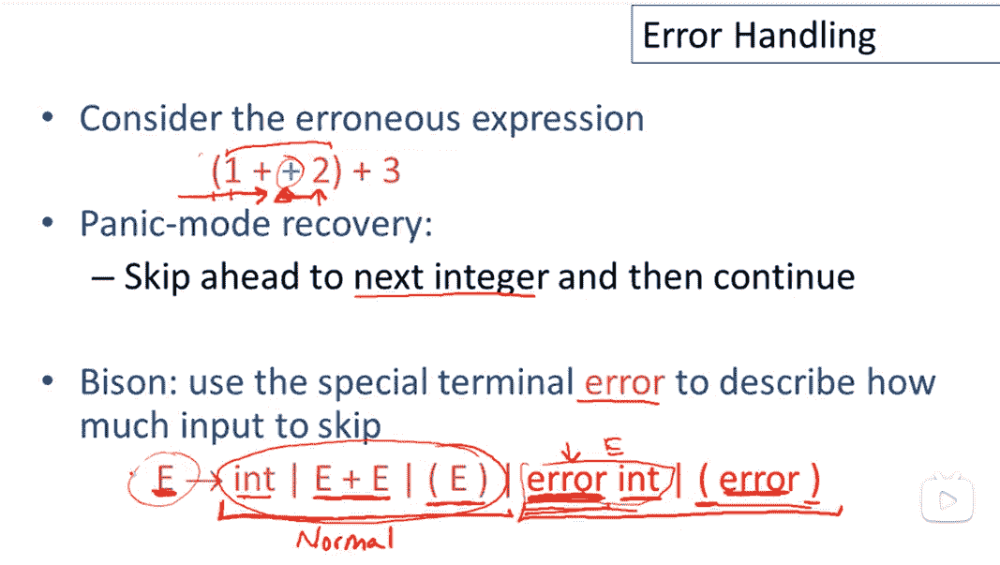

## Error productions

针对常见的 mistake grammar，写一个 production，把 error 变成合法语法。

比如，

+   大家习惯写 `5x` 而不是 `5 * x`

+   增加一个 production，允许这个写法。`E -> ... | E E`

## Error correction

编译时，发现 error 后，尽可能的自动修复 error。

1970s 年代，编译一次代码太慢了。所以搞了这一套。

但是，现在基本不需要了。

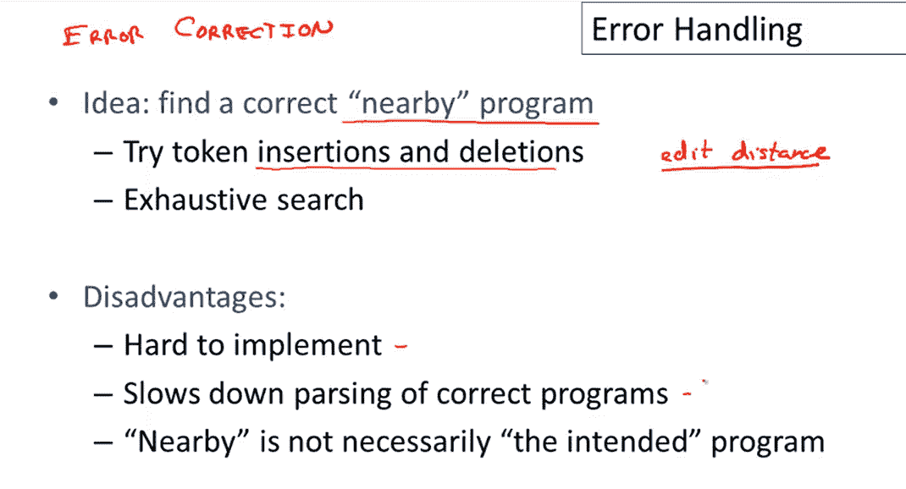

# `AST` - 抽象语法树

parse tree 的信息太冗余了，后面的 steps 不全需要。

`AST`：精简了 parse tree 的一些信息。比如，括号、单个的父节点。

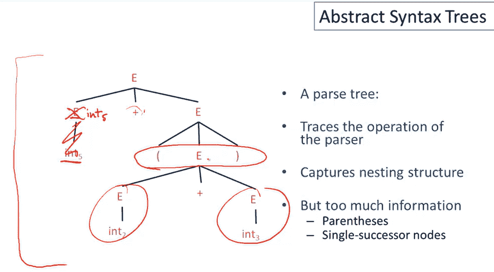

精简后，遍历这种树的算法更简单。

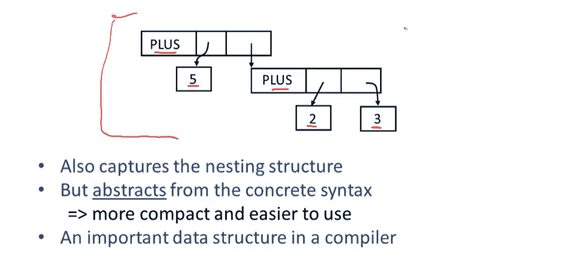

# Recursive Descent Parsing - 递归下降分析

## 算法概述

算法原理：对 non-terminals，按某个顺序 Try productions，

+   `if` fails，则 backtrack（回溯，原路返回）& try alternatives。

+   If success，input 指针前进一个 token。

名字来自于 Try production 的顺序，自顶向下、自左向右。

构造的是 parse tree，不是 `AST`。token 都在 tree 的叶结点上。

一个例子。

Grammar & 输入 token 如下

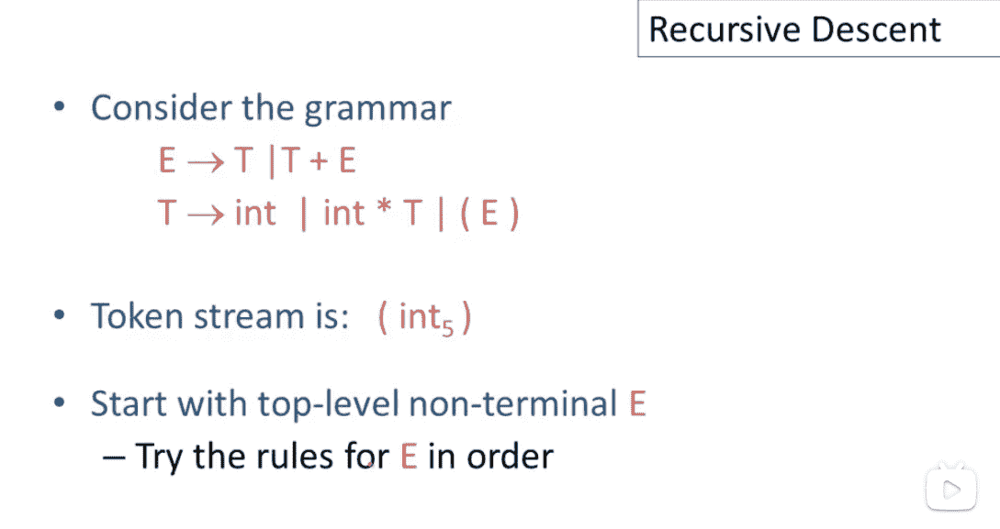

构造的 parse tree 如下

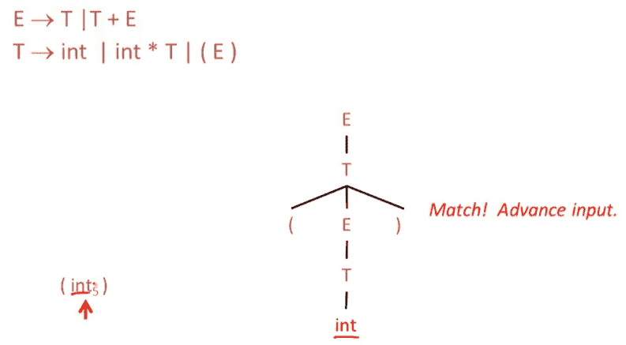

## 完整实现

概念定义

辅助函数

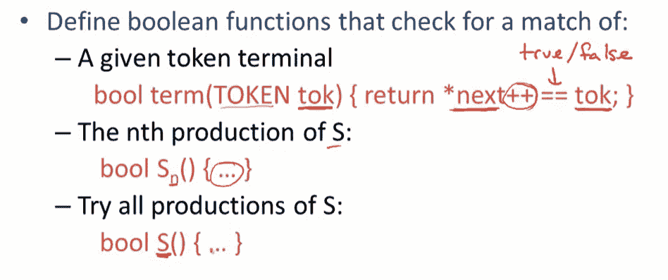

辅助函数的一个具体例子，notes：

1.  `E_1`, `E_2`, `T` 都是检查 production 是否匹配的函数。

1.  `next=save`，在每个分支开始时，都恢复到初始的 input 指针处。

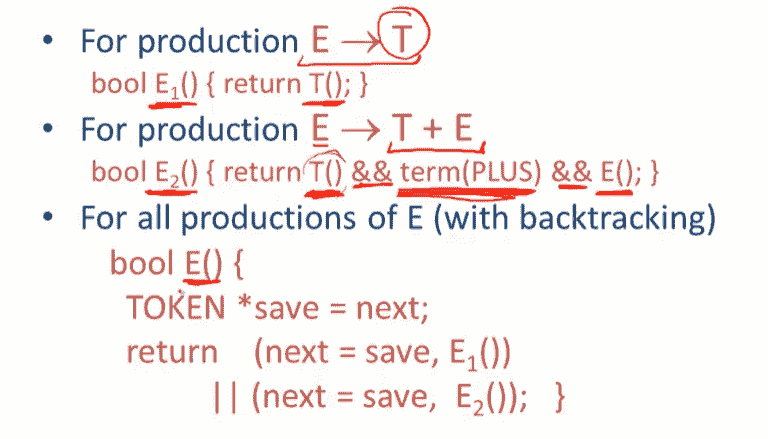

针对 non-terminal token，辅助函数定义

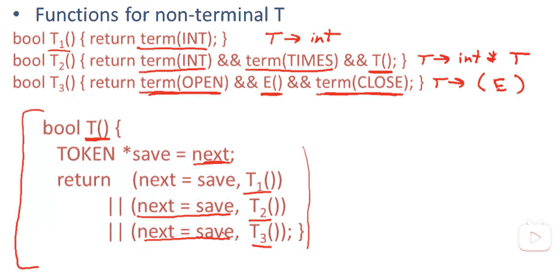

代码汇总，执行顺序：

1.  `E1 -> T() -> T3()`

1.  `E() -> E1() -> T() -> T1()`

1.  完成

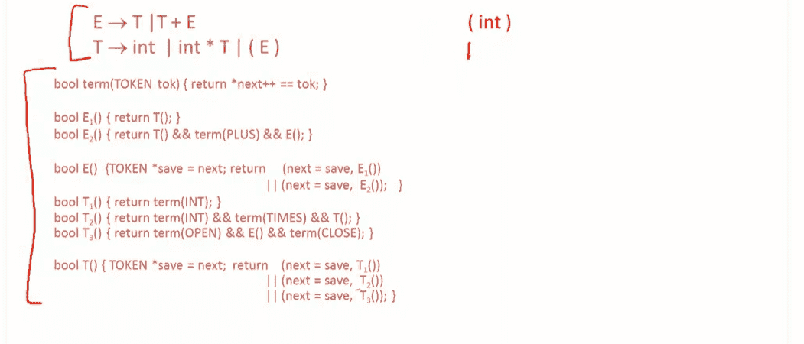

## limitation

解析失败的例子：`int * int`。

现象：解析完第 1 个 `int` 后就直接 succeed 退出了，但，pointer 没有指向 input 末尾。

原因分析：

1.  这不是 `RD` 算法的问题，而是上述实现太 naive 了。

1.  问题原因：当 non-terminal 的一个分支成功时，不会 backtrack 其他分支。

解决的思路是，

1.  增强 backtrack 的支持，主流的 recursive-descent 一般都支持。

1.  如果 grammar 的设计上，non-terminal 最多只有一个 production 能 succeed，也可以绕过问题。

前面的 implementation 不够 general，但胜在简单能用。适合讲课。

## Left Recursion 消除

课程讲的很简单，详细理解要看龙书 2.4.5，4.3.3 节

问题来源 & 解决方案（rewrite using right-recusion）。

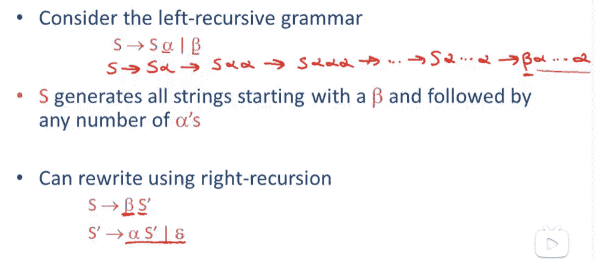

Left Recursion 是 `RD` 的主要难点，2 个问题：

1.  无限死循环。相对容易识别 & 解决。

1.  表达式的解析顺序问题。生成的 `string`，先是从左右往右增，最后在最左边填了一个字母。不是一贯的从左到右生成。

问题可解，也能自动 eliminate。

实践上，手动 eliminate 比较多。

方法是，写个 semantic actions。主要是因为更简单。

通用的问题定义 & 解决方案

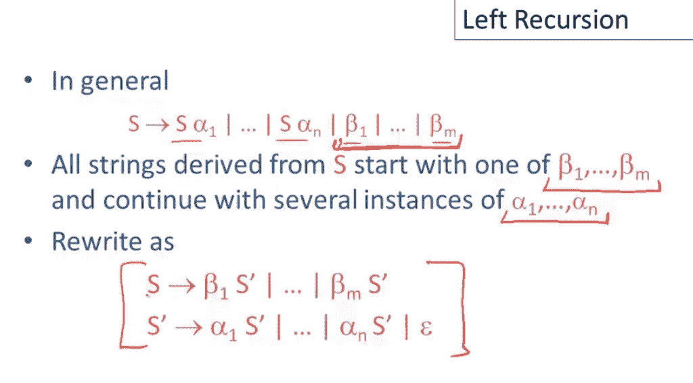

# Predictive Parsing

## 算法概述

也是 top-down 算法。

核心是不用 backtrack 了，写 parsing 时的关键 feature。

方法是，通过 lookahead 来 predict 该选哪个 production。

个人理解，

1.  Recursive descent 深度优先

1.  Predictive parsing 广度优先

# LL(1) Parsing

Predict parser 接受 `LL(k)` grammar。缩写来源：

+   Left-to-right

+   Left-most derivations

+   K tokens lookahead

不满足 `LL(1)` 的例子。

看到 `int` 时，`T` 有 2 个 production 可选，无法 predict。

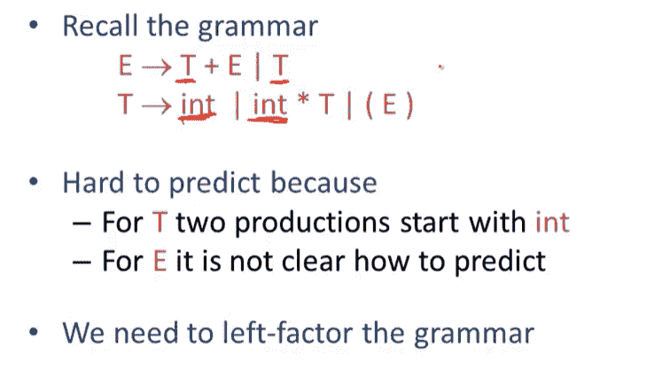

解决办法：`Left factor` 方法重写 grammar。

也就是提取 production 中最左边的公因子，作为单独一个 production。

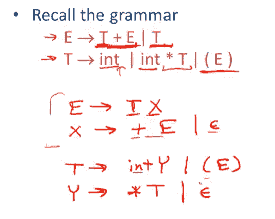

## 使用 `LL(1)` parsing table

把 grammar 改写成 parsing table，执行效率更高。

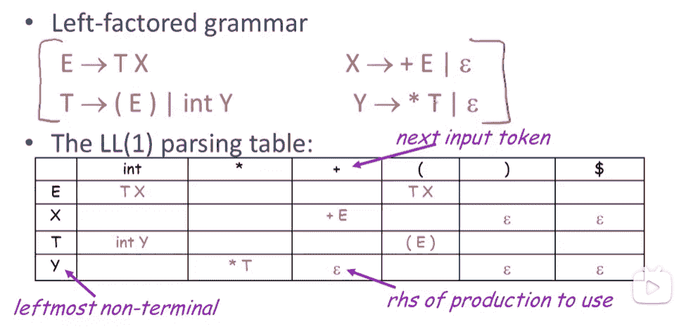

用法概述

算法流程

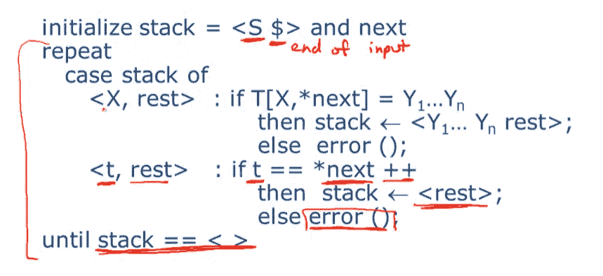

一个具体例子

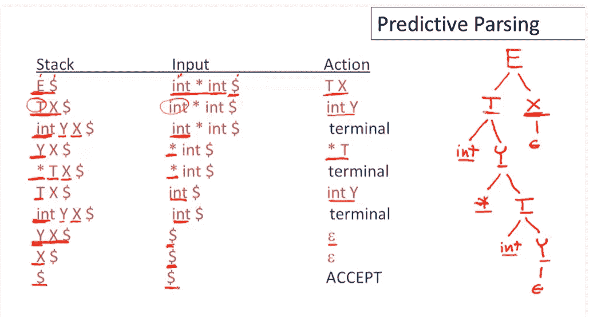

如何构建 parsing table。

理论略抽象，实际非常简单直接。核心是找 `Non-terminal` 后面可以有哪些 input token。

分 2 种情况讨论：第 1 个 `if` 是 `first set`。第 2 个 `if` 是 `follow set`。

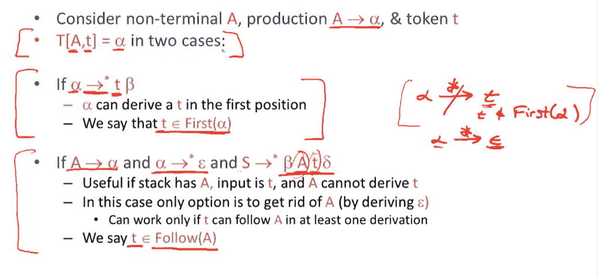

## First Sets

构建 parsing table 的 2 种情况之一。

核心: 在同一个 production 里，`non-terminal` 之后的 first terminal 可能是什么。

算法如下

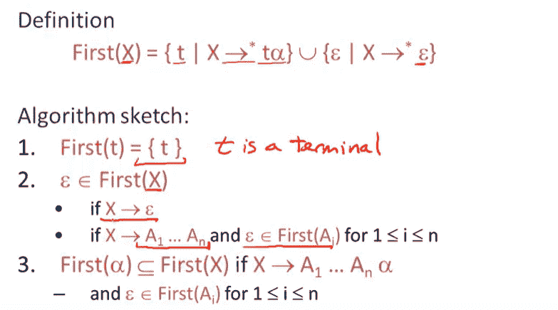

例子

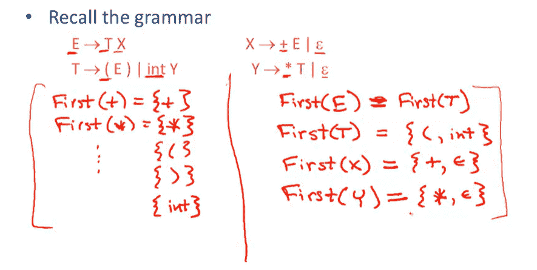

## Follow Set

构建 parsing table 的 2 种情况之二。

核心：跨 production 场景。`non-terminal` 是一个 production 的结束，他的下一个 terminal 可能是什么。

算法如下，

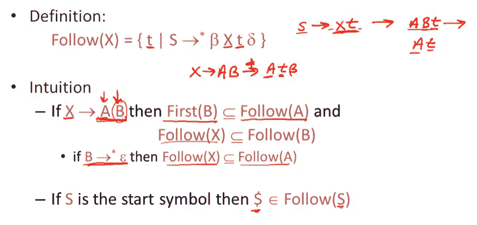

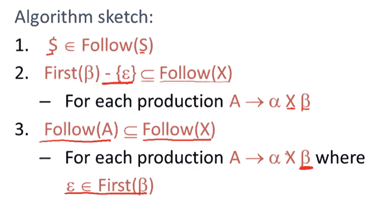

例子

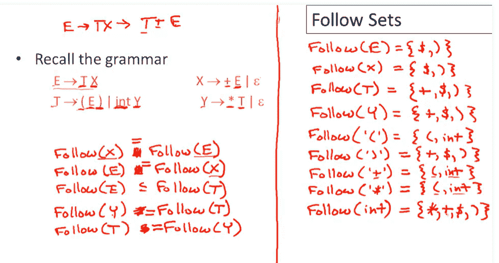

## 构造 `LL(1)` Parsing Table

已知 `first set` 和 `follow set` 之后，很简单。遍历一下填表就行。算法如下，

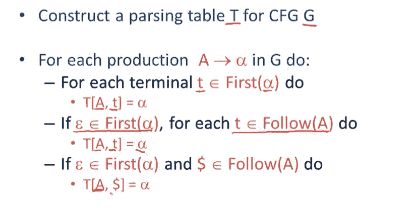

例子

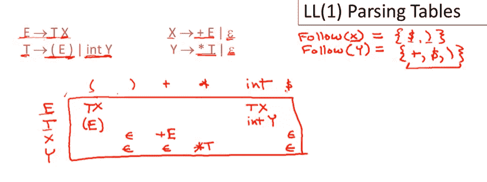

展开讨论

不满足 `LL(1)` 语法时，构造 parsing table 时，table cell 会出现 multiply defined move。

大部分语言的 context free grammar 都不是 `LL(1)`。比如，存在以下 feature：

1.  Not left factored

1.  Left recursive

1.  Ambiguous

1.  其他情况

# Bottom-Up Parsing

## 概述

特点：

1.  更 general & preferred

1.  不用 left-factored grammar。可以 natural grammar。

3 个重要 fact

1.  A `bottom-up parser` 是 `rightmost derivation` 的 reverse。

1.  `handle` 只出现在 `top of the stack`，never inside。

1.  For any grammar，the set of `viable prefixes` is a `regular language`。

一个例子

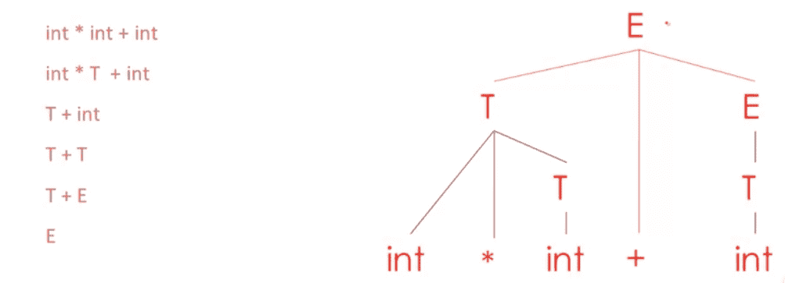

经典的 cfg 用法关系图

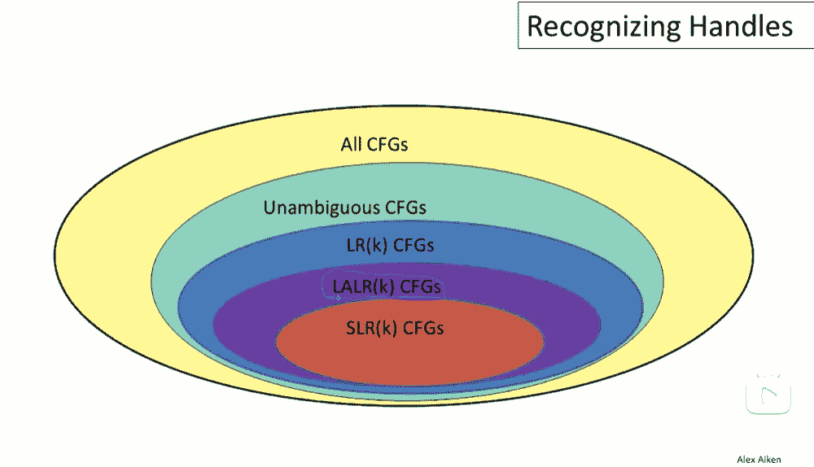

## A shift-reduce parsing

### 算法概述

这算法的实现过程，又复杂又枯燥。

而且，这是针对自动化工具的 parsing 算法，即使自己实现 parsing，也不太用自己实现算法。

了解原理，会根据自动化工具的语法配置 grammar 规则就够了。

算法的核心思路：只需要 2 种 `actions`：

1.  `Shift`

1.  `reduce` (reduction)

从左到右扫描 `input`，

1.  当已扫描的部分满足 `reduction` 条件时，就 `reduce`。

1.  如果不满足 `reduction` 条件，向右 `shift`。

难点是，何时 `shift`，何时 `reduce`。

这是后面 `handle`、`viable prefix` 这些概念回答的问题。

先假设我们能已经判定是否该 `reduce`。

`bottom-up parser` 是 `rightmost derivation` 的 `reverse`。

所以，做 `reduce` 时，右边的全是 `terminals`。不会有 `non-terminals`。

Reduction 的推导

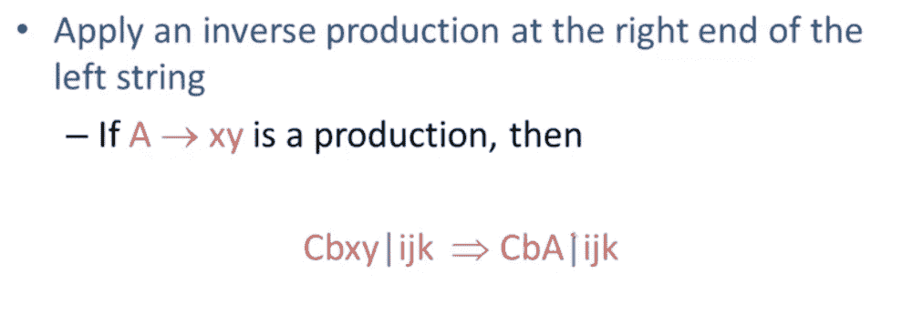

整体算法流程

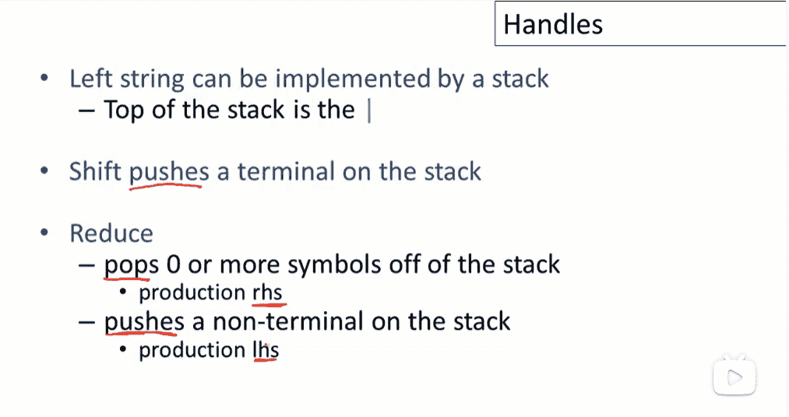

### Handle

核心问题：何时 `shift`，何时 `reduce`。

原则：`reduce` 之后的 `result` 能够继续 `reduce` 成 `start symbol`。这种 reduction 位置，叫 `handle`。

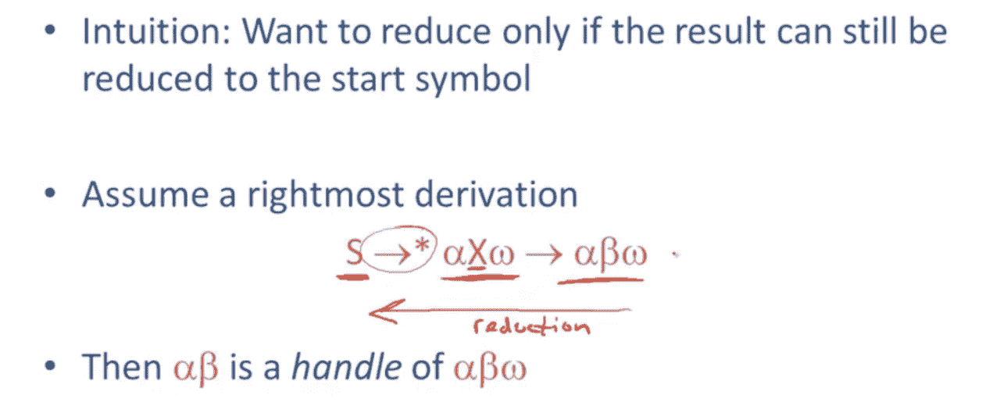

1.  `handle` 只出现在 `top of the stack`，never inside。

1.  `handle` 的右边全是 `terminals`。不会有 `non-terminals`。

下一步的关键，怎么找到 `handle`。

1.  没有一个高效的算法。

1.  可以先验法猜 `handles`，而且，在有些 context free grammar 上总是能猜对。

方法是，用 `viable prefix`。

### Viable Prefix

什么是 `viable prefix`？

1.  `handle` 的 `prefix`。不会超出 `handle` 的最右端。

1.  只要 `stack` 里有 `viable prefix`，说明还没发现 `parsing error`。很顺利。

`Parsing` 的过程中，遇到一个完整的 `handle` 之前，只能看到 `handle` 的一部分。

`viable prefix` 就是能看见的这部分。

`Viable prefix` 的集合，可以用 `regular language` 描述。

所以，可以用 `finite automata` 识别 `viable prefix`，进而完成 `bottom up parsing` 的核心。

核心是，怎么建立识别 `viable prefix` 的 `finite automata`，即，

1.  什么是 `state`

1.  什么是 `transition`

1.  `Input` 是什么？

识别 `viable prefix` 的难点在于，`stack` 里只有 production rhs 的一部分（`prefix`），不完整。

-- 如果完整，就可以 `reduce` 了。

所以，

1.  `state` 就是这些不完整的 `productions`。

1.  `Transition` 自然就是不完整的 `production`，读到下一个 `input token`，该进入哪个 `state`。

1.  `Input` 就是 `stack` 里的 `token sequence`。

### LR(0) items

用 `item` 描述不完整的 `production`。定义如下

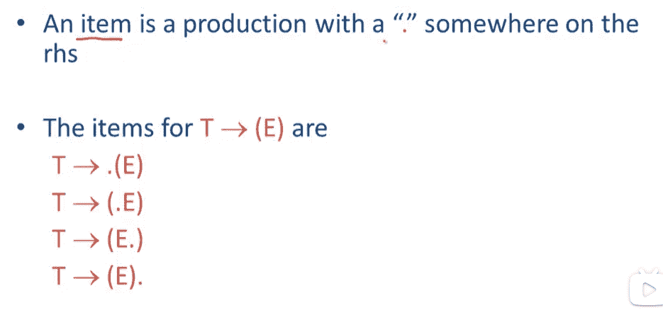

用 `items` 来描述见过的 `partial production`，变成

有限状态机的 `input`，即 `stack`，其实是一组 `prefix` 的组合。

也就是一堆 `items` 的组合。

一个例子，特别注意，`epsilon` 也是一个关键 `prefix`。

见过的 `prefix`，就是 `stack of items`

识别 `viable prefix`，就是

1.  从所有 `items` (`partial production`) 里找到能满足要求的，

1.  要求：能 `reduce` 成 `stack` 里前一个 `items` 的 `missing suffix`。

### 识别 Viable Prefix

算法流程如下，核心如前面总结

1.  有限状态机，用 `NFA` 建立。

1.  `NFA` 的 `state` 就是 `grammar G` 的 `items`。（不完整 `production`）

1.  为了 `transition` 完整，针对 `items` 增加了一些显而易见的 `production`。

一个例子

`Grammar` 如下

`NFA` 如下

### Valid Items

简单来说，就是能 `reduce` 成 `viable prefix` 缺的 `suffix` 的那些 `items`。

## SLR Parsing

基于 `viable prefix` 和 `valid items` 构建。

据说，特色是用了 `lookahead` 方法。

40min 讲 `SLR` (`sample LR`) 方法，没看。
