# CS143 编译原理笔记 6 - Register Allocation

> 来源：[https://learning.feishu.cn/docx/SXdfdGCwYozJGzx58B2cQntbnUb](https://learning.feishu.cn/docx/SXdfdGCwYozJGzx58B2cQntbnUb)

# 总结

本文是 Stanford CS143 Compilers 课程 Week 9 的笔记，讲 Register Allocation 阶段。

| weeks | topic | 视频时长 | 用时/二刷 |
| --- | --- | --- | --- |
| week 9-1 | register allocation | 40min | 1h |
| week 9-2 | 引用计数的垃圾回收 | 1h | 跳过 |

这部分，整体是简单又令人愉悦的。特别是 Graph coloring 和 spill 的概念。

提纲：

1.  上游 IR 假设了无限的 register。

1.  Codegen 时，硬件的 register 数量有限，使用 graph coloring 算法分配。

1.  Graph coloring 求解失败时，spill。即，插入 load/store 指令。

1.  spill 后，可能反而发现有解。不一定需要用 memory。

1.  compiler 搞不定太多的事情。比如，高效利用 cpu 的多级 cache。

点评：

1.  graph coloring 需要构建 Interference Graph。代价很高。

1.  spill code placement 比 coloring 问题更重要。graph coloring 只解决 coloring，不解决 spill。

1.  need to model alias and overlapping register classes。

1.  flexibility is more important than the coloring algorithm。

重要术语：

Register Interference Graph，简称 RIG

寄存器干扰图。表示变量之间的干扰关系。

节点是变量，边表示存在干扰，意味着，同一时间内不能被分配到同一寄存器。

# Register Allocation 建模

## 背景

IR 假设了无限的 register，但翻译 assembly code 时，一般不满足。

用 register allocation 解决。

1.  把多个 temporaries 分配给同一个 register

1.  不改变 program 的计算结果

举个例子：

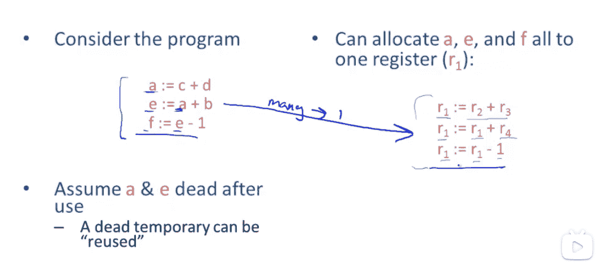

此时，用 SSA 分析 temporary 是否 dead，就容易很多。

历史

1.  历史悠久。1950 年代的 Fortran compiler 里就有了。但，非常粗糙。

1.  突破在 1980 年代，用了 graph coloring 算法。简单，& 效果不错。

## 算法原理

可以分配同一个 register 的前提：任意时刻，2 个变量最多只有 1 个 live。

[CS143 编译原理笔记 5 - Optimization](https://deep-learning.feishu.cn/wiki/Og26w1SA0iwPXSkpLx6c2H3yny7#share-FNZQd0kJwoXFd9xnVtvcLaAXnvc)iveness 分析的例子（方法同  ）

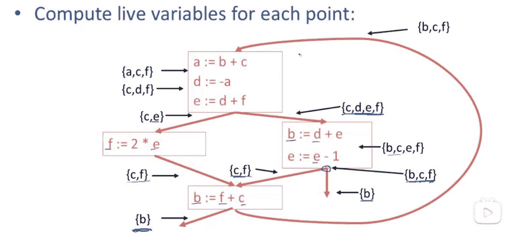

问题建模：Register Interference Graph，简称 RIG

1.  构造一个 undirected graph（无向图）。

1.  Node 是 temporary。edge 表示 2 个 node 某个时刻同时 live。（相互干扰）

1.  目标：没有 edge 相连的 node 可以分配同一个 register。

上面的例子，化成图

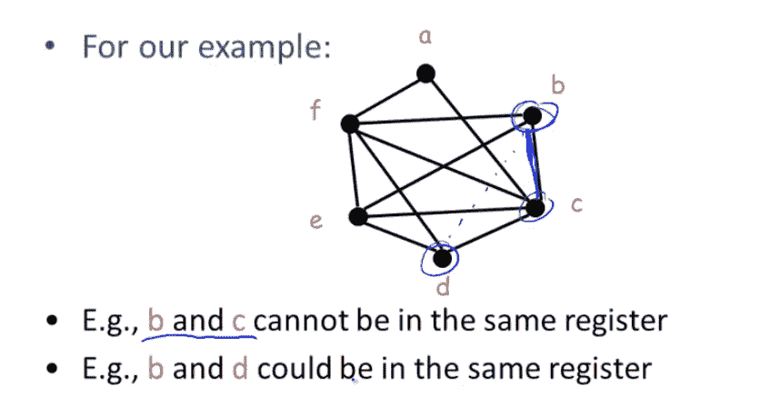

RIG 的特性：

1.  问题的 Exactly 抽象，没有丢失或污染信息。

1.  提供了 CFG 内的 Global picture。

1.  后续算法与硬件 architecture 无关。-- 只与 register 数量有关。

# 问题求解

## Graph coloring 算法

算法概述：

1.  给图上色，一条边的 2 个端点，颜色不能相同。

1.  如果能用 k 个颜色完成，就是 k-colorable

1.  假设寄存器的数量是 k，我们要求解的，就是 RIG 是否 k-colorable。

补充说明：

1.  所有 node 的 neighbor 都小于 k，则一定有解，且很容易求解。

1.  关键是，超过 k 个 neighbor 的 node 如何处理。

1.  注意，算法并未要求所有的 neighbor 颜色不同。所以，可能有解。

求解算法 - NP hard 问题

所以，用先验法解决。

思路

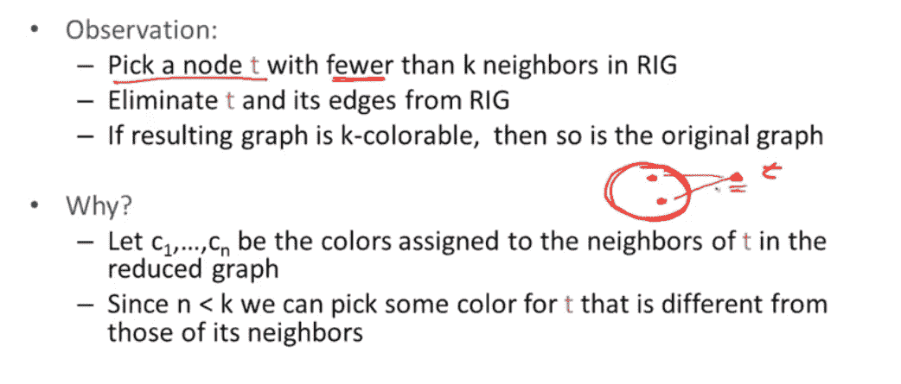

解释：

选出的 node t，边数 < k。即，与 t 相临的 node 用不完 k 个颜色。

所以，t 一定是可分配不冲突的颜色的。

算法流程

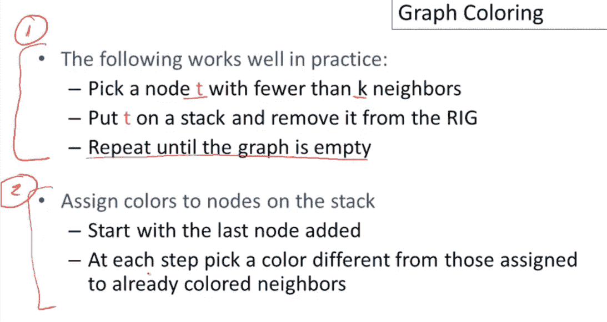

一个求解结果的例子

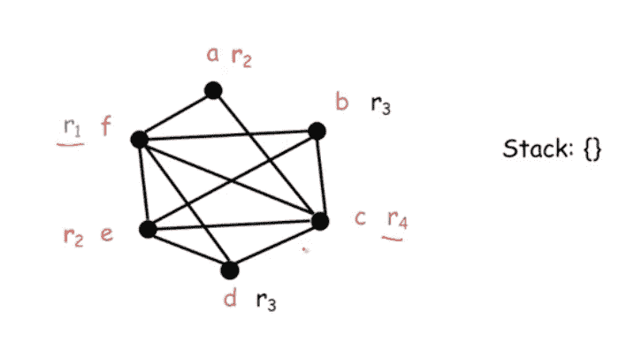

## Spilling

如果上述算法无解时，则选一个 temporary 溢出 (spill)

存在 2 种情况：

1.  Spill 之后，发现整个图是有解的。

1.  Spill 后，无解。一部分 temporary 要用 memory 暂存。

说明：

1.  经验法求解，并不保证可以找到所有解。所以，无解时，可能只是没找到解。

1.  核心是，spill 哪一个 temporary。

Case 1：Spill 后发现有解的情况。

选择 f 点 spill，然后发现，f 的 neighbor 没有用完所有 register。因此，f 可分配 register。

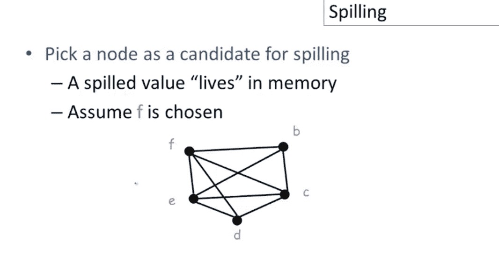

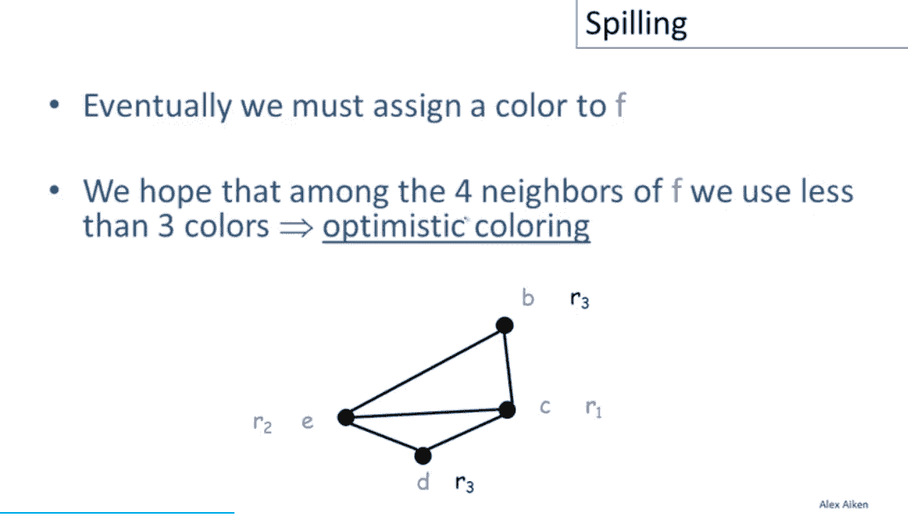

Case 2：spill 后依旧无解。

溢出到 memory。

1.  额外加入 load 和 store 指令读写内存。

1.  相当于把 1 个 temporary 拆成了多个独立的新 temporary。可以更新 rig 图。

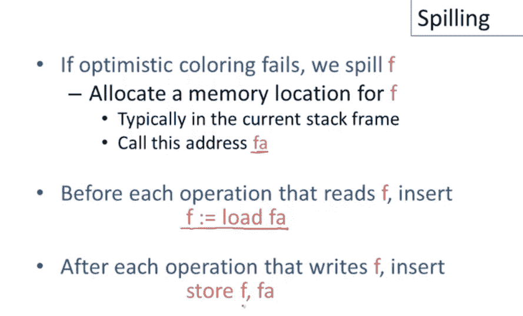

Spill 相当于，把 temporary 的 live range 拆分（split）并缩小。

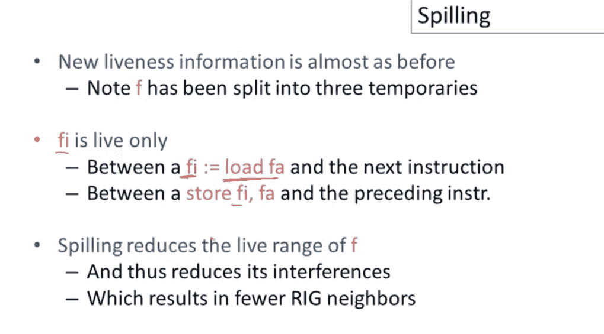

选哪一个 node spill，也是经验法。

1.  原则上，哪一个都可以。

1.  效果上，肯定有差异。

（翻译一下：暂无靠谱算法，自由发挥吧。spill 策略才是编译器实现寄存器分配的核心挑战）

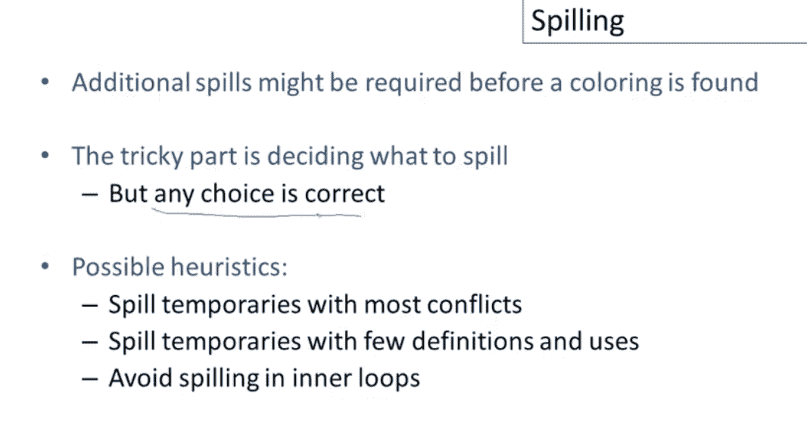

# Managing Caches

这个 topic，主要为了说明：compiler 搞不定太多的事情。

能搞定的，只举了一个例子：loop reorder。（有点简单，没整理笔记）

以 cpu 的 memory 为例，一般有多层 cache。

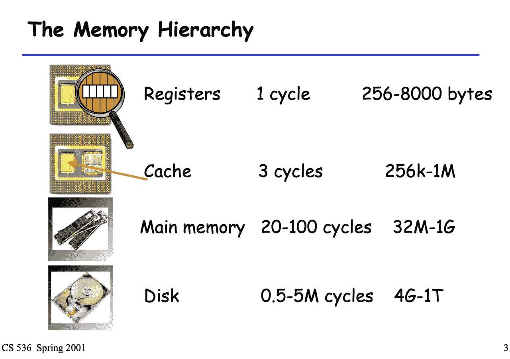

理论上，希望 compiler 也能做好 cache 的规划。

实践上，搞不定。

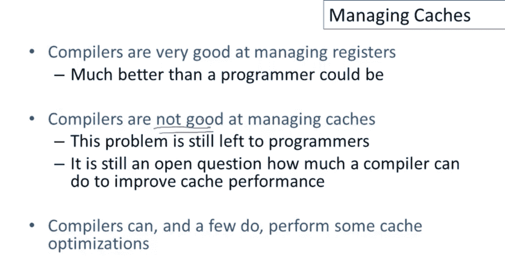