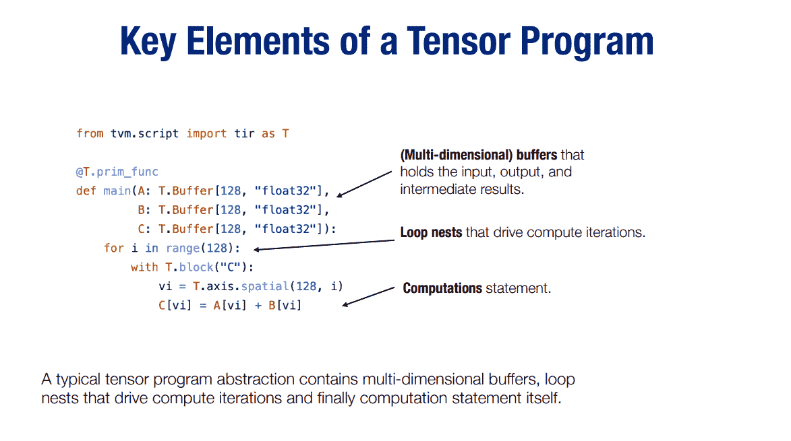
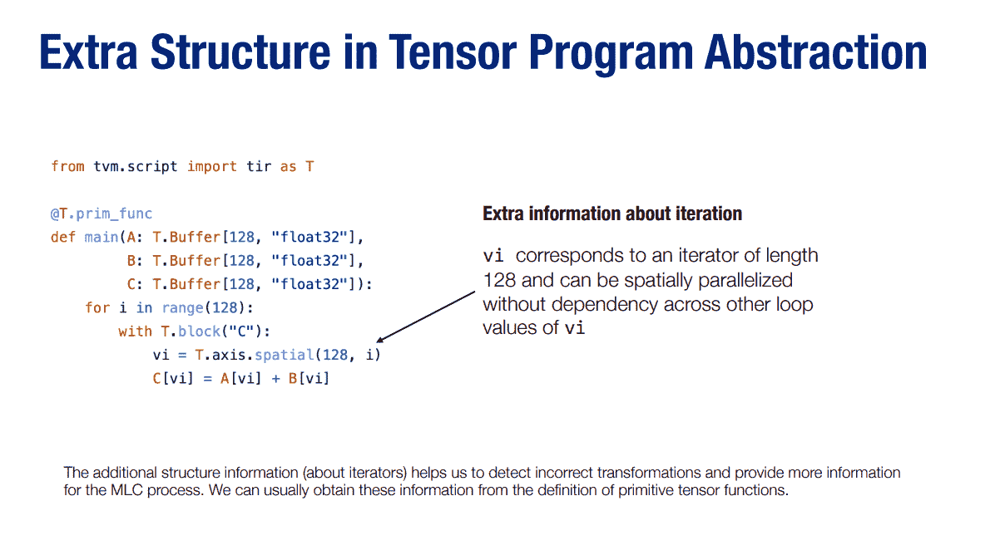
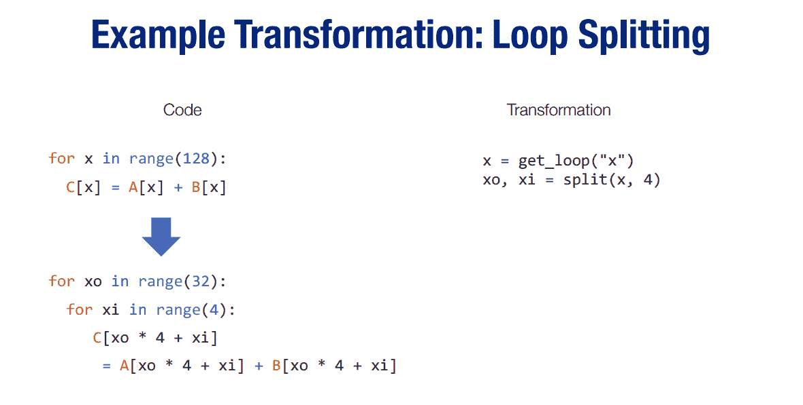
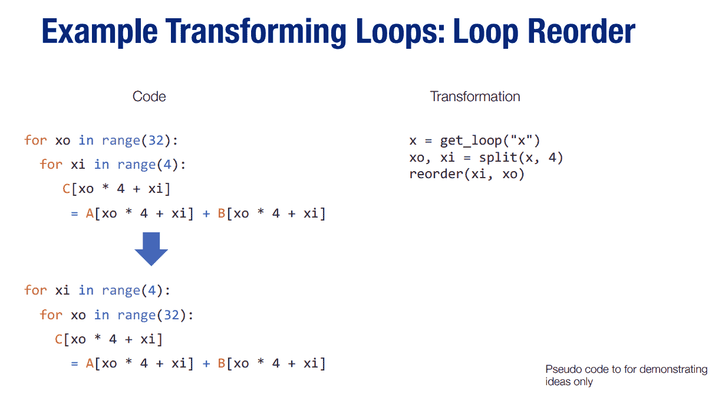
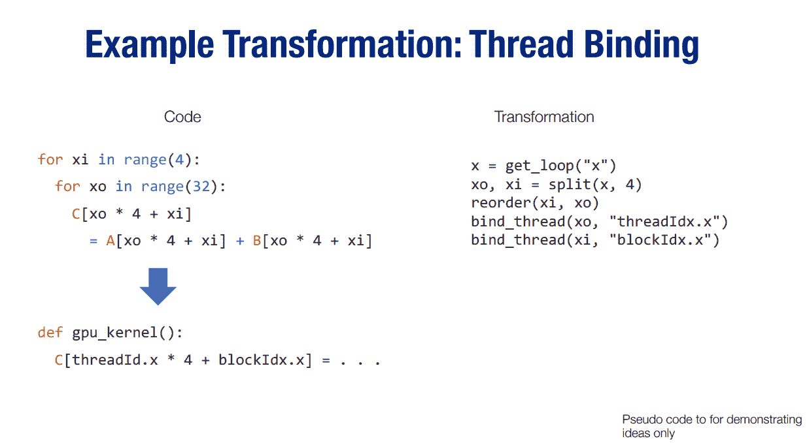
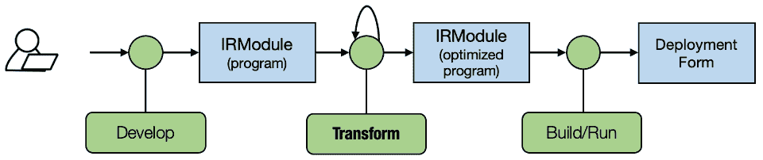
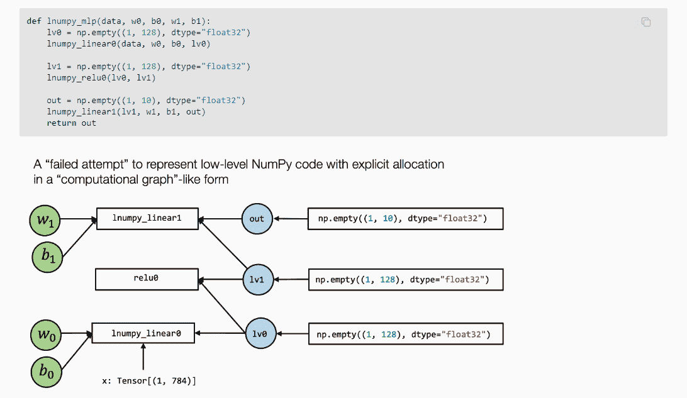
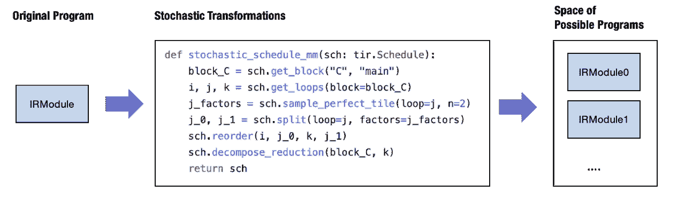
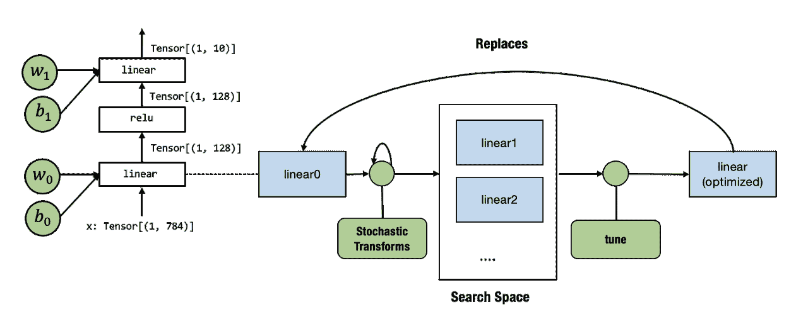
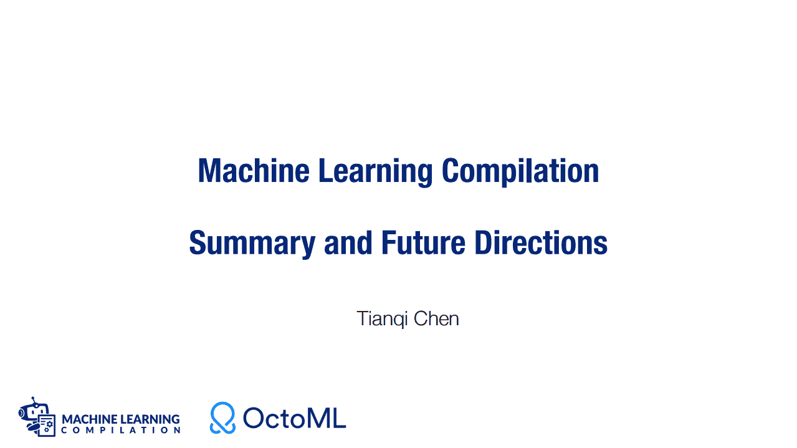

# TVM - 陈天奇 - MLC 课程笔记

> 来源：[https://learning.feishu.cn/docx/I1jQdqX0govAoAxeq4TcMIJhnqf](https://learning.feishu.cn/docx/I1jQdqX0govAoAxeq4TcMIJhnqf)

## 课程信息

| slides | `https://mlc.ai/summer22/schedule` |
| --- | --- |
| video | `https://www.bilibili.com/video/BV15v4y1g7EU/` |
| 时长 | 共约 8 小时。 |
| 点评 | 1. 陈天奇讲话很慢，可以 1.5x - 2.0x 观看。 |

## 要点总结

1. 主要是在讲 `tvm` 和 `relax`。并没有覆盖一般的 ai compiler，比如，`MLIR` 生态。
2. 图优化，只讲了算子融合。没涉及 `dag` 拓扑序优化等。
3. tools to construct an `IRModule`
4. 总体流程：`dl` 框架模型 -> `IRModule` ->(反复) `IRModule`(optimized) -> `build`/`run` (code gen)
5. `Tensor` and `Tensor functions`：基本数据结构，及其运算。
6. `Abstraction and implementation`：compiler 的基本方法论，不同的优化 level，使用不同的抽象。
7. 图层，一般用 `tensor`。
8. `codgen` 和指令发射，需要更细粒度的抽象。
9. `Primitive Tensor Function`: 最基本的 `Tensor Function`。
10. `Tensor Program Abstraction`。基本组成是 3 个：
11. `multi-dimensional buffer`
12. `loop nests`
13. `computation statement`
14. `Extra structure` 给优化提供更多的信息，比如
15. `T.axis.spatial`
16. `Relax` 的 2 个关键抽象
17. `Dataflow`
18. `call_dps_packed` / `call_tir`
19. 端到端编译的过程
20. `Build`
21. `VirtualMachine`
22. `vm['main']`
23. 2 个优化
24. 可以注册灵活注册 runtime function 的实现。比如，run 的时候，使用 `cuda` 算子。
25. 可以把 `parameter` bind 到 `IRModule` 上，调用时传一个 `dict` 即可。

### 总结已讲内容

1. 不同的表示，apply 不同的 `pass`
2. 计算图表示
3. `TIR` 表示
4. 对 `Primitive Tensor Function`，如何 `transform`
5. 对整个计算图如何 `transform`

### 总结

1. 主要是传递了一个思想，用采样 + `search space` + `cost model` 的思想，自动做最优化搜索。
2. `tvm.relax.vm.Executable` 类，提供了 `time_evaluator` 方法，可以直接测速。
3. 自动搜索的核心 API: `meta_schedule`。包括：`tune_tir`，`space_generator`

### 总体流程


## TODO

做一下：

- `https://tvm.apache.org/docs/how_to/optimize_operators/opt_gemm.html`
- 试一下 `chap 05` 的自动搜索。

## chap 01- MLC 概述

1.5x 倍速 + 不停的快进，20 分钟看完。

一共讲了 2 部分：

1. Why study: 外行入门听听概念就行，没啥特别需要记得。
2. Key elements in MLC: 有点东西。从 23:40 左右开始看。

### 要点总结

1. 一个抽象但有启发的观点：`MLC` 把 model 从 development form 转换成 deployment form。
2. `MLC` goal: 理论上，没啥是 `transform pass` 没法做的。市场想要啥，我们的 goal 就是啥。
3. 当前的 goal：`Leverage Hardware Native Acceleration`。具体包括：
4. `Minimize memory usage`
5. `Improve execution efficiency`
6. `Scaling to multiple heterogeneous nodes`
7. `Key Elements in MLC`
8. `Tensor` and `Tensor functions`：基本数据结构，及其运算。
9. `Abstraction and implementation`：compiler 的基本方法论，不同的优化 level，使用不同的抽象。
10. 图层，一般用 `tensor`。
11. `codgen` 和指令发射，需要更细粒度的抽象。

## chap 02 - Tensor Program Abstraction

1. 用 `TVM` 的 2 种 DSL 写算子。

   - `TVMScript` 的 `TIR` 写 矩阵加法
   - `Tensor Expression`（简称 `TE`）写矩阵乘法

2. 程序优化程序。`tvm scheduler` 把矩阵乘的性能提升 ~10 倍。

### 内容笔记

1. `Primitive Tensor Function`: 最基本的 `Tensor Function`。
2. `Tensor Program Abstraction`。基本组成是 3 个：
3. `multi-dimensional buffer`
4. `loop nests`
5. `computation statement`
6. `Extra structure` 给优化提供更多的信息，比如
7. `T.axis.spatial`





### Example - 手动优化 loop

用 `TVM Script` 和 `Tensor Expression` 2 种写法，分别写了个 `func` 并演示了如何 `transform`。

耗时从 2.4ms 提升至 0.15ms

Code `Jupyter`: `https://github.com/mlc-ai/notebooks/blob/main/2_tensor_program_abstraction.ipynb`

与一般的 compiler pass 区别不大，主要是熟悉一下 `tvm` 的 `api`。

详见 3 个截图







## Chap 03 - Tensor Program Abstraction Case Study: TensorIR

纯 `TVM` 的 coding。

`TVM` 里面有 `Relay` 和 `TensorIR`。这个讲的是 `TensorIR` 的 `API`

low-level `numpy` 的 `API`，实现

```
dtype = "float32"
a_np = np.random.rand(128, 128).astype(dtype)
b_np = np.random.rand(128, 128).astype(dtype)
# a @ b is equivalent to np.matmul(a, b)
c_mm_relu = np.maximum(a_np @ b_np, 0)
```

`TVM` 里的核心抽象：`IRModule`。

就是 compiler 里的 `IR` 的概念。



## Chap 04 - Build End to End Models

1. 用 `TVM` 手写模型。用到了 `Relax` 的 2 个 `API`: `Dataflow`, `call_dps_packed` / `call_tir`
2. 可以注册外部算子，并在模型里混合使用。使用 `call_dps_packed` 调用外部算子。
3. 把模型权重 bind 到 `IRModule` 上，运行时不用再传入模型权重。

### 备注

+ `tvm` 仓库 main 分支还没有 `relax`，需要 `git checkout unity`
+ 原始 code 下载 `pytorch` 数据集 & 模型，引入了很多额外代码，我已预处理好，并精简了无关 `tvm` 的代码。

### 要点

1. `Relax` 的 2 个关键抽象
2. `Dataflow`
3. `call_dps_packed` / `call_tir`
4. 端到端编译的过程
5. `Build`
6. `VirtualMachine`
7. `vm['main']`
8. 2 个优化
9. 可以注册灵活注册 runtime function 的实现。比如，run 的时候，使用 `cuda` 算子。
10. 可以把 `parameter` bind 到 `IRModule` 上，调用时传一个 `dict` 即可。

`Dataflow` 要求 `pure function`。衍生了 `call_dps_packed` 和 `Dataflow` 2 个 `api` 需求。

data flow 的模式里，要求 `function` 是 `pure function`，即，不能修改 `input`。

1. 如果修改了，得到一个不规范的 `DAG`，后续很难 apply 其他 `pass`。
2. `element wise` 算子，在 `tvm` 里面也很难复用 `input` 的内存，导致，内存占用增加，吞吐下降。

`Compiler` 里有一些解决这类问题的方法，比如，使用 `alias` 等。

核心的 demo 代码如下：

注：视频里是 `call_tir`, 网站上的笔记是 `call_dps_packed`

```
@tvm.script.ir_module
class MyModule:
    @T.prim_func
    def relu0(x: T.handle, y: T.handle):
        n = T.int64()
        X = T.match_buffer(x, (1, n), "float32")
        Y = T.match_buffer(y, (1, n), "float32")
        for i, j in T.grid(1, n):
            with T.block("Y"):
                vi, vj = T.axis.remap("SS", [i, j])
                Y[vi, vj] = T.max(X[vi, vj], T.float32(0))

    @T.prim_func
    def linear0(x: T.handle,
                w: T.handle,
                b: T.handle,
                z: T.handle):
        m, n, k = T.int64(), T.int64(), T.int64()
        X = T.match_buffer(x, (1, m), "float32")
        W = T.match_buffer(w, (n, m), "float32")
        B = T.match_buffer(b, (n, ), "float32")
        Z = T.match_buffer(z, (1, n), "float32")
        Y = T.alloc_buffer((1, n), "float32")
        for i, j, k in T.grid(1, n, m):
            with T.block("Y"):
                vi, vj, vk = T.axis.remap("SSR", [i, j, k])
                with T.init():
                    Y[vi, vj] = T.float32(0)
                Y[vi, vj] = Y[vi, vj] + X[vi, vk] * W[vj, vk]
        for i, j in T.grid(1, n):
            with T.block("Z"):
                vi, vj = T.axis.remap("SS", [i, j])
                Z[vi, vj] = Y[vi, vj] + B[vj]

    @R.function
    def main(x: R.Tensor((1, "m"), "float32"),
             w0: R.Tensor(("n", "m"), "float32"),
             b0: R.Tensor(("n", ), "float32"),
             w1: R.Tensor(("k", "n"), "float32"),
             b1: R.Tensor(("k", ), "float32")):
        m, n, k = T.int64(), T.int64(), T.int64()
        with R.dataflow():
            lv0 = R.call_dps_packed("linear0", (x, w0, b0), R.Tensor((1, n), "float32"))
            lv1 = R.call_dps_packed("relu0", (lv0, ), R.Tensor((1, n), "float32"))
            out = R.call_dps_packed("linear0", (lv1, w1, b1), R.Tensor((1, k), "float32"))
            R.output(out)
        return out
```

### 重要注释

1. 一个 `main` 函数，2 个 `prim_func`
2. `Main` 函数有一个 `dataflow` 的 `scope annotation` 函数。其中的所有 `operation`，都通过 `call_dps_packed` 函数执行。
3. `call_dps_packed` 自动帮 `prim_func` 开好 `output` 内存空间，并调用 `prim_func` 执行。使得 `dag` 的每一个 `function` 继续满足 `pure function` 的约束。

### call_dps_packed

既重要，又不重要的一个小细节 trick。

如果把 `output allocation` 当成一个 `node` 加入 `dag`，会导致非常奇怪的 `graph`，如下，

`relu0` 和 `lnumpy_linear0` 的依赖关系，已经被破坏了。

当，`dag` 难以反应真实计算逻辑时，后续的 `transform pass` 就很容易失效，或者引入 `bug`。



### Dataflow Block

因为 `dag` 要求 `side effect free`，但有的时候做不到。

引入了 `dataflow` 的概念，可以把一个大 `dag` 拆成多个小 `dag`，小 `dag` 之间插入有 `side effect` 的代码。

每一个小 `dag`，用 `dataflow` 标注出来 `scope`，依旧满足 `side effect free` 的要求。

### Compile and Run

```
# step 1: build to tvm.relax.vm.Executable
ex = relax.build(MyModule, target="llvm")

# step 2: initialize a virtual machine executor
vm = relax.VirtualMachine(ex, tvm.cpu())

# step 3: run with input params
nd_res = vm["main"](data_nd, 
                    nd_params["w0"],
                    nd_params["b0"],
                    nd_params["w1"],
                    nd_params["b1"])
```

### Registering Runtime Function


```
@tvm.register_func("env.linear", override=True)
def torch_linear(x: tvm.nd.NDArray, 
                 w: tvm.nd.NDArray, 
                 b: tvm.nd.NDArray, 
                 out: tvm.nd.NDArray):
    x_torch = torch.from_dlpack(x)
    w_torch = torch.from_dlpack(w)
    b_torch = torch.from_dlpack(b)
    out_torch = torch.from_dlpack(out)
    torch.mm(x_torch, w_torch.T, out=out_torch)
    torch.add(out_torch, b_torch, out=out_torch)
    
R.call_dps_packed("env.linear", (x, w0, b0), out_sinfo=R.Tensor((1, 128), dtype="float32"))
```

# Bind Parameters to IRModule

传参时，只需要传入一个参数即可。

```
MyModuleWithParams = relax.transform.BindParams("main", nd_params)(MyModule)

ex = relax.build(MyModuleWithParams, target="llvm")
vm = relax.VirtualMachine(ex, tvm.cpu())

nd_res = vm["main"](data_nd)
```

# Chap 05 - Automatic Optimization

总结已讲内容：

1. 不同的表示，apply 不同的 `pass`

1. 计算图表示

1. `TIR` 表示

1. 对 `Primitive Tensor Function`，如何 `transform`

1. 对整个计算图如何 `transform`

总结：

1. 主要是传递了一个思想，用采样 + `search space` + `cost model` 的思想，自动做最优化搜索。

1. `tvm.relax.vm.Executable` 类，提供了 `time_evaluator` 方法，可以直接测速。

1. 自动搜索的核心 `API`: `meta_schedule`。包括：`tune_tir`，`space_generator`

## TVM API

相关的 `tvm` 方法

```
# sch: tvm.tir.Schedule, 可以采样。
# 返回 list，element 是 tvm.tir.expr.Var，方便对采样结果做跟踪或其他高级操作。
j_factors = sch.sample_perfect_tile(loop=j, n=2)
j_0, j_1 = sch.split(loop=j, factors=j_factors)
# type(j_factors[0]): tvm.tir.expr.Var
```

演示了一个矩阵乘的例子：

1. 初始: 3.320 ms

1. 简单的 `tiling` 之后: 1.684 ms

1. `Random search` 找到：1.229 ms

1. 使用 `meta_schedule` 找到：1.230 ms

1. 使用默认 `space` 参数做 `meta_schedule` 搜索，找到: 0.209 ms



基于 `meta_schedule` 方法搜策略的 example code

```
from tvm import meta_schedule as ms


def stochastic_schedule_mm(sch: tvm.tir.Schedule):
    block_C = sch.get_block("C", "main")
    i, j, k = sch.get_loops(block=block_C)
    j_factors = sch.sample_perfect_tile(loop=j, n=2)
    j_0, j_1 = sch.split(loop=j, factors=j_factors)
    sch.reorder(i, j_0, k, j_1)
    sch.decompose_reduction(block_C, k)
    return sch


# space 的传参，与默认值的算法相似，可以省略。而且，默认的可能效果更好。
database = ms.tune_tir(
    mod=MyModule,
    target="llvm --num-cores=1",
    max_trials_global=64,
    num_trials_per_iter=64,
    space=ms.space_generator.ScheduleFn(stochastic_schedule_mm),
    work_dir="./tune_tmp",
    task_name="main"
)

sch = ms.tir_integration.compile_tir(database, MyModule, "llvm --num-cores=1")
```

`meta_schedule` 提供的功能：

+ Parallel benchmarking across many processes.

+ Use `cost models` to avoid benchmarking each time.

+ Evolutionary search on the traces instead of randomly sampling at each time.

默认的 `space` 效果明显更好，根据 `sch.trace` 分析，原因如下：

+ More levels of loop tiling transformations.

+ Vectorization of intermediate computations.

+ Parallelization and unrolling of loops.

简单总结：搜索空间更大。`trace` 如下

```
# from tvm import tir
def apply_trace(sch: tir.Schedule) -> None:
  b0 = sch.get_block(name="C", func_name="main")
  b1 = sch.get_block(name="root", func_name="main")
  sch.annotate(block_or_loop=b0, ann_key="meta_schedule.tiling_structure", ann_val="SSRSRS")
  l2, l3, l4 = sch.get_loops(block=b0)
  v5, v6, v7, v8 = sch.sample_perfect_tile(loop=l2, n=4, max_innermost_factor=64, decision=[1, 32, 1, 4])
  l9, l10, l11, l12 = sch.split(loop=l2, factors=[v5, v6, v7, v8], preserve_unit_iters=True)
  v13, v14, v15, v16 = sch.sample_perfect_tile(loop=l3, n=4, max_innermost_factor=64, decision=[1, 128, 1, 1])
  l17, l18, l19, l20 = sch.split(loop=l3, factors=[v13, v14, v15, v16], preserve_unit_iters=True)
  v21, v22 = sch.sample_perfect_tile(loop=l4, n=2, max_innermost_factor=64, decision=[16, 8])
  l23, l24 = sch.split(loop=l4, factors=[v21, v22], preserve_unit_iters=True)
  sch.reorder(l9, l17, l10, l18, l23, l11, l19, l24, l12, l20)
  sch.annotate(block_or_loop=b1, ann_key="meta_schedule.parallel", ann_val=16)
  sch.annotate(block_or_loop=b1, ann_key="meta_schedule.vectorize", ann_val=64)
  v25 = sch.sample_categorical(candidates=[0, 16, 64, 512], probs=[0.25, 0.25, 0.25, 0.25], decision=3)
  sch.annotate(block_or_loop=b1, ann_key="meta_schedule.unroll_explicit", ann_val=v25)
  sch.enter_postproc()
  b26 = sch.get_block(name="root", func_name="main")
  sch.unannotate(block_or_loop=b26, ann_key="meta_schedule.parallel")
  sch.unannotate(block_or_loop=b26, ann_key="meta_schedule.vectorize")
  sch.unannotate(block_or_loop=b26, ann_key="meta_schedule.unroll_explicit")
  b27, = sch.get_child_blocks(b26)
  l28, l29, l30, l31, l32, l33, l34, l35, l36, l37 = sch.get_loops(block=b27)
  l38 = sch.fuse(l28, l29, l30, preserve_unit_iters=True)
  sch.parallel(loop=l38)
  sch.annotate(block_or_loop=l38, ann_key="pragma_auto_unroll_max_step", ann_val=512)
  sch.annotate(block_or_loop=l38, ann_key="pragma_unroll_explicit", ann_val=1)
  b39 = sch.get_block(name="C", func_name="main")
  l40, l41, l42, l43, l44, l45, l46, l47 = sch.get_loops(block=b39)
  b48 = sch.decompose_reduction(block=b39, loop=l42)
```

## Tune 模型

可以 `tune` 完整模型，也可以只 `tune` 一个 `layer`。

`Tune` 一个 `layer` 的算法流程如下：



注：`tune_tir` `API` 目前要求 `IRModule` 必须有 `main` 函数。

流程：

1. 把 `layer` 拿出来，加入 `main` 函数，作为一个单独的 `IRModule`。

1. 调用 `tune_tir`。

1. 调用 `update_func` 方法，把 `tune` 后的代码写回原始 `IRModule`。(个人理解，用 `runtime register` 的方法，估计也行）

```
mod_linear = tvm.IRModule.from_expr(MyModuleMixture["linear0"].with_attr("global_symbol", "main"))

database = ms.tune_tir(
    mod=mod_linear,
    target="llvm --num-cores=1",
    max_trials_global=64,
    num_trials_per_iter=64,
    work_dir="./tune_tmp",
    task_name="main",
)
sch = ms.tir_integration.compile_tir(database, mod_linear, "llvm --num-cores=1")

# original IRModule
MyModuleWithParams2 = relax.transform.BindParams("main", nd_params)(MyModuleMixture)

# get new func and update
new_func = sch.mod["main"].with_attr("global_symbol", "linear0")
gv = MyModuleWithParams2.get_global_var("linear0")
MyModuleWithParams2.update_func(gv, new_func)

# build and run, as normal
ex = relax.build(MyModuleWithParams2, target="llvm")
vm = relax.VirtualMachine(ex, tvm.cpu())

nd_res = vm["main"](data_nd)

pred_kind = np.argmax(nd_res.numpy(), axis=1)
print("MyModuleWithParams2 Prediction:", class_names[pred_kind[0]])
```

### 测速对比

初始：0.236435 ms

优化后：0.0982011 ms

# Chap 06 - Integration with DL Frameworks

前面讲的，都是用 `tvm script` 写 `IRModule`。模型大了以后，不方便。

新工具：`Tensor expression` 和 `tvm frontend`。

## tensor expression

`tensor expression` 是一种 `DSL`。提供了：

1. `te.placeholder`

1. `te.tensor.Tensor`

1. `te.compute`

1. `te.reduce_axis`

1. `te.create_prim_func`

```
# type: tvm.te.tensor.Tensor
A = te.placeholder((128, 128), name="A", dtype="float32")
B = te.placeholder((128, 128), name="B", dtype="float32")

# te.compute(output_shape, fcompute)
#  fcompute function describes how we want to compute the value of each element [i, j] for a given index.
def te_matmul(A: te.Tensor, B: te.Tensor) -> te.Tensor:
    assert A.shape[1] == B.shape[0]
    n = A.shape[0]
    m = B.shape[1]
    k = te.reduce_axis((0, A.shape[1]), name="k")
    return te.compute((n, m), lambda i, j: te.sum(A[i, k] * B[k, j], axis=k), name="matmul")

C = te_matmul(A, B)
te.create_prim_func([A, B, C]).show()
```

## BlockBuilder

好像，就是一些胶水代码。不太重要。


```
A = relax.Var("A", relax.TensorStructInfo((128, 128), "float32"))
B = relax.Var("B", relax.TensorStructInfo((128, 128), "float32"))

bb = relax.BlockBuilder()

with bb.function("main"):
    with bb.dataflow():
        C = bb.emit_te(te_matmul, A, B)
        D = bb.emit_te(te_relu, C)
        R = bb.emit_output(D)
    bb.emit_func_output(R, params=[A, B])

MyModule = bb.get()
MyModule.show()
```

# Chap 10 - Summary and Future Works

## Import Model From PyTorch

直接看 slide 好像就行，作者眼中的要点总结。

没看到非常有价值的 future work 总结。



[10-Summary-Future.pdf](https://internal-api-drive-stream.feishu.cn/space/api/box/stream/download/all/SrMHbfEYAoVvHMxhukqcuC5jnnq)
