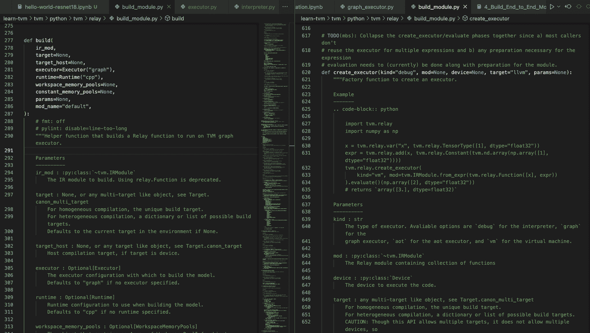
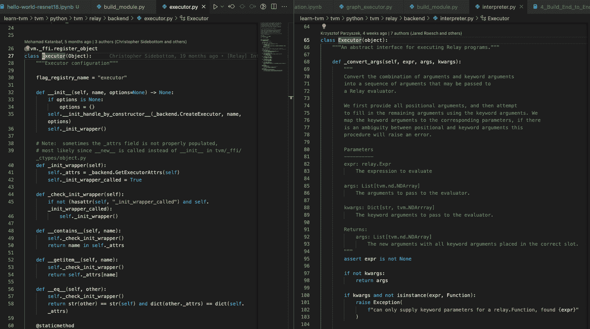
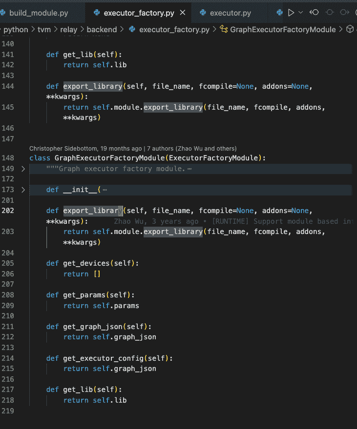

# TVM build & relay 代码初探

> 来源：[https://learning.feishu.cn/docx/SH7LdmBUQomW2Nxb267c67dPneg](https://learning.feishu.cn/docx/SH7LdmBUQomW2Nxb267c67dPneg)

# 背景

1.  TVM 的 build & run，有多种 API 组合可选，功能也好像差不多。

1.  现在，又增加了 relax & unity，排列组合更多了。

1.  有些组合，在新版本已经用不了。上手别人的新代码，很容易卡在跑通环节。

为了解决这个问题，

1.  核心是搞懂 TVM 的流程，build 和 Run 都需要看。

1.  重点是入口的 relay/relax/unity 层的 API。

# TVM 代码的整体理解

先处理成 AST，用 Expr 类存储。

执行的方法，主要是 2 个：

1.  VisitExpr, 不改变 Expr。或者说，不返回修改后的 Expr。

1.  Mutate 返回修改后的表达式。

AST 里的 code，不同的 code，用不同的子类，重写 VisitExpr，夹带了对应 code 的真实业务逻辑。

所以，VisitExpr 就是在部分的执行 code 了。不是简单的遍历一下。

# 起始 code

## Version 1: relay.build + set_input

```
target = &quot;llvm&quot;
ctx = tvm.cpu(0)
with tvm.transform.PassContext(opt_level=3):
    lib = relay.build(mod, target=target, params=params)


from tvm.contrib import graph_executor

m = graph_executor.GraphModule(lib[&quot;default&quot;](tvm.cpu(0)))
m.set_input(img_input_name, tvm.nd.array(img.astype(&#x27;float32&#x27;)))
m.run()
tvm_output = m.get_output(0)
top1_tvm = np.argmax(tvm_output.numpy()[0])
print(top1_tvm)
```

## Version 2: create_executor & evaluate

```
with tvm.transform.PassContext(opt_level=3):
    intrp = relay.build_module.create_executor(&quot;graph&quot;, mod, tvm.cpu(0), target)


dtype = &quot;float32&quot;
tvm_output2 = intrp.evaluate()(tvm.nd.array(img.astype(dtype)), **params)
top1_tvm2 = np.argmax(tvm_output2.numpy()[0])
print(top1_tvm2)
```

# TVM build

```
# version 1:
lib = relay.build(mod, target=target, params=params)

# version 2: 
intrp = relay.build_module.create_executor(&quot;graph&quot;, mod, tvm.cpu(0), target)
```

relay.build 和 relay.build_module.create_executor 都在同一个 py 文件里：relay/build_module.py

但没看到直接的联系。



两个 API 都创建了 graph 的 Executor，但 API 也不一样。

```
# version 1:
executor=Executor(&quot;graph&quot;)

# version 2:
# 处理默认值的代码之后，直接 return。重点看 GraphExecutor 即可。
return GraphExecutor(mod, device, raw_targets)

# GraphExecutor 定义在同文件里，继承 _interpreter.Executor
class GraphExecutor(_interpreter.Executor):

```

2 边虽然都用了同名的 Executor 类，但没有继承关系，也不再同一个 py 文件里。



左边的 executor 类，没啥用。只是一个 name 的判断。

最终实际 return 的是 _executor_factory.GraphExecutorFactoryModule

```
        elif executor.name == &quot;graph&quot;:
            executor_factory = _executor_factory.GraphExecutorFactoryModule(
                ir_mod,
                raw_targets,
                executor,
                graph_json,
                runtime_mod,
                mod_name,
                params,
                func_metadata,
            )
```

# 总结

没搞透彻，但基本看懂了。

1.  2 个 API 背后的逻辑，那是基本不一样。一人造了一套轮子。

1.  Version 1 用的 relay.build，更靠谱一些。能 export 动态库文件，方便 deploy 分发。

1.  在 relax 里面，也提供了 relax.build 方法相对应。不过，实际做的事情 & 代码流程，好像跟 relay 又是完全不一样。

