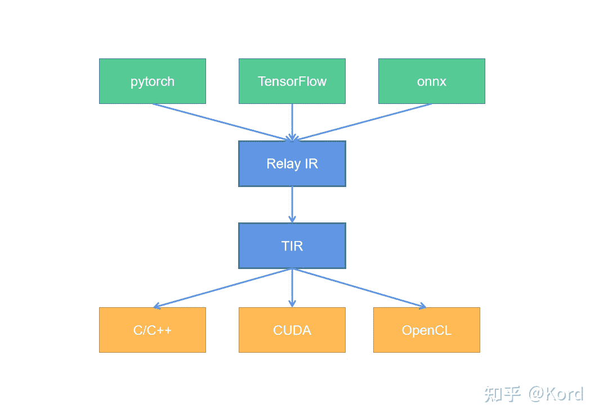
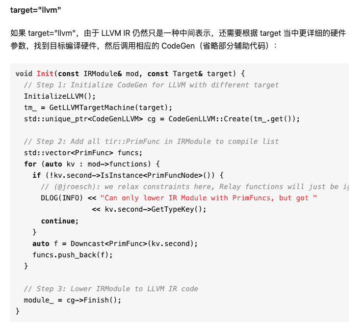
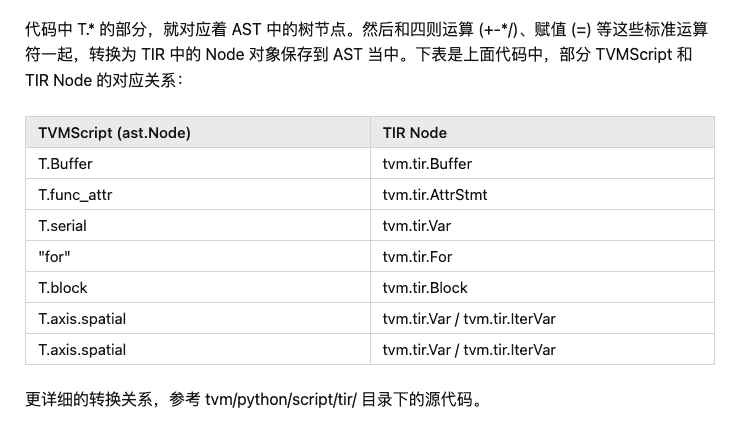
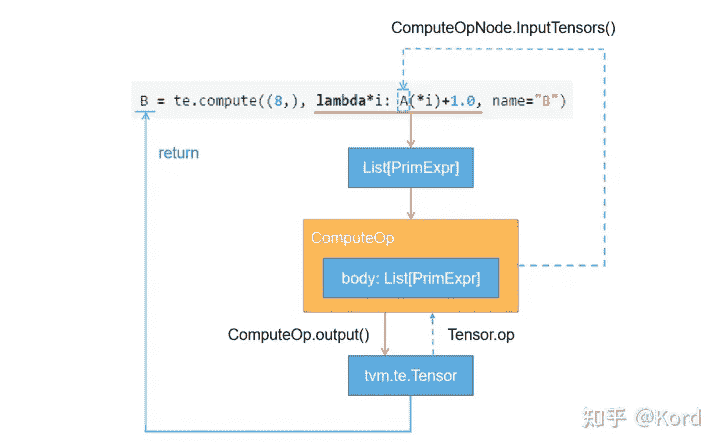
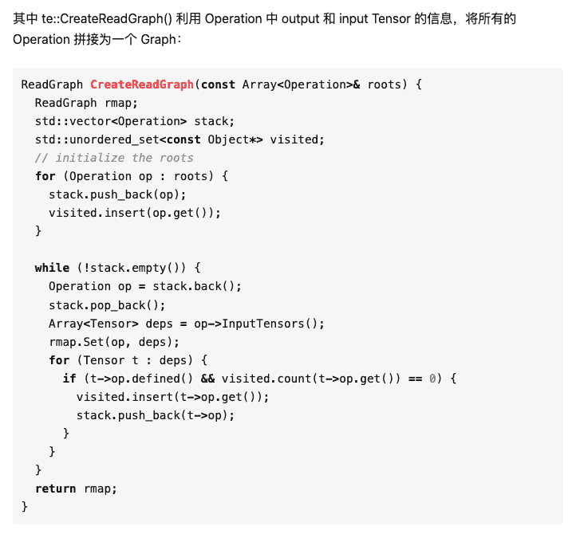
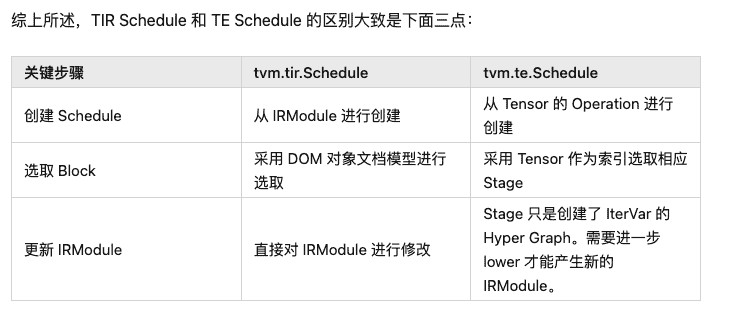
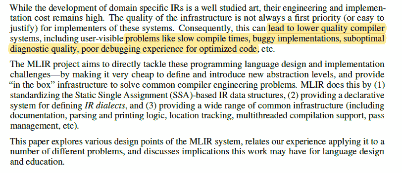

# 深入理解 TVM

> 来源：[https://learning.feishu.cn/docx/IllndM1n6oclnWxfhOwciVhunLf](https://learning.feishu.cn/docx/IllndM1n6oclnWxfhOwciVhunLf)

# 背景知识

假设已经入门 TVM。参考：https://github.com/JackonYang/hands-on-tvm

1.  陈天奇的 MLC 课程。

1.  了解 TVM 有 2 种写算子的 DSL：TIR 和 TE。

1.  图层。有 Relay 和 Relax。核心的抽象 Dataflow，IRModule。可以混合注册算子。

1.  tvm 的精髓：autotvm & ansor。

1.  官方 docs，会用 TVM 自动优化实际的模型。

1.  跑通模型编译的 API。

1.  Ansor 和 AutoTVM，分别跑通，对比使用上的区别。

学过编译原理和没学过的人，看到的 TVM 是完全不一样的。

[CS143 编译原理笔记 - 提纲](https://dwpl6xgouw.feishu.cn/wiki/YzyCwQzcUi8R0LkG243cCPRvnwg)刷一个 compilers 基础课，不亏，就是废人。

# 深入的目标

改的动代码，能二次开发自研的 AI compiler。

# TVM 自底向上  - korder

## 整体结构

完整的编译链路：Relay -> TOPI -> TE -> TIR -> bin

实际上，可以跳来跳去，摸不着头脑。



Relay 中包含如下信息：

+   算子的类型

+   算子的结构参数，例如 shape、group、layout、data type

+   算子的输入输出连接，即如何构成神经网络的 Graph

Relay 中不包含如下信息：

+   算子的具体参数，例如卷积的 kernel 和 bias，或者 BN 的 mean 和 std

+   算子如何进行计算。例如给定 input，经过卷积后 output 的具体数值

这种包含与不包含的信息，就是 IR 的表达能力特征。

IR 不能表达的，就无法规范化，难以写相应的优化 pass。限制了优化空间。

理论上，这些信息都可以在 attribute 里加个 struct 全保存下来，pass 从这里读取信息并 apply 优化。

实际上，工作量太大了，不如改了 IR 的表达能力再写 pass。

Relay 和 TIR 都是一个有向无环图 DAG，涉及 DAG 的通用 API，比如，遍历 dag，都封装到了 tvm.ir 里。

## TIR

https://tvm.apache.org/docs/tutorial/tensor_ir_blitz_course.html

问题：TIR 与 LLVM IR 区别，为什么不直接用 LLVM IR。

1.  TIR 里加了一些语法糖，可以携带 extra 信息，使得 opt pass 更激进。比如，for i in T.serial(8)

1.  更详细的 diff，应该可以跟代码，看 target llvm 里面做了什么。

如果是 llvm[,应该是调用：src/targ](http://link.zhihu.com/?target=http%3A//codegen_llvm.cc)et/llvm/codegen_llvm.cc



如果 target="c"，tvm.build 最终调用的是提前注册的 target.build.c 的全局函数，位于源代码 tvm/src/target/source/http://codegen_c_host.cc 中

如果 target="cuda"，tvm.build 最终调用的是提前注册的 target.build.cuda 的全局函数，位于源代码 tvm/src/target/opt/http://build_cuda_on.cc 中

其他一些要点



## TE

全称是 Tensor Expression。比 TIR 抽象层次更高的一个 DSL。

表达能力弱了，但，用起来简单了很多。不用自己手动写 tiling 和 schedule 了。

TE 编译为 TIR 的流程，主要涉及下面几个关键步骤：

1.  将 lambda 表达式，转换为 PrimExpr（即 AST），并封装到 Tensor 的 Operation 当中；

1.  根据 input 和 output 的关系，将所有的 Tensor 拼接为一个完整的 AST Graph；

1.  遍历 AST Graph，根据不同的节点，转化为相应的 TIR 节点。

TE 当中，tvm.te.Tensor 是指计算图中的某个数据块，概念类似于神经网络中的一个 feature map。例如，神经网络的 RGB Input 就是一个 Tensor；神经网络中 Conv、Pooling 算子的计算结果也是一个 Tensor。

te.compute 的完整流程如下图



te.create_prim_func 就是lowering的入口，完成了 TE 到 TIR 的转换。

```
PrimFunc CreatePrimFunc(const Array&lt;te::Tensor&gt;&amp; arg_list) {
  Array&lt;te::Operation&gt; arg_ops;
  for (const te::Tensor&amp; arg : arg_list) {
    arg_ops.push_back(arg-&gt;op);
  }

  // Step 1. 将所有的 Operation 对应的 PrimExpr AST 片段连接起来
  // 构成完整的 AST Graph
  te::ReadGraph g = te::CreateReadGraph(arg_ops);

  CreateFuncInfo info(arg_list);
  Array&lt;Stmt&gt; root_stmts;
  arith::Analyzer analyzer;
  
  // Step 2. 采用 post-DFS 遍历 AST Graph
  Array&lt;te::Operation&gt; order = te::PostDFSOrder(arg_ops, g);
  for (const te::Operation&amp; op : order) {
    // 如果是 te.placeholder，则创建一个 tir.Buffer 节点
    if (const auto* placeholder = op.as&lt;te::PlaceholderOpNode&gt;()) {
      const te::Tensor&amp; tensor = op.output(0);
      const Buffer&amp; buffer =
          decl_buffer(placeholder-&gt;shape, placeholder-&gt;dtype, placeholder-&gt;name, &quot;global&quot;);
      info.tensor2buffers[tensor] = buffer;
    }
    // 如果是 te.compute，则创建一个 tir.Stmt 节点
    else if (const auto* compute_op = op.as&lt;te::ComputeOpNode&gt;()) {
      // Case 2. ComputeOp (te.compute)
      root_stmts.push_back(
          GenerateStmtFromCompute(GetRef&lt;te::ComputeOp&gt;(compute_op), &amp;info, &amp;analyzer));
    }
    // 如果是 te.extern，则创建一个 tir.Stmt 节点
    else if (const auto extern_op = op.as&lt;te::ExternOpNode&gt;()) {
      // Case 3. ExternOp (te.extern)
      root_stmts.push_back(GenerateStmtFromExternOp(GetRef&lt;te::ExternOp&gt;(extern_op), &amp;info));
    }
  }

  // Step 3. 创建并返回 TIR PrimFunc
  PrimFunc func = WithAttrs(PrimFunc(/*params=*/std::move(parameters),
                                     /*body=*/SeqStmt::Flatten(root_stmts),
                                     /*ret_type=*/VoidType(),
                                     /*buffer_map=*/std::move(buffer_map)),
                            {{&quot;global_symbol&quot;, String(&quot;main&quot;)}, {&quot;tir.noalias&quot;, Bool(true)}});
  return func;
}
```



## TE/TIR Schedule

TE 的 ScheduleToIRModule，InferBound 是一个难点。

https://tvm.apache.org/docs/arch/inferbound.html

面向底层硬件时，TVM 意在解决两个问题：

1.  定义一种通用的 IR ，用于将神经网络的计算逻辑表达为 AST；

1.  定义一种通用的调度方法，即，TVM 里叫 schedule 的东西（高性能计算的术语？）。用于表示计算机体系结构中场景的硬件加速逻辑，例如内存管理、循环调度等方法。

还是 MLIR 系列抽象的更清晰。分别是：

1.  LLVM IR

1.  MLIR

1.  onnx-mlir

早期的版本当中，TVM 只能从 TE 调用 Schedule；但是由于 TE Schedule 存在一些限制，因此后来又添加了针对 TIR 的 Schedule。

翻译一下，IR 不一样，不光 pass 不能复用，连 IR 调用/apply pass 的 API 都不一样。

TIR 和 TE 的 Schedule 流程和原理却有非常的区别。究其原因，在 TVM 的版本迭代过程中是现有 TE Schedule，再有 TIR Schedule，而 TIR Schedule 是完全独立的实现，没有复用任何 TE Schedule 的设计和代码。

Schedule 的初始化，不一样

TIR Schedule 是直接从 IRModule 进行创建的，因此 Schedule 可以访问到整个 IRModule 的计算过程；而 TE Schedule 是从一个或多个 Tensor 的 Operation 进行创建，因此只能访问这些 Tensor 之间的计算过程。

Schedule 作用范围的选择

TE Schedule 中维护了map<Operation，Stage>的字典，那么要对某一个 Operation 进行调度优化，直接传入 Operation（或者相应 Tensor） 作为索引，就能获得这个 Stage。

TIR Schedule 由于是覆盖了整个 IRModule，所以 TIR Schedule 提供了类似于 DOM 对象文档模型的方法来访问 AST 中要进行调度优化的范围。



# tvm 之殇 - 代码太难了

1.  概念多且混乱。

1.  TVM 中到底有几种 IR？Relay、TOPI、TE、TIR 都是 IR 吗？

1.  TVM 中到底有几种 Expr？Expr、RelayExpr、PrimExpr 有什么区别和联系？

1.  IRModule 是什么？IRModule 中可以有哪些 IR？

1.  一种需求，多种实现，各有短板。灵活不足，困扰有余。

1.  TVM 编译模型，至少 3 种方法。我该掌握哪一种，还是全要掌握？

1.  relay，relax，unity 是什么关系，我该用哪一个？

1.  **c**ontrib.graph**_**executor，relay.build_module.create_executor 这些 executor 该掌握哪个？

1.  Relay / TE / TIR 的 schedule 都是 schedule，但又都不一样。差异是啥？为啥消除不掉差异。

1.  避开了成熟的概念和理论体系，自创了一套概念和讲解。叠加问题 1 之后，太酸爽。

1.  Ansor 和 AutoTVM 都是标准 search based optimization，只是 search space 的大小不一样。但是，TVM 定义为 template free 和 template based 优化器。一下子很难抓到核心。

1.  Schedule 和 auto_scheduler 是什么关系？Schedule 基本等价于，传统 compiler 里面的 Pass。或者，LLVM 里 transformation 类型的 pass。auto_scheduler 是 Ansor 模块的名字，有时候也被拿来指代 AutoTVM。有的团队也用 auto_scheduler 指代衍生出来的各种自动优化器。二者，冥冥之中有点联系，但切断这种联系其实更好理解。

读 MLIR 的 paper，背景介绍说，IR 的实现成本太高，导致了 low quality 的 compilers。

列举的这些 problems，TVM 基本精准的全踩了一遍。

