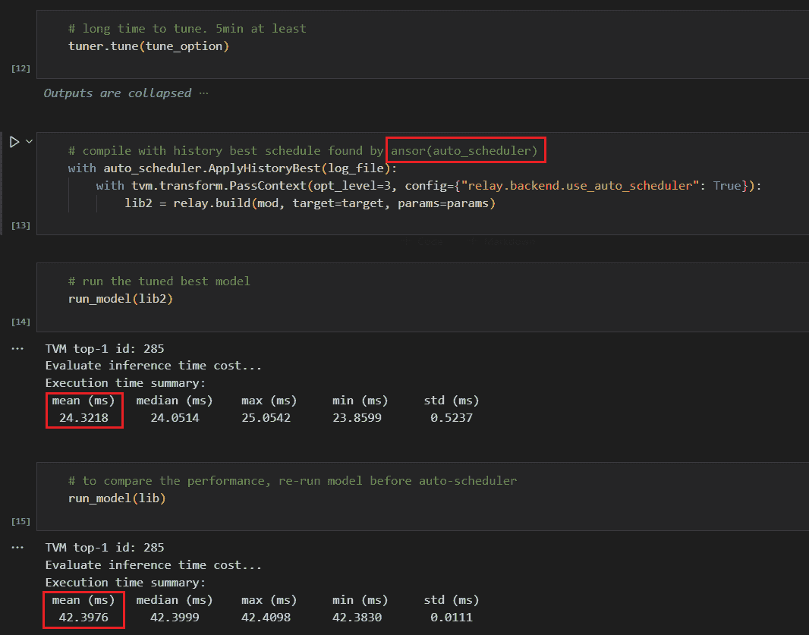
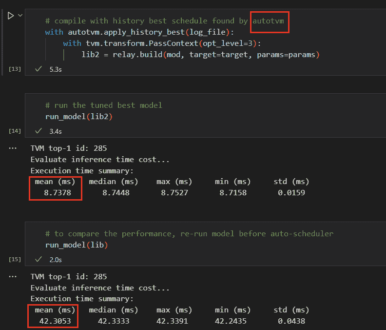

# TVM Ansor & AutoTVM

> 来源：[https://learning.feishu.cn/docx/EJQFdVNfXo5jd7xsYZKcKWE5nPb](https://learning.feishu.cn/docx/EJQFdVNfXo5jd7xsYZKcKWE5nPb)

Code: https://github.com/JackonYang/hands-on-tvm

优化的效果有点厉害：

1.  Ansor 搜索 5min，AlexNet 加速 2x。

1.  AutoTVM 搜索 13min，AlexNet 加速 5x。

硬件: Intel(R) Xeon(R) Gold 5320 CPU。核心代码很简单，最短只需要十几行。

效果截图

| Ansor | AutoTVM |
| --- | --- |
|  |  |