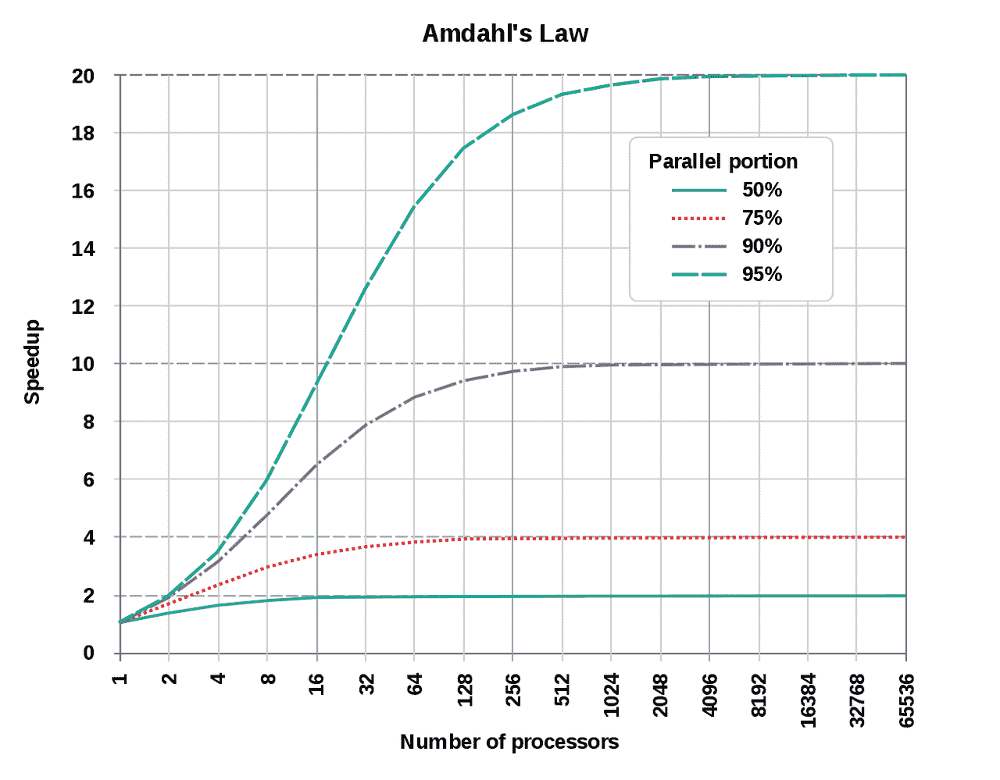
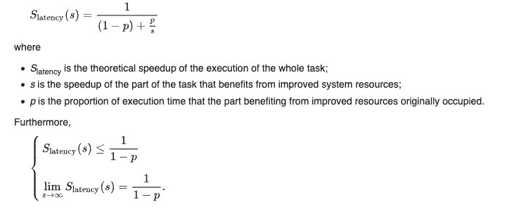
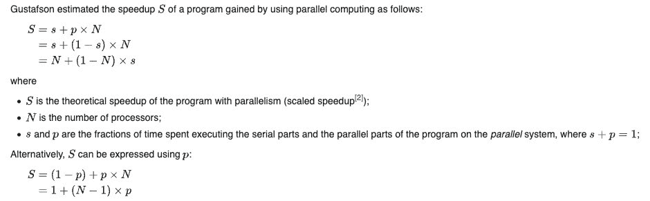
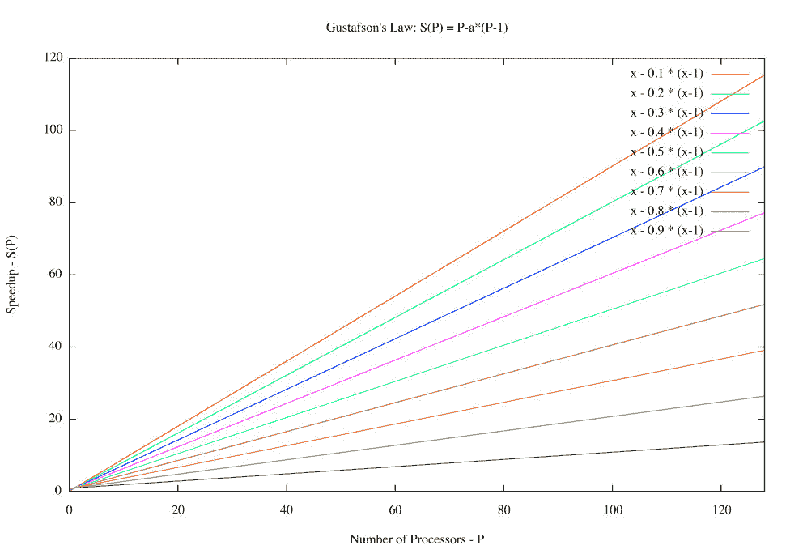
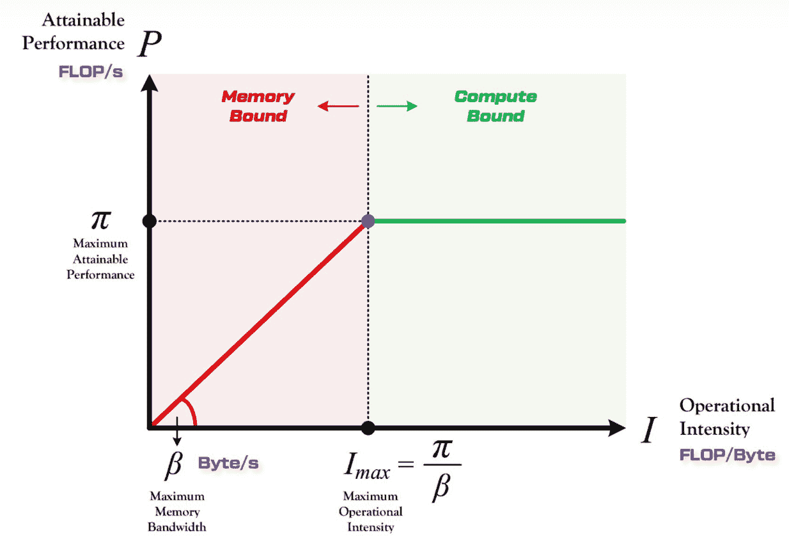

# 性能加速的方法论

> 来源：[https://learning.feishu.cn/docx/Gylnd5LQYozLQoxnqaRctNmAnMe](https://learning.feishu.cn/docx/Gylnd5LQYozLQoxnqaRctNmAnMe)

# 经典理论

## Amdahl's Law

维基百科 - Amdahl's law

在问题总量不变的前提下，提升并行度带来的加速收益，越来越小。

针对并行计算

1.  不能被并行加速的部分，限制了最大加速比。the overall performance improvement gained by optimizing a single part of a system is limited by the fraction of time that the improved part is actually used

1.  单模块的加速，对系统总体速度的影响，越来越小。

公式

## Gustafson's law

维基百科 - Gustafson's law

Amdahl's Law 假定了问题的规模（计算量）不变，实际上，随着资源利用率的改善，工程师们总是会增加新的计算需求进来，提升了问题规模。

因此，不能被并行优化的部分，随着问题规模的增长，对系统总体速度的影响，越来越小。

公式

注意，斜率越高，表示可以被并行加速的计算占比越高，对应的，加速效果（空间）也就越大。

## Roofline Model

Roofline Model [paper](https://people.eecs.berkeley.edu/~kubitron/cs252/handouts/papers/RooflineVyNoYellow.pdf)

一套算法，用于评估：

计算量为 A 且访存量为 B 的模型在算力为 c 且带宽为 D 的计算平台所能达到的理论性能上限E是多少。

估算加速效果的模型。考虑的因素，包括：

1.  硬件限制

1.  优化措施的效果和优先级

1.  locality

1.  bandwidth

1.  并行模型

1.  等

## streetlight 方法

A policeman sees a drunk looking under a streetlight,

and asks what he is looking for.

The drunk says he has lost his keys.

The policeman can't find them either,

and asks if he lost them under the streetlight.

The drunk replies:

"No, but this is where the light is best."

总结：只做会的，不做对的。

# 摸鱼的理论基础

根据 Gustafson's law（古斯塔夫森），优先把加速空间很大，又比较容易做的部分搞定就可以。

随着业务的演进，整体计算需求的增加。不能被并行优化的部分，对系统总体速度的影响，越来越小。

-- 只做又简单又有效的就差不多了。

不用太肝。