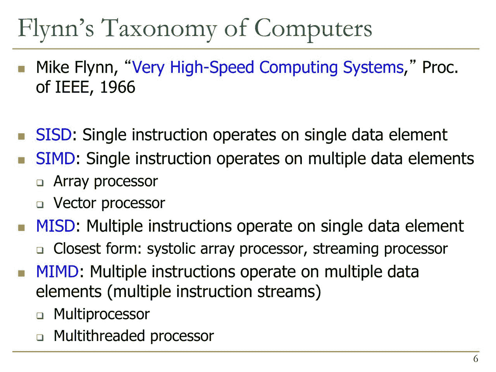
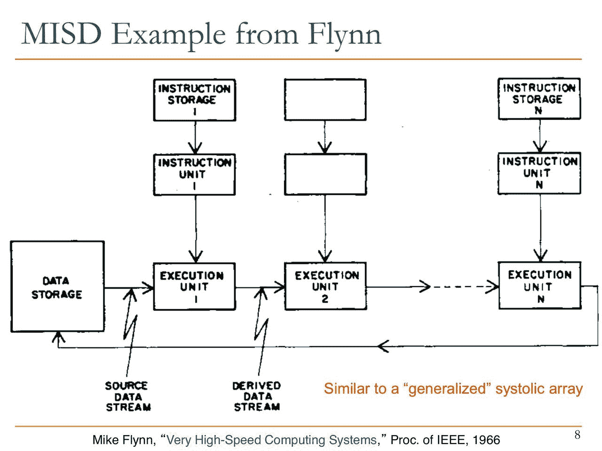
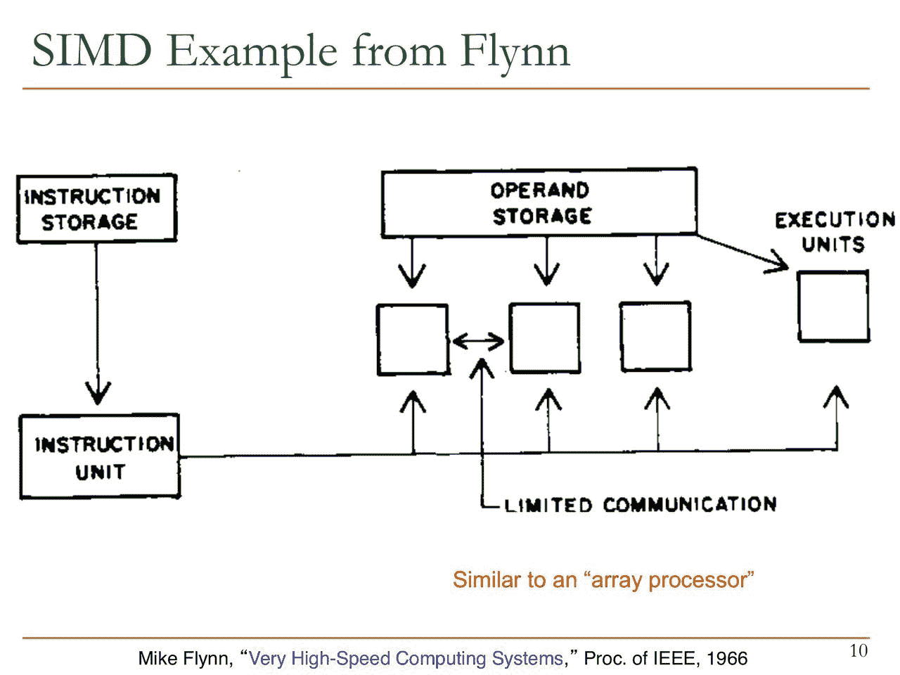

# Flynn's Taxonomy 费林分类法

> 来源：[https://learning.feishu.cn/docx/OQ1NdKaekoMZf9x96JZc6eBmnJc](https://learning.feishu.cn/docx/OQ1NdKaekoMZf9x96JZc6eBmnJc)

**根据并行的 i**nstructi**on stre**ams 和 data streams 数量，定义 4 种计算机类型。SIMD 和 MIMD 是最常用的。

+   SISD：一般不用

+   MISD：少见，used for fault tolerance，比如航天用的

要点：

1.  是 streams 的数量，不是 指令/data 本身的数量。

1.  GPU，用的 SIMD 的改进版。

1.  现代 CPU 一般是 MIMD

# Introduction

proposed in 1966 and extended in 1972.

## MISD example

## SIMD example

# SIMD 的 3 种流派

1972 年的时候，补充定义了 3 种 SIMD。

现代 SIMD 的 3 个主要流派：

1.  Vector Processor ( pipeline processor ), 每个 unit 在时间维度上，做相同 instruction 的不同 data。

1.  SIMD extension: MMX, AVX, SSE 等。

1.  GPGPU (SIMT): 每个 thread，每个 cycle 做相同 instruction。

## Pipelined Processor

流水线处理器。也叫 vector Processor。

每个 unit 在时间维度上，做相同 instruction 的不同 data。

Read Data From a Central Resource. Flynn 在 1972 年写论文时，还都是内存。

现代 CPU 里一般都是 Register file。也叫 packed SIMD

例如：Altivec、NEON 和 AVX。

## Associative Processor - SIMD

关联处理器

in Each Parallel Processing Unit, an independent Decision is Made. Based on Data local to the Unit.

Known as "predicated" (masked) SIMD。

示例包括 [AVX-512](https://en.wikipedia.org/wiki/AVX-512)

## Array Processor - SIMT

阵列处理器

each parallel processing unit has its own separate and distinct memory and register file

英伟达的 GPU，基于 Array processor，引入了多线程的概念。叫 SIMT

# MIMD

多核计算，就是典型的 MIMD。

As of 2006, all of the top[ 10 an](https://en.wikipedia.org/wiki/TOP500)d[ most of the T](https://en.wikipedia.org/wiki/Supercomputer)OP500 supercomputers are based on a MIMD architecture.

MIMD is most effective in applications that call for multiple discrete computations to be executed such as computer-aided design (CAD).

# References

1.  https://en.wikipedia.org/wiki/Flynn%27s_taxonomy