# 模型加速与 AI compiler 介绍

> 来源：[https://learning.feishu.cn/docx/XFY6dlOAYo3UVmxLNOtc8XK3nFg](https://learning.feishu.cn/docx/XFY6dlOAYo3UVmxLNOtc8XK3nFg)

## 目标

1. 非从业者：了解 ai compiler 的研究内容、成本和意义。
1. AI 从业者：帮大家读了一些经典的 paper。
1. 主要讨论 deep learning 模型的推理（inference）。

### AI 从业者的定义

AI 从业者的定义：深度参与过模型的训练优化或推理部署。

### 不涉及什么

1. 系统的介绍一门学科、理论。
1. 听完就能干活、能学以致用。

## 背景介绍 - 20min

当我们谈到深度学习时，可能在谈什么：

1. 开发
1. 训练
1. 部署（推理）
1. 模型库

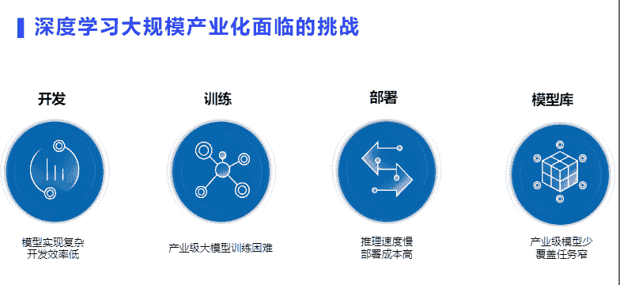

出自: https://www.modb.pro/doc/48500 飞桨：源于产业实践的开源深度学习平台 -蓝翔 _百度

### 模型训练的速度 - from paper

| Model Name | Training Time | 时间 | Hardware | Data size | Paper Link |
| --- | --- | --- | --- | --- | --- |
| Transformer | 12h | 2017.06 | 8 P100 GPU | 37000 token | http://arxiv.org/abs/1706.03762 |
| BERT | 81.4h | 2018.10 | 16 TPU | 3.3B word corpus | https://arxiv.org/abs/1810.04805 |
| BERT | 76 min | 2019.4 | 1024 TPU | 3.3B word corpus | https://arxiv.org/abs/1904.00962 |
| XLNet | 2.5days | 2019.6 | 512 TPU v3 chips | 32.89B | https://arxiv.org/abs/1906.08237 |
| Resnet50 | 2.2 min | 2018.11 | TPU v3 Pod | ImageNet | https://arxiv.org/abs/1811.06992 |
| Resnet50 | 75s | 2019.3 | 2048 GPU v100 | ImageNet | https://arxiv.org/abs/1903.12650 |
| GPT | month | 2018.6 | 8 GPU | BooksCorpus 800M words | https://www.cs.ubc.ca/~amuham01/LING530/papers/radford2018improving.pdf |
| GPT-2 | week | 2019.2 | 256 of Google's Cloud TPU v3 | 23 million URLs | https://d4mucfpksywv.cloudfront.net/better-language-models/language_models_are_unsupervised_multitask_learners.pdf |
| BigGAN | 24~48h | 2018.9 | TPU v3 Pod | ImageNet | https://arxiv.org/abs/1809.11096 |
| ResNet 101 | 22days | 2018.5 | 336GPU | 3.5 billion images | https://research.fb.com/wp-content/uploads/2018/05/exploring_the_limits_of_weakly_supervised_pretraining.pdf |
| RoBERTa | 1day | 2019.7 | 1024 v100 | 4倍 XLNet, 40倍 BERT | https://arxiv.org/pdf/1907.11692.pdf |
| ELMo | 2weeks | 2018.2 | 3 GTX 1080 | 5.5B tokens | https://arxiv.org/abs/1802.05365 |

1. 随着预训练技术的普及，从头训练模型的场景越来越少了。
1. 以 bert 为例，机器翻 64 倍，训练时间下降 64 倍。-- 砸钱就能加速。这是一个分布式的问题。

### 模型训练 vs 推理部署

深度学习框架的数量，那可以太多了。

训练框架

+ TensorFlow, Google
+ Pytorch, FaceBook
+ MxNet, Amazon
+ Caffe, Caffe2
+ CoreML，苹果，代码保密
+ Paddle, 百度。徐伟，百度第一位 T11。后任地平线 AI 首席科学家。
+ MegEngine, 旷视
+ Mindspore, 华为
+ OneFlow, 一流科技

推理框架

+ OpenVINO, Intel
+ ARM NN, ARM
+ TensorRT, nvidia
+ ONNXRuntime. ONNX 节点粒度较细，推理速度有时候比其他推理框架慢.
+ ncnn(腾讯) 手机端推理框架。
+ MNN（阿里）手机端推理框架。
+ MMDeploy。 OpenMMLab 的框架。

国产框架：

1. Jittor: 清华。PR 稿里见得多。
1. Paddle: 百度
1. OneFlow: oneflow 公司。
+ Mindspore: 华为
1. OpenMMLab: 香港中文大学-商汤科技联合实验室

深度学习框架简史：https://syncedreview.com/2020/12/14/a-brief-history-of-deep-learning-frameworks/

总结要点：

1. AI != 模型训练。推理市场很大。
1. 框架的核心需求：易用性高、性能好。
1. 推理和训练，基本是 2 套框架了。这就是“专业”。
1. 训练强调开发效率（易用性），比如 tensorflow，pytorch。性能优化的技术栈偏分布式的那一套。
1. 推理强调执行效率（性能）。比如 TensorRT，OpenVINO。关注性价比，最终归宿都是与硬件高度绑定。

### 模型部署的软件栈

[业界参考 - 模型推理软件栈](https://dwpl6xgouw.feishu.cn/wiki/ThNYwkYnLiwZ03kB8pAcBaGunFb)

### 高性能计算入门

#### 软件工程师需要了解的硬件特性

要点总结：

1. 计算单元，并行能力越来越强。标量 -> 向量 -> 张量。见下图。
1. 存储，越快越贵，多级 cache。

From https://zhuanlan.zhihu.com/p/613611390

从 CPU 到 GPU 是 2015、2016 年左右，从 GPU 到 TPU 是 2019 年左右。

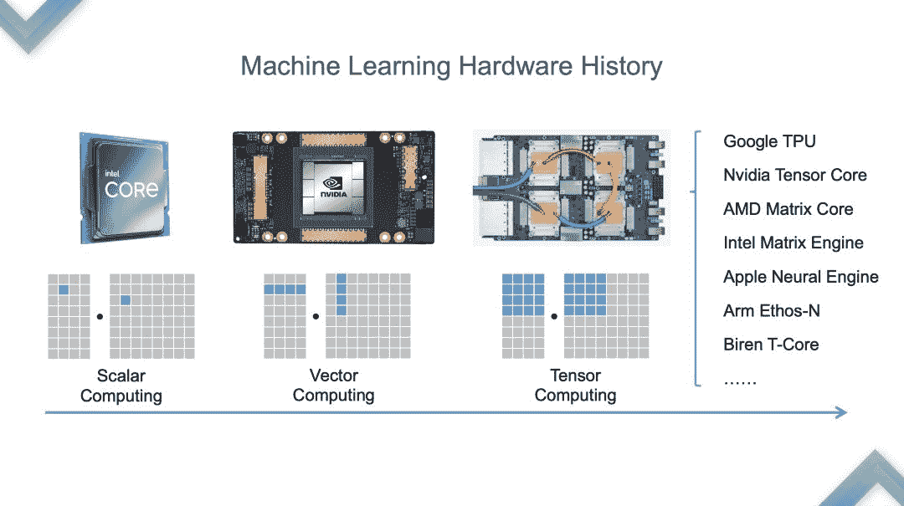

优质读物

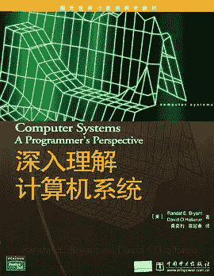

#### 高性能计算的研究内容

高性能计算，主要针对科学计算。研究的核心是如何加速 nested loops。

科学计算的特点，是大量的数据运算 -> 大量 nested loops

优化 nested loops 的手段，主要是并行计算。

并行计算分 4(or many) 类:

1. 位级（bit）-- CPU 指令经历了 8bit, 16bit, 32bit, 64bit。
1. ILP 指令级 (instruction level Parallel)
1. 以 RISC 为例，先做了流水线，然后是多指令发射。
1. 传统编译器和硬件都是隐式的 ILP。
1. DLP 数据级 (data level Parallel)
1. 比如：SIMD (单指令多数据), GPU。常见于图像处理、深度学习。
1. AI compiler 在这一层也发力。
1. 任务级 (task) 。考虑多处理器，内存模型很关键。共享内存，或分布式内存。分 2 个子类
1. TLP 线程级 (Thread level Parallel)
1. RLP request 级

前 3 类的优化，非常基础，需要懂 hardware & Linux kernel。

第 4 类，比较常见。其中，分布式内存的，通俗的说，就是分布式计算了。

高性能计算入门的 Hello world：矩阵乘 (General matrix multiply)，简称 GEMM。

#### 加速的方法论

[性能加速的方法论](https://dwpl6xgouw.feishu.cn/wiki/KtdcwCTZgia3Jbkc8ODci79Unyd)

## Why AI compiler

1. 模型加速。适配特定硬件的加速，省出来的算力都是钱。
1. 易用性、硬件 bug 遮羞布。AI 芯片厂做 ai compiler 基本是标配。
1. 除了 Nvidia，如果不是开箱即用，基本拿不到用户。
1. 早期的几代芯片，bug 比 feature 不知高到哪里去了。ai compiler 就是最好的遮羞布。
1. 摩尔定律终结，DSA 会越来越多，软件栈人力需求将爆炸。趋势：融合现有的编译器设计快速的打造软件生态。https://arxiv.org/abs/2002.11054 MLIR: A Compiler Infrastructure for the End of Moore's Law
1. 加速之外，ai compiler 能讲故事的场景也不少。
1. on-device learning。比如，iPhone 上 fine tune 自己的人脸开锁模型，满足数据安全要求。
1. DL 框架太多，学不动了。用工具链自动转成一个框架的格式，学一个就够了。

问题：AI compiler 会不会成为下一个被 AI 革了命的领域？

## 深度学习模型的加速手段

### 模型的表示 - DAG

Deep learning 模型就是一个 DAG 图 Directed acyclic graph，有向无环图。

建模方法：

Node: operator (运算，粗略理解，就是函数）

Edge: `Tensor` (张量，即，数据。粗略理解，就是函数的输入参数和输出数据，一个函数的输出，同时又是下一个函数的输入）

可视化工具：https://github.com/lutzroeder/netron

另一个古老的 caffe 工具：https://dgschwend.github.io/netscope/#/preset/inceptionv4

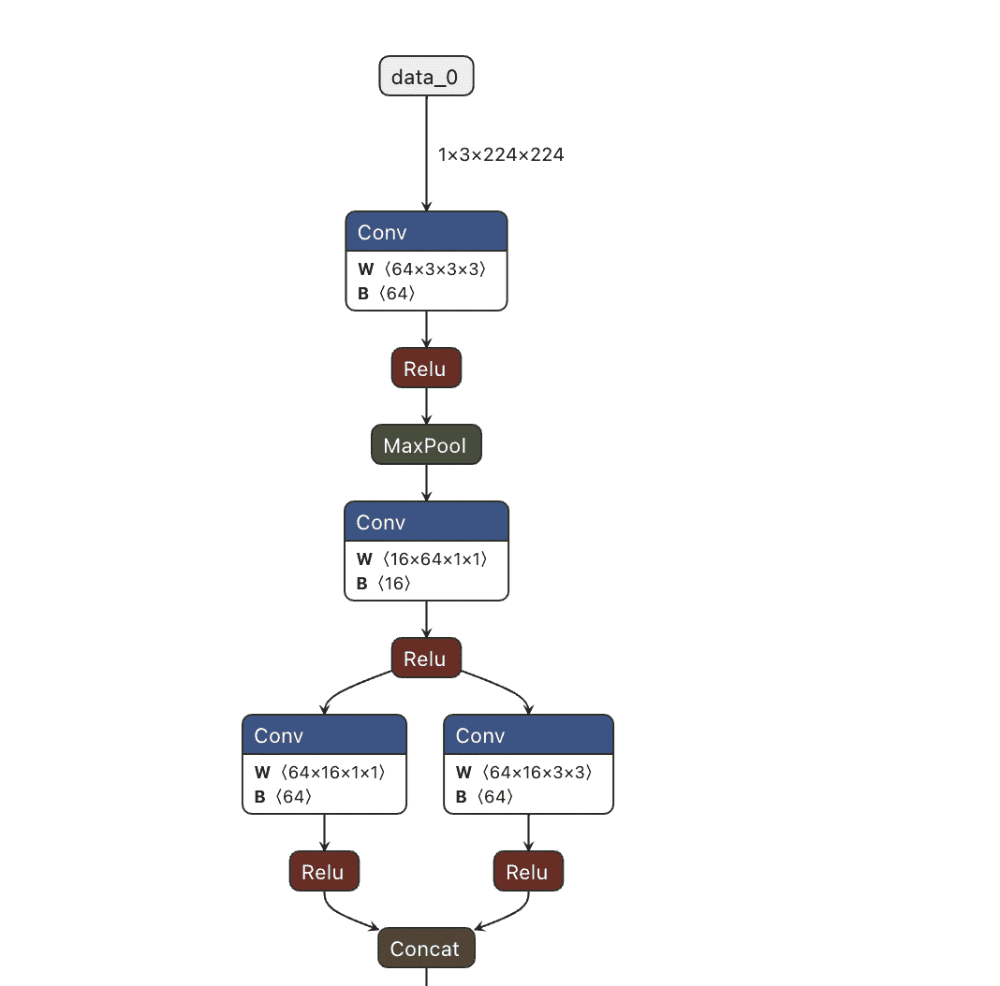

### 如何让模型跑的更快

工程上，就是 2 个 layer 的工作：

1. 图层。比如，
1. 多算子融合后，提高了局部性。中间结果无需反复搬入搬出。
1. 找 better 拓扑序，提高并行度。
1. 算子层。
1. 单个算子跑得快。比如 `GEMM` 类的矩阵乘加速，算子的指令重排等。
1. 用传统编译器的那套性能优化方法。

编译器优化 loop optimization 三板斧:

1. Fusion
1. Tiling
1. vectorization

算法上，深度学习圈研究的比较多：

1. 模型量化
1. 稀疏化
1. 模型蒸馏等。

原理：

模型中只有小部分参数起了核心作用，其他的大部分参数是无效参数，可以去除掉。即，矩阵稀疏化。

不能去掉的参数中，很多参数在推理时的状态空间非常少，用 `int8` 就足以区分开。不需要 `fp32`。即，量化。

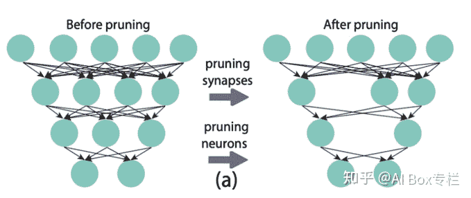

### Transformer 类模型的加速

加速方法，详见 https://scale.com/blog/pytorch-improvements

2 个自测题：

1. 从 LSTM 到 transformer 的例子。为什么 transformer 能瞬间霸榜 NLP，但霸榜 CV 就慢了。
1. LLM（NLP 大模型）输出的 token （文字）数量与算力成本的关系。

#### Transformer 架构的算力特征

[Atten]tion Is All You Need Arxiv

【李沐精读】https://www.bilibili.com/video/BV1pu411o7BE

比论文更好读的 blog: The Annotated Transformer

Transformer 架构图：

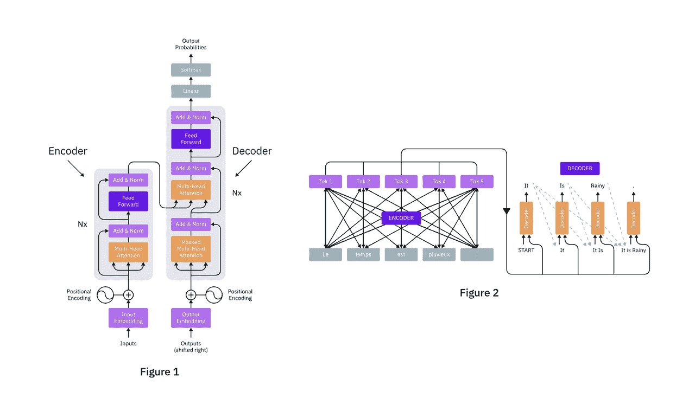

作为对比，LSTM 架构图

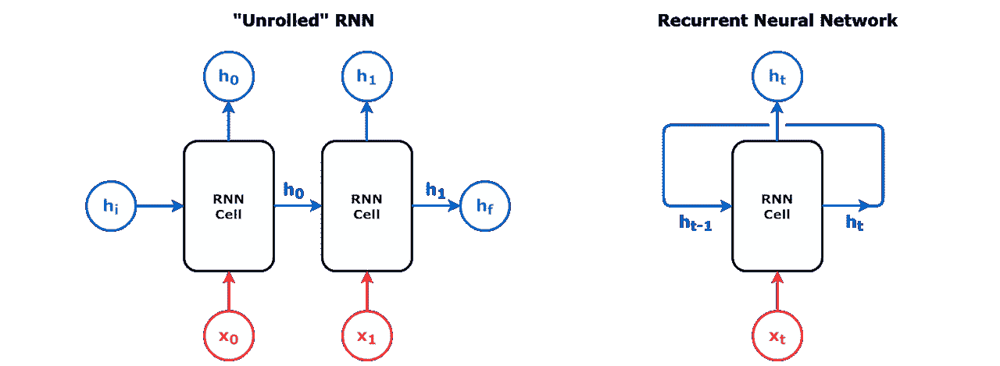

CNN 架构

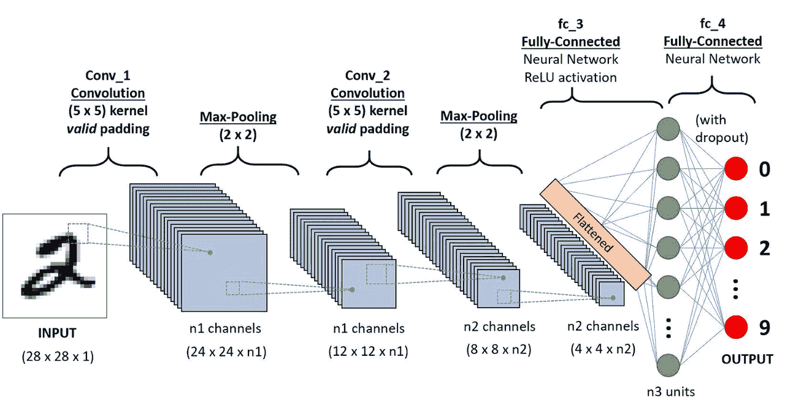

CNN 和 transformer，都用一组结构相同但 weight 不同的 block 去学习，

block 之间相互不依赖，可以 parallel 执行。

LSTM 为代表的 RNN，都是 sequential 的处理，每一个 block 都要接收前序 block 的 output，存在数据依赖，很难并行。

详细解释：https://voidful.medium.com/why-transformer-faster-then-lstm-on-generation-c3f30977d747

总结：

LSTM 一直被算力锁死了学习能力，换成 transformer 以后，学习能力就碾压了。

CNN 被算力锁死的比较轻，原本就发展的很厉害了。

#### 用 cache 加速 transformer

实现参考:

https://github.com/alex-matton/causal-transformer-decoder

https://github.com/hpcaitech/CachedEmbedding

名词解释：decoder 时，每生成 1 个输出 token 的过程，叫 timestep。

1. encoder output 和 decoder 可以并行计算。
1. Decoder 时是自回归的，如果能做好 cache，那么，每个 decode timestep 只需要
1. 计算新 token（上一个 timestep 的输出）的 embedding。
1. 计算新 token 和其他 token 的 attention

Input sequence length `M`, decode `N` tokens。

时间复杂度，input * output self-attention + output * output self-attention

优化前: `O(MN² + N³)`

优化后: `O(MN + N²)`

实验结果

We compare our three different implementations

+ The most naive Pytorch implementation (defined in the first piece of code), which uses `nn.Transformer`
+ The Pytorch encoder-decoder implementation (second piece of code).
+ Our CausalTransformerDecoder (third piece of code).

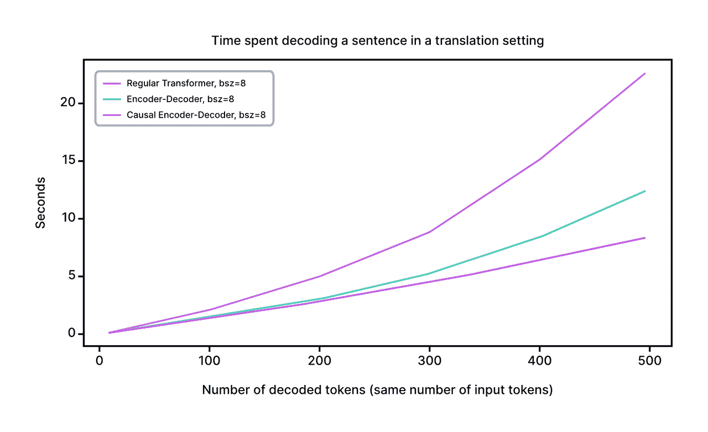

## 深入 AI compiler - 以 TVM 为例

详细介绍：https://mlc.ai/summer22/schedule

### TVM Stack

AI compiler 如何理解模型？

TVM 的方法是：分 4 层 IR

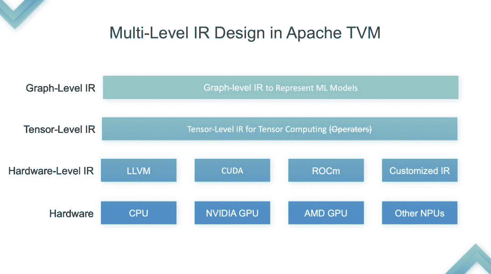

From https://zhuanlan.zhihu.com/p/613611390

### TVM 的图优化

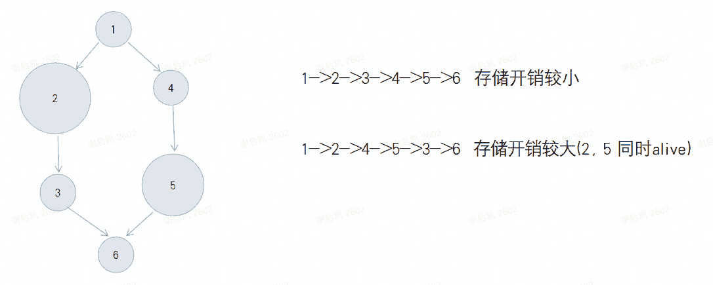

解释：

1. 算完 3 就可以立即释放 2
1. 算 3 之前就算 5，则 2 和 5 就会同时 alive 在 cache 里
1. 算完 3 再算 2，就不存在 2 和 5 同时 alive

整体思路：

1. 本质是找最优的 DAG 的拓扑序。
1. 因为 cache 分级，如何把更多的计算放在更快的 cache 上，是主要目的。


# 最佳拓扑序的目标函数：最小峰值内存占用

以 TFLite 用的方案为例，

参考 Paper: https://arxiv.org/abs/2001.03288

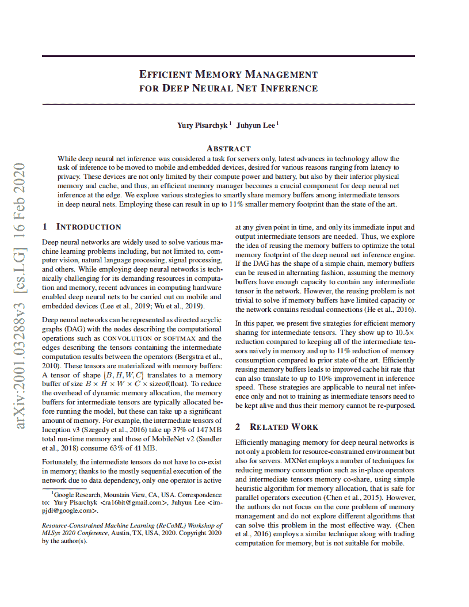

[2020-google-efficient-memory-management.pdf](https://internal-api-drive-stream.feishu.cn/space/api/box/stream/download/all/SQy5bIAupo0tnaxTuSTcOEoZnqg)

Google 在 2020 年的工作，也是 tensorflow lite 用的内存管理算法。我们在其他芯片上也试验过，加速效果明显。

研究的问题：Mobile and embedded device: inferior physical memory

目标：Smaller memory footprint

结果：11% smaller memory footprint than the state-of-the-art

## 弊端

1. 对动态 `shape` 的处理，可能是不太行。
1. 没有考虑 `cache hit rate` 的影响。

建模的核心抽象，完整的 pipeline 分为如下 4 个 stage，每个时刻 `t` 可以执行 1 个 stage。

- `L`(`load`) : `load` data from `LLB`->`L1`
- `C`(`Compute`): `compute` on `L1`
- `S`(`Store`): `store` result from `L1`->`LLB`
- `F`(`Free`): `free` data on `L1`

## 优化理论的 2 大流派

+ 基于规划理论：（整数）线性规划，动态规划、二次规划和凸优化等。
+ 基于搜索算法：基于采样理论、启发式算法等。全局最优、非全局最优。
+ （流派 3）启发式的策略，即，人工手动调度。

自动驾驶的 motion planning，路线之争的时间线：

1. 搜索为主。如果走规划路线，是一个高维的非线性规划问题，算力搞不定。
1. 动态规划 + 二次规划主流。90 年代，大神提出了时间和空间解耦的数学模型，转化为 2 个低维的非线性规划问题，降低了搜索难度。
1. 搜索（启发式采样）为主。真车遇到的很多问题，改不动规划模型。基于采样的，有能力修 bug。

## 个人理解

1. 当问题足够复杂时，全局最优很难找，投入产出比一般也不高。
1. 产品角度，只要不比人差 & 不比竞品差，一般就够了。一般也不是很依赖全局最优。

优化问题的经典教科书：An Introduction to Optimization

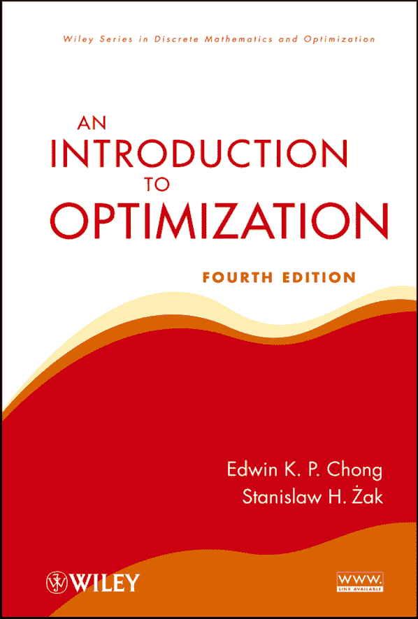

[Introduction to Optimization, 4th Edition.pdf](https://internal-api-drive-stream.feishu.cn/space/api/box/stream/download/all/MLV5bmvYboN9RMxWK4kcsnGQnid)

## TensorIR 优化的例子

在 2-3 层，loop optimization 三板斧:

1. `Fusion`
1. `Tiling`
1. `vectorization`

From https://mlc.ai/summer22/slides/2-TensorProgram.pdf P12 页开始看

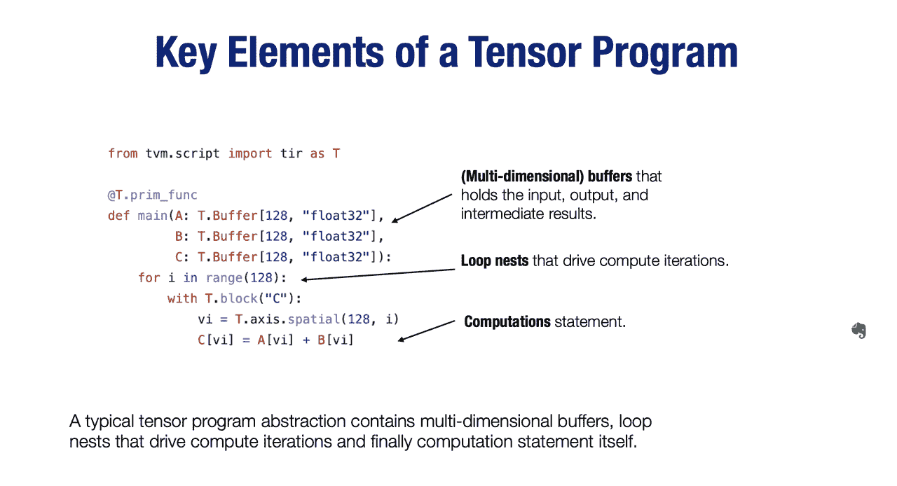

优化效果如下图，From https://zhuanlan.zhihu.com/p/613611390

右图还可以看出，NV 认真手动优化了 resnet50 和 bert，但 mobilenet 优化的少。

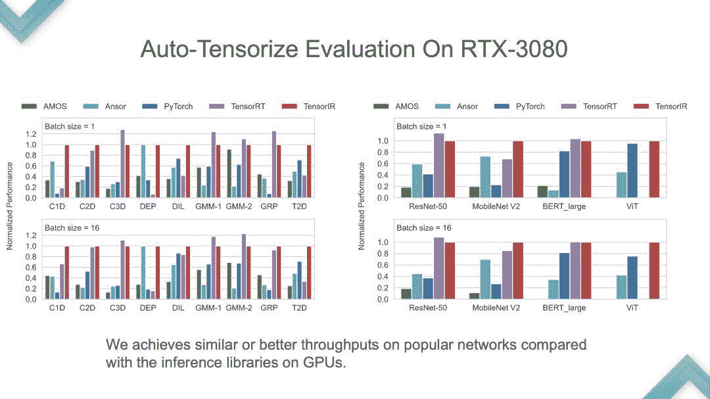

MLIR `codegen` [arxiv](https://arxiv.org/abs/2202.03293) 总结不错，要点：

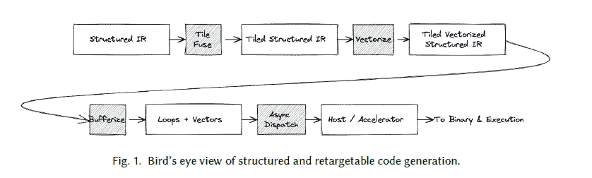

## 注

`Async dispatch` 就是 `split` 成多个 block，进行 task parallel 的执行。在 GPU，NPU 上很常见。

`Blockwise` 运算，不是 `elementwise` 的。滑窗类对 `Blockwise` 运算做 `split` 时，一般要处理数据重叠问题。

`Conv` 算子的例子：

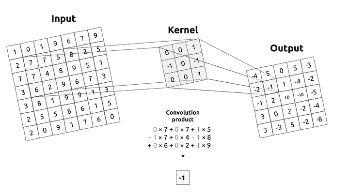

要点：`split` 之后，相邻两份数据有依赖。导致 task parallel 时更复杂。

深入理解，需要了解 `conv` 算子的原理，推荐 https://www.youtube.com/watch?v=FmpDIaiMIeA&t=1099s

## 局限性 & 研究方向

### 主要的研究难点

1. 动态 `shape`
1. `Control flow`
1. 自动生成新的算子实现。手写的工作量很大。

# 其他 AI compiler - 10min

现在 ai compiler 可能比 dl 框架还多。这么下去，得做个 compiler for compiler 了 🐶

## 要点总结

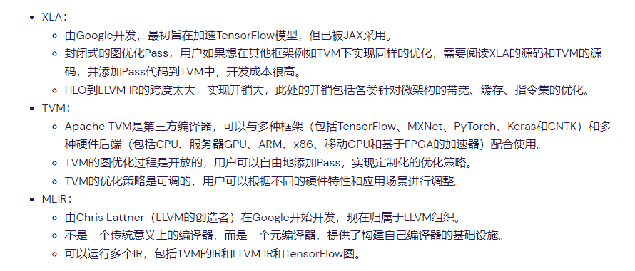

## XLA

XLA 基于 LLVM 框架开发的，前端的输入是 `Graph`，前端没有将 `Graph` 直接转化为 `LLVM IR`

### 特点

1. Theano 之后的第 1 个 ML-compiler。
1. Compiler 知道每一个 `operation` 的完整 `semantics`。`operation set` 称为 `HLO`。影响是：
1. 调度的实现，简单了很多。而且，调度的效果很好。
1. 过度依赖 `perfect knowledge of operation semantics`。导致代码复杂，要把部分 `operation` 的 `semantic` 在局部或者全局传来传去，比如 `fuse pass`。
1. 没有 `serializable IR`，很难用独立的 `compiler flow` 做 `UT`，`inspected`，`compose`。导致代码的复用性差，TPU 和 GPU 版本并没有 `share` 多少 code。-- XLA 没把自己当一个 compiler 去做。

相比于 TVM 和 MLIR，xla 就是一个早期的探索，

1. 没啥设计。就是早期的 shi 山代码。
1. XLA 作为早期的 ai compiler 雏形，启发和指引意义很大。

`Fusion` is XLA's single most important optimization

```
def model_fn(x, y, z):
  return tf.reduce_sum(x + y * z)
```

1. without XLA, the graph launches three kernels: one for the multiplication, one for the addition and one for the reduction.
1. XLA "fusing" the addition, multiplication and reduction into a single GPU kernel.

## MLIR

全称: Multi-Level Intermediate Representation

Chris 继 LLVM、CLang、Swift 之后第 4 个重磅项目。且有 Google 背书。

The “multi-level” aspect is very important in MLIR: adding new levels of abstraction is intended to be easy and common. Not only this makes it very convenient to model a specific domain, it also opens up a lot of creativity and brings a significant amount of freedom to play with various designs for your compiler: it is actually a lot of fun!

MLIR v.s. TVM

TVM 通过划分 4 层 `IR` 的方法，大大的简化了问题，& 推动了早期的技术发展。

但 4 层 `IR` 之间的信息隔离，导致一些优化无法实施，无法跨层搜索 global 的最优解。

MLIR 的 `multi-level` 可以很好的解决这个问题。

个人感觉，这种设计是双刃剑。

太过于灵活，放在一般团队里，如果用不好，过于灵活 == 没有设计。

如果是比较优秀的团队，灵活性高则是极好的。

# 如何入门 - 5min

通常，大家都会推荐这些书：

1. 编译原理相关书籍
1. [CS143编译原理](https://web.stanford.edu/class/cs143/)，[https://www.bilibili.com](https://www.bilibili.com/video/BV1NE411376V/)/video/BV1NE411376V/
1. 鲸书：高级编译器设计与实现
1. 龙书：编译原理
1. Engineering a Compiler, Second Edition.pdf
1. The SSA Design Book.pdf
1. 体系结构相关
1. Computer Architecture - A Quantitative Approach
1. Computer Organization and Design RISC-V edition.pdf
1. 编译相关经典论文
1. The Compiler Design Handbook, 2nd Edition (Dec 2007).pdf
1. PLDI论文
1. ISCA论文
1. CGO论文
1. LLVM 相关学习书籍。low-level IR, optimization, and code-generation
1. Getting Started with LLVM Core Libraries.pdf
1. LLVM Cookbook.pdf
1. LLVM Essentials.pdf

补充说明：

1. 以上材料，我转入这个行业前都没读过。
1. 最近开始读了。看过跟没看过，理解问题确实不一样。

更实际的，我的 1 年技术计划如下，目前进展 50%，感觉比较实际。

1. 主流 ai compiler
1. `TVM`
1. `MLIR`, `XLA`
1. Deep Learning 框架
1. `Tensorflow`, `Pytorch`
1. `Onnx`, `Tensorrt`
1. `Oneflow`, `paddle`
1. deep learning 模型。
1. CV、NLP、搜索、推荐的经典模型
1. `Transformer` 深入理解
1. 选择性的看迁移学习、强化学习、图模型
1. `c++` 开发
1. 搞的动 `TVM` 和 `tensorrt` 涉及的 `c++` feature
1. 熟练写多线程、高性能攒 batch 的代码
1. 传统编译器。
1. stanford CS143编译原理
1. 刷龙书
1. `LLVM tutorial`
1. HPC 异构编程 & 并行计算。
1. `GEMM` 做一遍
1. 体系结构, 公司芯片的电路结构
1. `CUDA` 的编程模型

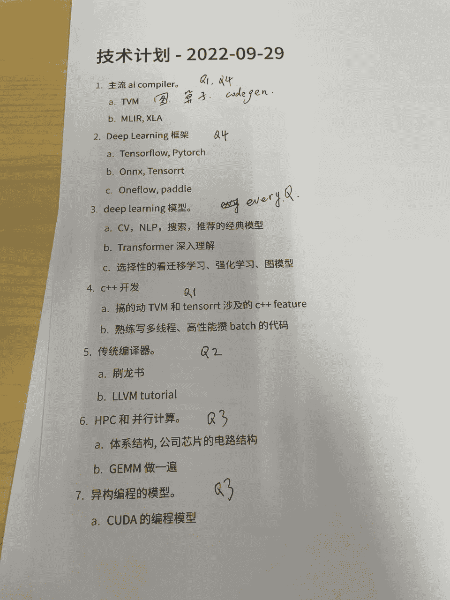
