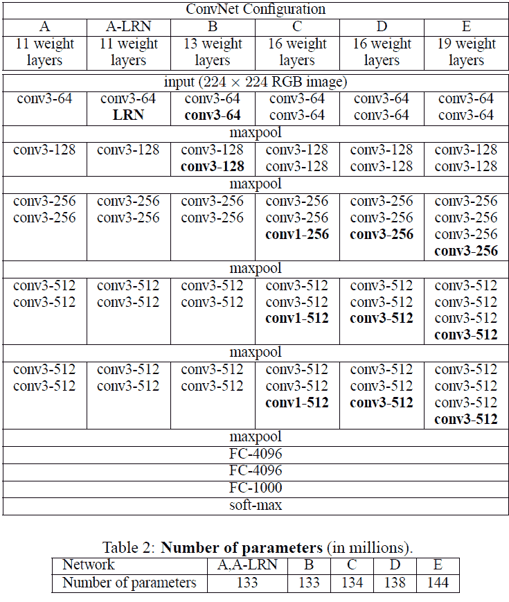

# Paper Reading 模版 (2014-VGG)

> 来源：[https://learning.feishu.cn/docx/VOX9dp1Lmo19tAx4WDZcWsC8nhh](https://learning.feishu.cn/docx/VOX9dp1Lmo19tAx4WDZcWsC8nhh)

以 2014-VGG 为例

# **Paper 信息**

https://arxiv.org/abs/1409.1556

TODO：从 page4 的开始的训练部分, 精读

# **模型结构**** Summary**

Paper 亮点：

1.  暴力使用 3*3 卷积核，把深度推到了 16-19 layers。

1.  论证了堆叠 3*3 卷积核可以达到 SOTA 效果. 设计 kernel size 这门手艺, 用不上了.

业界的后续工作：

1.  加了 batch norm 层，推到了 30 层。

1.  ResNet 推到了 154 层。

结构概述：

1.  基本 block 是 连续 N 个 conv3x3 + ReLU + MaxPool

1.  常见的 VGG-16 是 5 个 block。channel 从 64 升到 512.

1.  后面接了 3 个 FC 层。前 2 个是 ReLU，最后一个是 softmax。

超参设定：

1.  所有 conv 都是 3x3，步长为1。

1.  为了能暴力堆叠 conv 层，图像 4 周各填一个像素，从而 conv 前后的图片尺寸不变。

1.  MaxPool 层的核均为 2x2，步长为2。

1.  全连接层有3层，分别包括4096，4096，1000个节点。除了最后一个全连接层之外，所有层都采用了ReLU激活函数。

模型结构一张图

# **Paper Reading**

## **作者信息**

[简读]关注一作和通讯作者，以及其他与本paper所做方向强相关的作者。

+   作者做过哪些工作，与当前工作有何关联？

+   作者（所在组）的风格如何？（solid、追求深刻、有远见等）

Karen Simonyan

Andrew Zisserman

（我都不熟悉）

牛津大学视觉组（Visual Geometry Group），CV 领域的顶尖机构之一。

## **问题定义**

[简读] paper 可分为求解特定问题类和讨论类，求解特定问题类通常有较固定的问题定义形式，类似于算法设计模板，须明确：

+   输入、输出

+   评测指标

+   边界及假设，通常由数据集定义

+   该问题的意义，可以是实际应用价值，也可以是该问题在领域内受关注的程度、被关注的原因

研究的问题：在 image classification 任务上, network depth 对 accuracy 的影响.

评测指标：accuracy 的提升比例.

研究意义: CNN 网络的改进方向探索. 作者的结论, 奠定了接下来几年 CNN 模型的基调.

## **相关工作**

CNN 结构的奠基是 AlexNet，大家都在尝试改进 AlexNet 的方向。

1.  使用 smaller receptive window size, smaller stride

1.  玩数据. 用整图, multiple scale 的图片

1.  更深的模型. Model depth

作者用 3*3 的小卷积核堆 model depth. 使用 3*3 小卷积核的历史：

1.  Ciresan 2011，关注点是 GPU 加速，而非模型结构。

1.  Goodfellow 2014，street number detection。侧重在 object detection 上的应用，对 CNN 基础理论的改进，讨论的少。

1.  GoogLeNet 2014，各种卷积核都用了，偏 NAS 的让模型自己选。不能体现对 3*3 卷积核的价值有深刻认识。

## **动机及思路**

+   [简读]作者从已有工作的哪些局限性出发，通过什么方式来改进？

+   [速读]作者所采用的方法是否能对应到其出发点？paper提供的实验结果是否验证了作者的改进？

+   [精读]作者的思路有什么缺陷？如何改进？

### **conv3x3 非常好用**

更大的卷积核, 等价于几个 3*3 连起来, 关系如下:

2 个 3*3 = 1 个 5*5

3 个 3*3 = 1 个 7*7

用 3*3 的优势:

1.  非线性关系的表达能力更强. 因为多了 N-1 个 ReLU

1.  参数量更少.

用 7*7, 参数量多了 81%, 计算过程如下:

3 个 C channel 的 3*3 卷积核, 参数量是

1 个 C channel 的 7*7 卷积核, 参数量是

### 为什么不用更小的 2*2 或 1*1?

1.  3*3 是能捕获上下左右 + center 特征的最小 size.

1.  1*1 可以用于降维. 但作者没理解到这一层. 做了一些实验, 没效果就放弃了.

1.  CNN 里面, NIN 用了, 但 ResNet 之后也不太用了.

1.  Transformer 里面捡起来了.

### **限制: 堆 3*3 有上限**

图像 4 周各填一个像素，从而 conv 前后的图片尺寸不变。就可以任意的堆叠 3*3.

但是, VGG16 之后,再加高度, 精度上不去了.

### **其他讨论**

证明了 AlexNet 里的 LRN 没用，但，主要靠实验证实，而不是理论分析（待确认）

## **算法流程 - TODO**

+   [速读]尽量以流程图的形式描述，明确各个子模块的输入输出（如果是ML算法，通常先描述Inference流程，后描述Training流程）

+   [速读]列出核心的公式

+   [精读]尝试做性能推理，对算法流程中paper新引入的模块作用给出讨论

+   通常情况下paper会给出对应的实验结果，可以根据该结果定量分析

+   尝试对比不同paper的结果，可能会发现一些不一致，有助于判断新模块的有效性

+   对于熟悉的领域，可以尝试给一些定性的讨论

Conv 层，最终都是 512 channel。

训练方法

遵循了 LeNet5 & AlexNet 的方法（没有创新）

370k 次迭代，74 个 epoch。

4 张 Titan Black, 训练 2-3 周。

这个数量级上的模型深度增加，是否导致了训练难度增加。

用 pre-train 解决 weight initialization 难题。

浅层模型，随机初始化。然后逐步增加深度，并用上一次的结果做初始化。

论文提交后，发现 Glorot & Bengio 2010 年的 random initialisation procedure 已经解决了这个问题。

## **数据 - TODO**

+   [速读]数据量，数据集在该领域内的影响力

+   [精读]以举例的方式给出数据分布描述

+   [精读]讨论各数据集的特点：着重体现问题的什么维度（什么样的算法在该数据上的性能好）？

## **实验结果 - TODO**

+   [精读]对于每个实验：

+   该实验想讨论什么问题？

+   该实验的设计是否合理？能否很好地回答此问题？

+   实验预期是什么？结论是什么？

+   [精读]有哪些需要注意的实现细节？（数据处理、参数等）

在 B 组配置(13 Layers) 中实验了把 2 个 3*3 换成 5*5，error rate 从 28.7% 提高了 7%

单 Net 是 2014 第一，但是 Google 用 7 Net 搞出了比单 net 好的效果。

# **延伸讨论**

## **为什么 2014 年收官**

1.  为了花了 2 年才搞定。

1.  他为什么只花了 2 年。

1.  不用 3*3 行不行

从 2013 的 best submission 进行分析。

| Visualizing and Understanding Convolutional Networks | 2013 | Zeiler, Fergus |
| --- | --- | --- |
| OverFeat: Integrated Recognition, Localization and Detection using Convolutional Networks | 2014 | Sermanet |
| Some Improvements on Deep Convolutional Neural Network Based Image Classification | 2014 | Howard |

大家用了大量的时间理解模型、探索优化方向。

Overfit 在当时也是很严重的问题，如何解决缺乏共识，很多人把重点放在了这里。

如何通过数据增强来对抗 overfitting，一贯的占据了一篇论文的一个章节。

以及，multi-scale 的图片怎么处理。

Szegedy 2014 给的总结：

For larger datasets such as Imagenet, the recent trend has been to increase the number of layers(NIN, lin) and layer size(zfnet, Sermanet 2014), while using dropout(Hinton 2012) to address the problem of overfitting.