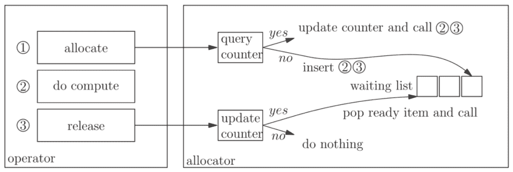

# Oneflow - 原有深度学习框架的缺陷

> 来源：[https://learning.feishu.cn/docx/K3kzdIKtzoQIvCxiT5bcvzAgnQf](https://learning.feishu.cn/docx/K3kzdIKtzoQIvCxiT5bcvzAgnQf)

主流深度学习框架的运行时系统的三大不足

1.  资源依赖的“诅咒” https://mp.weixin.qq.com/s/3FofhnlyBbBVIKYM0xUFqQ

1.  数据搬运的“诅咒” https://mp.weixin.qq.com/s/arlPWDcujrHTjIOnDUQzKQ

1.  动态调度的“诅咒” https://mp.weixin.qq.com/s/RCNzE4v50bWSosa0-YAnFA

读后感：

名声在外，空有其表。

没解决啥有效的重要问题。

# 资源依赖的“诅咒”

算子间的 3 种依赖原因

1.  数据依赖: A-->B-->C，B 直接依赖 A，C 间接依赖。

1.  控制依赖：数据无依赖，但引入了 control edge 强行建立依赖。-- 从 tensorflow 抄的概念。

1.  共享资源形成的依赖：共享互斥资源，导致 A 和 B 不可能同时发生。

tensorflow 和 pytorch，没解决问题 3.

oneflow 用 actor 机制解决。

图 3 就展示了在 TensorFlow 里实现双缓冲的一个潜在方案，也就是添加一个自定义的内存分配器，这个内存分配器限制每个算子只能分配到两份内存。

图3. 自定义分配器，支持双缓冲

+   当一个算子使用分配器分配内存时，分配器会查询一个计数器，查询该算子是否有空闲的缓冲区可以使用。如果有，它就为该算子分配一个缓冲区，让该算子继续执行，并在该算子完成计算后释放缓冲区。如果这个算子的两个缓冲区都已被占用，分配器会将步骤2 （do compute)和步骤3 (release) 放入一个等待列表中。

+   当一个算子向分配器释放其内存时，分配器更新与该算子对应的空闲缓冲区的计数器，并检查等待列表中是否有请求该缓冲区的算子。如果有，就从等待列表中弹出处于就绪状态的算子，执行步骤2和步骤3。

通过定制一个这样的内存分配器可能是通过最小的改动就可以支持起来双缓冲，然而，这样的做法在软件工程中是不好的，因为它将调度器的部分责任推卸给了自定义分配器，而且需要把调度器模块暴露给自定义分配器。

# 数据搬运的“诅咒”

1.  探讨数据搬运放进计算图的关键问题，以及使用回调函数的缺陷

1.  OneFlow 的数据搬运是“一等公民”的理念。

数据搬运是否放进计算图？

问题的关键是，计算图是不是只描述“计算”？是不是只有在 CPU 或 GPU 上执行的计算才被当成算子？

不幸的是，原有的深度学习框架都是这么认为的。

-- 个人并不认同这个判断。

在传统框架里，所有由系统插入的、硬编码的、在运行时才会触发的回调函数都被提取出来，并转换成计算图里的普通算子。这也可以理解为，回调函数的链条被展开并静态表示为计算图。

# 动态调度的“诅咒”

从分配线程池这一关键问题出发，介绍了计算图调度机制，重点探讨原有框架使用动态调度的缺陷以及设置最优线程数的烦恼，并阐述了OneFlow实现的更优雅的方案。