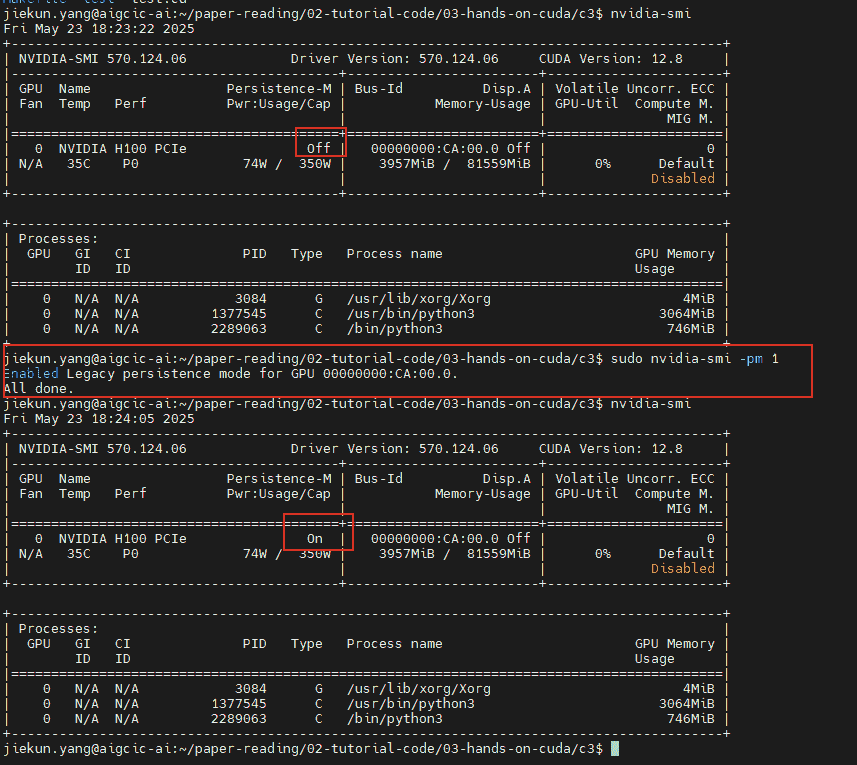
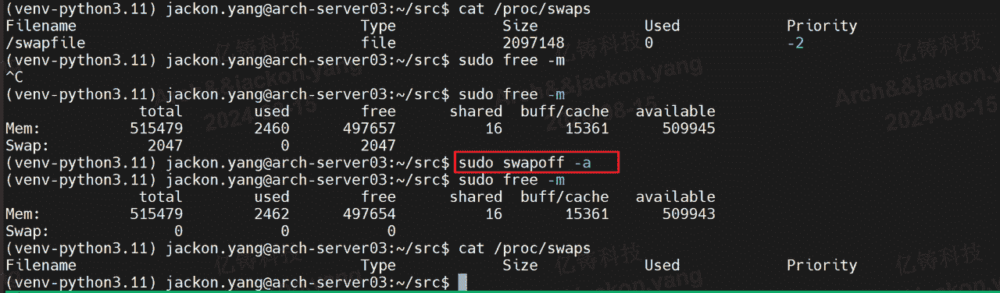
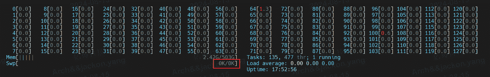

# Shell CMD cheatsheet

> 来源：[https://learning.feishu.cn/docx/JHU6drM8SoHEZ6xtEZmcKnqKnHf](https://learning.feishu.cn/docx/JHU6drM8SoHEZ6xtEZmcKnqKnHf)

# Log 分析

## Sort and uniq

```
ls TritonGPUToLLVM/ | xargs  -n 1 echo &gt; ~/tmp/t3k-list.txt
# list deleted files:
cat ~/tmp/t*k-list.txt | sort | uniq -c | sort -n
      1 AllocateSharedMemory.cpp
      1 AssertOpToLLVM.cpp
      1 BarrierOpToLLVM.cpp
      1 BarrierOpToLLVM.h
      1 ClusterOpsToLLVM.cpp
      1 ClusterOpsToLLVM.h
```

## cut

```
cat v1.out | rev | cut -d&#x27; &#x27; -f 1 | rev
```

#  Shell Cheat sheet

```
# pretty JSON
curl xxxx | jq .

# pass calculate date to bash shell
date -v &#x27;+5H&#x27; +&#x27;%Y-%m-%d %H:%M:%S&#x27;

# set git commit timestamp
GIT_AUTHOR_DATE=`date -v &#x27;+2H&#x27; +&#x27;%Y-%m-%d %H:%M:%S&#x27;` git commit -m&#x27;good&#x27;
```

# Git command

```
# Pull All Branch
git branch -r | grep -v &#x27;\-&gt;&#x27; | while read remote; do git branch --track &quot;${remote#origin/}&quot; &quot;$remote&quot;; done
git fetch --all
git pull --all

# 批量删除分支
# 删除除了 master 的本地分支
git branch | grep -v &quot;master&quot; | xargs git branch -D
```

# Tmux

TODO: 考虑录屏的 scripts：

1.  llvm & mlir 的编译。长任务，terminal 退出后，任务仍在。

1.  分窗口，边编译，边 htop 看监控。还能全屏某个窗口。

1.  创建一个新 pane，创建一个 jupyter server。

1.  创建一个新 pane，等编译的同时，开始 debug 别的代码。

1.  切回去，jupyter server 仍在。编译窗口仍在。

tmux shortcuts & cheatsheet: https://gist.github.com/MohamedAlaa/2961058

终端神器tmux：多任务管理大师 https://www.bilibili.com/video/BV1ML411h7tF

常用 tmux 命令

```
# start a new tmux session
tmux new -s myname
# attach to existing session &quot;ck&quot;
tmux a -t myname
# exit without killing the session (running in background)
ctrl-b + d
# Exit the current pane. The entire session will exit once all panes have been closed.
ctrl-d

# start new pane
ctrl-b + c
# switch pane
ctrl-b + &lt;pane number&gt;
# such as
ctrl-b 0
ctrl-b 1
```

关键 tmux 配置：tmux.conf

```
# Enable mouse control (clickable windows, panes, resizable panes)
set -g mouse on
```

# DevOps

```
# rsync. 跨机器的 copy, 比 scp 快且支持断点续传
sudo apt-get install rsync
# -p or --partial, keep partially transferred files, 即断点续传。
rsync -avp src-path cpu02:/dest-path

rsync -avp paper-reading nv03:/home/jackon.yang/src/paper-reading
rsync -avp paper-reading/.git nv03:/home/jackon.yang/src/paper-reading

# swap
sudo swapoff -a

sudo useradd -d /home/abhishek -s /bin/bash -g my_group new_username -p password
sudo passwd new_username

# change ownership of softlinks. using -h
sudo chown -h askar.admin path/to/softlink
```

踩坑nvidia driver https://zhuanlan.zhihu.com/p/521581269

GPU driver 的 persistence mode 问题，后面要注意下，避免踩坑。在没有显示器的Linux操作系统(headless systems)中，GPU的驱动程序会随着GPU运行的程序开始的时候自动被加载，程序关闭时自动被卸载。短时间内大量Application 频繁启动，driver频繁卸载加载，GPU频繁被初始化，CPU访问PCIe config registers时间过长导致 softlock，从而造成GPU的死机。

```
# 开启 Persistence Mode
sudo nvidia-smi -pm 1

# Persistence-M 一列，查看是否开启了 Persistence Mode
nvidia-smi
```



# 新服务器配置

## 关闭 swap 分区

关闭 swap 分区，需要 2 条命令

```
# 立即关闭，重启后失效
sudo swapoff -a

# 永久关闭，重启后生效
cp /etc/fstab ~/fstab.backup
sudo sed -i &#x27;/swap/ s/^\(.*\)$/#\1/g&#x27; /etc/fstab
```

查看虚拟内存是否关闭的 2 种方法，效果见截图

```
# 查看 memory 和 swap 分区的状态
sudo free -m

# 列出所有 swap 内存文件
cat /proc/swaps
```



关闭后，htop 也能看到区别



控制 swap 时机的参数：swappiness