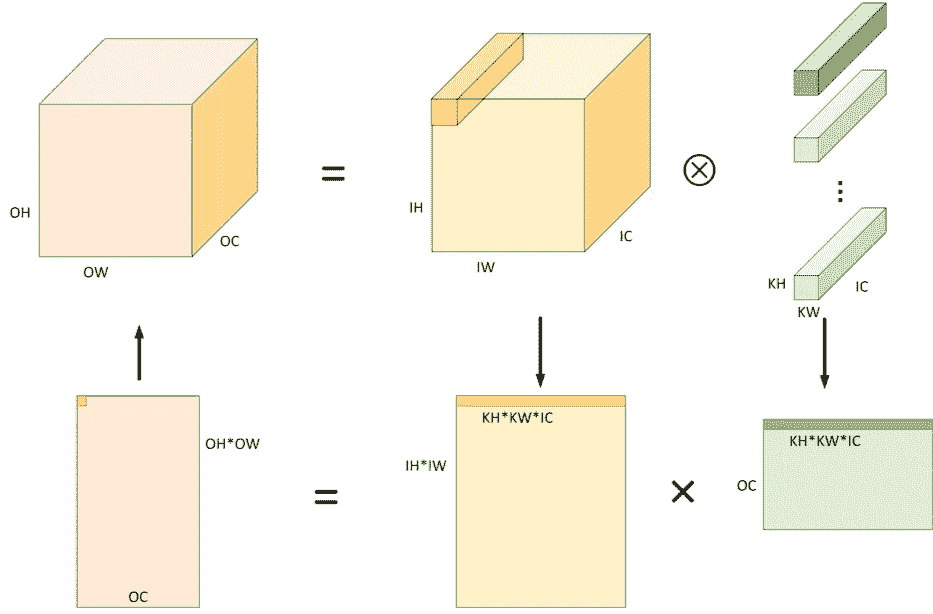

# Im2col 算法

> 来源：[https://learning.feishu.cn/docx/N8tddoiKSo4RM9x7gxPcP9tPnSg](https://learning.feishu.cn/docx/N8tddoiKSo4RM9x7gxPcP9tPnSg)

在 AI 框架早期，Caffe 使用 Im2col 方法将三维张量转换为二维 矩阵，

从而充分利用已经优化好的 GEMM 库来为各个平台加速卷积计算

Img2col 算法主要包含两个步骤

1.  Im2col 将输入矩阵展开一个大矩阵，矩阵每一列表示卷积核需要的一个输入数据，

1.  使用上面转换的矩阵进行 Matmul 运算，得到的数据就是最终卷积计算的结果。

1.  Col2Im 将结果转换为三维矩阵输出

卷积默认采用数据排布方式为 NHWC，

输入维度为4维(N,IH,IW,IC)，卷积核维度为(OC, KH, K W , IC)，输出维度为(N, OH, O W , OC)。

conv 转换为 gemm 计算

Im2col 算法计算卷积的过程，具体简化过程如下:

1.  将输入由 N×IH×IW×IC 根据卷积计算特性展开成 (OH×OW)×(N×KH×KW×IC) 形状二维矩;
阵。显然，转换后使用的内存空间相比原始输入多约 KH∗KW−1 倍;

1.  权重形状一般为 OC×KH×KW×IC 四维张量，可以将其直接作为形状为 (OC)×(KH×KW×IC) 的二维矩阵处理;

1.  对于准备好的两个二维矩阵，将 (KH×KW×IC) 作为累加求和的维度，运行矩阵乘可以得到输出矩阵 (OH×OW)×(OC);

1.  将输出矩阵 (OH×OW)×(OC) 在内存布局视角即为预期的输出张量 N×OH×OW×OC，或者使用 Col2Im 算法变为下一个算子输入 N×OH×OW×OC。

通过Im2col，输入数据被重排成一个大矩阵，而卷积权重（即卷积核）也被转换为另一个矩阵。这样，原本的卷积运算就转化为了这两个矩阵的乘法操作，如图上所示。这种转换后的矩阵乘法可以利用现代计算架构（如TensorCore）的强大计算能力，从而实现高效的计算加速。