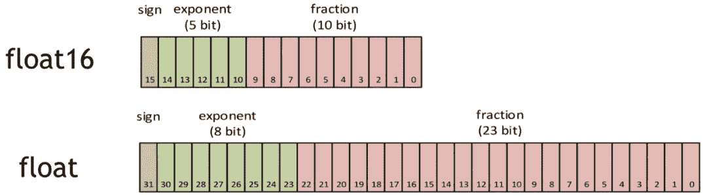
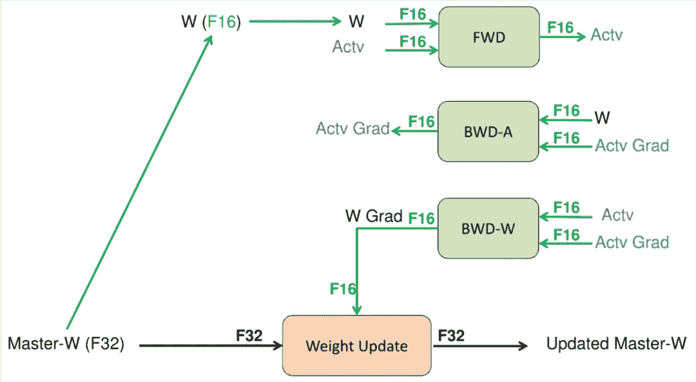

# 混合精度训练

> 来源：[https://learning.feishu.cn/docx/BkpiduSnnot1dzx9NjocivxXnkb](https://learning.feishu.cn/docx/BkpiduSnnot1dzx9NjocivxXnkb)

混合精度训练不仅仅是在模型中同时使用FP16和FP32那么简单，而是指在底层硬件算子层面，使用半精度(FP16)作为输入和输出，使用全精度(FP32)进行中间 结果计算从而不损失过多精度的技术

FP32 vs FP16

软件层面混合精度计算

