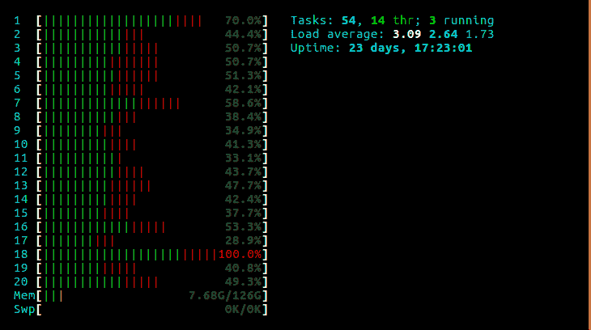
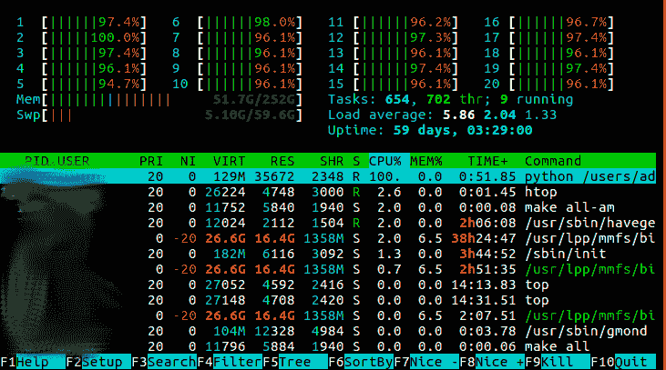

# Linux Configs

> 来源：[https://learning.feishu.cn/docx/PBaqdSF3yoGlNTxnlQmcpv44nZc](https://learning.feishu.cn/docx/PBaqdSF3yoGlNTxnlQmcpv44nZc)

# **常用工具**

## **Tmux**

大部分命令 （git pull / compile）耗时较长，建议在 tmux 里做，减少 terminal 断开导致的任务中断。

B 站：一分钟学会 tmux https://b23.tv/tpm2Wjj

常用 tmux 命令

```
# start a new tmux session
tmux new -s myname
# attach to existing session &quot;ck&quot;
tmux a -t myname
# exit without killing the session (running in background)
ctrl-b + d
# Exit the current pane. The entire session will exit once all panes have been closed.
ctrl-d

# start new pane
ctrl-b + c
# switch pane
ctrl-b + &lt;pane number&gt;
# such as
ctrl-b 0
ctrl-b 1
```

## Htops

See ~/.config/htop/htoprc

To put All CPUs in a single column, with Tasks/Load/Uptime on right (1st example):

```
left_meters=AllCPUs Memory Swap
left_meter_modes=1 1 1
right_meters=Tasks LoadAverage Uptime
right_meter_modes=2 2 2
```

or, for 2nd with half the CPUs on Left, and half on the Right:

```
left_meters=LeftCPUs2 Memory Swap
left_meter_modes=1 1 1
right_meters=RightCPUs2 Tasks LoadAverage Uptime
right_meter_modes=1 2 2 2
```

Note that the meter modes cycle through bar, text, LED etc in a non-intuitive way.



