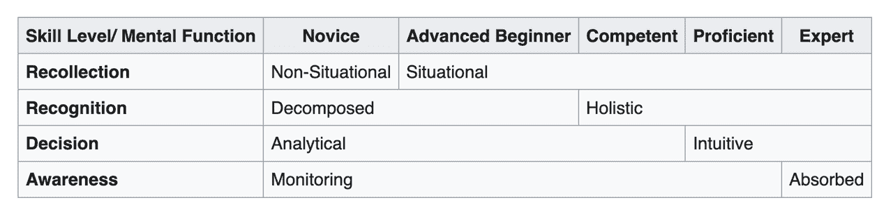
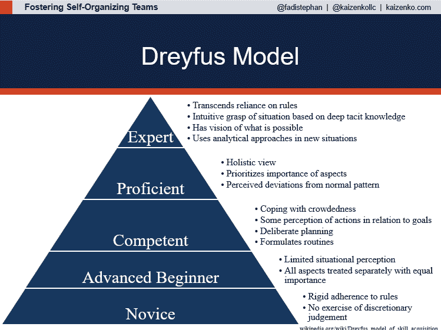

# 技能等级 & Skill Acquisition Model

> 来源：[https://learning.feishu.cn/docx/VrIOdjPC3o18tfxY0ayccJFdnPd](https://learning.feishu.cn/docx/VrIOdjPC3o18tfxY0ayccJFdnPd)

https://lib.3feng.im/common/Dreyfus-model.html

# 核心问题

评价现状不是目的，核心在于：怎么提升。

帮助大家更好地评估和反省自身能力，有助于进一步提高。

1） 做什么事，需要什么能力？

2） 能力怎么评价？ 怎么提升？怎么学习？

一些摘录与心得

1.  所谓的经验，指的是，通过实践这项技术促进了思维的改变。量变引起质变的那种改变。

# 5 级的能力模型

基于 Dreyfus (德雷福斯) 模型，采用 5 级评定法。

| 等级 | Brief | 描述 | 职责 | 提升通道 |
| --- | --- | --- | --- | --- |
| L1 Novice (新手) | 需 2-3 次/天的辅导 | 1.  很少，或没有领域相关知识。 | 学习。 | 1.  目标：非情景 -&gt; 情境性的记忆 |
| L2 Advanced Beginner (进阶) | 天尺度汇报工作 | 1.  有些经验和知识，学到的规则有上下文了。 | 在指导下工作，遇到问题及时汇报。 | 1.  目标：分解式 -&gt; 整体式 的识别 |
| L3 Competence (胜任) | 每周 1-2 次汇报。 | 1.  能总体分析，并判断优先级。可制定周密的计划了。 | 独立解决问题。 | 1.  目标：分析式 -&gt; 直观式的决策 |
| L4 Proficiency (精通) | 双周 - 月尺度汇报。 | 1.  可以创新 &amp; 解决没有遇到过的新问题。 | 解决关键和创新问题。 | 1.  目标：监控式 -&gt; 沉浸式 的意识。 |
| L5 Expertise (专家) | 直觉好，引领者。 | 1.  不再依赖规则和指导方针来做决定，而是相信自己的知识和在需要时提出创造性解决方案的能力。人们在这个阶段通常会实现心流。 | 规则制定者，教别人做事。 | 持续训练自己的直觉。 |

人数分布律

|  | 一般团队 | 我的理想团队 (20-30 人) |
| --- | --- | --- |
| L1 Novice (新手) | &lt;10% | 0 |
| L2 Advanced Beginner (进阶) | 55-60% | 40-50% |
| L3 Competence (胜任) | 15% | 30% - 40% |
| L4 Proficiency (精通) | 10% | 10% - 20% |
| L5 Expertise (专家) | 2~5% | 随缘 |

比例分析：

6-8 人团队，2 种管理模式：

1.  直接管理所有人，全部 L2 以上，50% 以上的 L3。

1.  分 2-3 个 group，每个 group 2-3 人。适合有大量 L1 的情况下。但，L3 仍不能低于 2 人。

20-30 人团队：

1.  直接管 6-10 人，要求 L3 以上。

1.  间接管 10-20 人，L2 为主，由 2-4 个 L4 负责。

管理 Tips：

1.  L1 依赖 tutorial + mentor 需要快速度过的阶段。长期处于 L1 是面试失误。

1.  一般团队，L3 以上占比 30%，大部分是 L2，写日报是科学的管理方法。

1.  当 L2 占比小于 40% 时，基本是团队可以开始新一轮扩张之时。

# 能力维度与要求

## 一般项目

能力维度

| 维度 | Notes | L1 | L2 | L3 | L4 | L5 |
| --- | --- | --- | --- | --- | --- | --- |
| 代码 coding |  |  |  |  |  |  |
| 架构设计 |  |  |  |  |  |  |
| 项目管理 |  |  |  |  |  |  |
| 沟通协调 |  |  |  |  |  |  |

角色要求

默认 L2，没填写。2 个角色合并时，能力取 max。

| 维度 | 版本(总)负责人 | 开发负责人 | 测试负责人 | 开发骨干 | 开发工程师 | 测试工程师 |
| --- | --- | --- | --- | --- | --- | --- |
| 代码 coding |  | L3 |  | L3 |  | - |
| 架构设计 |  | L3 |  |  | - | - |
| 测试设计 |  | L3 | L3 | L3 |  |  |
| 项目管理 | L3 |  |  |  |  |  |
| 沟通协调 | L3 |  |  |  |  |  |

## AI Compiler

| Group | 维度 |  |
| --- | --- | --- |
|  |  |  |
| AI 算法 | CNN | 1.  classification 分类 |
|  | Transformer |  |
|  | Diffusion Model |  |
|  | LoRA and finetune |  |
|  | 数据标注 &amp; 收集 |  |
|  | loss &amp; eval 指标 |  |
|  | 量化 |  |
|  |  |  |
| 代码 | python |  |
|  | c++ |  |
|  | Shell |  |
|  | Linux 命令 | tmux，sed，find，xargs，rsync |
|  |  |  |
| 实验 &amp; profiling | 实验计划 |  |
|  | 实验记录 |  |
|  | 实验数据分析 |  |
|  | 实验报告 | +   文字表达 |
|  | profiling 工具 |  |
|  |  |  |
| 高性能 | CPU 优化加速 |  |
|  | GPU 优化加速 |  |
|  | OS &amp; c++ 相关 |  |
|  | 代码层级 |  |
|  |  |  |
| GPU 高性能算子 |  |  |
|  |  |  |
| 图编译 |  |  |
|  |  |  |
| 科研素养 | 读 paper |  |
|  | 写文档/笔记 |  |

# 理论 - Dreyfus model

德雷福斯 模型。

The Five-Stage Model of Adult Skill Acquisition

a model of how learners acquire skills through formal instruction and practicing

The Dreyfus model is based on four binary qualities:

+   Recollection (non-situational or situational)

+   Recognition (decomposed or holistic)

+   Decision (analytical or intuitive)

+   Awareness (monitoring or absorbed)

| 维度 | 新手 | 专家 | 解释 |
| --- | --- | --- | --- |
| Recollection - 记忆 | Non-situational - 非情境性 | situational - 情境性 | +   新手：relies on **abstract**, non-situational rules and procedures |
| Recognition - 识别 | decomposed - 分解式 | holistic - 整体式 | sees the problem or situation 的方式差异 |
| Decision - 决策 | analytical - 分析式 | intuitive - 直观式 | +   新手：conscious, analytical process |
| Awareness - 意识 | monitoring - 监控式 | absorbed - 沉浸式 | +   新手：actively monitoring their performance and decision-making |

4 个维度与 5 个 level 的详细映射关系。

反对声音：

1.  no empirical evidence for the presence of stages in the development of expertise

1.  如果，专家是直觉性的，决策速度应该很快。但，实际上，专家的决策速度可能更慢。例如，国际象棋中的前瞻搜索。

斯图尔特·德雷福斯 (Stuart Dreyfus) 在 1982 年的一篇文章中，在技能模型的范围内讨论了国际象棋中前瞻搜索所带来的挑战。([9])关于专家计算未来的问题，德雷福斯认为，国际象棋并不是一个适合用来概括一般技能行动的例子：“德格鲁特提到的国际象棋选手计算未来的众所周知的做法，不应被解释为其他领域的熟练决策者也会这样做的证据。这种对未来可能情况的考察在国际象棋中是可行的，因为国际象棋位置的客观性和完整性使得未来位置与现在位置一样具有直观意义”

https://lib.3feng.im/common/Dreyfus-model.html

简而言之

+   新手阶段：列清单；

+   进阶新手：划分轻重缓急；

+   胜任阶段：案例分析；

+   精通阶段：学习和总结格言、经验之谈；

+   专家阶段：将经验之谈内化成直觉；

在一个团队中，或者一个组织中，绝大多数人其实是高级新手(55-60%)。新手（<10%），胜任者(15%)其实都是很少的。至于精通者(10%)和专家(2~5%)更是少之甚少。

