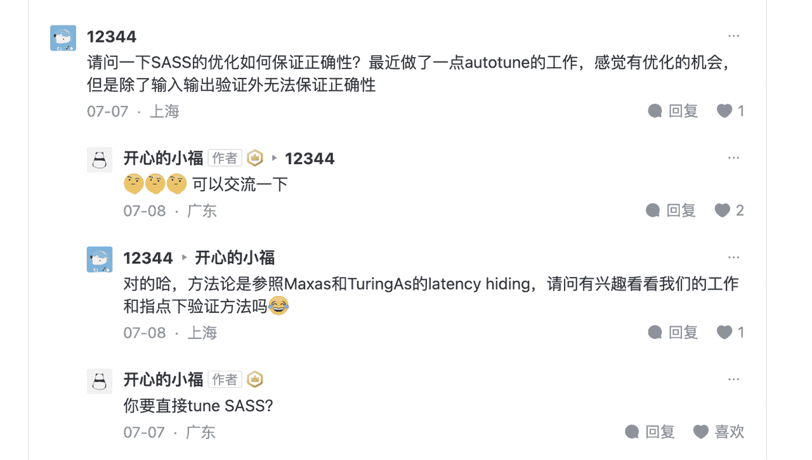

# 泰迪智能 DL 知识库

# 大模型 AI Compiler 入门材料

> 来源：[https://learning.feishu.cn/docx/HJUods0r8oGytsxXMtTcCzUAnEd](https://learning.feishu.cn/docx/HJUods0r8oGytsxXMtTcCzUAnEd)

如果想下载文档，申请编辑权限即可，欢迎交流。

技术栈

1.  模型算法。LLM & diffusion models

1.  Torch Compiler

1.  OpenAI Triton

1.  MLIR & LLVM Compiler

1.  GPGPU 微架构

不管是 学习编译原理，还是 实现一个 Compiler，

现在应该学习 MLIR-Style Compiler Development，而非传统编译原理 or llvm based compiler 的开发理念。

学习编译原理，尤其不要盯着 Parser / Lexer 等前端去深入看。重点在 Optimization。

核心领域：模型算法、体系结构、编译原理、自动性能优化（数学领域的 Optimization 分支）。

学习的 3 个关键维度：

1.  理论原理。

1.  动手能力。加一个 pass/dialect，调试一下 Tiling 策略。

1.  性能瓶颈的经验数字。比如，matmul 和 softmax，哪个跑的更快，核心看硬件的什么指标。

# 模型层

分 3 个阶段：

1.  知其然。能把自己的任务与模型结构联系起来，知道为什么要做，理解工作的意义。

1.  老法师。拿到新的模型结构，一眼看出性能瓶颈。

1.  趋势研判。能押宝未来 3-5 年模型的算力需求。

## 快速上手 & 动手练习

阅读材料：

1.  https://www.bilibili.com/video/BV1v4421c7fr/ Andrej Karpathy - Let's build GPT. Jan 18, 2023 (目标：理解典型的模型结构)

1.  ICML22 tutorial slides https://drive.google.com/file/d/1HFxSxIhbyrapCHEss_KcCdCJEmFrAUvo/view?usp=sharing （目标：理解张量并行和 AllReduce）

动手练习：

1.  使用 PyTorch 从头实现一个 LLama2 Decoder，一个 Deepseek V3 MLA Attention。

1.  基于 PyTorch Distributed，修改为 TP=2，PP=2 的 4 node 分布式版本。可以 4 个 docker container 模拟 4 台机器进行功能测试。

1.  使用 torch.compile编译模型，并观察生成的 Triton Kernels。

1.  简易的性能 simulator。latency 即 critical path 上的指令 latency 之和。难点是找到 critical path，可以用多个 node，模拟各个 hardware unit，模拟的跑一边。

1.  对性能 simulator & 算子 compiler 调参，理解不同硬件设计下，性能优化手段的定量影响。

## Transformer 结构与 AI 算法

阅读材料：

https://www.bilibili.com/video/BV1v4421c7fr/ Andrej Karpathy - Let's build GPT. Jan 18, 2023

https://zhuanlan.zhihu.com/p/338817680 知乎经典的 Transformer 模型详解

https://zhuanlan.zhihu.com/p/624740065 分析transformer模型的参数量、计算量、中间激活、KV cache

[LLaMa2 Arch & GQA Attention](https://dwpl6xgouw.feishu.cn/wiki/QbDEwX6fuish9rkxP46c9f16nYe?fromScene=spaceOverview)

推荐 李沐 的 paper reading 视频，过一遍 paper，更高效

https://www.bilibili.com/video/BV1pu411o7BE/ Transformer论文逐段精读

https://www.bilibili.com/video/BV1AF411b7xQ/ GPT，GPT-2，GPT-3 论文精读

https://www.bilibili.com/video/BV1vM4y1U7b5/ GPT-4论文精读 (选读)

目标：

1.  理解 transformer 架构，特别是 decoder 的结构和算力特征。

1.  理解 KVCache 对模型结构和算力特征的影响。

自测题：

1.  GPT-175b 中，1 个 decoder 有几个带参（预训练权重）的 matmul (矩阵乘法)？

1.  写出 Tensor Shape。

1.  计算 matmul 的 MACs（multiply-accumulate，乘加） 指令数量，估算占整个 decoder 算力需求的百分比。

1.  GPT-175b 中 KVCache 的 memory size 估算公式。batch size = 16，sequence length = 4096 时，8MB 的 SRAM 能放多少个 decoder 的 KVCache？

1.  LLama2-70b 用了 GQA Attention，KVCache 的 memory size 降低多少？

1.  Deepseek V3 用了 MLA Attention，KVCache 的 memory size 比 GQA 降低多少？

## 张量 & 流水并行

阅读材料：

ICML22 tutorial slides https://drive.google.com/file/d/1HFxSxIhbyrapCHEss_KcCdCJEmFrAUvo/view?usp=sharing （目标：理解张量并行和 AllReduce）

PyTorch Parallelism - talk notes https://zhuanlan.zhihu.com/p/677808809

手把手推导 Ring All-reduce 的数学性质 https://zhuanlan.zhihu.com/p/504957661

目标：

1.  理解常见的并行算法：张量并行、流水并行、数据并行。能写出公式和 shape 推导。

1.  理解 AllReduce / AllGather 的语义，熟悉 RingAllReduce 的实现原理。

自测题：

1.  C[m,n] = A[m, k] * B[k, n] 做张量并行，可切分 m/n/k，分 3 种情况。

1.  画个图，写出 A、B、C 矩阵拆分前后的详细 shape、计算公式。

1.  拆分后，需要合并回原始 C 矩阵。写出需要插入的算子，及其 Input / output 的传输数据量公式。

1.  GPT-175b 模型，单机 8 卡张量并行，AllReduce 的通信数据量是多少。

注意：

1.  大模型情况下，设备数 p 一般特别大。使得，all reduce 的启动 latency 影响更大，一般不用 RingAllReduce。

## Torch Compiler & 图编译

传统 CV 模型阶段，图编译的核心是 算子融合 & memory planning。

大模型阶段，图编译的核心是分布式并行 & 通算融合。

PyTorch:

[PyTorch 2.0: Compiler - talk notes](https://dwpl6xgouw.feishu.cn/wiki/IWF4wwnfcilhHQkyLcLc91XWnpg?fromScene=spaceOverview)

[PyTorch Parallelism - talk notes](https://dwpl6xgouw.feishu.cn/wiki/W93EwuaAeimd0Hk0Dbqc3OrunHh?fromScene=spaceOverview)

PyTorch Autograd

https://pytorch.org/blog/overview-of-pytorch-autograd-engine/

https://pytorch.org/blog/computational-graphs-constructed-in-pytorch/

https://pytorch.org/blog/how-computational-graphs-are-executed-in-pytorch/

https://zhuanlan.zhihu.com/p/686285169

知乎 - ZZYSonny, Torch Inductor 系列 7 篇文章

PyTorch 适配新硬件，工作量主要还是端到端的 performance tuning

1.  大模型，一般要做 model sharding 的适配。

1.  添加 torch backend，增加 memory planning & triton op codegen 的灵活性。

1.  KVCache 加速、量化等上层优化，在定制后的新软件栈上，端到端的 performance tuning 做完。

# 算子层

核心命题：将单个算子，高性能的跑在指定硬件上。

当前的主流思路：tile based 编程模型 + Compiler 自动性能优化 (Triton / TileLang)

优化的核心指标：更少的 spill 次数，打满 IO。包括 register spill 和 memory spill。

关键技术：tiling & vectorization 策略，memory & register planning (FA2)，Latency Hiding（pipelining）

## 快速上手 & 动手练习

+   [CS143 编译原理笔记 - 提纲](https://deep-learning.feishu.cn/wiki/YzyCwQzcUi8R0LkG243cCPRvnwg?fromScene=spaceOverview)。入门编译原理。看完再看龙书，效率更高。

+   [Hands-on LLVM essentials](https://deep-learning.feishu.cn/wiki/FnyawtybTi5Wynkzer2cRW1qn8g?fromScene=spaceOverview)。入门 LLVM，工作常用。与编译原理，相辅相成。

+   https://www.youtube.com/watch?v=XnRZA1pz7iw Teaching MLIR Concepts to Undergraduate Students。（课程网站 https://xdsl.dev/）

手动练习 - TODO

## Triton & 算子编译器

Triton 解决算子问题，LLVM 解决指令问题。新增的主要是：

1.  Tensor IR。即，ttir，Triton IR。传统 LLVM 里一般都是 scalar，最多涉及一点 vector。

1.  data layout。与 Pass 一起，堪称 Triton Compiler 的 2 大核心。关注最新的 cute layout。

1.  host + device 编程引入的挑战：kernel launch，传参。类似 LLVM 中的 calling convention 设计。

1.  device 并行编程引入的挑战：类似 cuda 和 PTX 要解决的问题。

[Triton Conference 2023 - talk notes](https://dwpl6xgouw.feishu.cn/wiki/SbWEwY68mi8WpCkBZHIc56wMnjb?fromScene=spaceOverview)

https://triton-lang.org/main/getting-started/tutorials/08-experimental-block-pointer.html

Triton 入门：

[scan triton - paper and codebase](https://dwpl6xgouw.feishu.cn/wiki/EXWGwc9xniMKSukrN8DcO4KWnJc?fromScene=spaceOverview)

[Hands On Triton 2.1](https://dwpl6xgouw.feishu.cn/wiki/MCodwF9IGiLAuFknsN1cT98Mnah?fromScene=spaceOverview)

TODO - triton jit 流程

TODO - triton compile 流程

Triton 适配新硬件，工作量主要在 TritonGPUToLLVM，主要是

1.  大量 asm 支持的体力活 or 自动化。

1.  load / store lowering 时的 连续性 & coalesce 分析。一般以 layout 分析的方式展开。

1.  针对 matmul 和 TensorCore arch 适配的强耦合代码。

1.  适配硬件 hierarchy 层级的 reduction 性能优化。

1.  device kernel 传参的 calling convention。灵活性，code size，kernel launch 代码，数据流代价。

1.  block layout，shared layout & matmul layout 之间的转换、连续性分析，stride 计算，coalesce。

### 自测题 1 - tl.load & tl.store 的 offset 计算

走读以下代码 & 运行结果，回答问题：

1.  以下代码，实际在做 c = a * b，为什么 15 行是 tl.dot(b, a) 才能算出正确的 c？

1.  如何修复这个 bug。

```
@triton.jit
def matmul_kernel_m16n16k16(
    # Pointers to matrices
    a_ptr, b_ptr, c_ptr
):
    offsets = tl.arange(0, 16)[:, None] + tl.arange(0, 16)[None, :] * 16

    a_ptrs = a_ptr + offsets
    b_ptrs = b_ptr + offsets
    
    a = tl.load(a_ptrs)
    b = tl.load(b_ptrs)
    
    accumulator = tl.zeros((16, 16), dtype=tl.float32)
    accumulator = tl.dot(b, a, accumulator)
    c = accumulator.to(tl.float16)

    c_ptrs = c_ptr + offsets
    tl.store(c_ptrs, c)
```

解释：

第 6 行，offset 计算问题。

这个 offset 的效果，会边 load/store 边 transpose。

因此，这段代码的实际效果是：

1.  11-12 行，tl.load 后的 a 和 b，实际是得到了 a 和 b 的 transpose。

1.  15 行，b 和 a transpose，得到 c 的 transpose。（矩阵乘法的数学原理）

1.  19 行。tl.store，底层会自动 transpose，得到 c 矩阵。

1.  至此，最终结果与 c = a * b 一致。

## MLIR

比 toy language 好的 MLIR 入门课程

Teaching MLIR Concepts to Undergraduate Students

https://www.youtube.com/watch?v=XnRZA1pz7iw

课程网站 https://xdsl.dev/

经典的 MLIR Tutorial https://mlir.llvm.org/docs/Tutorials/Toy/

深入理解 Compiler IR:

1.  [Compiler IR - 编译原理](https://deep-learning.feishu.cn/wiki/BbWLwQSODi3MD4kq1UWcIcctnRd?fromScene=spaceOverview)

1.  [LLVM IR 设计思想 & 局限性](https://deep-learning.feishu.cn/wiki/Z128w7fUziim3KkDCamcfEBenAh?fromScene=spaceOverview)

1.  MLIR Dialect - WIP

目标：

1.  会添加一个 MLIR dialect/Pass。会加一个新 op & 往 lower-level dialect 的 conversion 代码。

1.  熟悉关键 Dialect，比如 Linalg。

1.  熟悉关键数据结构，比如 memref, subview。

Lei Zhang 的 4 篇系列文章

1.  编译器与中间表示: LLVM IR, SPIR-V, 以及 MLIR https://www.lei.chat/zh/posts/compilers-and-irs-llvm-ir-spirv-and-mlir/

1.  机器学习编译器代码生成相关 MLIR Dialect https://www.lei.chat/zh/posts/mlir-codegen-dialects-for-machine-learning-compilers/

1.  MLIR Vector Dialect 以及 Patterns https://www.lei.chat/zh/posts/mlir-vector-dialect-and-patterns/

1.  MLIR Linalg Dialect 以及 Patterns https://www.lei.chat/zh/posts/mlir-linalg-dialect-and-patterns/

## LLVM & 编译原理

学习路线图

1.  [CS143 编译原理笔记 - 提纲](https://deep-learning.feishu.cn/wiki/YzyCwQzcUi8R0LkG243cCPRvnwg?fromScene=spaceOverview)。更容易入门，看完再看龙书，效率更高。

1.  [Hands-on LLVM essentials](https://deep-learning.feishu.cn/wiki/FnyawtybTi5Wynkzer2cRW1qn8g?fromScene=spaceOverview)。Tools，LLVM IR，Pass Infra, Codegen 等。

1.  [LLVM & 编译原理的阅读材料](https://deep-learning.feishu.cn/wiki/D8AewDekqif0zBkkB2ocQCqgnOe?fromScene=spaceOverview)。

目标：

1.  理解 LLVM 的基本模块和用法。前端 clang，后端 llc (codegen)，中端 opt。

1.  传统编译原理的重点是 frontend：Lexical, parsing & semantics。基本可以跳过不看了。

1.  现代 LLVM 的重点是 Optimization 和 后端 codegen。

1.  optimization 的要点：常量传播、数据流分析、SSA。能添加、修改 Pass 和 lit 测试 Pass。

1.  code gen 性能优化三板斧：指令选择，指令调度，寄存器分配。

1.  其他要点：Runtime，Typing System，Region analysis，metadata 的功能与 API 使用。

1.  掌握 LLVM IR 调试技巧。gdb, lldb, Program Visualization(?)

LLVM 处理的关键问题：

动态分配、同步、命名、局部性、分级存储结构管理、流水线调度。

编译原理，比较经典的是：

数据流分析，控制流分析，指令选择，指令调度，寄存器分配等算法。

编译器中的算法

| 算法 | 编译器模块 |  |
| --- | --- | --- |
| 贪心算法 | 寄存器分配 |  |
| 启发式搜索技术 | 表调度 |  |
| 图算法 | 死代码消除 |  |
| 动态规划 | 指令选择 |  |
| 有限自动机 (DFA) &amp; | 词法分析 &amp; |  |
| 不动点算法 | 数据流分析 |  |

一个完整的汇编，有几十到上百条指令。-- 龙书第 8.2 节。

Nvidia PTX 有多少条指令？

一些典型的 topics

[Loop Optimizations by Compilers](https://deep-learning.feishu.cn/wiki/XDYfwxQFKiEju0kxAOhcCPTQnHh?fromScene=spaceOverview)

[ISA & intrinsic Designs](https://dwpl6xgouw.feishu.cn/wiki/RZriwDzq0ifbyxkHCXQc67DlnKf?fromScene=spaceOverview)

自测题：

1.  作为用户，购买编译器最重要的 5 个 feature 是什么？

1.  [MLIR 中的 addres](https://llvm.org/docs/GetElementPtr.html)s 计算，与 LLVM getelementptr 能混合使用吗，为什么？

# 硬件层

GPU 使用的核心是：latency hiding。

## GPGPU 微架构 & CUDA

重点是学习 GPGPU uArch (微架构） & CUDA 性能优化方法

[SIMT & GPGPU arch](https://dwpl6xgouw.feishu.cn/wiki/ObQjwqMcCiASWJk3OkncS5q9nZc?fromScene=spaceOverview)

[Nvidia TensorCore](https://dwpl6xgouw.feishu.cn/wiki/PnYmw4KcdiPBphkJBFdcqdDxnke?fromScene=spaceOverview)

[GPGPU Programming](https://dwpl6xgouw.feishu.cn/wiki/BVzNwrb4jiY8ZSkdnWJckd4Inqg?fromScene=spaceOverview)

## GPGPU Driver & runtime

比较重要的：

1.  stream 类 API 的设计 & 机制。

1.  memory API。特别是 sync / async 机制下的 API 覆盖范围 & 性能差异。另，注意 pinned memory。

[GPU Driver & Runtime](https://dwpl6xgouw.feishu.cn/wiki/Lfn0wHjKSiW76wk4OZQcSpsBnye)

# 高性能计算 & 并行计算 - TODO

[性能加速的方法论](https://deep-learning.feishu.cn/wiki/KtdcwCTZgia3Jbkc8ODci79Unyd)

# 数学功底 - TODO

optimization

# 落地 - LLM Serving 服务

| Project | 问题 |
| --- | --- |
| SGLang | LLM Program，面向业务支持, 有些专业团队推荐，比vllm性能更优，作者测试Qwen模型比vllm明显快 |
| https://github.com/karpathy/llama2.c | Inference Llama 2 in one file of pure C |
| vllm | FlashInfer 性能很好，相比xformer 2-3倍提升 |
| Tensorrt-LLM | 英伟达官方，nv内部算子 |
| Ollama | 支持cpu，arm cpu，mac |
| llama.cpp | 支持cpu，arm cpu，mac |
|  |  |
| lightllm | LightLLM：轻量高速的LLM |
| Transformer-deploy | [h](https://link.zhihu.com/?target=https%3A//baijiahao.baidu.com/s%3Fid%3D1720545846675638931%26wfr%3Dspider%26for%3Dpc)ttps://baijiahao.baidu.com/s?id=1720545846675638931&amp;wfr=spider&amp;for=pc |
| Infinity | [h](https://link.zhihu.com/?target=https%3A//baijiahao.baidu.com/s%3Fid%3D1720545846675638931%26wfr%3Dspider%26for%3Dpc)ttps://baijiahao.baidu.com/s?id=1720545846675638931&amp;wfr=spider&amp;for=pc |
| Triton Transformer | 用 OpenAI Triton 重写了 Transformer 库 |
| gpt-fast | Simple and efficient pytorch-native transformer text generation in &lt;1000 LOC of python. |

#

# 其他

Fast-Math

2024 LLVM Dev Mtg - Towards Useful Fast-Math

https://www.youtube.com/watch?v=3Uf_3Su1NEc

跟个热点：存内计算。(hot chips)

[Memristor 忆阻器 - talks 笔记](https://dwpl6xgouw.feishu.cn/wiki/Yc1rw9eMvi0au3kechccs2IBnof)

RISCV官方文档

+   RISCV ISA Manual

+   [RISCV Vector](https://github.com/riscv/riscv-v-spec)

AI编译器的核心是在已有的大量、不规则、高维的张量计算中，进行变换、融合、映射，以极致优化性能

# 自动性能优化

把⾃动驾驶 Planning 算法的理论体系迁移到 AI Compiler 的 optimization 体系中。

LLM 时代，AI Compiler 的重点 kernel fusion 和 topo scheduling 等

变成 auto distribution & parallel processing，

这个依然是人力很难解决的问题。

AI compiler 应该从传统的 compiler 和 codegen 转向 planning 和 optimization 的编译技术。

AI compiler 在高层转换完，直接映射到 microkernel，似乎可以抛弃掉大部分传统编译器里的优化。

关注的重点开始变为整个AI系统，如从算法角度引申的KV Cache，以及推理过程引起的Prefill / Decode分离，乃至我们内存方案优化出来的PageAttention等，即使是Continous Batching等也是提高吞吐的有力武器，这无疑是CNN时代未出现的系统与推理的强耦合性。

直接 tune SASS 的思路：方法论是参照 Maxas 和 TuringAs 的 latency hiding

12344 https://www.zhihu.com/people/12344-4



袁进辉

Google GSPMD （[G](https://link.zhihu.com/?target=https%3A//arxiv.org/abs/2105.04663)[S](https://link.zhihu.com/?target=https%3A//arxiv.org/abs/2110.15032)PMD: General and Scalable Parallelization for ML[ Computation Graphs）和 OneFlow SBP （OneFlow: ](https://link.zhihu.com/?target=https%3A//arxiv.org/abs/2201.12023)Redesign the Distributed Deep Learning Framework from Scratch） 这样的抽象方式其实为auto placement和auto parallelism 定义了足够通用的解空间，在这个解空间下有很多种可能的办法去自动搜索出来还不错的解，譬如伯克利一个团队最近的一篇文章 Alpa (Alpa: Automating Inter- and Intra-Operator Parallelism for Distributed Deep Learning)。 我相信，在问题定义比较清楚之后（如何评价Google的GShard论文？），以后还会涌现出来在效果和效率上更好的解决办法。