# 如何用一张照片推理具体位置｜网络迷踪入门指南

> 来源：[https://my.feishu.cn/docx/VXcjdjNVJowZ71xCXRzcfeMznMc](https://my.feishu.cn/docx/VXcjdjNVJowZ71xCXRzcfeMznMc)

[访问🛰️👸号版本 →](https://mp.weixin.qq.com/s/CldWI4QREOHyCmih2gnsJw)｜[访问知乎专栏版本 →](https://zhuanlan.zhihu.com/p/555606058)｜[访问 Notion 版本 →](https://spacekid.me/458653a2e5674b21918ed261a86720fb)

> 在开始正经的教程之前首先需要说明几点：

1.  这篇文章将要介绍的是一种叫**「网络迷踪」的，仅凭一张照片及有限提示信息判断出照片拍摄具**体地点的推理游戏。它可以被认为是开源情报（Open-Source Intelligence, OSINT）的一种形式，指合法地从公开和可公开获得的资源中收集数据和信息的做法。

1.  这篇文章不会介绍如何获取和分析**「场外信息」**，例如「本地人一看就知道」，或从出题者历史内容、社交平台上获取其身份和常住地信息。这篇文章不鼓励在「网络迷踪」中使用「人肉搜索」等涉嫌侵犯他人隐私的行为。

1.  作者本人仅是「网络迷踪」的爱好者，与本人中提到的社交平台以及工具之间没有利益关系。同时，作者也是业余玩家，下述内容是对个人经验的总结，是一份快速入门指南，而并非严谨专业的教程。希望这篇文章能帮助一部分对这个游戏感兴趣的人入门，也同时希望能帮助大家意识到在公开渠道发表照片可能带来的隐私风险。

# 初入「网络迷踪」

201[1 年，人人网上一](https://page.om.qq.com/page/OzDezp5M825FCotpeuYPEl6w0)个名为「罗霄宇 BHSFer」的用户发表的一篇名为《我是如何推理出王珞丹住址的？》的日志被各家媒体转载，作者介绍了自己利用王珞丹🧣所发的照片以及 Google Earth 等工具，历时 40 分钟推理出王珞丹前住址的全过程，彼时曾掀起轩然大波。

2015 年，有🧣网友发了一张形似龙的河流或水库的照片，当时很多网友留言说是「假的」、「P 的」（当然更多网友是在转发求好运），经过我的寻找，这是葡萄牙的奥德莱蒂河（Ribeira de Odeleite），证实确有此事。这应该算做我个人的第一次「网络迷踪」之旅吧。

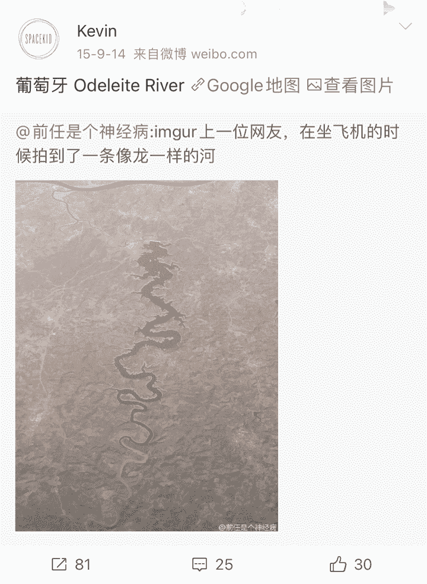

[进入到短视频时代，B](https://space.bilibili.com/43645887/channel/seriesdetail?sid=90709) 站 up 主「[我是 Eye](https://space.bilibili.com/1960160215)O[pener」的](https://space.bilibili.com/93569847)几[个「网络迷踪」](https://space.bilibili.com/1078123935)系列视频获得千万次播放，「探照寻址」、「宇宙百科君」、「夜点短视频」等人的「网络迷踪」专栏相继开播，将「网络迷踪」这种玩法呈现给了大众视野。

类似玩法在国外已经相当流行。例如在 Twitter 上，一位叫「Ve[rif!cation Quiz](https://www.google.com/maps/d/viewer?mid=10YK14-QB25penu8jeS4hBVarzGKZsVgj&ll=48.104096492535504%2C31.957569662788224&z=6) Bot」的机器人的迷踪题每天都会吸引大量网友参赛。与此同时，Twitter 上还有大量关注「俄乌战争」的网友们自发地对各类网传的图片、视频进行地理定位，并将其汇总在一张 Google 自定义地图上。在此期间，不少 OSINT 相关技术和工具应运而生。


如果你也希望玩类似推理游戏，可以前往国内的「炒饭社区」的「网络迷踪」板块：https://chao.fan/f/84。这个论坛是国内圈内最大的爱好者聚集地，不仅每天都有饭友发出各种图片（绝大部分都是自己拍摄或授权发布的），向其他「侦探们」提出挑战，社区还会根据成就赠送徽章，并定期举办比赛。论坛还有个子版块叫「远古难题」，6 个月没有人能破解的谜题则会自动移动到该板块，成功解决「远古难题」则可以获得宝贵的「初解远古」以及「远古粉碎机」徽章。

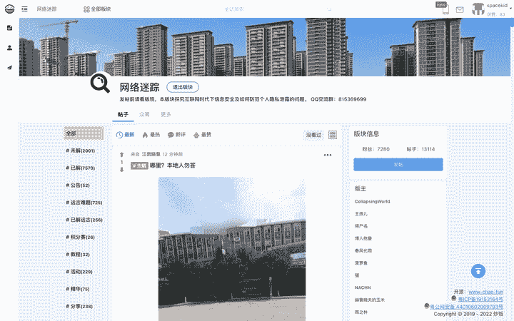

插播一句，「炒饭社区」还有一个叫「图寻」的小游戏（https://chao.fan/tuxun），这个游戏取材自类似的「GeoGuessr」，每分钟玩家会出生在真实世界一个随机位置上，玩家需要根据周围环境的全景图，推测出自己在世界地图里的位置，按推测位置与实际位置距离之差计算积分。可多人实时在线竞技，可以匹配 Solo，还有每日挑战赛，休闲的同时还能顺便逛逛世界各地风景。

尽管「网络迷踪」本身并没有明确的难度划分标准，从我个人的经验来看，「网络迷踪」的题型主要有三种：

+   送分题：分为识字题和识图题两种，并不考验综合分析能力技巧，适合新手入门。

+   分析题：需要通过识字、识图提取画面信息，结合个人知识储备和各类工具进行缜密分析得到答案。

+   超纲题：画面中可利用的信息过少，即便是老手也很难解读，很容易成为「远古难题」。

我将以「炒饭社区」中常见的各类不同难度的谜题为案例，通过由浅至深的方式来聊聊这篇入门指南的核心内容：如何用一张照片推理具体位置。

---

# 送分题 —— 学会「识字」和「识图」

当看到一道「网络迷踪」题目后，首先要做的就是进行「识字」和「识图」，仔细审题和观察，提取画面信息、扩大信息含量。实际上社区里的不少新手谜题仅仅通过简单的「识字」或「识图」就已经能完成解答了，如果还不够，则再进行进一步分析。

### 1.1 识字

文字信息是用于推测照片拍摄位置最简单也是最直接的方式。照片的任何犄角旮旯都可能藏有文字，因此即便是模糊不清或已经被打码过的信息，都要善加利用，它们很可能成为解题关键。文字信息可能来源于：

+   建筑招牌、商铺名称

+   车辆牌照、电话号码

+   路牌、公交车线路

+   宣传海报、广告牌等

**先举个简单的例子：****https://c**hao.fan/p/1199749（图 1.1-1）


原帖作者声称这张图片「拍摄于 2021 年 4 月 25 号重庆，女友坐在车里拍摄的」。原图非常模糊，除了能识别出一个「@汽车吧」的水印以外，还有一个「公园洋房 6850 01**」的广告语文字。除此以外，建筑和道路都非常普通，没有什么特征可言。

看到这道题，我首先想到的是这个「@汽车吧」的百度贴吧水印——这代表着这张图可能从贴吧转载而来，原帖可能包含高清大图或者其他信息（其实属于场外信息了），可惜在「汽车吧」搜索之后没有找到这个帖子。所以我再次把注意力集中在这个「公园洋房 6850 01**」的广告语文字（图 1.1-2）上。

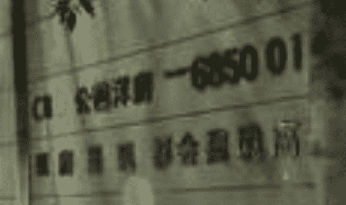

我们知道，这种楼盘围墙广告一般用于正在开盘中的楼盘附近，也就是说只要知道这个楼盘是什么，就基本定位到了照片的拍摄位置。我们又知道，重庆的区号是 023，也就是说只要把后面的电话补充完整，就能知道这是什么楼盘。通常来说，房地产营销的电话为图吉利，尾号一般都是「88」、「66」、「00」之类，而这个号码倒数第三位是「1」，所以后面两位也有很大可能是连号的「11」。所以我就从「023-68500188」开始搜索，发现是个化工公司的电话后，紧接就搜索了「023-68500166」和「023-68500111」。


在「023-68500111」的搜索结果（图 1.1-3）中，排名第一的就是一个叫「金地首创两岸风华」的楼盘，并且很明确地给出了售楼部的地址。如此一来，借助地图和街景我很快就定位到了照片拍摄的原始位置：重庆市南岸区福民路 24 号两岸风华，西门向南 50 米处。

**举例 2：****https://c**hao.fan/p/1201031（图 1.1-4）

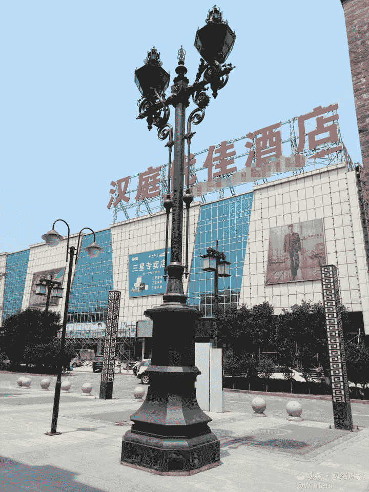

原帖作者声称这张图片是「2018 年 8 月 5 日 12:26，旅游途中拍摄，街景变化甚小，但广告、照片已有很大不同」。图片上重要信息都被马赛克，仅仅留下一个硕大的「汉庭优佳酒店」。如果是你，你会从「汉庭优佳酒店」开始搜索吗？

这其实不太科学，因为如果你尝试用地图软件搜索「汉庭优佳酒店」，发现全国有近千家，光上海就有 112 家。这显然太难排查了。正确的做法是，留意到照片最右侧还有一个垂直招牌上还有三个汉字，尝试在 Photoshop 中对这三个汉字进行透视变换，识别到「陶源丰」三个字（图 1.1-5），然后检索得到，这是位于晋中市平遥县的，陶源丰新天地（顺城路店）—— 平遥的「陶源丰新天地」是「陶源丰」的唯一检索结果，靠谱多了。

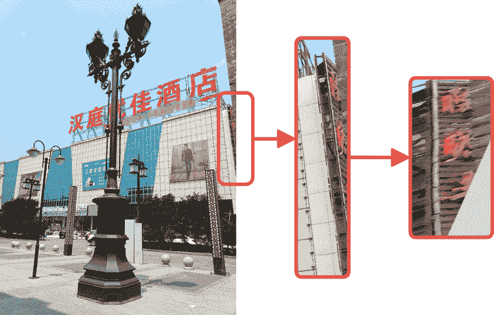

**举例 3：****https://c**hao.fan/p/1201066（图 1.1-6）

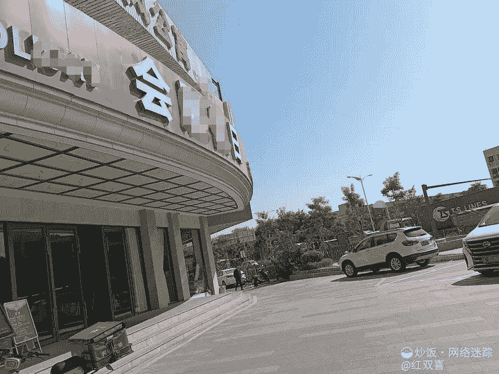

画面中可见建筑招牌文字「会□□日」以及「□公寓」，但都不完整，难以进行搜索。很多人会尝试从可见车牌号「粤L·000NP」入手在广东省惠州市尝试搜索，但这是不合适的。车牌号虽然代表了车辆注册地，但车辆跨市甚至跨省通行是常有之事，并不是绝对有效的信息。这道题的解题关键在于认出「会□□日」中间两个字，由第二个字的厂（尸）字头以及第三个字的单人旁（亻）推断前两个字为「会展」，后两个字为「假日」，继而搜索地图得到答案：广东省深圳市宝安区凤塘大道 612 号 B2 栋会展假日酒店鸿利来分店。

以上是一些简单的识字方式，除了肉眼辨别，你还可能用到以下工具：

+   Photoshop 等图像处理软件：用于提高图片可识别性、防抖滤镜处理、透视变换等

+   **手机号码归属地查询**：https://www.ip138.com/sj/

+   **长途电话区号查询**：https://www.ip138.com/post/

+   **全国各地车牌查询表**：https://www.ip138.com/carlist.htm

+   **License Plates of **the World（世界各国车牌样式库）：http://www.worldlicenseplates.com/

+   **一些在线字体识别网站**：用于手动模拟尝试恢复无法识别的字体

关于文字的识别，之前有发过一篇专门利用文字分析方式解决「远古难题」的案例，有兴趣的可以移步下方链接展开阅读。

### 1.2 识图

识图并不是纯靠肉眼分辨，而是有效借助各类图片反向搜索引擎进行「以图搜图」。许多标志性设施、有特色的建筑和道路细节都很容易被反向搜索。常用的图片反向搜索引擎有：

+   **Google 智能镜头**：https://lens.google/（通过 Chrome 浏览器的右键菜单即可使用）

+   **Google 图片**：https://images.google.com/

+   **Bing 图片**：https://www.bing.com/?scope=images

+   **百度图片**：https://images.baidu.com/

+   **搜狗图片**：https://pic.sogou.com/

+   **Yandex Images**：https://yandex.com/images/

+   TinEye Reverse Image Search：https://tineye.com/

如果你使用的是 Chrome 或 Firefox 浏览器，通过安装[「Search by ](https://chrome.google.com/webstore/detail/search-by-image/cnojnbdhbhnkbcieeekonklommdnndci)I[mage」扩展程序，可以](https://addons.mozilla.org/en-GB/firefox/addon/search_by_image/)一次性打开多个图片反向搜索引擎：Chrome 商店地址，Firefox 商店地址。

通常在进行识图时需要留意这么几点：

+   如果图片不够清楚或照片构图不理想，应先适当调整图片的曝光、亮度、对比度，以及画面裁剪、旋转等参数。

+   为保证识图的准确性，应分别对图片的整体、带有特征的局部（尤其是不同建筑物的主体部分，以及公交车、出租车等）进行识别，以找到足够多的可能线索。

+   如果前景被路灯、树木、行人等障碍物遮挡，应先利用图像处理软件对前景的障碍物进行内容填充移除，以正确识别到后方画面主体。

+   如果建筑物只有一半，但其很明显是对称构造，则可以尝试手动镜像以补全另一半。

+   对于画面中模糊的 logo 等元素，可以尝试通过肉眼识别后手动重绘，再进行识图处理。

**先举个简单的例子：****https://c**hao.fan/p/1200856（图 1.2-1）

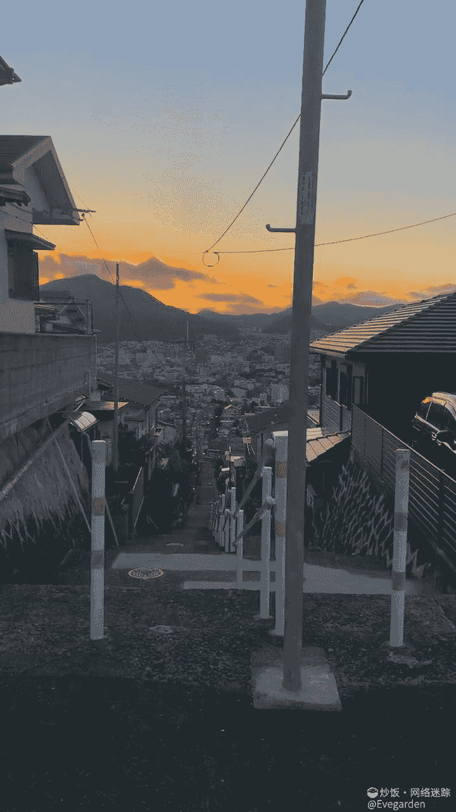

这张图看着像日本，但具体是日本哪里？我同样先启动了识图，虽然大部分识图工具没有在前面位置给到很准确的结果，但我在 Google 智能镜头里找到了一张很像的图，是一家叫「カットハウス ミネ」（CutHouseMINE）的美发店的 Facebook 主页，主页里明确标识了他们的邮编以及地址：

> 〠 852-8123 長崎市三原 2 丁目 3-26 三原小学校のすぐ近くにあります。


比对画面中的栏杆、山脉形状与原帖配图都非常接近，但前景里的建筑物不大一样。因此推测原帖配图就是在长崎拍摄，与「カットハウス ミネ」位置接近。这时候只要启动 Google Maps，定位到「カットハウス ミネ」，然后寻找其附近的其他朝西的阶梯口位置，很快就找到了原图的拍摄地点。

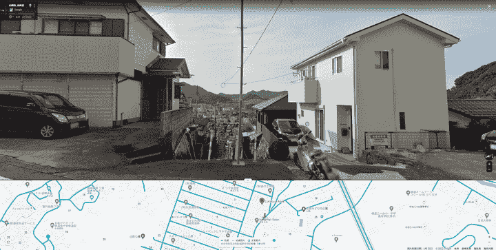

**举例 2：****https://c**hao.fan/p/1199790（图 1.2-4）


这张图看着像摄影师的作品或者壁纸之类网图，所以看到题目顺手先点了以图搜图，结果略有些出乎意料，并没有找到直接的结果，看来这张图片并没有想象中那么简单。但最终我还是解的很快，大概 3 分钟就找到了结果 —— 其实只要稍加留意就会发现，画面正中心的圆顶建筑非常具有识别性（图 1.2-5），只要对它进行识别就可以了。

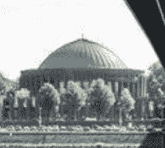

裁剪画面这块区域到 Google 智能镜头中进行检索就直接得到了答案：这个建筑是位于德国的杜塞尔多夫音乐厅（Tonhalle Düsseldorf），因此配合 Google Maps 很快就能定位到照片原始拍摄位置是德国杜塞尔多夫的 Oberkasseler Brücke 大桥西侧的桥底。

**举例 3：****https://c**hao.fan/p/1199875（图 1.2-6）

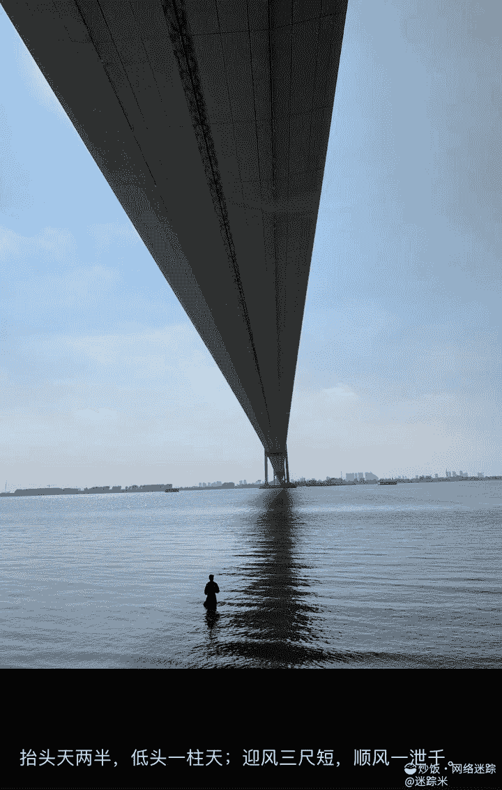

原帖作者询问，「图中小伙在哪里以蚯投鱼」？这座桥相比上一个例子里杜塞尔多夫的桥梁而言，可识别性大大降低，对岸建筑物小到只剩一点轮廓，要怎么寻找特征呢？我提取到的信息有这么几点：

+   这是一张朋友圈截图，图中大桥在中国可能性较高

+   从江面样式和宽度来看，可能性最高的是长江

+   桥梁为悬索式

+   桥梁路面背部中脊线上有一道明显的黑色纹路

+   桥梁路面背部有长条的网格状纹路

尽管没有什么明显头绪，我仍然尝试在各个平台进行识图搜索。以图搜图后我发现，不同桥梁的路面背部样式细节差别其实非常大，如果盯着「背部中脊线上有一道明显的黑色纹路」这个特征去寻找，可能会有所斩获。在浏览了大概 100 张各种桥的背部照片后，我在百度识图里找到了一个几乎一模一样的桥底（图 1.2-7）：

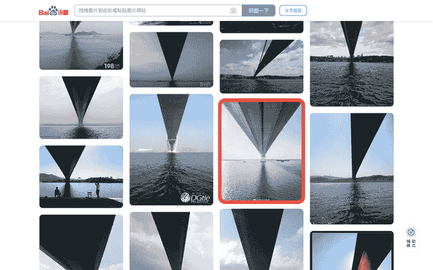

可[惜的是，这张图片](https://www.huitu.com/photo/show/20180218/204610197016.html)点击后百度提示「页面不存在」。不过这也难不倒我们，我们继续用这张小图进行以图搜图，继而进一步找到了这个作者的原始摄影作品主页，尽管作者并未在这张作品下做任何说明或标注其拍摄地点，但我在其个人主页的同批次摄影作品里一个不起眼的角落里最终发现了一个关键词标签「泰州大桥」。再之后，我通过对泰州大桥全景图、📕里泰州大桥的相关视频进行比对、验证细节，最终实锤了原帖配图的确是拍摄于江苏省泰州市的泰州长江大桥桥底。

以上是一些简单的识图方式，除了肉眼辨别以及前文提到的片反向搜索引擎，你还可能用到以下工具：

+   Photoshop 等图像处理软件：用于提高图片可识别性，去除障碍物等

+   如果不想安装 Photoshop，可以使用 https://cleanup.pictures/ 这个在线工具快速去除障碍物

+   **通过地图软件查阅街景图**

+   **Google 地图**：https://www.google.com/maps

+   **百度地图**：https://maps.baidu.com/

+   **高德地图**：https://amap.com/（高德没有街景图，但有商铺主页，也可以查询到实景图）

+   **腾讯地图 App**

+   通过**大众点评**、**🧣**、**抖音**、**📕**等社交和内容平台查阅实景照片、视频

+   **通过全景图平台比对全景图**

+   **720 云**：https://720yun.com/

+   **安居客**：https://shenzhen.anjuke.com/（是的，很多房地产平台会有小区的全景图）

+   S[k](https://www.skyscrapercity.com/forums/cityscapes-and-skyline-photos.8/)yscraper City（城市天际线图库）：https://www.skyscrapercity.com/forums/cityscapes-and-skyline-photos.8/

+   **Phorio（建筑图像库）**：https://en.phorio.com/

有了「识字」、「识图」等手段，对于不少初级谜题应该得心应手了。但很多实际情况下，照片中给到的文字或有特征的画面信息并不多，尤其是在「炒饭社区」，很多发帖者会刻意遮盖画面中出现的文字，或者具有代表性的地标建筑物，这个时候该如何处理呢？接下来就是考验我们从画面中获取更多信息的本领了。

---

# 分析题 —— 如何从人文地理和交通设施中获得更多信息

### 2.1 人文和地理

借用少数派作者「SuperJerry」的一句话：

> 提取解读自然地理信息需要博物君般广博深厚的自然地理知识积累，以及在此基础上的直觉。在很多著名网络迷踪案例中，关键步骤只是大佬的一句「我感觉像这个地区」，其中奥妙不可言传。

除非你属于「本地人一看就知道」，或者凭借经验和直觉得来的「我感觉像这个地区」，一般总结而言，照片中往往会透传出以下自然和地理信息：

+   **气候**

+   结合照片中的气候表征以及拍摄时间，可以从气候角度推测照片拍摄地点的大致范围。例如，给定位于北半球、画面存在积雪等信息，则可判断拍摄位置大概率在当日的 0℃ 等温线以北。

+   **山脉与水体**

+   山脉的地貌、形状、植被、朝向等信息，往往成为解题的关键因素。例如，遇见中国大陆地区的喀斯特地貌，可以优先锁定广西、云南、贵州等省区。

+   水体的类型、流量、流向、颜色，常常也能提供很多信息。经常解题的大佬们有很多都能一眼分辨黄河、长江、珠江以及京杭大运河。

+   **植被**

+   基于对植被的分析，能确定照片拍摄位置在秦岭－淮河线以南或是以北。以南主要为亚热带常绿阔叶林，以北则是温带落叶阔叶林，这是中学地理知识了。

+   如果能分辨画面中具体的植物品种，则可以直接根据该植物的分布范围来缩小答案范围。

+   这里有一张《中国植被类型在线地图》请收好：https://www.osgeo.cn/map/m0139，除此之外这个网站也可以看地质、地形地貌、气候、水文海洋、土壤、动物等分布信息。

+   **土壤**[：土壤颜色也是推测拍摄位置的合理依据，例如在我国东部](http://www.ssa.ac.cn/?p=7955)地区，土壤从南到北大致呈砖红壤－赤红壤－红壤－黄壤－黄棕壤－棕壤－暗棕壤及棕色针叶林土等地带性分布。

+   **光影**

+   从光影中能获得的信息其实远比你想象的更多。从夕阳、影子等信息可以得到大致方向，从而判断道路方向或纬度信息。如果你能测量出影子的具体长度，结合本体的实际高度以及照片拍摄的时间信息，甚至可以直接得出拍摄位置的经纬度范围。Suncalc 这个网站可以利用影长、位置或时间来实现参数之间的互相确认。

+   如果能从照片中观测到日出或日落，结合照片拍摄时间也能对照片拍摄的经纬度进行科学推测，例如可以使用 https://richurimo.bmcx.com/ 这个网站根据经纬度或省份查询日出日落时间。

+   **天气**：主要用于推测拍摄的大致日期范围，也可以通过给定拍摄日期来筛选符合天气条件的地理范围。有很多可以查询历史天气的网站能给到我们帮助。

+   **星空**：如果画面中有明显的星空，则借助星空来进行定位也是一个明智的选择。

另外照片中其实常常会有一些其他人文类信息出现，这些信息里也对照片拍摄位置有很强的归纳和筛选价值：

+   国旗等旗帜

+   建筑物的风格

+   语言文字类别

+   人种和肤色信息

+   当地特有的物品或装饰

+   商品，等等

**举例：****https://c**hao.fan/p/1118939（图 2.1-1）


原[帖作者要](https://chao.fan/user/62427)求破解出[飞机下方山](https://chao.fan/user/54242)[脉的名字](https://www.bilibili.com/video/BV1LG4y1a79k)。这是一道经典的，利用对山脉、植被以及光影信息完成解题的案例。「炒饭社区」用户「你來了麼」以及「宇宙百科君」共同完成了解题，并分享了他们的解题思路：

+   通过在 **Flightradar24**（https://www.flightradar24.com/）网站搜索飞机注册号 B-5280，可以查询到这是一架厦门航空波音 737-75C 客机。

+   波音 737-75C 实际上就是波音 737-700 型飞机，其中的「5C」只是厦门航空的用户代码。

+   [同时可以查询到该架客机历史班次：https://www.fl](https://www.flightradar24.com/data/aircraft/b-5280)ightradar24.com/data/aircraft/b-5280，并将过去 1 年所有班次以表格形式下载到本地。

+   结合下方山脉的地貌、积雪情况，推测是中国北方，时间为冬季，过滤掉所有起降地均在南方以及不符合季节的航班。

+   根据下方山脉的影子朝向，判断出飞机是由南向北飞行，过滤掉所有降落地在南方以及航向不符合条件的航班。

+   根据图中对飞机影子长度的模拟，估算当时的时间。

+   我们可以在搜索引擎中检索一张波音 737-700 的尺寸图，判断飞机右翼上产生的投影为飞机垂直尾翼顶部的投影，根据垂尾投影顶点位置、垂尾本体顶点位置、以及垂尾投影顶点到飞机中线的垂线交点构成的直角三角形，经过勾股定理可以得到阴影长度约为 15.6m。通过侧面视图可以得到垂直尾翼顶端距离机翼的高度约为 9.5m（图 2.1-2）。

+   将这些参数代入到 **Suncalc**（https://www.suncalc.org/）以计算 9.5m 高度的物体产生 15.6m 长度阴影可能的日期时间范围。过滤掉该时间范围中不在执飞的航班，同时根据时间范围排查当时航班所飞越的山脉，进而大范围缩减筛查范围。

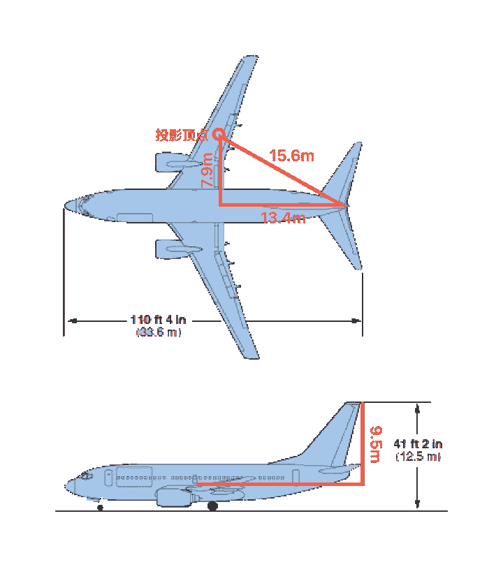

经过几轮的排查和范围缩减，剩下航班数并不多，再在其途径山脉上进行比对，可以得到最终结论：图中航班是由福州飞往西安的 MF8692 航班，照片拍摄所在位置位于陕西省西安市蓝田县蓝桥镇附近，照片下方的山脉是秦岭。

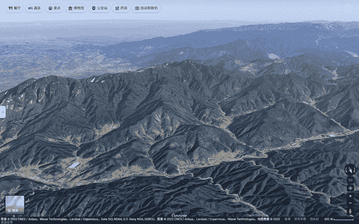

### 2.2 交通和设施

不同国家、不同城市之间的各类基础设施和交通工具，看似大同小异，实际大有文章。

**从建筑和设施来看：**

+   **地标**：

+   机场、港口、桥梁、政府机关、地标等建筑物具有独特识别性，往往对推测拍摄位置发挥着关键作用。

+   例如，旗杆往往在政府机关、酒店和学校出现，而大型探照灯意味着附近可能有体育场。

+   **道路**：

+   道路类型、交通标志、路灯款式等细节信息，有时能成为解题的突破口。

+   例如，城市路牌颜色就大有学问， 根据 GB 17733-2008 国家标准( )，东西走向用蓝色，南北走向用绿色。

+   **建筑流派**：例如中国传统建筑可以分为徽派、闽派、京派、苏派、晋派、川派共 6 大流派，而风雨桥则流行于湖南、湖北、贵州、广西等地。

+   **建筑朝向与楼间距**：

+   中国的房屋大多坐北朝南，其朝向和庭院位置可用于分辨方向。

+   楼间距其实也有信息价值，按照 GB 50180-2018 国家标准( )，以冬至日照时间不低于 1 小时（房子最底层窗户）为标准，据此可以推测纬度信息。

**从交通工具来看：**

+   **公共交通**：

+   每个城市的公交车和出租车的车型、涂装往往统一或成系列，很容易与其他城市进行区分。这是新手常常忽略的重要信息。

+   诸如公交站、地铁站，以及交通相关 logo、导向标识等设计，每个城市也有各自独特的规范。

+   **航班信息**：若知晓照片的拍摄时间、照片的拍摄位置、飞机的班次中任意 2 个信息，则可以借助第三方工具推断出第 3 个信息。常用的工具有：

+   **Flightradar24**（https://www.flightradar24.com/）：基于 ADS-B 等信息来源，提供航班的飞行轨迹、出发地、目的地、航班号、注册编号、飞行器型号、当前位置、高度和空速等信息。平常看到头顶有飞机飞过时也能随时打开 app 了解下。

+   **FlightAware**（https://zh.flightaware.com/ ）：与 Flightradar24 功能类似。

+   **VariFlight**（https://map.variflight.com/）：用于查询实时或历史航班的航线。

+   **船舶信息**：类似航班信息，船舶相关信息也可以通过各个 AIS 工具进行检索。

**举例：****https://c**hao.fan/p/1173907（图 2.2-1）

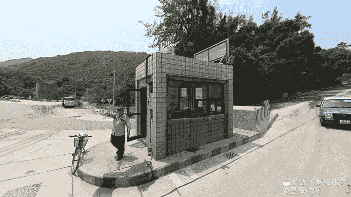

这[张照片](https://chao.fan/user/62418)中并没有什么地标建筑物，也没有文字可供利用，其解题关键在于对画面右侧出租车以及对画面左侧设施的识别。「炒饭社区」用户「红双喜」分享了他的解题思路：先从出租车及其车牌判断位于香港。其次，根据出租车颜色来分析香港的具体区域。

香港的出租车分三种颜色，分别行驶于不同地区，但全部均可往返香港国际机场及香港迪士尼乐园：

+   红色出租车即市区出租车，俗称「红的」、「红艇」，除了大屿山岛上的东涌道及南部以外，可以在香港大部分地区行驶。

+   绿色出租车即新界区出租车（图 2.2-2），因其绿色的漆身而被俗称「绿的」或「草蜢」，只限行驶于新界，不得进入市区。

+   蓝色出租车即大屿山区出租车，也被称为「蓝的」、「蓝灯笼」、「蓝精灵」或「屿的」——只限于大屿山，不得进入市区。


经过简单搜索比对，可以确认原图拍摄于香港新界。第二步是确认左侧的设施，从画面中我们可以得到以下信息：

+   大热天地面有水，说明车轮带水且车辆进出频繁，由此可以判断画面中左侧应为洗车设备

+   远处有一辆似乎是运垃圾的车，正在洗车槽内清洗车轮

+   保安亭外墙面肮脏

由此，「红双喜」推测这是一个垃圾填埋区或垃圾处理区。在地图中搜索「新界垃圾处理」，地图上只搜出新界东南和东北两处堆填区，验证都不符合。再通过搜索引擎发现还有处西堆填区，进入地图验证一致，因此原帖照片拍摄于香港特别行政区新界西堆填区（West New Territories Landfill, WENT）。

---

# 超纲题 —— 那些远古难题被突破的过程

即便是我们已经掌握了很多分析手段和分析工具，但局限于照片中的有效信息过少，仍然有很多题目经历半年甚至更长的时间都没有「侦探」们能顺利将其「擒拿归案」。截至目前「炒饭社区」里大概已经有 1000 个谜题进入「远古难题」，但其中只有约四分之一的题目在之后被人成功解答。历数在这些拨云见日的过程中发挥关键作用的神兵，大概可以概括为以下两种。

### 3.1 工具

工欲善其事，必先利其器。前文已经提到了不少地图服务和地理工具，但真正专业的玩家掌握着更加硬核的工具。常见地，我们有各类地图开放平台以及基于 OSM（OpenStreetMap，一个开源地图服务）衍生的数据挖掘产品，另外还有 GIS（Geographic Information System，地理信息系统）领域中的专业软件。这里简要介绍 3 种常用的「硬核工具」：

+   **地图开放平台**

+   中国常用：**百度地图开放平台**（htt**ps://lbs**yun.baidu.com/）以及高德地图开放平台（https://lbs.amap.com/）。

+   国外常用：**OpenStreetMap**（https://www.openstreetmap.org/）以及 Google Maps Platform（https://developers.google.com/maps）。

+   通过这些开放平台的 API 接口和 SDK 能力，可以非常灵活地实现自定义的内容呈现方式和数据的获取，以匹配千人千面的个性化需求和在「网络迷踪」中的大数据筛查需要。

+   **Overpass Turbo**（https://overpass-turbo.eu/）：这是一款基于 OpenStreetMap 的数据挖掘工具，能根据限定的位置逻辑搜索所有符合条件的地点，极大程度降低逐个排查（即所谓「扫图」）带来的人力成本。

+   **WhatIsWhere**（https://www.whatiswhere.com/）：这同样是一款基于 OpenStreetMap 的 POI 搜索工具，与 Overpass Turbo 类似，但不需要复杂的语法。

**举例 1：**「炒饭社区」用户「[猫](https://chao.fan/user/53906)」在他的一篇文章《POI** 地点借助地图开放**数据解题》里介绍了他是如何使用高德地图开放平台以及 MySQL 解答 https://chao.fan/p/1042686 这道题（图 3.1-1）的，摘录如下：


原图较为模糊，画面中「好客连锁」和「□□银行」是唯一可以利用的文字信息，原帖作者提示在广东非珠三角地区。为了完成解题，需要找到所有在银行附近的「好客连锁」。广东省内「好客连锁」数量上百，银行数量上千，靠人力比对排查显然不现实。鉴此，「猫」选择借助地图开放平台来完成解题。

这里需要自行撰写代码（他使用的是 Node），使用 API 调用高德 POI 接口，先获取到广东非珠三角地区完整的银行 POI 列表数据以及「好客连锁」相关的 POI 数据，并建立两张数据表（图 3.1-2，3.1-3）。

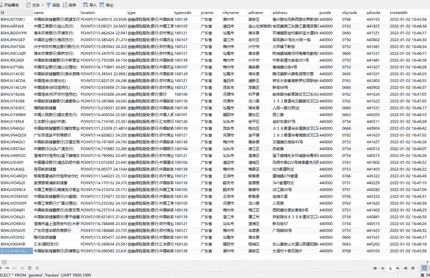

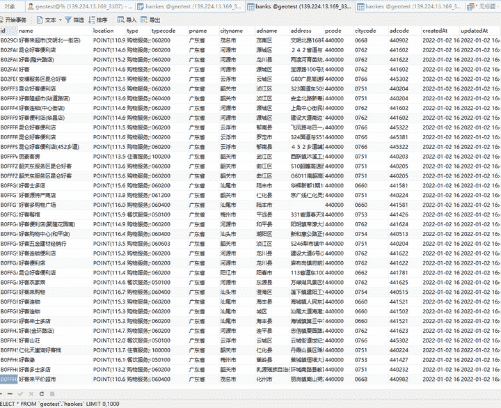

接着，「猫」使用了笛卡尔积连表查询，分别计算两两之间距离。查询语句如下：

```
SELECT
  h.`name`,
  h.address,
  b.`name`,
  b.address,
  round( ( st_distance ( h.location, b.location ) / 0.0111 ) * 1000 ) AS distance
FROM
  `haokes` AS h,
  banks AS b
ORDER BY
  distance
```

其中使用了 st_distance 计算两个 POI 之间的距离，并且使用结果进行排序。经过简单的排查，在第三条就得到了结果（图 3.1-4）：位于梅州市江南新中路的嘉州假日酒店附近，原帖图中的银行是广东农信梅州农商银行。

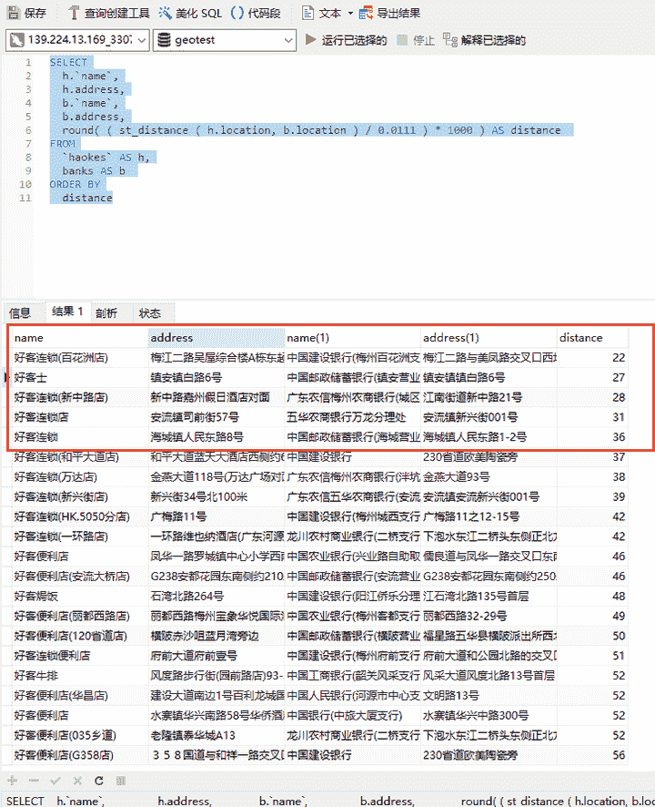

**举例 2**：这里重点说一下 **OpenStreetMap****，基于 OpenS****treetMap 的标签寻找**工具 TagFinder，以及基于 OpenStreetMap 的数据挖掘工具 Overpass Turbo。

**OpenStreetMap**（https://www.openstreetmap.org/，以下简称 OSM）是一款开源非盈利在线地图服务，与维基百科类似，用户可以自发上传编辑和贡献地理信息数据。由于用户共建特性，在 OSM 里，你几乎可以找到地球上的任何地标（POI），大到公路、铁路、建筑、小到变电站、电线杆。OSM 中 POI 信息体量非常庞大，以至于大多数不能在地图上一一展示，但借助 API 接口或一些成熟的数据挖掘工具，我们可以轻易获取并导出这些数据。

注意，OSM 里中国的国界线是错误的，且中国大陆的地图数据偏少，但其海外的地图数据非常翔实。在适当的条件下可以善加利用。

**TagFinder**（http://tagfinder.herokuapp.com/）是一款帮助在 OpenStreetMap 里找到物品标签的工具，方便后续在数据挖掘工具中请求数据。例如，我们想通过数据挖掘工具在 OSM 中找寻「风力发电机」，则可以在 TagFinder 中搜索「Wind Turbine」，系统告诉我们可以通过 generator:method=wind_turbine 以及 generator:source=wind 两条标签进行地图的数据检索。

向 [OSM 服务器请求数据的方法](https://overpass-turbo.eu/)有很多[，会 Python 的](https://www.whatiswhere.com/)朋友们可以通过安装 Overpass 请求器模块写一个简单的脚本，例如 Overpass API python wrapper；可以通过 QGIS 软件中的 QuickOSM 插件获取信息，也可以通过一些网页前端工具，例如前文介绍过的 Overpass Turbo 和 WhatIsWhere。以下以 Overpass Turbo 为例。

**Overpass Turbo**（https://overpass-turbo.eu/）是一款基于 OpenStreetMap 的数据挖掘工具。虽然在请求数据时需要写一段脚本，但网站的 Wizard 功能可以帮助我们快速生成请求代码。例如，输入「wind turbine」后 Wizard 功能会帮助我们自动生成一段类似这样的代码：

```
[out:json][timeout:25];
(
  node[&quot;generator:source&quot;=&quot;wind&quot;]({{bbox}});
);
```

假设我们需要在广州找寻「与军事用地距离在 200 米内的地铁站」，我们可以将 Overpass Turbo 画面定位至广州，然后学习 Wizard 提供的方式输入以下代码：

```
[out:json][timeout:25];

// 获取所有军事用地，标签可以由 TagFinder 查找
(
  node[&quot;landuse&quot;=&quot;military&quot;]({{bbox}});
  way[&quot;landuse&quot;=&quot;military&quot;]({{bbox}});
  relation[&quot;landuse&quot;=&quot;military&quot;]({{bbox}});
);

// 在地图上展示结果
out body;
&gt;;
out skel qt;
```

如此一来便能够将画面中的军事用地全部展示出来：


这时候，我们将其中 node["landuse"="military"]({{bbox}}); 这三行检索条件简写为 nwr["landuse"="military"]({{bbox}});，然后将其检索结果暂存为 military，在地铁站的检索 nwr[railway = station] 中进行调取，条件为 200 米范围内，继而得到如下代码：

```
[out:json][timeout:25];

// 获取所有军事用地，保存为 military
(
  nwr[&quot;landuse&quot;=&quot;military&quot;]({{bbox}});
) -&gt; .military;

// 获取所有与 military 距离 200 米内的地铁站
nwr[railway = station](around.military: 200);

// 在地图上展示结果
out body;
&gt;;
out skel qt;
```

再次运行，就能在地图上得到 13 个「与军事用地距离在 200 米内的地铁站」的结果，点击「Export」可以保存为 JSON 格式，再进行进一步筛查和处理。利用好这样的工具，我们能够节省大量的「扫图」人力。

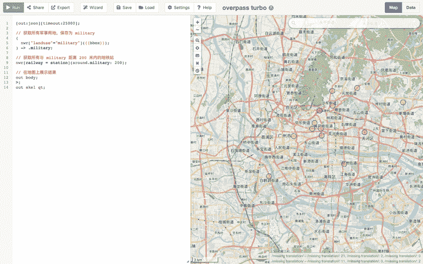

Overpass Turbo 的玩法还有很多，感兴[趣的朋友们可以在](https://nixintel.info/about/)英国 OSINT 大神 NixIntel 的两篇 Overpass Turbo 教程中学习完整的使用方法：

### 3.2 思维

看完上面那么多工具和案例是不是感觉眼花缭乱？别太担心。

「网络迷踪」只是一个推理游戏，它并不算得上是一门严谨的科学。光有工具没有思考是远远不够的 —— 广博的知识储备，丰富的推理经验，长期的户外实践，甚至是偶尔的灵光一现，它们共同造就了大佬们那些「只可意会不可言传」的直觉。在有些人还在煞费苦心愚公移山般地「扫图」之时，有的大佬已经冲着内心中那句「我感觉像这里」前往了目标位置，面无表情地回复完答案后刷新页面前往了下一题，留下那些抓耳挠腮百思不得其解的朋友们在风中凌乱。

你以为的「网络迷踪」，远远不止真实的「网络迷踪」。为了探寻真相，不惜向当地人询问、动用美团小哥批量跑腿侦察，甚至肉身亲自前往验证之事，在「网络迷踪」历史上并不是没有发生过。一道「网络迷踪」题也就是一场开卷考试，就算作弊或蒙对也能算对。也正因此，「侦探」们都是以结果为导向的，至于过程是怎样，动用了哪些黑科技工具抑或是人际关系，其实并不是很重要。一个出色的「网络迷踪侦探」，在现实世界里可能是个刑警，婚外情调查员，可能是个黑客、全栈工程师，也完全可能只是个扫地僧。本文只是一个入门指南，若你已臻化境，大可忽略前文中所述的所有工具和方法。

尽管不是所有人都能有朝一日巅峰造极、返璞归真，但有一件事仍然是明确的：善于在实践中学习和总结，这样才能不断进步。再次提醒，本指南不可能提供解决所有谜题的最佳路径，它只是些许普适方法的简单归纳。有的时候适当的放弃是必要的。希望你在推理「网络迷踪」某道谜题遇阻之时，先把它收藏关注起来，日后回过头来看看大佬们的解题思路，也许豁然开朗柳暗花明又一村，这才是你内心真才实学得到了实质性提升的时刻。祝你好运！

---

# 送你一个「网络迷踪」资源库

对于所有在「网络迷踪」中经常使用的工具和相关资源，我已经帮大家整理了一个「网络迷踪资源库」在线文档。当然这个数据库不仅包含了本文中提到的所有工具链接，也对它们进行了分门别类的整理，而且更重要的是它会随时更新，以进行修补和扩充。既然看到了这里，相信你是对「网络迷踪」真正感兴趣的朋友，欢迎点击下方链接进行收藏：

[网络迷踪资源库｜OSINT Library](https://ooglx41xh8.feishu.cn/wiki/PrZ4wgOrkiNZJ5kj37BcRHhNneb)

---

# 写在后面

本文创作过程中有参考以下文章，谨此向原作者致谢：

+   一张照片，就能知道你在哪里？丨网络迷踪初探 - 少数派

+   好家伙，我把全国的风电机组找出来了！ - 数读城事

> **本文知乎专栏地址**：https://zhuanlan.zhihu.com/p/555606058

> **本文👸号地址：**https://mp.weixin.qq.com/s/CldWI4QREOHyCmih2gnsJw

> **本文 Notion 存档地址**：https://spacekid.me/458653a2e5674b21918ed261a86720fb

<https://my.feishu.cn/sync/ZBjddkhI0sHZFxb2oq1c4Uz4nRe>