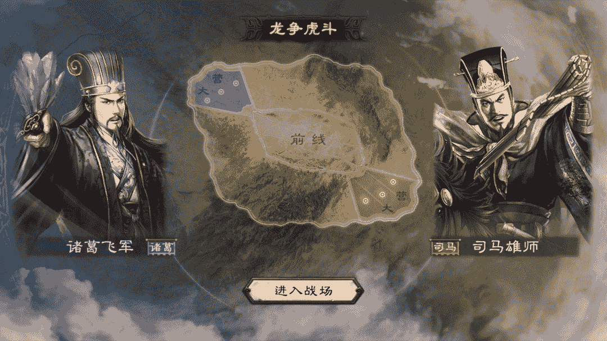
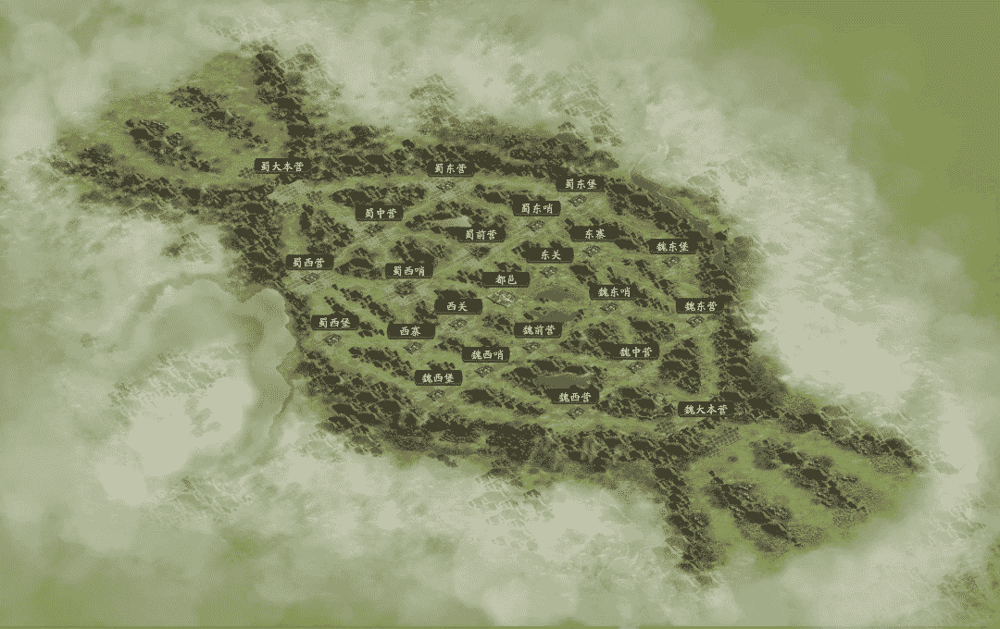
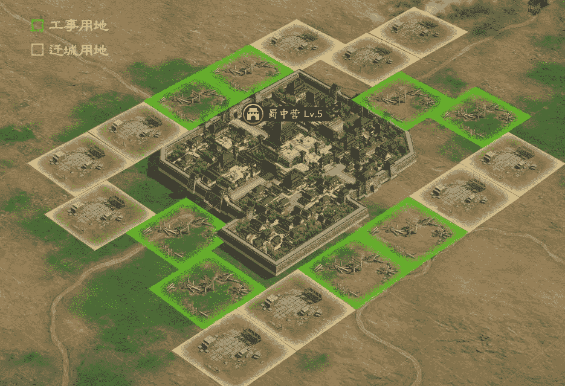
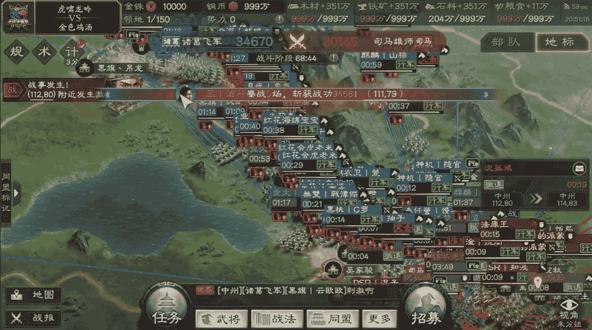
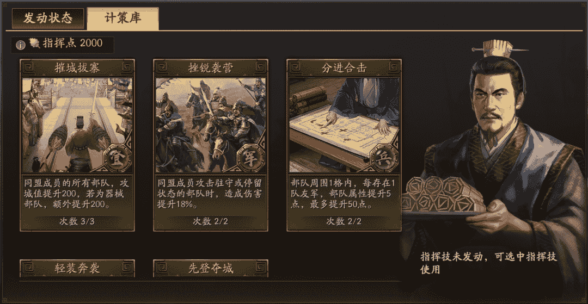
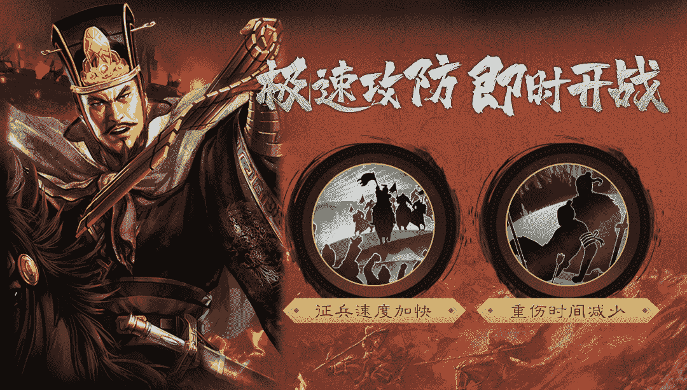
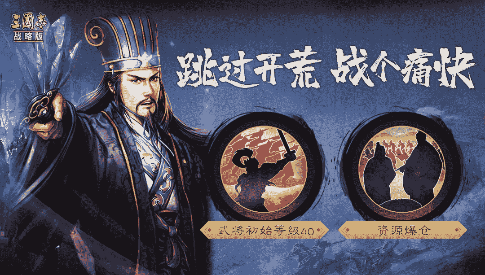
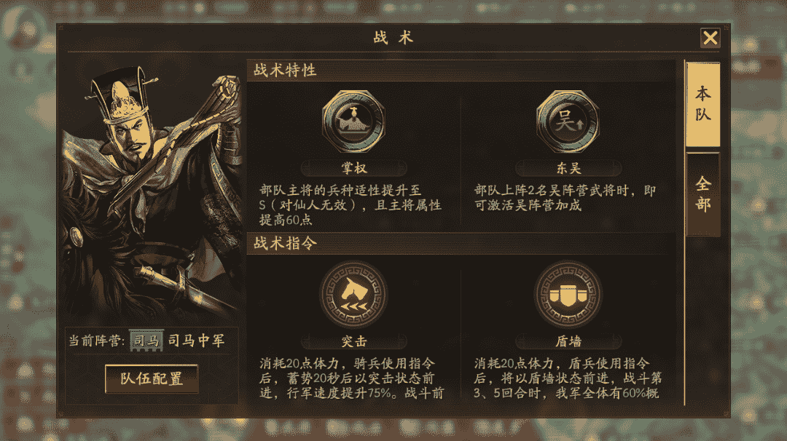
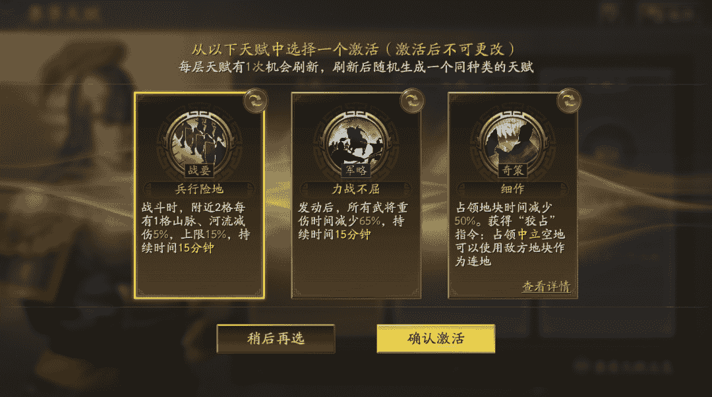

# 三国志战略版｜龙争虎斗配将表汇总

> 来源：[https://my.feishu.cn/docx/ZdKEdade0omdZRxzUlicq5SxnTg](https://my.feishu.cn/docx/ZdKEdade0omdZRxzUlicq5SxnTg)

<https://my.feishu.cn/sync/BTfEdFPvYsPbABboyyXcGskHnNh>

> 汇总阵营对抗玩法「龙争虎斗」、官方赛事「龙虎争霸赛」介绍及配将表。

# 配将表

多维表格（VQPFb0WGYaVZP5sygE5ciyiFnTf_tbluNTN3tmwRYKL7）

# 战术特性表

# 玩法详情

## 2.1 玩法简介

> **180** 名玩家分为**「诸葛飞军」**和**「司马雄狮」**两个军团相互对抗，每个军团由 3 **支 30 人小组队**伍**构成。在规定时间内**（30 分钟准备阶段，90 分钟战斗阶段，共 120 分钟），成功攻占对方大本营，或积分更高的军团获胜。

> 积分主要由**城池首次占领**和**持续占领**这两种方式获得，同时所有主公的战功也会按比例转化为积分。

## 2.2 玩法地图

> 魏蜀两方阵营的城池围绕中心城**「都邑」**。

> 每座城池周边分布着多块**迁城用地**和**工事用地**，在攻占之后，可用于迁城和建造战场工事。

## 2.3 团体策略

> 攻打城池**无需铺路****，攻**下一座城池之后，即可继续攻占相连的城池。

> 同时还有全新**同盟指挥计**可供使用，需消耗指挥点。计策使用有次数限制，使用前需谨慎考虑，合理规划。

## 2.4 战斗体验

> 行军调动、征兵、重伤恢复**时间将被缩短**，战斗节奏更紧凑。

> 在战斗开始时，麾下所有武将的**初始等级均为 40**，且**资源充足**，征战再无粮草之忧。

## 2.5 个人战术

> 在开局时会随机分配数条**战术特性与指令****，整场比**赛期间会持续生效，需要根据此来进行阵容配合和战场微操。

> 战斗阶段开始后，在第 **15/30/45**** 分**钟系统将分别随机分配 3 个天赋，可以选择获得其中 1 个天赋，并立即生效。

---

<https://my.feishu.cn/sync/ZBjddkhI0sHZFxb2oq1c4Uz4nRe>