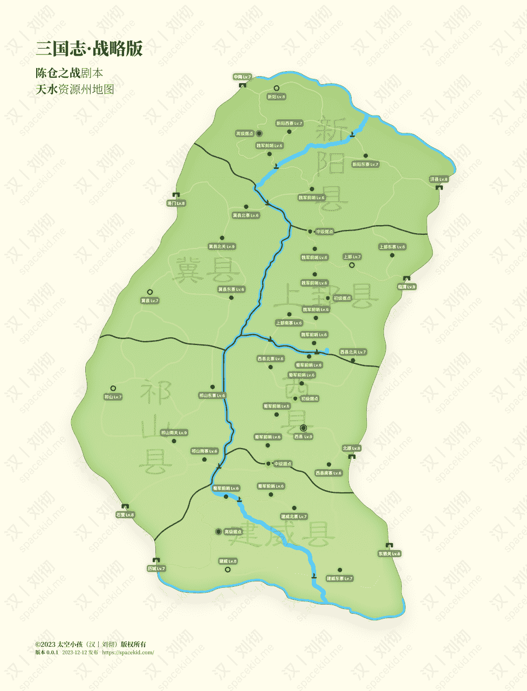
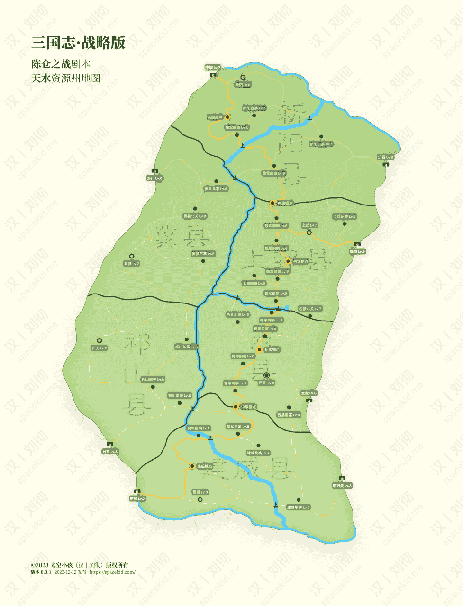
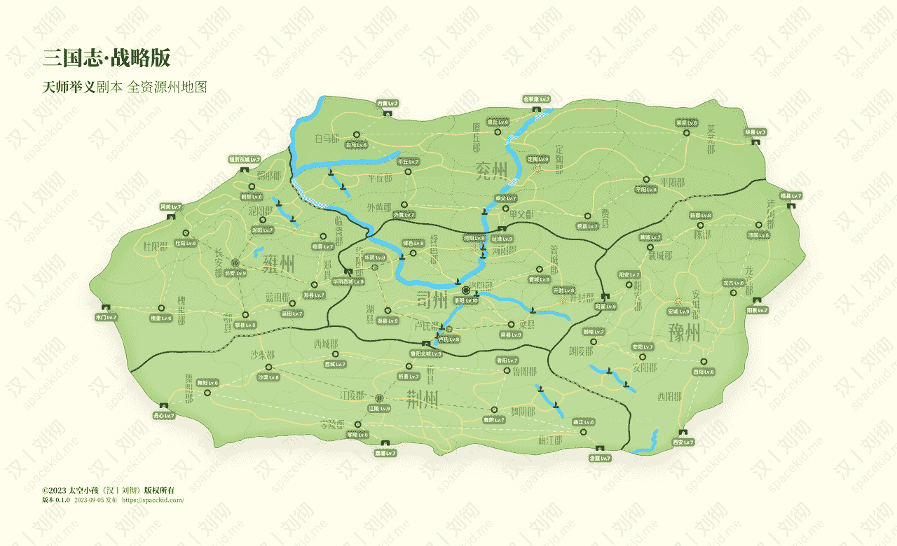
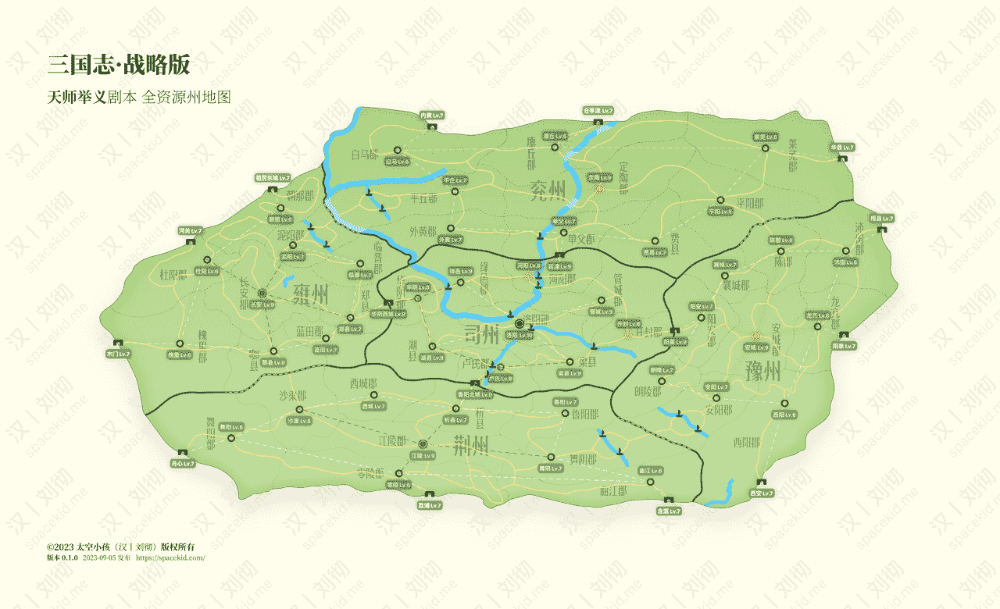
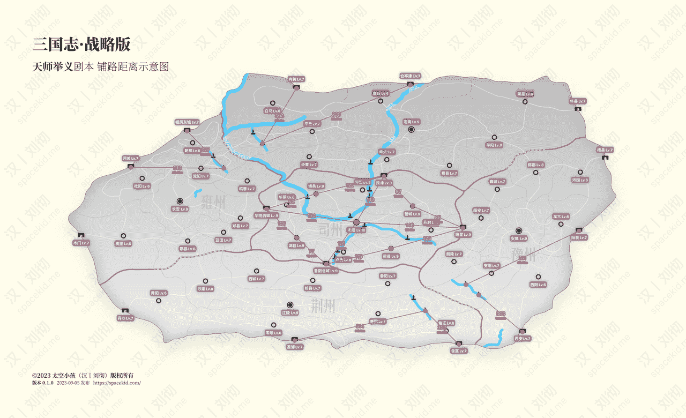
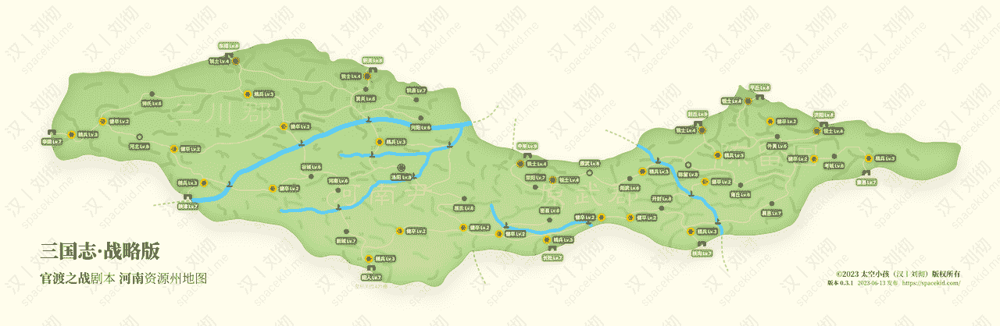
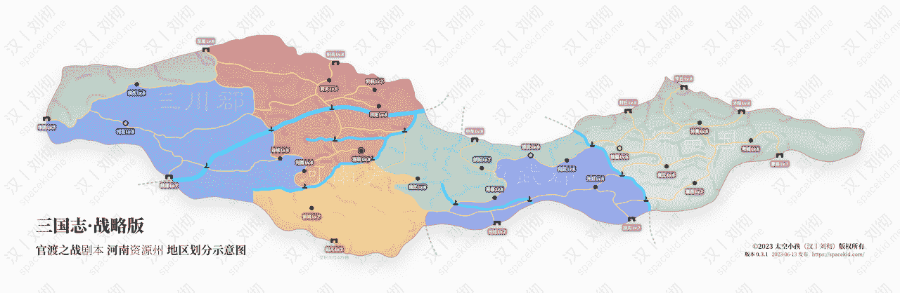
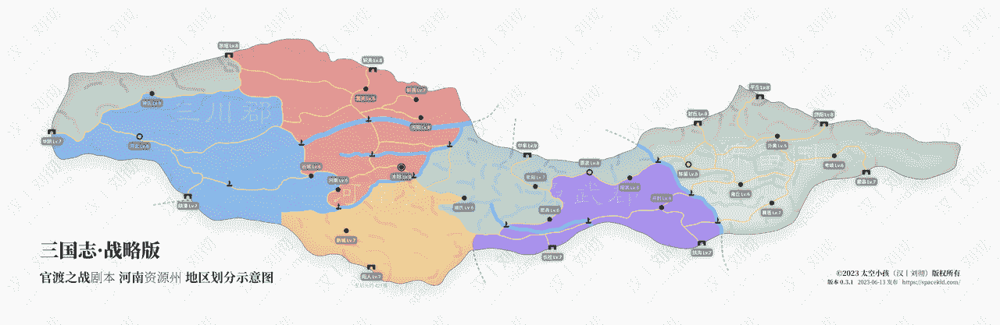
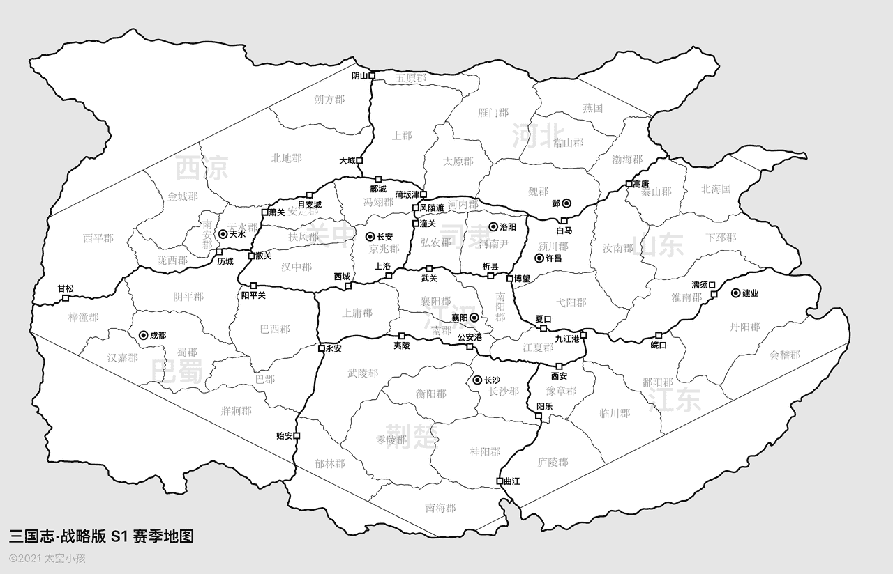

# 三国志战略版｜矢量地图

> 来源：[https://my.feishu.cn/docx/WtpSd4G04oWngCxmyuJcyCLInzg](https://my.feishu.cn/docx/WtpSd4G04oWngCxmyuJcyCLInzg)

<https://my.feishu.cn/sync/BTfEdFPvYsPbABboyyXcGskHnNh>

> 使用 Sketch / Adobe Illustrator 绘制的三国志战略版地图，可用于战场指挥、制作区域划分示意图等。

# 陈仓之战剧本

## 天水资源州地图

> PDF 下载：

[三国志战略版陈仓之战剧本天水资源州地图.pdf](https://internal-api-drive-stream.feishu.cn/space/api/box/stream/download/all/YCkpbofd9oDJQsxC5oYccb6fnad)

# 天师举义剧本

## 全资源州地图

> PDF 下载：

[三国志战略版天师举义剧本全资源州地图 v0.1.0.pdf](https://internal-api-drive-stream.feishu.cn/space/api/box/stream/download/all/RBobbBl17oAunmxnGItcYGNqnPf)

## 铺路距离示意图

> PDF 下载：

[三国志战略版天师举义剧本铺路距离示意图 v0.1.0.pdf](https://internal-api-drive-stream.feishu.cn/space/api/box/stream/download/all/Lf7AbOGXPooaa6xAncjcf1R9nFf)

# 官渡之战剧本

## 河南资源州地图

> PDF 下载：

[三国志战略版官渡之战剧本河南资源州地图.pdf](https://internal-api-drive-stream.feishu.cn/space/api/box/stream/download/all/VMY2bqQazo9Zlnx0qOncGDfJnac)

## 河南资源州地区划分示意图

> PDF 下载：

[三国志战略版官渡之战剧本河南资源州地区划分示意图.pdf](https://internal-api-drive-stream.feishu.cn/space/api/box/stream/download/all/LhsobNWq8oOFaxx5Z2ecKHURnJc)

# S1 / S2 / S3 赛季剧本

## 大地图底图

> PDF 下载：

[三国志战略版 S1 S2  S3 赛季剧本大地图底图.pdf](https://internal-api-drive-stream.feishu.cn/space/api/box/stream/download/all/UvJ3b02T7o1gH1x6p2qcshqSnsb)

---

<https://my.feishu.cn/sync/ZBjddkhI0sHZFxb2oq1c4Uz4nRe>