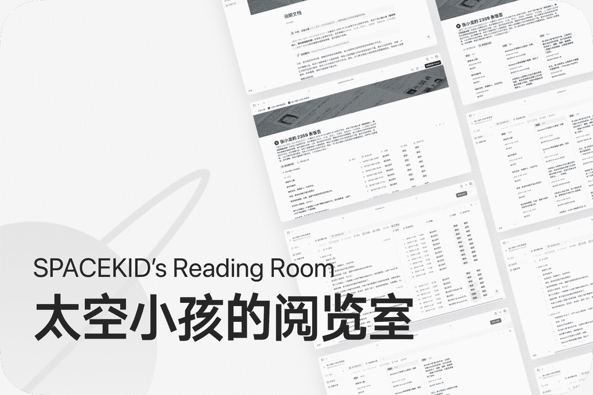

# 太空小孩的阅览室

> 来源：[https://my.feishu.cn/docx/KfI3d463YohCF8xVZazcHtZxnlb](https://my.feishu.cn/docx/KfI3d463YohCF8xVZazcHtZxnlb)

<https://my.feishu.cn/sync/QHWrdT4qFsFEUDbMppscgeOonnf>

以后会在这个知识库分享一些文档。

> 本知识库的固定链接：wiki.spacekid.me/read

> [访问 Notion 版本 →](https://wiki.spacekid.me/read)

# 目录

## 张小龙的 2359 条饭否

《看完了张小龙的 2359 [条饭否日](https://mp.weixin.qq.com/s/WLHpr8nh2S9a9oeA1KeCAg)记[》一文最](https://36kr.com/p/1721022562305)初[于 2](https://www.ifanr.com/614486)0[16-](https://www.huxiu.com/article/138457/1.html)0[1-28](https://tech.ifeng.com/a/20160129/41546177_0.shtml) [发表于本](https://www.williamlong.info/archives/4497.html)人[的知乎专栏，收录](https://www.woshipm.com/pmd/277371.html)了部分张小龙（🛰️创始人，腾讯高级副总裁）在饭否上发表的日志。该文章被腾讯科技、36 氪、爱范儿、虎嗅网、凤凰科技、月光博客、人人都是产品经理等多家媒体或网站转载，曾引起较大反响。

之后，因为饭否关闭注册、限制旧内容访问等原因，张小龙原本已发布的饭否内容现已不可见。

在文章爆火后，有多个自媒体或个人登录饭否，将张小龙完整的 2359 条饭否自行下载、备份之后在淘宝、闲鱼、📕等平台进行售卖，但本人认为如此行为并不妥当。因此，本人再次将张小龙的饭否内容整理至此，供所有人免费查阅。如有需要，请自行复制或下载文件。

> **点击查看完整表格：**[张小龙的 2359 条饭否](https://ai.feishu.cn/wiki/SPpDwOybYi2AKHkKe7QcLEBSnRq)

<https://ai.feishu.cn/share/base/view/shrcnUpS1M8uJVjcrggA2nTP5Nc?iframeFrom=docx&ccm_open=iframe>

> **PDF 导出版：**[PDF 导出版 - 张小龙的 2359 条饭否（2010-11-26 至 2012-04-09）.pdf](https://ai.feishu.cn/wiki/UwNBw4k8siwwPUk3Ve5cE0GJnpg)（[转载出处](https://m.okjike.com/originalPosts/638e8c403d600ff5f15affbc)）

## 王兴的 15420 条饭否

王兴的第一条饭否发送于 2007 年 5 月 13 日（饭否上线第二天）。王兴的最后一条饭否发送于 2021 年 5 月 8 日，而就在前一天，因为王兴的一条饭否，美团跌去千亿市值。

> **点击查看完整表格：**[王兴的 15420 条饭否](https://ai.feishu.cn/wiki/KoMwwYNh0iaAqUkToF5cyzymnyd)

<https://ai.feishu.cn/share/base/view/shrcnREB4dLwfFBsCOGB0L2Fzhe?iframeFrom=docx&ccm_open=iframe>

> **PDF 导出版：**[PDF 导出版 - 王兴的 15420 条饭否（2007-05-13 至 2020-03-01）.pdf](https://ai.feishu.cn/wiki/UJUEwb3F4iEtV7kIc3UcrqHnnse) [（转载出](https://m.okjike.com/originalPosts/638e8c403d600ff5f15affbc)[PDF 导出版 - 王兴的饭否（2020-01-01 至 2021-05-08）.pdf](https://ai.feishu.cn/wiki/OJ5Cw54BPiS61qkfqsecWGaPn8d)）[

> （转](http://xiaomiao.space/archives/481)载出处）

---

<https://my.feishu.cn/sync/ZBjddkhI0sHZFxb2oq1c4Uz4nRe>