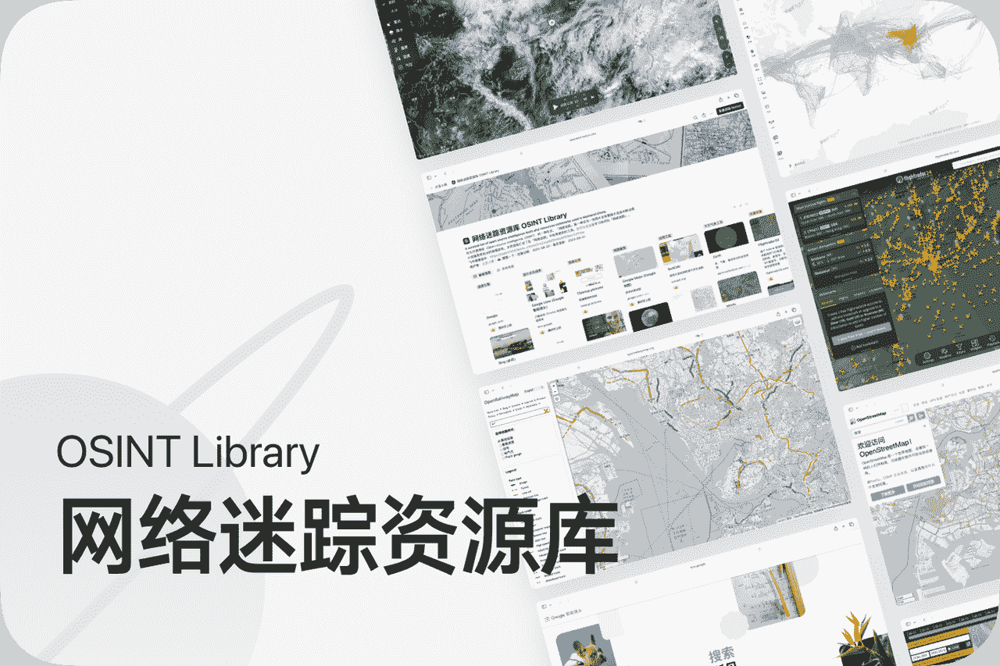
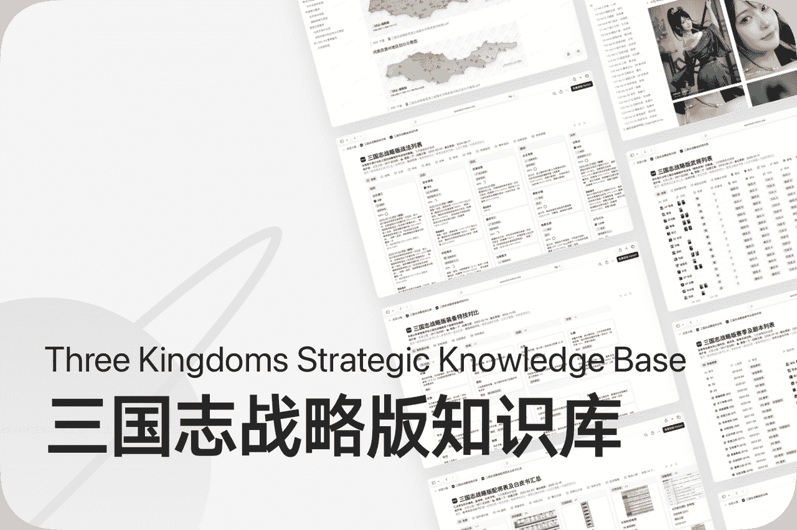
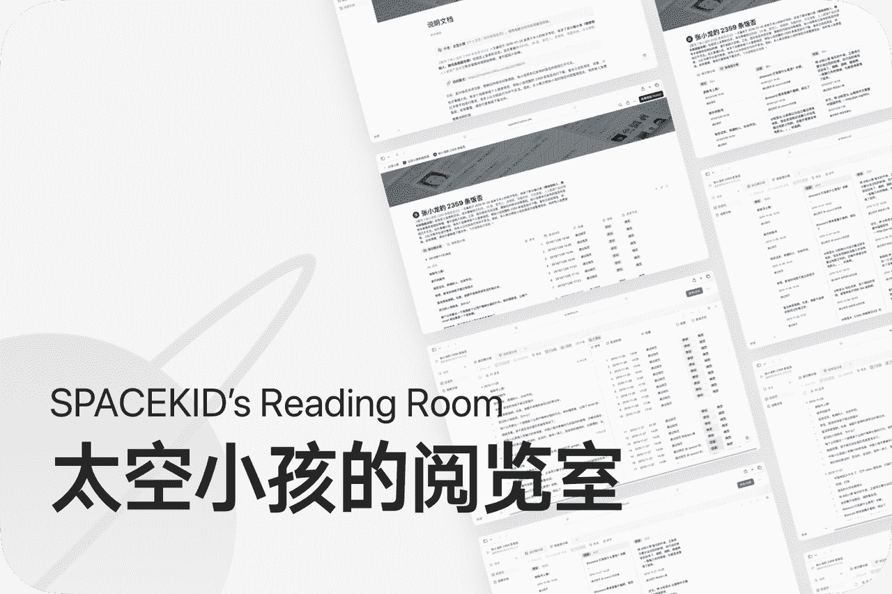
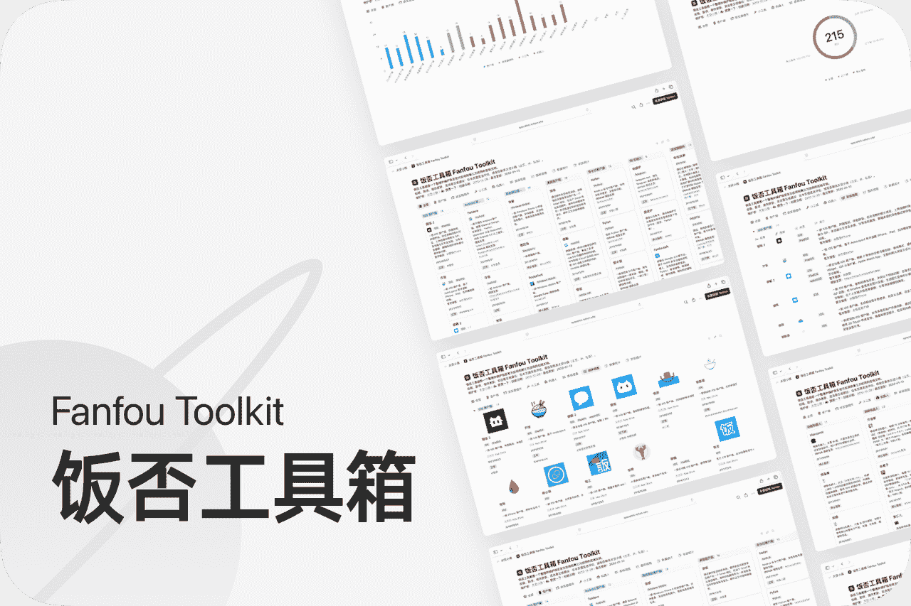
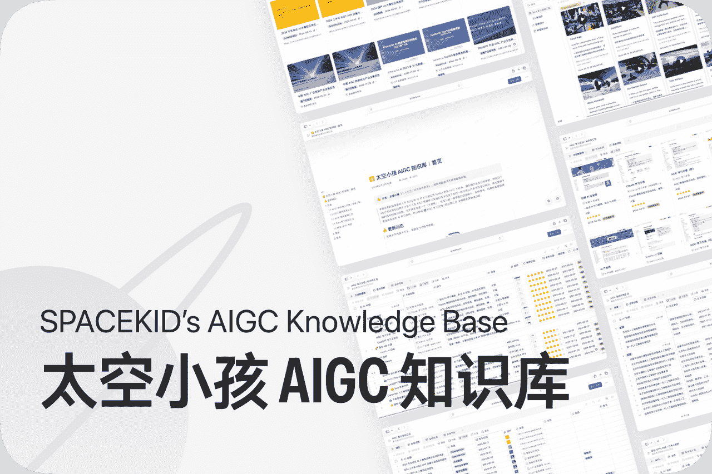

# 太空小孩的知识库导航

> 来源：[https://my.feishu.cn/docx/J5qcdpS6Soqctwx6VmecHqiTnQd](https://my.feishu.cn/docx/J5qcdpS6Soqctwx6VmecHqiTnQd)

<https://my.feishu.cn/sync/QHWrdT4qFsFEUDbMppscgeOonnf>

> 本页面的固定链接：wiki.spacekid.me

> [访问 Notion 版本 →](https://spacekid.me/)

# ⭐️ 精选

+   [张小龙的 2359 条饭否](https://ai.feishu.cn/wiki/SPpDwOybYi2AKHkKe7QcLEBSnRq)

+   [王兴的 15420 条饭否](https://ai.feishu.cn/wiki/KoMwwYNh0iaAqUkToF5cyzymnyd)

+   [三国志战略版 4K 真人立绘系列](https://ai.feishu.cn/wiki/AWnWwlCtDiuUH7kY4f8cKt7jnbe)

+   [三国志战略版｜配将表及白皮书汇总](https://ai.feishu.cn/wiki/IjdAwd8VJiGEqYkZYNpcUfnjnfg)

---

# 网络迷踪资源库

一张照片推理拍摄位置，常用工具合集。

+   Notion 知识库：spacekid.me/osint

+   飞书知识库：[网络迷踪资源库](https://ai.feishu.cn/wiki/YnvZwuM20inMu6k93kkc1UlTn5e)｜wiki.spacekid.me/osint

# 三国志战略版知识库

非官方三国志战略版资料库，配将表、武将表、战法表等。

+   Notion 知识库：[spacekid.me/sgz](https://spacekid.me/sgz)

+   飞书知识库：[三国志战略版知识库](https://ai.feishu.cn/wiki/GhIewYDYKivw33kM6ayc5UrDnXe)｜wiki.spacekid.me/sgz

# 太空小孩的阅览室

在这里分享一些文档，张小龙、王兴的饭否及其他。

+   飞书知识库：[太空小孩的阅览室](https://ai.feishu.cn/wiki/XujZwJ3CKiCikBkLflNcNwzknLh)｜wiki.spacekid.me/read

# 饭否工具箱

一个整理并维护饭否官方应用和第三方应用的在线文档。

+   Notion 知识库：spacekid.me/fanfou-toolkit

# 太空小孩 AIGC 知识库 (2024)

AIGC 学习文档、相关报告和政策，及其他。

+   飞书知识库：[太空小孩 AIGC 知识库](https://ai.feishu.cn/wiki/Wsukw99E1ihSldkqEjwc5E2Mnrb)｜wiki.spacekid.me/aigc

# Awesome AI QR Codes (2023)

收录 AI 二维码工具和资源的精选列表。

+   英文：[github.com](https://github.com/ispacekid/awesome-ai-qr-codes)

+   中文：[github.com](https://github.com/ispacekid/awesome-ai-qr-codes/blob/main/README-zh.md)

---

# 👍 赞赏

如果你觉得我的知识库有帮到你，并希望它持续更新，请考虑支持一下它。

> **微信扫一扫，赞赏作者。**

> **啊，这也能扫？**

---

<https://my.feishu.cn/sync/ZBjddkhI0sHZFxb2oq1c4Uz4nRe>