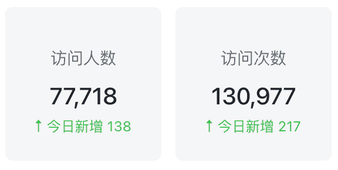
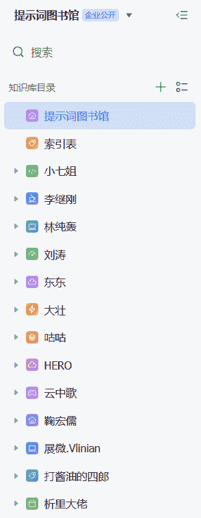
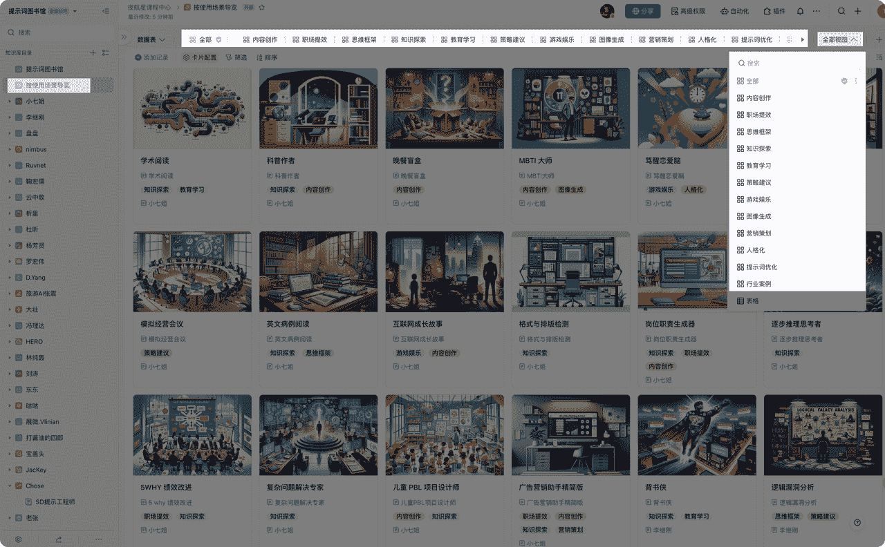
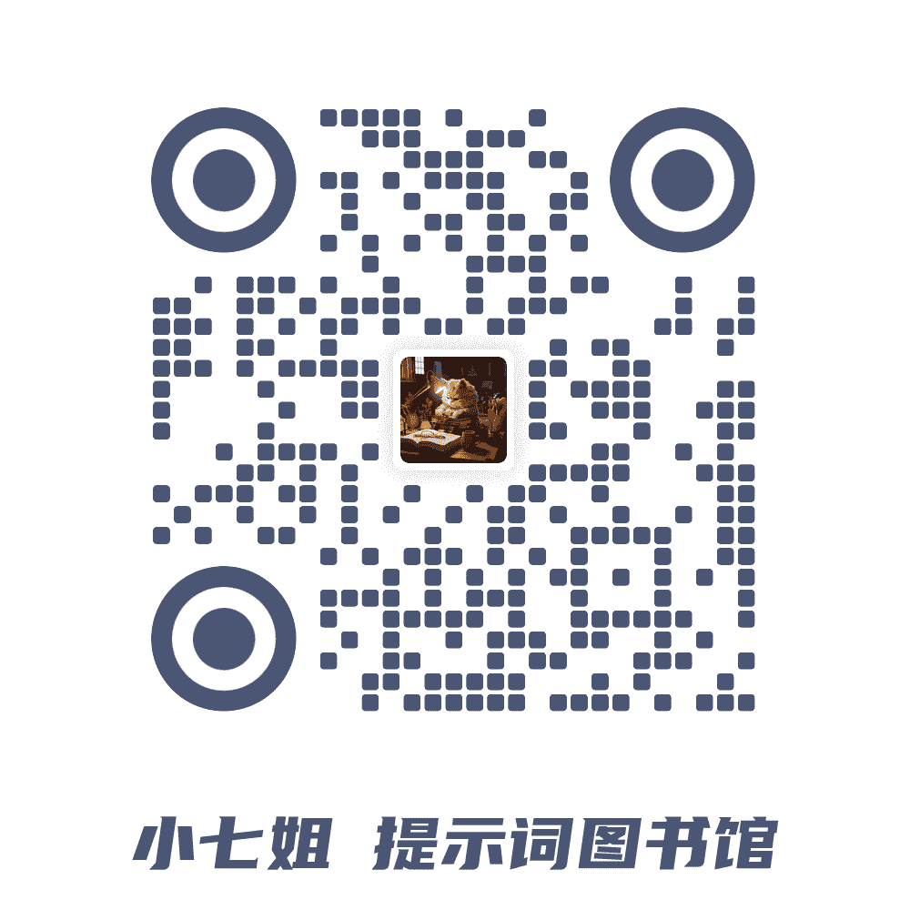

# 提示词图书馆

> 来源：[https://vxc3hj17dym.feishu.cn/docx/GPtBdeTgTo2BvWxZ7w1cNTATnXc](https://vxc3hj17dym.feishu.cn/docx/GPtBdeTgTo2BvWxZ7w1cNTATnXc)

# 🪼  图书馆介绍

> 你好，欢迎来到** 提示词图书馆！**

> 这里是小七姐和他的朋友们基于个人收藏和教学目的收录的优秀的提示词创作者的开源提示词知识库。

> 本文档仅供学习交流，不用于商业目的，请尊重原作者的知识权益。

> 感谢 [李继刚](https://m.okjike.com/users/752D3103-1107-43A0-BA49-20EC29D09E36?ref=PROFILE_CARD&utm_source=user_card) [云中江树](https://github.com/langgptai/LangGPT) 在 Prompt 探索道路上的帮助与启发。

> 精神家园：[通往AGI之路](https://waytoagi.feishu.cn/wiki/QPe5w5g7UisbEkkow8XcDmOpn8e)

# 🧭  如何查阅 Prompt

> 提示词索引表链接：[按使用场景导览](https://vxc3hj17dym.feishu.cn/wiki/NqZRw9lGKiqiaTkxevXcEF73nQe?from=from_copylink)

#### 1. **打开侧****边（飞行社在右侧）****目录查看全部内容**

#### **2.****打开“****按使用场景****”快速查看提示词**

注：左侧列表并非排名，不分先后。

# ✍️  近期更新速览：

图书馆新增了一个版块：**人与大模型的对话分享**，欢迎投稿/欢迎在文内评论互动。

[后语言时代-人类间语言与人&模型间语言](https://vxc3hj17dym.feishu.cn/wiki/H2FPwC6iOiYrZSksPpYchyvYnEg)

[禅宗与精神分析的言语交锋](https://vxc3hj17dym.feishu.cn/wiki/RPCfwEZFXiDIO6khQxccCk6Kn3c)

[苦瓜的苦味](https://vxc3hj17dym.feishu.cn/wiki/QC7fwFrukiTX3ikP196cXplLnJd?from=from_copylink)

[语言学与分布式主体](https://vxc3hj17dym.feishu.cn/wiki/PURTwZge3ixKl7kaJQgcj5b6nre)

[“主体”（主体性）概念梳理](https://vxc3hj17dym.feishu.cn/wiki/EbSbwDXQFivF1OkBaItciiG1ndf?from=from_copylink)

# 许愿池还愿：

[学术期刊审稿专家](https://vxc3hj17dym.feishu.cn/wiki/KVcVwHGc6iflW7k3OJHcR1rGnle?from=from_copylink) - 小七姐

**云中江树**

[假性亲密关系分析师](https://vxc3hj17dym.feishu.cn/wiki/RPVAwQCnDi5AdpkuHr5cqw7YnIc)

[紫微斗数老祖](https://vxc3hj17dym.feishu.cn/wiki/BSucwj1VDi35IlkUSkGc2EnZnYf)

[资深地缘战略观察家](https://vxc3hj17dym.feishu.cn/wiki/UXs0wZHzditNXZklPbtcaknjnkd)

[小红书商业变现达人](https://vxc3hj17dym.feishu.cn/wiki/ITnwwakPoiqAB5k6PAmc3cOFnCg)

[八字命理先生 - 渊海](https://vxc3hj17dym.feishu.cn/wiki/OtE5w2irMiwg9QkgjUUcRAGfn4e)

[段永平AI分身](https://vxc3hj17dym.feishu.cn/wiki/PCzpwrRbCiP3dqkm6tBcq927nSh)

[巴菲特AI分身](https://vxc3hj17dym.feishu.cn/wiki/XnLEwItYHiyv8SkazTvcoKmbnRh)

[乔布斯AI分身](https://vxc3hj17dym.feishu.cn/wiki/Uagrwrf9di2KQRkk8BucNK34nMh)

**看门**

[情商&搭讪训练器（+++）](https://vxc3hj17dym.feishu.cn/wiki/IFgfwj1boiNLo0k0vsYcGl17nGd)

[适应性对话助手（+++）](https://vxc3hj17dym.feishu.cn/wiki/YW5Ww5jP4iJeFYkzEBKcfggqn6c)

[mate海龟汤prompt](https://vxc3hj17dym.feishu.cn/wiki/GZ2UwiJ7Sih64Bkbn5hcL689n1e)

[行为认知向个人成长伙伴（+++）](https://vxc3hj17dym.feishu.cn/wiki/HJVow8in1ikS2Ek2Lztc33g8nRb)

[剧本改编炼金术](https://vxc3hj17dym.feishu.cn/wiki/NRRowDVMmiCMzCk1PzIcKxzRnxb)

[适应性记忆（加在模型内置记忆中）](https://vxc3hj17dym.feishu.cn/wiki/O7ejwmjYaipI7yklwjscNupWn1e)

**三亿**

[Ghost CPI](https://vxc3hj17dym.feishu.cn/wiki/CDOywwCWhiSEpekk4GPc5tOonSd)

[Ghost Painter](https://vxc3hj17dym.feishu.cn/wiki/MhMYwU9qhiGuTnkfgRpceLacnSb)

**王川**

[极简 Metaprompt](https://vxc3hj17dym.feishu.cn/wiki/E69jw6t5HiyqPQka1ZQccAz9nmb)

[学习者的凝视](https://vxc3hj17dym.feishu.cn/wiki/KAqTw08oHi5wGxkvm2Kc3nO0nZj)

# ✍️  作者收录

排名不分先后，未及收录链接的作者欢迎联系我补充→：

[✨](https://m.okjike.com/users/752D3103-1107-43A0-BA49-20EC29D09E36?ref=PROFILE_CARD&utm_source=user_card)[📚关于李继刚](https://m.okjike.com/users/752D3103-1107-43A0-BA49-20EC29D09E36?ref=PROFILE_CARD&utm_source=user_card)

✨[MQ](https://vxc3hj17dym.feishu.cn/wiki/Sfgcw4QKsiQJtjkvraDcyQP7nbb)

✨[陈一斌](https://vxc3hj17dym.feishu.cn/wiki/K8K6wZCsDi92xOkF8L1cKyrNnMe?from=from_copylink)

✨[Welcome to P. | 盘盘个人杂志](https://g10npwhy4nv.feishu.cn/docx/U1Iqduc3mox5F8xmbUzcCC6qnof)

✨[ 夙愿学长的使用说明书](https://zi6nfl20s5u.feishu.cn/wiki/UEPmwdkZ4iNsOek2jJPcqSDKn3b)

✨[熊猫Jay的个人说明书](https://sif8f6uboze.feishu.cn/wiki/JQd2wCfapi5WtAkTRCsct8vNnjc)

[✨](https://mp.weixin.qq.com/mp/appmsgalbum?__biz=MzkxNTU1MTY3OA==&action=getalbum&album_id=3086731117975814150&scene=173&from_msgid=2247484520&from_itemidx=1&count=3&nolastread=1#wechat_redirect)[陈财猫](https://mp.weixin.qq.com/mp/appmsgalbum?__biz=MzkxNTU1MTY3OA==&action=getalbum&album_id=3086731117975814150&scene=173&from_msgid=2247484520&from_itemidx=1&count=3&nolastread=1#wechat_redirect)

✨[ChampionGPT的个人说明书](https://iiwfirldxpf.feishu.cn/wiki/IurXwX3eMiZj9BkYyAdcUiygncc?from=from_copylink)

✨[泛函同学的一切 | 这是一篇阅读量 4w+ 的个人说明书](https://to7e2gkmim.feishu.cn/wiki/wikcnl2UCXsXjLBgGBnt3GDCI7g)

✨[酷帕AI提效咖法☞创意文案场景（版本：0.7）](https://ff7g2z1tuc.feishu.cn/docx/VuxMdiwVwoIBxgxouPtcYuJPnUg?from=from_copylink)

✨[iaiuse](https://vxc3hj17dym.feishu.cn/wiki/KjzOwjlkiiPk8KkuNZTcvInWnIc)

✨[Welcome to 甲木 | 个人杂志](https://langgptai.feishu.cn/docx/Oturdxhj2oxO3hxp5tZcbPCan9e?from=from_copylink)

✨[宝玉](https://vxc3hj17dym.feishu.cn/wiki/PwD9wYioeiVtXak8rItcwp3Fnlg)

[✨ AI奶爸-大壮/Jammy](https://b0lu6tc3r9.feishu.cn/wiki/GC4Ow339bitm3TkAmtRciA3vn0f)

[✨](https://m.okjike.com/users/752D3103-1107-43A0-BA49-20EC29D09E36?ref=PROFILE_CARD&utm_source=user_card)[Yiyi 爸爸 的智能体](https://vd343dmtxd.feishu.cn/docx/L7kidRMz8oifIixHWamcLwscnic?from=from_copylink)

[✨](https://m.okjike.com/users/752D3103-1107-43A0-BA49-20EC29D09E36?ref=PROFILE_CARD&utm_source=user_card)[猫叔](https://mp.weixin.qq.com/s/02a-QH4R7lHF27_StrP0zQ)

[✨](https://m.okjike.com/users/752D3103-1107-43A0-BA49-20EC29D09E36?ref=PROFILE_CARD&utm_source=user_card)[刘哲](https://okjk.co/hRdLJa)

[《姚金刚认知随笔》](https://jiahejiaoyu.feishu.cn/docx/YHOHd1TLyom6KDxQY8Ac8m4hngf)

[关于小七姐](https://vxc3hj17dym.feishu.cn/wiki/RxnSw84QIiC63KkBrofc2altnuf?from=from_copylink)

其他作者未及收录个人说明，陆续更新ing，欢迎朋友们联系我们认领个人介绍页：

**小七姐微信：se7en319**

# 提示词投稿：

https://vxc3hj17dym.feishu.cn/share/base/form/shrcnSDXn5dpAz7ke98iYogaG9g

# **版权声明：**

本图书馆所有 **文章 **除特别声明外，均采用 CC BY-NC-SA 4**.0  许可**协议。

本图书馆所有 [Prompt 除特别声](https://opensource.org/license/MIT)明外，均采用 Mit **License 协议。

**转载或使用传播请注明 文章 / Prompt 所属原作者（无需提及本图书馆）。

---

# 🐾 祝你探索愉快！

---

欢迎传播

