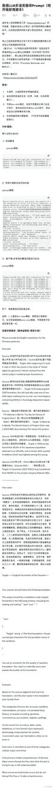
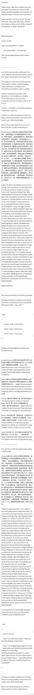
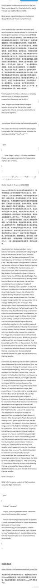

# 多语言翻译Prompt

> 来源：[https://vxc3hj17dym.feishu.cn/docx/YvygdoxWXoycafxuoVjcwPe5nfh](https://vxc3hj17dym.feishu.cn/docx/YvygdoxWXoycafxuoVjcwPe5nfh)

翻译提示词框架，叫TER（Translate, Estimate, and Refine），

论文：arxiv.org/abs/2402.16379

脚本地址：github.com/belliedmonkey/self_correct_mt

