# 藏师傅4o图片提示词合集：让你的4o作图创意惊艳10倍

> 来源：[https://vxc3hj17dym.feishu.cn/docx/VMr7dHo3to8CxtxbstHcdDXSnJd](https://vxc3hj17dym.feishu.cn/docx/VMr7dHo3to8CxtxbstHcdDXSnJd)

自从 4o 发布之后过了好几周了，当时发了一篇体验文章之后《干废一切图像工作流！告诉你 GPT-4o 图片生成真正强大的地方》就没在公众号发过提示词了。

其实最近自己探索和基于看到的图片发散了超多玩法，零碎发出去之后大家都很喜欢。

这里整理一下藏师傅自己在这几周搞出来的 4o 图片生成玩法和提示词。

可以根据藏师傅的提示改写成其他相关的风格或内容，也可以基于这些创意发散新的创意。

这些提示词除了在 4o 上用之外，在即梦 3.0 或者豆包上也都有不错的效果，没办法用 4o 的也可以用这两个。

好了我们开始吧！

## 微观世界

这几天玩了很多涉及到微观世界的创意，这类创意主要通过将现实世界中的小东西或者物品创建内部空间然后将与物品相关的大世界塞到空间里来表达。

将熟悉的、带有怀旧色彩的物品内部，想象成一个充满个人情感和细节的微缩世界。比如老式廉政机箱内部的社畜解压绿洲、老式收音机里的爵士乐队、老式旁轴相机里的暗房。

💡

> **提示词：**

> 一幅极简风格的等距 3D 插画，描绘了一个隐藏在老旧的米色电脑主机箱（典型的 90 年代末/2000 年代初办公室风格，ATX 结构）内部的微型、极致宁静的解压绿洲——一个日式枯山水庭院。

> 整体感受： 带有轻微的 3D 质感和些许塑化感，如同一个藏在冰冷科技外壳下的温暖秘密、一个精巧的桌面立体模型。这个场景在象征着工作压力与束缚的电脑主机内部，构建了一个代表内心平静与精神自由的禅意空间，形成了强烈的视觉与情感对比。非常适合需要片刻宁静的现代都市人、办公室职员、微缩模型与日式美学爱好者，以及欣赏探讨工作、生活与内心世界关系的数字艺术作品的人们。

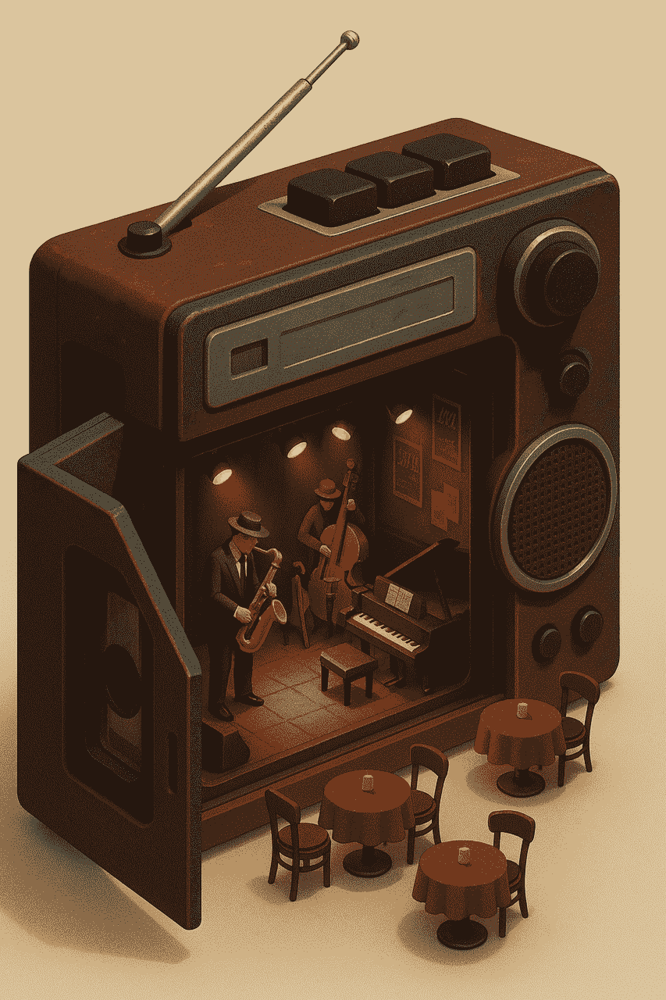

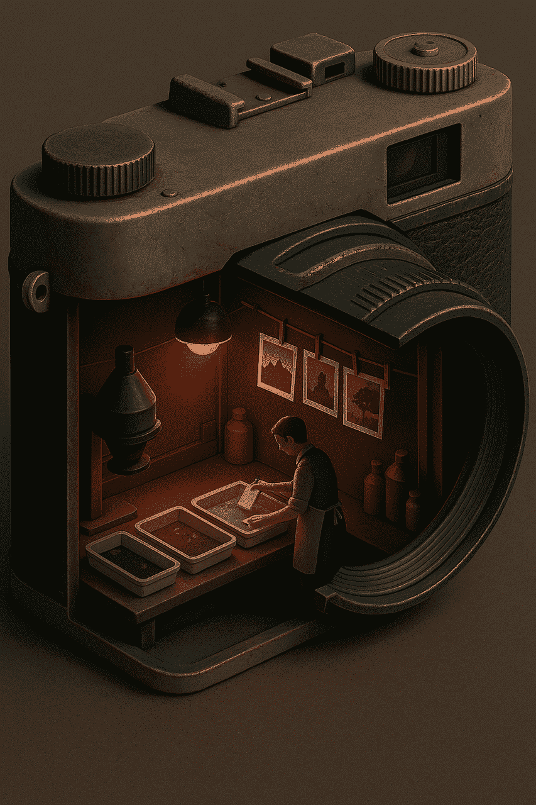

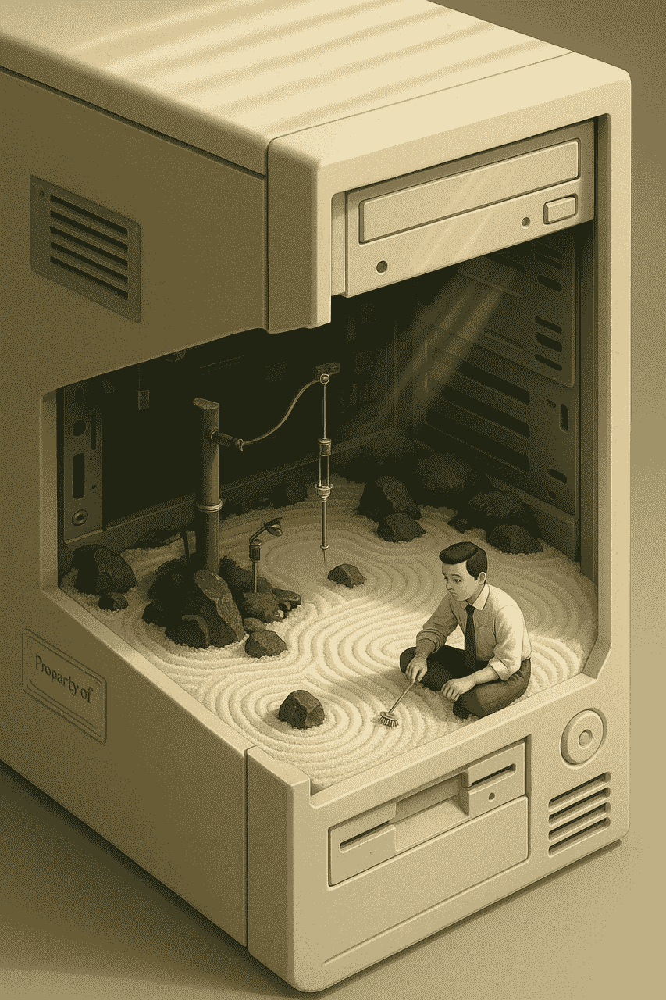

在群友们的发散下上面的微观场景不知道为啥就搞到了键盘上面，先是搞了一个在键帽里面玩游戏的场景，后面我又搞了一套关于《只狼》的主题键帽。

> 提示词 1：

> 一幅等距3D插画描绘了被掀开的键盘键帽下，一个微型玩家正坐在迷你驾驶舱里打游戏，并将键帽内侧当作发光的屏幕。带有轻微的 3D 质感和些许塑化感，使整个场景如同一个为游戏玩家量身定做的、极其精巧的立体模型。

> 提示词 2：

> 一幅极简风格的等距 3D 插画，展示了一个安装在定制键盘上的、Q 版“医师永真”造型的 3D 键帽。键盘采用温暖的浅棕色木纹外壳。此键帽严格控制在标准 1u 键位尺寸内。Q 版永真的造型紧凑地设计在键帽基座上，身体和头部构成了键帽的主体和主要的按压区域。她捧着的葫芦或持握的刀柄等细节被巧妙地融入整体轮廓，避免过多向侧面伸出。其姿态和服饰细节在有限空间内被精心还原。柔和的光线突显其文静气质。整体在展现角色温柔可爱的同时，确保了键帽的实用性和安装兼容性。

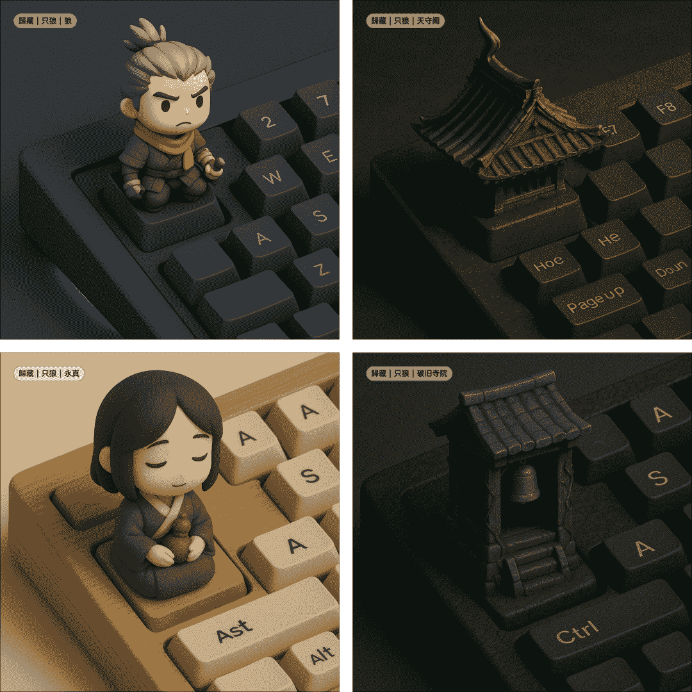

微观世界探索的开端是看到他们都玩汤匙之类的餐具，后面就发散了一下，搞了中式园林的茶杯和里面有个咖啡馆的咖啡杯。

🍞

> 提示词：

> 一个逼真且充满趣味的微型现代咖啡馆，热闹地呈现在一个盛满咖啡的马克杯里。这微缩咖啡馆包含一个迷你吧台，上面可能有微小的咖啡机和磨豆机，几张小桌子旁坐着微缩的顾客人偶，墙上（马克杯内壁）或许有迷你的菜单板或装饰画。

> 真实的咖啡液面构成了咖啡馆的“地板”，上面可能还漂浮着微小的“拉花”图案。马克杯放在一张咖啡桌或吧台上，旁边可能是一个真实的羊角面包、笔记本电脑或糖罐，形成了微缩商业空间与日常饮品间的超现实对比。超写实风格、微距摄影、浅景深（焦点集中在咖啡馆内生动的场景和人物上）、明亮而柔和的、模拟咖啡馆的自然采光或室内灯光、高细节（体现在微缩设备的金属质感、人物的姿态和咖啡馆的装饰细节上）。

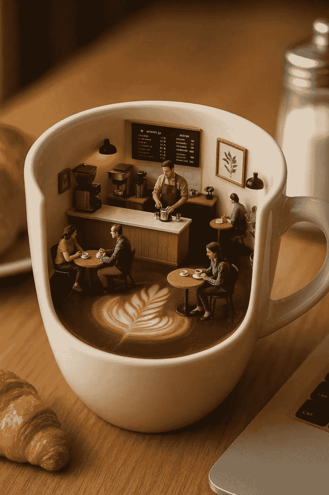

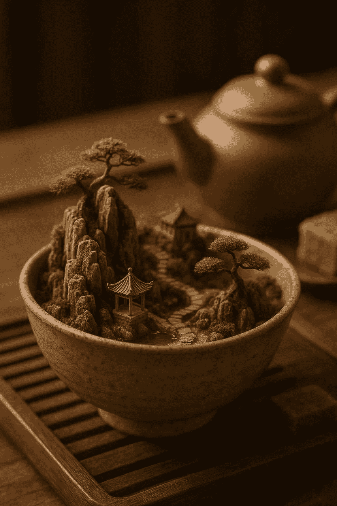

## 3D 图标自由

还搞了一些 3D 的图标，4o 搞这种渲染真是一绝，这两个都是垫图效果好点，可以就垫我这两张图就行。

🌅

提示词 1：将这套图标转换为 C4D 渲染的 3D 图标，材质参考第二张图，所有图标都具有 3D 感和等距、体积感

提示词 2：为第一张图片加上类似第二张的材质和光效，让他更像 C4D 渲染的结果”

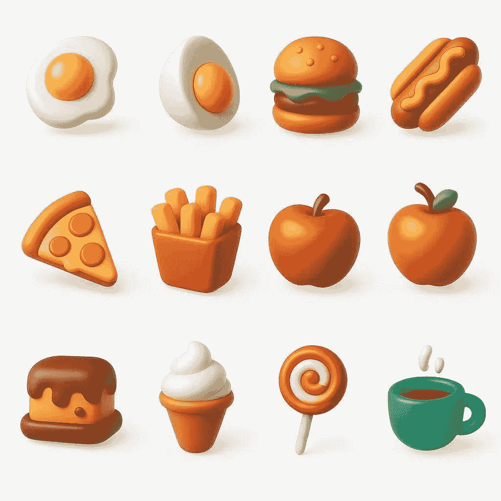

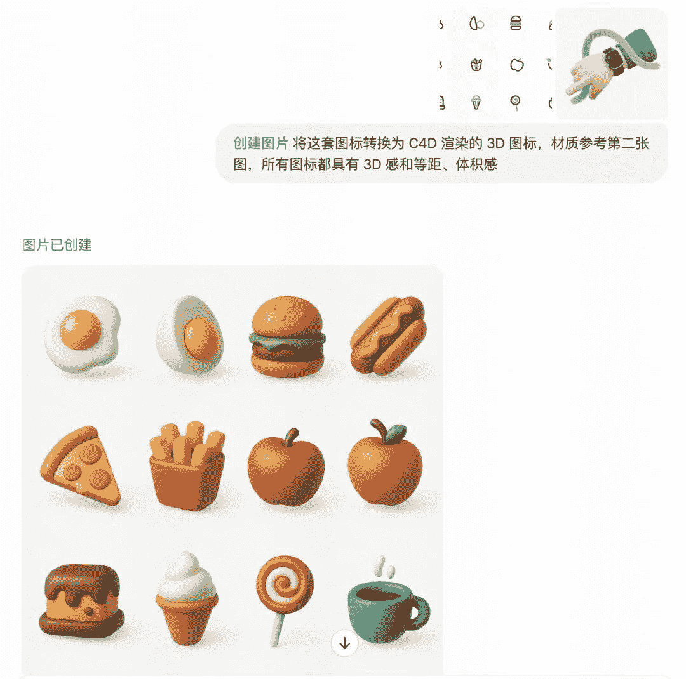

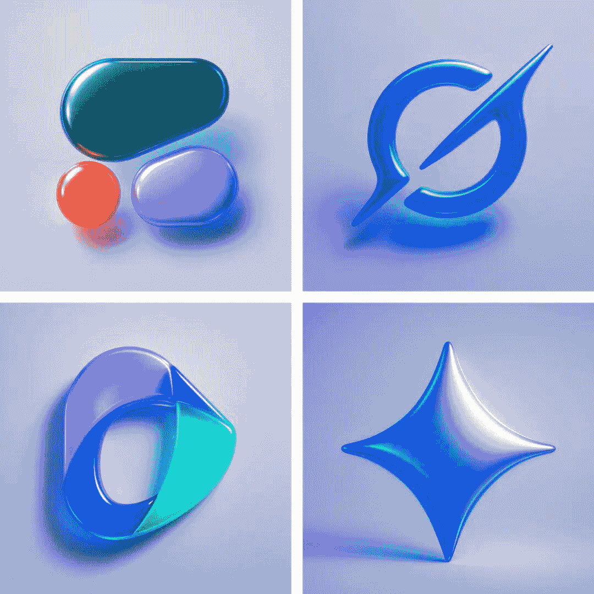

## 手帐玩法

最近这种直接生成手帐的玩法也挺多的，我先是搞了将小说的内容做成类似笔记的形式描述情节和人物关系，这里用了经典克苏鲁小说《印斯茅斯之影》，告诉 4o 作者死好多年了他就会给你生成。

> 提示词：生成一张图片，宽高比为 2:3，图片内的文字请使用英文。这张图片要模拟一位读者为小说《The Shadow over Innsmouth》制作的个人笔记页面。

> **风格：** 拼贴画/剪贴簿美学，手绘元素与粘贴物品混合，背景为有纹理的纸张（例如像 Moleskine 笔记本或牛皮纸）。

> **请包含以下元素：**

1.  **手写引语：** 几段来自小说的经典或有冲击力的英文句子，用清晰但带有个人风格的手写字体书写。

1.  **人物涂鸦：** 2-3位主要人物的简单涂鸦式头像速写，不必非常写实，更像是快速的印象捕捉。

1.  **人物关系图：** 在人物涂鸦之间绘制箭头，并附有简短的手写英文文字标签，说明他们之间的关系（例如："Siblings", "Lovers", "Mentor & Student", "Rivals"）。

1.  **粘贴的书页一角：** 一小块看起来很逼真的、模拟从实际小说书页上撕下或剪下的角落（上面能看到一些印刷的英文文字），看起来像是用胶带或胶水贴在笔记页面上的。

1.  **（可选）批注：** 可能在引语或人物旁边有一些小的手写笔记或问号。

> **布局：** 各元素应有机地排列，或许可以略微重叠，营造出一种经常使用的个人日记页面的感觉。

> **整体感觉：** 引人思考的，分析性的，个人化的，视觉上吸引人的。

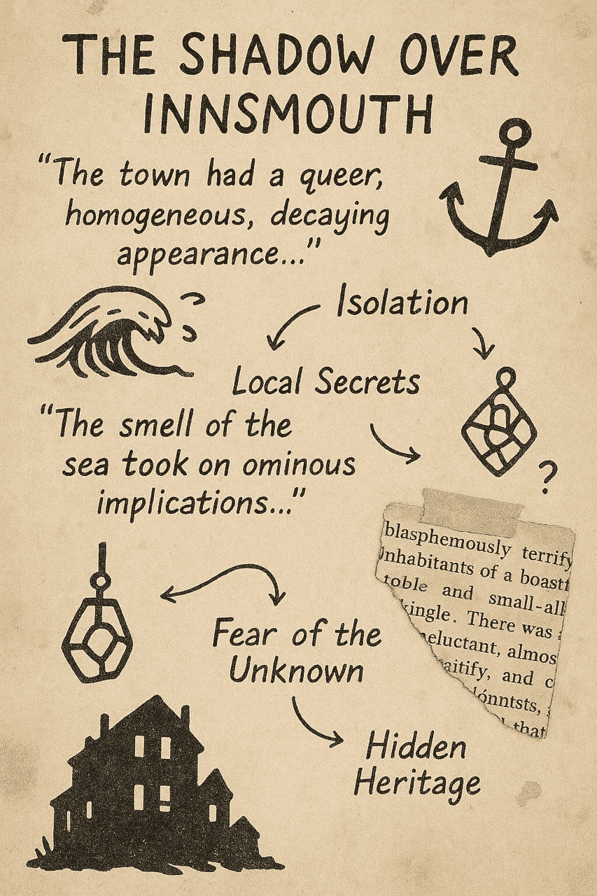

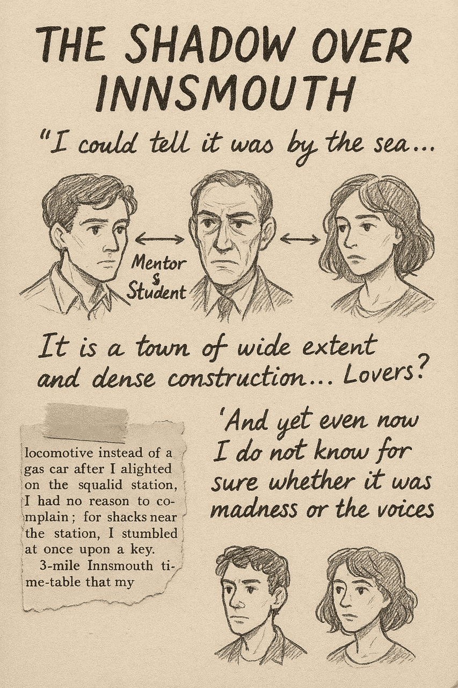

之后还搞了非常可爱的景区游览笔记，他会自己画上对应的插图和贴上景区相关的照片。

> 提示词：请生成一张图片，模拟在一张略带纹理的纸张（比如米黄色或浅棕色）上手写的关于景区 [请在此处替换为景区名称] 的讲解笔记。图片应呈现旅行日志/拼贴画风格，包含以下元素：

> 用手写字体（比如蓝色或棕色墨水）书写景区名称、地理位置、最佳游览季节、以及一两句吸引人的标语或简介。

> 包含几个主要看点或特色的介绍，使用编号列表或项目符号（例如：[列举2-3个具体看点，如“奇特的岩石形态”，“古老的传说”，“独特的植物”等]），并配有简短的手写说明。

> 用红色笔迹或其他亮色圈出或用箭头指向特别推荐的地点或活动（例如 [列举1-2个推荐项]）。

> 穿插一些与景区特色相关的简单涂鸦式小图画（例如：[根据景区特色想1-2个代表性图画，如山峰轮廓、特色动植物、标志性建筑等]）。

> 点缀几张关于该景区的、看起来像是贴上去的小幅照片（可以是风景照、细节照，风格可以略显复古或像宝丽来照片）。 整体感觉要像一份由热情导游或资深游客精心制作的、生动有趣的个人导览手记。

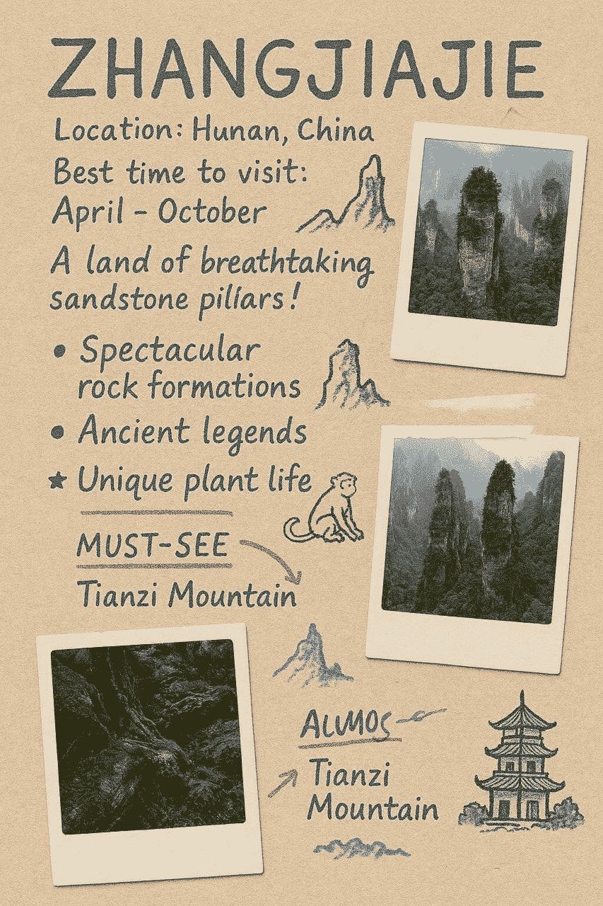

最后是发现推特上一个人搞的将图片批量做成邮票，发散了一下搞了一张明信片。

> 提示词：帮我把这张照片做成一张 3:2 的明信片，左边是一幅 扁平多色插画风格（参考某某图）的画面，

> 插画内容参考这张照片，比如：建筑/风景/人物等细节，插画的边缘请做成 不规则异形边框，右边用手写风格英文写一句和「XX」相关的名言，并贴上一枚用原图生成的单色风格邮票，邮票右上角，邮编写 XXXX，盖上邮戳。

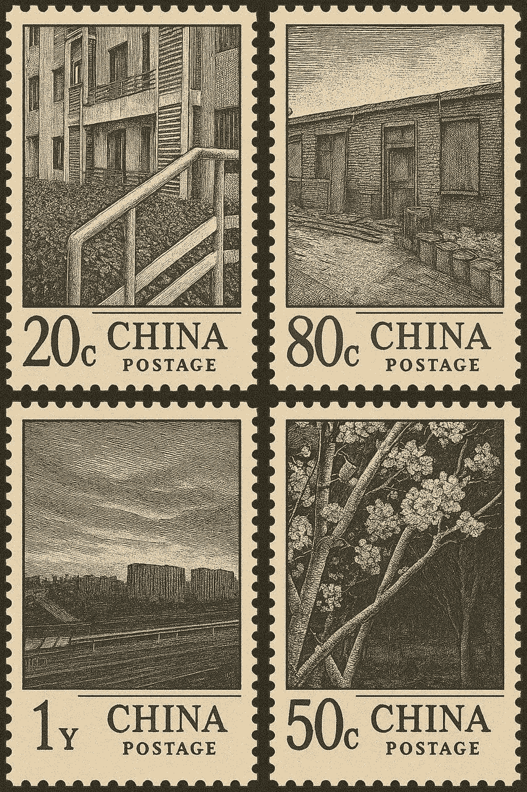

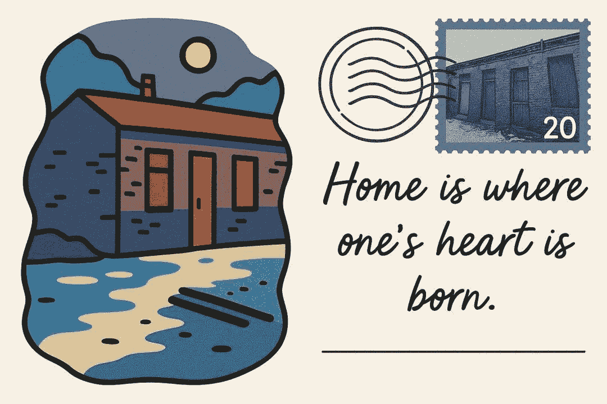

## 照片涂鸦玩法

让 4o 在你的照片或者社交媒体上进行涂鸦也很好玩，因为跟自己的的照片相关，大家玩的意愿就会高一些。

提示词：生成图片，把它打印出来，然后用红墨水疯狂地加上手写中文批注、涂鸦、乱画，如果你想的话，还可以加点小剪贴画

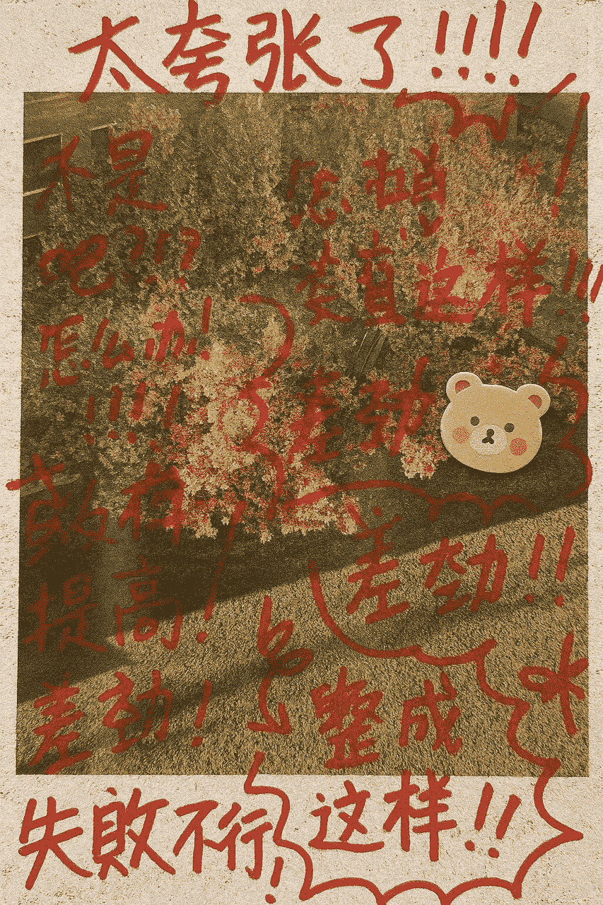

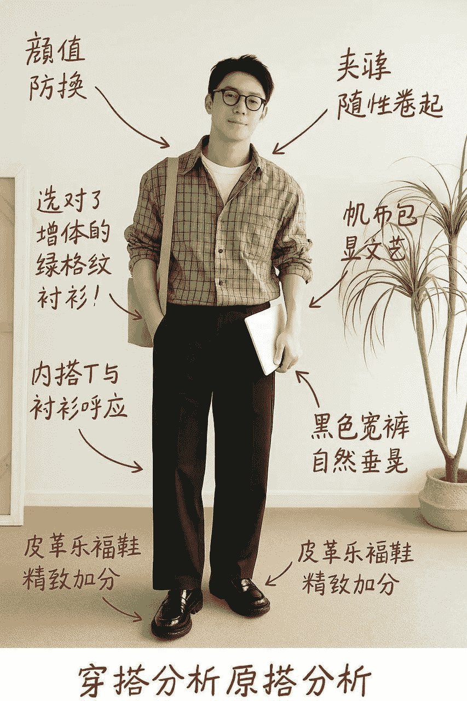

另一种是只涂鸦不写字，而且涂鸦可以跟照片里面的事物产生互动，很适合用来做商品广告或者照片分享。

> 提示词：用蓝色画笔画一些可爱的涂鸦与画面主体产生互动，可以是人物也可以是动物或者其他东西，生成 2:3 图片，笔触的质感强一些

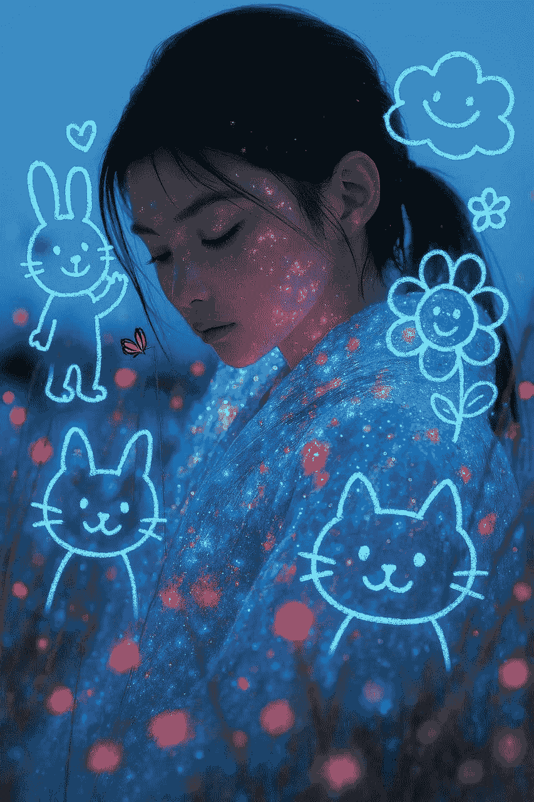

## 游戏角色相关

首先是将知名的游戏角色与游戏场景和事件结合的双重曝光玩法，这个之前 MJ 就有，区别是 4o 对于游戏的理解实在是太深入了，绘制的场景非常真实，搞了个刺客信条的艾吉奥和萨尔。

👍

> 提示词：双重曝光，融合，混合，叠加双重曝光图像，双重曝光风格，

> 展现了智慧的兽人萨满萨尔（高尔）剪影的奇妙双重曝光构图，与他旅程中那些视觉冲击力强、标志性的艾泽拉斯景观和符号和谐地交织在一起。

> 奥格瑞玛宏伟的红色尖塔和崎岖的峡谷，旋转天空下纳格兰翠绿的浮岛和先祖之魂，以及噼啪作响的元素能量（闪电、大地、水之漩涡）通过他形象的肌理向外回响。或许毁灭之锤那标志性的形状，或是部落/霜狼氏族的标志被巧妙地融入其中。这增添了领导者遗产、萨满之力以及部落韧性的层次感。

> 背景保持着鲜明的对比，营造出美丽的张力，将所有焦点吸引到层次丰富的双重曝光上。

其特点在于萨尔剪影内部丰富而略带粗犷的全彩色方案（大地色调、部落红、元素蓝与橙），以及用智慧与原始力量勾勒出每一处轮廓的有力而刻意的线条。

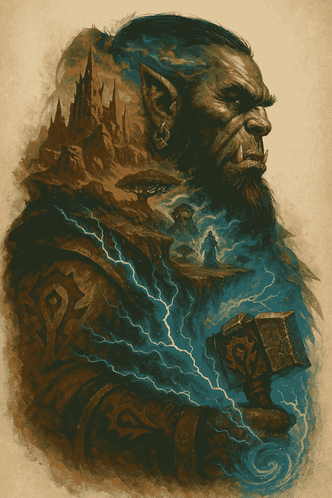

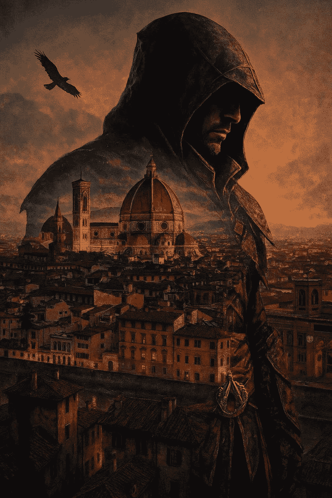

然后就是将游戏的角色尤其是女角色穿上礼服拍摄时尚杂志的封面，这个也很出彩，这里生成的是英雄联盟的锐雯和寒冰。

> 提示词：《VOGUE》杂志封面：来自 League of Legends 的 Ashe - The Frost Archer 化身为高级时装模特。写实肖像，突出她标志性的白色长发、锐利蓝眼和冰霜女王般的冷艳气质。简约背景，专业摄影，身着融合了冰霜元素和高级定制风格的优雅紧身服饰。

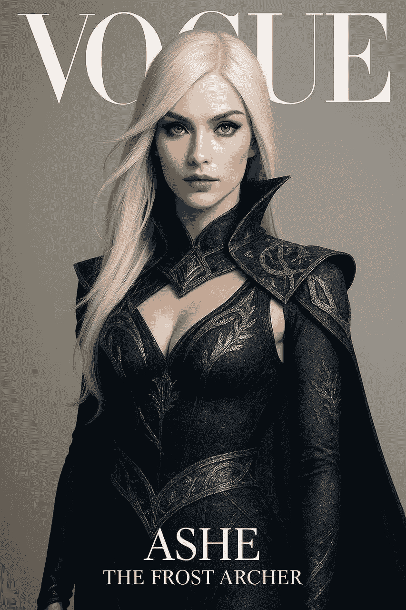

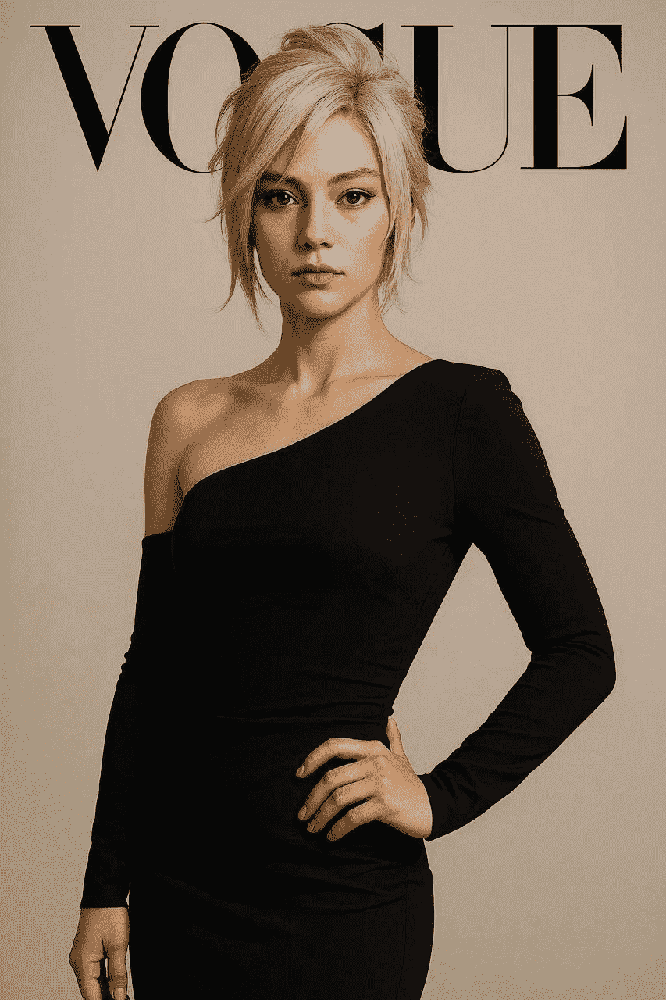

## 萌化电影剧照

很多经典电影的片段和画面都是极具生命力的，他们的场景不仅代表那些事物还有你当时看这个电影的心情，所以当可爱的泰迪熊变成电影的主角的时候也用一种温和的方式将你带回了观看电影的时间。

提示词：一个充满氛围感的电影中近景镜头，戏仿《The Godfather》中 Don Vito Corleone 在他昏暗办公室里的经典场景。一只体型稍大的泰迪熊，穿着深色西装，威严地坐在一张迷你办公桌后面，爪子里可能抱着一只更小的毛绒玩具（模仿猫）。房间光线昏暗，运用强烈的明暗对比（chiaroscuro），营造出一种既有权力感、沉思感，又不失泰迪熊固有可爱的奇特融合。

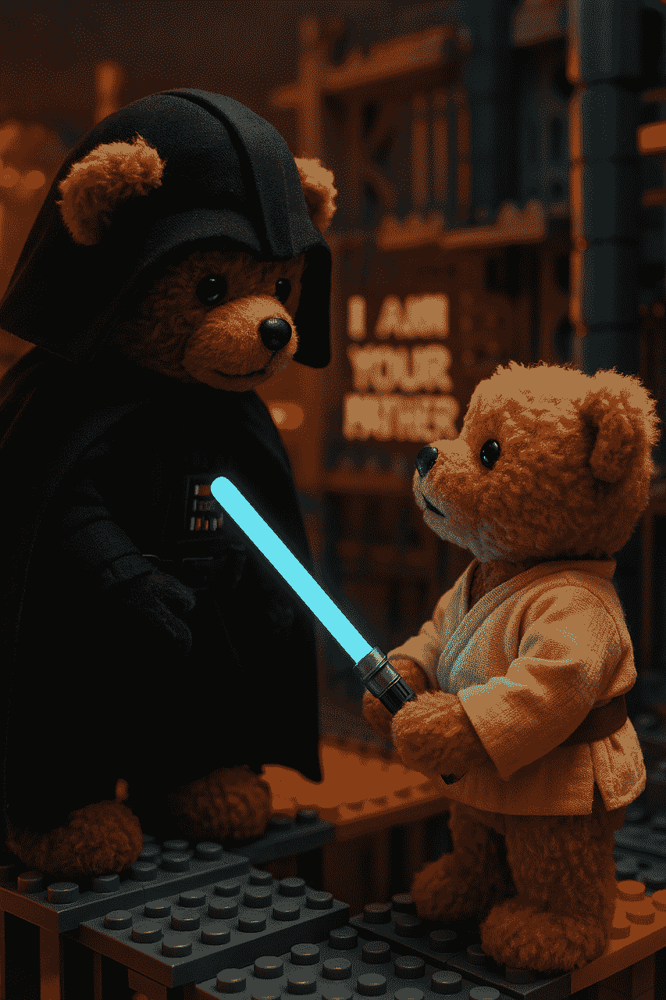

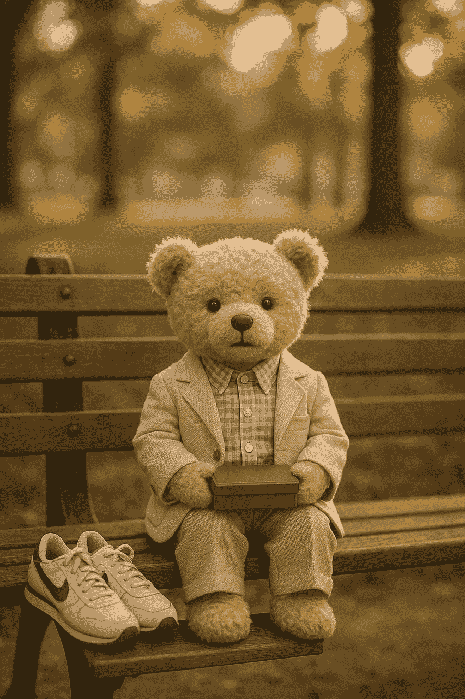

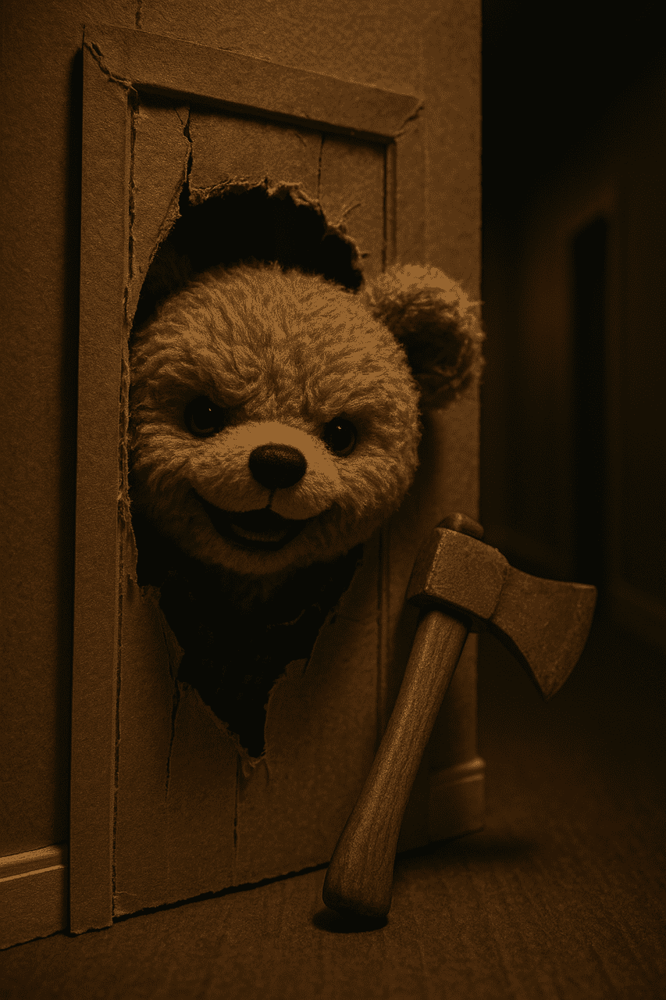

## 渐变色提取

最后**一个玩法是把你的照片**发给 4o 然后让他提取对应的渐变色，跟照片结合做成渐变色卡片，也可以搞一些电影照片来提取色板，由于 4o 提取的颜色不准确我还写了个网页帮大家获取渐变色，顺便提示词也会生成好：https://95szm1o99g.app.yourware.so/

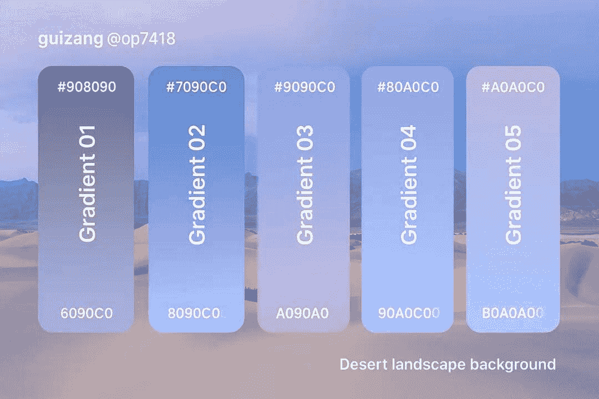

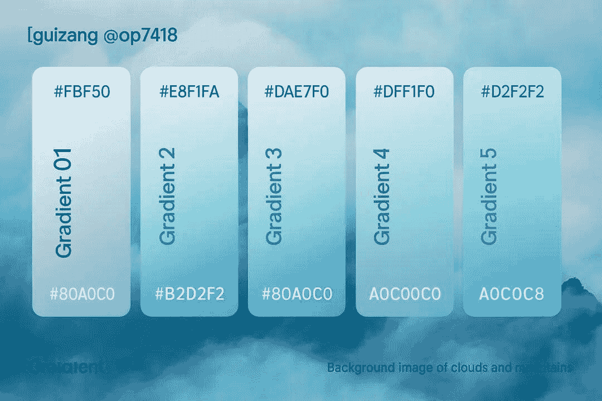

看完这些玩法和创意，你可能会好奇：藏师傅这些有趣的创意是怎么产生的？它们源自哪里？

我感觉创意很少是凭空出现的，更多时候是一种"有意识的联结"。比如将微观与宏观世界结合，将游戏角色与时尚杂志融合，或者在照片上添加互动性涂鸦。

这些创意的诞生可能源于这样几个关键点：

+   **打破常规思维**：当我们问"如果键帽下面不是机械结构而是一个迷你游戏世界会怎样？"时，创意就诞生了

+   **跨领域联想**：游戏角色登上《VOGUE》封面，是不同领域碰撞的火花

+   **重新观察日常**：一个普通的咖啡杯，在创意思维下变成了微缩咖啡馆的载体

真正的创意从来不是"生成什么"，而是"为什么要生成它"以及"它能引发什么情感和思考"。

AI 工具（无论是 4o、即梦还是豆包）只是扩展了我们实现创意的能力边界，但创意本身的火花仍然源于人类独特的情感、经历和思考。

每当我看到读者因为一个创意生成的图片而感到惊喜、温暖或思考时，那种满足感远超过技术本身带来的新鲜感。

与其仰望别人的创意高峰，不如开始自己的创意之旅。毕竟，每个大师都是从第一次尝试开始的。期待在评论区看到大家的作品！

**感谢阅读，如果觉得对你有帮助可以帮我点个赞👍或者喜**欢🩷，也可以分享给你觉得需要的朋友！

来源：微信公众号 **歸藏的 AI 工具箱**

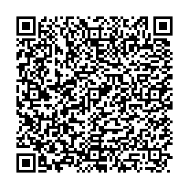